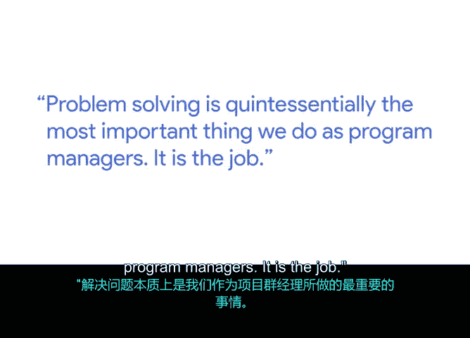
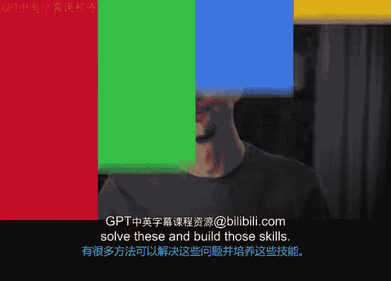

# 谷歌项目管理：专业证书 第6课：《顶尖：在现实世界中应用项目管理课程（Google）》｜applying-project-management｜ - P39：39_04_03_克里斯问题解决的艺术.zh_en - GPT中英字幕课程资源 - BV1WG411o77A

Hi， my name is Chris， I'm a program manager at Google I work on search so the type of programs that I manage on search in particular are building features for millions of users all around the world on many surfaces。

 languages。And information needs that users all over the world have。

 I can't emphasize enough that problem solving is quintessentially the most important thing we do as program managers。

 It is the job whether it's a scope problem， you know。

 something is out of scope or the scope is increasing or decreasing whether it's a budgetary problem like you don't have enough funds or too many funds we don't have enough people。

 too many people wrong skill sets of people whether it's a timeline problem。

 These are all problems fundamentally at the today we're here to solve。 So our job is to identify it。

 figure out a framework around tools and our processes and methodologies come up with a proposed solution and then get by for that solution。

 and the only way you're going to do that is to put something principally and organize together with these sort of tools and taking some methods which try to always understand what is the root cause of the problem itself。

 typically what you're experiencing is sort of a red herring or an outcome of the underlying problem and so always debugging the initial underlying systemic issue or the process issue or the tooling issue or the technical issue。

 whatever it may be into the hood is actually the first step。

Once you're able to sort of identify and get enough information as to what that problem is and how you might solve it。

 then objectively putting a plan together based on those inputs is actually how you reach a decision。

 which is your ultimate outcome， many times these sort of charters or scope docs or meeting notes or trackers or documents these artifacts that we create or we manage on a day-to-day basis as part of our job is the job。

 but that's actually not the job those are just mechanisms and tools and methods to help you do the real job。

 which is running scope， running programs， convincing people driving organizational change。

 know solving strategic initiatives， these things are just elements that help you navigate those problems as opposed to being the problems themselves。

I think that's really really important takeaway I think this is the thing that we practice most at Google in particular is trying to solve more complex。

 more strategic， more holistic， larger， more complex problems on a day- to-day basis if you're new to this space。

 you haven't have the opportunity to work on these big problems how do you build that problem solving expertise。

 whether it's a hobby， whether it's building a new piece of software for yourself or your friend。

 whether it's another passion that you have in another industry。

 all of these are great ways to build skills and opportunities to just solve problems every industry every business has them and there are lots of ways to solve these and build those skills。

😊。

