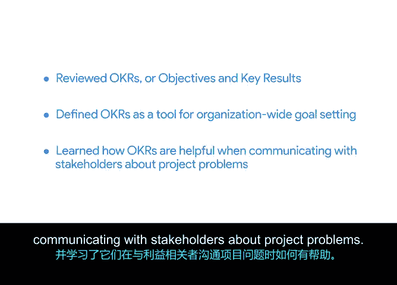

# 谷歌项目管理：专业证书 第6课：《顶尖：在现实世界中应用项目管理课程（Google）》｜applying-project-management｜ - P40：40_04_04_将项目问题与目标关联.zh_en - GPT中英字幕课程资源 - BV1WG411o77A

Welcome back。 In the last video， you practiced communicating project problems by writing a brief summary of an issue affecting sauce and spoon's tablet Pi。

😊，In this video， we'll revisit a concept from a previous course on objectives and key results。

 or OKKRs， and their connection to projects。Then in the upcoming activity。

 you'll connect your problem statement to sauce and Sps ORs。

The ability to identify a project problemss impact on your organization's OKRs will help you determine and communicate the appropriate level of risk and urgency of the problem。

Objectives and key results are a tool for organization wide goal setting。

OKRs combine a goal and a metric to determine a measurable outcome。Let's break OKRs down。

The objectives portion of the OKR defines what needs to be achieved， which is similar to a goal。

The key results portion of the O K R defines how an organization。

 team or individual will tangibly measure their success in meeting the objective。 For example。

 one of sauce and spoon's objectives might be to prioritize customer needs and wants。

 So the key result that indicates they've reached this objective could be addressing feedback from customer reviews within 24 hours。

Earlier in this course， you learned that OKRs can be a helpful reference point when determining if a project goal is relevant to the needs of an organization。

If a project in its goals help contribute to the larger OKRs of an organization。

 that's a good sign that your project is relevant and worth the time and money required to complete it。

OKRs can be a kind of shared language for an organization。Here at Google， for example。

 every project big or small， aims to contribute in some tangible way to our organization wide OKRs。😡。

Struggling to determine how a project might help us reach our OKRs can be a strong indication that we should reevaluate the project as a whole。

OKRs can be really helpful to reference when communicating with stakeholders about project problems。

You can make it clear to a stakeholder why a given problem needs to be addressed by identifying the specific ways in which that problem might impact an organization's wider ORs。

You can also point to them to explain to stakeholders why a problem is worth their attention。

Stakeholders， especially those who hold senior positions within an organization。

 often have a lot of work to focus on， even beyond your project。

Connecting a solution to a company's ORs can catch a stakeholders's limited attention。

Let's take the sauce and spoon objective of we seek to run an efficient， profitable business model。

 or we seek to prioritize our customer needs。As you fine tune the problem summary you began in the previous activity。

 you can add a sentence to explain how the issue jeopardizes the sauce and Sp mission to run an efficient business model and meet customer needs。

Let's review。In this video， you reviewed OKRs or objectives and key results。

 defined OKRs as a tool for organization wide goal setting and learned how they're helpful when communicating with stakeholders about project problems。

In the upcoming activity， you'll practice drawing connections between OKRs and project problems。

You'll use what you learn from the supporting materials to write a sentence that connects your problem summary with sauce and spoons ORs。

After you've completed the activity， meet me in the next video where we'll discuss composing emails to senior stakeholders。

