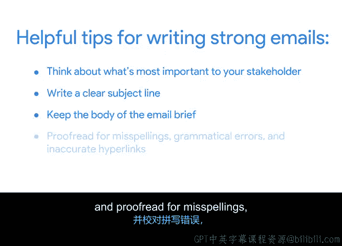

# 谷歌项目管理：专业证书 第6课：《顶尖：在现实世界中应用项目管理课程（Google）》｜applying-project-management｜ - P41：41_04_05_撰写问题升级邮件.zh_en - GPT中英字幕课程资源 - BV1WG411o77A

In the last video， we did a quick review of objectives and key results。

 We also discussed how connecting a project problem to an organization's ORrs can help convince a stakeholder to take that problem seriously。

In this video， we'll review a few best practices for writing emails to get decisions you need from stakeholders。

Then in the upcoming activity， you'll use these best practices to compose and email to sauce and Spoon stakeholders。

 outlining a project problem and requesting assistance。As a project manager。

 identifying and managing issues is part of the job。

 And if an issue is big enough to escalate to a senior stakeholder。

 then it's probably an issue you're hoping to resolve as soon as possible。

Email can be an effective tool for quickly escalating a problem and asking for a decision from a stakeholder on how to proceed。

That's why it's really important to ensure that your email is written in a way that effectively captures a stake's attention and gets you the response you need。

There are a few best practices to keep in mind to make sure your email doesn't get ignored。First。

 think about what's most important to your stakeholder。Often。

 senior stakeholders will be more interested in a problem's potential impact on an organization than its impact on a single project。

This is where connecting project problems to an organization's OKKRs comes in handy。

Identify how a problem will impact your organization as a whole and ensure that you clearly communicate that impact within the first two sentences of your email。

Once you've determined what's most important to your stakeholder。

 you'll be better prepared to draft an effective email。

Remember to write a clear subject line that briefly states what your email is about。

 It's also helpful to include language in your subject line that indicates what you'd like your stakeholder to do upon reading your email。

Do you need them to review a document you've attached to the email， Try adding the words。

 Please review to your subject line。 Is this an urgent email that you need a quick response to。

 Then you might try adding the word urgent to the subject line。Stakeholders。

 especially those who hold senior positions within an organization。

 usually receive many emails throughout the day。Including terms like urgent， timely， decision needed。

 or please review can help draw attention to your message and make clear the action you'd like your stakeholder to take。

And remember to also keep the body of the email brief and to the point。

When communicating about a project problem to a busy senior stakeholder。

 your email should briefly outline the problem， Explain how it might impact an organization's goals and clearly state the decision you need from your stakeholder in order to proceed。

That's it。 Write one or two sentences that summarize your problem。

 along with another sentence that identifies how the problem may impact your organization's O KRrs。

If there are documents or additional information that your stakeholder might need to review to make an informed decision。

 consider including hyperlinks or attachments with the information in your email。

Once you've finished writing your email， be sure to proofread it for misspellings。

 grammatical errors， and inaccurate hyperlinks。Use spellell check and other grammar check functions in your email application or online to help you make sure everything looks good。

Let's review。When writing an email to stakeholders， make sure to do the following。

Think about what's most important to your stakeholder。 Write a clear subject line。

Keep the body of the email brief and proofread for misspellings。

 grammatical errors and inaccurate hyperlinks。

Someday， when you have to communicate issues to stakeholders in real life situations。

 you'll see how managing， tracking and communicating project problems is a huge part of running the project。

In the upcoming activity， you'll apply email writing best practices when you compose an email to a stakeholder of the sauce and Sp tablet Pi。

