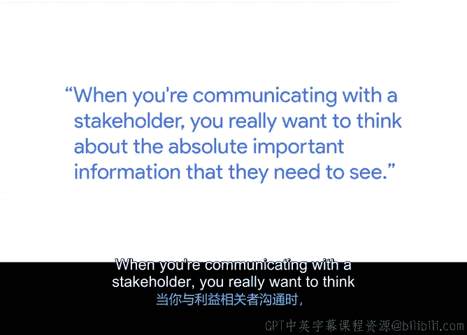
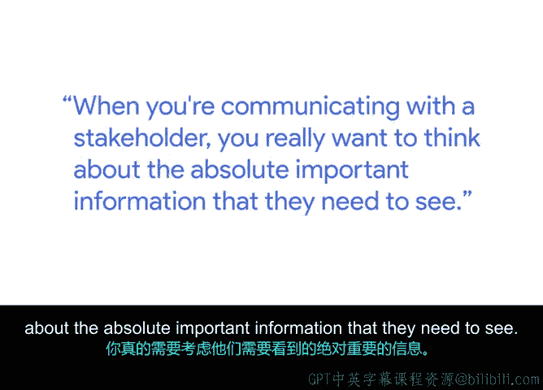
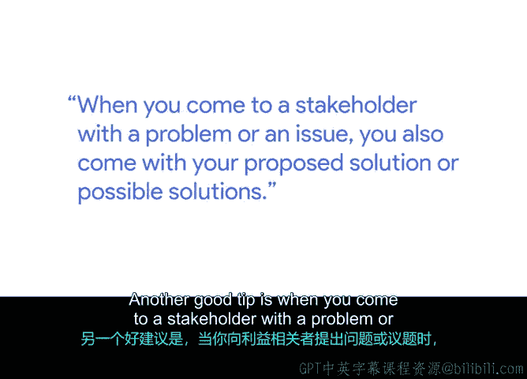
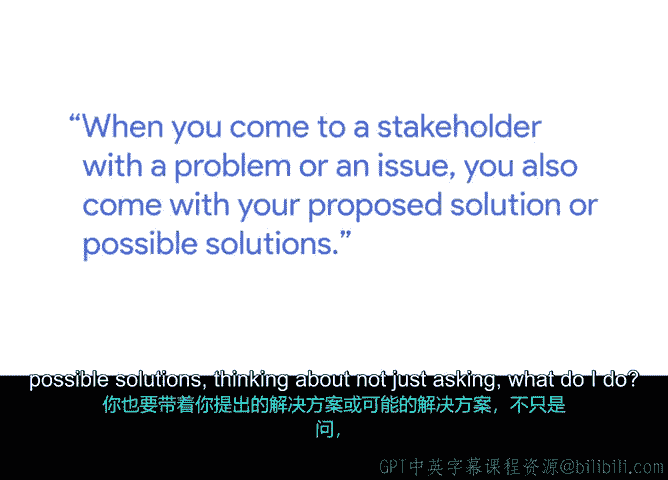
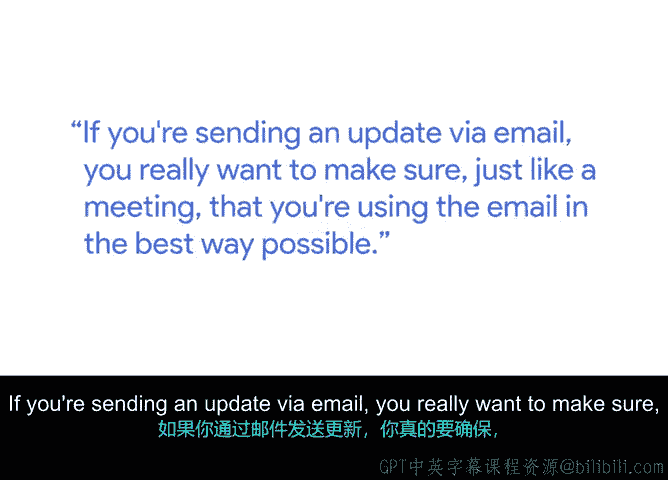
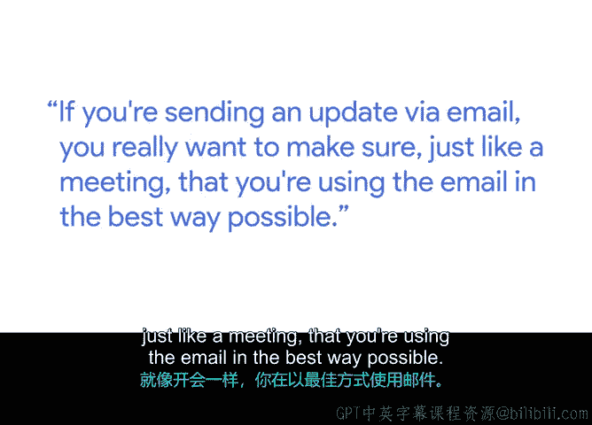
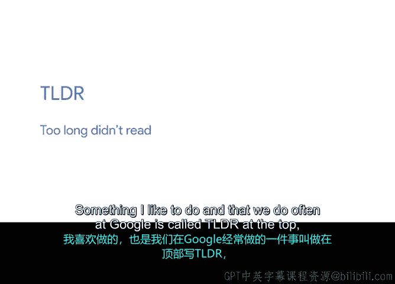

# 谷歌项目管理：专业证书 第6课：《顶尖：在现实世界中应用项目管理课程（Google）》｜applying-project-management｜ - P42：42_04_06_劳拉利益相关方沟通最佳实践.zh_en - GPT中英字幕课程资源 - BV1WG411o77A

I'm Laura， the executivecutive Productivity advisoris at Google。

My role is to work one on one with executives in a coaching format in order to help them with time management。

 meeting management， effective email communication and organization when you're communicating with a stakeholder。

 you really want to think about the absolute important information that they need to see。

So you might give more details when you're speaking with a co or a teammate。

 but when you're summarizing for an executive， you really want to make sure you keep it concise you want to do some work beforehand to figure out what's the best way to get them information or to get a decision from them some things that can be helpful with that is asking someone like their executive assistant or someone that's worked with them before asking them what is their preferred communication style what types of presentations do they like to see what information do they typically need in order to make decisions。

And by doing that work ahead of time and asking around you're setting yourself up for success。

 especially if you only have a limited amount of time or a short amount of communication that you're able to get to the stakeholder It's important to remember that while you have multiple stakeholders or different projects it is going to be different how each of them liked to communicate or like to receive information one example is I worked with a couple of managers on a project and both of them were stakeholders one was very talkative and love to brainstorm through things he wanted meetings with me pretty frequently and he wanted to hash out all of the details the other stakeholder was completely the opposite thinking about how to tailor the same information the same decision making process two each person that you need information or stakeholder that you're working with is really helpful and important to remember I like to look at a presentation I'm giving。

to a stakeholder and think what are the probably the five questions they're going to ask me。

 and then I have that additional detail in the appendix or ready to go so that I'm able to make the most of their time。

Another good tip is when you come to a stakeholder with a problem or an issue。

 you also come with your proposed solution or possible solutions。

Thinking about not just asking what do I do， but saying I think maybe we should do A。

 but we could also do B and C， what do you think that gives them a starting point and they feel like you've done the background work and you know the problem really well if you're sending an update via email you really want to make sure just like a meeting that you're using the email in the best way possible。

Something I like to do and that we do often at Google is called TLDR at the top。

 which means too long didn't read。

It's kind of a funny way of saying there may be a lot of information but here's the one sentence you need to know from the email so having some sort of summary at the top similar to that saying here's an update on project A or need decision or action requested or deadline by that type of communication right up front。

 gives the stakeholder the ability to know what's coming in the email。

 then you want to think about how to be as concise as possible when you're developing the email so using things like bullets highlighting or bolding things that need to pop out to them。

 reiterating your ask at the end of the email， including any sort of deadlines that you have that's really helpful so that if people are scanning or if they go back to read your email。

 they have all the information that they need including links。

 attachments make it as easy as possible for them to go through your email and reply to you with the information that you need。

