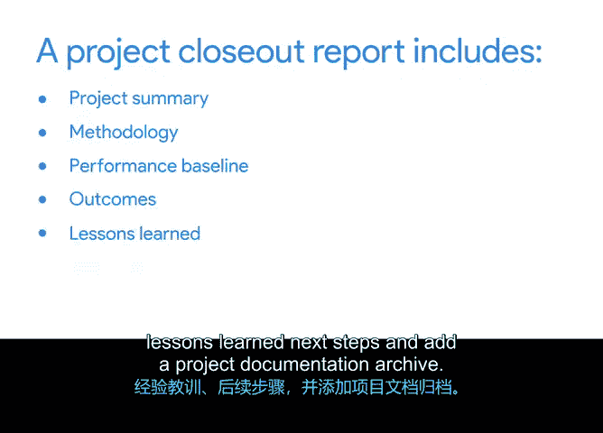

# 谷歌项目管理：专业证书 第6课：《顶尖：在现实世界中应用项目管理课程（Google）》｜applying-project-management｜ - P43：43_04_01_完成结项报告.zh_en - GPT中英字幕课程资源 - BV1WG411o77A

Hello there。By now， you've been with Peter through some of the most essential pieces of managing and delivering a project。

You followed her as she set goals， navigated through the planning process， managed quality。

 escalated issues to stakeholders and more Great work。

We've reached the point in the project where sauce and spoon has launched the tablets after passing quality standards。

 and most of the project manager's work is done。In this video。

 we'll discuss one of the last elements of project management。

Closing out the project and showcasing its impact。Before Peter can consider her project completed。

 she has a few more tasks to take care of。 One of those tasks is to create a close out report。

 The close out report is a great opportunity to compile all links and documentation into one place。

 a practice we like to call good project hygiene。😊。

The closeout report is also a time for reflection on your team's performance。

 and it helps your team ensure every task was completed。

A close out report confirms the project is done， summarizes deliverables， success metrics， feedback。

 lessons learned and next steps， and serves as a reference document for the organization。

If a follow up project is required or a similar project is initiated。

 having these artifacts in one place will help these future projects run smoothly。

And should another similar project occur， future project managers will be set up for success if they have meticulous information on past projects。

An effective close out report helps ensure that everyone is satisfied with the work that was done。

 finalizes the efforts of the team and lets people move on to new projects and tasks and increases the impact of the team's work through communication with other people who may not have been as involved in the project。

In addition to serving as a reference document for the organization。

 a project closeout report is a document created by project managers， for project managers。

 future project managers， and anyone interested in the project elements and artifacts。Ideally。

 you want anyone unfamiliar with the project to be able to read it and get a full understanding of what the project was。

 why it was done and how well the project went。 In fact。

 the project close out report you will complete in this course should be able to stand alone for your potential employers。

 You should be able to give them this document as a sample of your work。

They should understand the context of the So and Spoon tableablet rollout project and get a demonstration of your ability to synthesize and communicate information clearly。

In a project closeout report， you'll start by adding your project summary。In this section。

 you'll need to include the objectives。Another way to think about this。

 what was the desired result for this project。Next is methodology or approach。

Make sure to denote which methodology or approach your team used。 Is your team using waterfall。

 Agile， lean， maybe a combination of these or something else。

One of the most important aspects of the closeout report is the performance baseline。

Here you'll describe the actual results and compare them to the objectives laid out in the planning and execution phases。

You'll compare specifications like actual project schedule versus planned project schedule。

 actual project cost versus planned project cost and planned scope versus delivered scope。

There's even a handy notes column so you can explain any discrepancies or issues that arose。

The remaining sections are key accomplishments and outcomes， lessons learned， next steps。

 and project documentation archive。When filling out these sections， being thorough is key。

 We've included questions to help guide you and ensure you are being detailed enough。

 but feel free to take it one step further in your own close outs by getting even more specific。

And when you're filling out these sections， keep in mind that the purpose of the closeout is to compile and archive the most important aspects of the project。

Let's review。When writing a project close out， make sure to include the following project summary。

 methodology， performance baseline， outcomes， lessons learned， next steps。

 and add a project documentation archive。

Hopefully， I've explained just how important the closeout report is for a project。

If a project is repeated or a similar project is initiated， this important documentation。

 which includes your learnings and project outcomes， will set future project managers up for success。

In the next activity， you'll review supporting materials to finish a closeout report for the sauce and Sp tablet pilot。

