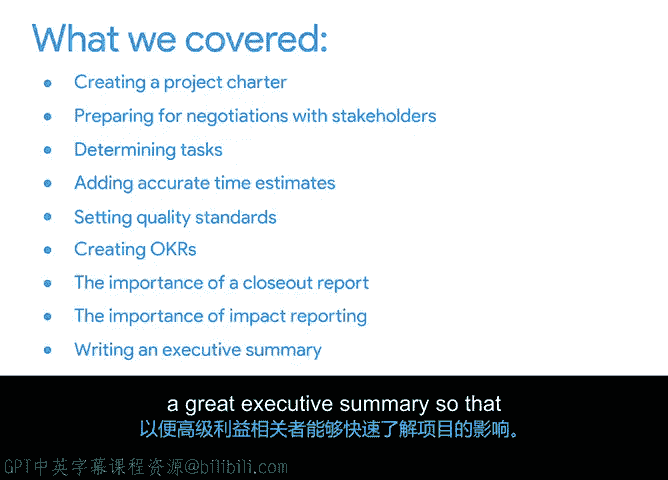

# 谷歌项目管理：专业证书 第6课：《顶尖：在现实世界中应用项目管理课程（Google）》｜applying-project-management｜ - P45：45_04_03_总结.zh_en - GPT中英字幕课程资源 - BV1WG411o77A

Hi again， in congrats on reaching the end of this course。 So far。

 you've used the skills you learned in previous videos to execute the entire life cycle of our example project with sauce and spoon。

😊，First， in the initiation phase， you learned how to create a project charter。

 and then you identified project goals and deliverables。

 You demonstrated how to conduct a stakeholder analysis to prepare for negotiations with stakeholders。

Then you went into the planning phase where you determined tasks in order to accomplish the goals set forth。

You learn the value of holding team brainstorms in order to ensure all tasks were included。

 and we explored some techniques for creating accurate time estimates for each of those tasks。

As you move from the planning to the execution phase。

 you started executing tasks as part of quality management。

 where you set quality standards and measured quality with user surveys。

Next up was the closing phase where you learned how to connect problems to project goals by creating OKKRs。

And you learned the importance of a closeout report。Finally。

 you learned about impact reporting and how to write a great executive summary so that your senior stakeholders can quickly understand the impact of your project。

In the next video， we'll wrap up the whole program and apply the knowledge you've gained to taking the next step in your project management career。

 See you soon。

