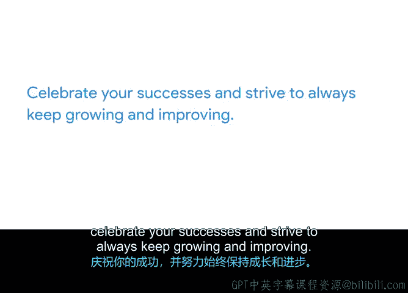

# 谷歌项目管理：专业证书 第6课：《顶尖：在现实世界中应用项目管理课程（Google）》｜applying-project-management｜ - P46：46_04_04_个人结项报告.zh_en - GPT中英字幕课程资源 - BV1WG411o77A

You've come such a long way in this course。 Let's take a moment to celebrate your successes in growth and project management。

😊，We call this process personal closing reporting。Similar to what you've done in the retrospective documents and close out reports you've created throughout this program。

 let's take a moment to reflect on what you just completed。

 the Google project management certificate。Let's start by listing your key accomplishments。

 Think all the way back to when you first started the program up until now。

 What challenges have you overcome throughout this process。

 Maybe there were particular lessons or concepts that you didn't think you'd ever understand。

 but you surprised yourself when you finally figured them out。

Maybe you overcame challenges in your personal life while taking this course。

If you have a full time job， but still found the time to complete this course， that's a major win。

Take a moment to write some of these down。Then reflect on any lessons you've learned。

 Maybe you were having a busy week， and you feel like you didn't spend enough time on one particular lesson。

You might have wanted to read it more thoroughly because you felt it was important。

Maybe you learned that you loved managing stakeholders。

 but you didn't enjoy budgeting and procurement as much。Take note of those learnings。Next。

 you'll want to think about what steps you can take from here to advance your project management career。

😡，This could be contacting recruiting companies or asking your current boss to give you more responsibility。

Maybe it's setting a goal to spruce up your resume and apply to five project management jobs a week。

Write those next steps down。Then take that a step further and add your goals to a timeline as if they're part of a project you're managing。

Like we have said， time and time again， project management is part of your everyday life。

Then finally， add your own executive summary， rather than the executive summary you learned about earlier。

 This is an executive summary of your experiences in the program。😊。

When you're writing your executive summary， describe your experience with this program as a whole。

 Take note of your successes and how you plan to advance your career in project management moving forward。

This should feel inspiring and fun。 So feel free to include all kinds of highlights。

 Maybe you scored high on a certain quiz， and you want to pat yourself on the back for that。😊。

Maybe you were able to apply some of the concepts you learned to the planning of your family reunion。

Maybe you learned a lot about a specific topic that you had never researched before。

 and you really enjoyed it。Whatever it is， be sure to highlight it here。😡，And with that。

 you're ready to complete your personal closing report。

Take this report with you as a project artifact to look back on your experience with us throughout this program。

Just like you would for your team at the end of a project。

 celebrate your successes and strive to always keep growing and improving。😊。

That brings us to the end of the program。 But it's just the beginning of your journey in project management。

Take a moment to celebrate yourself in all you've achieved。

Not only did you remain diligent in your search for new information and knowledge。

 you also have a portfolio of work to show potential employers。No matter what comes next。

 you should feel confident that you have the skills you need to be an amazing project manager。

 I can't wait to see what you do。😊，Congratulations， and good luck。

