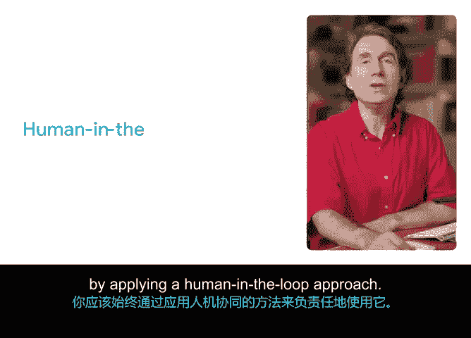

# 谷歌项目管理：专业证书 第6课：《顶尖：在现实世界中应用项目管理课程（Google）》｜applying-project-management｜ - P48：48_04_04_用AI提升项目管理技能.zh_en - GPT中英字幕课程资源 - BV1WG411o77A

AI is transforming the way we approach everyday tasks in work and in life。

 Using AI can help you get routine things done more quickly and empower you to spend more time in places where you can have the most impact。

 Think about your typical day at work。 If it's anything like mine。

 you have a lot of things to do and not enough time。

 Some of the days you to do this might seem never ending。😊。

But what if AI could help as a fellow project manager。

 I' am here to share a few situations you may encounter where generative AI or Gen AI can help you work smarter and faster。

 and I'll show you how to do it。 You'll discover how to use Jen AI to help write a project charter run effective meetings and more。

 My name is Ben。 and I'm a staff program manager on the Google Cloud team。 In my role。

 I've delivered many projects like cloud networking features and trading for all of the thousands of program managers at Google。

 generative AI helps me work more efficiently and creatively。

 So I'm excited to share how I'm using it。 to get the most out of AI。

 It's important to write an effective prompt。 A prompt is the input you provide to degene AI model to elicit a specific response。

 A good prompt follows a simple framework。 task context references。😊，Ealuate and iterate or T， C， R。

 E， I。 If you ever forget a step， just remember， thoughtfully create really excellent inputs。😊。

First is task。What do you want the model to do， fairly simple and straightforward， right？

 We can break task into persona and format。Persona refers to what expertise you want the generative AI tool to draw from。

 You can ask the tool to take on a persona like a professional speechwriter or a marketing executive with 15 years of experience or you can ask it to create output for a specific audience。

 like a customer or even your manager。 You can be as detailed as you like when adding a persona to your task。

 format refers to how you want the output to appear。 whether it's a bulleted list。

 short sentences or a table。😊，Next， you'll include context。

 These are the necessary details to help the Gen A I tool understand what you need from it。

 This is the difference between writing。 Give me some ideas for a birthday present under $30。

 and give me 5 ideal for birthday present。 My budget is $30。

 The gift is for a $29 year old who loves winter sports and has recently switched from snowboarding to skiing。

😊，Third， sometimes you'll add references for the Gen Ai tool to use while creating its output。

 You just asked a Gen Ai tool to give you ideas for a birthday present， right？ Well。

 if you add examples of birthday presents you've given in the past as references。

 then the Gen A I tool can give you a more useful output。 Keep in mind。

 there aren't always going to be clear references of what you need。

 especially if you're working on something more abstract or searching for ideas and inspiration。

 Promping is all about being clear and specific in your instructions。 use natural language。 right。

 as if you're speaking to another person and express complete thoughts。 Okay。

 so you've included the task， context and references in your prompt。 Once you have the output。

 It's time to evaluate。 Ask yourself if the input you provided gave you the output you need。

 This leads us to the final part of the framework。 Iterate， If you have。😊。

Euate your output and determine you're not getting what you need。

 You can try again by any more information or tweaking your prompt。

 This is a key part of prompting effectively。 One more note on the framework。

 There are plenty of ways to construct an effective prompt。 Remember。

 it's okay to start with a simple prompt。 And sometimes that's all you need， However。

 if you want to unlock the true potential of AI。 The secret isn't magic。 It's good prompts。

 Consider thoughtfully creating really excellent inputs。 And watch the magic happen。😊。

As we explore how to use Gen Ai and project management。

 keep in mind that Gen Ai works best when used as a complement to our uniquely human skills and abilities。

 You should always use it responsibly by applying a human in the loop approach。

 Gen Ai is a useful tool to help you accomplish task， but it requires human involvement。

 No tool has the depth of experience， practical knowledge and interactive skills that we do。

 That's why a human in the loop approach is key to using Gen Ai responsibly。

 It combines machine and human intelligence to train， use， verify and refine results。😊。

In practical terms， this means being mindful of what you put in a gen tool and always evaluating and verifying what comes out。

When you work with Gen AI tools， carefully consider if you need to use confidential or sensitive information to perform your task and always consult your organization's rules or policies first。

😊，Even when you're using these tools outside of work。

 you should avoid entering personal or confidential information and always check how the data you enter might be used。

 One last thing。 There are a lot of Gen Ai tools out there。

 I am going to demonstrate how to prompt using Gemini。

 but all the techniques and best practices you'll learn can be applied to other Gen Ai tools like chat GPT copit or Cla。

 If you're an aspiring project manager， your passion might lie in leading teams。

 Navigating challenges and delivering successful projects。😊，But especially in complex projects。

 you might be slowed down by administrative tasks， documentation or chasing down updates。

 Generative AI is changing how we approach these responsibilities。

 which allows project managers to spend more time on strategic decision making and ensuring the overall success of the project and the team。

 So let's get started。😊。