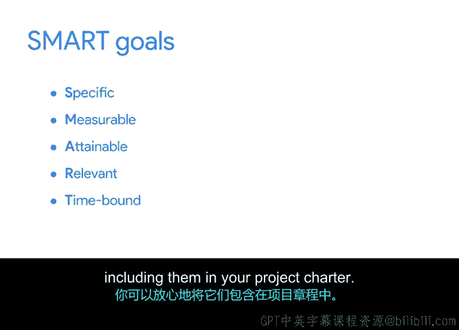

# 谷歌项目管理：专业证书 第6课：《顶尖：在现实世界中应用项目管理课程（Google）》｜applying-project-management｜ - P4：04_01_03_项目章程起草SMART目标.zh_en - GPT中英字幕课程资源 - BV1WG411o77A

Welcome back。By now， you've drafted the project summary。

 goals and deliverables in the project charter。And you've identified details in the project charter where stakeholders need to be in alignment。

In this video， I'll review SM goals and discuss how to add specificity to your project goals。

I'll also share some tips for researching industry success metrics。

 which are helpful in adding specificity to your goals and deliverables。Being able to write specific。

 measurable goals is an important part of project management and a great way to demonstrate your project management skills to potential employers。

Then in the following activity， you'll review supporting materials and update the goals and deliverables you've drafted in the project charter to make them smart。

Ready to begin。 Let's go。During the initiation phase。

 some of the project goals might be broad because not all of the project details have been determined。

While it's okay to have broader goals， it's helpful to add specificity where possible。

That's because clarifying project goals early on can help you avoid misalignment and gain a clearer understanding of the project scope。

 budgetdge and timeline。 Remember， project goals are the desired outcomes of the project。

Outlining clear and specific goals is an important step in creating an effective project charter and crucial to launching a successful project。

So you'll need to be able to accurately identify whether or not a goal has been met。

When your goals are clear， you'll be able to determine your project deliverables。

Project deliverables are specific tasks or outcomes that contribute to the completion of a goal。

In your career as a project manager， you'll likely encounter stakeholders who only vaguely describe the outcomes they want for a given project。

 For example， a stakeholder might tell you that they'd like more customers to use a certain service or they'd like to sell more units of a particular product。

These are fine goals， but they're not very specific。 You don't know how many more customers。

 what kind of customers or how many units that you'll need in order to meet your goals。

As a project manager， it's your role to ensure that the project goals are well defined so that you and your team have a clear roadmap。

This not only allows you to focus， but also eliminates wasted time and miscommunication going forward。

You can create clearly outlined goals with the help of the smart method we discussed earlier in this program。

The smart method helps turn your project goals into smart goals。 Remember。

 this means your goals are specific， measurable， attainable， relevant and time bound。

These qualities can help you measure your success more accurately and allow you to make more precise adjustments along the way。

Let's review some best practices for ensuring your project goals are also smart goals。

To make a goal more specific， make sure that it provides answers to questions like。

 what am I aiming to accomplish and what are the requirements and constraints of this goal。

Here's a tip I like to use to add specificity to goals。

 Look for words in your goals that might be subjective or based on an opinion such as bigger。

 better or faster。Once you've identified subjective words。

 connect with your stakeholders to agree on a definition of what it actually means to make something bigger or better or faster。

What is bigger or better entail in practice faster by how much specifically。

The smart method helps you make your goals more specific by making them measurable。 For example。

 if your stakeholder wants to increase company profits。

 ask by how much do they want to increase profits by 5 per cent by 30 per。

 addinging numbers and figures to your goal makes it a lot easier to know when you've achieved it。

If you're having trouble making a goal measurable， research how others in your industry quantify success。

 This is called benchmarking， which refers to evaluating success against a standard。For example。

 there are lots of ways to measure success in the restaurant industry。

You might search online for information using queries like how do restaurants measure success。

 or how do you evaluate employee training sessions？You'll likely find a number of results。

 Some common metrics include table turnover rate or the average length of time that a guest spends at their table Prime cost。

 which is the labor cost， plus the total cost of goods like food and drink。An average check amount。

 which is the average amount of money guests spend on a given meal。Most industries。

 from the hospitality industry to the entertainment industry to the construction industry。

 will have their own metrics for success。That includes the tech industry， too。

 metricss are a big part of how we measure success here at Google。Smart goals are also attainable。

 which means that the goal is challenging， but not impossible to reach。Ask yourself in the team。

 Can it be done。Do you have the time， resources， and people available to complete the goal on time and within budget？

If not， you'll need to make some changes to your goals。And all project goals should be relevant。

 Ask yourself， does it make sense for us as a company or as a project team to pursue this goal。

One best practice for determining the relevance of your project goals is to notice how closely your project goals align with the wider goals of your company or organization。

Here at Google， we use a tool for organization wide goal setting called Objects and Key Res。

 or OKKRs。Other organizations might use a different term for their own goal setting。 For us。

 O K Rrs combine a goal and a metric to determine a measurable outcome。For example。

 one of sauce and spoon's broader objectives is to make fresh。

 quick food for the working families in its community。

So a relevant goal for the sauce and spoon tablet rollout might be to decrease customer checkout time by 10%。

 On average， in the first six weeks after implementation。

This project goal helps the restaurant chain reach its larger goal to provide quick meals for guests。

And the last part of the smart framework is to make your goal time bound。

 You'll want to add a deadline to your goal so that you know when it's supposed to be completed。Okay。

 let's review。Smart stands for specific， measurable， attainable， relevant and time bound。

 If your goals are smart， you can feel confident about including them in your project charter。

In the upcoming activity， you'll collect information from the supporting materials that will help you turn the goals you drafted into smart goals。

You'll also identify any additional goals and add them to the project charter。Okay。

 ready to get started， let's get to work on the activity。

Then meet me in the next video to discuss scope， benefits， and costs。

