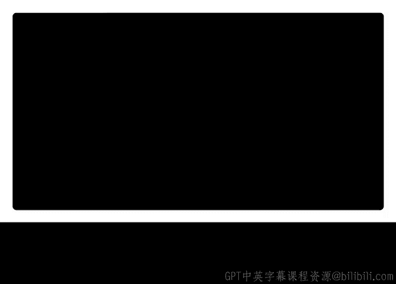
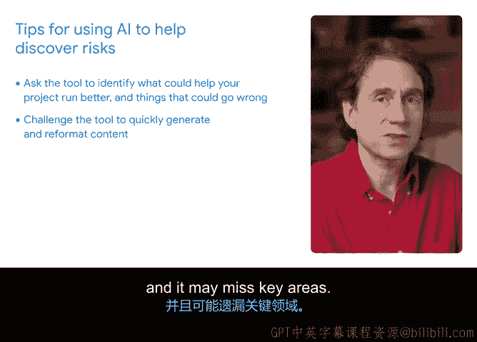

# 谷歌项目管理：专业证书 第6课：《顶尖：在现实世界中应用项目管理课程（Google）》｜applying-project-management｜ - P50：50_04_06_用生成式AI识别潜在项目风险.zh_en - GPT中英字幕课程资源 - BV1WG411o77A

It won't surprise you to learn that every project has risks。

 potential events that could occur and impact the project's outcome。

 A risk can cause a positive or negative effect on one or more of the project objectives。

 such as scope， schedule， cost or quality In any project。

 you won't be able to completely eliminate all of these risks。But as a project manager。

 you'll be much better off if you're clear about what the risks are and which ones you need to prioritize so you can figure out how to mitigate them。

 Your project charter might only list a few of your project risks。

 A Gen Ai tool like Gemini can help generate a more detailed set of possible risks so that you can be well prepared as a project manager。

 For this example， Let's imagine we're building a wellness Act for dogs。

 We set the stage by inputting a scenario into Gemini and providing a few details about the project。

Let's try entering a prompt like this。I'm a project manager overseeing the development of a dog wellness app。

 We are a midsized company offering dog walking， training and pet supplies。

Please review the fine project details and identify only major risks that could affect the project timeline ors budget。

Now let's give lots of context about a project， we could copy and paste information from a project charter like this。

Keep in mind that some Gen Ai tools like Gemini advanced allow you to upload documents directly。

 This means you could upload a project charter right into the tool rather than copying and pasting the information like I just did。

Ha， let's check out the output from Gemini。 It's exciting to get this large list of potential risks。

😊，I might not have thought of all of these At the same time。

 some of these risks are general and might not apply if we'd given Gemini more details about our project。

Generally speaking， the more information you can share in your prompt。

 the better Geni tools will work。 For example， we could try adding details to our prompt about the risks we've encountered on previous projects or risks we've already identified for this project and see if it improves the output。

 Here are a few things to keep in mind when a Geni tool is helping you discover potential risks。

Generative AI tools are great at helping with brainstorming。

One way of putting it to work for you is to not only ask it to help you identify things that can help your project run better。

 but also what could go wrong。 In addition， Gen Ai tools are quick at generating content and text。

 Chall it to generate what you want。 and ask it to reformat it in different ways until you find what works best for you and the team。

Of course， getting a long list of risks is helpful。

 but it may not always contain items that are relevant for your project or your team's needs。

 and it may miss key areas。 This is where you need to carefully review the list and use your own judgment。

 Finally， as your project develops and you identify new risks。

 You can come back to Gemini with these specifics and brainstorm mitigation plans。😊。

Just like humans， JenAI can prevent risks from becoming problems that derail your project。

But tools like Gemini can help you get ahead of those risks。

 And that's essential to being an effective project manager。

