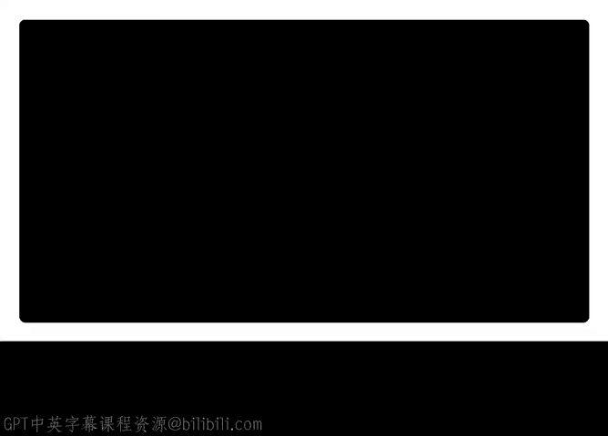
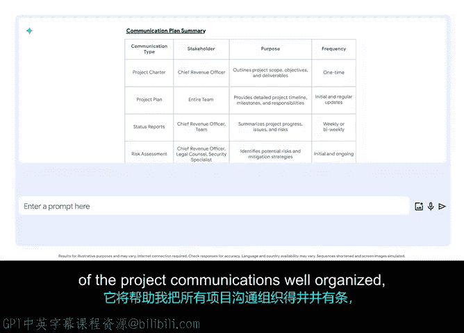

# 谷歌项目管理：专业证书 第6课：《顶尖：在现实世界中应用项目管理课程（Google）》｜applying-project-management｜ - P51：51_04_07_使用AI改进项目沟通.zh_en - GPT中英字幕课程资源 - BV1WG411o77A

Yeah。Even with the best laid plans， a great project charter and a thorough awareness of the risks。

 your project won't succeed without one crucial ingredient。 Good communication。

 There are lots of ways a Gen Ai tool can help with project communication。

 Let's start at a high level。 Gen Ai can help generate a list of the communications you might need to keep a project running smoothly。

 These might include status reports， stakeholder updates and more。 Let me show you for this example。

 I could prompt Gemini with something like。😊，Given the project charter。

 which includes the following information， please share a summary in a table form of the most important communications I should prepare during the project and indicate both the type of communication and stakeholder。

And just like before， I'm going to copy and paste information from a project charter like this。Okay。

Jem and I created a detailed table that will help me keep all of the project communications well organized and keep me from forgetting something important。

Hm。This table is a helpful guide to make sure I'm effectively engaging the right stakeholders so I can manage their expectations and keep the project on track。

 If you want to use Geni to help you with stakeholder communications。

 here are a few things to keep in mind。 Geni tools can provide different formats in the output。

 like a table or a list of bullets。 So specify the format you want in your prompt。

 just like we ask for in a table here。 your company may have standard templates and methods around communication and norms around who should be involved in receiving different pieces of information。

 Remember， you have a big role to play here in determining how to manage that communication。

 but a geni tool can give you a helpful starting point。

 And always review your company's policy before including sensitive or confidential information in your prompt。

 like the names of individuals and avoid entering this kind of information whenever possible。

 after you create a stakeholder communications plan。 you can keep using Geni。😊。

Bring those communications to life。 For example， a Gen Ai tool like Gemini can help you write the first draft of a status email to senior sponsors of the project。

 usinging a Gen Ai tool to create drafts of communications can really help you save time。

 So try it out for yourself and see what you come up with。😊。

