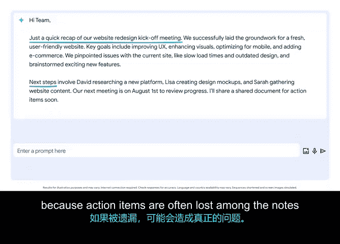

# 谷歌项目管理：专业证书 第6课：《顶尖：在现实世界中应用项目管理课程（Google）》｜applying-project-management｜ - P52：52_04_08_用AI更高效执行会议.zh_en - GPT中英字幕课程资源 - BV1WG411o77A

In many companies and teams， you spend a lot of time preparing for and attending meetings。 for sure。

 Meings can be important for moving work along， but if not managed。 well。

 they can also be frustrating。 And what happens after a meeting is often the most important part。

 We've all been there。 You have a great conversation while yourre meeting live with your project team。

 But after the meeting when you all go your separate ways。

 It's not clear what each person should do next。 Well。

 Gen A I tools can help make your meetings more productive and organize the fall through afterwards。

 Let's focus on a scenario。 I often find myself and at work。

 I need to generate a meeting summary and capture action items so that my team can act on what we discussed in the meeting。

 I can write a prompt like this。😊，Summarize the fine meeting notes in a succinct two paragraph email that identifies the key points and action items include a friendly opening line and warm sign off。

 Now， I'm going to open my notes。Car比 them。And drop them into the prompt。This is pretty cool。

 It took my somewhat disorganized meeting notes and created a clear summary with action items。

 as a project manager。 This is really powerful because action items are often lost among the notes and can cause a real problem if they're missed。

 a couple of things to keep in mind so that Jen Ai can help you run more effective meetings。 First。

 Gen Ai can't read your mind。 Meing notes are often sparse。

 So you need to make sure your meeting notes are complete enough to be able to capture everything that's important。

 If you have challenges capturing good notes there are even features in some video conferencing software that allows you to get a transcription of the meeting。

 Second， remember to specify the format that you need in order to match your communication objectives。

 In this case， I wanted to send a short summary via email to people that were in the meeting。

 But imagine if a few people weren't able to attend the meeting。 In that case。

 I may want to ask Gemini to create a long。😊。

Recap so they can get fully up to speed about what they missed。

Who doesn't love more productive and efficient meetings？

 Take a moment to identify a meeting that you have coming up on your calendar and try it out。😊。

