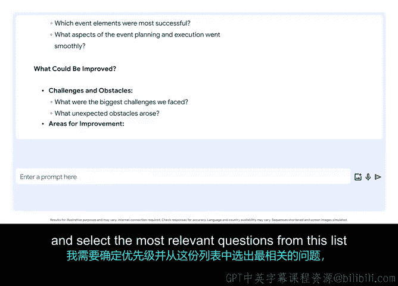

# 谷歌项目管理：专业证书 第6课：《顶尖：在现实世界中应用项目管理课程（Google）》｜applying-project-management｜ - P53：53_04_09_用AI规划迭代回顾会议.zh_en - GPT中英字幕课程资源 - BV1WG411o77A

How often have you done something like tried a new recipe or taken on a home improvement project。

 And afterwards thought， I wish I would have known that before I started。

 you might make a mental note or jot a reminder down about how you do it differently next time。

 It's the same with project management。 Reviewing what went well。

 and what didn't makes the next project run even more smoothly。

 Retrotives are valuable for any project management process you're running because they provide an opportunity to get honest feedback in a timely manner and that feedback can help guide your next sprint and future work。

 when it comes time to plan your next retrospective。

 Gen and I can help Sha clear and specific details about your project and ask a tool like Gemini to help come up with ideas for questions that you can ask during the meeting。

 Let me show you a prompt I might use。 up until now， I've been typing prompts into Gemini。

 But here's a pro tip。 You can also。😊，ToAcivate the microphone feature。

 This lets you quickly add more information， start a new prompt or iterate on an existing prompt all using your voice。

 So， for example， I could use the microphone feature to speak this prompt to Gemini。😊。

I am a project manager preparing to lead a one hour retrospective for my team about the project we just completed。

The project involved a community fundraising event for a local school with businesses and nonprofits from the area。

 Sha a robust question bank that will spark participation in the meeting and guide our discussion to uncover what went well and what could be improved next time。

😊，Gemmini has provided many potential questions here。

 This is a great starting place to work from with a limited amount of time and a large group of people in the meeting。

 I would want to prioritize and select the most relevant questions from this list that align with my specific team and Project Gos。

😊。

You can consider these factors when narrowing down your choices， relevance， impact。

 engagement and time allotted。 a few more things to keep in mind when Geni is helping you prepare for a sprint retrospective。

 Be sure to add cultural and personal aspects into this time of retrospective， for example。

 to begin a meeting like this。 I would usually start by thanking the team for their great work on bringing the programme together。

 and I might want to update the icebreaker to align with my team culture。Lastly。

Many people participating in retrospectives are not aware of the purpose of this type of meeting。

 It could be helpful to briefly explain the purpose of the meeting up front。

 A sprint retrospective gives you and your team a chance to discuss what worked well and what could be improved when you use Gen A I to help you prepare。

 you can focus on the unique concepts and insights only you can bring Instead of worrying about the time consuming logistics。

Just like any new technology， we all need to try， test and play in order to learn how to use Gen A I。

 I really enjoyed being able to share some of the ways I'm using Gen Ai in my work as a project manager from helping to write a project charter to making meetings more productive。

 I hope this can help you start to use Gen Ai in a role。 My challenge for you。

 Think about the work you're already doing。 Is there something that's taking a lot of time。

 a project where you need ideas to get started， commitit to experimenting with Gen Ai for something that will make a real difference to you and your work。

😊。