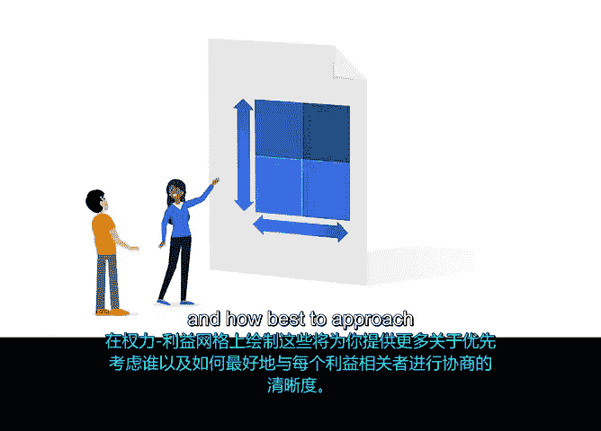
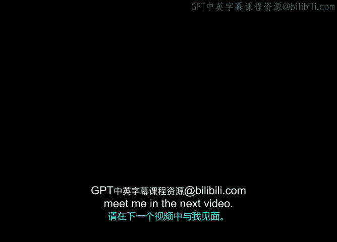

# 谷歌项目管理：专业证书 第6课：《顶尖：在现实世界中应用项目管理课程（Google）》｜applying-project-management｜ - P7：07_01_01_完成利益相关方分析.zh_en - GPT中英字幕课程资源 - BV1WG411o77A

Yeah。Hi again。 By now， you filled in most of your project charter。 the summary。

 goals and deliverables， scope， benefits and costs。

 You've also learned more about the project and your stakeholders who are the core audience of the charter。

In this video， you'll learn how to prepare for some of the negotiations you'll have with stakeholders about your project。

We'll spend some time exploring stakeholders individual interests， involvement。

 and contributions to the project。Then we'll figure out how to use stakeholder influence to benefit the project and how to effectively work with stakeholders。

Almost every part of a project requires input and agreement from multiple stakeholders。And。

 of course， not all stakeholders will value the same input or agree on the same things。

That's why a successful project manager needs to be a skilled negotiator， too。After this video。

 you'll review supporting materials about the sauce and spoon project stakeholders to write a persuasive email demonstrating your negotiation skills。

 Let's get started。As we discussed earlier in the program。

 some common project aspects that are negotiated during the course of a project include scope。

 costs and benefits， timeline， success criteria， roles and responsibilities and resources。

This is another reason getting aligned with stakeholders early on is helpful。

 Good alignment can help prevent some of these types of negotiations down the road。

 Early in the project。 It's important to agree on the scope。

Take note of how PE focuses on securing stakeholder buy in for that。

And it's good to remember that a lot of the skills she'll apply here will be useful to negotiating other elements throughout the project's lifecycle。

 whether that's the budget， timeline or product requirements。

You'll prepare for this and future negotiations by creating a stakeholder analysis。

The stakeholder analysis is a visual representation of all of the stakeholders。

It helps you understand who your stakeholders are， what their priorities are and how they prefer to communicate。

It can help you determine how strongly you need to prioritize a particular stakeholders's needs or goals on the project。

Stakeholders have a vested interest in the project's success。

 Understanding your stakeholders helps you figure out the right people to include in important conversations and how to prioritize the different needs of the different stakeholders。

This is key to getting the support you need throughout the project。As part of your analysis。

 try to answer as many questions as you can about each stakeholder。 Then as you review your list。

 identify which stakeholders directly influence the project and the level of interest each one has。

A stakeholder's influence is related to how much power they have and how much their actions affect the project outcome。

Interest refers to how much the stakeholders' needs will be affected by project operations and outcomes。

So， for example， if a stakeholder has high interest and high influence。

 it might be very important that you keep them informed and make sure their goals for the project are top priority。

If they have low interest and low influence， then you might be able to deprioritize one of their personal preferences for the project。

Mapping these out on a power interest grid will give you even more clarity about whom to prioritize and how best to approach negotiations with each stakeholder。

You'll find a stakeholder analysis template in power interest grid and the supporting materials of the upcoming activity。

Once you have a good idea of who your stakeholders are and what role they play in the project's success。

 you can use this information to support your project negotiations。

One of the most important negotiations will deal with defining and maintaining project scope。

Stakeholders might push to add more into the scope。

 and it's your job as the project manager to negotiate what's realistic within the given budget and timeline expectations。

Okay， let's review。Some common project negotiations you're likely to have with stakeholders include aspects of the charter。

 like costs and benefits and success criteria， as well as other project aspects。

 like roles and responsibilities and project resources。

You can prepare for these negotiations by conducting a stakeholder analysis using a power interest grid。

 Coming up， you'll review supporting materials and complete a stakeholder analysis for the sauce and spoon tablet rollout。

After you complete the activity， meet me in the next video。

