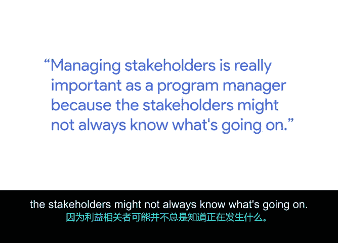

# 谷歌项目管理：专业证书 第6课：《顶尖：在现实世界中应用项目管理课程（Google）》｜applying-project-management｜ - P9：09_01_06_斯坦顿管理利益相关方的范围变更.zh_en - GPT中英字幕课程资源 - BV1WG411o77A

Hi， I'm Stanton and I'm a program manager at YouTube a program manager at YouTube basically works on a lot of different projects but。

Puts them all together into a program that can help people understand what's going on at any given time。

 whether that's development or product requirements or testing。

 all that needs to come together for a project to work well scope change can happen at any time。

 and I found that。Often happens when you don't want it to happen， usually right before a launch。

 so this is a project that I was working on at a startup before I came to YouTube。

We were implementing a new app that had to do with。Body weight percentages。

Managing stakeholders is really important as a program manager because the stakeholders might not always know what's going on。

And in this case with our CEO， he was really focused on getting us to launch。

 thinking about all the PR and the marketing and everything that he was going to announce once everything went live he saw that specific thing with the graphs and really wanted to changed this is something that happens a lot you can get。

Require change at the very last minute you kind of find some ways to make sure that your client or your stakeholders are still happy with what you can produce so in this case what we ended up doing is we went back to our developers we got an estimate for how long they thought making that change would actually take and that actually brought us way beyond the timelines that we had in mind so we came up with a few different proposals and what ended up happening was because the launch date was set there was no way we'd be able to make all the changes that he wanted in time for launch so instead we negotiated and said hey we'll have it this way at launch but based on the estimates that we received we'll be able to get this done in another two weeks and we'll just do another release after that。

shouldnn't be a big deal。 It'll just be a change after the initial launch when you're dealing with stakeholders。

 there's always going to be some things that they want to get done more than other things。

 And so when you're managing scope， especially if something last minute comes along。

You can kind of try to stack rank it within that priority level， right？

The one thing I would also add and caution about too is you can't get anything for free。

 so if you do have a change in scope， you need to make sure to go back and look at that priority and see what actually gets pushed out because of the new thing getting brought in they come to you because your project manager or program manager you understand all the things that are happening on the ground and I think that's the power that you have in this role。

