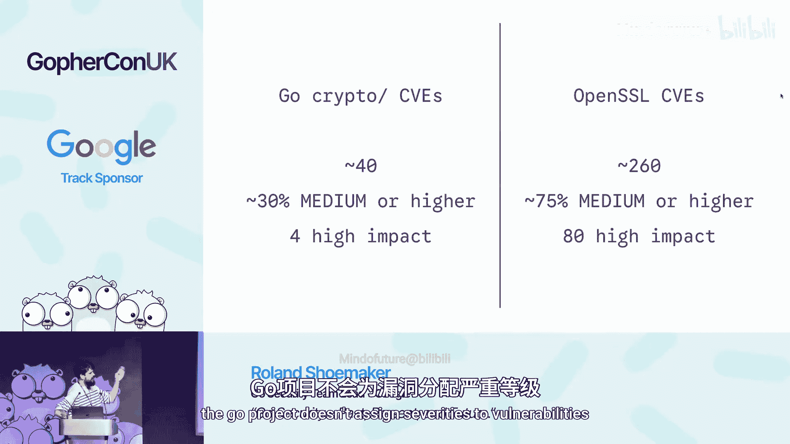

# Gophercon-Uk-2025-p01-P01_Go_安全_–_过去、现在和未来--BV1dCHTzQEdN_p1-

Without further ado， thank you all so much for coming。

 the first talk we have today in this room of the six that we'll have here is go security past present and Fu from a former member of the Les encryptncrypt Project and now heading up the Go security team at Google。

 please give an absolutely massive hand for Roland shoemaker。😊，Alright。

 so thank you for the introduction。 Like， like you said， I'm Roland shoemaker。

 I run the security team at Google for Go。😊，And we're going to kind of go over why you probably haven't heard of what we do and why that's probably a good thing。

 So first， we can give a quick overview of what the team actually is。

Go security team started some time around the beginning of 2020。 formally。

 I don't think any of us actually know the exact date。

But and it's existed in basically the same form since then with various numbers of engineers。

 Currently we have five people who basically work full time on the security of the language。

 so me and a handful of other people。The reason the team was started is that Go has become a very important language。

 not just for Google。 kind of across the industry。 people are using go to build massive services。

 And you know， if something in go breaks that can cause a security incident， that's really bad。

 you know， not just for Google， it makes us look terrible。 but also， you know。

 we don't want people losing information。Basically having security breaches。

So the main kind of the main way that people probably interact with us is through this email address。

 security@go dot org。 And this is where we get security reports。

 So most of the issues that are discovered and go and not actually discovered by us。 You know。

 we go over the language with a fine tooooth comb， but we don't find most of the issues。

 typically it is either external security researchers who you know， this is their job。

 They look for security issues。 they will send us an email and say， hey。

 here is something that is wrong with go。 It is either you know。

 crashing with unexpected input or you know， something you have said works one way actually works another。

 and technically， there is also another way people can contact us。

 which is through the Google open source vulnerability vulnerability rewards program。

 and most people don't actually know this。 So if you have ever sent an email to this。

 which you know unlikely， but if you have， you can actually also submit this。

Through a Google program that will give you money。We try to， you know。

 when people send us a lot of emails， we tend to say， hey。

 you should go and do this this other way because they will pay you。

And we technically calledt do that。So the other thing that we do is we own what we consider to be the security critical packages in the Gt standard Library。

 so the most obvious of these is everything in the crypto tree。

 you know every crypto algorithm you know for encryption， password hashing， regular hashing。

YouProcols like TLS oricx 509， things like that。We also own what we consider to be the critical production stack for Go。

 So the things you need to write a network service。You know， net HTTP is a good example of this。

Things you might not think of things like encoding JSO， you know。

 probably 99% of the usage of encoding JSsonN is to take something off the wire and decode it。

And that can be incredibly security critical if there is something broken in this package。

 it turns out that huge numbers of network services would be broken in horrible ways。

And then there's a whole bunch of other stuff， you know。

 anything that passes untrusted user input typically is considered security critical so you know。

Image passing libraries， which are the bane of my existence。Arive packages， the zip package。

 the tar package， things like that。And then we also own everything else that could have a security impact on Go。

 So the module， kind of the security aspects of the module proxy， the sum database。

 and then there's a whole bunch of other stuff that is kind of internal to Google。

 the security of the go team at large， which I won't really talk about because it will be of interest to absolutely nobody。

So first， let's talk a bit about GoV's security history。嗯。Its go is， you know。

 because it is a memory safe language， we don't have all of the classic security bugs that you will get in C。

 We don't have memory corruption。 That's not。Technically。

 there are some places we have memory corruption。 But for most of go。

 that's completely uninteresting。 So I tried to， you know， I looked up some CBE data。

 If you don't know， CBE is the common vulnerability。Enumeration。

 I forgot out exactly what it stands for。 But these are vulnerability reports that the industry have used for about 30 years at this point。

 And I'd looked at， you know what other languages that you could plausibly compare to go and what numbers of Cs they have。

 Now， you will notice that we are not the best of all of the languages here。

 Rust is significantly better。 but。Really， one of the reasons that Go has this many CVEs is because Go comes with this massive standard library。

So any security issue in any of the， you know。Although， I don't know what it is。

 60 plus packages that we have in the standard Library， we have C E4。

Only 20 of that 160 CEs that we have ever had for go are actually in the tool chain itself。

 So these are things that affect your usage of the go command。

 And these are kind of often some of the highest impact vulnerabilities。 and only 20。

 I think this is know， very impressive。 I mean， comparing to Python and node Js is perhaps a little unfair。

 but you know we have done pretty well。嗯。You knowOne thing I really do like to brag about though。

 is that Go crypto libraries， you know， it's very hard to compare to other languages because almost every other language ends up having wrappers around Open SSL。

 You know， OpenSL is the only other project that probably has the same breadth of cryptographic implementations that Go has。

And you know， this is slightly unfair because Open SSL is written in C， so maybe not 90%。

 but very high proportion of the CVEs in Open SSL are from memory corruption， of course。

The rest of them are because open SSL has OpenSL has been around since the 90s。

 it has implemented every single possible optional cryptographic algorithm or extension to a cryptographic algorithm。

 an idea that somebody had， and they wrote down on a napkin， they implemented it。So when you do that。

 when you create this huge vast swath of options。You run into the problem that a lot of them are not。

 the interaction between lots of things are not well thought out。

 So one of the things that we did when we， you know。

 developed our cryptographic packages is we are very selective about what we actually implement。

 We only。Mostly only implement things we actually think are going to be useful to people and you know very niche algorithm。

 you know， there's a whole series of encryption algorithms that we just have no interest in implementing you know people come to us every so often and say hey。

 could you please implement this。😊，And unless there is a popular protocol or a really strong reason to implement it。

 we basically say no， and that some people have gone very angry at us because of that。

 but I think these numbers show that we have probably made the right decision there and we did an analysis of all of the CDEs that affected the cryptography packages about a year or two ago。

 and we kind of tried to the GoPro doesn't assign severities to vulnerabilities。

It probably should have turned off sleep on my laptop。So we， we went through and we tried to say。

 you know， if we were to assign。severity is what would we have assigned these 40 vulnerabilities。

 And we， we decided that only four of them were actually considered high impact。

 and high impact means that like this being broken could fundamentally impact the security of an application that is built on top of this。

 So this is things like。Incorrect results from cryptographic algorithms。 You know。

 signatures not being produced correctly or verified correctly。

 Oracles in encryption and decryption and stuff like that。

 And this is compared to the open S 80 high impact。I think this is， if I get to brag about anything。

 I think it's this。So。😊，Because go doesn't have。Memory corruption， vulnerabilities。

 we tend to see vulnerabilities fall into two very broad categories， I must say。

 The first is denial of service， this is， you know， you can cause a program to panic。Or to use。

More resources than it really should。 so consume large amounts of memory。

 consume large amounts of CPU， things like that。We tend to consider these to be quite low impact to the go ecosystem。

Go is typically very often used to build network services。

 and the infrastructure around network services these days is often very resilient to programs just crashing。

So you know， it's not great if someone can just send a request to your HGTP server and it crashes。

 that's not good， but it's also not the end of the world。

 Usually most services will know how to recover from that。 and then the other。

 which is an unbelievably broad bucket。Incorrect behavior。

 So these these are typically what we would consider logic bugs。 You know。

 we implemented something incorrectly。We've documented an API to do one thing and actually does another。

 and these tend to be significantly more serious。 Logic bugs can really break your program。 You know。

 if you are the classic example is if you are trying to verify a hash or a password or something。

 if we say this is you know these two hashes match when they don't actually match。

 that's just breaks every go security guarantee that there is。

So I'm going to talk a little bit about the different first I'm going to talk about denial service。

 right？The not service for Go typically falls into two different categories。

 One being you cause a program to panic。 There's two ways you typically do that。

 One is that you trust some， you know the classic example is in a passa。

You trust the input data to say what it you know to actually describe the data that your program is ingesting and then you do a slice operation and you say I want to access this portion of a byte slice。

 and of course you haven't checked that that the header from whatever this data is accurately reflects how much data is in the byte slice and all of a sudden you're trying to read outside of the end of the slice in C this would be very serious Of course in go your program just panics which is not good but you it's not terrible and then the other example of this is no point references。

 which happens less often in terms of security contacts。 It's usually just a programming error。

And then the other is allowing untrusted data to make allocation decisions so in this case。

 in the second case， you pass some header from a data and then use it as use that untrusted data as an input to make or allocate some kind of slice or other object we actually see this incredibly often you you will have this header items will be 10 million and your program tries to say。

 okay I will allocate a slice of integers 10 million long all of a sudden your program grinds to a halt because all of the memory has been consumed。

And that can either cause your program to crash or if somebody is being very smart。

 they choose a length， which is not too high， not too low。

 and then they can just slowly consume huge amounts of memory on your system。So。

Incorrect behavior is much more interesting to me。TheMost of the time we get。

In the go language in particular， we get logic bugs。

 is because we are implementing something that is either very confusing or very vague。

So you read a specification and you say， yes， I have implemented all of the things this specification says。

 but the specification leaves out about 80% of the security considerations about implementing this protocol and because of that you introduce all of these security bug and the prime example of this is something like implementing HTTP11。

😊，Which is， a great specification for its time， but made absolutely no considerations for security。

 So there's a whole bunch of things around， you know。😊。

How many headers is it reasonable to pass for an HTTP request or how long of a body of an HTP request should you be happy to read of course。

 the specification makes absolutely no comment on this at all。

 kind of when the HTP specification was written it predates when the IETF required that you have what is referred to as a security consideration section which says you really need to think about these things when implementing this protocol。

嗯。😊，And then， you know， another example is the H TM L。 We have an H TM L pass in the Xnet package。

 And similarly， the H Htm L specification has gotten a lot better。

Since it was adopted by the Wat working group。But the original H HtMl passing specification is absolutely horrendous。

 You there， I mean， even， even the current one has kind of infinite loops where， you know。

 it tells you how to walk through the dom and you get halfway through into this weird state。

 And then it says， go back here。And then you end up in an infinite loop。And you know。

 if you know how to write pass， you just implement some kind of maximum depth limit for your parer and you say。

 okay， I'm just going to stop here。 I'm not going stop trying， but of course。

 the specification makes absolutely no comment on doing this， which is unfortunate。

 And then the other thing that we see often is misalignment of implementations。

 So what I mean by this is。When we we have an implementation in go。

 and then there's an implementation in another language。

 And because of the vities of a specification， or sometimes we just implement the specification wrong。

Our implementation will result in a different result。

Than different implementation when given the same data。And this is。

It's arguable the security impact of this， it's often very dependent on where it is that this problem arises。

But， you know， we see this often in things like HTTP。

 where you know if you're implementing a proxy and go and we read a request one way。

 but you know your downstream HTP server reads it another way。

 it gives an opportunity to kind of sneak data through。In a way that。Can be quite dangerous。

So the other thing we see is low level API is really a bad idea。

giving access to people to really dangerous primitives。

Can allow people to do really interesting stuff， but often you really need to think hard about how you use those primitives。

 So we have one example of this here， which is when we implemented ECDSA in the crypto treee。

In order to do ECDSA， you have to do a lot of mathematical operations over elliptic curves。And we。

know， we had to write a package that did eiptic code of math， and we decided。

 let's make that package public。And it turns out that doing elliptic curve math is actually really complicated。

 And there's a lot of ways to do it really badly。 And when you do it badly。

 it causes really bad problems because all of a sudden， you know。

You get points on the curve that make you think that you have done the right thing and in fact you have taken a signature that is for the completely wrong thing and all of a sudden it verifies for something else。

嗯。And really， you know， it turned out when we found this particular bug in the ECDSA package。

 we had done the right thing。 We had checked that scalers were properly reduced。

But in the elliptic code package， we didn't make that check， we just assumed you did this。

So anyone who was using this and didn't implement those checks themselves。

Had a really severe problem。 I don't think we ever actually found anyone who was doing that。

But the fact that you had to know to do this is kind of an indicator that it was just not a safe API to produce。

 we could have added the checks ourselves， but we also should have just never made this accessible。

And then I didn't actually put a slide for this， but the other thing here is assembly cause for almost all of the really high。

The cryptographic algorithms that people actually rely on。

 we have assembly implementations per architecture assembly implementations。Because， you know。

 cryptography can be quite slow and really to kind of squeeze out all of the performance needed。

 you really have to。Do it in assembly， unfortunately。And those clauses are kind of。

 I said passes of the ban of my existence， probably assembly is the ban of my existence because it's hard to review you you know go the go assembly or the go assemblymbler makes it slightly more complicated because we use our ownspoke instruction set that maps to per architecture instruction sets。

And reviewing it is very complicated， you have to really know what the mapping is between the go assemblymbler and whatever architectures assembly you're using。

 spawning bugs is you very hard， it's very hard to test properly because you can't really do the same kind of coverage that you use for go code for assembly instructions。

 so it's very hard to tell you am I actually exercising all the branches of this。

 or if it's constant time code， you know， am I actually exercising all of the non-bra of this code？

And then the other thing is Sego。 Seago is awful。 You know， if you really need to call in see。Sure。

 but the problem is that as soon as you touch C， you get all of the。

Memory issues that C comes with and you know。We。When I said there are 20 different。

Security vulnerabilities in the Go toolol chain， the teen of those are related to the SeaG implementation。

In fact， most of them are not actually。you know， C go in the go language itself。

 it's C flags and LD flags。 If you've ever written Cgo。

 you will know that we have special directives that you can put into your C that say these are the flags to pass the compiler。

 these are the flags to pass the linker。😊，It turns out compilers and linkers for C have this whole breadth of。

Things they can do， like loading arbitrary modules that override parts of how the linker and the compiler work。

So most of these vulnerabilities are related to the fact that you can pass a C flag that says you load this module。

 you run go build and all of a sudden you have remote code execution。

 it's just executing whatever is in the shared object that you passed it so we have an allow list for these but it turns out that enumerating all of the safe flags is also incredibly difficult we've made a number of mistakes here and I'm sure there will be more in the future。

😊，So let's talk a little bit about what we're doing now。 The first thing is。

 let's try and deprecate all of the mistakes that we made in the past。So we have， you know。

 we have a huge number of libraries。 Some of them were written a very long time ago before there was kind of。

We made the same， you know， we made， we didn't make as good choices in the past。

 So there are a whole bunch of APIs in very sensitive packages that are just they're there。

You really shouldn't use them， you know， because of the compatibility guarantee we kind of have to leave them there。

 but we've been trying to deprecate them， add big warnings that say， hey。

 unless you really know what you're doing， please do not use this。

 I mean the prime example of this is we have a function in the crypto RSA package that lets you decrypt PKCS1 V15 session keys。

This is a really dangerous API， it's intended to let you kind of switch out a real key for a fake key in a constant time way so that you can kind of transparently use either the right or a completely randomly generated key when you're decrypting a session。

It's only safe to use really in TLS， and we use it in the standard library in the TLS package。

But nobody else should really ever touch it because unless you really know how to design a protocol。

 you're probably going to get it wrong， and we have seen people get it wrong。嗯。

So the color realitygy to that is adding safer APIs。 You know， we really。

 when we design APIs these days， kind of the first thing we think about is。😊。

How could you misuse this， You know， I it possible to hold this in the wrong way and all of a sudden security guarantees that we're trying to provide you just disappear。

You know， it's entirely possible We will still make mistakes。It's API design is a hard problem。

So you know， we're trying， but don't hold me to getting everything right。

And then another big thing is Fps。 Hopefully nobody in this room knows what FIps is。 If you do。

 I am very sorry。 PhIps is a US government regulatory framework。

That you essentially are required to comply with if you want to sell software to the US government。

In 2016， we added support to go for Fips。 Now， we added this。Basically just for Google。

 Google is required internally to use PhIps cryptography。

 So we had all go had to use PhIps internally at Google。But because Go is open source project。

 we added the integration to the Open source tool chain。With a very big warning that said。

 if you don't work at Google， you really shouldn't use this。 It is not designed for you。

 It is designed for us to use。嗯。And it turns out， despite the fact that you want people not to use it。

A lot of people use it。And a lot of people have based a lot of their business model on using it。

 So every so， we would get questions from people saying， can you add support for this， You know。

 here， I found this bug， Can you fix it， And we would have to say， did you not read the warning。

We said we wouldn't help you with this。But nevertheless， they persisted。

 So in collaboration with Felipo， who is sitting here。We have in one go 1，24。

 we have added support for a pure go Fips implementation。 The。

 the previous Fps implementation I didn't say， but is based on boring crypto。

 which is a C 4k of open SSL that is used at Google because of that。

All of the issues that I have with Sego are also present in this very important cryptographic compliance framework that we use。

 So in 124， we completely， you know， go crypto libraries have everything needed to build a PhPS module。

 So we said， okay， why don't we just use go。 Why do we use C for this。 So we。

So in collaboration with Filipo's company Ges， we developed a pure GoFIPS module。

 which is currently going through verification at NIST， if you know what that means again， I'm sorry。

 at some point in the future when the US government deems that we have done all the things that you are required to be rubber stamped as a FIPS certified module。

You will be able to use the pure Go version， and this is a completely drop in。

 all you have to do is set an environment variable when you build your binary。It's great。

 It's significantly better than what we had before。And the other thing we did。

 I'll go through this very quickly at the beginning of this year。

 you know we look at all of our crypto libraries， we tend to know what's in them。

 but what comes with that is kind of blindness。 We look at it so much。

 we don't always see the problems that are actually there。

 So at the beginning of this year we engage an external company trail of bits to do an audit of all of our crypto libraries and to see。

 could they find anything that we had missed。And it turns out yes。😊，But not very much。

 I think there was a total of four。Maybe five findings of which only one we considered actually serious。

 The rest were all kind of internal implementation details that don't really matter。

 So it turns out we are actually quite good at writing crypto code。So the future。

 what are we going to do next？Testing。turns out that there are two time honored ways to prevent bugs from appearing in your code。

 The first is， never write it。The second is really test it。

So we have been kind of focusing on finding test suites that we can apply to go code across a whole bunch of TLS。

 X509， all these important protocols， even for some of the lower level crypto stuff。

And then also testing， or trying to test with still working on this a little bit。

 all of our assembly implementations。 So making sure that our constant time assembly is actually constant time。

 quite important。 and then also testing that we actually test all of the non branches in constant time code。

The other thing is improving the security of the Gomod ecosystem。 you know。

 there hasn't been a major impactful attack on the Gomod ecosystem yet。

It's kind of a matter of time until somebody tries to and probably succeeds in attacking the go module ecosystem。

 So we have been looking into what can we do， especially at the module proxy layer。

To make those attacks harder， I don't have anything to public to share about this yet。

 but we have a whole bunch of kind of nascent projects internally at the moment that have focused on this。

The next thing is post quantum crypto again， if you actually know what this is， I'm sorry。

 you know at some point quantum computer depending on who you ask at some point。

 quantum computers going to render off the cryptography you're currently use completely useless。

So we are looking to what the future holds in terms of implementing new algorithms。

 we have been a bit hesitant to just you know there's a whole field of different implementations that we could pick to do this。

 we've been a bit hesitant to add these to the standard library yet。

 we're really trying to wait until protocols actually adopt these before we add them to the S library because if you don't use crypto libraries in the standard library。

 it's really hard to tell what a good API looks like。You know。

 we really want to actually have to use it before we can say like here's how you can safely use these APIs。

The other thing is bringing Go Volunchech to the Go command if you don't know Govoluncheek is a tool we wrote to find public vulnerabilities in your source code。

 so this is currently in the Goang toorg X v repository and it's just a binary。

 you run it over your source code and it consults a vulnerability database that we host and says。

 hey look， here is a call site in your program that calls a vul symbol。

 you might want to look at this and consider how this impacts your project。And it's really good。

 but not enough people use it because it's not in the Go K yet。

So we're hoping to bring it to the Go command。So。How can you help us if you are a security researcher。

 send me an email。If you find something， if you run a production system and you noticed weird behavior。

 we recently had a vulnerability reported to us about a race in the database SQL package because a big company was seeing weird results come back from the SQL queries。

 it turned out that was actually a very serious security bug。😊，And， you know。

 if you want to get paid。Use the Google Vulnerability rewards program。

If you know about security Fo gunns， if you have written go code that has caused you a problem that may not necessarily be a problem in Go itself。

Let us know， you know， if there are better APIs we can implement， we would love to implement them。

 We would love to make it easier， safer to use go and， of course， keep using it。And with that。

I think I'd perfectly hit my time。

