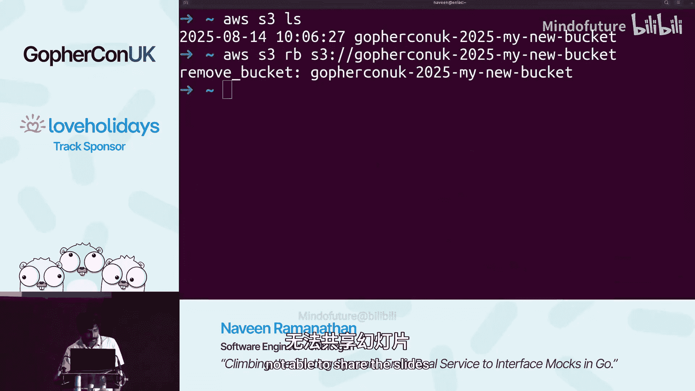
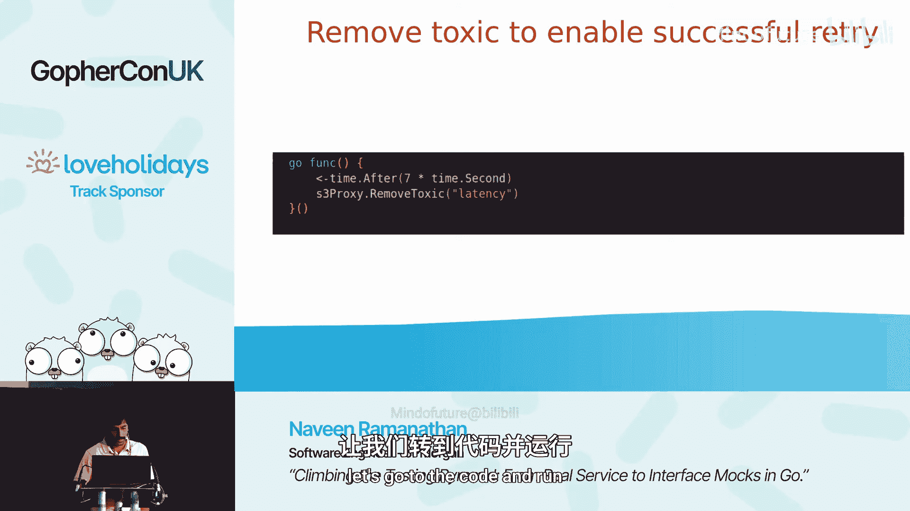
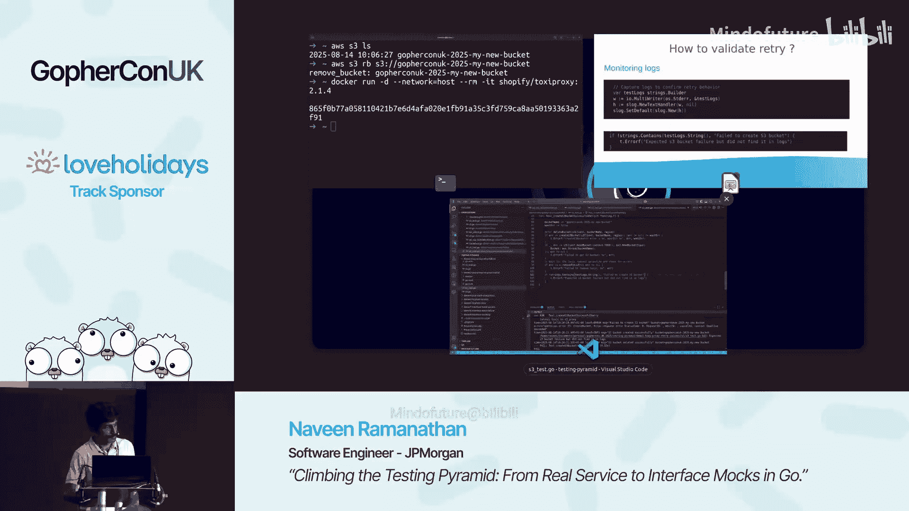
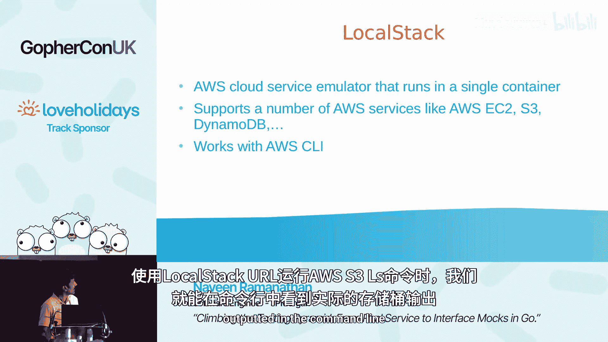
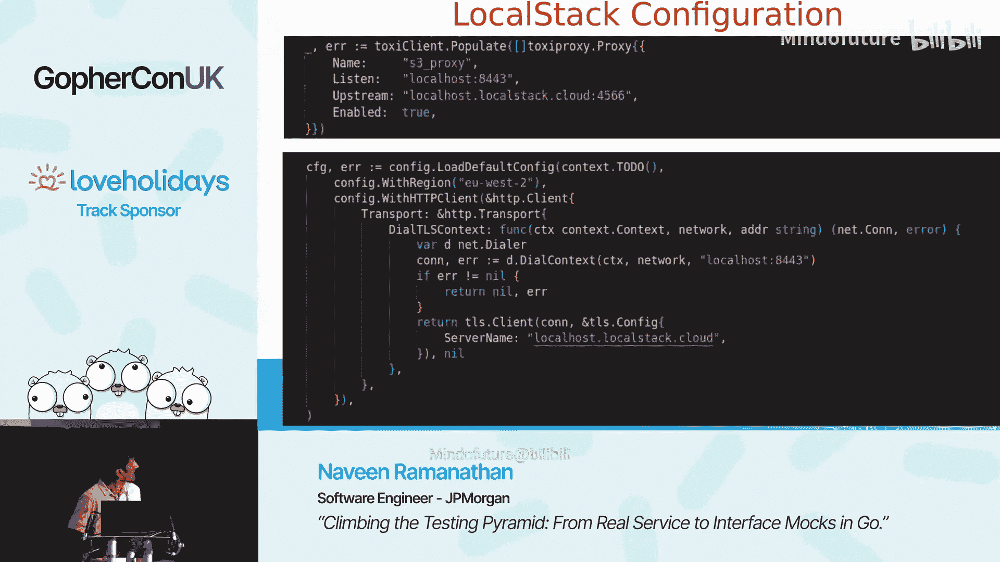
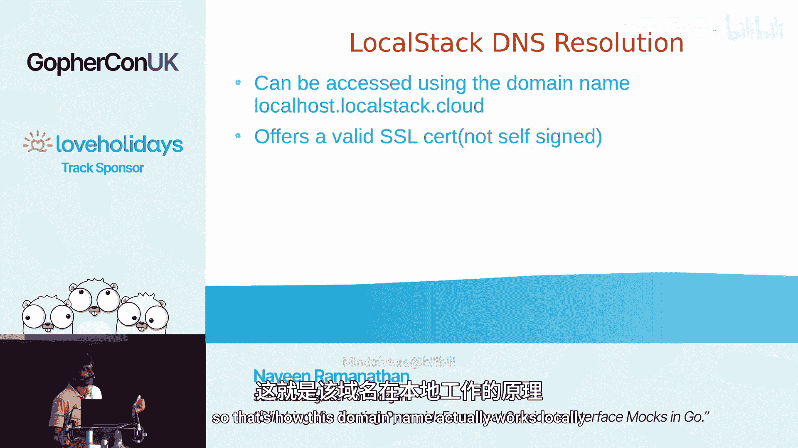
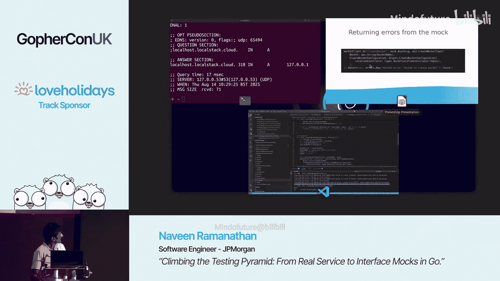

# Gophercon-Uk-2025-p03-P03_攀登测试金字塔——从_Go_中的真实服务到接口模拟--BV1dCHTzQEdN_p3-

So our first speaker is Naen Ramanaththan， and he will tell us about climbing the testing pyramid。

 Please welcome Naveen。ha morning， everyone。 thanks for joining and welcome to Go Focon。

 I really appreciate that。 join my talk。 Im a software engineer at JP Morgan and at JP Morgan。

 I do things like provision in Kubernetes clusters and managing them。 That's what I do at my day job。

 And I have a blog， which is golan board dot com。 I usually write all things about go Kubernetes and a bit of Linux。

 So it's been like our own for。 I think our own seven years I've been running this。

 That's my site project。 I would say。😊，Yeah， so before we go into the talk。

 opinions express are my own and they don't express the views of my employer。To be sure。Yeah， okay。

 so let's get into the talk。 So this talk is mostly about how do we test code that have cloud dependencies。

 I guess all of us will be using cloud。 Is there anyone that is not into cloud。Okay， that's good。 So。

 and we can talk about the different strategies that we use to cloud test cloud dependencies。

 So that's what I'll be covering。When you write say a code that interacts with the cloud。

 whether it is GP or AW S， let say we are creating a S3 bucket and we want to test that code。

 Do you find any difficulties when testing that code。😊，Anyone has any， yeah， I guess so。

 because the reason is cloud dependencies are generally very hard to test because we don't control the cloud whether when it's on premise。

 it was a bit easier。 for example， let's take the case of well。😊，Creating an S T bucket。

 testing the happy path is usually fine。 Well have access。 We'll be able to test the happy path。

 But let's say we have。😊，A code that retries creating the S3 bucket。

 if in case there is a network partition or temporary network issues when connecting to the cloud。

 we have to test this retry code somehow。 So that's the major difficulty with testing cloud dependencies where reing failures is really。

 really hard。 That is one And if you have worked in regulated fintech environments。

 I think you'll be knowing about access restrictions。 with that， I mean。

 developers usually don't have access to create anything through the cloud。

 either itll be through a Gi action or it'll have some kind of workload identity federation or a service account basically that will have access to create things in the cloud。

 So if you are in fintech， I think you'll be able to understand this better。 that is one。

 And the third one is for example， spinning up VM or E2。

 there should be tearone case as well to bring it down。😊。

Alright for big companies who are not worried about their cloud bills， but if you are a start。

 then we should be mindful of tearing down the dependencies after creating them。

 So these are the three things that makes testing cloud dependencies really， really hard。

 I would say。Let's talk about the strategy now。 So we can call test cases like testing permit。

 So the first thing that we could do is the lowest level， which is。😊。

We can test against the real service。 I think that's what we should be aiming at but due to the difficulties that we just discussed it is not always possible。

 and the second level is testing with emimulator I think as we go through the talk well understand so now lets go through the first one which is testing against the real service and。

😊，For this particular talk， we will be using a function I would say that creates a S3 bucket in A AWS so that will be a function that is under test okay。

😊，是。And this is the code that I have。 It's pretty simple。 Let me see with I。Yeah， here we go。 Okay。

 Ive written a simple re。 We have a simple re logic here， which just attempts。

To create the bucket arice in case there is any error。

And then we have wrapped it into a closure this is because we have we have to cancel the contextion case of any branches so to ensure that we do it in any of the code branches we have made this as a closure and that is about it it just creates the SC bucket this is the code that will be testing okay。

😊，And this is。Test case that is being written。 This This is also quite simply。

 which pretty standards of we create a S3 client， and then we。Create the bucket that is here。

 And then we check whether the bucket exists and。I we delete the bucket after the test is done as clean up。

 So let's let's run the code enough to me talking。Just give me one second。I'm just。

Comment results for the time being so that we know that the bucket is being created Okay。

 let's run the test。It does it stin。 It passes。 Now， let's see whether the bucket is actually there。

Okay， it is there。 This is a market that I just created。So let let me just remove it。

Keep it ready for the next test we did have a defer， but I have commented it to。Show that。

It is actually creating the bucket that is here。 Okay。

 so just to ensure that the next demo goes well and quickly remove this bucket。Okay， there we go。

Now let's get to the problem here， sorry。The slides。

Yeah， thats any ideas on how to test the Ana path here。 Now， everything works。

 The bucket is being created， but in our code， we have a a retail logic。

 So somehow we need to test this retail logic test You have any ideas or have you done it before。

 How do we do this with the cloud dependency。😊，Okay。

The way we can do the approach this is we have creating the S bucket function here。

 and we can introduce a proxy in the middle between。😊。

The code that creates the bucket and AW SS the proxy what it basically does is it creates a network partition。

 So when creating the Google client instead of pointing to AWs S3 and point directly we go through a proxy。

 So this proxy what it does it creates a network partition and willll be able to test our retail logic。

 So thats what we'd been doing。😊，And the proxy that we will be using is toy proxy。

 This is open source project by Shopify as we go through the demo we will see how to use this。

 and this proxy is written and go and it is used for simulating network conditions and it runs as a container and we can actually configure this proxy using rest As So there is an end point for conferring the proxy using rest As and。

😊，We can tell the proxy things like listen on this port as the listening port and use AWSS3 endpoint as the upstream so we can do all kind of things using toxic proxy。

😊，Okay， so what essentially will will be doing is the go client we contact S3 through a toxic proxy。

 we will be introducing network partition and then we will see whether are retail logic works。

So this is the architecture of proxy proxy。 There is a rest end point which runs in port8，4，7，4。

 which will be。Using to configure the toxic so in terms of toxic proxy all this latency or peer reset errors that we introduce are called toxics according to the their terminology so what we do is from the test through port 8474 will be configuring upstream and a toxic a toxic what it will do is it will add a latency to the call between the listening for what84。

43 will be the listening port now so our a 3 bucket function will。

We connect to port 8443 and then that will have the upstream port as sorry upstream as AS3 and the configuring part which is doing all these things is happening in port 8474 which is exposed through a ST plate。

Okay。Yeah， no， let's look at the cord。So we have we have to create a toxic proxy client which will interact with the toxic proxy on port 8474 there is a rest A for that。

 but there is a go client as well。And what we basically do here is we create S3 proxy and we say that this proxy will be。

Lsening in port8，4，4，3， and it will have the S 3 endpoint as the upstream。 Okay。

 and we are enabling it。 So this is this will contact us proxy。

 And then if we create this new client。 Okay now the client is ready。

 The next thing that we need to to us， we have to introduce a latency when。😊，When the。Basically。

 when the network or when the connectivity goes through toxic proxy。 So that is done here。

Which is adding a toxic。 So what we do here is we we get the proxy by name that we already created。

 which is S 3 proxy。 And after that， we had a latency toxic here。😊。

To the upstream connection and I have said this as 30 seconds。

 So what this will do is when the go code tries to connect to S3 it add a latency and then we will see a re code working。

And this is the。Part that we have to change in our test。

 the client that we AW S S3 client that we pass in our test should now be using the toxic flux in point。

 So we the way to do that is we this functional options we configure。

HtTB client and then in the transport we say that we have to give it a connection we say that use this one which is a toxic proxy end point to connect to AWS and then since it is a tCP proxy it is one level below htTps so it doesn't know about the endpoint that。

😊，That will be returned from the server。 So we have to specify the endpoint of the domain name that is expected in the TL certificate here。

 So we could do a Ts I mean no we we there is an option to not verify the Tls as well。

 but it is possible to do this if we specify the endpoint then the Ts will also be verified。 Okay。

 so this is pretty much the code。😊，So now好。Let's go to the code and run master stuff。

It is all that that we just discussed in the slides。 We have a proxy here。

 and then it is listening on this port。 and then we have upstream as AWS。

And then we add a latency toxic。Okay。And our AWS S3 client that we use to pass to artist。

Which is this one。Is using this convict。Which has toxic proxy configured。

 toxicy endpoint configured in the Ht T P client。 and we have this name here。 So now let me。

Go and run this test。I have to start toxicyrxy。Okay， it's learning no。Yeah， let's see。Hopefully。

 that I more God for with us。Yeah， now， if we see， we get a context deadline。算哎都。20笋。Yeah。

 we can see a context certainly exceeded which is because of the proxy it is adding a latency and we can see that our code is trying to retry but eventually it will fail because we have not removed the toxic gate the toxic is still there in the code so thats why it' is failing here。

😊，So now the next thing that we need to do is remove the toxic and。Pass this test。 So what we do is。

 let's say in the test after a few milliseconds or a few seconds， we can remove the toxic。

 So what it will do is after a couple of gries， the toxic is not there。

 And then eventually the code will。😊，Eventually， our test will pass and the market will be created。

 let's go to the demo now。Yeah， so this is the change here。 After a few milliseconds or seconds。

 actually， we are removing the latency toxic so that the bucket will be created successfully this time。

 So let's surround this test now。😊，Yeah。So the first time it fails。Then after that。

 it creates a bucket successfully。 and we are having a code that defer to delete the bucket。 Okay。

 so this is how we can test our failure case， which is the later logic。😊，Okay。

 and the next one is how do we validate the re automatically Okay we can see from the logs that the re happens。

 but。We need to be sure that the re is actually happening。

 One way to do this is to tail the logs and see whether we are able to find out the particular log that says that there is a failure to create the bucket and I am actually re so the way to do this and go is pretty similar to Linux which is like a T writer I would say we can create a buffer。

 and then we will stream the logs to both to standard error， as well as the buffer。 And then finally。

 we check from the test。 whether this particular buffer has the log that we expected。

 Okay I know that this is sort of brittle for example， if we change the logs。

 the test will start failing and someone has to go and fix it。

 But that is also one more good way to understand that our tests are actually working if it fails its good。

 then we go and fix it。 so this is one way that we can test the re now， let's see this。😊，Corin。

Yeah here it does。This is the T reader that we just saw。 We have a string builder buffer here。

 and then we have a multiwriter here that will write to both standard error error as well as the launch buffer。

And then we are using S logs S log for the load handling。

 So we set the new text handler to be this writer and then we set the S logs default handler to be this okay。

And then in the code， this is a simple string comparison to see whether the logs actually have this failed to create a bucket string line or not。

 which is。Which is here。So fish on this again。Yeah， the log line is there， and the test will pass。

 in case let's say I。Change this log line or something happens Let us start failing。

 And we have to go。And fix this。Yeah， the tests are failing。

 so this might happen in a production code where someone changes their log line and the test starts failing。

 We have to go and ensure that we keep it on track with the code。Yeah。

Okay。And this is fine。 We'll be able to test the happy path when creating the S3 bucket and the unhappy path as well。

 But it's not always possible to test it against the real cloud service。

 Let's see what are the reasons we discussed about this a little bit earlier。

 First one is access restrictions which is common in fintch where we don't have permissions to。😊。

Create things from our local。 Itll either be from we an E to that transformations to do this or some kind of the ACD pipeline。

 will will not be able to basically do this from a local。

 That is the issue with the testing against the real service。

 And the next one is cost if there is say， dangling resources that have been created and not being cleaned up by the test case properly。

 then it adds to the cloud bit。 So the second thing actually I would say leads to the first。

 which is access restrictions because of developer hygiene Okay so。😊。

Now lets talk about what what can we do this to solve this so we were in the bottom of the pyramid which is testing against the real service in case if that that is not possible or we don't have access to do that we have the second level which is testing with the service emimulator。

Okay。Eulatorators are they provide mock implementations to cloud dependencies and a few other external dependencies and they run run in a container a single container usually so it's very easy to use them to for testing in local and N as well。

😊，And particular emulator that we be seeing is local Sac。 Local Sac is a emulator for AW services。

 it has coverage for lots of the AW services that we use like E C2。S3 or I mode D。 So in this case。

 we will be using S3。 So it has support for S3 and the amazing thing about local circles when using the AWS CI willll be able to specify the local URL and the AWS CI as it is works。

 So if we do say AWS S3 endless with the。😊，Local tech you be able to see the bucket actually outputed in the command line。

So， let's talk about the。Confiration， the configuration is pretty much the same。

 So here the upstream in the last testing against the real service。

 we had the AWS S end point as the upstream for the toxicy client。 But this time we use local tech。

 So local stack will be running as a container locally。 and they have a valid domain name。

 So that will be the。😊，Astream that will be that well be connecting to。

 And then the config is almost the same。 The difference， I would say。

Is with the server net because this time we are not connecting to AWs S 3。

 but we are rather connecting to the。Connecting to the local s， local environment。Now。

 let's look into the code everything。So this is the local track optionstream that will be connecting to。

 this runs locally as a container。And then we are changing the configuration for the S3 client to use。

Local sex when name when verifying the Tls the remains from the code should be the same。

 So let me quickly go and start local S。Hoolute。Yeah， it does。Yeah， the test pass。

 So this time around， we are using the local second point instead of the AWS S3 end point。

And as I said， local S also provides。A URL that will be able to verify whether the market is created or not using the AWS CLI。

 So lets quickly go to that。😊，或着的。Iphone。Yeah， we see the bucket here。

 So this is one good way to test whether local tech is doing what it is supposed to do AWS A or the AWS C I has a way to specify the endpoint and we'll be able to check whether the bucket exists locally as well。

😊，So now给你 go ahead。

Okay now let's talk about the locust DNS resolution a little。 so we see that it is running locally。

 but it has a valid endpoint as well and there is no the Tls works as well so it is not a sales sign in certificate the way this works is locus what they have done is they have bought this domain name which is localos locusact dot cloud and they are actually pointing to 127 do00。

1 in the DNS entry。 So thats how this domain name actually works locally。

 So if we do a dig well be able to see this。😊。

So， if we see here in the air record we have 1 to7。0。0。

1 so even though the domain is registered for local sec they are pointing it to this local letters so that' is how TS verification works as well。

😊，Let's get back to。emulatorators are fine but they come with their own set of problems。

 which is they don't have 100 percent parity with the cloud dependency。

 all services are not available and for certain cloud providers， for example。

 I would say I sure I think it doesn't have an emulator and we do have lots of other cloud providers。

 for example， digital options we have in order as well I don't think we have emulatorators for all of these cloud providers that is the primary barrier for testing code with the。

😊，Eulatorators。 and the second one is also a parity， as we just discussed。

 So now it's now we have covered the first two levels of the pymid。

 Let's say we don't have a emator or。It is not in feature parity with the with the service that we would like to test。

 Now we move one level up， which is testing with the HtTP mos。So mock services。

 what we do is we create a mock htTP service which resembles the cloud dependency and we run it locally。

 It can be thought of as writing our own emulator。 That's what the emulator pretty much does。😊。

And Ht TP test standard library has support for writing mock services。

 We could use a standard Ht TP library as well， but Ht TP test is good for reasons that we will discuss which is it creates it provides a test server and that test server comes with the Tls and it also gives us a client that trust this server SS so we can use this client in our test and Tl S also works。

 We need not do skip Tl S verify。 That is one advantage of using the Ht TP test standard library and。

😊，It starts in some port and host name and it exposes these ports and host names using functions and will be able to use this port and host name when。

Creating our test as upstream for the toxic proxy。 So the code basically says the same。

 we just keep switching from the real dependency to deimulator。

 And then now we are going to switch to the HP test service。So now， let's look at the happy part， so。

The code for this demo doesn't do much。 it just returns status， okay。

For whatever input it gets okay so we can add a logic here like checking the bucket name or checking the met date of the bucket or things like that。

 but for the purposes of this demo it only returns the http state is okay and then。

The test this creates a test server。And for conferring the client it exposes the test server using this URL okay this is where the server will spin up and then it has the port ta as well。

And also， it has a client and this is what we had discussed earlier。

 which is this client trust the server certificate。 it is configure like that。

 So there is no need to skip T S  verify。😊，And there's。It's do 때。This is a code here。

 it creates a server。And then we have the server here。

 We use the servers URL in the convoil configuration configuring the client。

And then we just create a new market。Yeah， it's running and it's quick as well because everything is local。

 There is no integration with local or cloud， okay。Now， let's go ahead and。Test the unhappyy part。

Sorry。😔，So here also， we will be using toxic prooxxy。 It's the same configuration。

 And the change that we do is。那。It is here。 It's with the。It's here。

 It is the host name and port name。 So we create the T server here。 It exposes the URL in this。

Variable we pass the URL and we get the host name and port name from here so the host and port where the Tls server starts the server is here and then for the for the toxic proxy client。

We changed the upstream to this host name and putip。

 so now toxic proxy is listening is or actually it's proxing our test server。

And then for certificate what we do is the test TLS server also exposes the certificate that is use that it uses so we create a root CA and then in the TLS client that we use。

The htTP client that we use in the S3 client which we use in the S3 client。

 we said this as the roots here so here also the TLS search work without the need for skip TLS verify。

Now， let's quickly run through this demo。Yeah， the this is code。

And then what we do is we pass the URL， we get the host name and the port name。

 and that is set up as upstream for。For toxic proxy。And then the rest of it is the same。

And we add the roots here here。Yeah， we can see that it's retrying and then it has created the bucket and the bucket is successfully deleted as well。

OkayThere is also cases where the mocking is also always not possible。

 The first thing is there are close those dependencies。

 The A SDK does a pretty good job of providing a functional option to set the client that we need。

 So that's why we were able to override the client by our own URL which has toy proxy。 It works。

 But there are close source dependencies which don't allow to do this where we not be able to change the HtP client。

 So we not be able to mock as well。 And then we if we start writing mocks。

 then maintaining a mock becomes a task of its own。

 I would say we have to add for the demo for the purpose of the demo， I had a very simple mock。

 but we start adding logic to the mock and that becomes really difficult to maintain as well。

 So these are some barriers for using mocking so。😊，So now we are in the last level， which is。

 let's say we are not able to use marks。 Now finally， we can go with the interfaces。

Whi is which doesnt use the server lets see how to do it the first thing that we need to do is the S3 client that we pass here to the bucket was the was a structure。

😊，Earlier we all know the go go Pro which is accepted interfaces and returnstruct。

 So the first thing that we need to do is convert this into interface。

 So the methods that that were called using thestruct earlier where the create bucket delete bucket and we had a hit get bucket method which was using this already existing interface which I am just specified here。

 So this is the new interface that needs to be created。😊，Which will have these three methods。

 and we pass this interface as。As the client know instead of using thestruct directly So this is the first key factor we need to do the we need to do in the code if we want to use interfaces for testing and this is done in the create S3 bucket method。

And after that， what we do is we have to create a mock S3 client structure which implements all these three interface methods which is the create bucket head bucket and the delete bucket so here I am returning empty strs without any error so that the test succeeds。

😊，And next， what we do is we have the mock client now。

And when creating the S3 bucket we used to pass the actual S3 client with the toxic proxy and upstream URL and stuff like that。

 But now it is not needed we just pass the mock S3 client here our code accept this interface and then it calls the mocked methods。

Yess。응 들어두 또 뭐。Yeah， this is the refactor。 So now the S 3 client， instead of astruct。

 you are accepting your interface here。And then that interface has these three methods。

 And if we go to the。S3 client， it has implementations for these three methods right now。

 it is just returning a empty structure and it doest return an error so that the tests will pass。

Okay， this is pretty standards of the test passes。 Okay。

 the next thing that we need to do is test the uny path as usual。 Now。

 let's go ahead and see how we can do that with mocks。Unhappy path as we discussed earlier。

 there is no need for a proxy because this is just plain start mocking if we return an error from the work implementation。

 which is the methods that we implement in the interface it will just start the test will start failing and we will be able to test the re logic but there is a problem here we need to test the whether the re logic succeeds which is for a couple of times it has to fail and then it has to create the bucket so to do this。

One possible implementation is we have a call count in the mock S3 client。

 and we track the number of calls here。 for example， for the first two times the。

Create bucket is called we return an error okay and when the third time the bucket is called we don't return an error so ideally what this will do is it will test a re logic by the first two times it will try to create the bucket it will fail because of this error and in the third case it will return success and then the bucket creation will pass。

We run this code。As we see here for the first two times。It has failed。

This is because of our logic here which checks whether the call count is less or equal to 2。

 if it is less or equal to 2， it returns an error in that case at logic kicks in。

 it tries to create the bucket twice。And then finally， our bucket is created and deleted okay。😊，This。

This seems to be fine， but there is a problem with this as well。

 which is it becomes tedious to maintain the most。 So if we see here。

 we have we already have a call count and then we need to check how many times the APA is called and if it is more than our re or if it is say for our re is three times we have to track the number of times the function is called。

 And as the code becomes bigger this becomes really difficult to maintain。

 And one more thing is every time our interface changes， the mocks have to be。😊，Return again。

 So let's say we add another method to the interface。 It becomes really。

 really difficult to manage in the long run。 So there is a way to get over this as well。

 There are automatic mock generation tools for generating these mocks in go one such tool is mockery。

 It's a open source project and it generates the mocks based on configuration Yal file It has a lot of options in this Yaml file。

 for example， in this case what we have used the file name to generate the mocks which is mocks underscore test dot go and then we say that what package is needed。

😊，For what package the mos should be generated which is this is the package that we have been using in the demo and we say that for all the interfaces the mos have to be generated so it has a lot of configuration options but this is the simplest I could get for the demo but you can go through the dock it is pretty exhaustive there are a lot of options to configure the mos okay。

And the great thing about the this is it will generate us code and then。😊。

Well be able to validate whether our interfaces are called as well as well be able to return errors if it is needed。

 for example， let's say we have this this mock history client was generated by the mock and we can say that on calling this create bucket method The first parameter is the context that we pass when creating the bucket so we can say that it can be anything and the second validation that we can do here is we can validate the bucket name and the bucket location and we can validate a lot of things like this and then we can return。

😊，N and mill， which is the bucket output and the error。 So this is for the success case。

 Let's say we are returning errors from the mock。 It has convenient help of functions like this。

There is a twice。 There is a once as well。 So what this will do is on the create bulk function call it will return error twice and on the third call if we sorry if we do a once on the third call without any error it will return a success。

 so lets go into the。😊，Courd。Let he be。I already generated the mocks here， using。啊 thisや系。

So we go to the court here。The success case is pretty simple。 We just。

Ass certaint that create bucket is called。And then we don't return error and we just return a enough for the output structure as well this is the success case。

And for the re case， what we do is。From the mock this is the and this is the mock line that it generates from the code that it generates we assert that the create bucket is called and for twice which is two times we。

Return error and the third time。We don't return an error， which means it passes。

 so if we do this then we will be able to place the vitri logic as well now lets run the key。Yeah。

 so if we see here。It has failed to create the S3 bucket twice。

 and then finally code has created it and the defer has deleted the S bucket。O啊。

So。The conclusion is there is no one solution for the problem actually there is no one phase with all solution and usually a hybrid approach works we need not stick with one approach even within the same test case for the happy path we will be able to use the real service and if it becomes difficult to test the unhappy path we can go with interfaces in the same test case that that is the preferred option here。

😊，And mostly I would say we can try to test against the real service and if fallbacks then as a fallback we we will be able to walk the pyramid up and go to emulator or mos or interface face marks。

😊，Yeah， that's all I had if you want to contact me my social media and my email analyst here。

 thank you。

