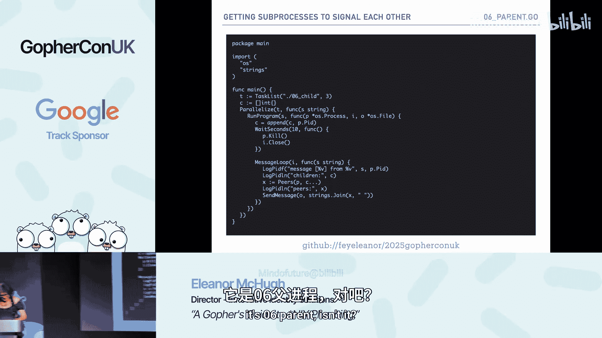
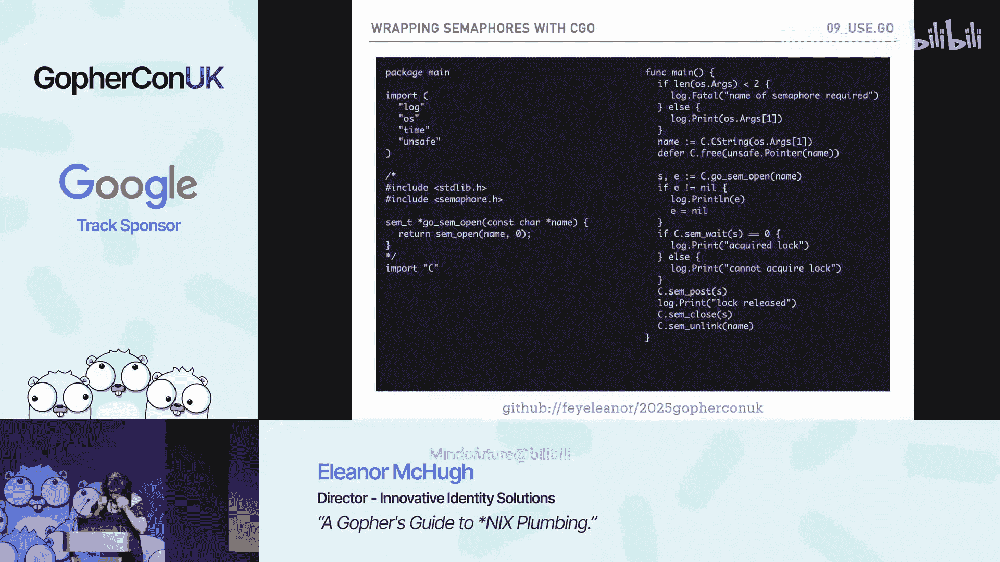
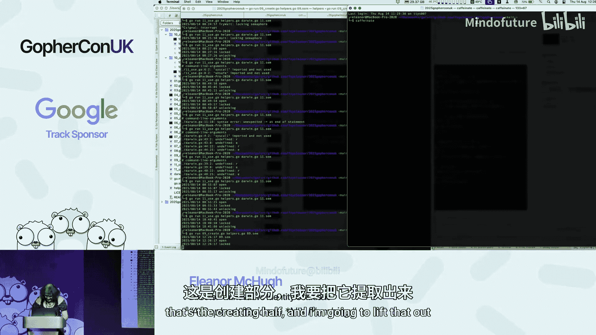
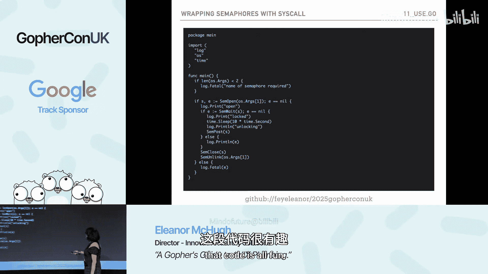
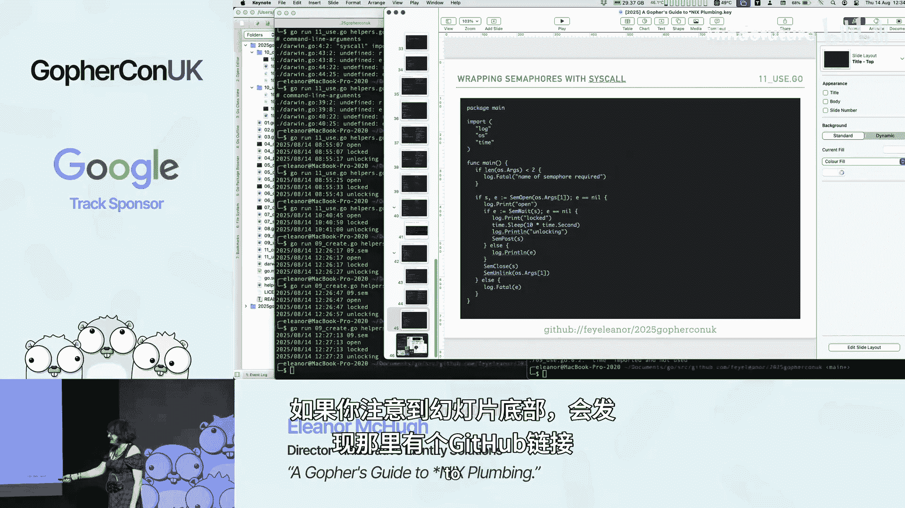

# Gophercon-Uk-2025-p04-P04_Gopher_的_NIX_管道指南--BV1dCHTzQEdN_p4-

🎼Yeah hello everyone I hope you had a great break so we're about to have a talk from Elna McHugh Elna is an aficionardo of both Go and Ruby is the author of a GoDevelops notebook and is currently the director of innovative identity solutions now last year at GoCon had a bit of trouble E because sadly her talks were a little bit to engaging for her own good so if we're hearing a three hours time and I'm sitting quite placidly with a big smile on my face in the front row could someone just tap me on the shoulder to let me know that we're slightly past time and then'll ask her if she wouldn't mind stepping down for a little while but until then with her talk a Gopher's guide to Nick's plumbing please give a big hands to Elna McHugh。

😊，Good morning。You right。I really have no sodding idea how to start this talk。It started。😊。

This all started in 2009。I mean， my involvement with Unix didn't start in 2009。

 That started in 1998 when I broke into my first。Got legitimate access to my first little old Ts box in the engineering department that I wasn't part of at Kingston University。

 which was then a Polytechnic。😊，Anyway。For a lot of years， I was a systems fomer。By which， I mean。

 I was an embedded systems programmer for a decade。

 something that I harp on about all the time because please， God。

 pay people enough to do that work so I can go back。😊。

You only have to care about hardware and you don't have to care about business people very much。

 It's very nice。Anyway， in 2009， I was looking for an excuse to get to a Ruby conference in Manhattan。

 and I thought。😊，What better way to get an excuse for that than to say。

 I'll come and talk to you about how to do kernel scripting in movie。

This was the last time that I was on the Ruby conference circuit in any serious way。

 because I did five conferences， burnt myself out。 go release today。

 I came back from the last one of them， which was Rupi in Posan in 2009。

I took one look at it and when it's got multiple returns。

And there's history there because from my MSC， I was not allowed to develop a language with multiple returns because I was doing a more business oriented degree and I had to do something more business oriented。

 so those would not parties did。😊，Which I don't say how that's any better。😊，So I thought this year。

I've annoyed people with a lot of other stuff。Let's make the entire go team go， God， no。

 don't do that。So that's what we're going to do。Now， I've only got 11 examples here。

 There were supposed to be more。 It turns out that debugging things when you're using cisco。

And semaphos and things like that is a little bit of a pig。

 And I'm also building a cabin at the same time。 I'm a bit distracted。

 So we'll go where we go and see what we see。😊，So Ex is very old and venerable。

 it dates back to 1969。And you should recognize one of these two people。

For here we have Ken Thompson and Dennis Ritchie， the two creators of Eunuchx。

And as Kent Thompson is one of the three creators of Go， and as Rob Pike is sort of like。

 before he became famous for doing stuff with languages， was famous for X windows and Munichs。😊。

It isn't really a surprise that Go is actually quite good at sitting on Unix。

And we have a couple of books。Please don't try to learn PP 11 assembly language。

 or its big Brother Vax 11 assembly language。 They read like high level languages。

 It will ruin you for assembly language programming。嗯。But can't get like。Obviously。

 everything I'm going to talk about is stuff that was invented in C originally。

 and we're not going to touch much C in this talk。But we will touch some。Yeah， Much。

 It's got stuff not interested。 I'm more interested in that bit。

The whole point of Uni is to get out of your Fffing way and let you build the programs that you either need to build or want to build。

It is not an operating system for business types who。

 you know since the invention of Cobal have been inflicting processes on us。

It's a good operating system for hackers who like to write code， don't feel embarrassed writing code。

 and would really wish that everybody would so off and let them drink their cup of tea and finish writing code。

😊，I'm one of those。嗯。The basic premise is quite simple。

 you build little things and you compose them and pump output from one into another and things happen。

No， I really， God， my poor liquor is dying。This has been to so many places with me。😊，Now。

 I did have a sensible disclaimer slide， you know， this only works on Go blah。

 blahh and only tested on MacBook Intel and all of that。 but really the truth of the matter is。

 don't do any of this。😊，I'm going to show you stuff you shouldn't do。😊。

Unless you want to do it for fun。 don't do it in a production code base unless somebody pays you a lot of money。

And takes the responsibility for when it goes wrong。And we will get to things that will go wrong。

Right。Let's start with something simple。The heart of Ex is that it's multitasking。

And the point of multitasking is that you can have these discrete little processes that talk to each other。

 And one process does one little job， and it feeds some output to another process that takes it as input and does another little job。

And you get these little pipelines that run between。

So the first thing we really need to do is get a process。😊，I mean， technically， we've got one。

 the program we' were actually in at the time is a process。

 but it's kind of nice if you can have other processes doing other things。😊，So in this case。

 this is the highest level interface that Go gives us for this malary。😊。

I am going to launch the Echo program。It's going to echo hello golang。

 I don't actually care what Echo does from the point of view of writing the code。It's a command。

 and it takes some arguments on its commands line。 And that's all that this is doing。

 This is pumping its its O S Og's value。Right。I can grab hold of the output from now。

 Now when I grab hold of the output， I'm not getting it interactively。

 I'm just sitting there and waiting until it's finished producing all of its output。

 and then it it dumps it all at me effectively， at least from my perspective under the hood it's sort of trickle sending it on its standard output。

 but to me， I just get this big blob of output and I do something with and what I'm going to do is print it。

 This is the very simplest program you can come up with to create a subpro。😊。

Now it's called a subprocess because everything inside computing is a tree。😊。

And processes all live in a tree。😊，So this that this program's running in that's our parent process。

😊，And this over here， this is our child process that's gone off and done some work。😊，Okay。

Now there's a basic format to how I'm going to talk about stuff。😊。

I'm going to develop a DLL that means that I can make it very clear what's happening。

And then I'm going to talk about bits of that DLL to explain how they work。

I don't know if there's enough content here for an hour or half an hour or 45 minutes。

 because I only finished writing what's here about 45 minutes before。Before I got in this morning。😊。

And there's a lot of examples that I just didn't have time to finish debugging。

 I don't like showing off code if I've not debugged it。 It should work straight from the slides。

 Otherwise it's a bad talk。The constraints you put on yourself that make life more difficult。Okay。

 so firstly。😊，There's three things up here I'm actually interested in。

I'm interested in being able to talk to the operating system。 that lives in the O package。

 which is part of the standard Packers Library。I'm interested in doing that whole。

 executing a sub processcess thing。And I'm also interested in some specific is it system specific stuff that lives in Cisical。

😊，I'm going to use Cis call extensively， and then there's an alternative which is specific to UniX。😊。

Now， I keep reading things that say that Cisco has been deprecated and I keep seeing other things that say。

 well， I'm not using the Cisca in Unix。 I'm using this Cisco。 I have no idea what's going on。

 I have no privileged insight whatsoever。 I just have a command line。

 a text editor and more time than I could do should be using。

So our program here is going to launch off as many different commands as I give it on a command line。

 and you know what， I wasn't expecting to have an hour， so I'm actually going to go into a term， God。

 that lights b， go into a terminal and show you exactly what I mean。

Which means doing that and then doing that and then being back there。Well， of course。

 now I can't actually see the slide， so that's not very helpful too。😊，So go on。Oh yeah。

 this is also a really bad idea。 Don't put lots of programs in the same directory and give each of them package Ma。

 It happens to be incredibly good for doing examples in talks。

 It's a dreadful idea if you ever want to build anything。😊，So in this case， I'm going to go。Echo see。

 I don't know if it's actually going to do path expansion， but we're going to ask it。

And then we're doing LSS Air AL。😊，Oh， and then of course， there's the other bit。

These examples all rely。😊，On a helpers file so I can get all of the bullshit out of domain main code examples so you can just concentrate on what they're doing。

And did we get an echo？B。嗯。Not that I can see， but we did get an LS DL。 so I'll count that as a win。

I'm not greedy。There was an echo brilliant。😡，I can't actually see at any bloody distance because I'm too short sighted for my glasses。

 I'm too long sighted for when I'm close， and it's justoo。

I really only normally live at terminal range， which is right here， so。Right。

 so our program is going to create a whole pile of subprosses。

 This parallelized thing I'm going to talk about in a second。😊。

For each one of these parallelized tasks， we launch our command。To do that。

 I'm actually going to find out what my preferred shell variable is from the environment。

 I'm being kind。For people who want to use seashell or fish or any of the other mad shells that are out there。

 I mostly just live in Zed Shell these days because that's the one that comes straight out of the box in my Mac。

I wish I was still in bash。 It's not as easy to write dodgy scripts Ed Shell's bash。

 but I suspect that's intentional。Down here， we're going to grab the standard out and the standard error that the operating system is provided to our main program。

 and we're going to let each of the commands that we launch off have those as it standard out and standard error so it will dump any garbage straight to our terminal that gets spewed out if we type in a wrong command so we can see it and it will also dump the output straight to us。

Welcome to our first Cisco。This is a very polite mapper to find out what the process Id of my current process is。

That is not the process that's exact， that is this process here。😡。

And that's so that for each of these， I can say， well， I'm launching off this process over here。B。

 but， but， this is my process Id。 This C dot string overhell print out a whole pile of stuff about the command。

 and that will include its process I D。 I think I did that with command line。 Can't remember。

Doesn't matter。Then over here。😡，For every one of these shell commands。

We're going to launch off a timer that's running in our main program。That will kill it。

After5 seconds。So itll run for five seconds， I think。Dead。In came the doctor， in came the nurse。

 in came the lady with the alligator purse， a Budha wasn't it。

It isn't necessarily guaranteed to be dead。 It can become a zombie。

 There's all kinds of weird stuff that can happen on eunuchs。喂喂。😊。

The launch command is not very exciting。😊，It's just， you know。So let's have a look at what we do。

 Now， parallelized is actually quite useful。 It's not a nice little pattern。

So we've got a standard standard package sync that includes this concept called a weight group。

 and weight groups are great there， this little atomic thing that every time you start a task。

 you says tell it that you're starting a task by adding one to it。I don't like the naming of that。

 to be honest， I don't like the fact I can add 5。 That just feels wrong for what it's actually doing。

 but。I might do a time of example one day that just uses weight groups to do the timer。

 kind of funny。But down here， all I'm really doing is。I'm saying。You've given me a piece of work。 Oh。

 yeah， we're going to do a lot of function passing。 Hopes you don't mind。

This technique is a sequel to last year's talk on functional of forgo。

So I'm going to pass in a nice little function or closure of any type notice so we have made it fully generic。

😊，And I'm just going to make sure that it runs off， does its bit of work。

 And then when it's finished， it dectriments this weight group。 So each time a task dies。

 the weight group counts down by one until all the tasks are done。😊，Wait down here。

 waits until all the tasks are done。 and then we pop straight back out。

 It's a nice little bit of code。 And I like the fact that you can write doel in go。

 because a lot of people don't。😊，And I'm old fashioned。Is anything else to say here， oh， yes。

 obviously。Right， we're arranging over a loop。Whenever you're launching go routines inside a loop。

 always make sure that whatever thing outside you want to use inside， you pass as a parameter。

This loop goes around。 God。 I used to actually know a reasonable number。

 but let's say that takes 2 nanoiseseconds。This go command here from the time that he executes and says。

 okay， that's happening in the background。 I'm just getting on with things until this bloody thing actually executes 4 nanoiseseconds。

You walk through a lot of loop space in that time and whatever the value of that N there is。

 if we're referencing that directly from here， that's the value you'll get。

So if you've exhausted the whole of your loop count， you will only get the last value。

 it's the most insanely annoying bug。And I've been bitten by it so many times that I go out of my way to avoid it。

Now。This good example is slightly more complicated。And oh。Let's go back and have， backwards。

 backwards， let's take this slowly。It's too early in the morning。 Three hours sleep doesn't help。

 right， So here。Now you are just trolling me， stop it。Right， so back here。

 we're launching off a command， and we're setting up a whole pile of stuff here using Xec dot command。

But that's a high level approach to doing it。And what now we' go the wrong way again。我。There we are。

I'm not standing with you。All dont know。Right， what we're going to do over here is we're going to go down a level of abstraction。

Were actually going to go and start the process manually。Now OS。star process will take。

 let me see I've Ju rigged together a command which consists of the command I want to do。

 a parameter to it， some more parameters to it， I'm using this dash C because。

It felt right at the time， don't hold it against me。啊。

But the main thing is Shell Command is now taking a set of parameters up here。Right。

 which it's getting in this function here， which is part of being parallel and being given one OS S Og。

So the first argument there comes into the first imvocation of this function。

 and this here will then result in shell command down here， getting one command to run， just one。

And then it's going to want to grab a process。😡，And do something for that process。

This builds a command line of which we need the very first entry of that to be the name of the program。

 it's a fully path。Canonical name at that point。So that's what's actually going to run to do our thing。

 That's where the show runss。And then we give it the whole command line。

 because shells do expect to get their name of themselves as part of their command lying arcs， right。

This stuff is a all a lot weirder than it needs to be now I think about it。

We're then going to grab hold of a process ID for the program that's actually launching it。

So we can print out the little logging message all the way through。 I am using log， not。Format。

 print， whatever， because that would go to standard output。

 and log will just go off to wherever log lives。嗯。It's probably better in a real world program。

When we start the process， we also have to give it a set of files。

There's three that are basically by default， given to every Uniix process standard in。Standard out。

 Standard error。Each one of them gets a file descriptor， which is a number。

It's an integer from0 upwards。Every single process you look at standard in will be 0 if it has a standard in。

 which should have a standard in。 I mean， I can't think why it wouldn't， but it might not。

So here we're going to create a set of standard in。We are。 We really are。Com吗。

We're going to set give it a little set of three files。The standard in， the standard out。

 the standard error for our process， we're going to say you use the same ones we are using。

Shells do this all the time。 So it seems perfectly reasonable to do that。

 I'm also going to wrap up this time after funk because I really don't want to have to keep typing the time dot second everywhere When I want to set a timer。

 I know that I want to set timers for a number of seconds。 So I just wrap things。😊，嗯。😊。

It's kind of a talk on refactoring， I guess， don't hold it against me。

I promise never to tell you how you ought to write your code。Death。Right， so down here。

 that set of three filess that's passed in。As part of this thing called a proc a。

 Now that's a set of attributes that describe a process。 When you create a process。

 you get a handle to one of these things， and you can look up stuff about it。

 And when you're creating a process this way， you create one of them to give to the thing that creates the process。

We' then just call our function that does our work。

 which gets our actual handle to our process so we can kill the process up here because it knows about it。

And then we just wait for the process to finish。So this is， you know。

You can use this to build a really， really inefficient version of semaphos， locks， Mutexes， etctera。

 please don't build Mutes with processes， it's a horrible idea。😊，😀系。😊，But if you are going to do it。

 please here and do it on Windows。Now。Yes can that。Oh God。

 time is going much quicker than I thought it would， so I'm going to speed up。Okay， so。

For our next little example。😊，I'm going to create a child process， and I'm going to interact with it。

 not over standard I O。 I'm going to interact with it by sending it signals。Now。

 a signal is literally just an in of value that turns up at the process。

 The process doesn't know where it came from， it only knows what type it is。

 there's lots of amusement can be had with that concept。Outside the scope of today。😊。

And I'm going to set things up。 So I'm going to wait 30 seconds before I kill the process that I'm running。

I'm going to wait 20 seconds， so two third as long to send a sig term to the child process I'm going to create。

 so I'm going to kill my child before I die， which is a bad practice。

And then every second for 20 seconds， I'm going to send that process。An interrupt signal。

I'm going to run this wealth in the command line because otherwise it makes no sense。😊。

This is the closest I'm ever getting to live coding。 I refuse to go any further than this， right。

That's so， that was4， wasn't it。So we can get into the command line parameters。

 I don't think we need those。D da。诶。Oh， you'll be。Okay。

 I have naming conventions and they're also kind of crap。Right。

 so I've got a parenting process that is currently talking to a child process。😊。

It's sending the such child process this into up signal once every second。Boom， boom， boom。

 this is the payment process。Log， I've set up logs。

 so it will quite happily tell me about which process is doing what。 So 111，7，2 is the parent。11，1，7。

3 is the child。 The child does a whole pile of stuff。 Then he'd exit。

 then the parent goes that the child is finished， and then it exits。

 right It's a very simple concept。 That's horrible to describe。😊，So going back to this。😊，Okay。

So let's start with one program。 So down here， I've just taken what we did in the previous example。

 setting up a command line。Setting up some standard I O。

 I've put it all in like that because otherwise the line just goes on forever If you do it in line。

 and it doesn't fit on a slide nicely。I've created a helper function， a set of helper functions。

 in fact， called log Pef， in this case。This is a normal log call。

 but it finds out what the process Id of your process is。 So it printed out in the log。

 So you can therefore see which process is doing what。

And this bit is just the same as we already had， we're doing our work load。

 and then we're waiting for it to finish。😊，So if we skip on。These are really simple wrappers。

 The main thing that's important is they're all doing ciscos to a get paid。😊，Except for fatal。

 I seem to have forgotten to do it with fatal。Here we are。 bug。

 I found my first bug I can actually spot。 Nothing very exciting about those。😊。

Something more interesting though is。😊，Tickers。Now a ticker ticks。And it does it based on duration。

 in this case， I'm saying tick every second。Operating systems have a finite minimum tick time。嗯。

Without using。Real time operating systems have high precision timers。

 and they can quite happily do very small ticks in tea down to the fractions of a millionsth of a second。

😊，But commercial operating systems have this habit of having tick timers that are。Every millisecond。

So。Ticking on a computer can be a strange thing。In this particular case。

 I don't really care about the detail。Go gives me a ticker。I give it a duration。😊。

I read off of the ticker because it exposes itself as a channel。And then I keep doing that forever。

 But I've got a countdown on my ticker。 So when the countdown hits 0。I return， and my ticker dies。

 In the meantime， you might want to run many different tickers at the same time。

 So I've put a sink weight group in。The way group will tick up， the way group will tick down。

 this means as this is given back as a return value that somewhere else in your program。

 you can wait on all your tickers to end if you really want to。Because otherwise。

 some of your tickers might get cut off before they finish doing their job。😊，So。蹦蹦蹦唔。Oh。

 I've gone back in the opposite direction again。😊，Right。Now， this is the child。

 This is the program that's going to be in our child process。

 This program is going to listen for signals。Right。So。We start that by creating a channel of signals。

Quite handily。I've buffered it at one， it doesn't need to be buffered。诶。For our purposes。

 it makes no difference because we're sending signals so slowly， know， once a second。But down here。

 you just range on that channel of incoming signals。And then if it happens to be a SIG term。

 we will close the channel。Which will then mean that we stop ranging on the channel。

 which will mean that we then exit the program， and when we exit the program。

 then obviously the parent process goes， program is ended。if we get to that point。嗯。

There isn't a lot really exciting to say about that。Anything else？I mean， obviously。😊。

You use a term to tell a program that it should terminate。

 but there's lots of signals for lots of different purposes。

 and there's also some user definedfined ones that we'll use later that you can use for whatever you want。

Deliberately listening for operating system generated signals and let you know what you're doing is probably a bad idea。

Suck it and see。Sor of thing。Right。come on。Be obedient。Right， we've done every second。

 That's the child。 Where are we now。 Allright， program number 5 is kind of a variation on program number 4。

 And I've got to remember what kind of variation it is。 Oh， yes， I've introduced a signal hand。

 I don't think I had that in the previous one， did I。😊，No。

 I didn't have a signal handle in the previous one。 So this one。

It's going to exchange signals with its child。😡，The child process is going to send a signal back in response to receiving a signal。

Sa天红。Standard conventional， I want to test how concurrency works sort of program。诶。

Nothing down here is particularly different。 I've only actually continued to list one program because I have not moved it off into the helpers's file because it's just。

 I don't know， maybe， maybe not。Probably should。Not that concerned， right？😊。

So we've got a package for handling signals， OS slash signal。And all we have to do on a signal。

 this is great。😊，Because。We receive a signal。😊，Right。

And we got a signal type that we want to look for。 So we say。

 notify me when that signal happens and do so on this channel， see。And then。

Just go away and do some work until whenever。Now， obviously， in a real program。

 you'd have some guards around this to make sure this go routine stays alive like I've done in other places and stuff。

 but it's such a stupid example。 I couldn't really be asked。

All we keep doing is just keep doing the job until the channel is exhausted。 and then we exit。

 That's all a signal handler is。Book。看么。Ac 1。And that's literally the only change in that program。

 which is great。 I can tick off five really quick。The child's got a slightly different job to do。

 though。The parent knows its children because it's created them。

But the child doesn't know its's parent， until it asks。So in this particular case。

 we've got a ciscal peapi that allows us to ask for our parents。Process I。

And then we confined that process。You can put any random number in there， and if there's a process。

 you'll find it。Except on Unies， you can put any random number in there and even if there isn't a process。

 it will still give you a pack process handle。So you can't just rely on that bit of information。

 You then have to go often。To make sure it's really a live process， you have to send it a signal。

And only if it receives a signal， is it a live process， we'll get to that later？😊，Right。

 so down here， I'm just in my child， I'm listening for interrupts and terms。When I get an interrupt。

 I'm going to send a signal back to the pair。RightSo this P here， this is the process that I got。

For the parent I D。 So I now know who my parent is， which is quite a wise thing to be able to say。

 And I can send it back the messages。 At the other end， every incoming message signal it gets。

 its gonna the signal hand is going to handle。😊，There's not really much more to say about that。Right。

What about if we've got a whole pile of child processes and it's not so much that we want to signal them from the parent。

What if we want them to signal each other。Effectively。

 we'll want them to go and play ring or ring of roses or something like that， or Chinese whispers。

That's actually quite annoying to arrange because you can't just say， oh， by the way。

 signal all your siblings， because the process doesn't know its siblings。

 you'd only know can get its pair。So what this program does is a little bit different。😊，Firstly。

 I'm going to allow several children to run at the same time。 So I've invented this。

Stupid little method called。Actually perhaps if we just stand that up。

Perhaps it's just that my MacBook is getting in the way。Right， skip past。 Oh God。

 Now I'm lost in my own code。 right， We've got this thing up here task list。 It's really boring。

 All he's going to do is take a whole pile of strings and turn them into a slice of strings。

 And like other ways I could have done it。 And I didn't have to give it a name。

 And probably it's a dreadful name for what it's doing。 But in the context of the example。

 it makes perfect sense as you read the example。😊，Which is part of the point of DSLs is that the code you're reading on the screen should look as much like pseudocode as you can possibly make it while still executing。

😊，So in this case， I've got this T， which is a list of three calls， well，306 underscore child。

And then down here， when I parallelize， I'm parallellyzing across that list of three different things。

 I get three instances will run of the same program， right。And for each one of these。

 I run the program boom boom。I get a process that's associated with something。

And an input and an output file。 We'll get onto those in a second。I've then got this thing， C。

This is my children。Every time a new one of the new program runs， I append its process I D to C。

 So I've now got a list of my children。😊，I don't have a system call I can do this with。

 I have to build this manually。 So this is how I'm doing it。So if I'd got three children running。

 I'll have three ideas in there， one for each process。For each one of them。

 I'm going to let them run for 10 seconds， and then I'm going to kill them。

 and then I'm going to kill their input。File， now， what we're playing with here are actually pipes。

 We're creating a pipe between a parent when it opens or another a parent and a child that it opens。

I use the input for sending information down to the child。

 and I can send that in any form I want because a pipe will take anything that could be text or binary format。

The out is what's coming back from the child。 And I get this is a twoway communication that happens in real time。

 So I can say I'm going to give you a message， and then I can get a message back。

 and then I can give it another message。 So unlike what we had at the start where we've got that whole dot output。

 and we're grabbing the entire output of the command。

 What we're actually doing here is we're just saying， I'd like a conversation。

 Now I'm going to send you something。 you send me something back。

 It's pretty much the same patterns we use when we do network coding。

 It's just now we're doing network coding directly between processes over a pipe。😊，Down here。

 we've got a message loop。Now， what the message loop does is it just sits there。

I've probably done the input and output that all way around， but never mind。

 It just sits there on one of these two files。And every time something comes in on that file。😊。

We can do some work on the string that we get， and we'll going into how that's created in a minute。

I'm going to log him crap out so I can see it happening。 I'm going to build a list of peers in my。

As I'm going。So I can print out what the peers that I。

 as the parent know about are for the particular process I'm talking to。 I'm going to run this。

It's so six parents， isn't it？I mean，op。

hel狗啊。That。不咩。And I'm going to make the text size a little bigger。

 It occurs to me I keep my terminal text too small for people。There we are。Right。

 I've launched have three processes。 I'll let it run for a bit。

 and then we'll talk about what we actually see。That was six， wasn't it？Yes。Okay。

So we've got some things going on here。We've got four process I Ds actually in use in this。

 and I can get back to the top of the list， like。S。So。We've got our parent process，11247。 Hello。

11247。😊，And 11247 is going to launch 11248，249250。 It surprises me that those are sequential。😊。

Normally， people harden operating systems so that when they launch processes。

 they don't give you their next process I D as the I D of your launch your spawned process。

They normally randomize it somewhat， and I remember Max randomizing this somewhat。

 And so I'm kind of surprised it's not randomizing them and they're all sequential as an attacker I can use that to getting all kinds of naughty compromising capabilities on a box So it's not very good and when doing this yourself。

😊，Yeah， something to think about。But each one of the client each one of the children is going to send a hello message。

 Now， it can be anything。 I could have put dog。 I could have put Thursday， whatever。

 but I get a text message that comes up from the child。 and then I can interpret that text message。

 and I can choose to do whatever I bloody want with that text message。But in this case。

 it's just hello to say， hi， I'm here。And then what I choose to do is build a list of the children。

 Those are the three processes。 And for each one as those children。

 I can figure out a pair of children it can talk to。So this would be the peers for 1148 11248。

 because it's 11249 and 1125， I should probably put that in here actually， in a debulog。😊。

And then down here， this is another pair of processes it can be talked to。

 and they're being talked to by 112，49， because that's the missing number。

 And this ones being these two can be talked to by 112，50 because that's the missing number。

 That's what Pes is。 It's just a way of showing that。

 I've fixed that at some point and make it more read。 I am giving versions of this in the future。

 I've probably shouldn't， but I am。哎。Then each of these processes can go off。

 each of the children can send signals to each other because they know about each other。

 but they only know about each other because after they send this hello message。

 they get sent one of these pairs of peers that I know about。

And if more processes come in while I'm running， I might well shall them do that。

That was not friendly friendly。唉。It's kind of salty because it's a last generation Intel MacBook Pro。

 and it knows that Apple are going to make it completely unusable over the coming year to try and convince me to move across to I've got a Mac mini that says it Apple Silicon。

 and it's fine as a server， but I just don't want it as a day to day machine。You know。

 I would actually be here with a 12" MacBook， except I couldn't bloody get enough of a connection in the hotel to be able to transfer the slides across。

😊，Which is why I've got the big thing with me today。 I don't normally have it。

 Like having shown you roughly what this does， let's get into the weeds。都唔系。Oh I firstly。

 run program。 I've introduced this concept of try weight down here。 We'll meet that in a while。

 I don't really care about it。 It's not very interesting， I think。Ope。

Piers is literally just producing a list of things。

 turning them into numbers and sending it off to the process that。You know。

 or getting it from a process。Try wait， oh yeah， if we can't wait on a process。

 then we can give an error message。😊，Taskies we've done。

 Drop tail is just convenient so that I can do that rather than having to do。That in there。

 tokens is me just literally splitting a set of single string by spaces。

 because we only passing process Is， they're going to be discrete integers。Put a gap in between。

 I've got a message protocol。 I could write an RFC on that。

It's not like the world doesn't have enough。This is more interesting。

 so now we're getting into how the two of them talk to each other to share this information。

Send message is usable on anything that's an I O writer。 That's a file。

 That's a pipe or anything that implements a right method that just takes a slice of bytes as its parameter。

I think it has to give back an error， but I don't can't remember。 But anyway。

 one of the greatest bits of power in Go's package library is the number of is IO readers。

 I O writers and their related things because it means you can turn it。😊。

Where people mock things in other languages， you can just go， well。

 I quite like a string to actually behave the same way as a file I'd just write a read and a write method for it。

😊，So in this case， I'm actually only interested in one thing， slices of bites。

 Every time I get a slice of bites， I'm going to stick a carriage return on the end。

 I'm going to pump it down the line， and I'm calling that a message。

So my messaging format for talking between parent and child is。

Discrete pieces of text separated by spaces indicate different messages in the stream。Oh， well。

 they different words in the。The message。 And then every time there's a cabbage return。

 that was the end of that message。 This is 1980s。 I'm in basic territory。

Where a portion of my brain is going to forever live， unfortunately。Now。

 I can then do some slightly clever stuff。 If I get a string。

 I can automatically convert it into a slice of bytes。 If I get a run。

 I can create a string from that room so I can send single characters。

 I make sure they' still get their carriage return。 And if I've got a stringer。 Well。

 literally anything that turns up as a stringer， I can now send as a message with a carriage return on the ends。

 That's kind of neat。 I could go further。 I could put a gobs down there or I could put Jason down there or whatever。

 now I can send literally anything I want through the same send message function。

 I don't have to write separate send messages for that kind of thing。😊。

And if I can't do anything at all， then I can quite happily say， oh， well， I couldn't send that。

 By the way， this is the type of it。 So you can go， do I not support that type。

 What would I have to do to support that type。So。This is a dreadful insight into what I do at keyboards。

 this really is。😊，Like to go with a said message， we've also got a receive message。

So I'll talk about that before the message loop。So for receive message， we use a reader。

 We just take anything that's an I O reader。 So that's anything that I can say read。

 and it will give me a slice of bites。And my received message will give me an error if something goes hideously wrong。

But if I get either nowhere whatsoever when I'm reading bytes from this thing。

 which is a reader I wrap around that reader so I can use buffer Io。Then I will just。

Take any crap off the end， and send it back。The crap， in this case， being a carriage return。

I know that everything that comes into here has a carriage return on the end because read bys always gives you back with the carriage return。

 So I just drop the carriage return and the rest is the message。

 So now I have an advanced messaging protocol。😊，Message loop。

This is the bit that's actually doing what we care about。So for message loop。😊，I just run forever。

 receiving messages on an I O reader。And then doing some work with the string data that that message contained。

Message loop doesn't care what that work is。 This is part of the point。

 This is part of why I do this style of programming where I pass in functions。

 higher order programming， because you just have to give it a function that knows what all of that is。

 This is boilerplate that you only ever have to write the once。 And once you've written it。

 that's it。 that's just how you do it。In this particular case。

 if I don't get an error message when I。Receive my message。

 I just go through each of the numbers I get。 And for each one of them， I do something。

 If I get an end of file， I give it a fair go。The last last part of the message might be a bit eted up。

 but I'll give it a go。And if I don't get， if I do get a proper river， then obviously。

 I'm just going to log it。 So that's through that。I don't even know what's so about the Papeo stuff。

I mean， pipes aren't specific to Unix anymore。 there was a time when only Unix had pipes。

 but now windows has pipes and all kinds of other weird operating systems have pipes， I mean。

 because Possys has pipes and if you want to be posits compatible， you have to have pipes。

A pipe consists basically of an input and output。😊，You write on one end， you read from the other。

 you can read and write from both ends if you want to， and if you forget not to do that。

 you can end up with some very confusing bugs because your process that did the writing might actually do the reading before the thing it was intending to read it Go to read it。

 So you get your own message back and you go， what the hell is that in my log。

That was my experience for two days last week when I completely forgot how I was supposed to be using pipes。

 because it doesn't matter how often you do this， you can still cock it up。😊。

One thing I want to make sure of， though， is when I finished with pipes that I create that they get closed。

I would rather try this twice and get an error message turn up somewhere than not do this at all。

 because sometimes operating systems decide， well， you haven't finished with that pipe yet so perhaps I shouldn't get rid of this process。

And if I'm not getting rid of this process， perhaps other processes that it created might hang around as well。

 and then you get basically garbage chunk。😊，Yeah。Zoms， you get zombies。And then when I。

This little thing here just means I can take however many handles for files and do stuff with them。

 but actually I'm only interested in these two。Up here。

 So I'm only ever passing in readers and writers for those two。The two end points for the two。

I made that sound completely unintelligible。唉。This is why people don't pay systems programs anywhere near enough money。

Now。This is the child。 This is the one that wants to receive process Is so that it can do something with them in the way of talking to other things。

 I really thought an hour would fit better for this。

I'm so glad I' put the other four examples in now。Right， so over here。😊。

I've decided it would be very nice if when I'm writing code that's looking up parent Ids。

 it actually gets the parent Id and gives me an actual process handle。 So I can just say。😊。

For my parent。B， do this。AndI think I got his up，All that that is is a wrapper for this。

 So for parent looks up a parent in Id and then says for process。😊，For processor。

 give me a process ID。😊，And then give me a workload that needs to know about a process ID。

 and I will tie them together for you。And of this。Over here。As I said， on a Unix box。

 when I find a process， it doesn't mean it exists。So I have to send it a signal zero。Well。

 I can send a signal anything， but a signal0 doesn't do anything， so it's safest。And as a result。

 if I don't get an error when I do that， I do know it exists。

 so I cant at least have a go at doing something。 Otherwise， no such process exists。

I don't know why it works that way， it's kind of weird。But anyway， for my parent。

 I know I'm going to want to handle some signals。Right，My parents given me some information。

 and I'm going to want to handle some signals。 And in this particular case。

 I'm just going want to keep track of how many times I send this Sig user off boom or whether I receive it boom。

 So every time I get Sig user too。Dis counter increments。

 and I put that in as part of my log message to see how many times I've received it。Down here。

Every second， for 5 seconds。I'm going to send a message saying， hello。

 because I'm not confident that my parent is listening。 So I'm going to brute force it。

 I could come up with something much more sophisticated， and it would take a lot more slides。

And then for every process I D my parent sends me， I'm going to go， well， for that process。

 I'd quite like to do some stuff。 and I need to know my kid because I'm going。

Send the signal their pit， because no， my pit， their pit， that's their pit。<|OTHER|>唉。

Point his process， it can be very confusing after a while。So in this particular case， boom， boom。

 boom， I send them a signal， boom， boom， they get a signal user too。

 they will do this in their process as it runs。And then over here。

 I've invented this stupid little thing here for Re because what I'm getting in the strings。

But I need to turn my strings into unwing pointers or other unwings。嗯。And then I need to fake them。

 that's a later example。 In this one， I just have to turn them into integers。

 I've got another example for long。 but I have to turn them into Us。

It is slightly more annoying because there isn't just a。😊，You know， A to U。

You have to actually properly format them and stuff。 We'll get to that。Maybe。

I've only got eight minutes in 22 seconds。😊，Right？Which would you rather see named pipes。

 which is something that lives in the operating system and has a name。

Or who wants to see how to do horrible stuff directly with ciscos？そうした。Right。啊。

You're my kind of audience。 Well， skip past that。 I's in the slide deck。

 Everybody can go and read it。 Where do we get to name Pi。 So， yeah， So let's start with CGO。

 because obviously， the reason everybody's turned up is the 80 minutes in which I talk about CGO。😊。

I don't actually use it very much because nobody should use it very much。

If you find yourself having to rely on putting lots of C code into a go program。

 you're probably doing something wrong unless you're wrapping something like a database library or something。

😊，But on the other hand， you can put C code ins literally inside Gocode as a comment。

 import this pseudo package C， and then reference your C code。😊，In your go code。

 Now that's kind of neat。 I do like that。😊，I'm accessing some things over here that aren't named over there。

 though，7post。Sim clothes， Sim mu， what's this？😊，So this example is about semaphos。

 And a semaphore is something that lives in the operating system that I can grab a look。 I can。

Increment it， or I can decrement it， and I can effectively use it as a locking mechanism。

 I can wait until it's clear， before I progress。I've done a beautiful job of butuing that idea。

 so in this particular program， what we've literally written is a go program that talks directly to the underlying operating systems functions for handling a semapho。

 So why have got this？😊，Why can't I just call S Open。Well， some open， unfortunately。

 exists in two different forms。And CGO does not cope with veryic C functions。

As far as it's concerned， a C function has a fixed number of parameters， that's it。

 one set fixed number of parameters， it shall have no more。But unfortunately。

 you often have libraries say that's not true。 So to get around that in your C code。

 you write a little raper that only takes the number of parameters you want。 And to be honest。

 all I want on this one is I just want a name。Although that's slightly complicated because I want a name in a string that C understands now C。

Considers any string of bites with a null at the end。

 if it happens to be assigned to a car pointer to be a string。

Go is pretty determined on what a string is。 I don't know if it still actually got a string header because I haven't played with reflection in a while。

 but used to have a string header that would tell you exactly where in memory it lived。

 how many bytes long it was。 And it doesn't care about nullles at the end。

 they're part of the string， which is good because the operating system considers nulls part of the string。

 If you send a string into a cisco。😊，But there's always a bit of a confusion。😊。

So in this particular case， I've wrapped this up like this。

 and then I've used a C string because we've got some some type conversions that we can use。

 I take a command line parameter， and I go， that's the name of the。😊。

Damn semapho I'm going to create。But because of that， I have to free it。

 But what I actually have to free is a pointer。And it's an unsafe pointer。

 so if you ever find yourself using unsafeing code， don't， unless you have to。😊。

Do not do what I did for several years and write this stuff for fun。 Only might it for profit， right。

So I'm going to skip on from now because what we can oops。Now， what's different there。

 Something changed behind my back， didn't it。B爸 ba。啊。Of course。This is I've called this 9 create。

 So this is the program I run first， and it will create a semapho。This is9 news。

 This is the program I run second， and it will use the semaphore。

 That's not really how Semaphore should be used。It's just convenient for slides。But as you can see。

 we end up with the same code where we're doing a slightly different thing。

 They're going to ping pong。 And I'm going to do this quickly in the terminal。

God， I'll be la when my eyesight just decides to settle on one distant。Right， oh。

 we left you hanging。Now。And it's helpers do go。ItTakes a parameter， doesn't it， Yeah。

 so let's call that 09 dot7。不配。That's the creating half。 and I'm going to lift that out。

Oh， no， I can't use that one。好系。So as you'll see over here。😊，When I've expanded the text up a bit。

As you'll see over here。It creates a semapho。 It opens it， it locks it。

 and then it decides it's finished with it。So if we run that one。Again。

And then we come over into this terminal。😔，鞋没没。Now I've got do get the oh god。Get the timing， right。

And of course， make sure that they're using the same seven4 name。😊，Otherwise， they won't marry up。

I off you getting。And then off。You go。Oh。That's last minute slide edits for you。

 Well we'll ignore that。 The point is， what will happen is both of their logs will show that as one releases the lock。

 the other one can acquire the lock。 and there's a 10 second gap。

 so that it's very obvious in the log。 so we'll get back to that。😊，都。

There isn't really a lot else to say about what their program actually does because it's designed to be stupidly simple。

But。That's back that way， that's that way。So I。Because of the way in which I've laid this set of examples out。

 they're all stored in the same directory。There is one interesting little wrinkle。

If I try to just do a go build。It gets very upset and says。

 I know nothing about any of the CGO stuff that you're doing。

Unless I move it all into a subdirectory。Because if I got， this is really weird。

 If I use Go build and I give it the name of some go files on the command line that it should build with。

 it won't associate them with any C files that you've got in the directory。

And I've moved the C stuff off into its own files。But if there's only。If you just run。

 go build or go run with what's actually in the directory。And there's nothing else there。

 It doesn it fine。It took me about five hours to figure that one out。 I kept thinking， well。

 the fuck is going wrong。 You worked fine there。 But so there there's two pieces of code that both live in their own separate subdirecties。

 And it's literally so that。You can actually get CGO to work properly with them。Right。Now。

We finished with CGO， this is the very last example， how is it。

 I've got an hour and I'm still going to be three minutes over。😊，吃。した？

I seem to now how write three minutes too long at all。 right， So in this particular case。

We're going to do something a little bit more funky。

Because CGO is us actually relying on C to do the job for us。

C knows how to link to various libraries that do all of this Saly。

 I can put little platform specific defines in。 I can use build tag support in my Go program。

But what we're about to do is truly go down the rabbit hole of madness。So I'm going to skip on。

Welcome。2。My Darwin specific semapho wrappper， purely using cisco。Now。

 I've moved on from using the standard package Ci I'm now using。X sis Unix。

People keep ass me this is where everything will turn up， but nothing I want seems to turn up in it。

 so I don't know who it's for。But in this particular case。

 I decided I've got particular requirements about how I want to write my code。

 and this is almost where Id go because what I'd actually do is create a map that's a jump table where I would give it a string and it would give me back the function that actually does that work and then it's a lot neater in line。

 but as nobody else metaprogram in go， I don't expect anybody else to do that， right。😊。

That's just a rubist thing。 We can't see a thing and not go， could I meta that to death？

And Go will allow you to do it， but you might not want to see the code。😊，Now。

 in this particular case， I've got six functions that I can do。On a sepho， I can open it。

 I can close it。 I can unlink it。 I can wait on it。 I can try to wait on it。

 and it will give me a different error， and then I can post to it， which increases the counts on it。

 right It doesn't really matter how that works。 It's a McGuffin。 The McGuffin has got six arms。

 and I can tickle any one of them I want。😊，The open is the most complex bit。

This requires that we send a Cisicle 6， but we don't have six parameters。 We have1，2，3，4。 Well。

 actually， we have four parameters that we want to send through。 We have an op code。 that's5。

 And then we've got two parameters。 We don't give an F about。

 And that's why it's called Cisco 6 because it takes seven parameters。对。So。I love Unix naming。

 There's so much Unix naming in this half of go。 It's brilliant。😊，Right。

 we're doing some error handling。Because error codes that come out of cisorss can be a little abstract。

 but we do actually get a C style error number。Now。

 if I was going to do this seriously I would put some cons up here and I'd have things like Ian Val and so forth and I'd give them a value。

 and then I'd be able to check against those when the errors comes to and I'd be able to do different things on different kinds of errorss because some kernel callss have quite a wide wide selections of reasons why they'll go wrong。

嗯。These numbers here。These are incredibly operating systems specific。Now。

 if we were doing this on Windows， which in principle， we can。

They're not just operating specific systems specific in the sense of windows。

Different versions of Windows have different cisco numbers。

And Microsoft strongly discourage you from ever using them。And when I say different versions。

 I mean different revisions。😊，Windows 2000 with Sur pack2 might have some different kernel numbers。

Because he's going to try and rip me off the stage in a second， say。Oh， like。That code is all fun。

 Go play with it。 There's lots of different system calls you will find Every operating system has a header file that's got all the numbers in。

😊。

And then you can plug in。 So I have a little book。 It doesn't have any of this stuff in yet。

 that's another set of unwritten chapters。 But it's on lean pubs。 so you can got bite now。

 make me feel happy because I can buy beer。😊，This set of books down here is a very good way to get started in all this Millachi。

 These two over here are very sense， but I've just bought myself a new copy of this because I've moved house and the old copy has gone missing in the House move。

 and I was really pleased to discover if I could get one for  six now because I paid a hell of a lot more for that back in the day as far as I can tell。

 only two books that are published on S programming and Go and that's both of these from Pact。

 I browsed through them。😊，They're not bad。There's bits I would have preferred covered it on and others that I probably wouldn't bother with。

I have a slide chair。 It's full of mad talks。 There's a companion to this one that I gave last week for Rubycom South Africa。

 which is at present of the virtual conference， which is everything you need to know about networking in crypto。

😊，If you would like to know more about this and have enough money to afford it。

 I highly recommend coming to Florence in October and watching me give this as a three hour workshop。

😊，I think I can add maybe 50% more content if I'm going to do that。And then finally。

 there is a GitthHub that is full of all of this stuff。

 And if you were looking at the bottom of the slides。

You will notice there is a link to that Github there。 Thank you very much。

 I seem to have gone over by red， red， red。😊。

