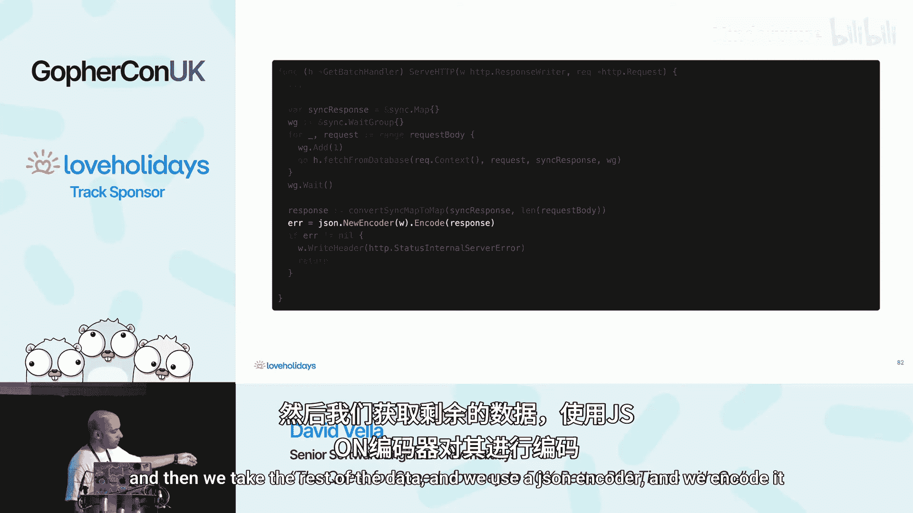
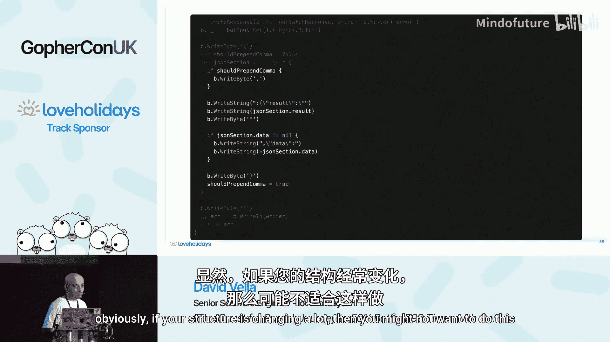

# Gophercon-Uk-2025-p05-P05_速度的追求——使用_Go_将_P99_时间提高_50%_的旅程--BV1dCHTzQEdN_p5-

Hi everyone， so today we have David Veow with us today and he's from Love Holiday just last month David was at giant help with setting up the London Gopher' meet up at Love Holidays so it feels a bit surreal seeing him here as a Gophercon speaker but nevertheless he's here and he's going to tell us about his journey to better latency times with Go。

 please welcome David。😊。

So to start off I just want to say that I've been coming to GoFcon for the last two years and this is my third time and it's crazy to think from back then to now that I would be speaking so it's a huge honor to be in front of all of you today so hopefully you guys can learn from my experience so the main goal of this talk is that we made some changes in our go services which had a huge impact to our latency and this is the journey that we went through to discover what was actually happening and what things we did to improve our latency。

One thing to say is that when I originally wrote the title for this talk， it was 50%。

 but since then we've improved it a bit more。So as you can tell。

 I work for Love holidays we sponsored the event this year and also last year。

 if you do not know of us like hands up in the room who have booked with us before。

 maybe not cool at least some people have called not just the Love holidays people so we are love holidays we are the third largest online travel agency in the UK we are expanding into Europe so since last year when we talked we've opened in Austria and Netherlands and as you can tell we love go and that's why we are here today so obviously I'm talking about an application we use at Love holidaydays。

 which we refer to as the Con repository。Now the content repository is at the heart of everything that you see on our site So this is our search results page so when a user comes onto our site。

 we do a search in our index and for every hotel it makes it call to the content repository and we return hotel information So this is the search results page here you can see the name of the hotel we've got images we don't actually host the images but we say the link to the images。

 then we've got reviews that come through when users like follow through to the hotel details。

 we have a description that comes through features， you get the point。

The content repository is there to serve data to our internalnal systems， and it needs to be fast。

 and everyone relies on it。 So how does it work。So this I could give another talk about how the content repository works behind the scenes。

 but effectively we have a huge pipeline that takes data from various different sources。

 so from our suppliers， from our own content team， bit of AI is in there as well now。

 and then that generates JSO we take this JSON and we save it into a database。Right now。

 it's Postgres， and the content repository is literally responsible for serving the data。

 It does no transformation of the data。 It literally is just serving Json that we've already prerendered。

 And that's how we make it fast。So someone asked me before， why not use a C DN。

 And the answer to this is， yes， we do use a CdN。 But for this particular use case。

 this is data that served to our internal services。

 So our server side rendering caused a content repository rather than the CN。

 and it's closer to the things that serve data to our customers。

 So this is why we don't use a CdN in this use case。 So what was the problem。 So originally。

 we were running in London。 So at the moment， it's quite hot and everyone's complaining about the heat wave。

 but you might remember a few years ago， there was another big heat wave in London。

 So at the time we were deployed to one data center that was in London。

 which had a meltdown and our site went down effectively。 And this wasn't good enough。

 So we started then doing the obvious thing deploying to multiple data centers。Funny enough。

 this is an image I asked AI to generate。So it's actually like pretty good。

 I think I got like a static image and then SvGs on top to represent the data centers。

 but you can tell that you have the different data centers and you have a link between them。

 So effectively when you have traffic within your own network。

 then it's fine But if you have data that crosses different data centers then you get charged for it。

 and as you can probably tell the content repository sends a lot of data and we got charged a lot of money So this is a graph of our billing console and you can see that we were spending around 300400 a day just on inter interzoal traffic So what did we do So we decided to add ZSTD encoding to our application we thought that it was the best compromise in terms of speed and size So we added a middleware we check with the headers there we create a writerer and we effectively server the traffic and inside the middleware we have an underlying writer which we then call okay simple。

So this is what happened so as you can see this is one of the memory or the bytes traffic through one of our applications Aurora which calls a consumer repository and you can see a huge drop in terms of traffic which is good it means that the change is working so this is a quote from our head of platform and we saved around 100 pounds a day and 3000 up so not too shabby。

So obviously I'll be using a lot of slides with graphs and this is because we have observability。

 Now， if you do not have observability， you should do that first。

So because we have that information I can retrospectively show you what happened so this is a graph of our CPU and you can see the CPU and the CPU afterwards this makes sense like you have to pay a cost to compress data which costs CPU so you can see our CPU usage went up and then obviously when we made that change our latency then went through the roof so the content repository is literally just responding with data so it doesn't actually do much and obviously the compression adds some latency because it has to do some work to send something back so our latency went up。

So。Before I go into the detail， I w to talk about a story。 It'll make sense， Trust me。

 So this is a picture of my bathroom door in my flat。

 On the right is the bathroom door and on the left is a heat pump。 So one day。

 when I was leaving the bathroom， I couldn't open the door and effectively， I was trapped。

 And as I was pushing through。 You could hear this really loud screeching sound。

 You can actually see that the mark in the door when it happened。 And I pushed it as hard as I could。

 And there was enough space for me to get out。 And basically。

 what had happened was that the heat pump door had opened by itself。 And effectively。

 I was lodged in。😊，And this isn't great。 So what was wrong。 So this flat is about 10 years old。

 And it's never the door has never worked properly。 So whoever installed this did a really bad job。

 So this is the latch and the strike plate of the door。 And you probably can't tell。

 but it never fits in。 And what was happening before is you， if you were observant。

 there's a piece of blue tack。 So even the So the landlord or maybe a previous tenant had used this blue tack to keep the door closed。

 And just so happened when I was in the bathroom， it decided to open。 And then I was trapped。

So if you wanted to fix this properly and maybe if this was your flat。

 you would effectively drill some more space in the strike plate， move it down。

 maybe have a bigger strike plate， and then you would solve it properly。 But it wasn't my flat。

 So I didn't really care。 So what did I do， I got a piece of cardboard。

So this is a box of celebrations， which I hadn't opened， which I apologized to my mum。

 but I didn't open it， so that was the only cardboard I could see。 so I just ripped it open。

 folded it。 And as you can probably tell， I used it as a wedge in the door。So the story。

 why am I telling this story？So the door opening randomly and not closing is a problem that the business asked you to solve。

 Now， your goal normally is to come up with the most simple solution to solve a problem。

 And in this case， the most simple solution was to take a piece of cardboard and wedge it in。

So I never opened this door。The only time I open this door is when someone comes in to service the heat pump。

 and then I never open it again。 So in this case， it works。

 But let's theoretically say that I had to open this door maybe thousands of times a second。

 Every time I opened the door， the cardboard would fall on the floor。

 I would then have to pick up the cardboard and push it back in when I needed to lock it。

 And back to the scenario， the simple solution isn't good enough。 and we had to fix it。

 So how can we fix the content repository properly。So we did a simple code change and it was fine。

 but we realized it wasn't good enough and the same with the cardboard we need to fix it properly So Go has a lot of stuff in the standard library and one of the things that it provides is Pf so PProf is a package created by Google to visualize profile information and one of the things that you can do is that you can expose information as part of the HtTP endpoint if you probably pay attention we just do an import and what this does is when you call in it go add some default handlers for you So if you're using like the standard library which we do and you're using the default marks which we do then it comes out of the box however if you don't use the default marks or you create your own one then the handlers are still available for you to use you just need to call them and you don't necessarily have to give them those endpoints but they match。

So。Now that we have this you can call Go2 PProf it creates a local HtP server and this is me calling a CPU profile for 20 seconds so unfortunately this isn't a live demo but this is a flame graph of what was happening at the time when this was happening so the flame graph how it works is that the wider it is the longer it takes and it goes for most to the little so if you're probably looking at this you can probably tell what was happening in the far lefthand corner so briefly we'll talk about memory so go is a garbage collecteded language and that comes with some caveat so in the sense you don't have to manage memory but then it happens behind the scenes and that has a cost and in this case it costs CPU so as you can tell here the go background mark worker was using a lot of CPU and this is what appears to be what's causing a latency but necessarily。

This isn't a problem when it comes to latency， it just means that the GC is doing a lot of work So the go this is a very simple diagram which I ask AI to generate。

 but go is a mark and sweep implementation So what happens is that when you're doing stuff the GC happens asynchronously in the background so it's not actually stopping your code running and what happens is it runs a stop the world which it takes a snapshot of everything that's there it does a marking set and then it does another stop the world to see whether it needs to delete it and then it sweep and deletes it So if we go back to this flame graph and here was taking like 26 seconds like actually what was happening if you go down to stop the world。

I's only taking 60 milliseconds out total。 So like the garbage collection in itself isn't stopping or making your latency bad。

 but it does highlight something else。 So this is some of our handlers。 And as you can tell。

 there's a lot of this malloc Gc。 And this directly impacts latency。

 So every time that you do a memory allocation that has a cost and you pay some CPU for it。

 generally， you don't notice it。 But as the service gets a lot of requests。

 then the time grows up over time。 So if you have a look at this。

 we were spending 20% of our CPU based just on doing memory allocations， which is a lot。 So。

And specifically you notice that we had a ZSDD a lot of the time was taken up by the ZSDD implementation。

 so let's have a look at that a bit more so you create a new writer it calls in it we use classPo compress it's probably one of the best implementations of ZSDD that you can use there's nothing wrong with this package but effectively every time that you create a new writer。

 it does a bunch of memory allocations which in itself isn't bad but we weren't using it correctly so the goal is that you do this once and then you can reuse the writers and we were not doing that So this comes as a given but if you start making changes two application do them slowly So you might see loads of problems and you might want to fix them all but you need to do it one at a time if you make 10 different changes one of them might actually make things work。

And you need to do it incrementally， step by step and observe what changes after each change。

This is also a given， but you need to have unit tests。 If you do not have unit tests。

 you need to make， you might actually break your application trying to make it faster。

 And at the end of the day， we're here to solve business problems。

 And if your code optimizations break the business， then you're in a lot of trouble。So as I said。

 you want to make changes incrementally and these changes didn't all happen at once and they were made in stages。

 So having looked at the output， the first change we used was to use a sink pool。

 So sync pool is a package provided by the ghost of the library and the main goal is effectively if you have something that takes a long time to initialize that you want to reuse it's great because you can create a pool of objects and reuse them and it saves garbage collection because you're reusing objects and you're stopping stuff from being GCed eventually So this is like another diagram of like how it works and it's a very simple diagram effectively you have a sync pool per core and this is really important for later But effectively every time you go to a pool it checks it to see if something's available and it returns it to you if it is Otherwise it creates a new objects and it returns it to you so。

One thing to bear in mind， and it was quite hard to figure out。

 was that a sink pool naturally grows with your usage， so it doesn't have a limit。

It will keep on allocating stuff and creating new objects。 if you keep on using it。

 And if you're not returning objects to the pool， it'll keep on creating new objects。

 So it'll reach a natural limit or frequency of like what your usage is effectively and this is like important for later。

 So I'll explain it。 So let's create a sync pool。 So you create the sync pool object。

 and then you pass it a new function。 you'll notice here that it returns an interface。

 this was written before like generics。 maybe it might be well。

 it might be easier to read of generics， but maybe not for performance， but this is what you do。

 So here you create a new writer and for now you just like return it in a wrapper and this is like all you do to effectively create a sync pool。

 So what code changes did we need to make to then use it So this is our HttP endpoint not much has really changed。

 you'll notice that we added a closed method。 So this is important。

And then the same thing happens again。 So inside the writer now。

 you'll notice here that we have this dot do。 So one of the things I mentioned about the Singapore was that there was a use case in some of our handlers where we were returning 404s but not writing anything。

 And in this case， we were actually creating a bunch of writers which we weren't using。

And in this case， we only create a writer if we actually need it。 so if someone calls write。

 then we call in it and then this just calls the rapper to do a get and then it sets it in the object and then it sets a header but this is just like a wrapper that I created but effectively because it returns an interface you then need to cast it and then the most important thing was that we need to call reset on the writer So because this writer may have been used before the idea is that the implementation is that you reset it and then effectively that means that you're not compressing bytes from like the previous encounter so it's reset it from the beginning and then now we call write as we did before。

So the difference now is that we have this close function， so when the middleware exit。

 we call close and effectively if the object is nil which is the case when we never called right before。

 we return no error， and then we close the writer and then we put it back into the pool。So。

First change benchmark， so。Benchmarks are a really powerful tool to see what change what the impact your changes have。

 One thing my VP keeps on reminding me is that at the end of the day。

 the best benchmark you can run is against real world usage。

 And it's not necessarily always the case that because it is faster in the benchmark in real world it'll be faster。

 But these are the results。 So as you can see， you have the before and after。 So the memory is down。

 the nanoseconds per operation is down。 And we are effectively like。

Half like more than half the speed effectively， which is good and which is what we wanted to do so。

This talk is all about latency。 So what did it do。So as you can see here there's like a massive drop。

 so ourll latency before and after when the code was deployed so you can see like a huge drop and that was literally just reusing the writer so that's again more than 50%。

😊，So， but we didn't stop there。 there's more changes。 So as I say before， make changes incrementally。

 don't do all your changes at once and do it slowly。

 So we identified one problem and then we went to the next one。 So as you can see here。

 this is the same flame graph that we had before。 And then here you can see the next thing that was taking a lot of time。

So this is one of our endpoints， which is called getbach So let me just explain this。

 So this is just a reminder of the content repository again， so we process data。

 we generate JO and then we save it into a database and then the content repository is just responsible for serving it。

 It doesn't actually care what the data is， We don't care about the shape， it can change。

 we don't care， we literally just returning whatever response in the database So as you can see a client makes a call we effectively do a bunch of concurrent requests to the database and return them and then we return a single JSO response。

 which has everything inside of it。So let's have a look at this response。 So at the top。

 you can see that we have a I。 So in our case that's point of sale and a master I。

 which is like a hotel I。 We have a result and then the data。

 So the really important thing is that this data is whatever's in the database we don't care。

 And the actual end response is really simple。 So what were we doing。So we have a sync map。

 We iterate over each request and we make them concurrently。 Someone asked me this question before。

 So I say again， in our initial testing with this application。

 we found making concurrent requests to the database was quicker than having one select where in request effectively。

 So this is why we do this。 And then we take the data and we use adjacent J encoder and we encode it。

So。There was a really good talk by Daniel so we were using the default implementation and it has some problems so in in 1。

25 we added a V2 technically you can have used it a long time ago and is actually available in like another repo if you wanted to try it but in our use case we didn't actually need this and it's one thing to bear in mind when you have like a library that's used to serializedstructs It's designed to fit any use case our use case was very specific and it was very simple and the structure won't change so actually do we really need a generic library for encoding the response no。

So let's start making the changes。 So we just create a bite buffer pool。

 We iterate over each JON object and we just write the JON response。

 So literally it's just the result， the data that we get from the database and that's it like much simpler。

 then anything we have what you got bear in mind is that this structure won't change。 obviously。

 if your structure is changing a lot。 then you might not want to do this， but in our use case。

 it made sense。 So what happened with the result。 So as you can see。

 there's like three times drop in terms of how long it took memory allocations is down and it's a lot faster。

 And this in this case is simpler because in our use case， it was what we needed effectively。

 we just needed to merge a bunch of JON together。 So what happened to our latency。

So this is the same thing again。 So as you can see I'll latency I' dropped。 So again。

 it's like another 30% drop effectively from before and after。

 So a huge improvement and a lot of people would actually say that P99 of 45 milliseconds is amazing but again。

 we can push it a bit more。 so。😊，This is the flame graph of our changes afterwards and as you can tell the writing is now taking long time GC is actually at the other end so we're not doing like any GC and yeah so one thing I want to stress is that even though you could argue that your latency is being impacted by compression。

When you're doing loads of calls across data centers， the。

The impact of the size of your data has a larger impact to your latency than anything。

 so the time it takes to compress something is actually better for your customer and smaller payloads and it's just generally better so maybe if you were in one data center the compression wouldn't be necessarily worth it。

 which is what happened before， but it's much better in this use case。So。But again， there's more。

So this one is an interesting one。 We didn't intend for this to have an impact to latency。

 but it did。 So I just want to go through what we learned from it and share it with you guys。

 So we run on Kubernetes and our nodes are all all 80 X 86 and we wanted to move to arm with the goal of saving money in terms of power per watt No。

 yeah and。We thought that we would just save money。

 We didn't think it would have an impact on our latency So the main big difference between X 86 and arm is the instruction set and you've got X86 on the right and arm on the left So with X 86。

 the main goal of how this works is that you can run multiple operations in a single instruction and the reason why this was better is that your code is a lot smaller。

So why was8 x86 better at the time so you got to remember back in 19771 MBby of memory costs $5000 and if you go through time everything gets cheaper every time so 9941 MB was 6 and now one gig costs around 4 so the reason why X 86 might be popular back in the day where your memory constraint isn't necessarily the problem anymore and times have changed so the reason why and risk isn't anything new。

 this was like around back then but the idea is that to have a much smaller instruction set and for each instruction to run as fast as possible。

 but this means that if you want to run more complex instructions you need more code。

So this is an interesting equation， but effectively the time it takes for your program to run is the time per cycle。

 the number of cycles per instruction and number of instructions per program So if you take a look at x 86 your clock speed is3 gigahertz so what that means is that each CPU cycle takes 0。

33 nanoiseseconds you have one instruction and each instruction takes four cycles so in this case if you add it all up is 1。

3 to nanoiseseconds which is like tiny but now if you look at arm the idea is that you run each instruction per cycle。

 but that means you have more instructions， but in this case you have 3。2 gigahertz。

 three instruction and one instruction per cycle and as you can see here it's faster。

So why is on better now？ So what youve got to think about is that each instruction。

Has a transitionor and the more instructions you have the more transistor switching you have。

 which leads to more power consumption and the reason why Ar got so popular on mobile was because it used less power but so that's the main reason why we go with arm but。

Now that Apple have spent a lot of time developing processor on desktop。

 we now have efficiencies on the server side。 So we this isn't a sponsor slot。

 but we run on Google Cloud and Google gave us access to their C4A processor with the main goal that the price better efficiencies。

 So we could have the lower number of pods and save money。 but its interesting。 So we'll go through。

 So our like CPU usage didn't actually go down。But it had like a huge impact to our latency。

 which was a surprise to us。 and hence why I'm talking about it now so。

Go back here and we saw like another drop in terms of performance。

 So I just want to say some caveat that necessarily moving everything to arm will be faster。

 I'm pretty sure there'll be some scenarios where X86 is still better than arm。 but in our use case。

 we saw a big drop big drop in latency So better performance。

 I know that Google is doing a lot of work to move their other services to run on arm。

 and for us as a company， we're moving more of our services。

 And we've noticed a huge difference in terms of performance。

 So thought it was worth sharing with you guys， but not necessarily a go thing。

 I talk to someone at arm at Qcon。 And his opinion was that because the instruction sets were much simpler as faster。

 but I can't tell you specifically why arm was faster。 but generally it can be better。

So the next change is around Gomax Prox。 It's kind of ironic that Bill is giving a talk at this conference as well on the same thing。

 I read his article at the time and that's how I started investigating this so。We run， as I said。

 Kubernetes on Google Cloud， which is GCP， I've told you that we run on arm。

 so we use the C4A instances， which has 16 cores with 128 gigds of memory just to do this effectively the Gomax prox tells the go how many cores effectively you have and how much stuff you can run simultaneously so this is our pod。

 so the content repo pod， we set CPU 500 mills， which is half a core Kubernetes is a bit。

Funkky in the sense that it's not giving you half a core。

 it's like half a core worth of CPU time and it uses that to allocate nodes。

 what pod goes on what node so。When we were running our pods。

 you might notice that the Gomax product was actually 16 and this is in 1 dot24。So。

Recently on Tuesday，1 dot 25 was at released， and they have made some changes， so。

This is like the pull request again， it's a bit。 So now Go is aware of the C group on the node and the idea is that it uses the limits to identify what your Gomax Pro should be。

 you might have noticed that we don't set limits on our pods personally the idea is that we want as much allocation to our nodes we have as less nodes as possible we set a request for what we think it will need and we can handle spikes。

 So if one service has some spikes it's fine。 but then we save cost in terms of nodes。

 So we don't want to like over allocatelocate if we don't need to So in this case necessarily would still need to set gomax pros。

 So here we set a goax prox of two I was talking with Bill earlier and we probably should set it lower but anyway that's what we did。

 So as you can tell this is like the variable that we had So the change has gone through and what impact。

Did it have to our latency， So as you can see， we had another 10% drop in latency just by making that one change。

 and I'll go through why this is the case。So again。

 like by doing like no code changes and literally just part of the runtime。

 what like what difference it can make。So why did the go higher Gmax prox lead to was performance。

 So it one of the impacts is memory。So I was talking about that you have we use sink pools and you have a sink pool per core I don't know why I said that's so lovely。

 but anyway， so as you can see， now that we have lower core we use lower memory So again。

 we have less sink pools because we have a sink per core the memory usage goes down then as you can see the garbage collection time also goes down so it doesn't have to do as much work to figure out what it needs to delete also because that we have lower number of sink pools。

 we can reuse objects more often so we don't have to allocate so often So again。

 there's a benefit in there。There is also like a link in terms of scheduling。 So again。

 this is a really simple diagram that I asked TBT to come up with。

 but effectively for each core that you have， you have a corresponding Fred and what go does is that it allocates Freds to your go routines and the main goal is that the threads are locked to your service and go manages what runss where and it can do this really efficiently compared to like the Linux kernel。

 And that's why this is the case。 But what you got bear in mind is that the more cause you have。

 then the more threads that you have。 and effectively。The problem that you have is that。

There's like more context switching。 so necessarily you might gain benefit from like CPU cash and by just by having less number of calls。

 you can gain that benefit and it doesn't need to like distribute across many different threads and you can reuse your threads more often and threads just aren't sitting there idling so。

Here is the number of gu routineine， so like again。

 like no impact to performance like like no different pretty much。

So why did it happen Why is it beneficial in this use case， So effectively。

 when you have lower number of cores， you use lower memory and lower G pressure。

 we gained from having sink pool efficiency so we can reuse pools more often。 and if again。

 there's less threads for the schedule to manage。 So again there's some benefits there。

But necessarily why does lower gomax prox might lead to lower performance So you might say to me。

 well David， then let's just say gomax pros really low。

 but there is some like things you have to think about in terms of like concurrency so we have another go application that we manage which effectively is very go routine heavy。

 it's merging a lot of data into a single JON response and what you'll see is interesting So here we have similar So here actually we set requests of two and we have like two gig of memory so。

And here we set G Maxax prox 2。So what you've gotta think about is that before if your application had like a spike the go would use as many threads as it had available。

 but if it doesn't if that isn't the case， you're effectively limiting what your application can do So in this use case because we set a gomax prox of two the CPU is pretty much fixed so we might not necessarily want this to happen。

 we might want it to use one CPU so you have to bear that in mind where you're playing around with Gomax Prox so necessarily because we set a requests of two。

 we could set like a limit of three and in that case we wouldn't be using all of the CPU that we have So you need to bear that in mind when you're making these changes there's like an interesting thing in the change that they added to like 1。

25 and I need to read it a bit more but effectively it tries to figure out your CPU based on the C group and it does like。

max of two or the number of so effectively in some cases it like limits the two and I need to read about it a bit more but again。

 Bill is going to give a more in depth talk about this and do like real demos to showcase this。

 but it's just something to bear in mind with 1。25。So。

This is the end of like the changes that we made， but there's a few things that I want to share。

 So this is like a very famous quote， but what you' got bear in mind is that I just showed you that you can optimize your go code and make it faster but again。

 97% of your code just isn't going to be a problem right and you're just optimizing for the sake of optimizing so necessarily only opt when there's a problem。

But then there's 3% of your code has massive opportunities that you can improve。

 So I don't want to tell you， don't optimize， but you need to be very selective in terms of what you optimize。

So if you do optimize your code though， there is some benefits。

 so this is a report that we published on our tech blog and there's a correlation between largest contentful paint and the likelihood of conversion。

 so there's a direct correlation to having faster services and conversion。

 so having faster applications is better for your company so it's worthwhile investing if your service has a lot of traffic and it impacts users directly which is what the content repository does。

So as a conclusion。You need to observe so you need to know what your application is doing and what impact it is having。

 you need to know that when you make a change， does it break something。

 does it lower your latency and does it impact other services and then you need to know when to optimize So if you release something and it's fine don't change it you want to you want to prioritize your code to be read by humans not by machines So you'll pay yourself by having more readable code。

 it might not be as efficient but you be better off in the long term and only optimize when there's a problem So when there's a problem make sure that you have unit tests you don't want to break your application when you make these changes so make sure you have tests benchmark objectively see whether your application is going be faster and we did a talk last year about how we run performance tests on our application in production So I recommend that you watch the talk George gave last year。

But measure your change and slow down。 So you might have loads of ideas。 Don't do them all at once。

Do them steadily and observe each time， and you'll pay benefits in the future。

So this is the end of my talk so on the left is a QR code to our tech blog So you'll find more stuff interesting there。

 And also we have a link to our careers page。 We are also sponsoring the event。

 So we have a store just around the corner。 we have some really cool stickers So please look at them and also like bouncy balls that light up if you're interested。

 but we're not scary people。 So please feel free to like come to me or anyone and talk about the holidays and yeah。

 Thank you all for turning。 Thank you。

Yeah。Yeah。Feel free to ask any questions now， but I'll also be at the event for the next two days。

 so please feel free to come up to me and ask me questions。Yeah， thank you so much， David。

 I really love the graphs。 The best thing you can see on the slide is a good graph。 But here。

 any questions。😊，Looking for hands， okay？So you did some CPU profiling with Fgraphss did you also do the memory profiling and what did you find because as far as I can see you did the memory profiling via the CPU profiling effectively yeah in this case there's like a direct correlation but the memory allocations would show you the same thing as Brian Boom always says it's always memory。

 but yeah in this case the CPU profile shows that but necessarily it's not always the case。Okay。

 I saw another hand。Thanks for the talk It's really interesting How did you decide what order to investigate and come up with fixes Do you think the way you chose assuming it's the same order that you presented in was that the right order of sort of bang for your buck so normally when you're looking into things you obviously look at things from worse the best as engineers you need to evaluate each scenario and you need to understand what the benefit is so necessarily when I looked into this I saw that the thing that was causing the most problem was memory allocations but if you can see a much simpler fix that will have an impact than go for it and you just have to outweigh the cost of like complexity to change what impact it will have based on that change and you need to make those decisions as engineers。

But normally you argue the big things first because that has the biggest impact。

 but necessarily the biggest impact might have loads of changes which has risk。

 so you just need to evaluate that as an engineer。Okay， any more questions？😔，Yes。

Thank you for the great talk。 What tradeoff led to the use of a sink once to do the initialization of the Z standard compress rather than doing it in the new of the sink pool So back to the scenario the sink pool is basically based the size is on how much you use it So what you've got remember is that every time we create a writer we allocate something on the sink pool So in our case we were using so much more memory because there was a bunch of stuff that we were creating for but whenever using So in this case we can save on number of items in the sink pool by in the cases where we don't return a response we don't ask for something from the pool and that's why we went with that approach。

Thank you。 anymore more。一。Okay， could you press us Thank。Hello。

 great talk Did you have a kind of target in mind for what you wanted to get the latency2 okay。

 like when when do you know？To， you know， you get diminishition returns to keep going。

 So youve got to bear in mind that your applications are there to serve the business。

 So what we have is a bunch of metrics which have our latency for the end application。

 so in this case， necessarily， this wouldn't have had like a direct correlation to end latency in all scenarios。

 for us， we are metrics went up。 So our Kpis went up。 and we chose to prioritize this。 necessarily。

 I would recommend that you guys have a latency metric that you set in your Kpis that you delivered to。

 and if you don't have that， then。Like， what's the benefit to the business to sell that you need to make these changes？

 So for every application， you should have an alert that says that if it goes above this。

 then you get alerted and you need to look into it。Does that answer your question。Thank you。Okay。

 any more questions。Yes。Just a bit more on that like this is not every application gets called thousands of times a second and obviously you just have to take into account that API that gets called once that takes five seconds isn't necessarily a problem it just depends on the use case。

Hi， thank you so much for the talk。 you showed us benchmarks and we saw the improvement Yeah but before merg to production。

 did you perform any load tests Yeah and what was it about if you can give us more details So I mentioned like last year that we have a talk So every morning at like four o'clock we replay the traffic from the day before and we do a X amount so we can like again。

 the benchmarks on go tell you one thing and what you actually need to see is the end result So we replay the exact same user traffic So we go bear in mind is that if you run like a Vegita like traffic isn't constant traffic goes like up and down So the best way to benchmark your application is to replay user traffic and that way we can see the direct impact of our application before it goes to users。

That's a really cool way of benchmarking。It has risks of course because we do it like you wouldn't sorry it still has a cost。

 but it's as close to real data as you can get Yeah right， any more questions I see one。😊，Yeah。

 I'm just， I'm staggered that you got sign up from the business to optimize below a 45 millisecond latency Yeah。

 how how is it structured in that you I just， I've never worked anywhere with a degree to that and just how is it structured where you've got that that sort of buy in from higher up So what you got for us the way that we work is that we have Os that are set by the business So we have a bunch of stuff that we've agreed with the business that we need to deliver then we have a bunch of stuff which is set to business as usual。

 and what we do is that we manage business business priorities with tech priorities。

 So we evaluate ourselves， what important stuff has in our BU pipeline and then we decide what we work on。

And I think that way， we can like， avoid like technical debt getting too bad。

 but also deliver value for the business。Yeah， but obviously， again。

 if your application is 45 milliseconds， P 99 in most scenarios， it's really good， but for us。

 it impacts everything so we want it as quick as possible。Yeah， I see another question。

So this is a sad question you mentioned you guys replay traffic production traffic so I'd be curious about how you guys do that with like maybe mut data state or something or like yeah So at a very high level what we do is that we use fastly as our CDM provider and with that we get a log of all of the requests that we make and then we have a application which is called albot which takes those logs strips our stuff that we don't to be replayed like user traffic and anything that's like bookings because obviously you don't want to replay bookings because that'll be a disaster but so we only like do immutable stuff that doesn't make any changes and then we replay it and what we do is that we set an X of what we want to replay out so before our peak period we do like a 10x of traffic to make sure that it can handle what we expect and we constantly do this every quarter to make sure that our application。

A meeting our standards。But what this means is that when we do have our Black Friday。

 we never have a problem。Yeah。So please watch the talk from last year。

I am very tempted to watch after this talk。Okay， any more questions。Yes， yes。

Hi do you care about memory usage by itself or is it more about allocations and so I'll tell you so I work in the search team and what you've got bear in mind is necessarily memory is good isn't bad as long as it serves a purpose so for us we allocate a bunch of memory and that means we can do fast lookups for to return latency so for us our goal is latency and in some use cases we'll be happier to use more memory and in other cases we don't well in this case memory had a direct correlation to latency and that's not necessarily always the case。

I hope that answered your question。Can anymore。Cool yeah， I I have a question myself。

 You mentioned that you use Postgres。 and there was like a lot of optimizations you mentioned。

 I'm curious， was there， were there any database focused optimizations that you ran into needing to break data down into a different way or index something。

 Yeah so if if people were interested， the content repository has changed a lot since we started。

 So the content repository initially was a N X container that read from a bucket and then stored it in cache and it responded and that was like really quick。

 But the problem was that when we scaled the first request were really slow。

 we then moved to inmemory database called tar tool。And it was good for what we wanted。

 We loaded everything into tarentor， and it was fast， and it was okay。

 but then we had to maintain it。 and the person who was maintained it left。

 So no one knew how it worked。So we， we， we questioned ourselves and we said， what could we do。

 that would be simpler and would be just as good。 And we turned out in testing that Postgres was actually。

Good， like we were we were surprised that it was good enough what we wanted。

 and as you can see in the results， our services really fast。 so yeah。And in this case。

 we don't do much with Postgre， to be honest。We don't like optimize it too much。

 We just have Google run it for us cool。Any more questions？Sorry， yeah， like again， I'll be around。

 so please feel free to come up to me if you've got any questions。Yeah， okay。 well。

 thank you very much。 That' was a brilliant talk。😊。

