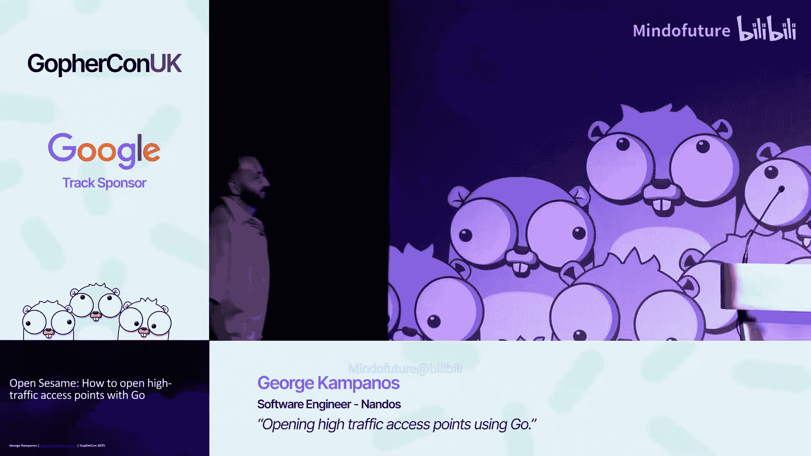
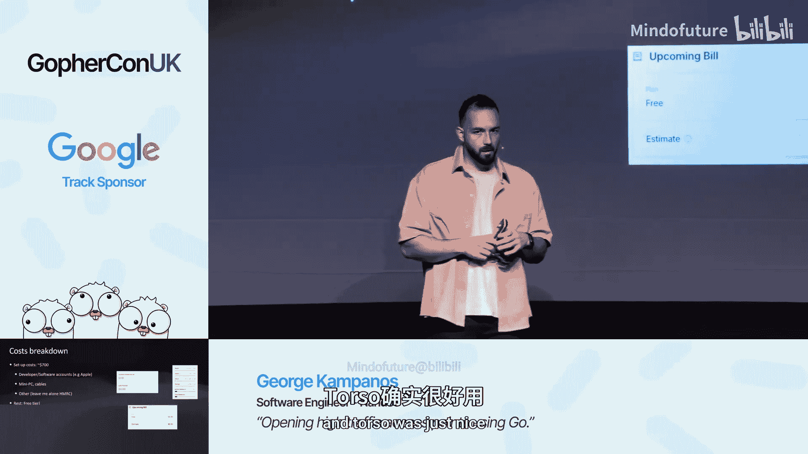

# Gophercon-Uk-2025-p06-P06_使用_Go_开放高流量接入点--BV1dCHTzQEdN_p6-

I tell you in advance， I put the dregs of my paper cup drink in my back pocket。

 so when I turn around to walk off stage。

The fact that I've got a wet bum was my drink I kind of wanted to get like one of you was going mention it if I hadn't so there it is last year when I was doing something I'm seeing here we had a George from Love holidays speaking down in the Queen Charlotte room and I said something along the lines of you he uses the power of go to send us on holiday which is very kind of him with our George today George Campanos he uses the power of go to make chicken delicious so currently Nands uses about 50% go 50% rust Ru and George has been on the go team for the last two or three years so please give him an extra big hand to the stage George Camp on us everyone。

😊。

Hey guys。Oh， that's not going to work up。Hi， everyone。 Thank you。 Thank you so much for having me。

 This is very special。 I think David was saying in his talk how he's been。

 that's like third Goric coin。 I think this is my first。 And I'm straight into the deep end。

 I guess So let's hope I can swim。😊，My name is George， I'm a software engineer atandos。

 I've been working there for the past three years， primarily go we do Coab bit Rot as well。

 and when I have free time from taking care of the dog which is another full- time job。

 I'd like to race goarts or whatever can go fast。😊。

Let me go So as a little bit of context and a little bit of what this talk is about。

 this initially was like a 20 minute thing， just how I use go to open a door and we'll get to that later。

 but I said you have an hour so I decided to just go and just tell you everything about it to tell you everything around this door。

So if you're ready？Let's go for it。If you haven't。P understood already from my accent。

 I'm not from the UK originally。 I grew up in Greece。 I grew up in a very small place。

 The main town was about what 10000 people。And there's one gym there and we're good friends with the gym owner George also because everyone in Greece iss name George。

 I think。And he's been running the gym for years and years， like two decades early at this point。

 and he was when I was there for holiday， he told me that he wanted to modernize the business for many reasons。

 one of the problems that he was having was that newer younger members。

 they were feeling a bit shy to go to him and ask for memberships。

But also because everything was done on Time of paper， like new members and memberships。

People that were working in the evening shift， They had no idea who was who， essentially。

 So they needed something。 They needed a nap。 He said。

 I'd want a nap to be able to manage all of this stuff。 So we went for coffee because， again。

 that's a very great thing。 We go for coffee for hours。 and we talk about things。

 And we came up with a list of requirements of what this app。ItMa look like。

 and apparently I have a laser。It's a lie so they needed an admin portal to be able to view and manage the memberships。

 they needed something like a mobile app so people can sign up and pay their memberships renew it。

 et ce， and they needed a QR code， they had to produce some sort of a QR code because they had already purchased a turnst outdoor。

😊，So the app of， or this thing。Had to work with this Stt。So I said， let's do it。

 sounds fun because obviously。And I will say weak quite a lot。

 it's because my best friend Ps helped a lot with this。 He's also a software engineer。

 but he is not in the industry。 He decided to take up his dad's business and he's still back home and he was a great help。

 not just by helping with the code a little bit。But he was there to， you know， essentially。

 he was my voice at the gym when I needed to ask， so thank you to him， unfortunately。

 he couldn't be London because hiss peak season' in Greece and he's very busy。So。Again。

 I will speak about not just the door， but everything around that turnst to make this last about 40 minutes。

 So initially I started with an API and it's just a simple restful API that I's just providing crude operations to the database which we'll get to later。

So that you， you'd have multiple Us， like that's the app。 that's the web or whatever。

 They need a centralized place to write to some database。

 It also provides a little bit of authentication usually done with J JWT's。So。

That's how I structured it。 And because of scale， as I said， you have to remember。

 scale is important here。 We're talking about a very small app。For not many people。

So it's a monolith。 I decided to go for a monolith and then say if we hit any problems。

 we can break it down。 So root folder。That has your command and your internal and your goal mode than sum。

The internal has all the stuff that you want to use， that could be your database。

 your payments provider， invoicing whatever you call it， which can be shared only internally。

 I guess with your code and then inside command or CMD you have the API。

 which has the main that starts the actual API starts the web server if you want。And then members。

 memberships， each like resource， I guess has its own file。

 The reason I did this is because then you can extract this file。

 you can take it out and you can just break it down to multiple services if you need to or if you find bottlenecks。

嗯。I really enjoy interface injection because it allows you to take， say， the payment provider。😊。

And stick anything there。 like you can do a real one， like you can have a stripe。

 say payment provider or you can mock it， which is great for unit testing。

 and you pass it in to your handlers as an interface。 So when you go to your main doorgo。

You decide what you want to do。The real one or when you go to your test， you can mock it。

When a request comes in， we have， say for example， a new membership request comes in。😊。

You have the fields that you want to do and you have that you care about。

 And then you have a little bit of。I forgot the messaging there。supposed say validate it there。

 but fine。This is a validate method， essentially， and you check， hey， the title is required。

 and if it's not there， I need to raise an error。诶。So this is the start， I guess， of the handler。

 you take the context and you start you check the roles if it's a developer and admin。

 those are the guys that can only maybe create a new membership。You decode the request。

 you do the validation， that's the method I was missing there。😊，Wops。And then finally。

 you go to your database and then you return a little bit of Jason， if you're happy。

 you probably return the whole object。So this is it。 It's very simple。

 I said it is like a very simple crude create read update， delete API to just keep things together。

Now， the most important bit is that we need a database， regardless of whatever technologies you use。

 you need a database and you need to store members， memberships， etctera。

And the the the gym is naturally relational。 So you have a member having an X amount of memberships there。

Easy， but the problem is how do you sync the database to the edge， how do you sync it with the door？

🤧And。Solution to all your problems。 S Q light throw anything at it。 is great。 But why， why S Q light。

 obviously， is relation， as I said， before that's quite important， is's very fast because you。

 it's only file。 So you only like write to it。 and you can read like locally。

 You don't have to go over the wire anywhere。 And it's just a file。 So it's free。 It's important。

 We don't wantna， you know， get the costs up for a small business。

 We don't want to give them a beautiful， you know Postgres cluster or whatever。

 Maybe we could beam the file to the door。😊，The problems， single writer， obviously。

 that's fine because we have a single API writing to this database， so that's fine for our case。

 but obviously Seago， Seago can be a pain， you know where。So I'll show you how we do the migrations。

 and this is just the regular migration use goose， which is a go tool， is great。😊。

Simple migration to create the members table。You keep a connection open and for now show you the connect Local。

 you connect to the file， you use the database driver that the built in go one。

 you return the connection。So you can close it later。This is how you run the migrations with Goose。

 You select the dialect， which is Lib SQL at this point， or you can be SQite。

Depending on the driver they're using。And then finally。

 this is this is a generic method that I use to commit the transactions。 So at the top。

 you just see how many rows were affected by the query you run。If there were any issues roll back。

 or finally， if you look at line 17， commit。And then the queries， say that's an insert query。

 you just write it as a con at the top of your file。Finally， you just run it essentially。

 you start the connection， you exact the query if you look a line seven。Check for any constraints。

 For example， you don't want to have duplicate members。And if there's an issue rollback。

 otherwise commit the transaction as I showed before。It see it units as as well。 It's just a file。

 and you can actually create an in memoryory SQ I database。 So you can， in theory。

 just for every test you have， spin up like an SQ I instance in memory run the migration。

 So that has the other benefit of a， if I wrote a bogey migration。

 I can check it before I even commit the code。 And then finally， happy path， for example。😊。

Instead of the database that runs the migrations， you unit test your method， check the errors。

 And then if you look at line 26， you have a helper method to match。What you expect。Similarly。

 on happy path check for the errors using the errors aids， which is quite neat。Yeah， but we haven't。

 we haven't solved how to actually。Use this thing。 It is fine because that worked on my MacBook。

 But how do you actually。Do it。 And this is not a sponsor talk by any， but manage chance right。

 but these guys are great T so it's essentially a managed solution for SQ light。

 So it's kind of like how Google runs your Postgres。😊，They take care of all the important things。

 which is it's probably safer than me beaming SQ light files around or keeping them in my local MacBook。

If other instances connect to the same database。They eventually sync with master。

So that means that I can have an instance somewhere on the edge on the door wherever。

And once my API writes to master or to the local instance that it has， and it syncs with Trsa。

 Trsa is going to do the hard job of all the hard work of actually syncing it to the door。

And you can set the intervals that you want to sink。 so for example wait one second， 15 seconds。

 30 seconds。And this is an overview of how it actually runs。 So say new membership。Is written。

 It goes to the local store or the local database。 I have you can go directly to to them to Trso。

 Eventually， that's going to get。That's going to get synced with the local Jimlan database。

That talks to the door。 And then eventually， you send instructions to the turns cell to open。

 So this is amazing because。😊，Yeah， I don't have to。

I don't have to do deal all the hard work myself and it works out of the box because it's just the Ncu driver。

 So the only thing you have to do is actually just change a little bit。

 the fields are you're passing。 You need a connector and where you store like the local file so you can delete it later。

 and then you just pass in the authentication toolken and how often you want the thing to sync So and the rest is kind of like handle for you。

 which is amazing。 The rest of the code that I showed earlier。😊，This works out the books。

So this is it escalte to the rescue。 escal light solves all your problems。 use it。 It's great。

 I think we actually use Annands。 I I was having this chat with someone and we use it and production somewhere onnandos。

 So maybe that's for another time。😊，嗯。I'll just very。

 very quickly run through the front end because this has nothing to do with go。

 I don' know this is not like guess， A U X or U I conference。 There's two things。

 There is the Web app that they're using to manage members memberships。 Next J S。

 And we use something called Daisy U I， which is just tailwind is just packaged nicely。

 And if it off with JWTs。 That's how it looks。 I'm sorry some of it isn' in Greek because。

They one Greek。 It looks like this。 You get basic information of your members。 You can search。

 which was quite nice。 It was important to them， see how many people see if someone has a membership or not。

 And then finally， you get。😊，All the details for the member you can create new memberships and that's how it looks and the app again。

 I'm not going to go into too much detail。 we wanted to build one app for both iOS and Android。

 save time and money。And yeah， react native with export on top of it， again， us with JWTs。

 and we build and publish with EAS。I's how it looks basic。I mean， tell me about U X， please。

 this is a back an engineer's attempt of making something pretty。killer feature dark mode。 you know。

 they were great when they when they we were showing them all this and we were iterating with them and they were like。

 oh， this is great。 When I pushed the merge for this one。 and they and they saw the dark mode。

 they go like， oh， this is a real app。 like， I don't know what's the psyche of people like。😊，Yeah。

 so， so it starts pretty much。 It the apps are essentially a window to the， to the API。

 they're just displaying relevant and hopefully useful information to members。嗯嗯。

Let's finally talk about the door。 It took me about 15 minutes to get here。

 but let's finally talk about that door。So this is what it is right So I'm sure like most of you if you use the tube today。

 you probably used a version of this what an or high traffic access point is， by definition is。

It has a shape that blocks away and you present something to go through。

 So if you use the tube today and you didn't jump through the barriers。

 you probably tapped your card。And they let you through。 So this is a version of it。

 It's about Y bigig。 It's like a small child size。And anyhow， sorry if I go back， any harder。

QR reader at the top where you can just scan it， opens both ways。

 obviously we only care about the entry。But how do you wire this thing， I'm a software engineer。

 not an electrical engineer when I went to uni， which way way back to one electrical engineering class。

SAT through， and I realized I'm not smart enough to do this。 and I left。

Hopefully you can see the purple like circle。 So this is I guess is the motherboard if you want of the door and it has a lot of weird cables。

 but we care about these two。 the Rs 485 connections。

 I'm sorry to backtrack a bit the first option is to use network。

 you can have either a land or one connection to the door and give it instructions through either the internet or the local net that wasn't good enough for that particular case because of how the gym was like made you couldn't run cables through there it would be a trip hazard and stuff like that。

 So had to come up with something inside the door。 And as I said， the door provides an R485 protocol。

Which you can pass signals such as up and left upper right， etc ceter。

 and everything can stay inside the door。The good thing is that you can buy off Amazon。

 that's an image from Amazon of R485 to USB。Therefore， you can wire your like a mini PC。

 which fits inside the door inside the turnstile， like wire the cables and having a USB， which means。

Stick it into the mini PC right， all the go that you want to open it。哎。So finally。

 I went down there to wire it。Horrible cable， which I changed later。

 I promise because we didn't want and want to die。 But essentially。

 you see like the connection is there。 That's the adapter over there。 Hopefully， you guys can see。

And then this is the mini PC actually like。Yeah big。And an overview of how we actually。

Like a bit like better picture of how it looks。 You have the door panel over there with the interface that talks to the USB and the go code in the database like talk to tors so and to the rest of our server to our services。

 the QR reader， which I didn't know before， when you connected to a PC。Comes up as a keyboard。

 and I'll show you the code about it later， but it's like plugging in any keyboard。

 it's weird but worth， and we needed a Wifi antenna which is unreliable as hell。Sorry， side note。

 the internet in the island is horrible， we're talking about less than six megabits per second like connections like trash and the dip that it does unreliable as hell。

 so you cannot trust the internet。come in handdi later。Oh。

 and we can connect to the Mu PC C via and the desk in case something goes by。Okay。

 let's try some go， as I said。😊，So we have a representation of a QR code or a QR image。

 so when the app generates that QR， it does some stuff about signing it and keeping it secret。

 but essentially it's just adjacent below both membership ID member ID。

Line 7 over there is literally you read standard standard in because that's what the QR code sorry what what the QR reader gives you and you just wait for the new line。

 Every scan is a new line right sorry every scan ends in a new line and you can just do all your parsing。

 for example， line 15， trim the space， whatever you need to do on marshall and then write some logic to。

嗯。See if it is a valid membership or not。 As I said， the Internet there is so bad。

 So that's why SqI is so good。 You have the local file and you can just read from it。

 So if the Internet is down in the island， it means that existing members。

 they're not gonna get locked out of the gym， which is good。 New members。 Yeah。

 maybe they have to ask for It depends on when Internet dropped。

 But it's good that obviously the the database is on the edge。 So you can run those operations。😊。

You know， safely， I guess。And this is the juiceicy bit， like yeah， this is what we all came for。

I'm sorry to disappoint you。 It's very simple to do it。 It would go。 it's literally。

 that's all it is。Lines 10， and then you know thestruct over there， 18 and 22。

 these are all given to you by the manufacturer of the door they tell you how to communicate with it。

 and then using the serial package to actually open a connection。

 maintain the connection to the door or the serial connection and then finally if you look at the bottom。

 you just write that is like writing to any other buffer。

Which is wild because I thought it would be this you know， extremely complicated coding exercise。

 but it worked。 like when you see it actually， I think I've got the video there， we fixed it。

 So this is how it looks。 The end result。 As I said， is about ya big。

 we have Mike they're protecting everything。 Sorry， about。 And then。😊。

We will see my friend over there。There we go。 So you go there。And it opens。We opened the door。

20 minutes for this， but yeah again I haven't done this in the past。

 so when I obviously tried it myself first， you actually see it。

 you scan it and it opens and everything that happens with a background it's crazy， it's extremely。

 extremely rewarding interesting side note。We were testing all of the code in that mini PC I showed before and obviously had a monitor over there。

 So everything was working with stick it and we tried to connect run desk to start everything。

 and we got a black screen。But it was working literally 30 seconds ago。

What the mini PC does when you disconnect any， I guess， outputs or visual outputs。

 it just shuts down the graphic card。So when you connect to any desk， it just， you know。

 is' not added。I don't have anything to show you because so we had to find those VJ dommy plugs。

 which they are used for torrents， people that are cedars， They use this because that's。

I promise I use it for a good cause not to。But yeah。

 they weren't available anywhere in Europe for some reason。

 I had to actually send them to Greece via post， I send three separate envelopes with them。

 one made it。😊，やね。Don't trust the Greek post office。So yeah， all comes down to this。

 it was very rewarding to see this like and especially that you can do it with go and it's so easy and so nice to do it。

 it's great because all this assumptions and all the stuff that you work on for the past。

 you know we worked on this for about four or five months。

 extremely rewarding to see it all come together and actually working and it's actually reliable when the internet is down。

 etctera， etcter。😊，So again， I had to feel a bit more time given I had the whole hour。

 so I'll speak about some other more meta stuff。😊，And how we deploy stuff。

 So the server is very easy。 I use something called fly I O。

 Hopefully people maybe have seen those guys。 They run their own infrastructure。

 Its like a cloud service， and they have the notion of machines。

 So your application runs into machines。 Again， I only needed like one。One machine， fine。

And they make it extremely easy， you just provide this this tumo file with all your configuration what you wanted it to do。

And it just runs it。 The key part is line 17， where they have this smart thing that if it's not。

 if your machine is not running or if it's not executing requests。

 it just shuts down and it has firecracker to just。Tur it on when the new request comes in。

 and this is key because you don't want to have loads of servers running all time。In an application。

 that is naturally very low scale。 So we're saving money to the business。

 But how do you deploy the door。 Yeah， that was， that was an interesting one because the door is somewhere that might not have Internet at some point。

 So the fanciest bit on this is just a Github action that builds the application。😊，For Linux。

 because again， we use we use Linux on the mini PC and then magic wormhole to the to the mini PC restart everything and it works。

If you have a better solution to this， I'm all yours because that's just horrible。So yeah。

 that's that's pretty much it。 It's， it's only two things。 like the fly I O takes over like the。

 the web stuff or the， you know， and then the door is a bit more manual actually， you know。

 get the Github action to build everything， but then you know， manually send it to the door。

And we have observability， you know because。We're software engineers， we like observability。

 but it is important。😊，But monitoring servers and Web API is all that kind of stuff is。

 it's a solved problem。 You， it's， you know， flyly provides a grafaana dashboard。 It's。

 it's a solved problem。 You know， you want to see how fast it is。 You want to see the load。Fine。

 you know， you can pay either a lot of money or you can find free solutions。But how do you。

 how do you monitor the door again， similar problems， The Internet is unreliable。

 What happens if there is a crash and no one can log in， although everything is you know。You know。

 how do you check for errors in the past， What if you we have a bug and you know， how do you know？

The other interesting thing is what if people are trying to rig the system and they're trying to pass in like bogus Q codes。

 hopefully you know your application handles that， but if you want to see a pattern。

Because obviously we talk to the gym and they say， well， we see people like acting weirdly。

 can you check this？And again， we don't want to spend money because you， you know。

 for a small gym of maybe 2000 members， it doesn't justify them。 It。

 it doesn't justify the cost to have Datadog subscription， right， because。So。

That's the kiss emoji because keep it simple， stupid。Try to make a joke。Yeah。

 but let's forget about fancy and expensive stuff。What if we just use a text file that then whenever we need it。

 either check it on the device in the door or we just put it in our local machine。

And use good old fashion less And just check what's out there。

 Like you can even take the file prole and stick it to， you know， Grrafaana or whatever。

 And it would do that job， but。And with was it go12 4， we get or  one to3， we get a slog。

 which is awesome。 And then we use a slog multi from Sammber。

 which essentially allows you to not just print stuff on the on the console。

 but you can also print stuff in the file。 So， you know， you， you can set the top。

 so you create your file at the top line 8。😊，Make sure that the file is created and then if you look at line 21。

You find out your logs so when you do slog the info it goes to the print that sorry goes to a standard app to the console also it goes to。

To your file。And that's how they look not very sexy， but they work。

 because when the error comes through， you know it。

 it's there and you can just get all all the stuff that you need。The yellow stuff are。诶。Obviously。

 I didn't want to get member information there just。

And then we use a very fancy incident management system called Discord。 but not sure you heard of it。

 Yeah， all the cool kids use it。 Don't worry。 again。

 we didn't want to spend money on something that for errors that don't happen very often。

 but it works because they are familiar with discord。We could put it on there。

PC on on the reception area。 And when something happened。

 it was easy to monitor and see what was happening。 We also did it for members that entered。

 So when you scan your Q R code， they get notification of Discord to say who you are。

 So if they don't know you for some reason， like they can see your name。

 they can see your membership。So yeah。The whole point is just keep it simple， in this scale。

 in this context。It doesn't make sense to go and spend thousands of pounds worth of， you know。

Logging。And then finally costs， again， costs， I don't think I drove the point very well at the beginning of this。

 like costs are very important for this business it spot business， right？

So they don't want to spend crap loads on something that obviously is going to bring them business。🤢。

You know， it's it's a small business。 They wanna keep it as low as possible。

 And it would be very hard to justify like a $20003000 bill month for stuff that they never see， so。

We wanted to keep it cheap and that was kind of like the North stars。

 and how do we keep it as cheap as possible？And minimize the costs。

And it costs about $0 a month to run， which is great， because that's almost free。😊，Obviously。

 there are costs associated to set it up。 I think there's a slide layers about $700 to set everything up。

 like Apple developer accounts。 obviouslytripe takes a little bit of commission every time there's a new membership through the app。

 But like what I showed you before， like the core app， which is the API， the database。

 the door itself。It's free for them to run， which is great。And again。

 obviously scale helps like annands。Different kind of beast。 obviously， you spend a lot of money。

 And I'm sure most of you guys working in big business。

 you know you expect that stuff to have a cost， but it didn't make sense to go fancy。So yeah。

 fly is free。 I think we go below the I think they charge you after five bucks。

 so we use a less that。 We were eligible for the free ti or Trso。

 but opted to pay because they wouldn't give you backups， which is a very smart business model。

Because why pave。 Yeah， And then the website is actually a static next S page on Cloudflow pages。

 There's a worker and， you know， it it just serves it， which is fine。 They don't need anything more。

 The business email is just an info outd from Cloudflare， and then it just。😊。

Forwards to their genome。But also thing is engineering choices。 Again， we're so used。

 I think most of us， maybe again， working in bigger companies， bigger business。

 There's like almost an infinite amount of money to， to spend。So we kind of go like， oh。

 we can try stuff or maybe we don't care so much about what's not going to cost as long as it serves the customers。

You know， I think under strain or under， you know， weird or hard requirements， maybe we make。

Different decisions， which I think that turned out to be good because。

They were able to make money out of the app and the door and everything from day one。Again。

 this is a bit of a breakdown to prove that when they're spend a lot of money。

 there you go two bucks on fly。The right one is to show that we're the free tier eligible。

 and then the last one is the EAS， the you know， the charging for builds boat and again。

 we fall below the free tier。Yeah， I just want to give a shout out to this MacBook and and to the go team。

 because most of the development for this was on this guy。 So this is a 2015 MacBook Pro Intel。😊。

No issues whatsoever if it wasn't for the app that you have to build it for within your processor and stuff like that。

Yeah， this MacBook Pro handled it perfectly， so shout out to the go team like， you know。

 you don't have to spend a lot of money to get into development， which is great。So yeah。

 has an overview， maybe think about the cost。 I don't know。

 maybe think what would you do if this was your business。

 Maybe what would you do if do you need to spend the money， Maybe you do。Maybe you don't。

Proise we're almost done，'s about。Yeah， gold does cereal。 again。

 I walked into this knowing how to do maybe a third of those things。

And it it it was an amazing choice to， to， to choose go。

 I don't think I would have been able to get to this point without using go。 And it does serial。

 like it， it's nice seeing it or seeing one language from one end of the stack to the other。😊。

And yeah， lots of learning opportunities of how do you sync databases to the edge。嗯。Yeah， it was fun。

 again， it was so rewarding seeing。Like when it scans again， I can't explain the feeling it's like。

 oh， crap， it's actually green after a few months and then。😊，Yeah， finally， I think it。

 it's definitely worth trying it。 Like if， if you can， if you have a friend， smaller business。

 do some good。 Like it's is， is good， I guess， working for a business and， you know。

 pay the bills and stuff。 But maybe we can use our， you know。

 amazing super power software engineer skills to。😊，To do some good and help some friends。That's it。

 thank you so much。That's I was celebrating after this kind。 I was saying before。So yeah， thank you。

Questions or yeah。Okay， so we should have loads of time for questions should any of you have any。

 so yeah， hands up and I'll keep an eye out on the cr as we go。😊。

He'll get you hellello wondering if a Raspberry Pi would have worked inside the turns style I can't hear if you can speak up a bit I'm sorry would a Raspberry Pi have worked inside the turns style yeah it would the mini PC So to give you a bit of context again it's a very small place right and the gym is very good friends with the guy selling PCs across the town。

😊，Do you want me to keep answering？So yeah， I mean， it's a great question。He told me， oh yeah。

 this guy's gonna bring us like the mini PC that we need。

 and it's not really minis about Ybeg and I was checking and he charged him like 200 plus heroes。

 and I was checking on Amazon I was like dude I can give you like this size of a PC or like a raspberry pie for like。

Close to nothing。 but you know， it's he didn't want to you know。

 have misunderstanding with his friend。 but yeah， like any PC or any。

 I guess board or whatever that can run Linux or that can you know run code。

It would have done just fine。The other problem was， sorry， we had to。

 if you saw like on the diagram before。We had to install a wfi antenna， because。

The guy selling the PCs he didn't understand the concept of we can't have cables running through the gym。

So when we turned it on and like why that thing is not connecting， is like， yeah， well， you got it。

's just it was a mess。Sorry， maybe all the venting now is going to come out。

 And we have about half an hour of psychology therapy session here。All right， next question。😊。

There's one over there。It's close on it is How often do you synchronize the membership data how often so I've actually switched it recently as an experiment so that the API。

Writes direct or talks directly to Trso instead of having you know the local file instead of syncs eventually so the ride happens almost immediately I guess and then the door syncs every 30 seconds。

 but you can set it to whatever you want if you notice before maybe if I go back to the costs。

Trso does charge you for。It doesnt sinks， if you look at the third row， it does charge you for sinks。

So if you had it every second， you had a bigger database。

 you might run out of you know that limit fast， but given the scale。

 30 seconds seems fine and then there's a bit of UI when you buy the subscription from the app that says generating Ke code which is a lie it doesn't generate anything。

 it just waits for the door to sync So 30 seconds seem to be the switch spot in terms of cost and also usability。

Okay。yeah。So I can't see with the light。 did you do any sort of disaster recovery like backing up the D B anything like like that。

 Yeah， so one of the reasons we did pay for torsso was because they do kind of handle this in the background for you。

 So they do have automatic syncs and checkpoints with the free tier。

 I think you only have one every day or whatever。 But also you have to consider， again。

 it's just a file。 So in theory， if you wanted to， you could just take that database file。

Text it to someone because it's so small and use it。 But thankfully， Tour so does handle down。

 It has checkpoints。 I think they recently added branching as well。

 So it has all the fancy stuff that you might see in。😊，Posgras and stuff， but they handled it for us。

Thanks。All right， got another over here。Oh that's gonna to be the one now now I was just going ask。

 did you have any interesting ways of any people trying to inject anything malicious or big ber sorry I said did you have any interesting scenarios where people trying to like challenge the security of the setup and trying to inject from day one from day one humans are horrible is what is worse is that again。

 what I said to to the other person before everyone knows each other there it's a small village essentially So we would see from day one people trying to scan in voiceices they would trying to scan there was a guy who was scanning his badge？

And I could tell because I we set it up as when someone's scans like bogus stuff。

 we get a error report essentially。I'm not sure if that guy knew。

 but he gave us his national assurance number， essentially。So'm I， okay。

 you are trying to gain the system fair， but at least don't be done。Someone knows was。

 you know how you can generate Q codes to connect the Wifi。

 The guy was just trying to scan the Wifi password of the gym。Or no， I'm sorry to take that back。

 he also has a shop。And he was scanning the QR code that was given to the customers for his wfi。

 So I'm like， okay， now have your Wifi password great。

The messed up thing is that they would go to the reception area and like， oh， but I've paid for it。

 my membership is not working， why is it not working you。

I can see it that you're just trying to scam the system， bro and stop it。

 And I think it's even worse when people are， yeah。

 you know them or you probably grew up together with them。Did I answer your question， sorry？

Oh it's gonna be even all the monster guys here are gonna just give to torture you。

 So it can be addictive working with something physical。

 like seeing something actually in the real world come to fruition two questions。

 how close did you come to really seriously hurting yourself with high voltage have you thought have you lined up any other hardware you real world affect you real life projects off the back of this？

😊，answer or answer to question number one。 no， if if you go back to the。

 I can make the slides public， but the door has a very big like breaker switch。

 it's very easy to just。Just kill everything。 Obviously。

 it takes a bit of time to boot and everything， but obviously everything was shut down。 The wiring。

 So there was one， one wire that had to go to the door。 That was the mains， but that was not done。

By me or by anyone。 it was an electrician。 thankfully。 Take everybody。

 we don't want to burn anything down。 The second question， No， that was again。

 that was my first time playing with wires。 and it was extremely extremely rewarding as you said。

 because it's this instant thing that you see it No working or working。 You're like， I can try this。

 the picture had over there is the only picture I took with the cable that I made it was a horrible cable。

 it was supposed to be more twisted it was supposed to。

 And then obviously the more you do and the more you learn。 you go like， oh。

 I need to put those connections in to make it safer and reliable and stuff like that。😊，I。

 I would100% do it again。 I'm not sure if I'm good enough to do it as I'm not I don't think I'm gonna be switching to electrical engineering any time soon。

 but if I was to wire something in my own house。 Yeah， it's， it's definitely try it。 It for sure。

 aive。 Like it's yeah， yeah like don't let me anywhere near your main guys out。Yeah。Right。

 we we got any questions over the other side of the room？It's just this item that was interesting me。

Gocha。😊，These guys were winged for it for like months， I think we going to just to grill George。

Thanks， you talked about keeping the database on the edge is is loud enough I'm try to work out where it's being written from and what's reading it exactly see you have this one writer thats running that is the back end that's running on the cloud and then also the door itself is reading a sort of copy of the database is there any other accesses or it just in this instance theres another reader which is a current job that essentially goes to that database and checks if your membership is about to expire and they would send you a notification but in this version of the app or the platform whatever you want to call it is a single writer and then everyone else as a consumer and that's why we're happy to just have the eventual consistency if you want。

😊，But you can read your own rights， so if there was more， if I was to split this into。

Like a microservice architecture， you can have like multiple databases essentially。

 for every instance of the API or the microservice。 And once you write。

 you can read your own thing so。Okay， thanks actually you follow up on that because you put a lot of points in that you specified。

 you could split it up here。 you know， I made it so that you could do that。

 Did you end up splitting up any of it in the end or did it all work fine。

 No that's a great question and that's maybe something I should have spoke about more the API that's the main I guess place where the load happens because everyone interacts with it。

 if you're a member or an admin I think。For the 2000 ish members that we have， plus maybe 3。

4 admins just running the application， we don't go over like 1015%， like say CPU usage any time。

 So the monolith seems to be okay， there are a few fail safes。

 like if something goes bad and it dies， I think fly just gives you it's like the Kubernetes thing that if you die。

 like it brings it back up。 if something goes bad if something bad happens， but the。Moonolilith。

 popular opinion， seems to be working fine，怎么呢？😔，Hi thanks for your talk and once you deployed the project。

 did you have any big failures and how did you resolve them any sorry you have to up any big failures。

 anything that went really wrong that you had to then address and how did you resolve the issue？😊。

Yeah yeah， sure we had a couple of instances， not only the API specifically or the go code， the web。

 the web at the next JS for some reason， cookies behave differently on local than on the。😊。

Than what on the production thing。 So I had to kind of rewrite on the spot how the cookies are used there。

 So that was annoying because no one could log in and they didn't know。 The API， thankfully。

 has been。Has been very robust。😊，And no major issues。I'm trying to think。I'll come back to you。

 I'm sure， I'm sure we had like a downtime， but it wasn't。

 It wasn't something necessarily that a deployment or something caused。

 which is crazy to think about。 Yeah， sorry。Okay， next question。😊，Thank guess。

Hi there So you said you deployed with flyIO I believe it also offers like a synchronized SQite database that you then chose Trso which I hadn't heard of that I'll have to look into I just wondered if there was any reasoning behind that given you already used flyIO It felt that the buyer of entry to Tersa was a lot easier it felt that the managed ecalite of flyIO。

How do they call it， I can't remember the name They have a name for it。 light F S。 Yes， lie F S。

 that like the way that we're presenting it it was like another like mount on your machine。

And it does quite a lot of the stuff that Trso does。

 but the nice thing with Trso was the dashboard that you can see like you can edit the rows on the flight。

 so they have this management dashboard if you want。

 and it felt a lot more user friendly and it felt a lot more like the barrierer to entry was a lot lower because I cared about speed and trying to get this thing out of the way。

And Trso was just nice， especially。 And then again， the killer feature for me was that it could sink。

On the edge， I guess， automatically， if that makes sense。Okay。

 yeah Ill look into it for my next project。 Thank you。 Yeah definitely try again， not sponsored。😊，系。

It's one over there。 Yeah， I mean， if， if I think Gabriel is the guy who writes it， yeah。

 me just give a text。Yet， so。It's really interesting to see how essentially your constraint you know drove your design。

 especially you know the limited internet， if you were to do something similar with you small business。

 you want to do it for free， but you have you it's a different place you have good internet。

 would you change something fundamental in your design， you think？I think I would。

 I'm not sure if I would。 I mean， obviously you would have to change stuff depending on the context of the application as well。

 but I would definitely take more time to understand， you know。

 the requirements that they need it was very difficult for us to just because every time you asked them or you spoke to the people running the gym。

 they would just say we want to nap we want to nap。

 And they wouldn't understand what we were telling， well。

 you need more things around it to be able to support this。

 So definitely understand the requirements of0 percent。But in terms of tech， yeah， I would maybe。

 again， depending on the scale， I would love to explore how this monolith can be broken up。

More efficiently。 And maybe， you know， you can， you might have two monoliths running half and half the services。

 but I think that would definitely be something I would love to explore。 And I would definitely。

 again， keep trying SQ light。 I'm sure there obviously there are limitations with a single rider and stuff like that。

But yeah。Hopefully that answered the question thanks。Next question。However。No。Hi。

 great talk Did you have to do anything around the QR code generation and how did you handle the QR codes as a as part of the design。

 did you did you need to encrypt the data that went into the QR codes were they like shortlive tokens。

 did you have to rotate them？😊，Any information about that would be great。 Yeah。

 this this is a great question and this is like I think a whole different talk maybe of how you actually secure those care codes。

The the first version when it was deployed again， let's get it on the ground， it was just raw data。

 it was just this raw JO thing， which was the membership ID and the member ID。

 which obviously is not ideal because in theory someone can generate enough QR codes to try to game the system。

The reason we went with this initially was because there's always someone on the reception and they can see like suspect activity。

So so so that was okay is to begin with。 then just hashing the there no hashing like essentially a one time pad when creating the the password。

 So we know the key on the door。 we know the key when we generate the Q code。

 we can decrypt it essentially。 But， and this is what it is kind of now。 again， not the best。

 but there's no road data there。 So that was the main requirement。

 but I'm definitely looking and exploring solutions of how do you do it for say。For each member。

 So maybe you can sign the QR code with everyone's like password and stuff like that。

 And how do you make it。So that doesn't leak data because you don't want people to know what's there in terms of timestamps and making sure that that's a legit QR code。

No， only because memberships expire eventually。So I didn't want to spend more time implementing another fail safe there。

 and also again， because there's people in the reception at all times。

 it's easier to spot weird or bad behavior。But once I get around finding a more efficient and better solution to assigning those keys。

 or sorry those QR codes， I think definitely like a timest like a rotating key or something。Yeah。

100%。 But again， this one was a bit of a cost over， you know， how fast can we ship this。

Given we have the protection of someone being on reception not all times。Hopefully。

 that answered the question。 Thank you。But if you have any good ideas of how to do it。

 I'm all ears because I。Yeah。All right， next up。😊，Anyone else？wo。Okay， a big hand for George。

 everyone。Thank you。That's。是谁。

