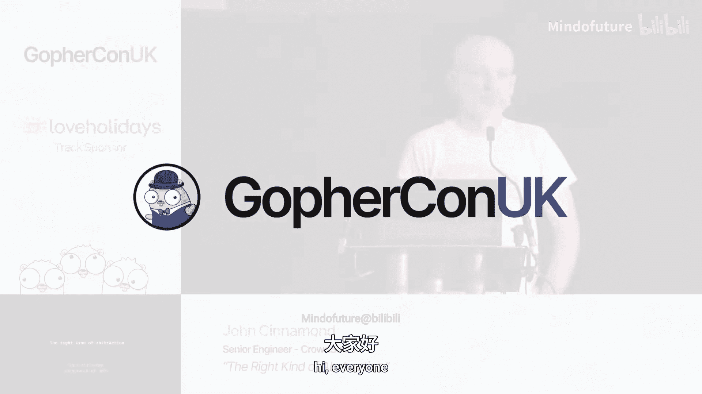
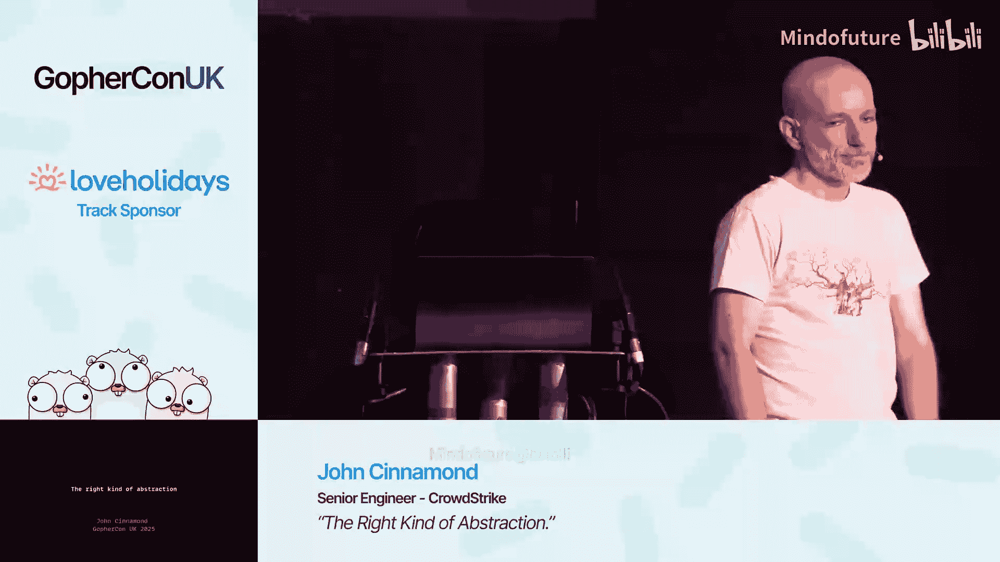
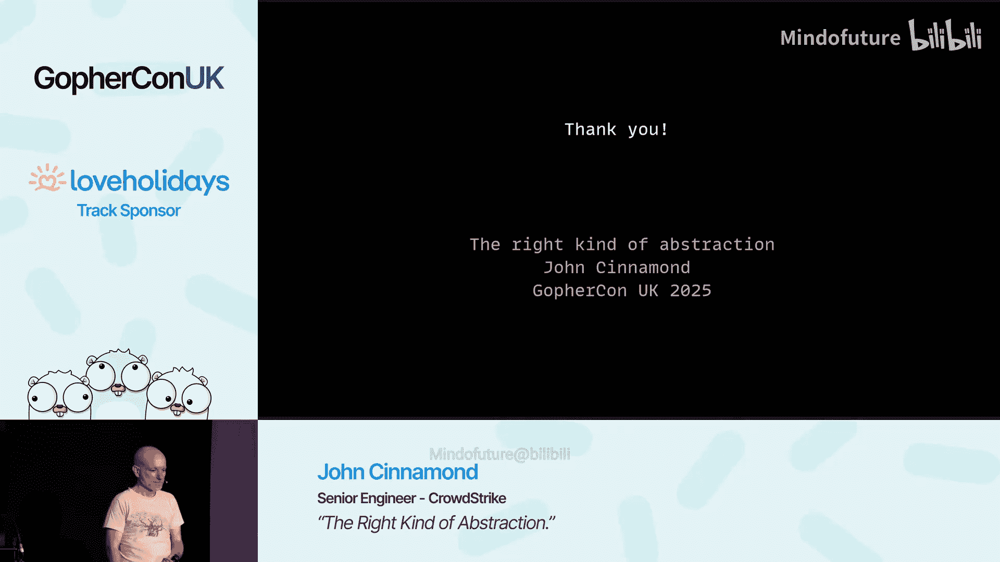
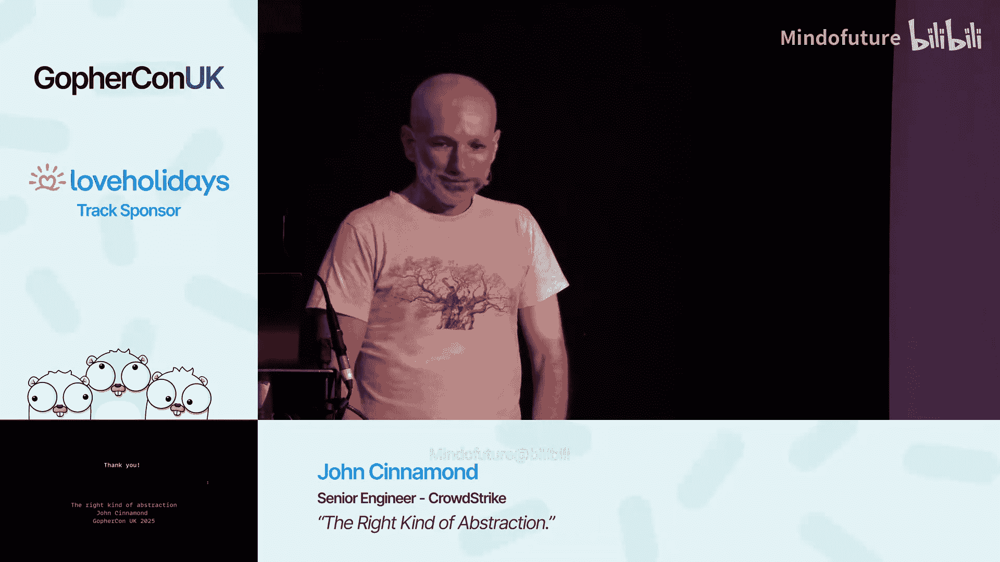
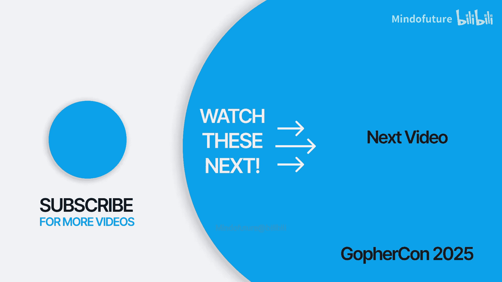

# Gophercon-Uk-2025-p09-P09_正确类型的抽象--BV1dCHTzQEdN_p9-

Hi， everyone。 Welcome back from the break。 And for the last talk in this room today。

 we have John Cinnamon， who will tell us about the right kind of attraction in go。

 So please welcome John。😊。

I sawaw a comment on Reddit a while ago， and it says Go's philosophy emphasizes avoiding unnecessary abstractions。

Now， this is not an official statement from the go team or the go creators。

 But I think it kind of sums up the way a lot of go developers feel about abstraction that kind of encapsulates the general suspicion of abstractstructions we have。

And it's not a terrible statement， but I do struggle a bit with this word unnecessary。

What does that unnecessary mean in this context。And what are we comparing it to。

 Are they suggesting there's a bunch of developers out there are going。

 I'm going to add unnecessary abstractions to my code。 that just doesn't happen。

But it means something。 So what were they trying to say when they say they want to avoid unnecessary abstractions。

 What kind of abstractions are unnecessary， Well， spring， right。

This comment was in a reply to a question about frameworks and go。

 And spring was universally decided as an unnecessary abstraction。

And there's some other stuff in that thread。 O， R Ms came up。 That was a bit more divisive。

 but in general， it a kind of push back against using O R Ms。But I can't be it， right， Otherwise。

 the quote would be， we avoid unnecessary spring。So what other kinds of obstructions are unnecessary。

Well， how to think about this。 And one thing that came to mind is map in the sense of map produce。

 right， So you quite often get code like this and go。 you have a list of something。 In this case。

 a list of users。 you want to turn it into a list of something else。 In this case， a list of names。

 So you create an output or an output slice to store the results。 Then you loop over users。

 And for each user， you convert it into name。 and you push that into your output slice。😊。

And this might repeat quite a bit。 So， for example。

 you might design something that converts the list of users to a list of Is。

There's a bit of a temptation to thing。 Well I can strike this right。

 And you end up thinking these things look the same。

 The only thing that's really different is the names， obviously。

 but the types of the things that you're you're pulling out and the actual piece of code it converts from a user into the thing you're interested in。

 So you write something like this。 You write a function takes us to users。

 but it also takes a function which maps a user into something。😊。

And in return a list of those things。 So it's parameterized over a higher order function。

 and a particular type。 And internally， this looks like what we've seen before。 right。

 we create our output slice。 Then we loop over the users and we convert the user into the value we want。

 The only difference here is that our output slices it the type A。😊。

And to actually convert a user into something。 We used a function that's passed in。

 And then we can call it later on and we can pass a little function。

 which just maps a user into an I D。😊，I do this from time to time。 I do it by accident。

 I tend to do it when I' be writing in a different language， which actually uses map quite a lot。

But it's not necessary。 You don't need to do and go。

 You can just write the original code that I showed you。

So I'm going to add map to this list of things that are unnecessary。Now。

 you may have noticed that to write map， I use generics。

 And that's another thing that we can look at。 Now。

 I don't want to get into the debate of whether or not generics are good for go。

 but we can definitely say that they are an abstraction。 They're an abstraction over types。

 and they are necessary， at least in a technical sense， right。

Generics are quite new to go go existed for a long time without generics。

 and we could write all the programs then that we can write now。 We might write them differently now。

 but it hasn't changed the types of programs we can write。 So technically speaking。

 generics are in distraction， and they are unnecessary。

Another common form of abstraction in go are interfaces， are these unnecessary。 Well， they are。 yes。

 I like them。 I don't want to get rid of them， but I could do。😊，So imagine a piece of code， right。

 This is a piece of code。 It takes some input and parses it in some way。

 And here I've used an interface。 I O reader in particular， right。

 So my function accepts something of that interface type。 And then it uses it。

 It passes it off to I O read all， which also expects an interface type。😊，No， I cant get rid of that。

But to do that， I need to write lots and lots of functions， right。

 So I might write a specific function， which pares information that comes from a file。

I might write another function， which powers the stuff that comes from an in memoryory buffer。

And if I want to parse other things like， for example， Read from a network。

 I'd have to write another function， which doesn't specific work。 So it's kind of clunky。

 but you can do it。 We can get rid of interfaces as being unnecessary。

 We just do that by adding more and more functions。😊，Spea of functions。

Are they unnecessary abstractions， Well， they are abstractions for sure， right。

 The computer has no idea about functions。 Fun don't exist at the computer level。

 They compiled away into some piece of code， which lays out your memory in your registers in a particular way and then jumps to some particular instruction。

So they are an abstraction， but are they necessary。Well， in go， probably， yes。

 it's very hard to get rid of them。 The closest you could get is probably writing one long main function。

 Now， that might be appropriate for some little programs， but in general。

 it's going be quite hard to get away from functions in go。But in programming in general。

 we totally can。 right， Funs actually didn't come around until Fort Trans。

 So we're talking mid 1950s。 This is about 10 years into using computers。

 So people programme for about 10 years before functions even existed or even available to them。

So technically speaking， they are abstractions and they are necessary。😊，It's just unfortunately。

 to get rid of the functions， you're going to start writing an assembly code。And what about that one。

Good。Is assembly code an unnecessary abstraction。 Well it is an abstraction。

 It's quite a thin abstraction， but it's not exactly how your computer works， right。

 So a little bit of abstraction in there， but there is still some。 And can we get rid of it。 Well。

 assembler， talking 1949，1950， something like that。

 You're a good4 or five years into programming before assembler comes along。 So yeah。

 we can totally get rid of it。 It just means that you're writing machine code instructions by hand。😊。

Surely no。Machine covered instructionsions are they abstractions。 Well， in the 1940s， probably not。

 it is probably literally exactly what was going on in your computer。

But today it's a little bit less clear， right？The firmware on your chip will probably rewrite some instructions at runtime into more efficient things。

 And the idea that a computer picks up your machine instructions and goes sequentially from start to end is no longer true。

So。I guess machine should encode at some level is a bit of an abstraction。Is it necessary。

 Probably what's the alternative， am you just going to scream electrical signals andbits of silicon。

I mean， that's obviously heard。I don't think that's what somebody meant when they said that they're trying to avoid unnecessary abstractions。

 I don't think they meant that unnecessary in this context means that technically。

 you are able to program without them。This is maybe a little bit of clumsy phrasing here， right。

 They probably don't want to say unnecessary abstractions。

 They probably want to say something like inappropriate abstractions。So does that help。I mean。

 what isn't inappropriate abstraction。Well， I guess it depends。 It depends who you ask。

 You can show the same abstraction to two different people and get a completely different answer。

The only thing we can say for sure is that my abstractions are totally appropriate。

 It's other people's abstractions that are the problem。Then I can maybe steal a quote here。

 Ohm sorry。 I won't do that yet。 I'm gonna say the appropriateous abstractions is subjective， right。

 People will give you different answers， and it's contextual as well， right。

 an abstraction that works well for one team and one situation might not work well for another team in another situation。

But it is not arbitrary。It's not asking somebody what's your favorite color， right。

 That's an entirely arbitrary answer。 It has no meaning。

 but talking about the approvness of abstractions does have a meaning。 So if I can notice it I quote。

 I can say， maybe I can't define a bad abstraction， but I know it when I see it。I think in general。

 I could choose some abstractions。 And we could all agree that some of them are bad abstractions。

Andwise， you could probably agree that some attractionions are good。 things like functions。

 for example。But It think this is an awkward bunch in the middle where we're not going to agree。

 It's going to be a difference of opinion。So what can we do with these awkward abstracts， right。

 How can we decide which of these are appropriate？Im I li to you。 I can't give you answer to that。

 Sorry about that。I can't give you a set of abstractions which are good and the set of abstractions。

 which are bad。But what was not lost because good and bad does have a meaning when talking about abstracts。

 I think the problem here is not that there is no meaning to saying something is good or bad。

 The problem is we don't know how to express it。 It's very hard to explain。

And that's what this talk is about。 I'm going to try and give you a way to think about abstractions。

 and to talk about them。Now， I've been talking for a while about the abstractions。

 And I've kind of just assumed that， you know what the abstraction is。

 And you think the same thing as me when I say it。And that may or may not be the case。

 but I wanted to find out quite clearly so you understand what I'm talking about here。

So an abstraction is a representation。But it's a representation that deliberately removes some detail of the thing being represented。

So let's break this down a bit。 An abstraction is a representation。 It's not the thing in itself。

 It's always an abstract of something。So consider a website that returns some products。

 And you want to filter these products before you return them。 you might have a bunch of filters。

 You might have something that filters based on the name of something。

 You have another filter that it filters based on a maximum price。

 Maybe another one that filters on whether or not something is in the stock。

And we can create an abstraction on top of that。 right， We can say these are all the same thing。

 We're gonna represent with an interface。 And this is something which has a single function called checked。

 It takes a product， and returns a bull。😊，Now， that's the abstraction。

 But there's an abstraction of these things are these concrete implementations of filters。

 If you didn't have those things， the abstraction wouldn't make any sense。

 You wouldn't be able to use it in any meaningful way。

There are a couple of technical things I want to say about references as well。 abstraction。

 not in general， but abstractions and programming are usually indefinite references， right。

 They can referfer to many different things。So if you were just say the person giving this talk。

 that would be a definite reference。 It would refer to me exclusively。

Where if you to say that people watching this talk， that's indefinite。

 it refers to a number of different people。I also think that abstractions in programming tend to be open references。

 that is the content that things they refer to can change over time。

So you just say the people at this talk， that could change as people join and as people leave。

I also said that they deliberately removed some detail。

Now there's a whole bunch of references which don't do this， which try to be as accurate as possible。

But abstractions are different。 Theyt want to represent some aspect or some part of their subject。

 So as an example， right， think about a model car。 This is a representation。 It's not a real thing。

 It's a representation of a natural car。But the success of this model depends on how detailed it is。

 The more detailed it is， the better it is at doing its job。Whereas by contrast。

 the go gopher is an abstraction， right， It's a representation that the delivery emits some details。

 It's not trying to accurately depict every aspect of a gopher。

So an abstraction is a representation deliberately removes some detail of the thing being represented。

Cool， but why， Why would you want to do that？ Why do you want to throw away some detail。

Well there's a whole bunch of different reasons。You might want to do it to avoid some repeated code。

 right， You might want to see some code。 It's repeated throughout your codeb and think， well。

 if I just kind of pull those bits out and leave some detail behind。

 I can move that repeated code into an abstraction。Well。

 you might to think I'm going to use very different structures in the same way。

 This is like the interface example， like readers， right。

 you have a whole bunch of things which read， but there are different structures。

 but you want to use them in the same way。You remember when its a first thinking about some details。

 this can be a little bit touchy with some good developers。 They like to see all the detail there。

 and they worry about you hiding detail。But actually， I think this is quite a powerful thing。

 and quite an important thing。 right， You might ask me， how did they get to the conference。

 And I would say I got the train。 And that's throwing away a whole load of detail about how I actually got here。

 Chances are you don't care。 youre just making small talk， right。

 Giving you all the detail wouldn't help in that situation。

 So I think deferring details can be the right thing to do。😊。

You normally to use it because it represents some domain concept。

 Actually Actually a whole bunch of code。 It does some stuff。

 but you can't map it back to the domain。 And abstraction can help you do that。

 And the flip side of this is actually， they can reveal something about the implementation。

 If you throw away some detail。 You can see the implementation more clearly。I like in general。

 we want to use abstractions because they enable us to solve complicated problems。 Without them。

 we wouldn't be able to hold all of the details in our hair in one go and solve things。

Abstractions differ a bit。 Not obviously， they are different。

 but I think there are different types of abstractions。

I think there are some abstractions that are best in how something works。

So you see some repeated code and you think， cool， I can create abstraction。

 So here I've got a reputation of checking whether or not a users an admin。you think， cool。

 we can lift this up and we can put it into some abstraction， which repeats that code for you， right。

 lifts the repeated code away。 And that's based purely on how something was working。

 Now this is a terrible piece of code。 I do apologize for that。

 It's very hard to give you an example of a good abstraction of how something works that fits on the slide。

 This tends to be good for things where how something works is very codified， very well described。

 Things like maybe， you know， encryption or decryption， something like that。

But you do get abstractions are based on that。You get abstractions based on what something does。

 And this is a lot more common than gold。 This is how you should be using interfaces in general。

 right， things like readerer and stringer。 Okay， the interesting thing is what they do。

 So they return some bites to you or they return a stringer representation。

You also get abstractions based on what something is。 So， for example。

 you might have a type in your system that represents a user。 Okay。

 and abstracttraction is not based on how it works。 It's not based on what the user does。

 It's based on what it is。And I guess in general， abstractions tend to be some mixture of those things。

 right， the line between what something does and what it is can become very blurred。 Likewise。

 what something does and how something works can be a bit blurry at times。 But in general。

 this is what I mean when I say abstraction。So now you know what I'm talking about。

 I can get to the meat of this talk， right， How do we think about abstractions。

And it's kind of difficult to explain。 I've seen some talks about abstractions before。

 but theyre about very specific abstractions。 And they're interesting for sure。

 but it's quite difficult to take that and apply to your own situation。

 What I really want to do is talk about abstraction in general。 And that's kind of hard。

And I think it's easy to forget just how young computing is computer science is。 right。

 We've been using computers for about 80 years。And we've done amazing things with it。 And that time。

 we come a very long way， but it is still a very immature field。😊。

And I think one of the ways you see this in maturity is we don't have the language。

 Wet have the constructs to talk about concepts， like abstraction。So to talk about it。

 I'm going to turn to other areas of human activity， in particular， philosophy and mathematics。

But before I do that， I want to take a little detail and talk about the social aspect of self development。

 right， because software development is a social activity。 For the most part。

 There may be some exceptions， right， You might be writing code on your own for yourself。

 And if that's the case， you can tune out for a couple minutes， doesn't apply to you。

 But for most people， you're gonna write software as part of a team。😊。

And the So development team is a social group。And that means you've got to follow all the things that social groups follow。

 right， And you get social group societies， and they develop their own customs and beliefs and Lord that kind of shared knowledge。

if you want to fit into those societies， you want to fit into your team。

 you need to adopt these customs。I think as well， over time， Saudis tend to become conservative。

 That is that， you know， the customs and beliefs tend to become set in stone and hard to change。

So if you get a new team， it's quite fluid， it's quite easy to influence the way it thinks what its culture is。

But if you get a well established team， this becomes much more difficult。Now you can't change things。

 Not that they can't be changed。 It's just that they change it at their own pace。

 which is often quite slowly。 And that you often meet some resistance to this change。

But you can't ignore that。 You can't just force change onto it。

 You have to be part of a society and work within its custom of belief to effect that change。

So if you' got into choosing the abstraction into a team， you need to think about these things。

 You need to think about how well does it fit with existing Lord， existing knowledge in that team。

 How well does it much how a team currently approaches things。

How much work is it going to be if I want to change it， Is it a young team， Will it be easy。

 Is it an established team， Will it be hard。Then you got to ask yourself， right。

 do the benefits of the abstraction outweigh the cost of introducing it。

There is a social cost reducing abstraction。 It costs social capital。

So you got to make sure it's worth it。 It may be worth it。 It may not。

 You just got to think about it。So how do we decide it's worth it。

 this is where the talk is a bit hard？I want to turn to philosophy。

 This is a distinction between something called ready to hand and something called present at hand。

It comes from a philosopher called Martin Heidegger。From a book。

 he wrote in 1927 called Being in Time and site。Now， Heidideer was a phenomenologist。

 and that's a branch of philosophy that tries to understand the universe through putting human experience at the center of it。

 It's not a collection of anecdotes。 It is trying to objectively study what it means to experience a universe。

And one of the， one of the things that Heidegger thought about was how do we experience other objects。

And he says that we normally encounter our objects as ready to hand。 And what this means。

Is that we consider them in terms of trying to achieve some other task， right。

 We don't consider them independently as objects in their own right。 Typically。

 we don't consider them theoretically。So let's look at an example。

 this The classic example of this is a hammer。So think about a hammer， right。

 We normally encounter into a hammer。 We normally think about a hammer in terms of trying to hammer something。

 right， We're trying to achieve something。 We want the hammer nailed into piece of wood or hammer post into the grind or whatever it is。

 We're thinking about the action of hammering， not the hammer itself。Okay。

 we don't think about how a hammers constructed。 what form it takes those kinds of things。

 We just think about using it。We don't think about it what it means to be a hammermer。Okay。

 so we normally consider a hammer as ready to hand。But none of it breaks。 If it breaks。

 it suddenly changes， right， we forget about the actual hammering， putting the nails into the things。

 And we're suddenly very aware of the hammer itself。

 We are now thinking about what it's constructed and what form it takes。And in the act of breaking。

 the hammer changes is ready to hand to being present at hand。

 That means we're thinking about the object， not the thing that we're trying to achieve。

Example from code， right， Think about a four loop。We normally think about a for loop in terms of trying to do something repeatedly。

We're not thinking about the for loop itself。 We're not thinking about how it's implemented。

 We're not thinking about how this gets compiled。We're not thinking about what the for loop is。

Right for us， a for loop is ready to hands。 We're not thinking about it。

 We're thinking about what we do with it。 Now， if you're learning the code。

 this is probably different。 You probably are thinking about for loop。

 You're thinking about the syntax。 You're thinking about the right way to use it。

 But for an experienced developer， a for loop goes away。

 You're just thinking about using it to achieve some other thing。

So what about some of the other abstractions， right， what about generics。

Are you thinking about generics themselves， Are you thinking about what you can achieve with them。

What about patterns， right， you see like a facade pattern。

 Are you thinking about what you trying to do， or are you thinking about what the pattern is。

 how it's constructed， whether or not it is the correct pattern in that situation。What about moonads。

 right？Be in contramonad， are you thinking about sequencing actions or are you thinking about burritos and endofuctors。

And the answer is it depends。 It depends how familiar you are with those abstractions。Generally。

 unfamiliar abstractions tend to be present at hand。

 That means you're thinking about abstraction itself and not the thing you're trying to do。Also。

 broken abstractions are present in at hand， right。

 A distraction doesn't work or doesn't work in the way you expect it to。

 You focus on the abstraction and not the thing you're trying to achieve。

And the thing that present had abstractions are generally bad abstractions。

 and they're bad because they're distracting。 They're distracting you away from what you are trying to do。

Now， of course， unfamiliar things can become familiar， right。

 and it become familiar by learning them and by practicing using them。

Which means that a present hand abstraction that's present at hand because it's unfamiliar。

 can become ready to hand because you learn how to use it and you get practiced with it。

But don't forget the social aspect。 It's not just you。

 Your team needs to be willing to put the effort in to learn it， as well。Okay。

 I want to talk about a different aspect of abstraction。 And I want to talk about truth for a moment。

 tell you different bit of philosophy。 Again， Quially。

 another German philosopher is time Emmamanuel Kant。 at the end of the 18th century。

 wrote a book called Criitique of pure reasona。 And then there。

 he introduces the distinction between analytic and synthetic propositions。

 I'm gonna give you some definitions。So an analytic proposition is one whose truth value is deve from its content。

 sorry， that's a bit of a useless definition。 It's very hard to understand。

 I'll give an example instead。 It's actually quite simple。If I gave you this sentence， right。

 triangle to three sides。 If you know what the triangle is and if you know what it means to have three sides。

 you know whether or not that statement is true。 You don't need to know any other facts about the universe。

Another cool example is all bachelors are unmarried， right， You know the bachelor is， you know。

 it means to be married。 You know whether or not that proposition is true。 soly。

 unnecessary abstractions are unnecessary， right， you understand the terms。

 You know whether or not that's true。 It's trulyly true because it is a toology。

Lo lot of mathematics is also under living tree， because it's true by definition。By contrast。

 a synthetic proposition， its truth value comes from outside of its content。 So， for example。

 it is raining， right， you can understand what it means to be raining。

 but you don't know whether or not this is true。 You need to know some other fact trivially。

 You need to know whether not it's actually raining。

 but you can't look at that sentence and decide itss truth。

The classic example is the book is on the table。 You can know where the book is。

 You can know where the table is。 You know what it means to be on something。

 but you don't know if it's true unless you know which book and which table and whether or not the book actually is on the table。

So although these propositions are kind of necessarily true， right。

 you can't learn new facts that render these things on true。 They're true in their own terms。

Where synthetic propositions are only circumsttanantally true， okay。It said， facts will change it。

Now， there is a certain appeal to a truth。 It's kind of seductive。Because it's necessarily true。

 So if you understand that truth is true， it's always true。 It's not going to change。

And there was a branch philosophy called logical positivism。

 which tried to explain the universe in terms of analytic truth。

 And the reason it tried to do that is because once you establish that it's true。

 it will never become false。 There will never be any problems with it。It's very seductive。😊。

Wasn't super successful in the end。 There was a lot of pushback against it。

 in particular from an American philosopher called Quine。

 But I'm going to pick up a different American philosopher called Hillary Ponam。

 who wrote an essay called the Ananalytic andynthetic。And in it， he said。

 it's far better to proceed with the idea that statements fall into three kinds。 analytic。

 which we've seen， iss synthetic， which we've seen。 And this wonderful term， lots of other things。😊。

And what he's saying is there are lots of true statements that you don't really get any benefit from from thinking of white them as being allnalytic or synthetic。

Okay， so we've seen things which aret necessarily true， right， these analytic propositions。

Things like unnecessary abstractions are necessary。 They're true， by definition。

And we see things was just circumstly true， or coincideally true。Right， things like I giving a talk。

 It's true right now。 wonon't be true in our's time。

And then there are things which are definitely true， but not by definition。

And refer to these things as essential truths。 So things like all martyists made from Adams。

 It's true。Not by definition， it's true because that's the way the world is。 Now。

 you could think of the world being different。 you could think of the world in which matter is not made from Adams。

 but that's not the case。 That's not the way the world is。 So this statement is true。

 because that's the way the world is。Now， of course。

 there are things that we can think are essentially true。 It turned out to be wrong。

 We can learn new facts about the world and overturn established truth。

 The classic example of this is Newton's theory of gravity。

 It would have considered to be the way the world is until Einstein came along and turned it on its head。

But in general， there is an sary out there whether or not we know it is a slightly separate question。

We can think about truth as a kind of spectrum， right。

 We have things that are definitely true and things that are maybe true or perhaps unreliably true。

So analytic statements are definitely true since they've are maybe true。

 Essential truth is definitely true， but for different reasons。

 essentially true because that's the way the world is。And coincideental truths are unreliably true。

And then generally， think about science as trying to establish a body of theory which pushes towards essential truth。

 We're never gonna quite get there。 But that's where we're going。

 And if you come up with some radical new idea， it's unreliable。 It may or may not be true。

 We need to investigate more and find out。And the reason I'm talking about truth so much is because I think there's a truthfulness to abstractions。

I think abstractions are true insofar as they are true representations of some idea， or in our case。

 some piece of code。And by that， I mean， does an abstraction always represent。

 and does it represent every instance of an idea， right。

 Does it always represent it or is it going to be changed by some future facts。

 And does it represent every instance of something。So consider this thing again， right。

 We got some code which filter some products。 we maybe filter on price， and we maybe filter on。

 whether not something's in stock。 and then we come with an abstraction。 We say， cool。

 we're gonna represent that with an abstraction， which says it's a function which takes a product which turns a bull。

 And then we use this in some way。 We maybe use it to filter a bunch of products with a bunch of filters。

 But forget about the usage。 Just concentrate abstraction first。😊，Okay。Is this essentially true？

What we're really saying is， does it always represent every possible filter。And that depends。

 That depends on what list filters is。 It depends on how the world is。

 or maybe it depends on reality。So if your filters consists of things like filtering a max price or filtered whether or not something's in stock or on size or whether or not on sale。

 then we're all goods， right， Our abstraction always represents every instance of a filter。

But if we come along with some weird filter and we say， were only get rid of duplicates， right。

 We're only going to return the first product for any given name。Well。

 you can't do that with this type。 You can't do it just by looking at a single product and making a decision。

 You need more data。 So you probably need something a bit different， right。

 You could have something which takes the product and then every other product and some pointer as to where you are。

 And that less than you can look back and check it。

 or more likely you take a cache of all the names you've seen before and just look it up in there。

 Whatever it is that you're doing， it's different。 So in this case。

 this abstraction is not essentially true。I don't think good abstractions are essentially true。

 And if it's not essentially true， it's coincidentally true。

 I think this is probably going be a by abstraction。 There might be some exceptions， but generally。

 I'm gonna be suspicious of it。And remember as well， that things that you think are essentially true。

 you might turn out to be wrong about it。 So don't be afraid to go back and update your abstractions as you learn new facts about the world。

Okay， final thing I to talk about is algebra。So Wikipedia to find algebra is a branch of mathematics that deals with abstract systems。

 So if I'm talking abstraction， this is going to be pretty good。😊，Now。

 algebra is very important for computer science。 And to a lesser extent programming。

 it takes a while for things to filter through。 There's a whole bunch of algebras been very important in computer science。

 Things from group theory like monooids and Si rings and laes， things from category theory。

 like factorsctors and monooids and arrows， moonads and arrows。😊，And things from type theory。

 most notably dependent types。 And there are other bits of algebra that come into here。

 I'm not super interested in any particular algebra， right。

 I don't want to talk to you about a specific abstraction。

I'm actually interested in what we can learn from an aspect of how algebra works。Or rather。

It doesn't work。 It just is。We don't do an algebra。 We don't go and monoade something。

You recognize it。 It's just the way things are。Her old friend the filtering， right。

If we've got this filter， weve got this abstraction， and then I come along and write a function。

 I'm going to call it join。 and it takes two filters and returns a brand new filter。

 And it's just applying the first filter for about applying the second filter。If I write that。

 it's a mode。We haven't used them all here， it just is one。K you're interested。 A monooid。

 It a set with a close binary operation that satisfies the sociotivity and identity in we time for that。

 right， It doesn't actually matter。 It doesn't matter whether or not you know what a monooid is。

 It doesn't change the fact that this is a monooid。 All we can ever do is recognize it。😊。

And when they say it's aoid， I'm not saying it as a judgment。

 And I haven't done any work to make an amoid。 I'm just describing reality。

I think a lot of abstract like this in programming， right， We don't create them。 We recognize them。

And the value of the abstraction comes from the things they available about our code。

 And also in the way that we it allowed it to treat different things as similar things。So。

 for example， because I know that this is a monooid。

 I also know you can take a list of filters and collapse it to a single one。

 That's just a consequence of it being a monooid。 I haven't had to do any work here。

So programming the abstracts in this way is really about understanding your code and recognizing the patterns that you find within it。

And good abstractions come from recognizing patterns， which are useful in some way。Okay。

 that was a lot of things， a lot of very different things。

 But what it lets me do is now talk about the right kind of abstractstruction。

 And I want to come back and address this question。Which abstract are appropriate。

 And I still can't give you an answer to this。 right， I can't give you a fixed list of things。

Ultimately， answering that question is answering this question。

 Do the benefits of your abstraction outweigh the cost of introducing it。

 that are always costs abstraction， most notably a cognitive cost and cognitive overhead。

 We need to understand your code and understand abstractions as well。

And answering this question is always going to be subjective because the benefits tend to be subjective。

 Things like it makes the code clearer is subjective。And it's also always going to be contextual。

It's going to depend on your project and your team and the problem you're solving。

But I can tell you how to think about it。First thing essay is be suspicious of abstractions。

 There are a lot of bad abstractions out there。Don't just introduce an instructionion because it seems like a good idea。

And don't prematurely introduce abstractions。 Don't see something that you could abstract and assume it's right to abstract it。

The wrong abstraction， bad abstractions cause a lot of damage。 There are lots of them out there。

 and they're problematic。They make your code harder to understand or harder to maintain or harder to extend。

Sandy Metz has written a great article of about the wrong kind of abstraction。

 And you've got this quote in there saying， preferred duplication over the wrong abstraction。

 I think it's a great thing to think。😊，However， don't fear abstraction， right。

 The correct abstraction is absolutely worth finding because it's the right abstractions。

 which allow us to write really complicated code， solve complicated problems。

So let's say you think you find a good abstraction。 What do you do next。

The first thing I want you to do is think about the benefit， right。

 What problem are you trying to solve with this abstraction， Are you trying to avoid reputationet。

 you trying to structure a code in a particular way， you trying to move some details out the way。

 Have you find a domain concept。 Have you find something about the presentation， whatever it is。

 doesn't matter as long as you know what the benefit is， you're trying to achieve。

 And if you don't know that benefit， then just stop。 It's not gonna to be an abstraction。

But assuming you know the benefit you want to get rid of it。

 before you look at the technical details， think about the social cost。Right。

 does it fit with your team， Does it fit with their culture and beliefs。

Is it a kind of abstraction that they already use。And if it's not。

 is it worth the cost of challenging the social norm， Now， it might be。

 it might not be a decision you've got to make， but you've got to think about these things。Next up。

 if you think it is worth doing， think about whether or not the abstraction is going to become a distraction。

 right， Is it ready to hand， Do you use it instinctively without thinking to solve a problem or is it present at hand。

 Will you become distracted by the abstraction。And in general。

 try and avoid present at hand abstractstructions。Now that doesn't mean always avoid them。

 They may become familiar as you learn about them， but do think about avoiding present hand abstractions。

Next， what you think about is it essential， right， Is it the true representation of the thing that you are trying to abstract away from。

And that means answering things like， do you understand the code， How well do you know it。

 You're not gonna come into a new code base to understand and recognize essential truths。

 You've got to take the time and learn the code。 And like coach， you to understand the abstraction。

 There was a tendency a while ago to say everything is a monad。

 And you just build these terrible distractions based on it。You've also going to think， you know。

 if it seems like it's a true representation now， will it still be a true representation in the future。

 Will things change。You really got to learn the reality of what you're abstracting away from。

 And you've got to respect that， particularly when it changes。And finally。

 when you think about whether or not you recognize some fundamental pattern in the code， right。

 Are you exploiting a pattern that is really there or have you picked an abstract you trying to force it down onto the code。

And in general， I think good abstractions emerge。 They emerge from things that are really there on your code base。

So to summarize， right goodions have a clear benefit， they fit well with your team。

 they're ready to hand， that is use them instinctively without our rethinking about abstraction。

There are sensor representations， why they always represent all examples。And there are emergents。

 right， They come from patterns that already exist in your code。

 And I think all of these needs to be true for it to be a good abstraction。That's a lot， right。

 And finding a good abstraction is a lot of work。 They're really hard to find。

And I' listen to another question， right， Are you sure you find a good abstraction。

 or perhaps are you really that good。 I mean， it's a really difficult thing。

 Are you the person that can find it。 Well， yeah， maybe I don't know。 But yeah， I believe in you。

 right。Finding extraction requires a lot of work。But if you do the work。

 you can find the abstractions。And don't be put off either， don't be put off by them under work。

 right， it is worth it because the payoff for finding a good abstraction can be huge。And also。

 remember that code is cheap。So if you think you find a good abstraction， nothing， just try it。

 Just go and write the code。 See what happens。 Don't try it out by pushing production for sure。

 But write a little proof of concept， Play with it。 Expre it It's quite a cheap thing to do。

 you'll learn a lot。 It important to think about what you're doing， right。

 Consider all these aspects of the abstraction and also check them reality。

 Don't decide it's the right answer。 Check it。😊，I right， stay skeptical but stay curious。

Spend the time and effort that it takes。 But if you do this。

 you can find the right kind of abstraction。 and using it， you're going to write greatit code。

Thanks for listening。

Pufflic at times。So we have around 20 minutes for questions。 Excel， That was quick。 Okay。

 any questions。All perfectly clear。 Good to know。Okay， well， I can start。

So it is a really interesting way to think about abstractions。

 I'm curious how do you use this concept in like day to day conversations about code with your colleagues or in day to day reasoning。

I yeah， I think the the key thing for me is probably gonna be check with your team。

 Now That's the thing that I would focus on most because I think it's quite easy to find abstraction that you like or works well for you。

 But if it doesn't fit with your team， you're gonna fight a losing battle。

 and you're gonna make everyone's life worse。 So the thing that I would really take away from this primarily is I would always try and think apart。

 even if I like abstraction， I it actually gonna help the team， Is it gonna get under way or not。I。

 I think the other thing is that it's very tempting to find an abstraction thing。

 This is pretty neat。 I'm gonna to use this。 And it works well for you。

 but it doesn't really solve a problem you have， or it doesn't solve a problem the way it's not distracting for you or for other people。

 So， yeah， I think check with your team and。Like， be conscious of whether or not it's really beneficial。

Even if the attraction itself is kind of neat。 if things like map reduce， right。

 I do this all the time and go。 I find myself accidentally reimplementing map。And I。

 I know I catch myself didn。 for I back away from it， but it's， it's a nice abstraction。

 It's a really powerful distraction。 It's great in many languages。

 But just don't know let you go codeb， right， Youre not， you're gonna make any friends that way。

 You're not gonna make anything better that way。 So I think it it's really。😊。

I gave it as like a five step process。 And if you follow it great。

 but it's much more about being conscious of the different aspects of the impact that your abstraction is going to have on you and your team and your codeb。

That's a good way to look at it。 Okay， any questions from the audience。Okay。

So I have to ask this because I was a Sa developer for a very long time。😊，And I came in to go。

 and I was sort of expecting naively Matt reduced just to be there。 yep， and it wasn't。

 And I went online like， oh， this must just be I'm missing it。

 Or maybe there's this commonly used package。 And I found， you know， the go developer So like， no。

 we don't do that。Can you， can you explain that to me。 Like， is there history。

 Is there a reason or is it just like the convention that's always been there with Go。

 I I think it's because it didn't come from C and then didn't come from and so on。

 I think it's just not， it hasn't been part of Go's ethos from beginning And I think that you know。

 like I said， culture osifies over time it comes sense stone。

 I think it's a real aspect of that in the go community where they will regard anything that comes from functional programming as being very suspicious。

 And you don't want that kind of thing in the code。

 And it's really frustrating because it is a great way of programming。

 is it really is for concept But I've just given up on it now because in go。

 I've given up on it because it is the community is so set against it。

 And I think that's just a cultural thing。 It's nothing technical。 It's just a cultural thing。Also。

 actually， it was hard before generics。That's probably another reason。Okay， thank you anymore。Yes。😊。

Great talk， Cor loved it。I would like you to identify what you think is the worst abstraction in the Go Standard Library。

嗯。I don't know I've top my head， actually。I think。The thing that knows me most about because on live is actually not an abstraction。

 It's a lack of abstraction。And it's HTP where you have to clue the body。

And I really think that that would benefit from abstraction。

 That would expose something that is missing。Which is the fact that you cannot just read from something without caring about the resource allocation and closing it later。

 So I think for me， that， the thing that springs to mind is a lack of abstraction。

 not the presence of abstraction。IThank you。Any more questions， yes。Thanks very much。

 it's very rare I see a code talk that references Heidegger。

So I have the exact inverse question which is， based on your criteria。

 do you think there are some abstractions that are unfairly maligned， perhaps map， but nothing else？

😊，嗯。I， I don't necessarily I。I think the problem I have is not a specific abstraction。

 It's an attitude towards abstractions or anything else。 I， I think abstractions are are contextual。

 And I also think it is important to understand their objectives。 So the benefit you get from。

 from abstraction is going to vary from person to person。So I don't I like I said in the talk。

 I can't give you things I think are good or bad because they're good and bad to me in situations。

 It's not good and bad in general。 I think the key thing is to think about them。 know。

 to try them out and to see what works and what doesn't rather than to say these abstractions are good。

 these are bad。 I think one of the things I want to do with this talk is to try to push a little bit against the go community because it's very anti abstraction。

 And I think thoughtlessly so sometimes。And I'd like people to be more open to the idea of abstractions as long as they are appropriate。

 But I I don't think there are particular abstractions the monads that would be good in go。

I have a follow up question to that because you said you have to consider the social cost of bringing and stretch into your team but it sounds like with go。

 you're thinking of trying to alter the social cost by perhaps slightly changing the communities Yeahitude you got to think about social cost。

 but。😊，Being conscious of what it would take to change that， you know。

 to understand how well it fits with stuff and understand the cost of change。

 It doesn't mean you never change stuff。 Just be conscious of that cost， so。

There are abstractions I have introduced because I thought they have been useful。

 even though I know that people are going to push against it。 I think， you know。

 the benefit from doing this will justify the effort it takes。

 And maybe all this is a gentle push against the whole good community going。 know， be more open。

 Think about these things more critically。But there are also situations where I look at an abstraction。

 I think I love this abstraction， but I'm not going to reduce it because the cost is too high。

 So it's being aware of that social cost rather than giving you a fixed answer to yes or no。

 more of a choose your vessels kind of。 Ex pick the head you want to die on。

 It's probably not map produceuce。Makes sense。 Okay， any more questions。Okay。

 I'll give you guys five more seconds。😀。😊，If there's no questions， we can go get coffee。ok。Yeah。

All right， Well， thank you again for your lovely talk。

