# Gophercon-Uk-2025-p10-P10_你好_MCP_世界_--BV1dCHTzQEdN_p10-

🎼Hello all and welcome back to the final keynote of the day so it's gonna to be the end of the first day of London or not London Gophers Blim me of Gophercon 2025 that wasn't a shameless plug I promise it was just a mistake so today we've got the absolute queen of the hellello world with us if any of you were here last year you might have caught productionready hellello world by Daniela Patrzaak but today we've got hellello MCP World so Daniela is formerly of JP Morgan Oracle and Thoughtworks and is currently a developer relationslation engineer at Google so please give her a big hand。

😊，谢。So。Hello， hello， hello， everyone。 Wow， this is really bright light。

 Thanks a lot for having me here。 If you paid enough attention to the program。

 You might notice I'm not Liam。 and unfortunately I don't know he had some personal circumstance could not be with us this year。

 So the organizer trusted me with his responsibility of doing this keynote。

 So I'm very thankful for the trust there。 to only disappoint you have 50%。 I kept the same team。

 Liam was going to talk about because when I was looking at his proposal。 I thought， oh my God。

 this is actually very interesting thing to talk about。

 And I've been doing MCP works for some level for the whole of the last four months。 So yeah。

 it's not a lot。 but it's kind of here I'm invite you to also my own learning journey。

 just as a quick up who knows what MCP is Can you just。😊，Okay， we have half of the room。 who is。

 who wrote an MCP server。 Okay， not so many。 Hopefully this talk will connect with both of you that the people who never knew any know anything about MCP never heard this before。

 And also the people who wrote so many MCPs。 Hopefully there is a little bit for everyone。This is me。

 I'm the Nella Pri X， so not Niam， and。Yeah， I'm currently working as a developer relations engineer at Google。

 I joined four months ago。 That's why I also only know MCP for the last four months。But also。

 my background is in back end engineering， a bit of data engineering。

 and I've been doing go on and off since 2017。 so I have been in the community for a while。嗯。

In terms of the agenda， we're going to first start with some definitions。

 that was a good starting point， especially because half of the room doesn't know exactly what MCP is。

 talk about architecture， terminology。 I'm going to show a few MCP errors for coding when I was writing the third bullet point。

 I realized I was in the sending order。 So I had to make it the small the bullet points。

 So go apart for MCPs and then start right your own thing。

And it's impossible to talk about standards without me immediately thinking about this XKCD comic。

 Yeah， you saw， oh， there are so many standards。 Maybe we should create another one to centralize and replace all And。

 then suddenly you get a new external is born and they all live together and probably everyone here also notice that in the AI world every day。

 there's only one thing that probablyliferates faster than jascript frameworks， which is AI tools。

 so。😊，Thank you。 Thank you。😊，Luckily， this is kind of a refreshing moment because the industry was very quick to consolidate on MCP。

 so for now， most people are focused on this。😊，Yeah。

 it's probably going to change at some point in the future。

So MCP was developed by Anthtroropic and this is the definition from their website。

 like an open protocol that standardized how applications provide context to large language models。

 Taam enables you to build Asians and complex workflows。

They use a expression in the website they talk about how MCP are the USB in terms of AI world。

 So the player they are trying to do is it helps you connect everything you write tools。

 you write things for models， if you use the MCP， you can easily connect them together。

 I don't like the USB knowledge that much I prefer to think about in terms of HP and rest because in the last。

 I don't know， maybe 1015 years， maybe a bit more everyone in this room here if you're already working at least what so much focus on making everything API first。

 because the idea is if you have APIs， you can automate， you can programmatically cow something。

 and the way I envision that MCps are playing a role is that if we spend the last 15 years writing APIs because and retrofitting all the system to have APIs。

 This is how you retrofit a system to be AI in。In a sense。

 So now I I suspect maybe we're not going to spend the next。10 years or 15 years doing this。

 Maybe the next five。 But we're going to for everything that you want to connect with AI。

 you end up writing an MP server until we have a new standard。In terms of architecture。

 this looks more complex than actually it is。So we have three main concepts。

 we have the concept of MSCP host。A client and server MP hosts any application that talks MCP。

 If you think V S code。 V S code is MCP compliant。 Yeah， V S code is an MCP host。

 Ge II cloud code Anything or it doesn't need should be according to it be anything that can talk MP and how do they talk with the servers through a client。

 So for the host has a bunch of clients Each client will talk with one server。 So as simple as that。

 The important thing is how they communicate。 And that's where the layers concept of this pack gets into place。

 which is。😊，So the data is transferred mostly basically using JSON RRPC protocols if you' never saw a JSO RC message before I haven't before I started working on this。

 so this is fine what we're going to see in a moment。

 so this is how the messages are written in the wire is's very readable because it's JO。

But also a higher life of abstraction is like we have the transport layer is how the message gets transmitted between client and server。

 where I have two main modes。 One is via standard IO transport which is chipco Uni standard in standard out so you can pipe things to the server and this is how most local servers who communicate。

 maybe you have a tool that you just want to use for yourself。 you can use implement standard IO。

But also you have the HTPS version if you want to deploy a server in the cloud or somewhere else and people who make a request to that server。

 you can use streamable HTPS。There is an note in this spec。

 the most recent one that before up to two months ago， we had this H TP plus SSE mode as well。

 This has been deprecated in the most recent version of spec because of security considerations。

 So you still find reference about it， but use streammo Hs from on on。 This is。

An example of how the message is looking the wire。 This set of messages is particularly important because usually this from the。

Client side is how do you initialize communication with the server When I was writing some of my entities I was mistakenly just sending a method like oh tools list or tools cow immediately and then I would get nothing you usually get a error message yeah。

 client is initializing or something like that that's why you need those three so to follow this initialization flow everything is in this spec so it's pretty easy to follow but also if you're using SDK you don't need word that much but for testing this is good。

嗯。Still in the concepts， like are almost done with the concepts， but。

Important thing this is they call in inspect building blocks。

 Sometimes they call it primitives or cri concepts。 Those three terms are used interchanably。

We have three main building blocks that MSCP server will expose。First one。

 a more straightforward is the tools concept， which is anything you give to the AI to give it capability to perform an action。

So this might be an API call might be a shell command might be anything to maybe hear the examples they have in spec like oh。

 search fly send message， great calendar events。 I have a tool that I wrote to do a code review for example。

 so really you can play with idea anything that you would make traditionally request response or make the model perform an action can be mapped to a tool。

😊，Secondly， we have the idea of resources。Resource is a bit of interesting thing。

 I haven't explored them that much， but IHU have UI kind of data mapping where you can use to read and extract data from like docom right here。

 example do calendars， but database access and one of the examples in the documentation is if you're building like a coding agent。

 a resource could be a file like a code file and you can use the resource to read like oh。

 I want to read this block of code or something like that。

I haven't explored that much with it because also the clients have been working on。

 they don't support resources yet。And to be honest， most people use tools for that。So you kind of。

 I'm not sure how much this will be adopted or if you're just defaulting to tools because tools you can perform actions。

 but you can also make a I don know， a get request an API to retrieve information。Last but not least。

 we also have prompts， which is a nice and convenient way to store prompts in the server sign。

At first when I saw prompts I thought but why would you want to do that。

 but in the end I realized that this is actually a very good way to get rid of those you notebook notebookeppas you have like our text files oh this is my collection of prompts。

 you can actually store their server side even for your own consumption or as part of your product to kind of standardize the API and some clients will interpret those prompt as a special entities like you're going to see in a minute like GeminizedI we can map into s commands so you can just type slash my prompt and perform something that's preprogram。

And you have the benefit you can version then in Gitthub and you have your MCP server。

 you can basically deploy anywhere where you have like a compatible MCP host。Yeah， so。

 and this is the， the。Descriptions， the official spec uses tools enable AI model to perform actions to several implemented functions。

This is an example of a tool I wrote recently， which is I called Go Doctor because it's a play with the Gold Dog command。

 The idea here is I've been playing with vibe coding a lot。 and by the way。

 if you're a shameless plugin if you're into vibe code I have a longer talk a one hour session。

 I can talk about this more briefly tomorrow。But the idea is。

 one of my struggles with vibe coding is that models， especially in go， they eucinate a lot。

They will make up APIs that don't exist。 They will try to pretend things So it's kind of。

 it's a big mess。 And my hypothesis。 if I give it access to documentation， wouldn't it get better。

 make it discover the API first before I tried to guess something and actually did get better。

 So this is the good news。 And but this is also what's kind of my hello world into the MCP role。

 So it's the very first MCP server I wrote just to test the ground。 And。😊，This is like this。

 don't get too attached to it。 I'm going to show the code in the in test code in a moment。

 But this the idea is that。Building it's pretty simple， you just need to basically do two things。

 you register your tools with a server， of course you instantiate a server and then you have like a registration process where you add the tools to the server and the tools will have the parameters to call if they have any or maybe they don't and then you have a handler just kind of like you have an HP handler for a regular API you have like a tool handler and here I can show you this is the actual code this is big enough。

Hopefully it is。 So by the way， if you ask me to explain the entirety of this code。

 I cannot do it because this also was AI generated。 but I try to， you know， put some quality on it。

 But anyway， the idea is you start with a server。Here I'm giving it the option to spin up either listen on an address。

 which will become like an streammo HTP， and this creates this streammo HTP transport or I can use the standard IO if I don't pass anything and here's the function to add the tools like for example。

 the go doc tool。 It will simply register here。 MCP tool and then the handler。

 the only thing I need to do in the handler is actually like a lot of data manipulation to get the arguments right。

 but I'm just kind of exact on the go doc command with those arguments and I need to wrap it up in like a tool code response。

 So the model can interpret that。 Let's just see this happening once。

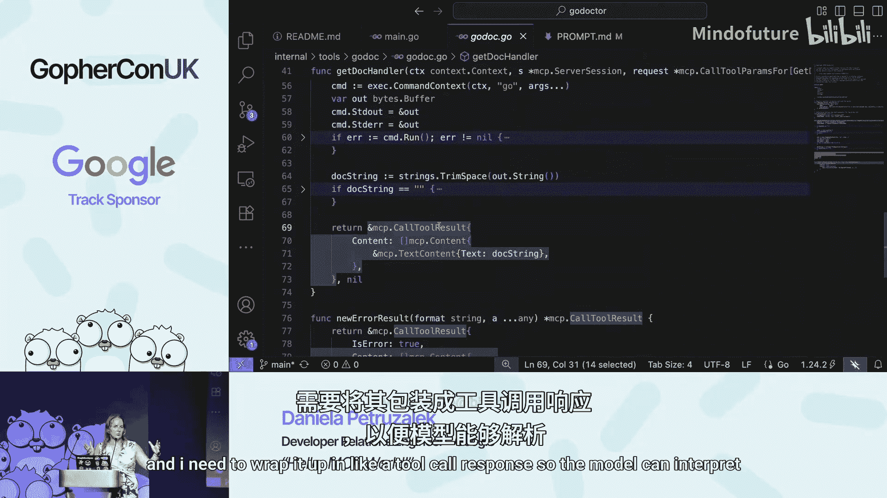

So。I'm using Ge ICI because， you know， I work at Google。 I have to use this tool。

But you can use this whole cloud code or any other MCP compliant even VS code。

 and the first thing youll notice when you try to do MCP in Gemini you have this control T to view is where I can see which are the MCP server I have map in here I have quite a few I developed to help myself Golddo is the very first one here It has a long description kind of hard to read in this way so you can just control T again and you'll see that I have this tool is green because it's online code review Golddog can I have and import this is an Instagram egg if you know you know。

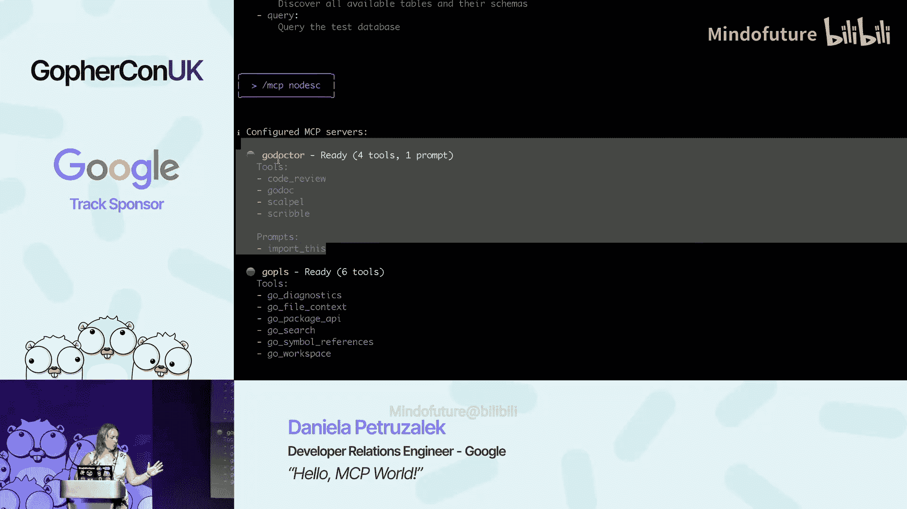

Yeah， it's come from Python， by the way。 So， but anyway。

 let's just try to get a prompt here just to show this working。 So I have my。

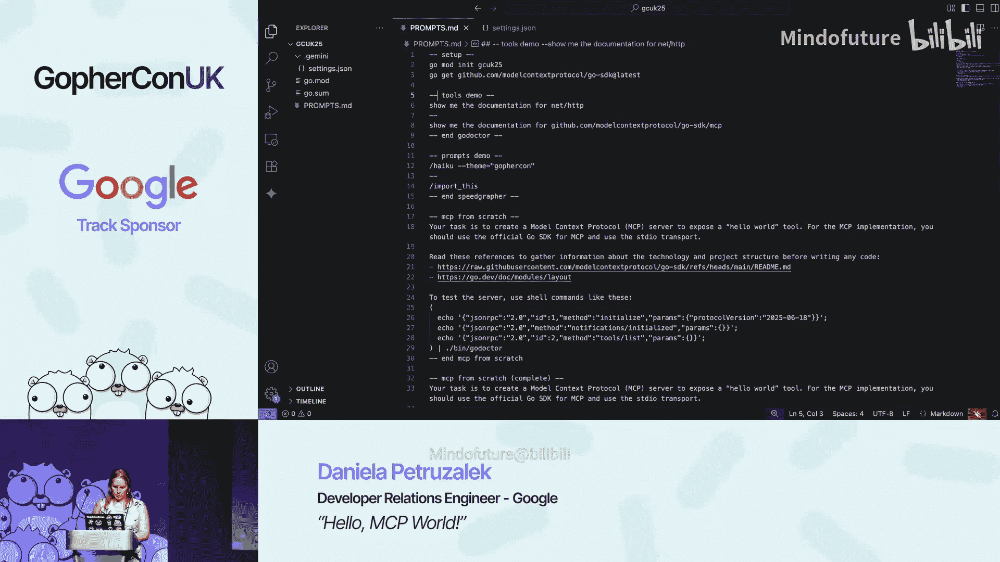

Let's just copy this one。 The other one I can make my。Mennually， so for example， I can say。

 show me the documentation。For， I don't know， HTP and that HTP。

And the first thing when you usually when you call something like this， I didn't say use godog。

 sometimes it' willll get right， sometimes you get wrong。

 But most of the time if your tool is defined well and I're going to go back in a call format to explain what this means。

 the model will automatically understand， oh， actually。They want documentation。

 And in my list of tools， I have this tool that retrieve documentation。

 So maybe I should try using the tool。 And here's asking for my permission tool allow。

 So I'm just going to always allow。 And it's kind。 So the golddo tool in the server， gold doctor。😊。

And I have the documentation for net HTP here。You can also。Asked in this case。

 I'm going to ask for an external patch， showed me a documentation for the go SDDK for MCP。😊。

And hopefully， yeah， it got in the first try， which is， yeah， not always the case。

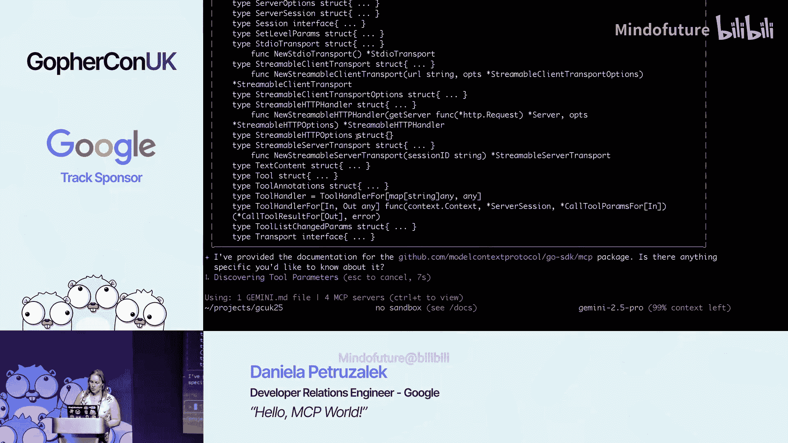

Okay， so this is how the documentation work。 The important thing here I was talking about is。

You know， for， this is kind of my redemption moment because for years in the new industry。

 I've been advocating in favor of documentation。 And you know。

 those people like I don't want to say the names that people say， oh， no。

 the code should speak for itself。You should not document anything。 and the code should be readable。

 Yeah， but if you want to play in the AI world， you need to have very good documentation。

Because this is how the models will figure out what you really want to do。 And here。

 like the description of the tool is very important to give this hint to the model of actually what it does。

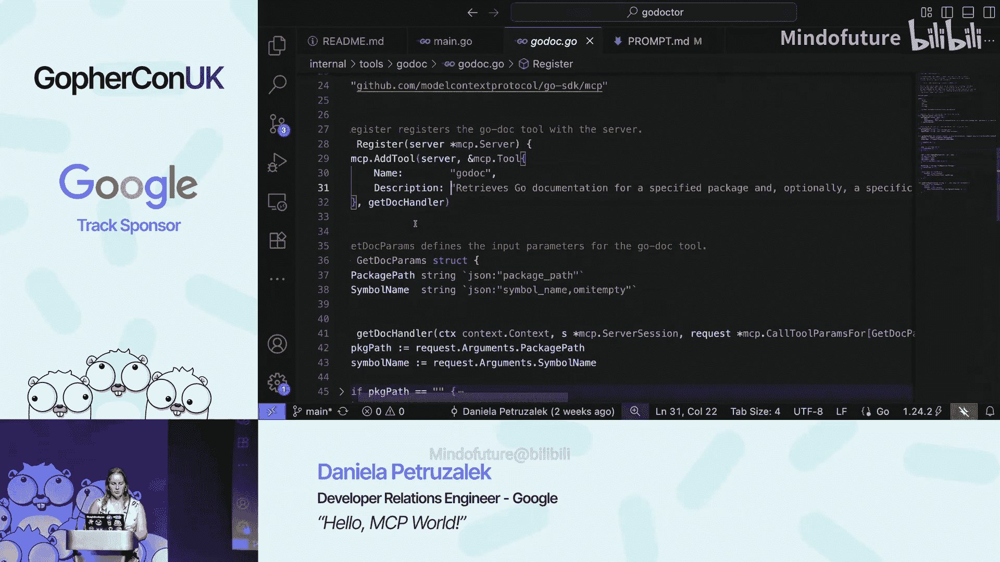

Okay， so this is God doctor for now。 Let's talk about prompts。Prompt is a way so again。

 it helps hear this talk about reusable templates。 You can store your prompts in an MCP in the server side。

And。You can also add arguments to the pro。 So it kind of doesn't need to be like a hardcoded thing here。

 it's best shown with an example， like I have another MCP server I wrote recently。

 it's call a speedgrapher because it's also the name of a a very anime， I I like a lot。

 but also it has the idea of writing fast。 Like if you go from Greek grapher， I mean it's writing。

Anyway， this has only one tool， but I have a bunch of prompts here and why do I have those prompts。

 They help me write like I've just recently become a developer relations engineer。

 I need to write a lot。And you know reviewing code text is even worse than reviewing code sometimes。

 So I added a bunch of prompts I was using to self review and help me make the model help me write。

 but for a simple hello world， I also have like a high Q prompt。

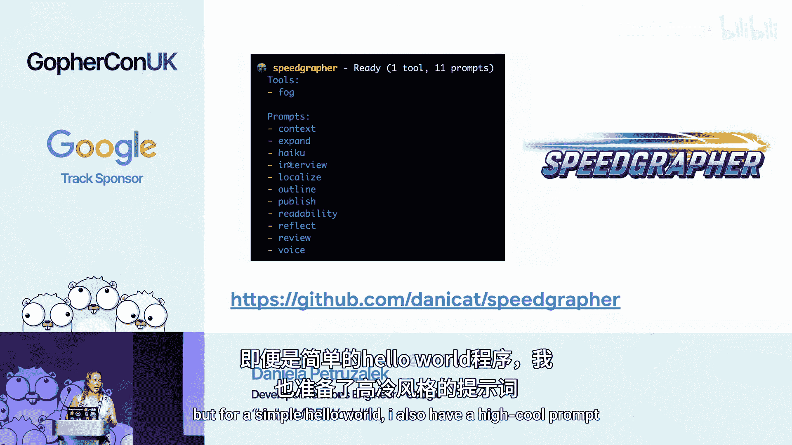

Let's see。 The thing， The cool thing about you see， I have。Speedgrapher here connected。

 and I have the Haikco prompt。 And this is a gymnai C accuracy。

 but other tools might behave the same， but I。Every time Jim and I say reads a prompt in MCP server。

 it adds to your slash commands。 So I can just type slash Haiku。 It's so completing to a topic。

 And let's say I want to a Haiku about Gofercon。😊，And engage。 And let's see， what does it tell me。Oh。

 golfers gather around sharing code and friendly chats。 Winter's show is gone。

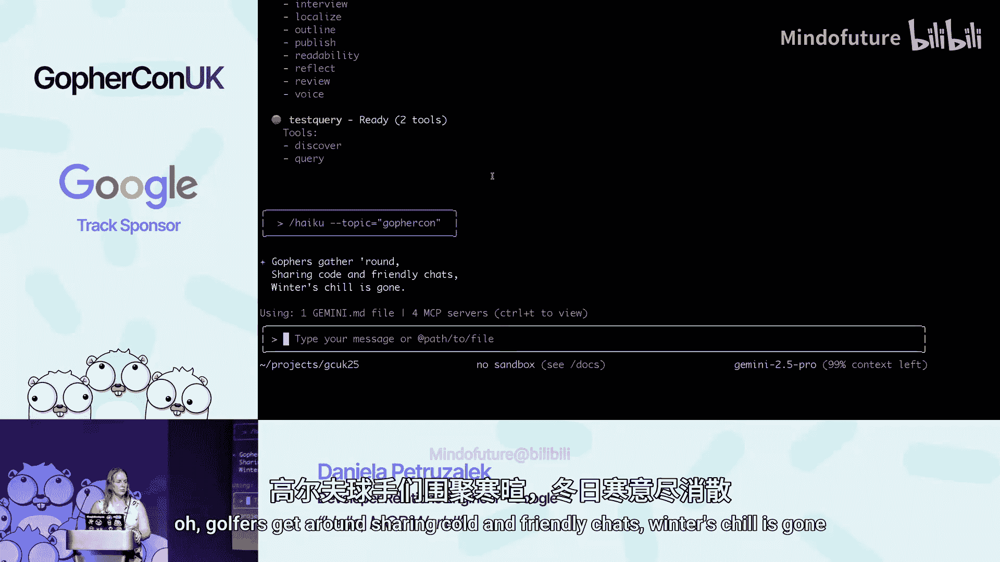

That's poetik。So how the high code prompts work is this exact same way as a tool。

 you have some kind of， would they find a prompt and register that prompt？It has a description。

 has some arguments， and it has a handler。 So in this case， I have a kind of a hard coded prompt。

 If you don't specify a topic。 You write a highiku about the the subject of our conversation so far。

And if it gives a topic， I would just like using a format print thing to build my my prompt。

 This maybe is not the safest way of doing this because it would be probably a vulnerable prompt injection。

 but it's a common。 It's a highikco。 I don't really care about security。But of course。

 in professional services， you yeah， beyond hello world。

 you would probably want to sanitize this prompt， maybe be a bit more careful with the prompt engineering。

The important thing here is that whenever you return a prompt message。

 now you are not returning a tool ca to the model or returning a message。

 and the message will have the raw user because this message is sent on your behalf so when it typeslash command is the same thing as if I had typed this prompt on the chat。

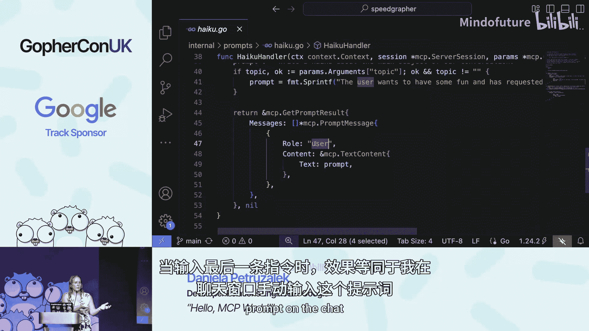

Hopefully， that makes sense。Okay， so resources， again， unfortunately。

 I don't have an example for this。 So Im just saying here what is in the documentation。

 it helps you deal with data。Again， real world people are using tools for that。

 so I still I don't know if this will catch up or not。

 but the idea here is you define customer Us like weather， lu， forecast CT date。

 and then you can retrieve data kind of these DSL things for retrieving data。嗯。

Besides server concepts， we also have client concepts。

 and this is something else I discovered recently。Those are the main ones the three ones I'm familiar with。

 sampling roots and elicitation。Sly， sampling is very promising because it。

It gives you the option to delegate some certain things to the client side。 So you're thinking about。

 I'm a server。 I can ask， oh， client， do you support sampling？And say， oh， yeah， yeah。 No。

 it's a part sampling。 Oh， cool。 So this model how also going to do serverign。 I want you to do it。

SoAnd why this is helpful， because， for example， you have an LLM on server side。

 an LLM on the client side， you want to make the client side LLM to answer the request。

So if I'm doing like a code review tool， I didn't know this when I wrote the doctor called review tool。

 but instead of spending quota on my calls for the server。

 I can have my client spend their quotas on reviewing。 and then maybe it simplifies my billing。

 simplifies my security， things like that。Roots is just a way to guard radio the file system to say。

 oh， is how the client communicate to the server that， oh， I only have access to this。

List of directories or this directory。 So it it' is specific about file system。

And elicitation is another interesting concept that is a of the client of the server to ask the client for clarification。

 So if I have I want the user to provide me additional data or I want to user provide a confirmation。

 do really want to do this。 really， really。 Okay， then you can use elicitation。

 if the client supports that。😊，Okay， I have 7 minutes。 So let's try something practical。

 What could go wrong。This is a quick demo I said I'm basically vibe coding everything and I'm not sure if this is going to work。

 but this is if you want to know how I craft this prompt come tomorrow。

 the idea here is to build a small hello world MCP server， usually I do this like task。

 a bunch of reference in a way to test it， so here I'm testing from the common line using the sequence you saw before。

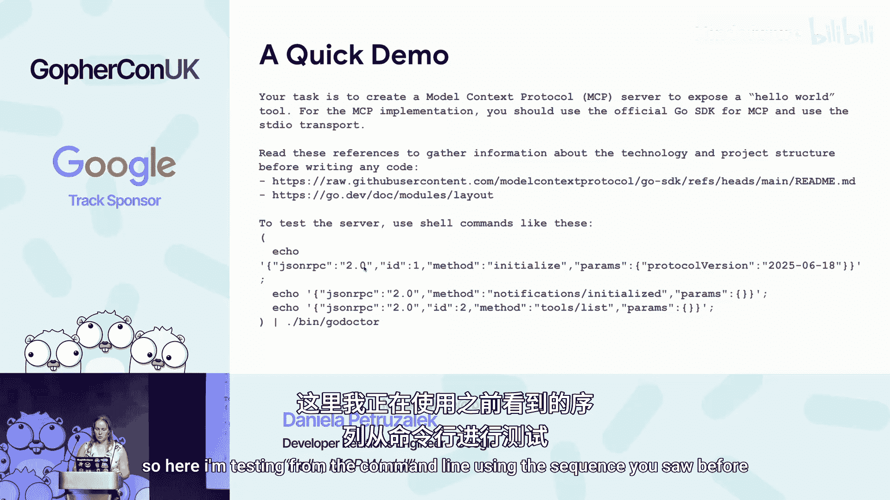

Let's just copy the prompt that I have a copy here。And， hopefully。

We will be able to at least write a hello world MCP server until like six minutes and counting。

 Let's see。 So one of the things about live about vibe coding these things like you'll see that the model will stop me asking for some confirmation。

 So I need to be here for a minute just to make sure it's not going to stop in a silly confirmation。

 It's already starting to write some code。 Okay， that looks promising。😊，And hopefully， yeah。

 not tidy。 It's actually going faster。 Like I was praying for the demogos that this will actually。

 So you see， it's kind of making some mistakes。 And that's fine。 Okay。

 I don't know why it's trying to play with elicitation now。 Maybe he's hearing me talk about this。😊。

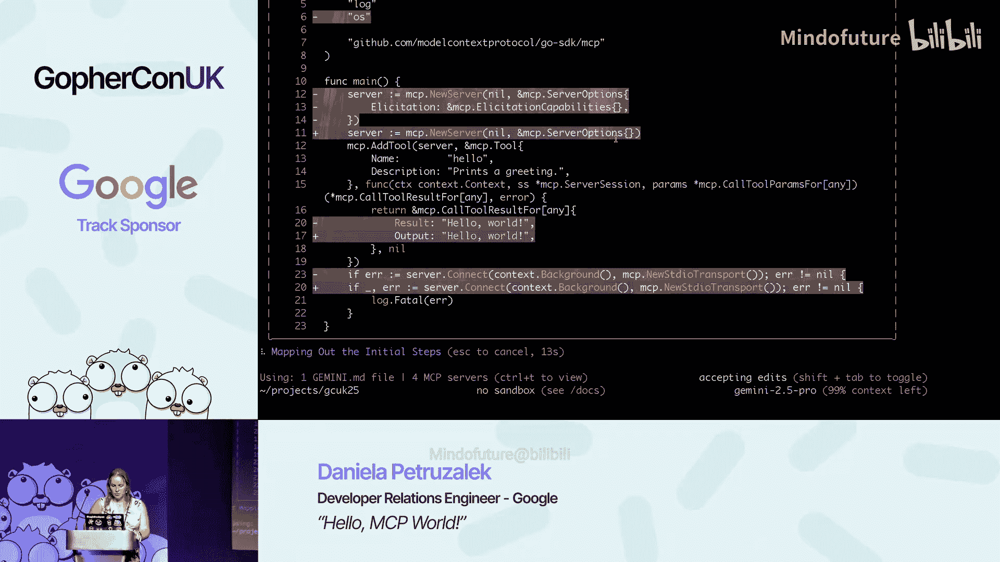

But O， it's doing some mistakes。 Let's leave it working。 Hopefully， we'll have something。 Oh。

 did you see that。

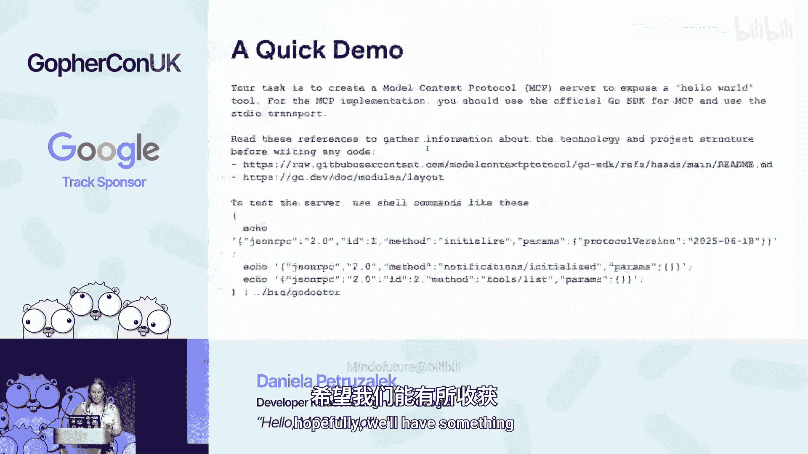

It starts。Failing and say， you know what， I still having trouble。

 I'm going to call Go doctor to see the documentation and see if I'm what I'm missing。

 This is what I love about this thing。 Anyway， let's pretend this is not happening and move on。

 So there are two things that you you need to care about like if you're tune in the go ecosystem。

 These are the main developments in regards to MCP。 We have a few community written SDKs for MCP。

 but this is the official one。 And this is not to merit the community。 actually。

 this is exactly the opposite。 This design of this MCP C was inspired by every other set that was written in the community。

 and they explicitly mentioned the inspirations in the design document。

 So talks about this marketre labs is the most popular one。 But this is the official SDK。😊。

You suppose you'll be a more opinionated way of what they think and this has been a partnership between Antropic and the gold team。

So we should see some good stuff coming up。 I'm using this for all my examples。 and so far。

 I'm happy with it， but I didn't try anything crazy。

 Like I didn't try playing with elicitation or or all those client features or even resources yet。😊。

So this is one thing。The second thing I want to show is the MCP support for Go please。

 Go please is the language server protocol for go which kind of powers out to complete on V code and other things。

 And the hypothesis between for this is that maybe with Go please support the models would be smarter and be able to do like better guesses I don't know。

 maybe guess less。 So I'm playing with this for a while so far。

 I haven't been very successful to be honest， because the tools that go please expose。 let's see is。

 is this done。 Oh that's just。😊。

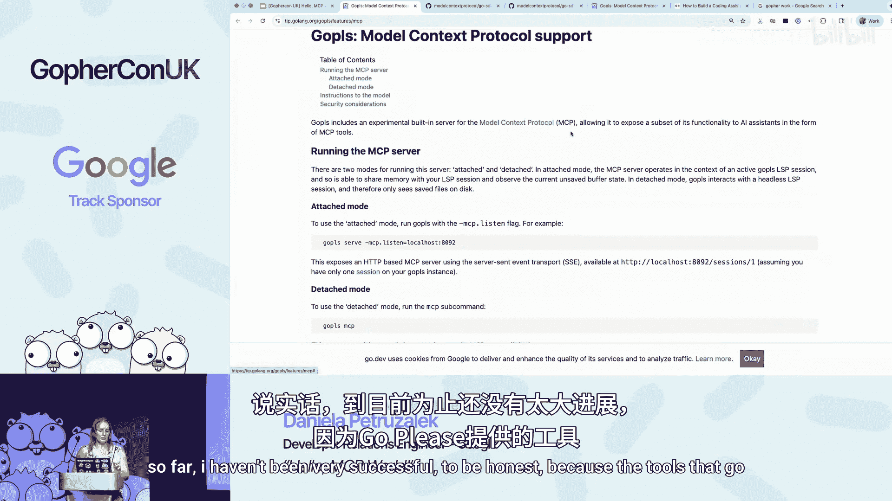

I'll save this for the end。 But when you。Look at the tools and have go place here somewhere it has。

Some diagnostics， like you can run， go please check on your code package API similar to what I'm doing with Godooc。

 It also go please can do that。So but I didn't have much luck in the model proactively。

 wanting to call those things。 So this is， I think。

 maybe something we can improve with the descriptions or the usage the API will evolve。

 But those are the main things I think you should be worried about。 Let's have a look at this。

 It does it actually work。

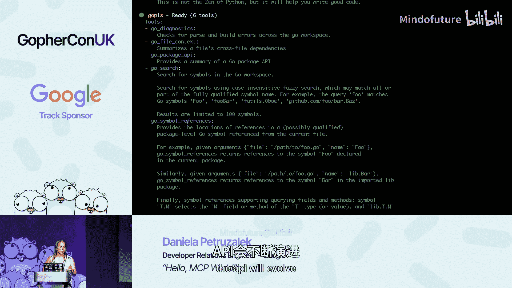

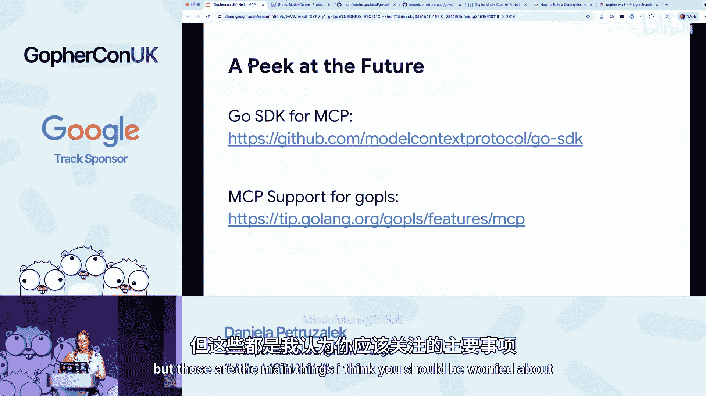

Oh， no， it doesn't in F。 This is a very common problem because it starts with a new implementation lens。

😊，Oh， now it's a this。Discover it needs an implementation。 So let's see it it work。Come on。

 I'm running out of time。I don't know。 It says it's working， but I didn't see anything you。run。

Example， again。I'm not saying。The output。Let's leave it for a while。 Just。 I'll be back later。

 I'm juggling to the threads in the same time here。 This is my actually my last lives。

 I few useful MCP server from the community。 playwright has been helping me a lot with web things。

 I'm not a frontend developer。 I'm writing a blog。 And I want to sometimes I need the image to be 10 pixels smaller。

 I don't know。 it's very cool because it can navigate your site。 It can screenshot。

 You can use the screenshot。 if have like a Mochi model model。 say， oh no。

 change that right change to the left center。 It has been very useful for me。

 The second one that has been very popular recently is called context 7。

 which is about documentation。 similar to。 I'm trying to with the golddog that's very specific to go context 7 iss a crowdsource all sorts of documentation things。

 So have a look at it。😊。

嗯。I think the catch here like it's cool。 Oh yeah，' seeing all those MCP servers。 It's pretty cool。

 but what about to try building your own， I think this is the most important thing you can do from the talk。

 So I wrote this is Mao Lab that you can actually do this thing I'm trying to do in the background。

 You can quietly in your home， try to build your own good doctor server and learn all those as the case。

 one last try， let's see how it's going。😊。

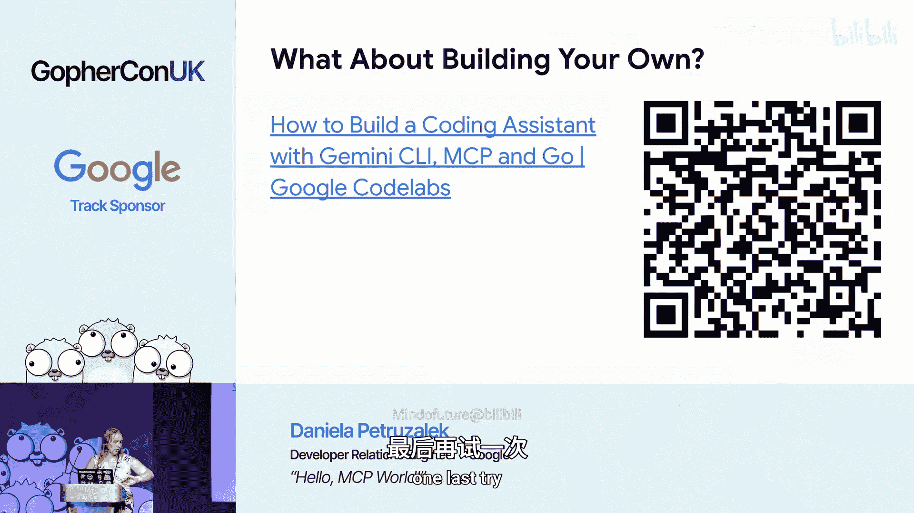

Oh， it's logging， but it's not working。And now the after， oh。Are you synchronizing。Correctly。In the。

Name， functional。The actual the server in issue I've seen this many times where the server do not wait。

 and just you need to add some synchronization logic for it to work properly。

 or otherwise it will just， you know， it concurrency。 It will finish before starts hand a a request。

他だから。That's an excellent and insightful。 Thank you。

You'll see I'm spending so much time with LOMs that I might start speaking like that and am I scared of it。

嗯。嗯。 let's see what can prompt。Can you just add。I weight in the main function。

I don't know if this prompt is going to work。 But usually when this， this demo fails。

 is because it forgot to synchronize in the process as it exiting earlier。Let's give one shot。

 I know I'm zero time。Oh， no， it's completely trying to make up stuff。Try the code lab。

 This will work better。 And if you want to see me embarrassing myself again tomorrow。

 I' will have more time。 We can play it a little bit。😊。

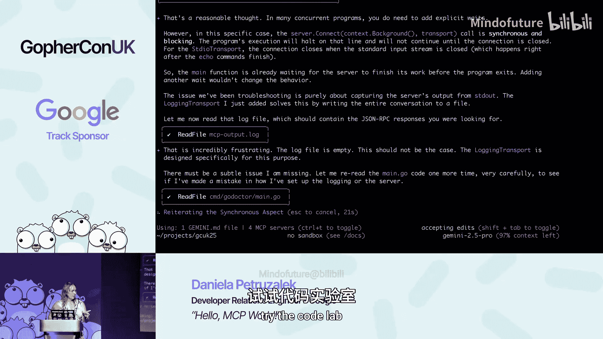

That that's it。 That's what I had for you guys today。 Thank you so much。😊，唔。

