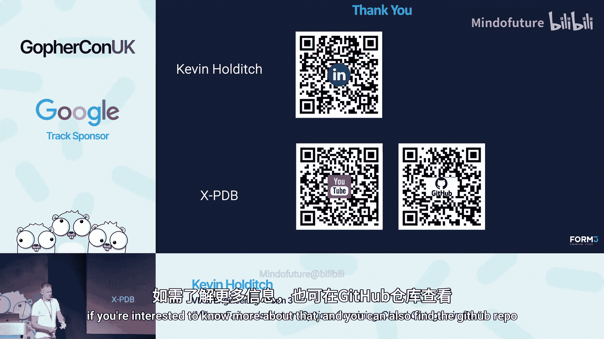

# Gophercon-Uk-2025-p11-P11_当失败不是一个选项——在_Go_中应对云服务中断--BV1dCHTzQEdN_p11-

T of the morning all and welcome back on another great day to be alive。

 So for our opening keynote today， having worked from Ejet to Asos and eight years ago becoming one of the founding members of Form 3。

 the company where he still works now as the vice president of engineering。

 please welcome to the stage with his talk when failure is not an option。

 surviving cloud outages and Go Kevin Holdch。😊。

Good morning， everybody。 My name is Kevin Holitch。 I'm VP of platformform for a company Con Form3。😊。

And welcome to my talk when failure is not an option， surviving cloud outages。

 And as it's go for con， it's got to be go， of course。So when I was growing up。

 I saw this screen probably more times than I would care to remember。

 debing problems with windows where the platform that I grew up using。

It always seems to be going wrong。And when I walk fast forward to today。

 I think about how much of our daily lives is dependent on technology。 Li。

 everything we do relies upon technology， whether it's booking a train ticket。

Watching a film using a streaming platform or even paying your friends and money。

 And that demand of something being always on is growing and growing。

 And no one accepts any service being down， even for a minute these days。

 And that problem is really pushed upon everyone in this room to build very highly resilient services。

 And it's definitely a challenge that we faced at form free in building our platform and to power our customers。

So in this talk， I'm going to talk about how we transition from a single cloud to a truly multi cloudud architecture。

And some of the challenges we faced upon the way。 I'm going zoom in on three of those and how we solved them using Go。

So before I get on that， I'm just going to briefly explain what form free to do。

 So it really sort of frames the frames the problem for everybody。

So I'm not sure how many of you are aware， but there's this concept called a payment scheme。

 So what a payment scheme really is， it's like a protocol and an implementation of that protocol that a bank or a financial institution can integrate with。

 and it allows the movement of money from bank A， a bank account on Bank A to a bank account on bank B。

Now， there's many incarnations of these payment schemes。 For those who live in the UK。

 I'm sure youve heard of a payment scheme called Bs。 It's very popular。

 And there's another really big one called FVS， which is the fast payment scheme。

 where money moves in real time。 And they're moving into Europe。

 there are the separate payment schemes。 And theres payment schemes all around the world in every geography。

So what is the challenge then。So even though these payment schemes solve this very simple problem for banks。

 which is they allow them to move money from a bank account in one bank to a bank account in another bank。

Every detail about the bank， the payment scheme's implementation is completely different。

So that is from how do you connect to the payment scheme， Is it over a VPN。

 Do you need a private network connection， is it the Internet， What message format do they use。

 Do they use the 1970s backs format， where it's like space delim format。

 Do they use XML because they want the challenge or how they doing it and some of them require physical data centers to connect into them and how do they handle errors。

 How do they do message flows， everything about them is like completely different。

So that's where form3 come in。 So what we provide to our customers， which are banks and fintech。

 is a single API， which is a restful modern API， which abstracts all of that away。

 So what our customers can do is they can integrate with us once and get all of those payment schemes from a single integration。

 And they don't need to worry about all the complexities of what's going on under the hood。

So then what is the journey we've been on。 So Form3 started in sort of late 2016。

But then there were four engineers。 I was one of those engineers。

 We knowingly made a decision when we were first building out the first version of the product that we wanted to offload as much as the challenge of running all of the technology onto AWS。

 So we just became AW native。 We just knowingly sort of integrated ourselves tightly of AWS。

We actually picked Java， like I know， probably a bit of a TV word in this， in this crowd。

 wrote all of our services in Java， a microserv architecture。

And the mindset back then was really about proving the idea。 We didn't like imagine that we。

 we hoped， but we didn't imagine we were going to land some of the customers that we have today。

So in fast forward like nine years， and now we're over 100 engineers。

 we've got a truly multi cloud architecture， which I'm going to talk to you about today。

 we're completely cloud agnostic。 We've migrated to go。

 We run on Kubernetes and we're running what I would consider almost nationally critical infrastructure。

 We're empowering a lot of the UK's payments。🤧嗯。So how does our architecture look。

 So at a simplified version， the V1 platform that we built out。 Remember that this。

 the mindset we had back then， we had a small team。

 We wanted to offload as much of the running of the platform onto AWs as humanly possible。 So。

 as I mentioned， we are in APIs。 We had a low balance at the top where customers could ingress into the platform。

We wrote all of our microservices in Java， deployed them in docker containers to AWS， E， C， S。

For those who don't you know， E S is AW S is proprietary container on time technology。

 Think of it as their version of Kubernetes， if you like。

And we used AWS S Q S Q S to send messages between applications。

 So we have asynchronous payment workflows that stitch together by a message bus。

And we stored our data in Postgres， which was running on AW S RD S。 So like I said。

 the name of the game here was really to let AWS worry about running the message brokers。

 running the database So we could take a support contract out with them。 And if anything went wrong。

 they on the hook for it， not us。And this worked really well for us。 We landed our first customers。

 which are smaller fintech。 And the company sort of really began to grow。So what changed。

 So after a year or two， we really started to gain a lot of momentum。

 and we started to pique the interest of a lot of several big Tier 1 high street banks that I'm sure many of you in this room bank with。

And at that same time， a lot of these banks were in the process of migrating to the cloud。

 That's one of the last industries that we're seeing you know， waking up and doing cloud migrations。

And the PR， who are like the regulatory authority， thats what oversee the banks in the UK。

 have taken a keen interest in the bank's migration。And。😊。

They've basically laid out some guidelines that they must adhere to。 So one of those is that they。

 the PR are very nervous about any bank just taking out a total dependency on a single cloud vendor。

So they've basically laid out and said， you need to be able to like exit that cloud and move over to another cloud fairly quickly。

 They don't tell you how you're going to do it。 They just say that this is what you need to adhere to。

So the banks then have that requirement and because it's form free。

 we're going to be powering those banks， those banks who we want to become our customers。

 then push that requirement down onto us。That then caused us to have to completely rethink our architecture to be able to run across multiple cloud providers。

So， you know， not a small， not a small challenge by any means。So at a high level。

 we had a couple of directions we could have gone in。

 So what we've seen some people do in the industry is which is one way we could have gone。

 We could have completely rebuilt our whole architecture and picked another cloud like GCP。

 picked all of their equivalent technologies， rewrote maybe a subset of our services to run on there。

And then be able to fail over to GCP in the event of， of disaster， to fulfill the requirement。

But some of the challenges we saw of that was we would have to then maintain two cobaases。

 one that worked on AWB， one that worked on GCP or whatever other cloud we chose。

 we would have also had to have this big bang farover process。

 and we really didn't like that as a strategy。So instead。

 we chose to take the really bold move of we thought， well。

 what about if we can treat a cloud provider like an availability zone。

So we'll just deploy across all of the cloud providers。And then if any of them fail。

 it doesn't matter because it's just like when an A Z goes down。

 So that's actually the design that we went with。So instead of using Aw's proprietary technologies。

 as we did in V1， we had to pick cloud agnostic infrastructure that we could run on any。

 any cloud environment。 So one of the things we normallymin took on there was instead of A。

 like running this technology for us， we now had to have teams of people running this technology at form free。

 But the trade off was that we can then run the same software on any cloud provider。

And with these sort of larger banking customers that wanted to use our platform。

Their sort of requirements were much higher than the sort of initial customers where we were approving the market。

 They had super high throughput demands of， you know。Up to 1000 payments a second。 in some cases。

 they wanted very low latency and very tight S L A。

 So we had to meet all of this on our multiclo architecture。So what was the design that we went to。

 So the V 2 architecture looks like what you can see here。

So this is what I'm talking about when you can see using a cloud provider like an availability zone。

So we have a low balancer in each cloud provider。Where the customer can ingress into。

And instead of using E， C， S， we now run Kubernetes in each cloud provider。 and we've deployed。

 We've moved our microservices from Java over to go more on that， more on that scene。

And then the really secret source here of what makes this function is that we've privately networked all of the cloud providers together so that pods in one cluster can talk via IPP address to pods in another cluster。

So we have that sort of hard networking challenge solved。What we can then un do。

It's run a single logical cockroach database and the single Nat jetstream clusterer for messaging of across the free cloud providers。

So with this in place， we've actually as a platform team。

 solved the super hard challenge of running multicloud for the engineering teams that Form free who are building products and all they have to do is literally write their application。

 which runs on Kubnetes， it runs in Docker， it's written and go。

 and it takes dependencies out on NAts for messaging and cockroach DB for storing data。

 And as I said， like with then the advantage is that the engineering teams can deploy that very same application to every cloud provider。

 They didn't even really need to know or care which cloud provider， their application is running in。

Like I said， we've offloaded the whole problem of， well。

 what happens when a cloud provider goes down because the only technologies that really care about that are nutss and cockroach and they're built to with withstand that failure。

哈。So what are the key technology swaps we made。 So as I mentioned。

 we knowingly coupled ourselves to AWS on V1 and on V2 we deliberately picked agnostic technologies。

 So one of the trade offs here was that now we had to have platform teams running these technologies for us。

 So we've Kubernetes， we actually use the managed control plane offering from each cloud provider。

 So we do get some benefit there of not having to run Kubernetes control planes ourselves。

 but we do have to run NAts clusters and cockroach clusters ourselves。

Which in this sort of environment we're in is quite a challenge because you have to obviously keep that running the whole time。

 keep it backed up， make sure you can restore it and everything else that goes with running those technologies。

So the reason we chose some of the technologies， I mean， E S Kubernetes。

 that that's a pretty obvious one。 It probably doesn't need much sort of explanation。Moving from RDS。

 we used to run Postgres on RDS， moving into cockroach。

The reason that we chose cockroacheach is we had a very sort stringent set of requirements on what we needed out of a database technology。

 So what we really needed was like a nosQqL database style architecture， where it was always on。

 It supported zero downtime upgrades。 It was horizontally scalable。

 but it was also sort of acid and right consistent。

Which is quite a sort of tough challenge that you're put in sort of a database through。 But luckily。

 for us， there are a few databases out there that now sort of tick that box。

 And cockroacheach is one of them。The sort of really good thing for us about cockroacheach is that they implement the sort of Postgre dialect。

 So for applications that we had already migrated to go。

We could literally drop those across to use cockroach。

 and they just worked out the box like pretty much all of the time。

 So it allows for a very easy migration from Postgress over over to cockroach。

And like I mentioned on the previous slide， we're then offloading the problem of， well how do。

 how do you keep data safe or offloading all of that to the the clever people over at cockroach。

So what you can do with cockroaches， you can set it up in a few different modes。

 But obviously being someone who provides payments， we can't obviously duplicate a payment。

 We can't lose a payment。So how we've set cockroach sharprp is for it to be right consistent across the free cloud providers。

 So when one of our applications writes some data。The right won't come back as successful until at least two of the cloud providers have accepted that right。

So we're trading off a little bit of performance for that right consistency guarantee。

 But that is like so critical for us。 And the performance is still， you know， pretty decent。

And then lastly， we chose to use Nat Jetstream as our sort of message bus。

 So Nats was a technology built in go， built by a team of people who used to work at a company called Tbco。

 So for those who don't know， Tco is a message bus used by a lot of realtime trading platforms。

 It's a very high performance message bus。And the guys at Tbco wrote like an implementation or a brand new message byinggo。

 And the idea was it to be very lightweight， very fast and very efficient。 And on top of that。

 theyve built something called jet stream， which has it adds a few more features to that。

And that's something that we've used at form free。 So what that really gives us is the same way as cockroaches。

That' also uses ra based consensus under the bonnet。 So that allows us to survive cloud failure。

 And we don't have to worry about that because， you know， Nas take care of that problem for us。

So then why did we move to go from Java， I mentioned earlier that we started in Java。

 And Ive got a few like angry looks。 So there are a few reasons that we。

 we sort of woke up and wanted wanted to move to go， so。There are many reasons。

 but I'm just gonna sort of zoom in on a few of them。So the first one was cold Start。

When we wrote our Java applications， we used this library called Spring Bo。

So many of you use spring boot for know feel your pain。 like it's a brilliant library。

 But when you try and start an application。 if you can start the application under 30 seconds。

 then you're also on kind of code and heroro。 and the way we do testing at form free is that we spin up dock containers to simulate all of the infrastructure and application uses and we run our test end to end。

 So when an application takes 30 seconds to start。 that means a lot of engineering time wasted on running tests。

 So we moved over to go and literally you couldn't believe it application seem like they just start instantly。

 So that's a lot of time saved running tests and a lot of happy engineers form free。 So win， win。

The next one is no magic， so。I remember one of my colleagues wrote， wrote a test in Java。

And it was literally， like， even though it's Java， It was one of the most beautiful pieces of code I've ever seen。

 I'm not joking。 It was like a class。 And it was like， give when then。😊，It was three lines of code。

 And when I run it。Docker compose booted up。 Los of docker containers started。

 It rewid all of the clients that Post my Postgre client was going to use to use Docker and all the rest of it。

 totally amazing。 Run all the tests。 Shut all the docker containers down。 And I was like。

 said to him。 I was like， well， how the hell does that work from those free lines of code。

 And he was like， oh， there's annotation at the top there。

 And theres this little annotation at the top of a class For those who don't know。

 that's like a little marker you can put on a class。😊，And when you drill into the annotation。

 that then pulls in loads of jar libraries and does all this magic under the bonnet。😊。

So it's like super beautiful code， but it's an example of very magic code。

 So as an engineer to want to work out how that， how that functioned。

 it literally would take you days like， so that's the trade off there。

 But then when you move over to go， there's literally no magic。😊。

But that's actually a good thing because you can read the code and you can actually understand what's happening。

 So I think when you're sort of sort of working on a test。

 it's impossible to sort trick people in write code that may might look beautiful。

 And you might be able to print it out and put it on your bedroom wall。

 But it's super hard to maintain。And then that falls into my last point of why it's， in my opinion。

 very ideal for writing the microservice architecture， because if you're working on many code basiss。

 the code is so explicit and it's easy to reason about and easy to pick up。So that's。

 that's a key thing that that that you need。So， so we built this V2 platform， Mo car platform。

 We launched it a few years ago， and we run many tests， and we were sure that it functioned。

 But you never really know if it's going to work D E。

 So I liked you to indulge me on a story where this all came home to Ruos for me。

 So it was the 12 June a Thursday。I actually went into London to the office。

 which I don't normally go in， but I did this day。 I was on the train on the way home。

 and I'm a very big sort of football fan。 My team is Tottenham Hotspur。

And we just actually hired a new manager。 So I was like， you know， when your phone stops paying off。

 super excited。And one of the things I really enjoy doing is I've got a couple of YouTubetubers that I follow。

😊，And they're really good at how they analyze football。 and they give their technicalctic breakdown。

 I was like， I'll jump on YouTube and I see what they've got to say about on manager。 very excited。

 So I got my phone out， and they were like streaming。 And when I looked on the stream。

 normally like these guys like， you know， super pro。 I really fancy。

 So they normally have like the graphics and the things going across the bottom of the chats find。😊。

And I looked on their screen， and literally， it was just the two of them and a black screen in the background。

 I was like， this looks really weird。 What what's going on？ And the mics weren't working。

 And it was like a complete shambles。And then they were like， oh， you've got a bear with us。

 like the streaming platform we normally use to like stream our content is something called streamamyard。

 which for those who don't know is like a if think of it like Zoom for YouTube。

 you can actually have a call and stream it straight to YouTube。 That's like down。And I was like。

 it's it。You know， you just go into that moment。 You're just thinking for a minute。

 And then I looked in the chat， and then it dawned on me what the， what the problem was。

 And it was this。And just as I put this slide up， I've realized what the name of this room was。 So。

 you know， pretend engineer this is between friends， so。I was like， oh my God。 So then I was like。

 totally forgot about the fact that we just hired on you manager， picked up my work laptop。

 And I was like， oh， no。You know， this is where your heart starts racing。Logged into work。

And I wouldn't say it was to my surprise， but you always never really know what's going to happen。

Not one single payment was affected by this outage。So that was really the proof。

The proof of all the hard work we've done of being able to treat a cloud provider。

As an aability zone。That this is not to be on anyone， that incidents happen。

 But when a big incident such as this happens， where it affected so many big names in the industry and all of our customers didn't even notice。

So， yeah， that was such an amazing achievement of one of the sort of proudest moments that they actually had。

😊，So now I just want to focus on three challenges that we had when we sort of was building the platform and how we solve those using Go。

So the first challenge was pod disruption budgets。So for those who don't know。

 pod disruption budget is a concept in Kubernetes where you can tell Kubernetes how many pods it's lay allowed to disrupt when you're doing operation。

 So let's say you're rolling out a new node pool。 You can tell Kubnetes， I've got three pods。

 and you're only allowed to take one of them offline any one time。

 and it would adhere to that at all costs。So， so why is that a problem。

So in our multi cloud architecture， we actually have three distinct Kubernetes clusters。

 and they know nothing about each other。 As far as they're concerned。

 They're just completely separate。But as I mentioned。

 we've actually got a single logical cockroach database spanning those clusters。So if we did nothing。

 the best we could do when setting a pod disruption budget would be what you can see on the screen here。

 which would be to set maps unavailable to one in each cluster。

Which would actually mean every one of those clusters， if it was doing an operation。

 could take one pod off line， and that would be valid。Now， in this architecture。

 you can see with 9 Kubernetes pods。We actually need five live at all times， minimumum， Otherwise。

 we lose the whole database， which would also be bad。

 So Kubernetes could actually take three pods down， and that would be valid。

 So that would leave us for 6。 So that would be very close to， you know， having having an outage。

So that was just not going to coverve it for us， especially when we're having to roll nodes quite often in order to keep everything thing updated。

So how did we solve this？ So we actually wrote， and we've open source。

 and I've got a link later on in the in the slide for you。

 We open sourced a new implementation of PD DB called X PDDB。

 And what this does is it spans N clusters where you can have a pod disruption budget that spans all of the clusters。

 So with X PDD B in place。 we can actually say， hey。

 you can only have one unavailable pod across all the clusters。So with this in place。

 we're really using Kubernetes and the constructs built into Kubernetes to do the heavy lifting for us。

So now， when the teams are rolling out nodes or doing whatever work they're doing， we can， you know。

 lay em bed safe at night， knowing that cockroach is always going to have enough pods running。

So the second challenge that we faced was， you know， rolling node poles。

 So if anyone who's worked with Kubnetes knows that they release， you know， it feels like daily。

 So how do you keep up with you know， even just keeping Kubernetes upgraded。

 So you might think that when you're running manage Kubernetes control planes。

 just upgrading would be like a button click， Now for the control planes。

 it kind of is a button click。 But then the challenge is that we run around node pools underneath that。

 And to upgrade to latest version， you actually have to roll every node。So why is that a challenge？

Well， that is a challenge because on every cluster， we have many node pools。

 I've shown some of them here， like a no pool for applications， a no pool for cockroach。

 a no pull fornas， etca。And we have to manage though。

 we were managing those in terraform using and infrastructure as code for every no poll。

 for every cluster。So why is that a challenge then？Well， then we actually have。

 because were you know， good boys and girls。 We have development staging production。

 We promote our changes through those environments so that you can very quickly see how this explodes。

 And then to make matters even in order of magnitude harder。

 We actually have what's called jurisdictions。 So we actually deploying different geographies。

 And each of those has development stageging production。

 we quickly see how this just gets out of control。 And if we did nothing。

 just upgrade all of these no pools。 when you're managing them all by terraform would be lots of PRs like And you can't just upgrade all of them all the light at once。

 you have to roll them out slowly to development first。

 It just would have been painfully slow in almost impossible。

So how we solve this problem is we wrote our own operator called the cluster lifecycle operator。

 So what this does is it runs in each cluster。 and this actually takes ownership over the node pools。

 So we have cluster lifecycle operator in place。 we can then define our own domain Pacific language using CRDs。

 which are custom resource definitions where we can say to it， okay， well。

 this is the version of Kubernetes we want you to run。

 And then cluster lifecycle operator knows what node pools it's running。

 and it can manage those for us。 So now we have cluster lifecycle operator in place。

 a bump of Kubernetes is three PRs， one for dev， one for staging。

 one for production to just change this CRD。So lastly。

 the challenge that we faced was obviously rolling out an ambitious project such as this。🤢。

traditionalraditional DR testing just wasn't an option for us。

 So so many places I've seen treat DR testing as an aftertht where they basically get a word document out of a dusty old drawer once a year。

 Go through tick boxes， check their thingwork， then sign it off。

 put it back in the drawer and then don't do anything for another year。 Now。

 the challenge is when we're running you know， very important payments for high street banks。

 We can't， we can't treat D R testing like that。 We had to treat it as a first class citizen。

So how did we solve that challenge？So what we did was in one of our sort of staging environments。

 we built fake customers。 So what fake customers are are separate deployments completely outside of our platform and we sort of build is exactly what it says on the tin。

 a fake customer that uses our platform。 So if those in place。

 those fake customers send pretend payments will actually real payments that run against fake implementations of payment schemes like every second。

 and then we have alerting that fires， if any of those payments do not work。

 And then throughout the night， we use chaos mesh， and we build custom scenarios in go to knowing and inject failure into into the platform。

 So some of the scenarios that we run is taking down a whole cloud provider breaking network connections。

 turning the database off and those types of things。 And then the next day。

 we have a report with what happened in all of those tests。

 And this gives us the knowledge that if if an engineer makes。change the very next day。

 they've got a report to see what the impact of that change was versus some of the other approaches you see where you run the test once a year。

 That test is invalid the very next day when you've changed the code。So what are our lessons learned。

 So multi cloud is hard。 I'm not going to kid you otherwise。

 but it's definitely possible when you stand on the shoulders of giants and you use today's technology and tools。

And I think a key learning was using Kubernetes extensibility。 like Ka mentioned。

 with pod disruption budgets and writing operators。 It's really key to be running active active。

Treating D。 R as a first class citizen， not just a chat box。 And obviously。

 Go was a huge enabler for us in all of this。Thank you very much。 I've got a few links there。

 If you want to connect with me， The Q R code at the top on LinkedIn。

 I love to hear from you and chat more。 If you're interested next PD DB。

 which is a project I talked about， there's a YouTube video on there that will link you to a talk than my colleague Moritz did where dived into loads more technical detail。

 If you're interested to know more about that。 And you can also find the Github repo there。

 Thank you very much。😊。

