# Gophercon-Uk-2025-p12-P12_Gopher_的氛围编程指南--BV1dCHTzQEdN_p12-

Once more unless anything catastrophic has happened in the last 24 hours。

 she is still currently working as a developer relations engineer at Google and today I'd say she's brought us a topic which is one of those things regardless of whether or not you're an AI coding skeptictic or enthusiast is probably going to be a very healthy thing to keep an eye on just in case you can sort of hear the footsteps of Gen Z and Gen and Alpha behind you with all of their vibe coding So with the title a Gopher's guide to vibe coding。

 please welcome to the stage Daniela Przaic。😊，Thank you。Thank you， everyone for coming。 See me again。

 this conference。ow is this light is so bright。 I usually like looking at the audience。

 but this light makes very difficult。 So just first of all。

 thanks for everyone for coming because I know it's parallel tracks is really difficult And competing with Bill Kennedy my worst nightmare。

 So I appreciate a lot。 you coming here。 this is kind of。😊。

I'm going to try to be gentle with people watching this later on on videos。

 Im youre going to see maybe a couple slides you saw yesterday。

 So this is kind of a direct sequel of the， the， the previous talk。 But at the same point。

 it's a different angle。 like yeah。Yesterday， I was talking about MCPs， this is and what they are。

 how you write them。 This is more like， yeah how you vibe code， how do you use them。

 So it's a different process。Pretend you don't know me。

 so I'm introducing myself again for the video。 I'm a developer relation engineer at Google。

 I'm originally from Brazil。 I the UK since 2018， been doing go since around 2017 on and off。

 not usually as my day job， not out times as my day job。

 but I've been keeping close touch with the community since then。😊，And today。

 if you ever saw one of my talks， especially yeah， probably saw yesterday。

 I always like to start with a definition， just make sure everyone is in the same page。

 So I' going to introduce what is live coding or what vibe coding talk about different kinds of coding assistance we have。

😊，Then I'm going to speak a little bit about how I am adopting this as part of my workflow。

 This is a common question I have。 like people come to conference like to the Google boot to ask， oh。

 yeah， this gemized satellite lighting。 But oh this is pretty cool。 But how do you actually use it。

 right？ So how do do you incorporate this in your day to day。😊。

I'm going to try to answer this question with my very opinionated view。

And then we're going to have some a few live demos。 This is my second shot at making things right。

 this time we have more time。😊，I don't plan to use it whole hour， but I mean。

 it will be more than two minutes。 So hopefully we'll get something working at the end of the day。

And see some practical tips。 And yeah。Talk about the future。So starting with definitions。

This concept probably existed longer than that， but you can see this is a tweet from February 2 this year。

But it's often referred to as the first time the term vibe coding was used in in， in this context。

 it was a tweet by And Carpati。 Hopefully， I'm not butchering his name。But。

He talks about the idea of writing code。 you're not writing code， but talking with L L Ms and say。

 oh， do this for me。And you blindly trust in the other of them and say， you， okay， I trust you。

 copy and paste or compile the code。 run。 Oh， I got an error paste back to the chat and say， oh。

 this is there。 do something， not even adding any lines。 just straight away。😊，And rinse and repeat。U。

I don't think this is the thing that most people mean when they're talking about5 coding。

 even though this is how it started， I believe that nowadays。

 the term is evolving to something more like this。 It's like a coding approach that relies on LL Ms to generate working code by providing natural language rather than manually writing。

 So it's more like， okay， if the L M wrote 90% of your code and you're just tweaking it。I personally。

 I consider this to be a vibe coding and I think most people are adopting this view。

 some people will strongly disagree with that and say oh no no no， if you had to sit down。

 review test， analyze and do a proper code review this is not vibe coding anymore。

 some people say that， but I think you know maybe that's fine from amateur but we are professionals So you cannot ship a code your name。

 it doesn't really matter which two we are using without a minimal guarantees and reviewing like you're betting your job on that thing。

So today。At least， maybe the technology will evolve。 and this is evolving very fast。Today。

 you should not H0% trust what El called right， You need to be in the loop。 You need to be reviewing。

Right， so。The term vibe coding is more catchy than saying this is code generated by M revealed by me。

 So definitely vibe coding， I think is gain interaction。 But with this intent。

 it's not something it's completely hands off。😊，Tms of coding systems。

 we have all sorts of coding systems from the more traditional one that has been here for quite a long time。

 like code completion。 first was just like an algorithm meeting thing。

 now we have code completion by AI。 like that's how Github compile started。We have this。

Cont or chat like some ideas like V S code。 you have the chat window。 you talk with。

 It kind of already starts to interact with the， the， the。The cold in the other window。

 but then the more we progress to the right side is more， I' would say。

 AI native becomes like this now we have seen the emergence of these coding agents。

C called Gemini CI。 We have no Gx CI。 We have all sorts of Cs either iss an open source alternative。

And to the extreme is the fully autonomous experience。 like you， you don't even practically。

 you don't even see the code。 You just say， oh， Asian， do this for me and you。

 you turn her back and go do something else。 And here we have like Jules， Devin AI and。😊，Now。

 Github has the compiled agent as well。 So have all sorts of new technologies coming up。

I'm going to focus on those two because I think they are the most interesting ones。 The first two。

 they feel like more retrofitting old tech to， to be AI enabled。

 These ones are the the new things that are emerging now。😊，So I think they're a bit more interesting。

 And， of course， we， we have some challenges when using those tools like， Oh， yeah， L O Ms。

 they're nondemin by nature。We saw this yesterday， tried to generate something with a prompt new kind of worked。

It didn't like not in the first try at least。 And this is something we you should be mindful。

 Like this exact prompt run twice。Can produce completely different results。

 They will choose different code paths， shoot different implementation， different things。

The code generated by the LLMs is mostly not great， sometimes it is。

This is probably has something to do with the training data they they use like now with the reasoning models。

 this is getting better。 But if you think that think that AI is are trained by volume of text and the volume of hello worlds you have out there are much larger than the volume of fullfl systems。

 So it's natural that it won't be great first， but there are ways to improve this。

 which touch the next point。 like prototypes are in in a different base。 You don't have。

Your corporate entire corporation system， open source for an AI to to train on it。

 So this is very rare。Of course， models output will get better as soon as they get better at reasoning and like reading。

 oh， the theory is that now I need to be able to abstract this， and apply to my knowledge。

E but we're not there yet。Coding environments， again。

 we retrofitting old tech to work with the new things。 but now newer things are getting。

 So this it has the tendency of improve over time。codeode correctness does what's supposed to do。

 How often you see， oh， implement this for me and they do like something like slash to do to implement and return something say。

 no， no， no， I want you to do it。 not me。 don't tell me to do。

 I told you like un reverse kind of card and ensuring code quality maintainability。😊，So， yeah。

Vbe coding， this is my experience。 like I've been doing this for the total amount of four months。

 So not a lot。 So I'm still learning experience， but for me has been both amazing and infuriating in equal parts。

 but maybe most， yeah， it's life more leaning towards infuriating， but how can we make it better。

 right。😊，Who knows what this cycle is。Its familiar。 I， I think most people， if you did some testing。

 like you you， this is the famous TDD cycle， right， you and。I really am a huge fan of TDD。

 I don't do TDD in they buy the book way of writing the test first before you write any single implementation。

 But the idea is， yeah。You write a test， You write a code， and it will probably fail the first time。

 And as long as it's failing。You should not touch anything else。

 You should just focus on fixing that thing。Because this keeps the scope small。

And so you're not going to try to make it fast。 not going to try to make it better。

 You're going to make the test pass。Green。Okay I made my working implementation。

 now I'm free to do two things。 I'm free to refactor and improve the test。

 improve the code and end the test。Or I'm free。 maybe I don't have anything else to refactor。

 and I can move back to red by introducing a new future or start continuing my work on something else。

What I'm bringing this here is because the way I see vibe coding is kind of TDD on steroids。

Because you start with a small feature， you want LM to implement this。 And this is the trap。

 you know， because LOM kind of help you with spill code so fast that your it' very easy to forget this。

Oh， implement this for me。 And then you oh， it's working nice。 Now implement next thing。

And you forgot the refactor， and make good part。This will build up。

 build up and and errors will be extrapolated so fast that you will eventually get something completely useless。

 And then I lost count of the times or I was screaming at another。 I saying no no， undo that。

 The last one was better and the the model and search me， oh， yes， I am a failure。

 I'm going to undo everything I didt get that hard and said no， I didn't commit everything。 Yeah， so。

 really careful with this。 So get to green， get get it to passing。 And then。Improve it。

And then commit it。 And then you can turn it off and turn it on again and start a new task。

 This is kind of the， the thing。So we have a few techniques to improve response quality from models。

 like I said， negative vanilla models。 if you think like just could be anyone。 Jim and I B T。

 I dont know all the cloud models It's kind of okay， theyre theyre they're good。

 They we write some code。 But most of the time they don't know like what's the newest SD D K or some pattern or they will not be super because they are also genetic。

 wouldn need to be fair。 They were trained on so much data。

 They can answer medicine questions and write some code。 That's amazing。😊，But when you need quality。

 this can be challenges。 So there's a few things that we can do to improve that。

 One is we call prompted and slash context engineering。Whi is how do you manipulate the prompt。

 how do you manipulate the context。 So you you steer the model to the right answer if you were here yesterday at the keynote。

 I kind of was trying to deceive you guys into doing something。

 So let's tell the background when I asked go doctor to say read the documentation for this specific package。

 which was the external library for the go SDDK for MCP。I was already priming the context。

So it knew that the next time I asked a question。I was referring to that specific package。

 And why did they do that， Because this package is news before it probably was released after the the model cut off training date。

 So he had no knew nothing about it。eventually one of the mistakes I usually find is you to try to import the wrong path or you try to you need to do like a lot of Google searches to find what's the writing part path and so on。

 So context engineering really helps if you prime the context to the task you're doing like by documentation reference and so on。

 There is also the concept of rug where you can retrieve from a database specific segment of text to augment your your prompt。

The second part is grounding， which is instead of just rely on the knowledge of the LLM and and the prompt in the context itself。

 you had tools for it to be able to augment its own knowledge and the LLM will decide to call these tools。

 yes or no。it's not meant only to retrieve， but also perform actions。This is。

 yesterday I was playing like MCP became the real this standard real quick。 So for for now。

 we still don't have 15 competing standards。Yeah， so this is about。嗯。

How to deal with the quality of the sponsor。 But how do you work with them。

 Because you have so many tools。 So I adapted this very simple framework。

EThat came from my agile consulting days。And。Basically， that is， how do you prioritize work。

 I usually aitize work in these two dimensions。 One is called business value is how important this is for my company。

 And the second is technical certainty， which is how sure I am that I know what needs to be done right if I。

It's high business value。 And I know exactly I have high certainty of the steps in you implement this top priority。

 Okay， I can start working on this now。 On the other extreme， I don't know how to do it。

 And it's very low priority。 This is kind of those things that appear on the You start putting on the backlog and then keep getting forgotten like go always to the bottom。

 They are typically the not doing part。And then the other， the mixed ones is， okay。

 if it's high business value， I don't know yet。EHow to do it。 This needs research。

 This is the spike thing。 You， you wanted do these spike things to reduce uncertainty。

And that's why you're researching。 And then after you finished top priority。

 you're probably going to go be on this side。 And the the bottom ones。

 high technical searching in low business file。 This already nice to haves。😊，Oh yeah。

 Maybe we need to improve a dog here and there or this feature that will make our life I'll spend less5 minutes per day doing something。

EYeah， and you know how to do it。 But there are other things that are more important。

So how does this translate， I like to think in asynchronous and synchronous flows。

ESomething that's synchronous is that I carried enough。That I want to be。In the loop all time。

 And I'm going to be hands on keyboard doing that thing。 So and for this here I'm putting Gemini。

 but could be any coding agent。 It could be your I D could be V code in this case。

 if it's something that needs exploration。 there are some very good research tools like deep research both Gemini did research and open AI also has a similar thing。

 And I also will do some hands on keyboard because I'm prototyping。 I'm exploring。

 I'm reducing uncertainty。 I'm spiking something。😊，And async， like it is a nice to have。😊。

I'll just delegate to to all of those afterhand， coding Asian。And even in the lolo。

 I'm definitely almost definitely not doing。 But maybe I don't know。 I'm in the supermarket queue。

 I'm bored。 I， I don't know what I have to do。 Ill just。Open an quo agent on the browser and say， oh。

 do this for me because I I might be good like improve the log message。 I don't know。

 Something silly。But most of the time， it's not the。So I'm talking about Jules。

 Not sure if everyone here heard about it before。 So let me just show this。 Joles is。

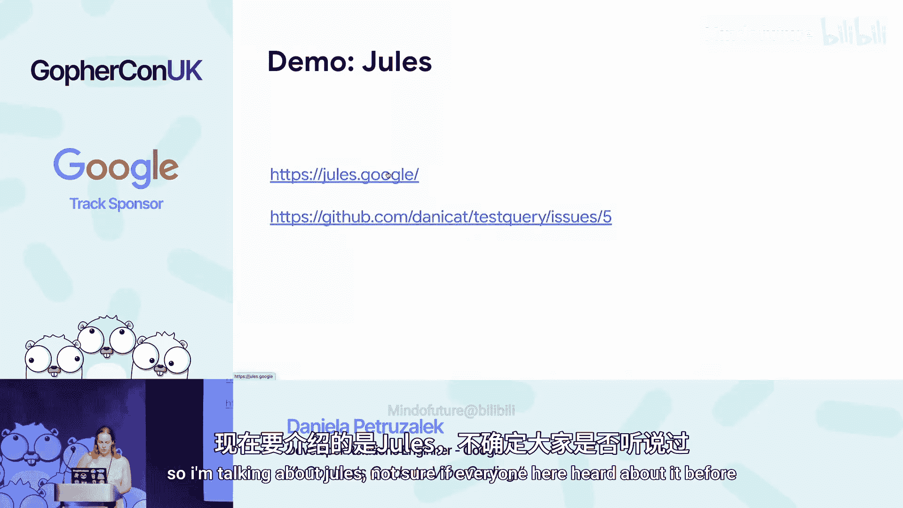

Dordination。 And the idea is you connect it to your Github。And you can basically， yeah。

 I'm not sure if there is anything。So bring interesting in this page。

 but I just want you to see the the face of it integrates with Github。 You can it installs us an app。

 Github app， and you can start giving tasks to it。 And， you know， when I'm talking about async。

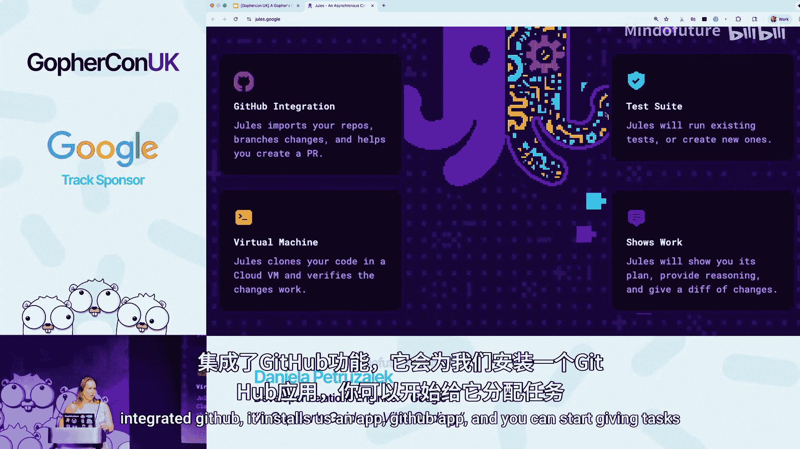

Working like， what's the best thing I can。 Like， I'm in a conference talk。 and actually。

 I want to do some real work。 You know， I this is the the， the absolute peak of laziness。

 I'm not going to。I don't really care about this。 This is actually real thing I need to do because I joined Google recently and there is an open source policy。

 and we need to add some disclaimers on every single project we have。

 Oh this is not a Google product and accommodate some things。 And here what I did。

 this is kind of my prompt。To comply with the open source policy。

 I need to add a disclaimer on the Readmi file， add some license headers and run some installations。

 The thing is， Jo is pin up a V M。And we'll do whatever you ask you to do here。

 And I'm just going to put a label here and say， you know what。I don't care about this。

Let jewels take over。 And I'm moving on my day。 And actually。

 so I'm doing talk and I'm actually doing work。 This is the， the， the anc thing。😊。

I'm going to go back to see what kind of PR Jou create later。

 but it will maybe it even already created something。 I don't know。

 but it usually it's pretty fast to response。 So you see。Was just the flip of a slide。

 It's already on it。So it's now it's booting up a VM and it's going to try to do it in background。

 So let's move on。And just a reflection， dude， anyone works in a team like this。Or even worse。

 are you the ones that are writing these stories。EWhat， what I'm really trying to do like， oh。

 I story that only has a title。Or， you know， oh no。

 then the the your managers or the tech lead starts nagging or maybe the tech lead is doing this。

 you know， And it is， oh no， but you need to have a description。

 and the description has a slightly longer version of the title， So which is also not helpful。EThis。

 for me， is a huge。Pet peeve of mine or come on。 This is not helpful to anyone， because。

 if you write something like this today。Future you in two weeks time when you pick this up。

 we will also not remember what youre trying to say。 And if you're trying to work in a team。

 you want someone to first， you have a log of work you're doing。 and also。

 you want to prepare the task for someone else picking up like another engineer。

That doesn't rely you。 You can go out on vacation。 You can， you know， move on with your life。

 You need to be。More specific of what's needs to be done。

 And that's why every time I go to a new team， I join。 I know this is。Kind of small here。 But I。

 I always propose a lightweight chicken template。 Honestly， that kind of thing as us after engineer。

 I want to when then I also don't like that。 I， I prefer a more lightweight。

 more straightforward approach to this。So this is a gift I have like for seven years。

 Every single team I join， I show this to them。 Okay， how do you structure a chi， put。

 put some context， put some references off time to do。To do what not to do and acceptance criteria。

 simpleim as that。 No need the B D D language， not anything。 It's just plain simple。

 And this will take you three minutes to write。 It' is not that hard。嗯。

And the analogy I'm trying to do here is that good prompts， they look very like very similar to this。

诶。😊，You start with。A task， oh， I want to achieve X。Give some constraints， if you all must。

 This has decay this library。Reference。For the them to do some searching。

 some testing criteria to validate。That it actually achieved the objective。And， and that's it。

 That's it。 So it's very similar。And yeah， now I find at the point where I want to be。And， of course。

 this， this might fail royally， but now we have more time。 So what could go wrong again。

This is the prompt where it's a slightly variation of the， the one like I only change。Here， yeah。

 the link for the readme。I， I think I added here the differences the。A link to the protocol。

 But this is usually typically more in line with what I would do in a daily basis。 So let's see。

 let's see if this works。 So let's first fire up Genai C I。

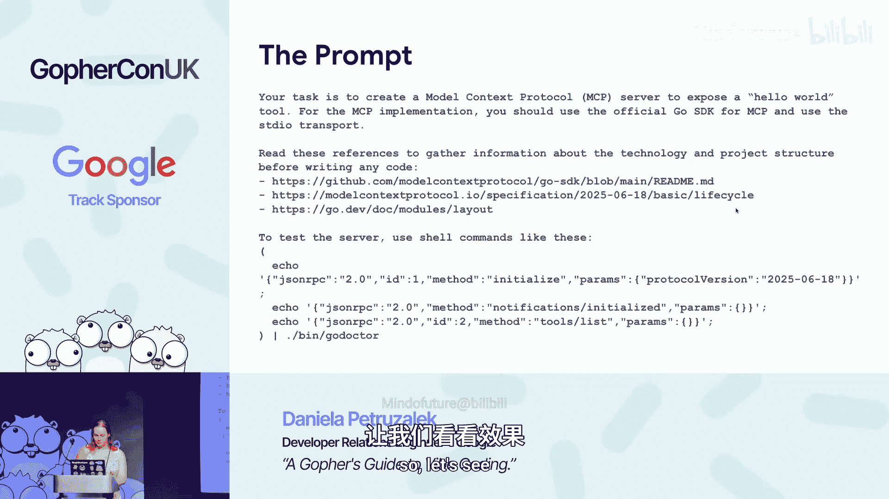

And。So， yeah， for those， especially for those in video don't know everyone saw this yesterday。

 But this is the， the kind of coation I'm talking about。Here。

 you can type any prompt and the them will respond to the prompt。 Youll say， you can start， say。

 write me a code X or do something。 but you can also。Type show commands here。

 If you type the exclamation mark， the bank sign， I can just to prove that this is empty。

 I can just type L S and you show the contents of my folder。 If I hit ask。

 I'm back to the other type of prompt with the I dont know。

 how to decide less than greater than sign。This is the prompt talk to the L O M。 And I can say， oh。

 let's start simple。 write me。Hello， world program in Go。And， it will， hopefully。

It will take a while。 So yeah， it it it has some failures because the L M leads to learn how to deal with this environment first。

 And every time it tries to do something for the first time it was for permission。

 you can allow once or allow always for writing things。

 I usually use allow always forget commands for the sake of God only one because this model has the terrible tendency of resetting things when makes mistakes and you don't really want to undo every work every single time it makes a mistake anyway。

 Okay， I got some code I got some my notes theres some formatting issues here that well。

 where's the dot。 But this is a visualization things。 not the code is there。 and I can。😊，Of。Start to。

 yeah， this is， let's prep the context again， just like at the last time。

 So here's just asking the documentation for net H TP。

 What this is going to do is because I have the go doctor。

 the MiamiP server configure will ask for permission to run tools from the server。

 I can allow only once or only this tool or all tools from the server。 So this case。

 I'm allowing all tools。 Let's get the。

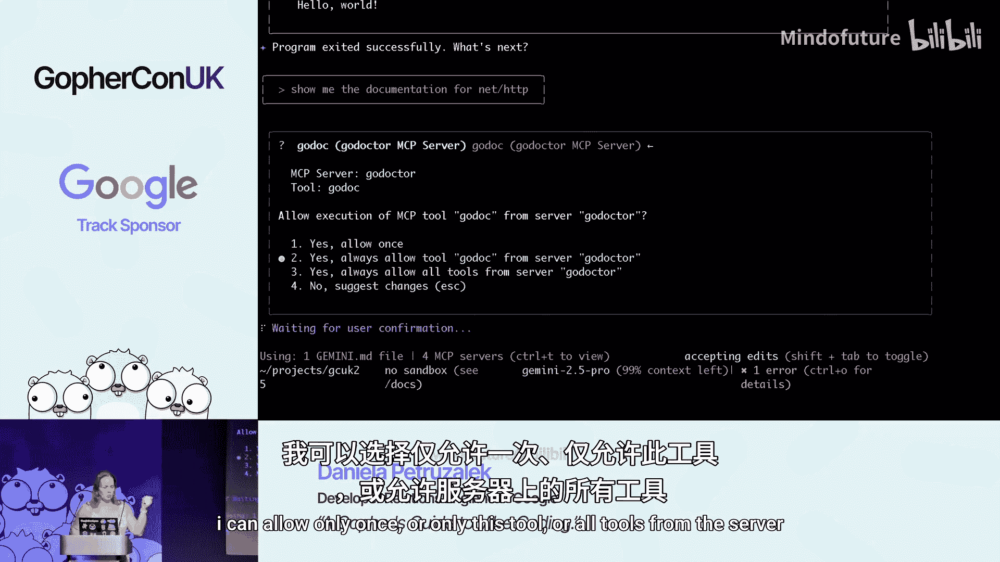

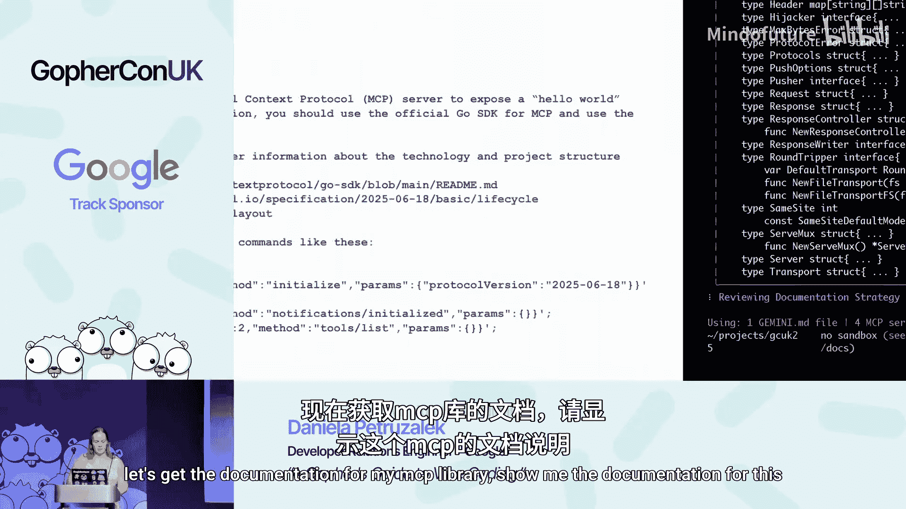

The documentation for。

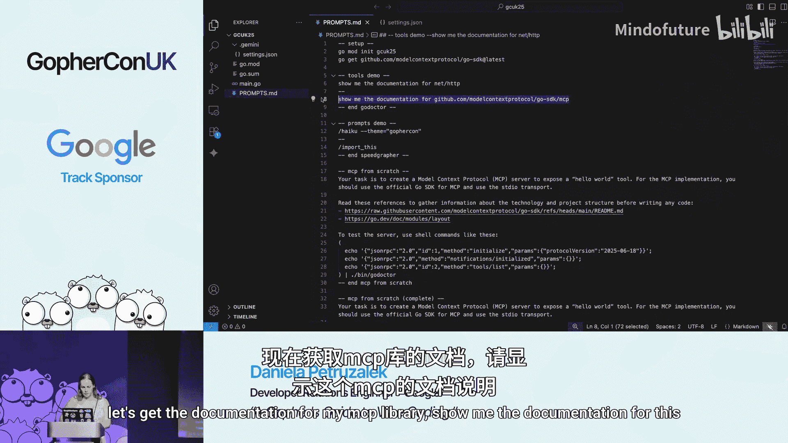

My MCP library shown me the documentation for this。MCP。It failed， because in this case。

And it never did they go get for the library。嗯。But it's okay， it's okay。 let's。That's actually。

One of the things I got used to， I never actually typed the the command in the show I say， like， oh。

 go get。 I type as a prompt and make the， the， the the L M code for me。 I typically do this。Okay。

 now you see， now it kind of self corrected and was able to retrieve the documentation。

 So let's start with the prompt for the hello world。

 This is the exact same prompt from you yesterday。😊。

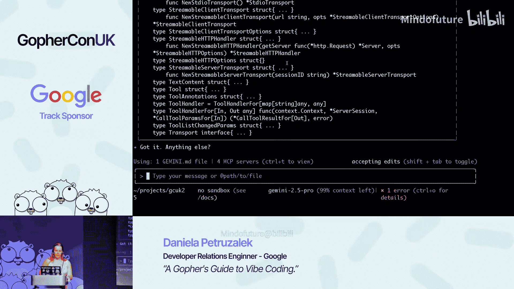

A hello old MCP server。So。Here， you cannot see the for prompt button。 So let's just zoom in。So。

 little less。Your task is to create a hello world MCP server to expose like this hello world 2 using the GosDK and standard I transport。

 So this is kind of the prep for the task at hand。 I gave gave it a couple of references。

 This one the problem we had yesterday is that the model didn't actually deread me。

And sometimes again， L OMs are nondemin。 Sometimes they will skip things。

 and it's your job to remind it if it did escape。 And I didn't notice that。 of course。

 I was worried about time and delivering the rest of the content。But if it had just read the example。

 the example show how to do the weight in the of the H TP server or the transport so it doesn't kill the process immediately and so on。

Okay， let's。

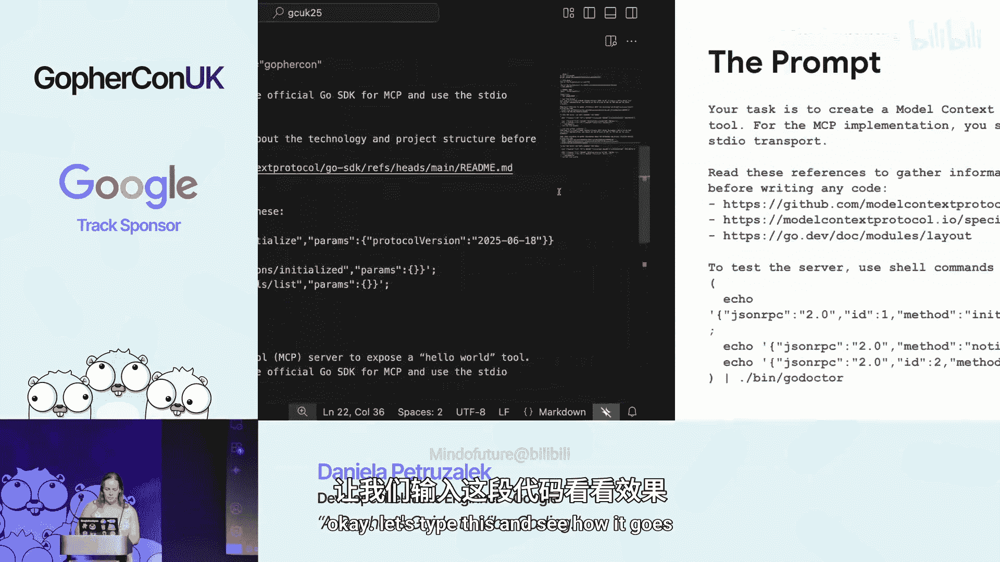

T this。And see how it goes。To。Come on， Jim and I。You see。😊，Now， it's。Pased my request。 And finally。

 web fetch is the tool it used to， whenever you're given an URL。

 you to try to read it and and get the context。 So this is finally obeying what I'm telling you。

 So it's saying I'm going to read those read me and SD D reposer to understand it。cool。

Let's leave it for me。 I'm going to do the same mistake I did yesterday which is not paying attention to what he's doing。

 but just for the sake of time。 So because I want to bring your attention to this kind of thing。

 So there are three possible error modes you need to be aware of。One of them is fully recoverable。

 The other them will recover on its own， which is， oh， it made a  type or it made an edit mistake。

 We're going just do this in a few minutes。 Probably quite a few of those。But okay， this。

 usually they typically recover。But there are some errors that you need to intervene， for example。

It has a failing test。And。It thinks it needs to fix the code not test。

Or has a failing test and it tries to fix the test and not the code。 Then both things can happen。

 or it it put like a to do on your code。 This is also very common。

 So if you're seeing hallucinations wrong API is being called wrong S K intervene course correct and you'll be fine and but they might recover if you give time。

 but I usually I not have patience person。 So I not try to wait that much。And first stop。

 you'll see something like， oh， a refactor loop is I'm using SDKA。I tried， I fail。

 Youll know what I'm going to use as decay B。Then it tries and fails again。 and go back to a。

This is horrible and it will not break this loop on its own。

And you're going to lose a lot of money if you're paying for your tokens。 So be really careful。

 So that's why things like this， like， if。

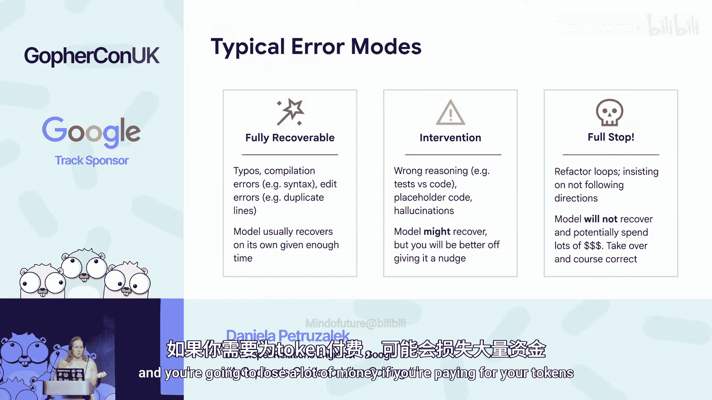

Living alone， like， oh yeah。 Now its finally creating the structure。

ELaving it alone for a few minutes， maybe it might be fine fine， but。If you're really invested。

 be very careful with this type of failure here because it could cost you lots of money。

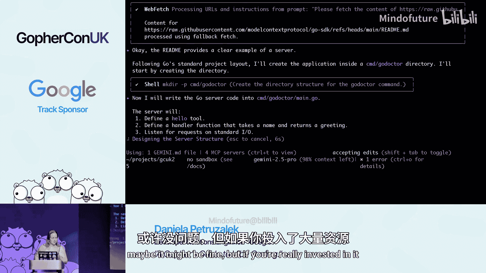

嗯。So typicals for tips for successful experience。 Don't be afraid of interrupting it。 if you。

 feel the need to do it。Enccooururaged to use if you see it struggling with SDK， say， hey。

 what about you， rid the dogs for a change？ And of course。

 the best one is have you tried turn it off and on again。And why is this important， Because。

 you know， everything in I T use So like that。 No， no， no。

 because of context something we call context degradation of context rot。The more。

 the longer your session， the more message you have in the chat and the more failures it accumulates。

More that failures might influence it to keep failing at the same things。

So if you see that you' are in a bad situation like your bed session。Most of the times。

 the best thing to do is turn it off and turn it on again。

Or you sometimes you have a call like a s clear command that will clear the context。

 But before turning off， again， there are some things I like to do。 Let's just see if it's blockeded。

 Oh no， it it's already testing phase。 That's good。😊。

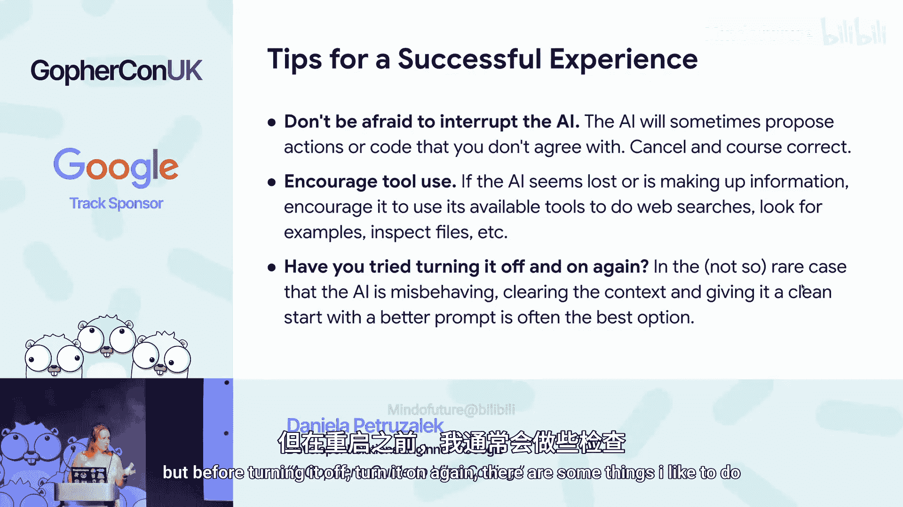

嗯。Let's see if this works first time。Oh。It made a wrong cow， I that it。

simpleimple total turns are graing。 but actually required， yeah。Correct response to tool。 Oh no。

 it did the list request。 Okay， so this is actually working。 So let's say， can you make a toca with。

Tools call method， because you see the Json R PC， the example had here and strictly specifically to call the tools list method。

 But let's see if can call the。Actually。Actually， hello everyone。Oh， it does work。

 It did work for the first time， you see。It was the exact same prompt as yesterday。 This time worked。

 And this shows the non deterministic nature of this this kind of thing。 Would I say that， of course。

 then we get to the second part， Is this code actually good， I haven't seen the code yet。😊，诶。

We can probably explore here and see what it did。 Oh， it created like a CMD folder。 you can say， oh。

 show me the code for main notgo。 You can either play with this or you can open your ID to inspect。

But， you know， I'm kind of lazy。 And you。I think there are so。

 so many low hanging fruits in terms of cold reviewing。

It's taking quite a while to really simplifyim。 So I kind of。Let's skip that for for a second。

 actually， because this is more interesting。So I created a prompt for me that is called code review。

And this is kind of literally the same way you work with developers like as soon as I have something working。

 Remember the TDD loop， the very first thing I want to do is I called review that thing。And this is。

 I， I separate in that tool because I don't want my review。

 my model who wrote the code to do the code review。

 I'm going to give it to a model with a blank state。 iss the same version of the model。

 but different context。 So I would just say， oh， run a code review。On the code you just wrote。

And this kind of。Helps me filter out so many problems immediately because the law hanging youri you to。

 doesn't exempt you， remember you is still responsible for the call you right。Oh。

 they didn't find anything。Oh， it's a standard hell。 Oh， yeah， of course， sorry。

Let me delete the main dotgo。Because this is the main for the hello world。 like run up。

C review for the。MCP however code。That's why it was a bit confused。 Okay。

 now it's written the right file， and it'll probably find lots of things。

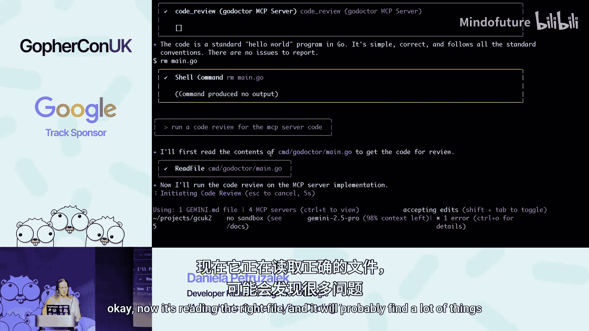

Meanwhile。Let's have look at Jos because I kind of forgot we did that。It's kind of， oh， sorry。

 wrong link。Oh， here。哦， you see。It was 10 minutes ago。

 So actually it took three minutes for it to generate the the API for me。

 and you can review it and push the branch manually here。But， yeah， it did create a。

You didn't create a PR。genetic Oh， was not unable to push the branch。

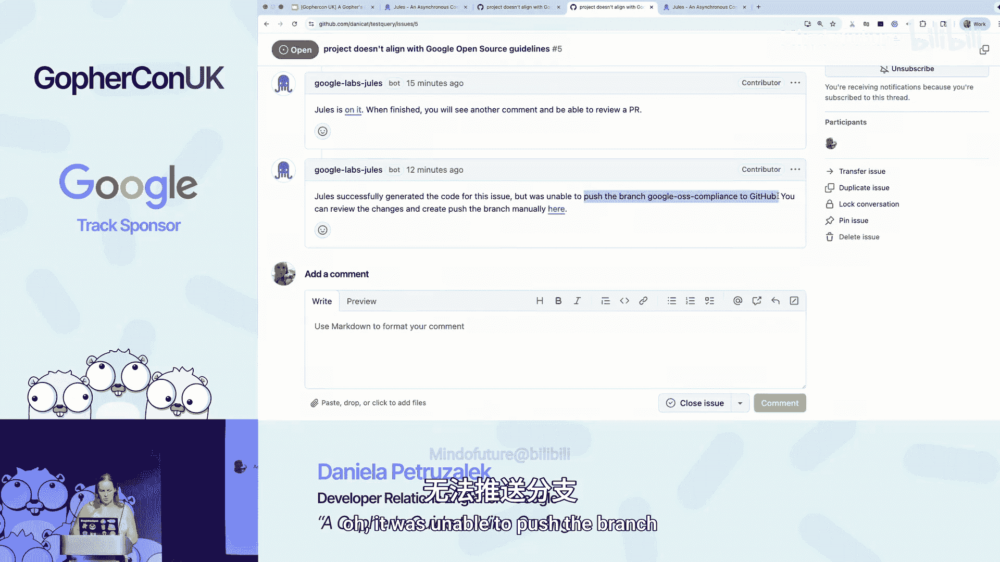

To GiHub， okay， it's asking me to review many。 I don't know exactly why he wasn't able to。

To do the branch for me。The the PR for me， but most of the times。It's able to， but you can see here。

Let's just hide this。Kind of， oh， this is a horrible of visual。

It just added the headers I needed to add， so the license。

Here it added this is not an official Google support。 So it did what I wanted。

 but it didn't go full flash to， but I can publish my branch here。And。That part of the work is done。

 Most of the times it， it creates the pair automatically。

 I don I don't always have what happened now， But you can see we can see the branch here。

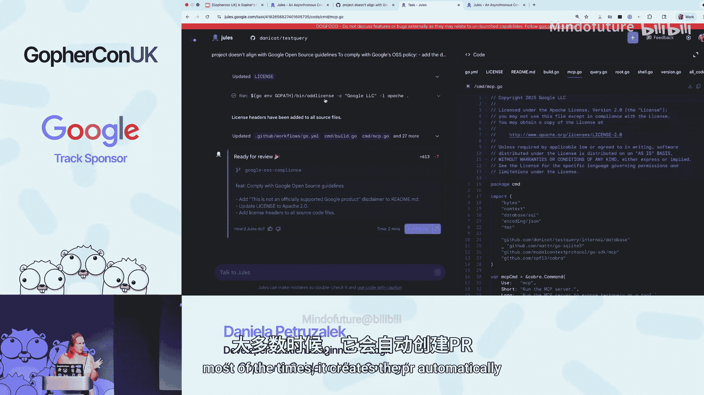

Anyway， and you can create it here。Okay， so let's see。

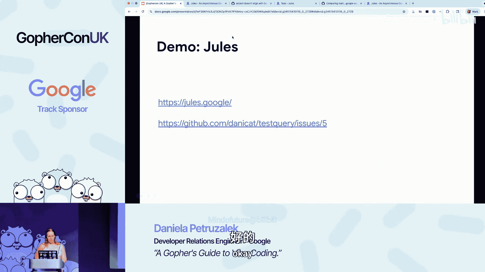

哦。This is surprising several calls very strictly fault pioneers that established the documentation clean and readable。

 I'm not sure if I trust you。Let's try opening a new browser window because now I'm really curious about what kind of code it wrote。

New top。就得的。AllOh it's here already。

It's usually not that good。 It usually flags so many things。What is my V， S code。Okay。

 you're playing hard。 So let's open folder。

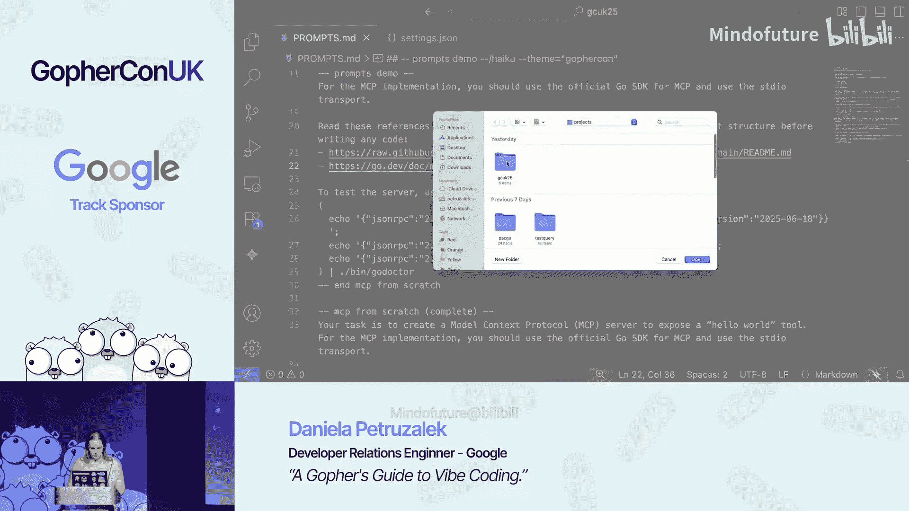

Actually， is this one， okay。So this， this is the call it generated。Yeah。

 maybe there isn't actually much to do here。As well。Yeah I it's fun。I actually kind of agree with it。

 There is nothing to be done here， which is surprising。

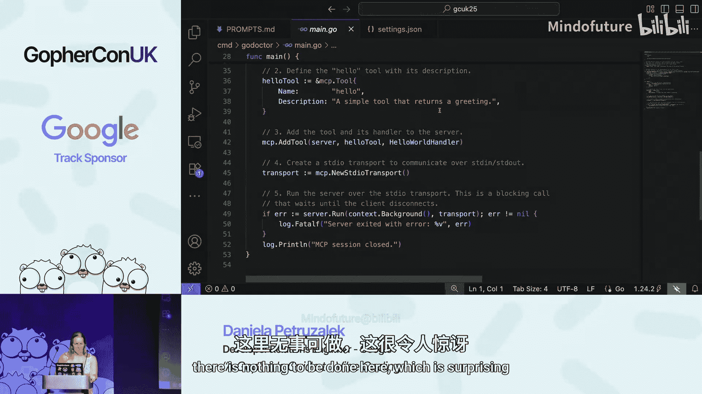

But you see， this is the power of the workflow is you basically can。Start delegating this task。

 the most important thing is how you organize yourself around these tasks。

Maybe we can give it the more complex prompt then。 So let's。

 because this was just a hello world prompt。 And now I want。Do we have a prompt for。They go doctor。

 let's see。Now， I will want you to implement a tool to read。They go documentation for a package。

As in the go dark command。It should take。Two arguments。I'm Beckers。And optionally。A symbol name。

Just to give you something to do and will say。

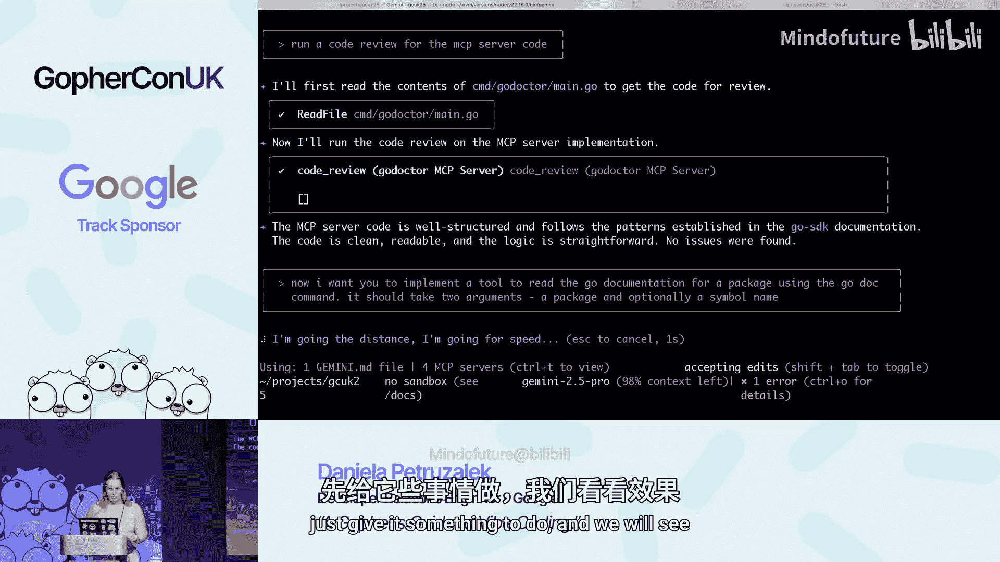

Anyway， let's see if we have anything else that we missed here。

 we spoke a little bit about this yesterday。 I think everyone should be really trying to aim for。

Writing their own MCPs， this is not only， I think it's a technology that's， I don't know。

Growing really fast， but else it's a fun thing to do。There is the MCP support for for Go please。

 which is Im， I have my own this go doctor thing I'm creating。

 but I think as soon as go please gets mature， it will quickly replace it。

 That's why like as a to example。 But the idea is to give LLMs tools to reason about code in better ways。

This is the third three ones here is if you want to play with。LOM is using Go code。

 So theres the Google Gen and IDK is mostly for Gemini。And I'm also listing the competitors SD the K。

 for a reason， we have the Open AI Go library as well。呃。And this is not a standard yet。

I'm not sure if it will become one， but Google released like a Gemini open AI compatibility mode。

 So essentially， you can call Gemini with the same APIs that would you call open A。Open AI。

 it's a bit tricky to to say those things， but it's a compatibility layer that you can call J as if it were the open AI models。

 which is meant for， you know， if you have that kind of call that's generic that you can branch can choose。

 pick and choose different models， you can use this SD DK。 Again， it's not a standard yet。

 but you can use any of the。😊，Open AI SDKs with Gemini， and that would also work。

Some useful MCP servers， I mentioned some of this yesterday。

 I actually love them playwright for web development。

 It's very useful frontend kind of thing contextt7 is aggregator of documentation so and feeding documentation the model is super important so this might be very helpful I haven't tested it myself yet。

 but it on my to do list and the last two are the ones I wrote。This is about a code lab I wrote。

 if you want to try to do it yourself， the exact same thing I'm doing here on stage you can the comfort of your home。

 theyre out there prompt written in a much better way and step by step you can get from a hellello world type of scenario to a full MCP server running on cloud run So which HTP and。

You can play with it， so just waiting for the picture。

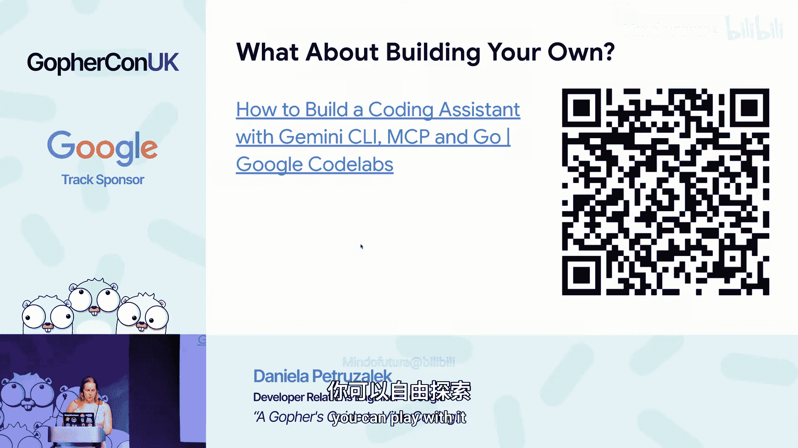

And let's see。哦。Look how fun it is。 I actually， it did what I asked to do。

 So here's the implementation。Its tire the has that the handler。 It is cuning， the go command。

 There is also， I'm I'm cheating on this task as well with this following sense that I instructed you to use the Golddog command。

And I didn't tell you to use the。Actually， a standard library for godogs。

Because I tried this before and believe me it's much harder to do like there's some magic that exists in the Goddog tool the CLI tool that is super hard to replicate with code alone。

 so I didn't want to re ask it to reimplement Goddog that's why I making it call like as I start no command。

 but actually you see， it did the test。I'll test the Google go Doc We request documentation for the format package。

 seems to be working。 and I'll let I wanted something my call more complex because I went。

 please do a code review。Of this implementation。Which is literally how I I work on a day to day basis。

 So I ask you to do something。 I do a code review。 as soon as I confirm。

 I throw a bunch of more test cases I it and say， oh I confirm。

 then I I start preparing my committee and I start documenting things。Oh， let's see。

If the code review comes quicker。

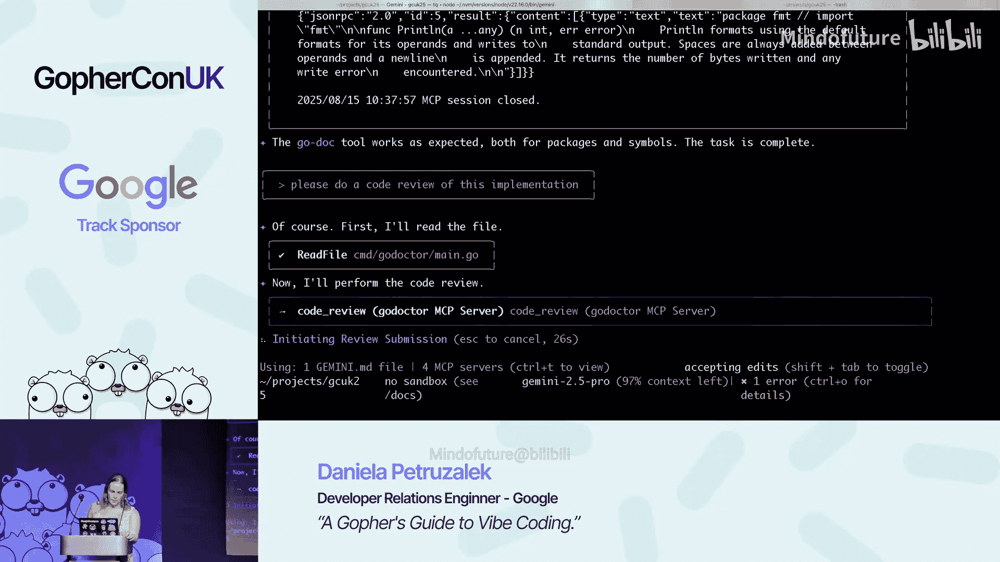

By the way， why is called the review like I can show you the code the review prompt。

 which might be interesting。 So this is the code review too。Which is kind of simple。To be honest。

 this is also AI generate。 So I didn't。 I never carefully tune this prompt。 but let's see。Yeah。

Everything here is just boilerplate to call the Gemini model the really important part here is this system prompt which says oh。

 you' are an expert go code reviewer， your social purpose channel go code and provide feedback based on the best practice recognized it is geo by the work community。

And so analyze the code， identify errors that violate principles and then provide a J object with like a structure response。

 I think this is a superme part with line number， finding and comment。

So and here I give an example， which is also a common practice to help it allow them to format things properly。

And let's see。Did finish。 Oh， actually。 So I performed the code review。 So I found two things。

Importantly early details is omted from response。Okay。

 if combined to put fails that and oh unreachable code。

 this log statement is unreable server run is blocking。 So you see。

 you start finding like the low hanging fruit to。 you quickly can prune。😊。

this is very simple and I didn't fine tune anything in terms of the code review 2 itself。

 which is also a huge point for improvement。 in this case it didn't if I sold trivial it actually jumped and already fixed those things for me。

 you can run code review as many times as you want。Which is also a fun thing to do。

 But sometimes the is diminishing returns。 Sometimes you'll not not find anything， or sometimes will。

Maybe even can try to un do something because you know， L L Ms。But overall， it's pretty good。

 like I've run one to three times until I was satisfied。 and then I move on to next task。

 And one of the things that I'm trying to improve is because。

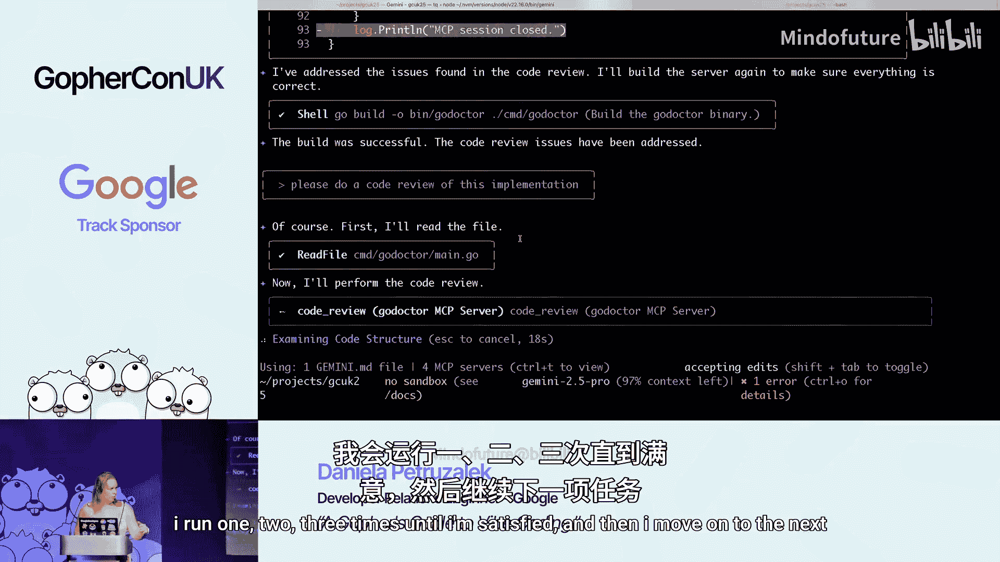

You know， the battery you gift it the two instructions to。So understand what good goal code is like。

 the better。 So instead of me writing those instructions I。Tell the LL M， my。

Correated list of resources and say， write a prompt for me。

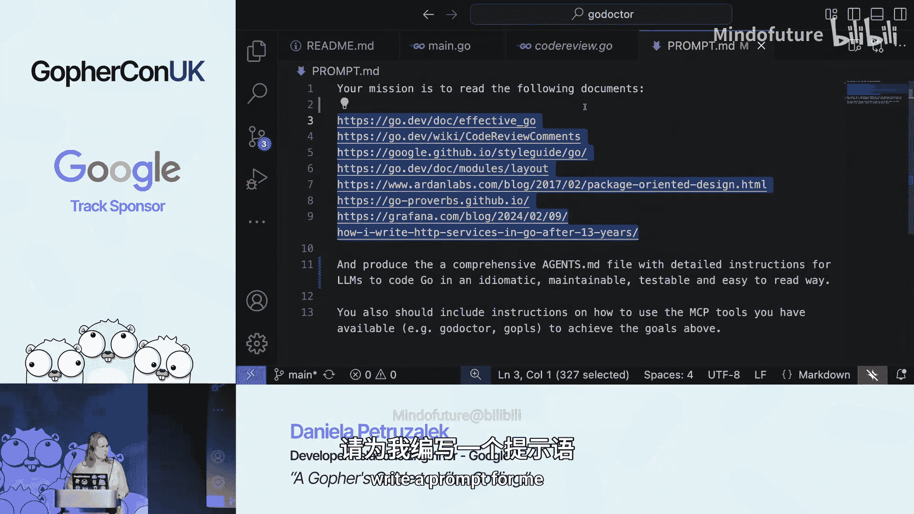

And this， if you use gold doctor， had。This everything is open source， if you go to the Godo， GitHub。

 Denica， Godo， you'll see that prompt。And I exposed that prompt as。

 I would just cancel and Sc review for now or not。后尾。But I。

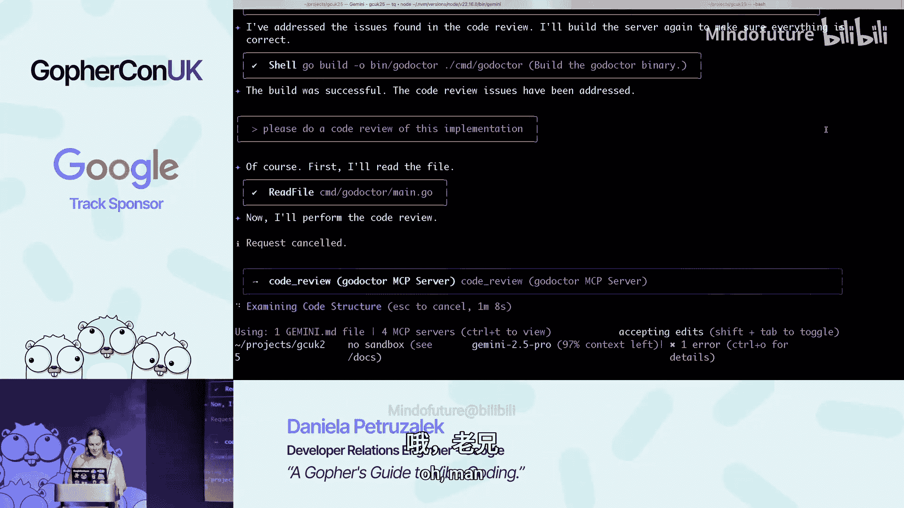

I expose this prompt as a prompt in the MCP server。So here it's my import， this command。

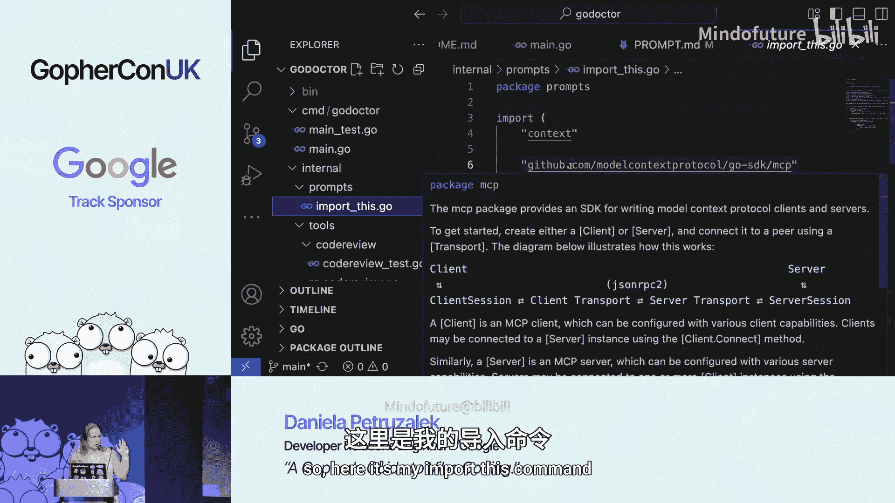

Which basically allows you to。 Yeah， let's do this。Impart this。Which is a playful world， yeah。This。

I I was just playing with the the the Python is egg that if you type import this in Python。

 you get the zen of Python。 So I want something that was similar to the C。We。

 read all those documentation and provide some guidance for the Asian here。 I think I have。

1 I generated before。And it is quite solid。Oh， the goway talks about clarity。

 clearance better than clever， simplicity。 Concurrency is not parallel。 Everyone loves this phrase。

 So you'll see。😊，This was。Generated by that prompt。

 So every time I want to add a new reference or something I think it's clever。

 Ill improve that prompt and I'll just slash in part this， have new guidelines。

 I can fit into the code review tool later。

Which is also how you， you kind of create like a。A self improvement flow。

 And the last thing I want to show you。 So， yeah， you see。ItStart， it starts in doing the research。

 I'll not let this finish because it will take a while。 The last thing I want to show you is the。

What I call the reflect prompt。Which is。Easier to see here。

IMost of the time I use this for writing sessions， but I you can also use it for coding sessions。

 a similar thing。 this one is more focused on writing because it's on the speedgrapher MCP for that I used to help me with tech writing。

But the reflect prompt is tells the LM to think about， think about the session we just had。

And propose improvements to the flow。And I use this to fit into most of the decodations。

They will have an agent M D or a Gemini M D or a cloud M D file。That gives them some。

Guidelines on how to behave for each particular project。And by using the reflect prompt， I say， oh。

 think about what happened in this session， what were your mistakes， what could have gone better。

 and improve your own guidelines。So in the next session， we become better。 And let's see。

 I'm not sure if we're going to get anything useful this time because I interrupted a lot。

But。This is just to give you an idea， like hey， every time you see it， oh。Wr in this prompt。

 this is such a chart。 Like this is， oh my God。 why are you going to write a prompt for that。 No， no。

 I make the LM write a prompt for itself。So this is， for example， learn this one。

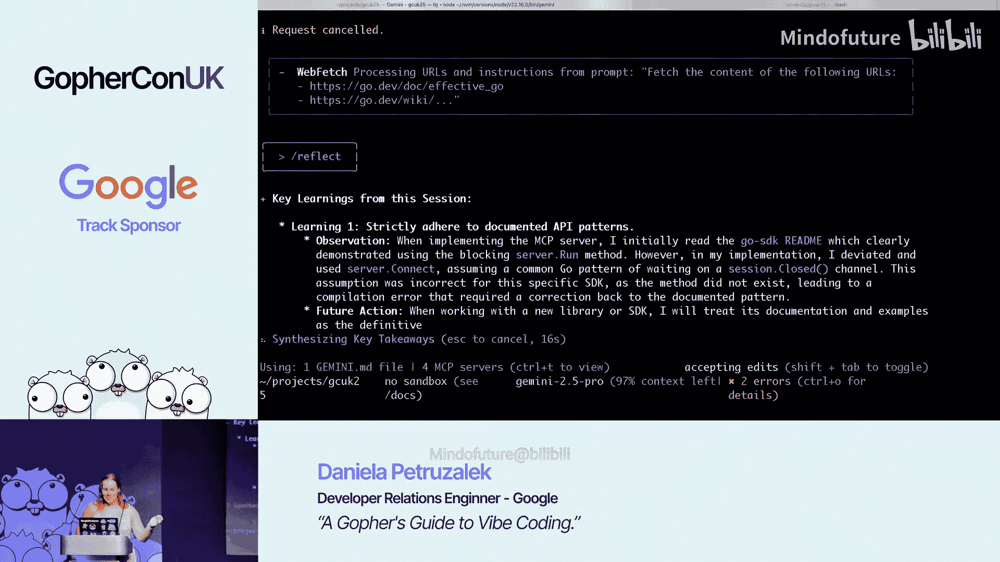

It it usually comes good stuff。 sometimes no， it doesn't。 But most of the time。

 learn to documented API patterns Se initially called reviews must be critical， okay。

Two input validation should be explicit， so it's usually good stuff。

And if you keep feeding back the model， like your Asian M D or Ge M D， or called M D。

 back this kind of information。Your flow will only better， better， better， better with time。嗯。

So in summary， have 10 minutes left， but I won to open for questions if anyone wants to ask。

 But yeah， for successful vibe coding sessions。Develop your prompting start writing skills。

 remember like the same way you should write your agile like your combmbling stories。

 prompts are very similar， the better you are writing them being more specific and telling the steps。

 the better results you'll get。Paraitizeizer tasks。You can。

 anything that's low priority or low business value。

 delegate to that sync tool so you can multiply yourself。Actually， we managed our context window。

 we didn't see much context degradation in this session because it's also a very small session。

 but if you're doing some kind of serious work for one hour， you start to see some weird things。

At this point， either I just。slash clear to clear the context or sometimes you have a summarization process。

 you can use it all， summarize this for me。嗯。But or this also is true for the managing of context on priming the model to use the things you wanted to use。

 forcing it to read documentation， forcing it to call to and so on。

 and the last point is the same point I want to make yesterday write m server you see like this time I was successful。

 I had more time。 could slowly the model wrote itself。

 basically So it's super easy to get it off the ground。

 and you can suddenly have like this I like to have like several small servers very specific。

 It's kind of like the Uni philosophy。 You have several small things connect together to get very powerful It' the same thing I'm doing withps。

 I have one for writing one for coding and I'm going to write many more even run on stuff to do my taxes。

 I don't know。 you can think about go very about this。

 it's super fun to write super easy and definitely helps。When dealing with LLMs。

That's what I had for today。 Thanks a lot for spending this hour with me。

 I'm not sure if anyone has any questions。唔啊。Thanks Danielella， okay， hands up for questions。😊。

Very nice。 I have someone under there。 polite pools。Oh， yeah， thanks for the talk。

I was wondering what do you think about any of the possible downsides of vibe coding if it might replace engineers or what your thoughts are in I'm sorry I cannot hear can you just speak a bit loud sorry is this better Yes much better I was wondering what your thoughts were in regards to vibe coding and the future of engineers as well。

 do you think we'll have a net positive or it might have a net negative in the future。

That's a very interesting question。 I love that question。 The way I'm seeing， yeah。😊。

It's harder like I'm not going to try to predict the future here。

 but I can tell you what I'm seeing is like， I think。In the hands of a good engineer。

 it definitely makes a difference。 makes you better。It doesn't necessarily make me better at。

Doing the things I already know how to do it。But the things said I don't know how to do it。

 it definitely unlocked me to the next level， like for example， I don't like doing frontend。

 I never was a frontend person， and I had to write a blog because I joined as developer relations。

 I want to have a platform。And because I knew kind of the engineering concept。

 the fundamentals is the same。So if you have good， strong foundation。

This kind of tool will unlock you to do amazing things。

 And I think for the new generation that's coming， like it's。😊。

I think it's very dangerous when people like， I don't know。 certain CEOos come and say， oh。

 do not learn how to code anymore。 This is useless。 L M will replace everyone。

 and we can go to the beach。 And I don't know。 I don't think that's really what's going to happen。

 I think we're going to become。Slightly more high level。But in the same way。

 we don't write assembly code by hand today。There will be circum where knowing a little bit of assembly will be useful。

 I don't know if usually in this kind of course， you have some， Heel is here。

 he knows what I'm talking about。 like if you're going deep into the compiler if you're going deep into the runtime。

yeah， maybe in the day today， you're not going to use。 But if you have that tricky key bug。

 you need to know what you're doing。 You need to know what you're touching。 If you know。

 need to know it's there。 You need to know that there is CPU and memory。

 even if everything is in the cloud。 So I think it there's a lot of foundational knowledge。😊。

That will not change。 And this is important to learn。 But how we work will change。

 And I think we will unlock。Things that we cannot do today。And also， I think we。

We have so much work to do。In terms of like， think about the last 60 years。

 we have been writing software。And now we need to enable  six decades of software to be AI oriented。

 so we have a lot of work to do， so I don't believe that the career is dying like software engineer is dying。

 but it's definitely transforming that transforming us I don't know if you answered your question properly。

 but that I told。😊，Hi， in one one of the slides you mentioned you incur。

 you might incur a financial cost if something happened。

 can you touch on that a bit more and just go over as as an engineer if we want to play around with this stuff。

 of costs would we incur if were doing it ourselves and not through our company。 Okay。

 I was speaking very general terms because I'm not from sales。

 So I don't I don't do pricing and I'm lucky enough that I have infinite model calls So because I work at Google。

 So I don't need to worry about this that much， but it is a concern。

 I came from the industry not so long ago。 and I'm seeing。

Sometimes on forums or Linked in or Twitter or readdit， you see those posts， oh， yeah。

 I thought it was free， but then suddenly I have like a $500 bills of something。

So you just need to be aware that this kind of model they charged。

They have many different ways and this is also a pain point for us， like Gemini。

 CLI has at least seven different billing paths， you have some subscriptions， you can buy by token。

 you have certain things so you just need to be aware of how billing works。But the thing I'm。

I'm trying to alert your hearers about fighting waste。

In the sense that you know that the LLM is going to a path is not going to recover those requests。

 if it's， like I say， for example， I tried SDDK1 didn't work。It will try， try， try it didn't work。

 oh， I'll try SD the K2， try， try， try， try， it didn't work， oh， I'll go back to one。

 imagine infinite loop， even if the tokens are cached。Some of them want to be。

 and you pay this kind of model most of the times you'll pay by token and you'll pay by request。

So that's a lot of waste。 It's like wasteing CPU cycles。

 So you just want to be aware of that to avoid this kind of situation。

 to make sure you use like make an efficient use of your budget。

I'm not sure if I answered exactly your question， but that's kind of the I'm taking here。 Yeah。

 that's great， thanks。Hi， that are can you hear me okay can you hear me okay yes yes Okay that was a really amazing talk。

 So on a more practical note， we've been startinging to roll out some of these AI coding tools in our company and something that we're encountering a lot is that junior developers will not necessarily understand what the output of the AI tools。

 but because it works they are going make a PR anyway。

 So what we're seeing is that the velocity of code generation is getting a lot faster。

 but the velocity of code review mostly stay the same because humans you know like midu senior level engineers are still the ones who are actually reviewing this code and you know for。

😊，Basic things like you know naming conventions， we have things likelinnts that can catch low hanging for very easily。

 like junior developers are lazy and don't follow certain conventions in the codeb that's something that can immediately be identified but it's a lot harder to identify when they've generated a bunch of spaghetti AI code that works。

 but just isn't good code and。😊，You know if it's crunch time。

 you kind of just approve PRs and things go through and then eventually you hit like you hit a tipping point where the quality of code and your codebase has gone significantly down。

 so I guess my question is just how do you see this working in teams where you know Southern people may not necessarily have the expertise or the you know willingness to use AI as a tool instead of a crutch。

 how do you see？Cold review changing in the future to be able to accommodate and identify situations where yeah。

 this kind of stuff happens No I got to a question there's definitely a huge pain point there like but the way I see like this is not a new problem is just a problem that has been exploded with time because the crunch mode that always existed and you always have like the pyramid like you have very few senior engineers for very like the large base usually are managing a lot of people so。

😊，I think for a team to work well like you cannot just have an accelerator。 it's just like a car。

 you cannot have an accelerator and only an accelerator or only a break。

 if you only have accelerator， you're going to crash if you only have the brake。

 you're going to not go anywhere， but you need to have a balance of those two so you need to have some kind of process that helps you usually the codereable process is one of those things but also it is not new to AI who have been doing automation like Ls testing some of those things to catch those filess earlier。

I think， for me。Having like a AI assisted code review kind of helps level the game you still as a senior engineer。

 you still need to be reviewing the code， but if you use theI to kind of tryage and filter。

 it will be also faster at code review。And also have good coding standards that you sometimes you can even add as the context for your model that will force it to write better called frontron start instead of you having to correct it later。

And that's why I'm playing with that prompt like the the part this prompt is to instead of me trying to fix it later。

 I want to try to generate better code from the get go。 So I think it that the two angles。

 and of course， if I talk about。New engineers like junior engineers。

 there is a huge component of coaching。 you can never ignore that。

 So I think as much as I free you from doing like so much like a hands on the keyboard。

 I'm going to be quo quo quo quoting if that frees you a little bit of time that you can spend more with your junior engineers coaching them that will be a huge win。

 So again， we need to work on the foundation。 I don't think juniors engineer will disappear。

 We need them。But also need to maybe taking even more care of them now than before。Thank you。😊，Okay。

 so I think that's all the time we have。 So a big round of applause for Daniela， everyone。 Thank you。

😊。

