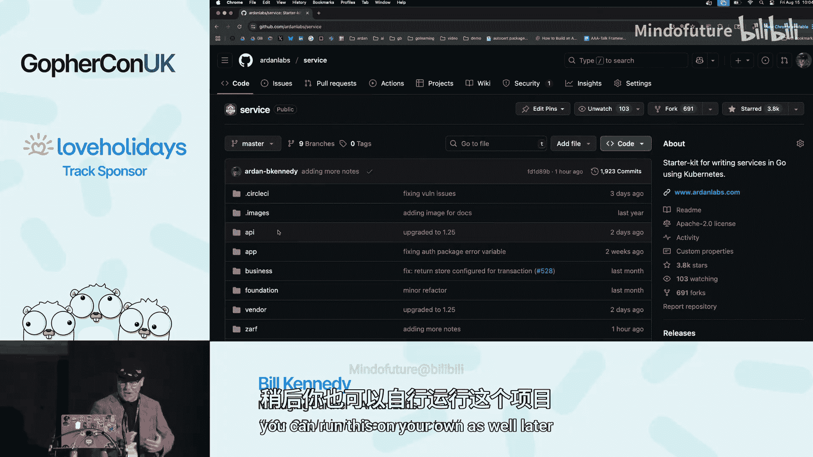
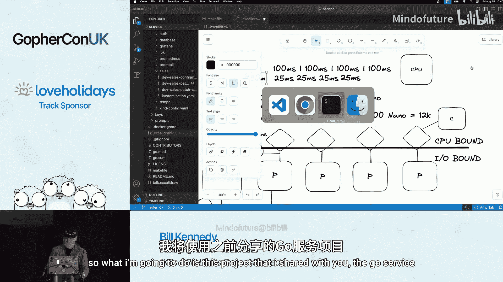

# Gophercon-Uk-2025-p13-P13_K8s_CPU_限制解析--BV1dCHTzQEdN_p13-

得你又，唔得你， ok k。

That's a great song。 Okay， Andres no no。 Yeah， well， Bill Kennedy is in London。😊。

I asked him how he wanted me to introduce him。 And I told her my name is Bill。 Well。

 he asked me to just say， let's go。 Yeah So That's what the kids say now。 Let's go。Let's go。

 That's it。 That's what I wanted。 Let's hear about Kubernetes from now。Dan。

 I got my blood is pumping。Okay， how much time do I get， I get to talk to in like 10。

45 or something like that。Yeah， okay， I get a whole hour。 Oh， that's dangerous。 Okay。

 my names Bill Kennedy。 I'm with Arden Labs。 That's as much introduction as you're gonna get。

 Let's jump into， a fun little story here。😊，So a couple years ago。

 I was working on my first project where I got to deploy some go code into Kubernetes。

thought that was pretty cool。So we' developing some services。

 We're deploying them in a testing environment。And one day， I needed to see the logs。

 I don't remember why it's not like my software was fanling or anything， right。

But I need to see the logs。 And I didn't know how to get to the logs。 And they were using Argo C D。

 If you've heard of that。 And I'm always really afraid to bring down systems that are running like staging a production because I've done it too many times。

So I'm very carefully clicking on menu items and buttons and Argo C， D scared out of my mind。

 And I'm gonna to do something bad。And in the process of looking for the logs。

I come across some yamel that they're using。To to run the service that I'm building。

 and it looks like this。Now they're running in Google， I guess they're running GKE on autopilot。

I don't know what any of that is at the time， but I see this and my brain says，I don't know much。

 but what little I know， that's suggesting that I'm only getting 25% of a single CPU to run the software。

And my brain is feeling like， why are you just giving me， who， Why are you giving。

 What did I do to piss you off。Then you're only going give me this。

But I don't really understand it beyond that。 I don't even know what 25% of a CPU actually means。

So I reach out to my client that they're doing the ops， and I say， shamee。First of all。

 why are you doing that and what does it mean。And Shane says the worst thing he could have said to me because。

 Bill， I have no idea what that is。Google sets it。We're not allowed to touch it。

 and everything is running fine。And I just see that image with the house on fire and the gophers behind it。

 right？So I'm like， Shane， that's not good enough， he goes， well， that's all you're going to get。

So I go on like a2， three day journey wanting to know what this means。

 And if I should be able to sleep at night， knowing that this is the value that it's going be。

So I'm going to share with you a little bit of that journey。

 We're going to talk semantics kind of at a medium to high level。

 We'll talk about how the ghost scheduler works because that sort of fits into this。

And then we're going to run some software， change some settings around and see if I'm complete bullshit。

Or what I discovered was actually fairly real。So let's start with trying to get a general understanding of what this means。

 Don't focus at all on implementation details because those things can always change depending on versions of Kubernetes and operating systems and stuff like that。

 So we're not gonna go there。 But the semantics are fine。I'm gonna create a whiteboard here。

 so you can。A new whiteboard。 But this project， by the way。

Was in this repo here at Darn Labs slash service。 The make file has all the instructions and stuff。

 You can run this on your own， as well， later。

And there's already a whiteboard there that you can look at。 But I like。

 I like kind of doing this on the fly。 So high level， what's happening。 What what does 2。

50 M mean that M stands for a unit of measurement called millic cores。

 And if that was 1000 milli cores， that would suggest that you want this service to have access to a full CPU。

😊，So what's going to happen semantically is Kubernetes is going start a 100 millisecond cycle。

And let's just keep it simple for now。 let's just say for now。

 we can keep it simple that we're on a node that has a single CPU。

And what's now going to happen is we've got 100 millisecond cycle starting over and over again。

Really， everything is built around time。So when we say that you're getting a quarter of a CPU。

 what we're really saying is you're getting 25% of time。On that CPU。 And so in other words。

 if our main unit of time is 100 milliseconds， then that means that if I'm using 2，50。

iss that big enough back there And anyone check these fonts here。 Thank you。

 Then what we're actually saying here is that for every one of these hundred millisecond cycles。

You're going be given 25 milliseconds of time。Assuming that you need all that time。

 That's what you get。 Now， that's kind of cool because if you think about it。

 then I could run four ghost services on this node on a single CPU each giving it 25 milliseconds。

 I mean， I have four of those particular units on this machine。 Now it would be great。😊。

But at the time， that still scared the heck at of maybe because 25 milliseconds doesn't feel like a lot of time。

 And we do have a a goes runtime that has garbage collection。 You know， we need some time there。

So what I want to do is。Let's see if we can break down what 25 milliseconds means， because time。

 we talk about time all the time。 but it's really hard to sort of rationalize about it。

So think about this for a second。Let's say that that CPU that I'm talking about here was running at 3 GHz。

I'm going to start using bigger font。Let's say it was running at 3 GHz。So what does that mean？Well。

 what that would mean to us is that if we have this clock running。

 and let's say everything I talk about is on average， right， Things fluctuate here and there。

 But on average， if it's running that， what that would mean is that we get three clock cycles。

For every nanosecond that goes by。So every nanosecond of time that goes by， that clock is doing。

And just remember that that clock cycle is pushing electrons through the machine so anything happens。

I don't care how many layers of software you have above the hardware。 At the end of the day。

 that core needs a clock cycle to execute instruction or nothing happens。Now。

Through the power of compilers and hardware and pipelining and all of that good stuff。

We should be able today to execute for instructions。On every clock cycle。

We should be able to do that， which essentially means that every nanosecond of time that goes by。

We're talking about 12 instructions。That have either been executed。Or not。

So if I said you had a nanosecond of latency on average。

 what we mean is you didn't execute 12 instructions that you otherwise could have。

 but you didn't because you had to wait a nanosecond to do something else。Now。

 let's take this math here。 I'm going to bring up。The go training repo。

And I'm going to show you a little chart on the industry defined times。 And this chart's a little。

 maybe things gotten a little faster， but it's a good chart to sort of look at。Let's see here。

 Did I'd not click on the right thing。 Oh， yeah， yeah， I didn't click on right thing。 Alright。

 doing this fast。 Everything's on the fly here。 Okay， so first， look at。Look at this。 right here。

So to give you a general idea up here。That's how many instructions。A nanosecond， a microsecond。

 a millisecond， and a full second would represent on average。 So if you had a microsecond of latency。

1000 nanoseconds， you've lost 12000 instructions。Now， we agreed，12000 instructions。 That's a lot。

 That's not a joke。And so when we talk about latencies， even in the milliseconds， I mean。

 we're talking about 12 million instructions that you otherwise didn't execute。 Now。

 this is one of the most powerful things about go and concurrency， concurrency。

 meaning out of order execution。If we're doing a lot of work and we're doing a lot of waiting。

 you can pay for garbage collection here。Right， we can execute large amounts of instructions in little bits amounts of time。

 And so when you start thinking at about 25 milliseconds，25 times this number。

You're talking about the ability， even over 25 milliseconds to get a tremendous amount of work done。

 In fact， here are the industry defined latencies。And。If you look at this one at the bottom。

Which is a 20 millisecond time to read 1 MBgaby。 That's 240 million instructions。Right。

 if you look at this one here， which is the round trip in a data center。

Which is that half a millisecond， that's 6 million instructions。 that one we're doing all day。

And so I'm not shocked that Google' is using 250M because technically we can get a tremendous amount of work done in that 25 milliseconds。

 we know how expensive the cloud is， we know how expensive these things are getting。

 And so the reality is that if we can begin to start thinking about， well。

 maybe 25% of a CPU could be enough for this particular service， we actually load test it。

 it might be interesting enough that it is under obviously certain loads。

 but with orchestration systems allowing you to scale horizontally， when you set that up， right。

 there's a lot of potential cost savings when you start thinking about it in this way。Okay， fine。

 So whatever， right， This is where we're at here。Now。

This can obviously get a little bit more complicated。 if I have two CPUs。

 then technically one way to look at it is I've got two，2 CPUs。

 So each CPU has 100 millisecond time slices。 So if I gave the service， let's say。

 50 or 1200 or 1250。 Let's use 1250。 Then what I'm saying is what I want 100% of one CPU and 25% of the other。

 There isn't any real。CPU affinity。 But I've got some documentation in there that once you start using 2000 M。

 there are some quality of service settings that where Kubernetes will try to keep you sort of in the same place。

 right， I mean， there everybody's worried about performance。

 and Kubernetes is trying to help you as well。Another way to look at a two CPU system is I've got 200 milliseconds of time now。

And let's divide that。 Sometimes it's easier to think about it as 200 millisecond cycles。

 and sometimes it's easier to think about it as 100 millisecond cycles across CPUs。

 It all kind of depends on what you're doing。 But， you get a sense of that， okay。Okay， now。

 for me to get a a more general understanding of how this can affect things。

 what I want to do is quickly give you some semantics on how the ghost schedule works。

Because it is directly tied to how you should think about and configure your ghost services running when you're gonna be using limits like this。

To keep things simple。Let's pretend that we're running on a machine with four cores。Now。

 I'm going to be running everything in go 1 dot 24。6 today。There have been some changes in 1。

25 around this。 I'd like to， we'll talk about that at the end。

 I'd love to get your opinions after we're all done on the decisions that they made。 Okay， I mean。

 go team knows what they're doing。 But， but you know， we'll see， we'll see。 I'm gonna ask you。

So let's say we've got a four corere machine。 What does that mean at a high level。

 What that means is the go run time is going to say， okay， there's four cores on this machine。

 Then what I'm going to do is I'm going to construct four piece。Which represent logical processors。

 And on these logical processors， I'm going to allocate， whoa， you know。

 I did this same thing a couple days ago。 And I don't。 I think there's some bug here， man。

That's okay。 We're gonna to keep going。There it is。 there's some new bug on this thing。 Anyway。

 here we go。 They're gonna to create。You're not gonna let me do that。 All right。

 we're gonna try this again。 If not， we're just gonna pretend that I've drawn a letter M in there。

没继来。Oh， my god。You would think Kubernetes would be failing， wouldn't you， O。给的。

I've tried to double click on it， man。There's the bug。 No big deal。

 we're gonna pretend that there's the letter M in here。 And the M stands for machine。

 and it represents a real live。Operating system thread and then operating system thread still has to be assigned。

 Let's see what happens on squares on a core。 And the operating system scheduler is gonna do that。

 And so when I want you to picture is we've got these operating system threads。

 Ms that I can't draw attached to Ps， which are logical processors。

 these ps have local run cues that can hold anywhere from like 256 or 512 go routines。

 And then when your go program starts up， a go routine is created over here。

 and it's attached to one of these ps。 and everything starts to magically happen。😊。

Our operating system threads， right？ They， they have stacks。 They。

 they can exist in one of three states。 They can be running， which means they're attached to a core。

 They're runnable。 They're waiting to be attached to a core or they're waiting。

 and they don't really show up。 The same thing with goerines。 For me。

 at goerine is an application level thread。 It has all the same semantics as an operating system thread。

 except for one。There's one semantic that Gors don't have， and that is priorities。

And the real reason for that is because your go applications are not processing events。

 They don't care that somebody touched the mouse。 They don't care that the clock has to be updated。

 They don't care that a network packet just came in。 We don't have that。 So we don't need events。

 And we just don't have priorities on those go routines。Now， does anybody have an idea on average。

 We can even be conservative。How much time it takes for a context switch to occur at the operating system level。

 A context switch is when we're going to take a thread off the core and put a new thread on the core。

 Call that a context switch。 On average， that takes about。A microsecond。

Or1 thousand0 nanoseconds or 12，000 instructions。So every time we context switch at the operating system level。

 that's costing you 12000 instructions， 12000 instructions you otherwise could have been using。

 but you're not because we're waiting for this to happen。

The last time it was measured on the go routine， which is sitting here on the thread。

 Look at the level of indirection。 The go scheduler is context switching go routines on and off that。

😊，Operating system thread。 You could see a local run queue， let's say here。

 with a set of go routine routines。YouGotta be kidding me。 This is never going to work。 All right。

 with a set of go routines。Thattter in Q。 And so a context switch would be happening here on the M。

 It's a level of indirect。 The go routine is looking at the operating system thread to execute its path of instructions。

 And then that thread has to use the core。 The last time I saw this measured。

 it was measured at about 200。😊，Nnoseconds。Or that would cost you 2400 instructions。

Where would you like to be context switching all day。Yeah， down there right。

 much cheaper when we talk about go routines being cheaper。

 these are the things we're talking about the stacks start out at 2K on your Linux systems。

 your stacks tend to start out at the page size。The context switches are incredibly cheaper。

And so this is kind of what we're talking about when we're talking about go routines being application threads。

 and they're being cheaper。 They're lighter weight。 We're talking about all these sorts of things。

Now， just a couple other interesting aspects of this， the。

 the scheduler is also a work stealing scheduler。So if there's a given P that has an M attached and we hope that's attached to a core and there's no more go routines to process。

 it's not going to just let itself go into a waiting state， it's going to look for work。

It's going to search other Ps to see if there's go routines in those cues。 It will steal them。

 It might decide to go look at the global run queue。If all those local run queues are full。

 the go jeanss got to go somewhere， it will go out and look at the global run queue will pull work and it will steal work。

 This is why you never really know what operating system thread you're going to be executing on at any given time。

 because that's going to change。There's a couple other interesting things they did here as well。

 There is a pool of threads。 starts off with one。And this thing is called the network polar。

And the net polar is here to。Handle asynchronous system calls。

 And the primary asynchronous system call that we work on are networking calls。So how cool is this。

 This go routine here is about to do some sort of read on the network。What happens？ Well。

 what sort of happens is the scheduler will move this over to the network polar and let the network polar thread handle the networking。

 This is no different than N X， having a single operating system thread， doing all this work。

 It's N X right here。And so that will move。 Now， what's beautiful about that is this frees up the M who's already on the core。

 We're using this M to do all this work。 So it's busy executing instructions。

 And then that gives us the ability。😊，Really。Gives us the ability to then attach the next go routine there very。

 very， very efficiently。Eventually， that asynchronous call is done。

 That gu team will end up back in a local run queue。

 not necessarily the same P could end up in the global run queue， depending on what's going on。

 It's bouncing around。 But how efficient is this。 It's amazingly efficient。

 So I go is so strong on the networking side。😊，Now， not every call can be done asynchronously。

 unfortunately， file I O outside of Windows， I think， very， very recently。They're synchronous calls。

 So what happens if this go routine here wants to do some file I O。 Well， that's going block this。

 this thread。 So what's going to happen in these cases is I'm using the wrong buttons again。

 these three。A going to have to get detached off the P。

And what's going to have to happen is we're going to let this go routine in this case block that thread。

 Now， what we're going to do is going to bring in another thread to service this P。

 and then we could take another go routine from somewhere。

 Let's say we had one in the local queue and we're doing。 Then when that operation is done。

 That go routine will move again。 And then that operating system thread can be parked。

Used again later or eventually， just sort of released。So when you're doing like file I O。

 you might see more threads than you have chos， depending on how quickly that dance can happen。

But if you're do like pure networking， then really。

 your threads to cores ratio is gonna be those four Ps， a net polar。

 And I think there's another thread for some other little background stuff related to G， C。

 That's it。Nice and simple。Okay， this is what I want to share on the semantics of the scheduler for now。

So far， so good。Now。There's another thing we should talk about before we get back to the Kubernetes side。

Let's define two words。Let's define what the word parallelism means。

And let's define what the word concurrency means。So at least for this talk。

 parallelism is going mean that we've got two threads。

That are able to execute their instructions at exactly the same time。 In other words。

 we have at least two cores with two operating system threads。😊。

Executing instructions for go routines。 That's fine。 At the same time。 That's parallelism。

 We cannot have parallelism unless we have at least two cores。 There's no way around it。

What does concurrency mean？For me， this is the best definition I've ever seen。

Concurrency means undefined out of order execution。

 Forge about all the fancy little things you've seen out of order execution。 Now。

 I say undefined because every version of the go scheduler， every version on that O S。

It is undefined on how that out of order is going to happen。

 You need to have in your head that there is no concept。 And every time you run the same program。

 the order of execution can be different。 In fact， you cannot use concurrency unless you can leverage out of order execution。

 And the idea is given a set of instructions or things to do。

 It doesn't matter what order they happen in。 as long as after they all happen。

 you get the same result。Then you can leverage concurrency。 So if I ask you。

 can we do that concurrently， I'm asking you， what， can we do that out of order。

So a classic example of something that can't be done concurrently。Would be bubble sort。

You' got to do linear traversals， you got to flip things， You got to come back。

 You can't break that work up in multiple out of order executions。 You'll never get it sorted。

However， a sorting algorithm like Quick sort， which is used by the standard library。

 is designed to be done concurrently。 Again， I said concurrently， So now， you know， I mean。

 out of order execution。Now。With those two ideas。Defined。

If you're going to write multi threaded or concurrent code。

You also have to understand that there are two types of workloads that you might be performing。

One type of workload is called CPUU Bo。The other type of workload。Is Ibound。

And you have to know which one you're doing， because the characteristics of the algorithm that you're going to be writing is dependent on this。

When I say something is CPU bound， what I'm trying to say to you is， given a thread。

That will probably have a time slice of 10 milliseconds。

 How many instructions can we execute 10 milliseconds。Quite a bit， right。

 That number don't sound too small anymore。 Your operating system and your go scheduler will the go scheduler for sure is using 10 milliseconds。

 The operating system is probably using that， too。Now， when we say CPU bound。

 what we mean is that thread。Should use its full time slice every time。

Because there's nothing it's doing that would cause it not to minus as we already know。

 the operating system is not a realtime operating system。

 it has to update clocks and handle network packets and handle mouse stuff。

 and so even though you're doing CPU bound work， the operating system might still choose your thread。

😡，To go。But that evens out over time。 So we could throw that idea out。

 So forget the fact that your the scheduler still might take you off。

 Let's assume that's not a reality for now。What we're going to say is that thread doing CPU bound work should get its full time slice every time because there's no reason for it not to。

So things like calculating pi， Fibonacci numbers， things that are just pure math。

 Those are CPU bound。Now， IObound work is completely different。

 This is work where the chances of that thread getting its full time slice is almost impossible because probably a millisecond or less in。

 it's going to want to go and hit the file system or do something over the network and do something where that system call is going to have to be made。

 and then it's going to move from a running state to a waiting state。So when you think CPU bound。

 just think， oh yeah， these threads are going get to execute their full time slice every time。

 when I think I O bound， the chances of that are very， very slim。

These are the two types of workloads。 Now， let's play some scenarios out for a second。Let's pretend。

That I've got。A slice of 100 million。Integers。And let's say I want to sort all of these integers。

 And let's say that I've written two algorithms。One that uses one thread。

And some linear traversal around that。And one that uses four threads。

That somehow concurrently uses these threads in some form or another to get this work done。

And let's say that to keep it simple just right now。

 I'm running this algorithm on a machine with a single CPU。So， here's the question。CPU bound，1 CPU。

An algorithm with one thread and a concurrent algorithm with four。Which one runs faster？Now。

 technically， the single threaded algorithm is going to run faster because every time。

And we don't know how many times it's going to happen。But since we only have the one CPU。

 it's going require context switches。 The number will change every time we run it， too。

It will require context switches to take these threads on and off the CPU。

 these semantics work again if it's go routines。But I'm looking at the operating system here。

 And so every time a context switch happens， that's 12000 instructions that we're not using to sort。

But to do a context which to get back to sorting。What I want you to understand is that if we have a CPU bound workload。

 right， actually， let me， let me do this first。 So we agreed that at some level。

The single thread is going be faster。What about？If I throw another core at it。Now。

 which one's faster。The fourth threaded one is going to be faster because now I can leverage parallelism to at least run two threads at the exact same time。

 But there's still context which is going on。 So I don't want just faster。I' want the fastest。

So how do I change this to run this algorithm in the most efficient way。

 The key is I got to get rid of context switches。And so if you tell me there's only two CPUs。

 then the maximum number of threads that I can use to run at my most efficient would be to match the number of CPUs。

 You got two CPUs。 I can only use two threads。 If I use less than two。

 I'm not using CPU that's otherwise there。 If I use more than two。

 I've got context switches getting in my way。I love CPU bound workloads。

 They're the most easy to reason about。 They're the easiest to get efficient because you just have to ask。

 can we do that concurrently， Yeah， great。 Wellow， is it CPU bound。 Yeah， Okay。

 how many cores do I have， You have 16。 Oh yeah。😊，Here's the problem。

How many of you get to work on CPU CPU bound problems every day？ And if anybody raises their hand。

Don't raise your hand So like God。We don't get to do this。We work。 I don't care what David says。

 David's been drinking already。 It is。 Oh， no， it's not Berlin。 Germany。 they're drinking already。

 right。Look， let's change this up。Because we don't work on CPU bound problems。

We work on Ibound problems。 Now， I've just given you a million URLs to process。Let's go back。

 We're gonna have a single CPU。 I've got an algorithm that just is single threaded。

 I've got a four threaded concurred algorithm now， which one's faster。

This time the fourth threaded is going to be faster。 Why。

 because we're not able to leverage our full time slice。 maybe a millisecond in。 We now have to wait。

 The last thing we're going to do is not process work。 At this point， the 12000 instruction context。

 which is our friend because it gets another thread on the CPU。 we can continue to do work。

How beautiful is that when it comes to I O bound problems。Right。

 we can throw some concurrency at even the single CPU， the context which is what I'm trying to say。

 don't hurt us。 But again， I'm not looking for。Faster， I'm looking for。The fastest， okay。

How many threads？Give us our most efficiency。 There is nobody in this room or on the planet that can give us that answer。

Workloads change over time。 What's happening at 2 AM。 is's not what's happening at 2 PM。

Everything changes all over time。You can't just throw threads at the problem。 We understand that。

And so what do you do？This is why all the operating systems have that thread pooling technology。

You got to get a thread pool。 You got to put a certain number of threads in there。

And you've got to pray that you've done enough load testing over a good sample of requests that this number of threads over time gives you some of your best results。

Now， when I spent 20 years writing these sort of services on Windows N T。

 I don't know why this was the number。But。I would look at how many cores were on the machine。

 and I would put three threads per core in the pool。And I don't know why。

But that always gave me my best sort of averages running。

I know it wasn't necessarily the most efficient all the time， but it。In fact， dot net， I heard。

 with its threadpo， tries to do some math with things that are running through it。

 and they try to adjust it over time to try to get you that efficiency。

Trying to get that level of efficiency when you're dealing with thread pools is really。

 really complicated。 You just don't。 It's not the same as CPU bound。

But we sort of understand that now。Okay， so CPU bound context switches are hurting us。 I O bound。

 they're helping us。 CPU bound。How many cores do you have， That's how many threads we'll use。

 I O bound， How many cores you have。 Well， weve still got to try to figure out what is the best use or the number of threads。

O。With all that in place。I want to go back to the ghost scheduler， semantics。

Remember what I was saying here。 When we're doing our I O bound workloads。

 we've got go routines that are coming on and off these Ms。 We're instead of say。

 doing 12000 instruction hits， we're taking these 2400 instruction hits。😊，But， here's the real magic。

Here's the real magic of the ghost scheduler。I'm gonna to put。A thick line right here。

Always gives me chills when I think about this。What's the magic of the ghost scheduler。

Is that it's capable。Of converting。Iobound workloads。Into CPU bound workloads。

But I want you to understand。Is the next time somebody asks you， do you write CPU bound software。

 you can all say yes。Because your go run time and scheduler， they run a CPU bound。

 This is why the runtime is asking， how many cores do you have on this machine。

 Because we're not going to create more threads than we have cores。

Because we're really a CPU bound program。 Think about it。All the context switching is happening here。

But from the operating systemss point of view， those Ms are always。Busy。

They're busy doing gorine work。 They're busy looking for gorines。 They're busy doing things。

 That's the goal here to keep those Ms busy。So the operating system gives them their full time slice every time to the extent that they can get it。

Your go programs are CPU bound。Your workload is Ibound。But， it's being converted。Interesting。

Now let's get back to Kubernetes。Now。We come back here。If I set a limit， not a request。

 requests are about where things can be scheduled。I set a limit of 2，50 M。

I am telling Kubernetes that this go service needs and can only have， keep it simple。

 25% of a given CPU at any given 100 millisecond interval。I've essentially told Kubernetes。

That this go program is only ever going to use how many cores at any given time。Just one。Remember。

 we are CPU bound。And this limit has essentially made us operate just against a single core。Now。

 here's where things get scary。In Docker on my machine。

I have told Docker that it can use all 16 cores。When Kubernetes is adding up the time that you're using in that cycle。

It's not at the process level， it's at the thread level。So if I have 16 threads。

 which I would on this machine。If I had 16 threads running at the time of my 25%。

Those 16 threads are going to eat up my 25 milliseconds like this。They're all eating into the quota。

 In fact， they're going to be eating into it so fast that I'm not really going be getting any work done。

I'm not really getting 25 milliseconds of， of execution time。

 It just gets completely sort of ripped out from under you。If I'm going to use a limit 2，50 M。

 if that means I'm only supposed to be using one CPU， then this go program should be running。

We're just one p。Which is 1 M， Because how much context which is happening when I use 16 threads against one core。

Andmagine if you were running on a big node with 64 cores。The more cores on that node。

 the worse this gets。You might be saying， I'm not seeing the performance。

 Let's go on a bigger machine。It looks like it's running faster。

 but it's actually not even leveraging because， again。

 you keep eating that quota faster and faster and faster and faster。And the problem is。

 at least in 1，2，4， is the go run time is not aware that you're running in Kubernetes。

So it's going to ask the node。 how many cores do I have， And it's going to say 16。

 It's going to say brilliant。 I'm going get 16 P's and 16 Ms because I run as a CPU bound program。

 and I've got 16 of these。😊，And then Kubernetes says， no， not really。

 we're just going to limit you to 25% of one core。And now all those go， you see what's happening。

 All the threads are gonna to get scheduled。 Those cores are going to be used from an O S perspective。

 but your time gets eaten up like this。 Now， I want to prove this to you。

We're going to run something here。So what I'm going to do。

Is this project that I shared with you， the ghost Service project。

We have a couple of services in there。 It's going to hit a Postgres database。

What I'm going to do is bring up my Kubernetes cluster using kind。You're not going to see the bottom。

 but that's just going to let me know that everything's running。

I'm rebuilding three services at a part of the project。

 The sales service is what we're going to look at。 That's the core service。

 There's an off service and then a metric sidecar。 But we're rebuilding everything here。

 And we're gonna， now we're getting the cluster up using kind。

If for those who can see the bottom of the screen， eventually you'll see some status there that the cluster has started boom。

 And now our Kubernetes cluster is coming up to speed。Once it comes up to speed。

 we will then start to load the images inside the kind container running in Docker。

 and then we'll start applying our Yaml to get our three pods， our sales。In our o pod。

 really the two pods running。I'm configured Docker here to use all 16 cores。

 And so once all this is up and running， will'll validate that we're using those 16 cores。 Now。

 the settings that I'm using for this first start。Are the 250m。

But I'm going to let the go runtime come up and see how many cores are on this machine。

 which will be 16。 And it's going to run with those 16 cores。So we're going to have limits。

With 16 cores， once this is up and running， we're very， very close。And if we're close， we're done。

So a couple things， just to check life。If I look at the logs。It's showing me that。 I have 16。

Cos there。And thanks to Floren。Who I work with。He gave me a cool little call for cube control describe that filters out the information。

That I want to see。And you can see describe as telling me that I'm using limits。

And gomax prox here is not set at all， but we already saw on the logs that we've got 16。

 So this is the worst case scenario。 In fact， this is how I was running go services at my client。

Up until I learned all of this。 And I think that a lot of ghost services are running like this in the ecosystem。

Though go 1，25 is going to help。Now， let's run some load through the service。

In order to run some load， I need a token。 Come on。 Everything's got to be secure。

I'm going to just put that in a variable。And then I got a cool little command that will run some load。

 This load is gonna be very， very small， Just 1000 requests， over 10 connections。

I'm going to run the load twice。And then we'll capture what that load is。Im to run it twice。

 Anytime I do benchmarks。Or anything like that。 I always run it twice。O。Let me steal。

This information here。And I'm going to put that in a notepad， here we go。

And I'm going to make that bigger for everybody in the， I didn't want to do that。All right， come on。

Thank you。Let me put it here。 We'll make it bigger。Everybody can see that。All right。

So that's the run when life is bad。 H26 requests a second。Look like 200 millisecond on the。

 on the9s there， right， or 9 requests there。 But that's the bottom， right， okay。Cool。Now。

 let's do what I was saying。 Let's come back here。We're going to keep the 250 m。

 but I want to set the Gomax prox to one。I want to match this with the number of cores。

 So since we're CPU bound， there's two ways to do this。Uber has a really cool package。

Related to this， because obviously， they ran into this too。And with this package， Max Prox。

 you literally just import this。 sorry， you import。This package。

 and it will go and look see if you're running in Kubernetes and Sem procs for you。

 So this is a software。 Now， I was using this until one day。

 we deployed some Florne deployed something。 I don't remember what， what the container had in it。

 but it wasn't working。 And I panicked。So I kind of stopped using it just because I just。

 I didn't want to have to worry about it。I'm not saying that would happen to you。

 This is a nice software fix， but there is an Osy fix to it。And that's by setting this。

Environment in the Yael， as well。You can say， hey， Kubernetes， set Omax prox to thelim do CPU。

 Now you're saying， but Bill that number 250 M。 Well， here's the cool part。😊，2。

50 M gets converted to 025。 And then they use a math ceiling function。To turn that into one。

So that's going to set it to one。 Now， I'm going to set this to one。I'm going to reapply that yaml。

I'm looking for this when I run that， because that tells me that there was a change。

 Everything's gotten reset already。I'm going to just double check the logs。

We're now set to being a single threaded go program。Okay， are we ready？Let's run this。

I'm going to run it twice。Remember， this is a very small load。But I would argue。

The fact that it's a very small load。And we're seeing this significant change。Is quite telling。I什 it。

This is a very small load。 Look at the significance of that。

 This is a go program running as a single threaded go program。

 and it's kicking the 16 threaded go programs， but。😊，But it's because the fact that we are CPU bound。

And that quota has forced us to run essentially on a single core。Now。

 the change that you're going to see in1 dot 5， and you can read about it up there is the go team has decided they never want to go program running with less。

Then。Gmax prox 2。 they never want to go program running with less than two threads。 regardless。

 if you're using a limit that is 1000 milliseors or less。

This is the argument that I'm having with them。Now。

 they feel like you might be running workloads that are burstible。

 There's so much configuration that you can do in Kubernetes that they're afraid that you might have set up Kubernetes with certain maybe levels of quality of service and things where even though you have a limit of this。

 Kubernetes will allow you to maybe burst over it， depending on how things are configured and they just don't want to。

They're just afraid， I guess， not afraid is the wrong word。 But， and they do their research。

 So who am I to say that Michael Pratt knows， I know better。 I， I'm not going to say that。

But what I am going to say is this。When you switch to 1，25。

 you don't have to do anything that I did with that Gomax prox thing。 That being said。

 and you should be doing this anyway， I'd love for you to load test with the two。 if you're using 2。

50 M， let's say。I'd love you to load test with the two。And then with that Gomax prox setting。

And see where you get。 if it's really small and insignificant， 1，25 doward thing。 don't worry about。

 But if it's not， you have another option to just see what your performance difference is when you do that is just something you have to be aware of。

 But the cool part that every go program right now that's using 16 threads。😊，Instead of one。

 overnight， we'll at least be using two， and they're going to see drastic performance increases just with that alone。

It's pretty wild。Now， I got 10 minutes。 So I want to share something with you that scared me one day。

Originally， when I was doing this stuff and teaching this stuff。

 the off code was inside the sales service。With some middleware。

And I decided that it would be better for the class to create an off service。

 because the reality is in production。 We all have these sort of off services。 We offload that。

So I built an off service。And then so now there's an HTP call from sales to off to do the token stuff。

 right。And I'm running， running the same example with you。And no matter if I'm using 2，50 M。

 no limits， I'm getting the same results over and over again。

 It's as if none of this matters anymore。And I am scratching my head。And then。I realized something。

I realized。That。Let to do it here。For the o。I had this set。For some reason， to 100 M。

And what was happening， it was mind blowing。Was that this service that I was dependent on。

Ended up throttling。The sales service， because it couldn't handle the request load。

 And so it didn't matter how much CPU and power I gave sales。

 It was always going to be throttled by this dependent service。So。Without you knowing。

 I give this thing a full CPU now。So it doesn't get throttled。

 And now I am wondering how many people have the same problem。

You're missing out on some performance because you have this sort of dependency where that isn't being allowed to run as fast as it otherwise could be。

That scared me。But I only identified it because I was used to already benchmarking something。

 And then it just， it didn't matter。That's interesting， though， isn't it？

So you've got to look at everything。You know， the go tooling has。

 you have the ability to look at like blocking latencies and tooling。

But I've always said you've got to be really careful about that because you could increase performance in one place。

 and that could cause massive pain， something else。You might not know this， but when the go team was。

Working on some performance scheduler changes years ago。

When they were moving from a cooperative to a preemptive scheduler。

They made some improvements in the code that handles like memory allocations。

This was during one of the death cycles。 In fact， that got so fast。

That it was killing garbage collection。Because it was going too fast。

 And for like a month and a half， they had to put a time dot sleep。

In the function until they could get to it。This is what I'm talking about。

When you're looking at blocking latencies or these things are happening。

 you've got to look at things as a whole， not as an isolation。Because suddenly， you're like。

 I just made this faster and everything else behind it going， stop， I'm drowning。

Just like the go team having to put a time dot sleep in the code for six weeks so they could fix the other side of it。

 In't that funny。 Oh， I can't get to it right now。 So let's just slow it back down。😊，Anyway。

 I hope you enjoy this this this project is out there when you see it， however。

 everything's going to be configured correctly， feel free to clone this and run it。

 Everything that you need to know is there in the make file。 And obviously。

 if you ever have problems， questions， issues， you send me an email， bill itard andlabs do com。

 You're only bothering me， if you don't bother me。If you send me an email and I don't get back to you within 24 hours。

 business day， I probably lost your email。 Send it again。 Please send it again。 Don't think。

 oh Bill just ignored me， no。Send it again that something bad happened。 Anyway， that's my talk。

 We have five minutes left， So you're gonna get extra time for snacks。 Thank you。

。

This is my favorite ragggged tone song。

Good job。How we got right。得咧得唔得咧。So in Miami， you say you like it on it Come on。

 it's a great song look， you're all tapping your feet you do not want to know what's being said。

