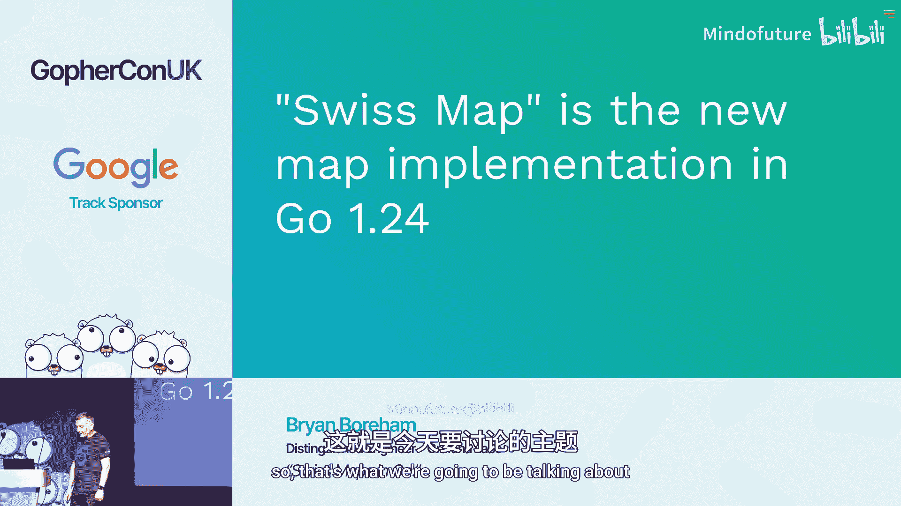
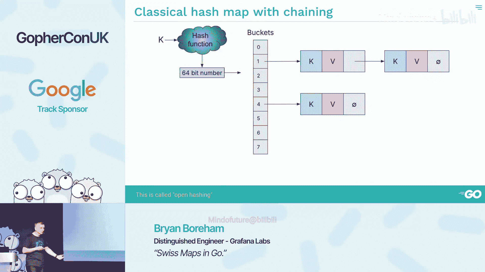
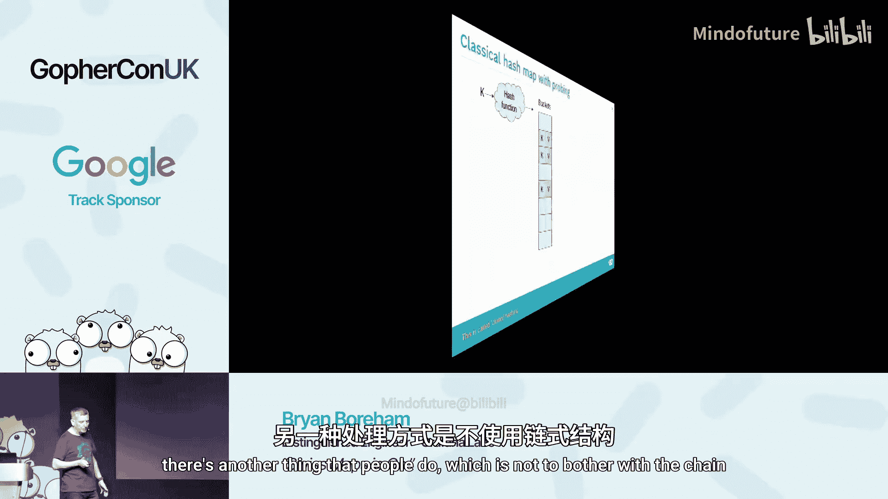
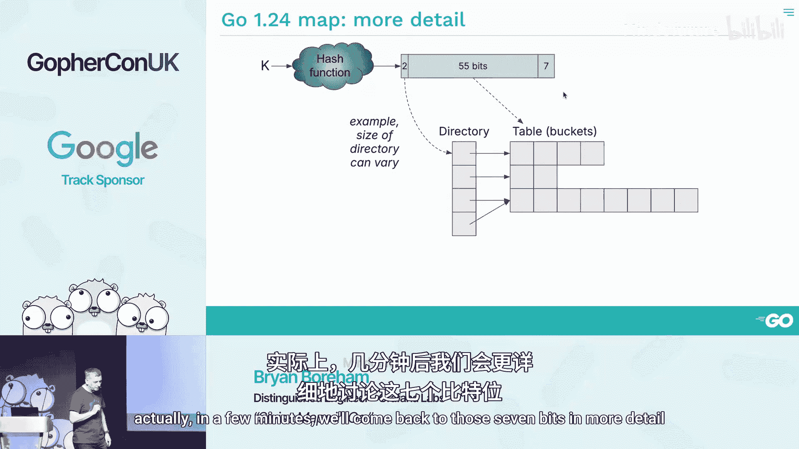
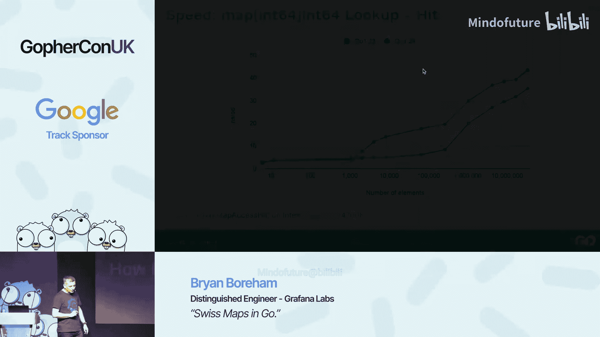
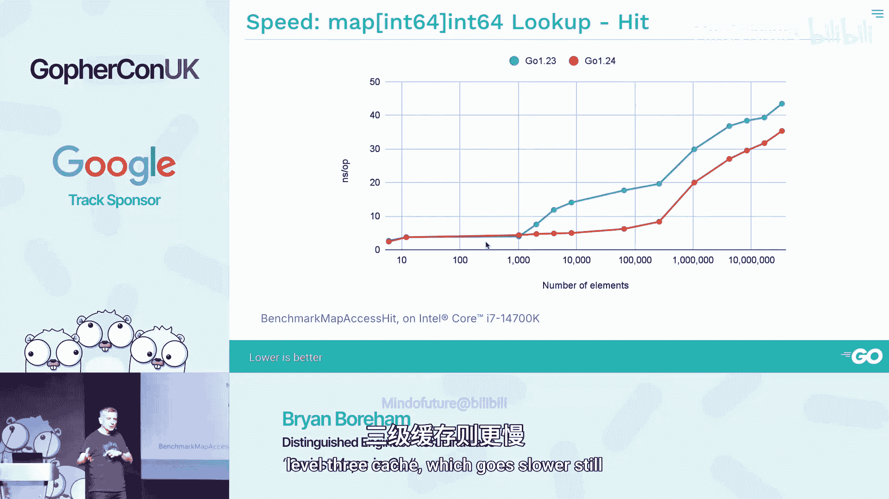

# Gophercon-Uk-2025-p14-P14_Go_中的_Swiss_Maps--BV1dCHTzQEdN_p14-

🎼Talk before， but yes， sometime helicopter pilot， longtime open source contributor。

 member of the Prometheus team and also presently part of the cloud Backend group at Graffana Labs for his talk Swiss Mas and Go。

 please welcome to the stage Brian Boren。😊，Hello。Hello， how are we doing。

 well thank you all for coming。It's good to see the room。 So， I can't see you now。

 But when I was standing down there， I could see you。So welcome， We are going to be talking。

 about Swiss maps。So。Come on。You know， there's like mountains and lakes and kind of crinkly bit at the bottom。

 No， Swiss map is the name of the new map implementation new in Go 124 and 125。

 which came out yesterday day before。So that's what we're going to be talking about just to introduce myself。

My name is Brian Boorham， I。I've been working in Go for 11 years now。I give quite a lot of talks。

 I put， I put some of the。EI put some pictures of my talks up on the screen。

 usually about performance。 That's， that's my main hobby。Making things go faster。

So I worked for Grfana， who's her of Grfana。Yeah， pretty much everyone， yeah。And， and this is what。

I guess what， what people are familiar with the。EColorful stuff on the screen。

 I don't actually work on any of that。I work on the back end storing。Metrics， logs， traces， profiles。

 mostly in our， our cloud system， which is。So a lot of scalability problems and so on。嗯。

Right， O， so let's get into it。 What do we mean in Goul when we talk about a map。

 I guess anyone who' who's used any amount of goal will have done this that you can。

You can say the word map， and you can put square brackets and one type and then another type。And。

The key thing， which is， which is kind of not written there。

 is we expect all of these operations to take。Constant time or constant amortized time。 We。

 we expect an insert， a lookup to be effectively instantaneous。 We。

 we don't expect it to slow down as the map gets bigger。嗯。And。So how do we do that。Well， if。If you。

 if you studied computing， you probably got taught this。 and if not， I'm going to。Do it now。 So the。

 the， the basic idea of a map。Is we， we take the key。So I've I've written。

 we'll see a lot of K's and V's here。 K is the key that's in the map。

 and V is the value that we're associating with that key。We take the key， which be might be a string。

 might be a number。In goal， you can， you can use a struct as as a key。 You can use。

Quite complicated things as keys。 But， you know， imagine something like a string。

And we run it through a hash function。And， and the。

 the whole idea of a hash function is it's going to produce numbers。 I mean。

 I've written 64 bit numbers。 We're going to use those numbers to index into some buckets。

So that's the， the primary idea of why this thing is going to go kind of instantaneous speed。

Is we're going to pick a bucket based on the hash function。And the data is going to be right there。

It could happen that two keys map to the same bucket because， I mean， in this case， there's only。

 there's only 8 buckets。 and there's a lot of 64 B numbers。 So if it happens that。

Two keys mapped to the same bucket。What we could do is make a chain。Of buckets。

So this is the kind of classic technique。 This is what you might get taught in， in a class。

 university or something like that。 And this technique is called open hasing。

So there's， there's another thing that people do。

嗯。Which is， is not to bother with a chain。EIf two keys map to the same bucket。

 we just put it in the next one。And then if when we come to look it up， we kind of have to。

 to scan down。 That's called probing。And， and by contrast to the previous one。

 this technique is called closed hashing。And I'm labouring this。I'm going to labor it some more。

Focus on the first letter。What is this？So that's why it's called a Swiss map。嗯。

It was was created in Google's Zur office。Which is possibly another reason， but。But the， the。

 the thing in the， in the code was called C， H table。For a closed hashing table and you know。

 CH table， Swiss table。So that's how it got its name。U。My inspiration for this talk。

 I watched this video two or three years ago on YouTube。 This guy called Matt Collounds。

 one of the authors of the of the original Swiss table。

 which was written in C plus plus at Google and。EThiss a really funny talk for a number of reasons。

 Super smart guy。 So definitely recommend that talk if you're into this kind of low level performance stuff。

😊，Anyway， so。So let's dive into some detail。So。Goal has had maps since the beginning。

And they pretty much always work this way。And then we look at how they changed in， in Go 1，24。

 about six months ago， that came out。So。Basically， at the， I don't know。 I don't know。

 is this going to be。You can't really see that。 No， could I use my mouse， maybe。Does that work。Here。

 yeah， okay。So the data structure has a， a mapte header that's like a struct。It has the buckets。

And in， in the older， in the pre Swiss map。All of the buckets were in one big slice。

And then each individual bucket could have up to eight keys and values in it。Go 124。

Changes that structure。In a couple of ways， and we'll get into a lot of detail about this。I mean。

 seriously， a lot of detail。You know， buckle up。嗯。So， the big difference is。

 instead of there just being one slice of bucket。There are， there are multiple。

 There's an extra layer of indirection here， which in the code is called a directory。嗯。And。So。

 the big difference。The big difference going from one slice。When you fill it up。

What they do is they double the size of the buckets。

 and they have to recompute all the hashes to figure out where everything goes。嗯。

So there's a lot of complication when theyre， they're doubling it in size and they're recomputing all the hashes。

 They don't want to take the hit all at once。 So there's like some of the old ones。

 some of the new ones。嗯。In the， in the goal， in the Swiss map。嗯。The， the， the buckets， they start。

 they can start off really small， just just one bucket with8 things in it。 but they go up to 1024。

 and then they start making these， these extra extra tables。So they。

 they never have this like massive slice of buckets。They， they will double the。

 the small slices up to 1024。 they and then they start indirecting to them。So。U。That's。

Get into a little bit more detail。 So we take the key。We run it through the hash function。 Go。

 go always runs its own hash function in in， in the the C plus plus talk。

 there's a lot of focus on how to pick a hash function and picking good hash functions and bad hash functions and so on。

 Go， go always runs the one that that they pick the go team， pick a hash function for you。

 which is good。 You don't have to think about it， But its in some cases。

 you might want to choose your own one。 Well， tough。😊，They， picked one so。

So the hash function gives you 64 B。嗯。Let's say we had4 a size 4 here。

So then we take two bits off the top to index which table we're going to look at。

And then the rest of the bits hash into the buckets。And we'll have a look in a second。

 What happens with the other。Actually， in a few minutes。

 we'll come back to those seven bits in more detail。

but I bet you're all wondering。How does it perform。I thought I I needed。

 I needed more photos of cats in this talk， so。There's no AI at all in this talk， I'm pleased to see。

But there are pictures of cats。Well。

So this is a benchmark。This is one of the， the Go project's own benchmarks where。诶。

We take a map of int to int，64 B int。And we fill it full of numbers， and then we look it up。

And we do that at different sizes of map。And we look it up with a number that's definitely going to be in the map。

 So that it's a hit。 We're always going to find the， the number。And so for small sizes of map。

 it starts off about the same。 Basically， no difference。And then as the。

 as the number of elements that we're benchmarking gets bigger。The blue line is go 1，23。

 The red line is go 1，24。 So it's quite a lot better on this benchmark。 It's you know。

 getting on for。ETwice as good， depending on the size of the map。Now。

 we'll have a little a fight here。I said it didn't slow down as it got bigger。This line's going up。

Brian， you lied。嗯。While， it's not the go map that's slowing down。

 It's the computer that's slowing down。one of the things you're looking at here is。

The CPU has multiple layers of caching。 The CPU goes like 100 times faster than the memory， the Ram。

So they have a， they have a level 1 cache that goes as fast as the CPU。

 They have a level 2 cache that goes a bit slower。 level 3 cache， which goes slower slower still。

The， the cash tops out somewhere and think about8 MB，32 MB， something like that。

 So that's what's happening as this map， as we， as we get to like。

A million elements。 That's an 8 MBby data structure。Plus， some overheads。 Well， it's sorry。

 it's 8 MB for the keys and 8 MB for the value。 So it's 16 MB at this point。 So anyway。

 what's happening is we're， we're coming here。 We're operating entirely in the cache of the CPU。And。

 and as we come over here， we， we're， we're having to go rely more and more on memory。

 and memory is 100 times as slow as as the cache。 So as the CPU itself， so。So I didn't lie。嗯。But。

 it's complicated。Anyway， so， so what we see the， the Swiss map is going a lot faster on this benchmark。

It's not at all better when it's really tiny。 And' it's kind of not doing quite so well as the as the map gets bigger and bigger and bigger。

But that's pretty good， right， We should。We should all upgrade。Maybe。Who， who has， by the way， who's。

 who's using1，1，24。About half， okay。Is it better？No answer。Who's using 1，25。This go it。

We'll look at that。 We'll look at 125 right at the end。So I ran a lot of benchmarks to。

 to put together this talk。 And so this is the one where you get the biggest speed up between。Go 1。

23 and go 124 is， is when you， you look in the map and we've made the map 4 million elements big。

 And we look for something that's not in the map。So that's a benchmarking a myth instead of a hit。So。

 that's interesting。I I ran Prometheus， which is a monitoring system。

 I'm one of the maintainers of Prometheus。嗯。And there's a lot of。Statistics here。 But basically。

 it came out about the same。So the benchmarks， many of the benchmarks look great。

 Some actual whole programs。So who knows？ Well， anyway， let's， let's get back。

What was that 7 B thing。That I mentioned before， the metadata。嗯。So。What we do。 So， this is our map。

 This is our Swiss map。We've got the， the keys and the values here。

And we hash each key gives us a 64 B number。And we take the bottom 7 B of that number。

And stick it in this thing called the metadata。And we do that。For each P。

So this bucket's only got three things in it， three keys， three values。嗯。We can have up to eight。😡。

So there's eight bytes of metadata for each bucket。In the， in the other ones。

 this is why it's 7 B because we need 1 B to say if the thing's empty。

So1 on all zeros means it's never had anything in it。

 And one a whole bunch of ones and a 0 means it's now it had something in it。 And now it's deleted。嗯。

But we have these 1 B per entry in the map， in the bucket。嗯。Now。

 the previous goal map had this as well。But Swiss maps。

 the whole special thing about Swiss mapps is exactly how they deal with this。😊，So。嗯。

We're going to get a lot of hex numbers here。So let's imagine this is our metadata。

We've got three entries filled and five entries that are empty。

And we are going to look for something with， with the same with the 7 B。

 We're going to take the thing that we're looking for。 We're going to hash that。 take the bottom 7 B。

 And that turns out to be 0，3。Are we going to find it？Is everyone following along no。

We're going we should find it， right， We， we should find it。Here。So how are we going to find it？

So the previous version of Go。Run a loop。It said， is it this one， No， is it this one， yes。等。

What does Swiss mapps do。We multiply that number by。0，1，0，1，0，1， We replicate the three。

Into all eight bytes。We exclusive all of that， with the metadata。

We subtract the number we first thought of I'm not making this up。And it not it。😊。

And mask the top bit。And as if， by magic。The one we were looking for is the only one with a bit set。

Brian， you're making this up。So we go to Godvault。Who knows God B。Two people， three。嗯。

God Bt is a website。I mean， it it's it's Mr。 Godbalt， who runs it that it's not a sort of fancy。

 It's not an acronym or something like that。 Its is a name。U。

And what what Godball lets you do is it lets you put it in some code。And it will run the compiler。

 just in the website。And then you can， you can see how the assembly code。

II was going to try and make that bigger， but I'll probably break something so。Just trust me。

 You can。 You can see。 We'll go back to the slides。 You can see。嗯。

How the compiled code matches up to the go code that you've written。

And he does it for for C and C plus+ and a bunch of other languages as well。 So that's pretty fun。

 Anyway， we， we can use a tool like this to check whether Brian's lying。😊。

So there's that multiplying exclusive ore and not。呃。These， these kind of funky numbers。 It's。

 it's printing out the number in decimal， which makes it harder to read。 but those are。

 those are those numbers that we， we saw when I walked through it。So。嗯。So that is the code。

 That is the go code that Swiss Maps runs。And by。Extremely trickyy means it can match up all 8 Btes at once。

So that's why it finds things faster。Typically。It also， if。

 it finds that the things not in the map really fast。

Because he doesn't have to loop over all eight things。 And then it's not there。 It。

 it runs these instructions and。呃。Finds things really， really， really within the8 by sorry。

 Within the8 element bucket， It finds things really， really quickly。嗯。

So I was in Bill Kennedy's talk earlier。 He said he doesn't want things faster。

 He wants them fastest。So we're going to go there， too。What is the fastest way to do this。More cats。

What is Cdy。Simdi stands 4 single instruction， multiple data。 So by contrast。Single instruction。

 single data。Is how you might imagine a CPU works。 It has a stream of instructions， a stream of data。

And it does computations。 And we get a stream of results out。So。Some time about about 2025 years ago。

 CPU manufacturers decided this is not good enough。And we're going to have single instruction。

 multiple data。 We're going to have multiple streams of data。

 which we process the same instruction on。I， it doesn't immediately sound like a great idea。

 but it it was， it was invented for things like bitmap processing， like graphics。

And people have found， found many new ways to do this。嗯。So， so basically， every CPU has。

 has Cdy capabilities， you know， unless it's like really， really tiny， cheap。Processor， and。Yeah。

 so let's， let's have a look at how that's used in。EIn Swiss maps。 So， so first thing is。

 how do you write Cindy code in go。And the answer is， you can't。There is a proposal， in fact。

 there are multiple proposals。So this one was opened May 19 this year。嗯。It's very interesting。

 You know， go read it。 but it's a proposal。 You can't actually do this right now。So what they do in。

The case of Swiss maps in order to because they want to use Sdy instructions， because， you know。

 think about it， those8 things that we want to match at once。We。

 we don't want to fff about with multiplying and and and stuff like that。 We。

 we want to use the Sdi instructions that natively inside the CPU， match8 things at once。U。

So the way they do this， is they cheat。Inside the compiler， they say。

 if I come across a function called control group Mat H2。

 That's the function I was showing you in God Bt earlier。If I come across this function， this name。

In this package。Well， the next thing we're going to do is is decide which version of the processor you're using。

Which version are you compiling for？ So this this is a environment variable。嗯。

And it has to be level 2。 So you set this environment variable， go AM M D 64 to V 2。

If you don't set that， you get the， the multi instruction we saw a minute ago。Every。

 every processor made。You know， since， since the war。And I'm going to say which war。诶。

Every processor you are using has got V2 has got Cindi instructions。 So。

 so go set that environment variable。嗯。Then， then we're going to start emitting these extremely complicated。

You know， this is just letter， letters， sort of。Burbed down onto the page。嗯。You。

 you have to spend years and years reading Intel architecture manuals to know what this is。

 but I'm going to tell you。So yeah， so this is how they cheat。

 This is how they do Sdy code when there's no way to write Sdy code and go。

Because they own the compiler。 They as the go team，They just， just。

Match the exact name of the function and then emit the instructions directly。Okay。

 so as we had before， we've got these 8 bytes of metadata。 We're looking for three。So when you go bm。

 replicate three to eight， eight times。There is a single instruction that does a comparison eight times。

 And in this case， it it gives us1，1。And now what we do is we squish that down to a single bit per。

matchch。So what we end up with is we， we end up with a one in the second second place counting from。

Least significant bit。And。So now， so we found our match。In three instructions。

All of which execute the maximum speed of the CPU。 No multiply takes like 100100 clock cycles or something like that。

 You know， I don't know，60。Depends on your， your CPU。3。😡，3 instruction，3 clock cycles。

 Well actually probably fewerer than three clock cycles， like one。So， so this is the real genius of。

 of Swiss maps。This stuff was， was come came up with by Jeff Dean， whos。

 who's a super genius at Google。嗯。And a bunch of other。

 I've got got a slide with all the names of the people who worked on this stuff。

This is why I wanted to give this talk， because it's so getting amazing。

That they they find the element they're looking for in in three instructions instantaneously。Also。

 they could do this。 They do 8，8 at a time。 They could do it 16 at a time， at the same speed。

They could， They could even go wider。 Theres kind of trade offs。

but I think they'll almost certainly do 16 in， in a future version of go。

And then it'll go a little bit faster。All right。Back to the benchmarks。So。Memory size。嗯。

So what I've plotted here。😡，Is making a map of a certain size， again， into in。And I， whoops。

I plotted this yellow line is the same if you made a slice。So that's like there。

 there's no overheads， There's no buckets or anything like that。

 If if you just made a slice that size， that's like the smallest it could possibly be。

So the difference between the yellow line and the other lines is kind of how much overhead you get。U。

And。呃。So you see a couple of things。 It jumps， right， At certain points， It jumps。

 And this is the bucket doubling in size。That I mentioned earlier。So that's， that's。

 that's when you get these big jumps。So depending on how many elements you。

 you have asked for on your map or how many you've inserted， you might。

You might have several times the overhead， right， You know， this is like。20 MBby。

 And we only really need sort of 7 or something like that。 So it's like3。

 the map is three times bigger when we happen to be here on the on the graph。 But if we're here。

 it's only like like 20% bigger。So this thing of doubling can sometimes cost you quite a lot。

So this is if you make the map the right size。嗯。If you。Make the map zero size， and then add。

Like half a million things to it。You really see a difference。So what's happening here。诶。In Go 1，23。

 the， the map gets kind of enormous and then actually goes down again。嗯。By the way。

 I had to write a whole test harness for this。 I'm actually using the profiler to figure out how much memory was allocated for the map because。

 you know， after garbage collection。this is all in， in a repo called Go Maps in my。

 in my Github account， if you're。Want to check。Check if I'm telling the truth。 But anyway， the。

So what is going on here， I I didn't mention before。 if you fill in go 1，23。

 if you fill all8 buckets， the next thing it does， it mix， it makes a chain。 you know。

 those chains that we talked about at the beginning， it makes an overflow bucket a little chain。

And that's。So， oh， yeah our Jo circleircle run it。 So we couldn't miss it， right。

So that's what's happening here is these overflow buckets。嗯。It makes。

 it makes a kind of blizzard of tiny overflow buckets and then says， oh， never mind。

 I'll just double the size of the whole thing。And that' that's why it comes down again when it kind of picks the double size。

The Swiss map， they run with a higher load factor。 So they they pack a bit more data in。 That's。

 that's why kind of asymptotically， it's a little bit smaller。So that's worth knowing。Okay。

 where are we？Right。This one。Is where Swiss maps looks worse。It's not all good news。Sadly。

What are we looking at here？ So we are making a map。Where， you know， it's got a key。 in this case。

 it's an int， and it's got nothing at all。For the value， it's an emptystruct。

 You can't put any data in it。 Why would you do that。 Well， this is set。

 This is a thing where we only want to know if the key is in the map or not。

 We don't want any data at all。 I mean， you might think I'll do that with a bull。

 I'll do this with bull and， I'll set the bull to true if it's in the map。

 but you don't need to do that。 You， you can just say， I don't need any data at all。

 I'll just check if it's in the map at all。So people do this。嗯。The， the goal 1。

23 map has still got this， these kind of annoying jumps。 But when it settles down。

It's kind of getting on for twice as small or the the Swiss map is twice as big。As the。As the。

 as the old， the previous map。So what's going on here？This is the bug。 If you want to follow it，7，1。

3，6，8， is still open。嗯。Basically， what's happening。 Have I got that no。Yeah， so， so if we look here。

 oh， no， it's not that one。 Yeah， so the old map stored all the keys and then all the values。

And the new map goes key value， key value， key value， key value。

And it just so happens that the goal compiler won't let two adjacentstructs。

But right up against each other， it basically allocates 8 B of space for the empty struct because it's going Key value。

 Keep。 Let me see if I can find a picture of that。呃。Oh I should have prepared for this， shouldn't I？

This picture， Yeah， so basically， the， even though no space is needed for this iss kind of a quirk of the go compiler that it ends up allocating 8 B for the empty struct。

So。So that's very sad。Where are we。O， there。 So this bug has still not been or you know。Regression。

 misfeature。Still not been fixed in 125， but maybe soon。嗯。O， what else。

 what else is a little bit sad about the Swiss table。Cold cash。 So， so this is kind of， I think。

 why the Prometheus case doesn't look very good。 All those extra pointers。So this is the。

 the Swiss map has this one extra level of indirection， which is what lets it grow more smoothly。U。

When you have a lot of data， the Prometheus has like 12 GB of data in my， in my benchmark。

Following these pointers means you， you have to go back to Ram because they're probably not in the CPU cache。

If you run a benchmark， you're going to hit。 All these things are going to be in cash。 The。

 This stuff is going to be very hot。 It's going to be in cash all the time。

 And then maybe this stuff' not in cash。But in， in a big program。

 just like arbitrarily coming up to a map， it might not be in cash。And。So that's why theres。

 there's an issue for that where they're sort of tracking ideas。 They have to make that go faster。嗯。

Finally， let's talk about 1，25。 Go 1，25 was released two days ago。Oh。

 we had a talk earlier from Daniel。Who told us all the new things， except these。So。It is faster。For。

A map。Up to8 elements。And an unspecialized key。 So， so if you use int or string int 64， int 32。

 there's a whole bunch of types that are specialized inside the compiler。

 It says I'm gonna run really fast code for those types。 Those ones always go fast。 but they。

 they kind of missed they， if you， if you use something like。

Bite array of 16 B or something like that。 It's not one of the specialized types。And。So those ones。

 they fixed that regression in 125。 So they go fast again。And。We prune timestones before growing。

What's a timestone at two times， What is a timestone。Come up and tell me tombstones。

 A tombstone is when we have deleted an element from the map。And so essentially。

 if we delete an element at the end of the bucket， we can just reuse that space。 There's no problem。

 If we delete something in the middle of the bucket and the bucket is full， we can't。

 We can't touch that space because of the probing mechanism of closed hashing。

 I won't go into every last detail。 But in that situation， they've got extra code in 125。

 So instead before doubling in size。 They go look to see if they can use some of that tubembstone space。

After they doubled， there's no tombstones。 they've copied all the data into fresh new memory twice as big。

 So so there's a little bit of an optimization to prune before growing。And finally， Matop clone。

 Who uses Matop clone。You。Well， you're going to be really pleased。This is Mapstop clone。

So if you've never used Mas clone， it takes a map and makes a copy of it。 It makes a clone。

So this is the speed。For different sizes of map in Go 123。嗯。It's got。

 it's got kind of an interesting bump on it。 But， you know， basically， it goes at a certain speed。

 copying all the elements。124 came out。I don't have space on my chart。It's so slow。

So that was a regression。呃。That was， that was a bit sad。 If， if you were， you know。

 the world's biggest user of Ma stock clone。You were sad on that day。So here we go，1，25。

 I've written R C 3。 The code is identical， R C3 to 25 dot0。 The only changes in the version number。

嗯。So， relax。EIts， not only is it faster than 1，24， it's faster than 1，23。

So you can map stock clone to your heart's content and rejoice。Okay， we're just about done。

 I wanted to credit。 I didn't do， Yeah， I want to be clear。 I'm talking about this thing。

 I'm excited about it。 I didn't do any work at all on the Swiss maps。

 It was all done by these other people。嗯。Most of the people here worked on the C plus plus version。

 Michael Pratt is the person on the go team， primarily responsible。

EPeter Matttiis kind of did the first， the implementation that was the basis for the goal1 in in go。

And I'm sure I forgot a few people。 apologies to them。Anyway， we'， we're done with my slides。

 If you want to find me。 I'm mostly on blue Sky。 I do have an account on Masterstodon。

 Both of them are B Bom。Anyway， but you can ask questions now if you want to。Big handslor Brian。

 everyone。Right， this is quite a full room。 Yeah， hands up for questions。 Got on here。😊，Hi， Brian。

 thank you for super interesting talk。 You talking very much about Intel the whole way there。

 I there equivalent speed up for arm backend。 Oh， yeah， good question。 Thank you。 I， I mentioned。

 I gave you the code。😊，On Intel or or what。What the goal compiler refers to as AM M D64。🤧嗯。

So the situation for arm is there is no CD implementation。Currently， on arm。Virtually， well。

 certainly， all of your server arms have a thing called neon。

 which is the equivalent of the Sdi instructions。 So they have the， the hardware to do it。

 but nobody's written the code。In in the go compiler。 So if you run an arm。

 you get the other version with the multiply instruction and the and and the not and so on。It's。

 it's still pretty fast。 but yeah， good， good question。 Were。

 we're still waiting on someone to do the arm implementation of the Sdi code。Thanks。Yeah。

 quick question on the first iteration and the second iteration of finding the element。

So the first one， it was like loop over everything。 And it was in this the first position。

 And then the second one， it was based on the bits that are set and then the bits that are not set。

How come it doesn't have to loop to find which bit is set。Right。That is also a very good question。 I。

 I'm tempted to try and find the right slide， but it'll take me5 minutes。 So just imagine。

So if I understood the question， the question is， you did all this clever stuff and you end up with one bit that tells you the right place。

 And how come you don't then have to loop to find that one bit。And the answer is。

 the CPU has an instruction that finds the first bit that's set in， in in a word in a。An an a bite。

Wd。So， yeah， I I。So that' cool that's a cool thing to know， right， Who knows that？

 Jeff Dean knows that。 That's who。So， sorry， is that clear that that the you know。

 boiling it all down to 1 B is， is cool。 But how does that help？ Well， theres a。

 there's a CPU instruction that turns the bit into a number。 And in that you know。

 it was the second one we were looking for。 So it turns it into to what one in this case。

 counting from 0。嗯。So yeah， there， there's a CPU instruction that that that tells you what is the first bit thats set either in in a bite in the。

Bit packed case or in a word in the non Simdy case。Brilliant， thanks。Next question。

Do you know why Go uses the compiler to inject the C D instructions as opposed to virtual functions like Li C at runtime in the sort of linker preload phase thing。

Why do they do it this way？ I mean， no， I don't really know。

 I guess they needed to kind of wedge it in somewhere， I think。诶。I mean， you， you。

 I think did you mention virtual function。 Is that what you said， Yeah， Yeah。

 so you wouldn't want any indirect。 You wouldn't want anything to slow you down。 I mean。

 that's that's certainly one thing that that you， you just want the code to execute absolute top speed for this。

 this low level in， in your program。You know， it's kind of what I was saying about if， if you。

 if the thing， if you thing you're looking for is not in the cache， it really slows you down。 Like。

 memory is 100 times slower than than the cash。嗯。So any indirection can cause that delay and。

So that that's probably part of it that they want They want the code to be right there emitmted by the compiler as fast as possible。

O。Next question。So for the set use case， meaning the value is the emptystruct。

 is a Swiss map a good fit， or do you think like a different data structure should exist in the go tool chain at some point？

Oh， the sat with just emptystruct。yeah， it， its， I mean， I think it's。

 I think it was just a kind of a dumb thing that nobody thought about。

 That's how come it doubled accidentally in size。 And then how come they didn't fix it in six months。

 It， it's not， it's not as trivial as it looks。So you can probably fix it。You know。

 by tweaking around with the code or putting another hack into the compiler or something like that。

 Or as， as I think you were suggesting， you could write a whole different data structure specialized for。

 for the set case。嗯。So。Yeah， I， I don't know。 I mean， you know， these。I I didn't。

 I didn't labor another aspect of， of maps in Go。 They have a whole set of behaviors about iteration。

So， you can。You can start iterating through a map and then add something to it。

Or delete something from the map。 You know， you can write。

 you can write a loop that deletes things from the map you're looping over and Go gives well defined semantics for those operations。

It not necessarily predictable what it's going to do， but at least。The set of things it might do is。

 is written down。 And that's not the case in most other maps。

 It's not the case in the C plus plus maps that that people use。However。

 it is very complicated to meet those semantics that you can add things and delete things from the map while you'iteiterating through it。

You know， if， if you sort of imagine about reusing bits of memory and so on， what might happen。

 So that's one reason why you might want not once you've written one of these things。

 you might not want to run write another one。诶。Because getting getting one to work with the go iteration semantics is very hard。

嗯。So I suspect that they will figure out how to get it to take zero space for the。

 for the empty struct。ERather than coming up with a completely different data structure。Which also。

Fits the iteration semantics。Next question。ItDoesn't matter how deep into the middle of the crowd you are。

 We will come and find you。No， okay。 All right。 Big hand for Brian Boham。👏Thank you。

