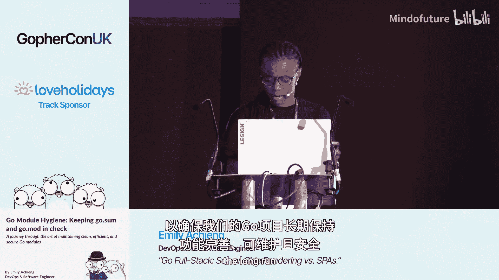

# Gophercon-Uk-2025-p15-P15_Go_模块卫生——保持_go.sum_和_go.mod_的一致性--BV1dCHTzQEdN_p15-

Hi everyone， please take your seats。So we have with us Emily Aian。She is from Kenya。

 but is based in Switzerland。 She is a software engineer and Do Devops。

 and she previously gave a talk at the first ever gophercon South Africa。 Today。

 she's with us in London。 So she's going to tell us about go module hygiene。 Please welcome Emily。😊。

Hello， everyone， thanks so much for joining。 And it's quite a pleasure and honored to be speaking in front of you。

 I've attended a couple of Go accountss and I'm really much excited to be able to speak today。

 have worked to go in the subrsside as well as in the cloud native space， like with Kuber net0s。

 and I'll try to share some of the。😊，Experiences， especially with dependencies。

 And I hope we can be able to relate。So thanks so much for joining。

 So have you ever experienced situation where。😊，When you start a project or like you keep kind everything is knit and tidy。

 And after some time you get to drown in that dependency。 like it's some sort of a wild jungle。

 and you just don't know how to control your imports or just your models。 And I've been there myself。

 and it took some seemingly innocent this update on goal model that took a whole day just trying to resolve some of the issues。

So that experience Hamd what we're going to talk about today。 go modules。

 So this presentation is not just about the technical steps。

 but it's about like sharing the developer experiences that can be related to those kind of headaches。

 And also like in order to ensure like our go projects are functional。

 maintainable are and also secure in the long run。 So let's talk about our our dependency journey。

 Thank you。

So a little bit about me as you just mentioned， I am Emily from Kenya。 I am based in Switzerland。

 and during my free time I enjoy like exploring parks in nature。

 which Switzerland happens to all for us。 and nice to meet you all。😊。

So our agenda for today is start by understanding like this， we collect dynamic tool。

Go mode and the goam。 So these are like our unsung heroes。

 They try to keep our dependencies organized and making sure like our project stays in check。

 and theyre kind of like quiet diligent library like of think of it like library when how a library operates the library keeps track of the most sort of like an inventory。

 keeping track of the books that are going and coming in books that are borrowed or lost。

 So we have this kind of situation but with dependencies。

 We also talk about spotting some of the symptoms like when do you know like your goal modules need some attention。

 this could be things like the slower builds and to those kind of mysterious or hair pullinging errors that you might encounter or face。

 And another is also like。How do you tie the up or cleaning up like your dependencies when you are a situation where you need to like you need your project to be efficient。

 So we'll talk about like some cases which that can happen and also like with trimming dependencies。

 sometimes you can have dependencies that you no longer need and you want to just stay with dependencies that you actually in a project。

 And later we also like look at the security patrols。

 guiding against the vulnerabilities that come with the dependencies and also like again the supply chain attacks。

 So walking with dependencies， you think about it like it's like a wind or a door and you allowing so much into your project。

 how can you ensure like your project is very secure。

 you try to keep like a lock to be able to ensure it's working and efficient and the other。

Like some of the sustainable practices that will help to keep your modules in great shape。

 So even as your project go grows and evolves。 And lastly。

 we also think about like the automation like tools and wax for your projects。

 So let's try to understand the go mode。 So the go mode is like think about it like a meticulous product manager。

 So responsible for ensuring like these are team these are your teammates are this is what your project is about and trying to see like and aligning everyone in the same page。

 So in the same way the go thumb is more of a vigilant security guide。

 So it tries to verify like nothing has been tampered on。 for instance。

 like think about it more of making sure nothing was secretly tampered with。

 if we didn't have this kind of file。 someone could just take a dependency。And make a change。

 And this will lead to like some of the exploiting。 So together， they are like a dynamic dual。

 ensuring security， consistency and reliability across different environments。So as we have known。

 they are like our unsang heroess。 They are not just boring configs or borrowing like lines of code。

 They are walking hand in hand in in， like theyre like the bedrock or foundation of our reproducible bills。

 So， and they are like our first line of defense against the attack whenever they have car。

 And they are very much important in helping keeping our projects clean and trusted whenever we working with something vital。

So let's start with the fast one。 So even though they are heroes， hero。

 even heroes get overwhelmed sometimes and。You can have a situation where， for example， we have this。

Yeah， an example is this gold mode file。 You can see like there are all dependencies or sound paths which are in use。

 So let's say you have an apartment and you keep adding things and accumulating them some on the table chair everywhere。

 So it ends up becoming messy in the same way。 like we have these gold mode file at once。

 you have like packages。 And then another， another。

 it becomes like your project becomes clated with so many old versions。

 and this old versions are like creating conflicts。

 maybe when some it could carry some of the hidden security vulnerabilities。

 So each of these can be also like a cl in your apartment in the same way。

 you have like all dependencies or another use， which are not used。😊，What are some of the symptoms。

 again。Slower bills。 So when you try to build your projects and you take a coffee break。

 you come back， It's still building and you try to distract yourself by probably going on a walk or。

Like exchanging some emails。 And then they come back。 It's still building。

 Another example is also like， can you extend that coffee bread to even lunch shower is still building。

 So this kind of situation where building is taking forever。 It it's just still building。

 It means like you need to pay a lot more attention。

 It could be huge warning sign to be able to check like。

 why is it taking forever to just build this project。

 it could be something the reason could be some of the unused conflicting dependencies or go is trying to sift through some of the packages and download them and making sure that and leads to like the building times to crawl as well。

It。Another symptom is like， ballooning binary size。So you could be having a very small project。

 And so imagine your application is very tiny。 And suddenly。

 it's asking for extra storage like you need like it's asking for like its own storage plan。

 Why is it like this。 It's because of the ballooning binary side。

 So it could be importing like it couldn't be importing parts of the functions from like say a huge library and trying to take the whole library into bundling it into like an executive table。

 which makes the deployment heavier and also like slower。

 And that can also lead to higher memory and higher memory usage and this also like not very efficient。

 That's why like you also need to look into it when you spot this sign。😊。

And another aspect is mysterious errors。 So why， when， when can this happen like， for instance。

You make a small change in an application。 and suddenly， unrelated parts are falling apart。

 For instance， like it can send a panic message whenever like you。

Make a small change or itwa yesterday。 It worked on the machine， things like that。

 So it could be also so with dependencies， it comes with their direct or transit ones。

 like indirect ones。 So they could be fighting against each other and causing this kind of unexpected behavior and a panic。

 So when you try when you exp， when you experience this is also like yeah， a mysterious era。

 which you do not know where it's coming from， it could be also like one of the science to check on。

And the other thing is also dependency conflicts。 So dependency conflicts is when you have a version and parts of your projects are asking for different like one party is asking for。

 let's say version1。 Another part is asking for version to。

 So it go is kind of left with the that difficult choice to be able to see like。

 and that can lead to run runtime errors because of the versions that are conflicting。

 And this is also like one other nightmare to debug。As we have seen。With a dependency blotting。

It's like a clattering Gar garage when you have like so many things in your garage and you're trying to look for what you want。

 It can be very difficult because。Theres so many unused bills that are just staying there。

 and they're not really being used。 And this also is。

 is a way more like an easy entry point for attacks whenever they come。

 So when you run this kind of outd dependencies。 and they take so much space and make it's really hard and difficult to be able to debug and to be able to find what exactly is wrong with your project。

 So when you able to recognize like this kind of thing。

 it means like your modules need some attention as well。And how about the security vulnerabilities。

 So， as we have mentioned， working with dependencies means like you are。Wking。

 it's like a door window。 like you are allowing a lot of things in your application。

 and you want to ensure like， you have a proper lock。

So when you have like dependencies that are updated。

 it's like you're leaving the window unlocked and you expect like buglarlus not to like enter in。

 So also having that in mind will be able to keep your dependencies and identify， like。

 if there is an old version needs， it needs like that kind of attention to be updated as well。

 So this is also enough to be able to spot as a symptom。And this is also like a slightly different。

 but it means you have a module。 A module can be found， but it is missing some part of the package。

 So this can lead to building consistency。 So the module is found。

 But why is it asking for like a certain package that version to that it， it relies on。

 So this also leads to version conflicts that can lead to build errors and slow down your dependency or development processes。

So， with that in mind。How do you try to clean up there are many different ways。

 depending on like different cases， like a gomo bill， go gomo tidy。 So tech。

 this is the fast line of defense。 For instance， when you have so many clothes and you're doing like kind of spring cleaning。

 you try to sort out the clothes that you want。 And then you sort out the ones that you want to donate in the same way with the gomo tiny。

 your project is actually going through a lot of changes and evolution for instance。

 there could be a feature that was shipped moments like months ago， or like reraing that was done。

 and it could be having more like a dead weight taking all the space that you need。

 So when you go through when you use this is more like a fast line of defense。

 it helps you to shrink。Some of the billionaries says some items that you don't need and speed up your building。

 So that go has nothing to worry about。And how about go， This is also one of the helpful ways。

 So let's say you go to a party and you invite people。

 So working with dependencies is like inviting things to your project， so。😊，When you have a party。

 you invite friends， their friends invite their friends as well。 Their friends， again。

 invite their friends。 In the end， you or you will have a full room full of people you probably don't know。

 And working with us with the graph will kind of help you to map。😊，YeahYou try to see like， okay。

 this with this dependency is coming from directly in the project。

 This is coming indirectly because it's linked to the other。 So when you have it。

 it will give you some sort of a social network of it's like cycle or dependency a tree so that every single model in your project is is you。

 you able to map it And whenever issues arise or something sneaks into your projects。

 you can easily you know and try to debug it as well。And another also。

 how do you also try to clean up you can use the dependency with the Go mode why。

 So this can help you to understand like， why is this dependency here very much important for like onboarding processes you it can help also to know like the exact path to which like the module is going through are there intermedia intermediary dependencies that are coming in。

 It also shows you like who or what and answers some of the why questions。

 So it also help you empowers you to make inform the decisions rather than just blindly like debugging。

And with the list all think of it like us another way， depending on the project， to be able to。

At least see everything in your module is going through。

 It's like a magnifying glass so you can initially sweep through and see like this project is just depending on this。

 And they's like transitive。😊，It's more like an eye opener to fully scoop what the project is actually about。

 with that， you can be able to see like everything your dependency or modules。

 which are direct and indirect as well。😊，So for painting， I painting。

 I I think about painting is when stability is more crucial。When you think about like。

 ensuring you just need this exact of。This exact version， for instance， in the C cityD pipeline。

 So you don't want to build suddenly something that will break a pipeline because it's incompatible or。

Just having you tell， you're telling it's like telling go to just use this kind of version and not to be inconsistence。

 So in that situation where you want to have like a very consistent version in your projects。

 And you don't want like something to fail in the long run long run， you can use like the painting。

 And for instance， someone is working on old local couch。

 And a lot of changes of up and with a C I pipeline is it will be able to ensure like you have a stable version that has been paint and everything else will be able to save you count a house of debugging。

And more of that is just like how do you also clean up like when you're working with different environments。

 Let's say like you have a local copy， you have a forked version。

 and you could try be trying to work with different dependencies in different environments。

 So you just point it to a specific environments to be able to swap like dependencies。 let's say。

 for the local version and let's say for the foked version that have not been mud。

 And it's all about like just being mindful and not being able to mix up a lot of dependencies that are in on different environments to。

 to like reduce also like runtime errors that come with it。

So one important thing which we should also remember is when we are working with dependencies。

 So think about dependencies， like， as you've just mentioned。

 you're inviting a lot of things to your projects。First thing you should ask is， do I really need。

 Of course， this might not be the case， but this is the most obvious part like could be an instances。

 which are not obvious。 So you what， this is like walking with a third party C package and you just need to ask yourself。

 do I really need that package or。I the gold standard library able to cover like most of the needs that I want。

 So to avoid just using a lot of the third party packages， you should also like scan through and。

 and and see like。Go is able to go to the library actually able to do this without me needing a like a packet or an extra dependency。

 With that， you also reduce a lot of unnecessary blotting。

 and you also embrace that kind of simplicity， which means like you have very few external dependencies resulting into better performance and like a few surface area for like security vulnerabilities as well。

And and working with packages。 So before adding a depend is what do you need to check。

So a lot of things is on the Internet。 And most important is the maintenance。

So when you look at a package online， you can look at。

Is it actively being developed or when was the last come， when was the。

Like are there like open issues that are there， things like that and also like with the API dependency。

 API stability like are there breaking changes that occur is the API well documented in the long run and a lot of the crucial things or crucial questions you need to ask are there issues being addressed or are there like an amount of stars or contributors So of course like you don't just pick something because it's cool you also need to ensure like it is well maintained or maintained at least whenever critical bug comes up like you at least also like have this community support like the good science could be the result comments。

 clear documentation， active issues that by the time maybe you're using a package that was last up data。

Y ago。 and there are lots of unresolved bugs。So whenever theres an issue， that means you。

 you be on your own， like。You don't have like any sort of help to be able to know like how。

 how to go about it。 So you can choose stability or well supported maintenance as well as well when working with dependencies。

 Thats like community aspect is also very， very important。

And let's also talk about like regular pruning。 So your dependencies also like need regular reviews。

 This is。So you can try and schedule reviewing like as part of your development cycle。 So it。

 this is more like a habit。 It should be not be our one heroic act just be like small。

 small steps in order to see like。Like a new， new v， when， especially when new versions come up。

 you try to like regularly check and ensure like this is more of a habit instead of like just waiting for one moment to make like that heroic change。

And as we also saw god tidy， it's like the first line of defense。

 So regularly also review that and also like with the goode file for any kind of outdated dependencies that might be in your project。

 So try to update everything at once。When when you're trying to update everything at once。

 it becomes like very difficult and terrifying。 So， and it can be also like time consuming。

 but just regular habits will keep your projects healthy and probably easy to maintain as well。

So one of the crucial things is security when working with dependencies。

Your dependency is like a door to your application。 and each each depend。

 you need to have a proper lock to ensure like yeah it's actually working well。

 So always have in mind this kind of thread landscape。

 like you are allowing things into your projects。 So how can you ensure like you have a proper lock by not allowing updated versions or like vulnerable parts of the library that are also like malicious updates or just like old。

Packages that could easily be exploited as well。 So have this in mind to regularly also like。

 check those kind of doors that you allow and ensure like it is very strong and up to date and still doing the job because you are allowing。

yeah， things into your， like you're allowing， when you work with a packet。

 you're allowing things into your application。And for the supply chain attacks。

So whenever like trusted packages also like can actually get compromise。

 something that is very much used。 So you should also like look at this is one of the risks that is involved So when you that's like when you have a package that is used and trusted it can get compromised sometimes。

 and without you realizing because you trusted。 this package。

 And this means you allowed it into your project。 So you should also ensure like you regularly。

 have that in mind and with the non vulnerabilities。 most of this packages are online on gi。

 let's say。 And people all always put issues like oh， this is a security issue here。

 And that also means like a lot of malicias or anyone can just use that we。

Point to be able to explore。 So always also have that in mind like， yeah。

 when you're working in a pocket， with a packet your'。Or a penency like。

 anything can also happen like the security bugs can also be taken advantage of because it's just online。

 and someone is looking at the issues that and using that weak point to be able to exploit。

And let's also look at scanning。 When you are working with dependencies， you can。

Also use scanning as a way like you can scan your cord depend dependencies for vulnerabilities。

 especially with Git。 So this think of it like an automated security patrol。

 So it knows how it will know how to lock and it will never get tired， So when you probably put this。

 it can also be a great help to your project in order to know like。😊。

Part of the pro like it can be able to easily run it and quickly like set up and catch。

 catch for your problems early before it gets too late。And who has used go Mo vendor。 Yeah。

 so how does it work， It's like creating a snapn copy。 Yeah。

 so it's like creating a copy a catch of your dependencies when you need like。

This means like you have like absolute control over your， your dependencies。 So you just。

 you don't have to。Pull it directly from when you， when you need it。

 you don't have to pull it from the external sources during the build。

 So you have like a local copy there where you just pull it。 But of course。

 that means you be the one to update it。 But it creates you that kind of local dependencies。

 And it's like stocking your pantry instead of going to the grocery， you have it stocked。

 and everything you need is just within your control right there。 So with that。

 it means like you just have your local copy and you have an absolute control。

 But you also need to keep updating it whenever it's needed。

So with the check sum is also like a security aspect protecting you from the supply chain attacks。

So with this， it verifies the code when， when you download it， it ensures like you。

 it matches the trusted version。 So if we didn't have it， people just use like a。

Any version and copy the like the original。 So it's able to ensure you。

 you have the original trusted version that has not been tampered with。

 And it's like having someone in the door checking the I D and ensuring like。

 this is the actual person who carrying the I D。 So it also protects you from the supply chain tax。

So now that we have ex explored some of the。W of。Depenencies can come， and how to clean up。

So what are the fish proof。 Yes， I another reminder， again。

 it's more of a habit building keeping your goal modules healthy。 Its。

It's a habit It doesn't have have to happen like all at once。 It's small of small。

 small stepss that will save you some of the hair ducks for tomorrow and keeping it it helps your code base to be in good shape as the。

 as the project grows and it makes you like thank the future you for the present that you that you have。

And with just like you can have a dentist appointment。

So sometimes you can just set a reminder trying to see like， how。

Just establishing a routine to be able to also like。

Have that sustainable way to maintain by just having that reminder， regular audits to think。

 think of it like yeah。A routine of maintaining like you， your project。 So it's not that exciting。

 but it can save you also So like the pain along the road in， yeah， in the long run。

And most importantly is automation。 Of course， like。

 we've talked about a lot of the manual processes that come with it。 So with automation。

 you think about like integrating checks in your C ICD pipeline， so。With this。

 your dependencies is being checked without you doing a lot of work。

 It means like you don't have like a lot of the。Forgotten reviews。

 And it's just like automatic and helps to push or integrate the whole process for you as well。

 with that is also like another sustainable way。And most important document document。

 So for future references， especially with the。Entering a project。

 people were entering a new project。 They're able to see the design decisions that came along。

 They can use it as their references。 Why did we have to choose this kind of version of the library。

 or why did we decide again it as certain like version。 So this would also like。😊。

Help us to help like new members to be out up， to adapt and also like helps troubleshooting easier。

 Or maybe when someone inherits a project， they're able to see like the crucial parts that have been made in the。

 in the whole decision。 So with the document documentation。

 it helps to like save a lot of the headache。And also， test test， of course， we have new version。

But before you also integrate it， ensure like the new version doesn't break you up or introduce bugs by running like some kind of comprehensive test or probably like isolating your environment with that。

 you also consider like what are the manual spot checks that especially for the crucial parts and to。

 to be able to also understand if this is something you want to go on。

 So always test before also like adapting a new one。😊，And yes。

 so creating habits is a selected process that we， I keep repeating。 like， it's all about just。

 it's not about a one time heroic act。 It's about like small。

 repetitive processes that helps to build that kind of。Healthy models in your， in your workflow。

 as well。So automation， of course， take care。😊，For the whole process。

 lets automation handle your module management。 For instance。

 like when it's all consist for you to ensure like that's consistency and。Reliability。

 you want to ensure like you can insign reduce some of the errors。

 You don't have to think about them a lot。 And you ensure like you easily maintain and it frees you also like time to focus on other development processes or processes。

 So with automation， its， it's more like a reliable support。

 maintaining the health processes of your module quietly as well。So， of course。

 when you start a project， you always just do the go more tidy， which is the manual process。

 But yeah， it's also a good practice to use a pipeline that will just be able to fail or build if changes are are dissected。

 So having this kind of workflow will also save you a lot of time whenever like and also like。😊。

Doeszzle the tidying。 And without much extra effort， that is needed。

And also like integrate some of the tools that can help you to automate processes that are there。

 So because whenever you work with the dependencies。I you don't have to think about like it will。

 which it will help you to check without lifting a finger。And also。

 when you also run some of the vulnerability scanning。You also， like with the CCD pipeline， you。

 you can see some of the dependencies can。Whenever the changes are made， and you're not aware。

 So it will helper。Autto generate。 So this， as we have mentioned， is more like。

Just giving you an overview when your project is growing and evolving。

 you get to generate more over lists。And remember， the best kind of module management is the kind you don't have to think about。

 That is what automation is about， so。It means like it's still happening in the background。

 even when you have not lifted a finger and when you automate。

 you are keeping everything running smoothly in the background and。It can easily like。

 help you to focus on other things。 So the key takeaway for today is。This， too， important。

Dynamic du college， they go about them go up。 They， they could be tiny。

 but they are the backbone of your reproducible， like reproducible bills。

 So they should not be an afterthought， but they are critical for your in infrastructure。

 And of course， they are allowing things into your project。

 But you should always have in mind and think about them alone。Sport issues Ali。

 I have mentioned some of the issues that could， you could watch for。

SSlow bills Bill is taking like a whole time。 You go on coffee， come back。 It's still building。

You extend it to a lunch break or a small application is having a blotted binary。

 like just a small application asking for an extra story or just mysterious errors that just come out of nowhere。

 So these kind of small， small issues are things that you could spot and try to see like this。

 Your dependency needs attention。And we often talk about technical depth。

 but dependency depth is also a real thing。 regularly prune like or tidy up their used packages。

 And before you think about， like I saw， like working with dependencies， of course。

 dependencies are third party like library。Think about one try and say if the gold standard library is able to handle most of the things that you need。

 So if you find less like。Trying to look use a lot of these。

 you realize like you depend on them a lot。 And it becomes a whole mess when you try to clean up some of the unused vulner packages and it introduces like vulnerabilities in the long run。

 So this means like your projects can be more slower and also riskier to build and a little bit painful because you are。

Adding a lot of things。 And this is where I like dependency depth being a thing。And yes， automates。

 automates。The best kind of dependency， maybe what you need you can pick， Pick up from today is okay。

 the one you don't have to think about。 It's able to check for you。 Like when you integrate it。

 it's able to check for you the updates。 It's able to like do some security can。

 It's like mostly working with the pipelines and able to check like some aspects of your project。

 making it easier to maintain and efficient and also like secure in the long run。

So another thing is also like document and test， especially for people who will been getting into the new project。

 They'll be able to see like， what are the design decisions that were made。

 And we have like new updates coming。 new versions coming。

 always test before like updating to the new version or the most recent version that will also help you to like。

😊，Yeah， just try to keep everyone aligned and through how like helps to avoid surprises that might arise like。

 especially with the updates。And another thing is most important you can get from today is just。

A build that habits of。The building that small， small habits of ensuring like the the。

 the dependencies or packages are well maintained and not waiting for when everything is a whole mess like the messy apartment that I give an example。

 And that lead to an easier way to be able to maintain it and also like make your project more secure in the long run。

 And also like， it's also the small， consistent efforts that pay the most than of the that big。

 heroic act。So， this is。So this is a bit of a walkthrough。

 And I had like a small Gi mini Mo these projects there。 And my slides are found on this。

 and feel free to connect on LinkedIn and Github and hope we can relate to some of the dependencies or some of the struggles。

 and I hope like you enjoy the rest。 And if there's any question。

 you can also feel free to ask me as well。 Thank you。😊。

