# Gophercon-Uk-2025-p16-P16_Just_Eat_如何使用工具在几分钟内部署_Go_微服务--BV1dCHTzQEdN_p16-

So for his talk， how Just E uses tooling to deploy Go Microservices in minutes。

 please with a warm welcome to the stage， welcome Ainsley Clark。😡，Thanks， Tiger。 Ireci that me。

 So hi， I'm Ainsley。 I'm a senior engineer at Jet Connects。 Jet Connects is a team within Justee。

 been here just over two years。😊，There's my contact details if you want to get in touch I'm or if you want to follow along with the slides。

Yeah， I've got a massive passion for Go， as you can tell by these little guys。 But yeah。

 I'm very happy to be here， joined by such a good community。😊，But moving on to my talk today。

I want to talk to you about how Just uses tooling to deploy go microservices in minutes。

And I want to talk to you about a talk called Goit。

 and how simplifies and creative managing microservices within Justy。

This centralized repo has helped us with S R event handling subscription， amongst many other things。

So today we're going to look at what is Je Connects。 What do we do within Justty。

 The problems that we face when trying to grow and scale and how we solve them using Gokit。

And then I want to design like a small pizza service or you know， to deliver pizzas using Goki。

 And I'm going to show you how some of the benefits this centralized repo helped does。

So what is Je Connect？Jet Connect initially started as flight。

 They opened their doors in 2013 as an integration platform。

 and we deal with everything from restaurants to groceries to electronics。 And we unify， excuse me。

 we unify order and menu processing for a wide variety of partners。 So back in the olden days。

 If you had like a restaurant for example， you might have three iPads。

 You might have one for delivery one for Uber and one for just eat。😊，EJ connect or flight。

 They made it just so we can have one iPad。 and you didn't need to deal with more than one payload when injecting。

So you didn't really need any devices in store。 So so it was very good。Excuse me。

 Cl is going bit mad。 You'll be referringir me to the pause or point of sale system a lot in this talk。

 And just to note， it's a system sort of to design to help with orders and other business transactions。

Essentially， it's what we use to interact with partners to tell about the order。At Justty。

 we love Go。 We have lots of teams using Go。 And in terms of scale， we've got about 731000 partners。

 which has spanned over 17 different countries。😊，Jet Connect specifically。 And again。

 we're a team of about 50。 We have over 100 microservices， and they're all in go。

 So when I say that we do love Go， we do really love Go。

So this is kind of a typical order journey of adjustee。 So， you know。

 someone places an order after a couple of beers on a Friday night。

We transform the order payload into a format that partner will consume。

 and we kind of also act as a router to decide where these orders will go。And as I said。

 there we inject it into the partner's point of cell system。 And to give you just an idea of scale。

 we do this thousands of times daily。 and we have actually over 800 millions of orders per year。

 So it's very， very big。So I'm going to go over kind of how we started and where we're up to now。

 and it kind of gives you a better indication of our go journey。

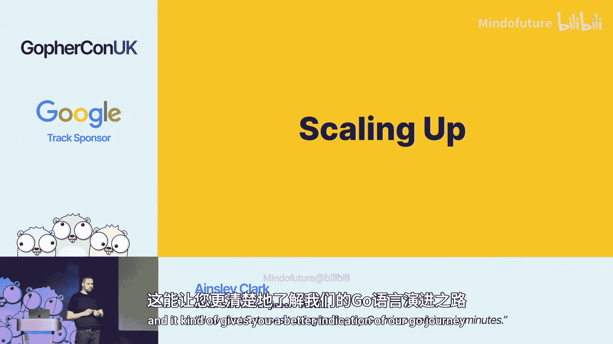

So we started off with a PhP monolith powering most of our platform capabilities。

 but it was slow to ship， you know， legacy code code， difficult to make changes and huge test suites。

 And I think I actually overheard someone saying yesterday that they had a PhP monoth。

 So I think that is kind of a journey that people make to go。 It kept on getting bigger and bigger。

 I feel like I've had nightmares about this blood elephant But there we goes， menacing。

 And as we were trying to integrate with different vendors quickly。

 We extracted our integrations into Typescript。 And they used GPC to interact with this PP monolith。

😊。

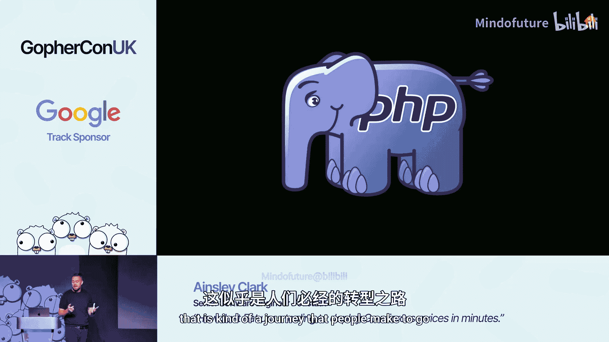

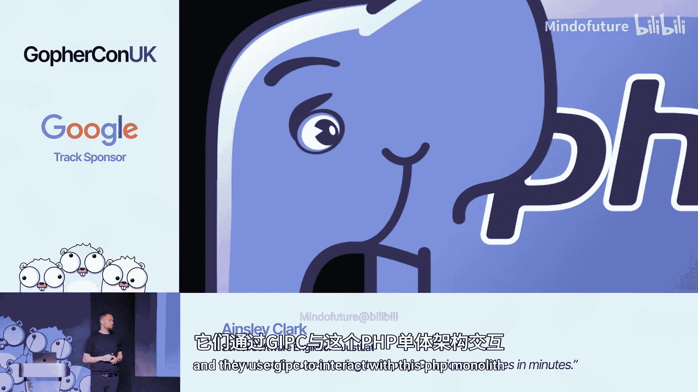

Each Typescript service implemented this R PCC call to make it easier for engineers to implement。

And a team was made to spin up as many of these integrations as possible。

 So what we did is we created a template repo to make it easier when we needed to write something。

 So had E Vvas， helm charts， building deploy workflows， amongst many other things。

engineerers could just fork it and on you go。 And it's really helped up speed up development in our young days。

 You know， fork it off you go， new integration。 We did it over and over again。As such。

 we're able to create pause integrations in days， weeks instead of months。

This was really good for the moment， and it helped us at the beginning。

 but it did have some major problems。

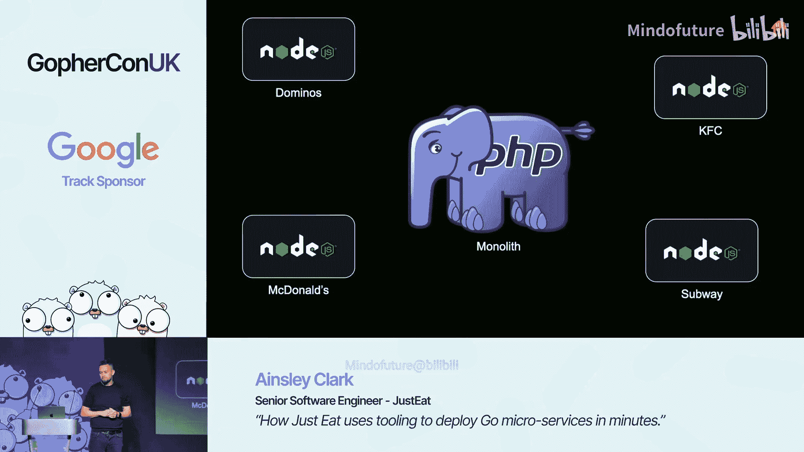

So we started fast， but we came to the realization that maintenance was a burden with this Github template idea。

If we ever founded a bug in the in the template repo we made。

 we had to apply it to all forks of the repo。So if we have to。

 if we had to update 150 services manually when there was a change， it was quite painful to do。

And because we didn't have a set of standards。 And because every reaper had kind of a different way of doing things。

 it was hard for devs to like just jump on an integration straight away and start fixing things or features。

 etca。We also didn't have any end to N testing bakeed in。

Which didn't really give as much assurance when rolling bits and pieces out。

So we needed a way to easily create and update these services as we're moving this fast。

We wanted something that， you know， distributed whale scales easily。

 and we mainly using Typescript just to sort of wrangle into the wrangle Jasonson into the various formats that the pause understands。

But we wanted something stricter and easier for cloud environments。

 And we all know Go is really good in those areas。 So we made the leap， and we switched。😊。

But we needed to come up with a plan and some prerequisites to keep up with these constant changes。

 So we wanted to build a tool that would help us with all all of this stuff。

What did we want out of this tool， We wanted to generate and update a repo within seconds。

We wanted to define HTP APIs and with industry standard documentation markup and make it part of the tooling to ensure documentation is first class。

 part of the process。Want to subscribe to as little events as possible。

 Just white run handler and off you go。We wanted all we wanted， excuse me。

 all infrastructure details as possible away from the engineers such as D B。

 event bus and object storage。We wanted all C ICD flows automatically generated so that rolling out updates was easy。

 No more helm wrangling or having to do these massive updates again。

And we wanted all changes safely deployed to production when merged into Maine。

And capability testing was a large part of this， which I'll get onto later。

We wanted devs to easily run these services in in a developed environment with minimal setup。

And we wanted the same thing。 We wanted consistent ways of doing the same stuff， abstracted away。

 such as creating a logoger。 You don't want 150 ways of creating a logoger。 You want one。

So we built Gokit， and Goki is our microservice development toolkit， which aids with this servicing。

 provisioning of events and much， much more。A collea pointed out to me maybe a couple of months ago that there's actually a go kit on Gitthub。

 It's not that。 We just kind of took a bit of inspiration from the name， but it is not that。

So I'm going to show you some of the features of Goki。

 and we're going to create a very simple pizza service。 It's not live。

 I don't have the guts do it life， but hey。

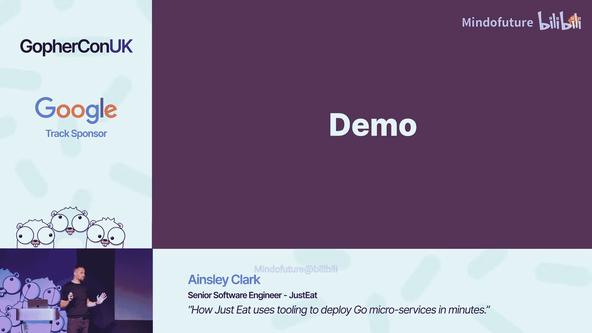

。This is a really detailed architecture diagram。 This is sort of stuff I do at work。 But no。

 we're building just like before， we want to integrate a partner in this case。 So in this case。

 is Bob's pizzas。So we're going to build a pizza service。

 and here's kind of the general flow of what we're going to build。😊。

The event bus or upstream are going to emit a new event onto the event bus called Pizza ordered。

 Pizza ordered is going to attain the con type for pizza， customer details， et cetera， etca。

The pizza service， we're going to tell Bob about his order。

 he's going to start cooking it via HTP post。Bob says all Bob says all good 200， okay。

And then we're going to emit a peak exceeded event back onto the event bus so the upstream can reconcile it and maybe even notify the user。

But as I said， we're going to be focusing on that pizza of service today。How do we do this。

 So let's start with Goki you， followed by the name of the service。

 And that's going to scaffold loads of files for us。

And we're kind of first presented with this selection。 It's going to ask us。

 what do we want this service to do well。We want to consume events。

 We want it to consume that pizza ordered event。 We want it to produce events。

 We want to produce that pizza succeeded event。And we also need a HtTP client so that we can tell Bob about his pieces。

This then makes the files， it bootsraps the files Boraps the service instantaneously。 And as I said。

 we can， we can also select HP server database of object storage。 but more than that later。

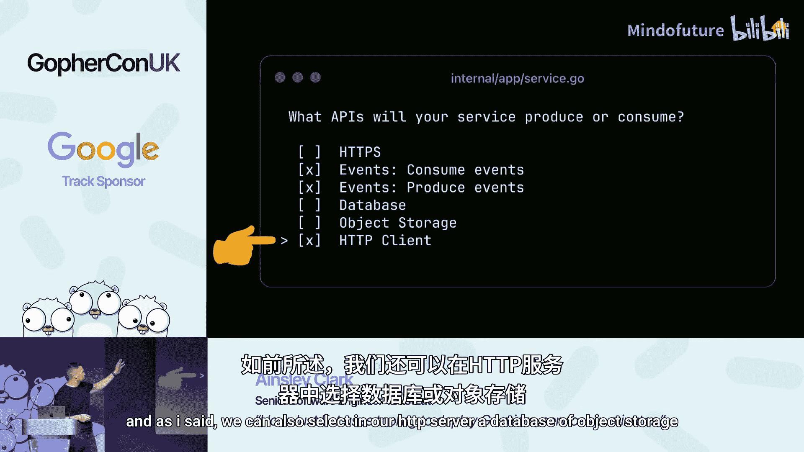

So this is the folder structure itself， a bit of a lightweight version that it's produced。

 and having like a consistent folder structure is really powerful。 I feel。

 engineers know exactly where to go when on the hunt for code。

 If you've got a bug and you have to look in up like 1020 services And they've all got different file structures。

 and they've got all different。 It's very difficult。 I find it difficult。 But yeah。

 this is the most important stuff that is produced。 I guess So we've got CM CMD app， main dot go。

 main dot go is actually automatically generated for us。

But it calls a function in internal called run service with all of its depend dependencies passed in。

 That's where all of our custom code goes。 really。 We don't really modify anything outside of internal。

And it also creates a special file called service。 Jason。😊。

Service dot Jason is pretty much inf as code。 It kind of just tells terraform。

 how does this service run in the cloud。

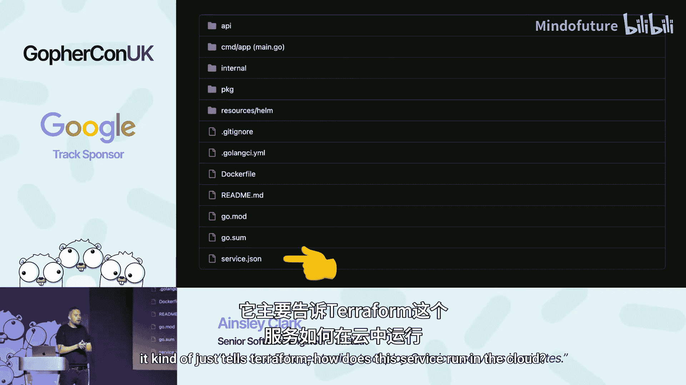

So as I said， let's get on juicy bit some coday。 So in internal appserv dot co， as I said。

 we've got this function。We asked for three dependencies， and it's given us three dependencies。

 We've got our H T TP client。 We've got a universal one so that we can send Bob his pizza。

 We've got our consumer， our event bus consumer。 and then we've got our event bus producer as well。

So let's create a handler， an event handler that's going consume that pizza ordered event。

 And this is what a typical event handler looks like adjusty。 So as I said。

 we've got that HCCP client。We've got the event bus producer that we're gonna to pass in。

And then we've got the event， which is type any or interface。

 And we cast it to the correct type there。We don't actually do any type checking on these sort of stuff because Go Ki does some magic when we call it。

 and you'll see that in a sec。😊，We then tell Bob about his order so you can get cracking with that pepperoni。

And then we emit a Pe succeeded event。 So quite simple， is's not too complicated。

Let's go back to our our service dot go file now。 And' it's time to bootstrap it。

 So let's create a new handle。 Let's just call the thing that we just made。

 We're going pass in our client and producer。And then we're going to call a special function or a special method consumer dot on and then pass a reference to that pizza order type。

 So the pizza ordered is what it's consuming。 And we're telling the consumer， hey， for this handler。

 you want to be consuming this event type， which is why we didn't need any type type assertions or anything like that。

And using A S T and reflection， we're able to sort of traverse these handlers and see what event belongs to what consumer。

 And that really produces some interesting artifacts。😊，And finally， we pass in our handler there。

 So that's it。We run Gokit update。 That's going to do some magic in the repo and modify some of the files within the repo。

😊，And now you can see in that service dot Jason Fler was talking about by running Goca update。

 It's added that consumes topics key at the top there。

 And this is a signal to terraform to provision pods on the configuration that's passed it。

So you can see that go name just eat dot pizza ordered。 That's passed in。 That's passed in。

 or we got it from that consumer dot on call。We're able to configure minimum replica accounts of this event。

 So if Bob gets starting and get loads of piecess， we can increase the minimum count here。

 We do have lots of good auto scaling as well。 But nevertheless， minimum stuff is there。😊，Similarly。

 we can vertically scale and increase CPU and memory by literally two lines of code。

 so small medium extra large large， etc cetera， via our pod resource is key。

 So an object that's small but powerful， I feel。

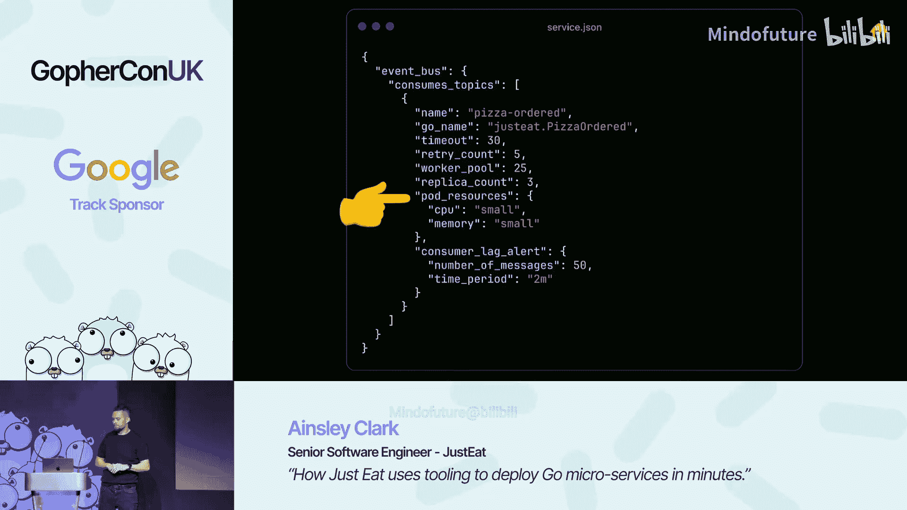

And because Goki is picked up on that go name， we're able to output some really useful documentation。

😊，It shows this is the readme， by the way。 if I was to come in here and see exactly。

 I know exactly what it does。 I know what it produces。 I know what it consumes。

 So it kind of just shows the engineer， okay， I know what I'm doing here。 So it's a bit。

 it's very good to output this stuff。 and we do it all by cogenn。😊。

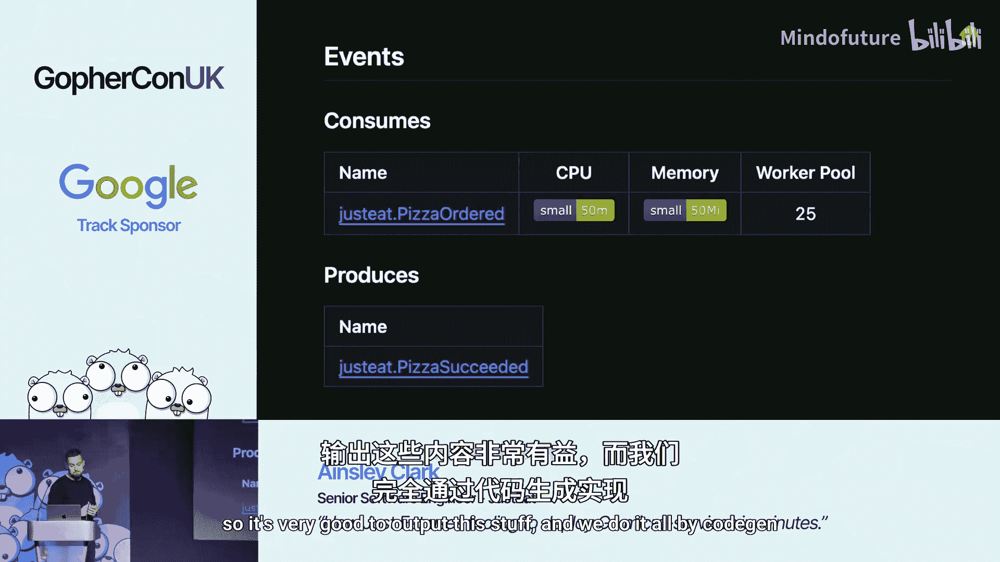

I hope that wasn't too much， but we've made a service in literally less than 50 lines of code。

 So yeah， quite powerful。 Let's， let's carry on。Let's deploy it。

 And I'm going show you some of the added benefits that Go kit provides。

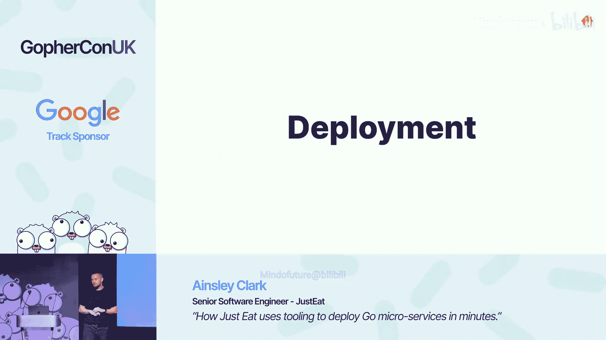

We'll make a PR for our new service， and our doc Github templates are already there。

 Thanks to the scaffolding that Gokit provides。And if we need to change this， for example。

 this template， we just need to do it in one place and then go， update。

 and then everything else is all automatically updated。

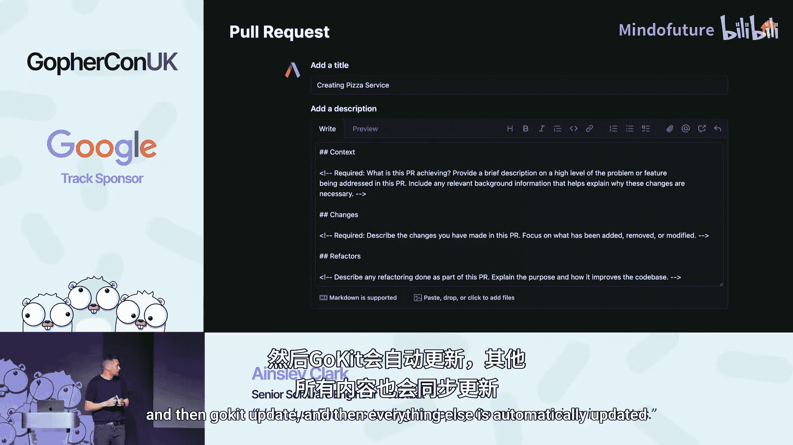

Another fantastic C ICD process is capability testing。 Now， when Kevin was here this morning。

 I noticed that he was doing something very similar to ours， which is really cool， so。😊，You know。

 I could do a whole talk on capability testing。 but the idea is that we're spinning up all of our services using Gokit and Docker。

 And this makes it easier to intercept the requests across the whole stack。

So we basically fire an event at the very start of our capability。

 and then we assert the results at the end。And Goka adds a nonce to these requests and events。

 which enables us to do this。This is， this is really trivial for two services or our pizza service because we've got。

 you can see we've got three services。 But all of our capabilities， you know， menu pushes。

 ordering stock。 They have 10 to 15 to 20 services in between them。

 So it's a lot easier doing it like this。 And it gives us great confidence when rolling out new features to know that we haven't buged anything up。

 So it's very powerful。😊，And we can only do this because of GoK。😊。

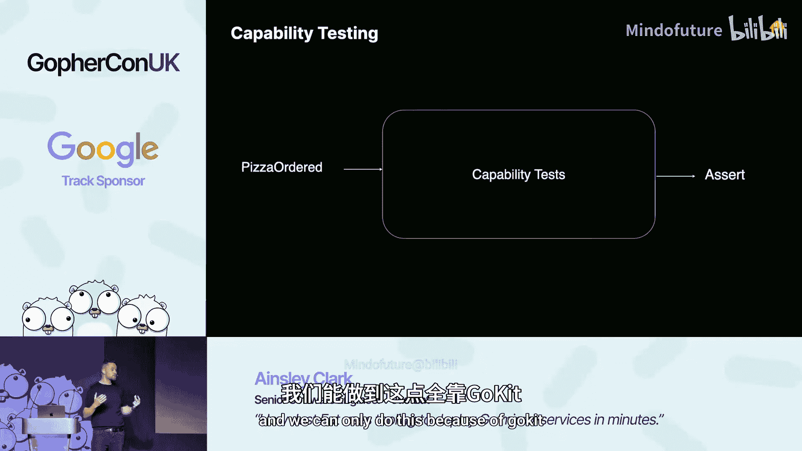

We also have drift detection。 So some of our stuff， as you've seen， is automatically generated。

 but we also have some protection。 So if we go and edit our service dot Jasonson file and we don't run Gokit update。

 C I is going pick up on up on it and tell us off。 So it kind of catches people trying to edit generated files。

So you can see here I passed in a just the dot My event to the consumer。

 I haven't run Go gett update and then C I is saying this isn't a topic in service dot go。

 What's it doing here， So I can't merge。 So there's never any drift between what's actually in prod and what's locally。

 So it's it it makes it easier。I'll get a Hub action templates as well。

 makes it deploying really easily。Again， if we need to update this。

 we just do it in one place and then one gocat update。

And something that I want to point out here is that you can't actually merge into Maine if there's a new version of Goki and your service is on the old one and。

When it's Thursday evening and you want to get a PR out quickly or something like that。

 It's quite annoying。 But in the long run， you're getting naturally occurring S R because it's just an added benefit。

😊，Without doing anything， we've got fantastic metrics and Grfana dashboards outside of the usual prom stuff。

 And Goka is provided with some really useful metrics that we produce， consume and things like that。

 So you can see the event rates here for the Pe succeeded event。

 And then we've got the the ordered ones， the just pizza ordered event rates there as well。😊。

And even though that's kind of some panels from our generic like events。

 I'm really just skimming the surface of what we can actually do here。

So all we've done is run go kit you。😡，We've created one handler。We've attached it to a consumer。

And we've deployed a service with metrics， workflows， and much， much more。It's a pretty good right。

 it's quite quick to do。😊，Let's dig a little bit deeper。

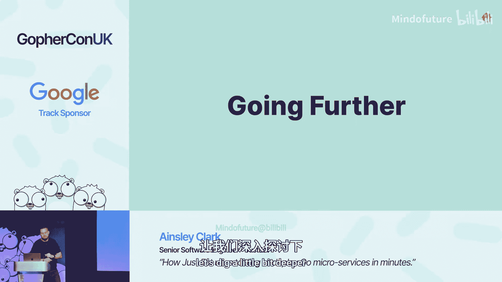

Let's say that someone from product knocks on your door。 and he says， hey。

 and he says that we need some analytics and more details on Bob's pizza。

He says that we need to have a reference to the order before we tell Bob。

And we need average basket totals in a database for analytics。

So let's create a dynamo DB table for those basket totals。

 and let's create an S3 store to store the order before we send it to Bob。

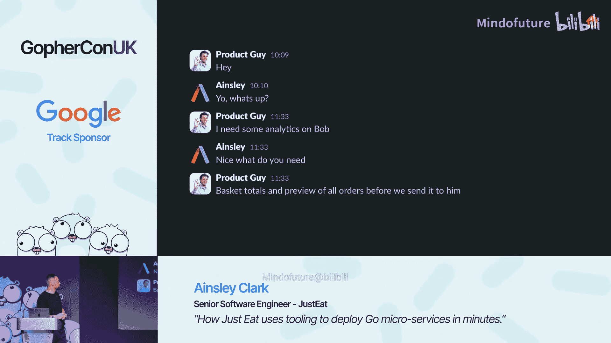

So back to our lovely detailed architecture diagram here。

 we need to add a dynamo DB table so we can store the order analytics and then query them by order ID。

Then we need to add an S 3 bucket to store that order payload before sending them over to Bob。

How do we do this？Let's go back to our service。 Jason file。And we need to add some data into that。

 that resource is key。 That's going to allow us to have stores and databases。 So the first one。

 we're gonna to add a database object。We add a name， we add a description。

 and we can also add some other bits and pieces like indexes that's going to persist to the D B。

And we also add object under object store so that we can have a bucket。

 And we give that name and description， as well。Let's run Goca update。

 and that's going modify main dot go。 It's going to modify run service with all of those dependencies。

 And we also have some other duty metrics and other bits。

 And behind the scenes is going to provision these resources by adding terraform templates。

 So we don't usually see it。 We just see service dot Jason。 and that's it。 So quite easy for us。

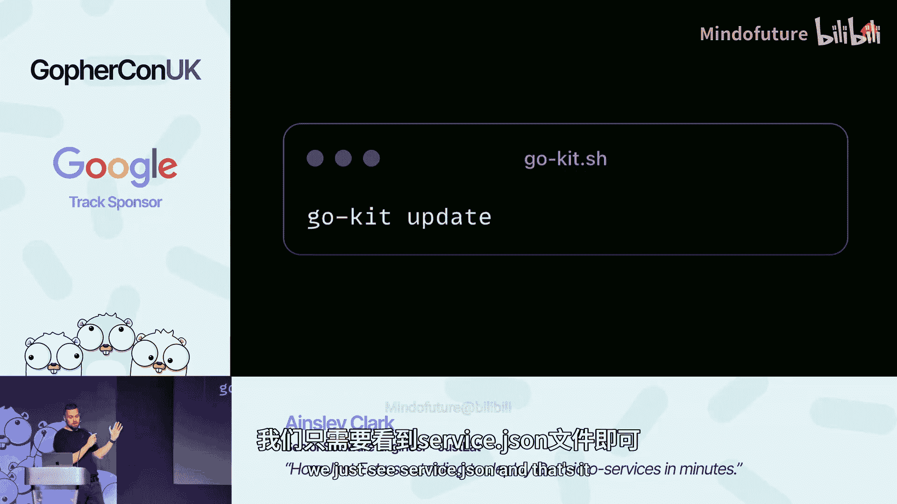

After we run it， you can see that Readme has updated and we've got some more docs。

Including descriptions。 And Dev's a lazy right。 We。

 we don't want to be writing loads of documentation。 So it's perfect for us。 And as I said。

 any engineer looking at this readme file knows exactly what it does。 So yeah。😊。

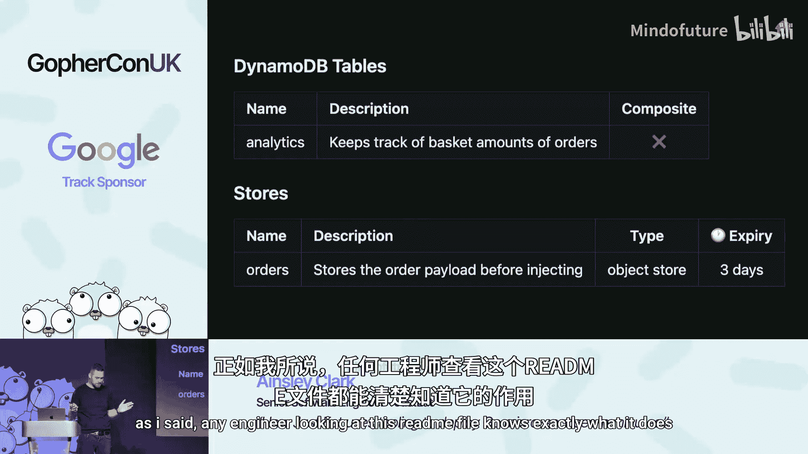

Let's go back to our service dotgo file。 and Gokit has updated a few things here。

 So the first thing it's added is a database。 and that's a type read writer。

This is an interface storeded within the Goka library。

 So when I was talking about abstracting those patterns。

 this is going to be one of those methods that we do。

The object store is also passed in where we can download and upload files to the bucket。

And then we just pass them into our pizza handle。Everything that's passed into run service is usually an interface that covers that encourages a really eat a lot of easy testing with great dependency injection because it's easily testable。

 right， And as I said， this is a great example of some really reusable code that we have in the Gokit library。

😊，Not saying that we would， but if we did want to switch over to Postg， maybe dynamos too expensive。

 We could do it in one place。 We'd update the implementations from these me， Read and write。

 and then everything else would just work。 So we got that extracted away。

 which is easy to hot swap components。Looking back at the handlelet that we just wrote。

 let's pass in our database。And our store into the pizza handler。

And then we're going to write our analytics to the database after we've told Bob about his pizza。

And then we're going to upload our our order to S 3。We can test our changes by running Gokit runung。

 and that will spin up Dynamo D B admin and minii I O。

So that we can pipe the event and check if our capability is working。

 And that's going to give us a lot of reassurance before making that PR。

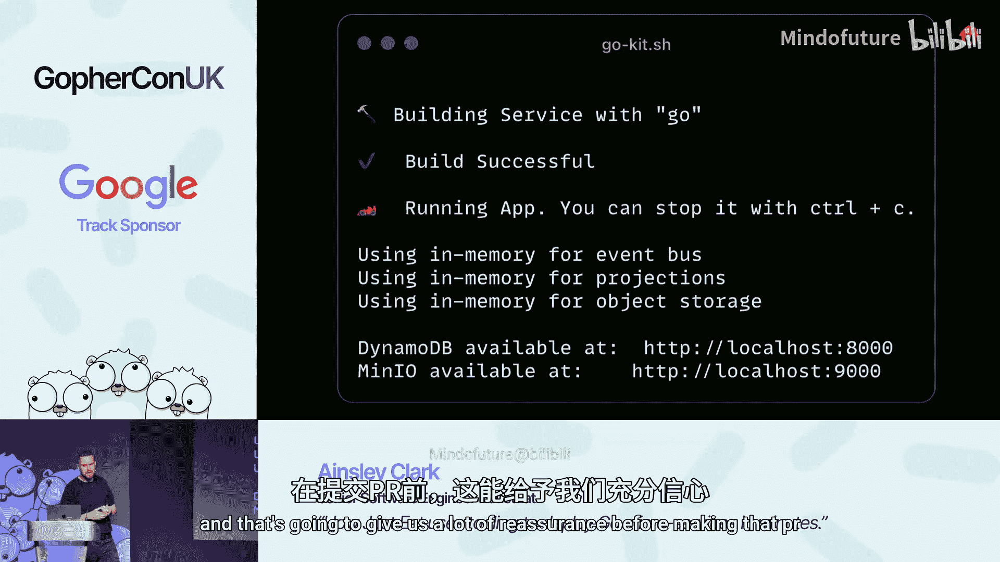

So let's go ahead and create a PR and deploy it。 and let's see what is done to our metrics。

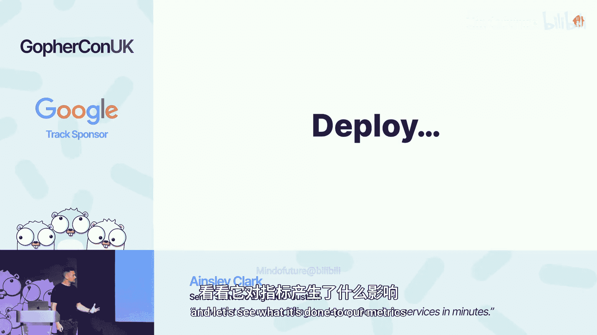

So you can see how our graphana balls have just kind of updated automatically。

 you can see our dynamo DB analytics with readrs， latency and other metrics。

 You can also see our S3 stuff here， the display with ops per bucket， latency and errors as well。😊。

It's not too bad， right。 So someone's asked us to add us some functionality。

 and we haven't really thought about the underlying infrastructure。

 We've added a couple of Jason keys and installed them。 And like I said。

 I know this example is trivial， but it does really come to life when we're doing working on these hard problems。

 We don't have to focus on infrastructure。Prota guy comes knocking back。

 I'm sure this is sounding familiar to a lot of you。But essentially。

 Justie wants to notify the user when the order is ready so that the user can get a nice kind of your pizzas on its way notification。

So Bob essentially needs to tell us when he's cooked the pizza。

He's going to do that by sending an order IT to a post endpoint that we define。So essentially。

 we're creating a HtTP server now with an endpoint。

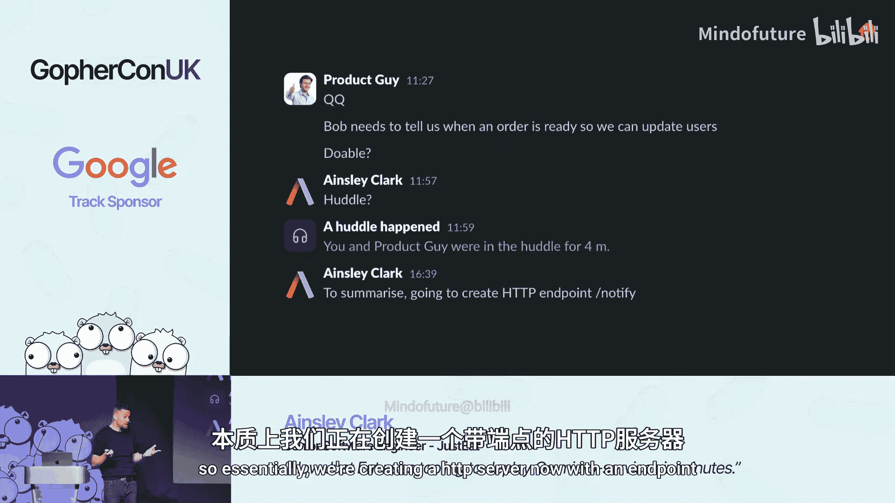

Again， back to our lovely arch diagram， Bob's going to tell us when he's that cook that delicious pizza。

 So he's going to send us a post request to an endpoint that we define in our pizza service。

 That's going to contain the order I D。😊，And then we're going tell upstream about the pizza。

 And that's going to be so the user can see it on their app。

 And we're going do that by meetingt a new order ready event。😊。

Let's edit our service dot Json  file to enable that H TP server。

 So we're going add a H GPS object here。 That's going to signify to go kit that we need an echo server。

 practically。😊，We can also set how long we expect our handlers to time out。And as usual。

 we can define how much CPU and memory we expect this service to use。Most of you familiar with this。

 but Justee uses open API files to define APIs。 So let's create an endpoint so that Bob can tell us when that piece is ready。

We define an order notified path。We pass in the order I。

And let's return to 200 when everything's all right。We run Gokat update again。

 That's going to generate some of the files via the open API file。

 And you you're probably familiar with this scaffolding。 If you've used go with Open API before。

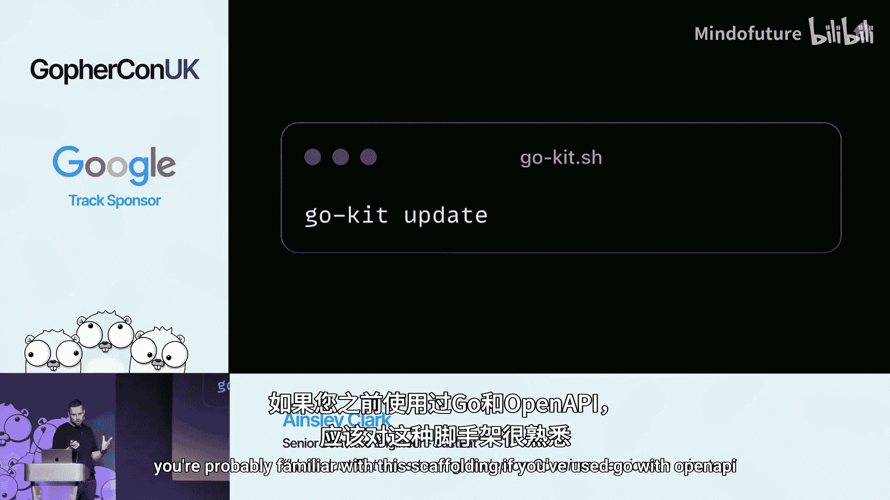

So we've got some new files under HtTP service package here。The first file endpoints。

go has created a HCCCtP handle structure for us。Server。gen。go。

 you'll see next is the HCCTP server interface definition generated by open API。

And types dot Gen dotgo defines all of our requests andresponsibilities。

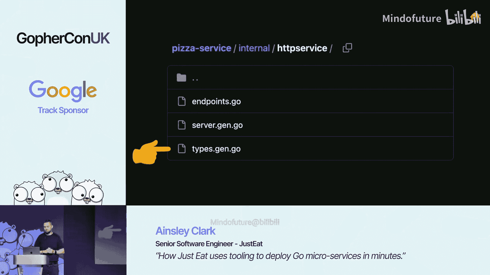

So it's created a server interface that we need to implement。

 So we need to create a type that implements that order ready function so we can tell upstream。

So this is what kind of event handler looks like。 normal H TP handler。

 Let's go ahead and implement that function。 So we create a shared logger at the top。

 which contains trace Ids and request Is， making it really easy for debugging。Again。

 this is another bit of library code that we had that makes it easier for us to do the same thing over and over again。

We then bind our request body so we can get that order Id and then finally。

 we emit our justy dot order ready event alongside the order I。Back to our service dot file。

 So let's account for that new HCCP server。 You can see it's automatically passed in an echo server there。

And then we register our HtP handlers by passing in， excuse me。

 by passing in a type that implements that server interface。 In this case， it's the HtP handle type。

And finally， we part in the event bus producer。

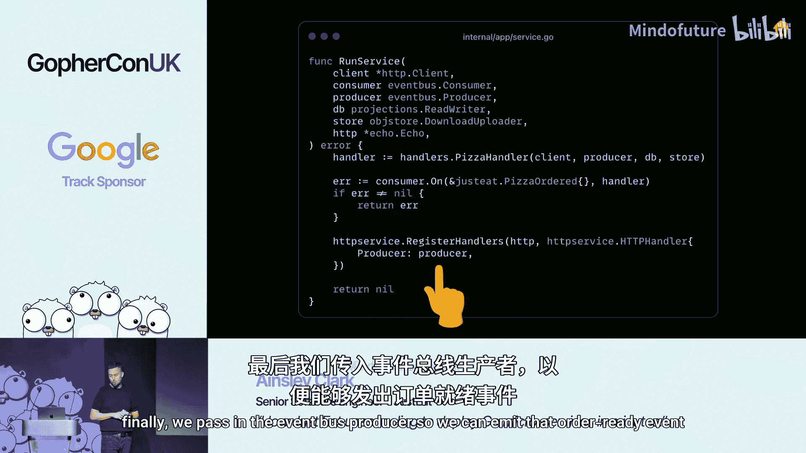

So we can emit that order ready event。Let's deploy it again。 And as you can see。

 we've got some really nice H T TP metrics out of the box。 We've got response codes per request。

 and we've got average response time as well。 So you can see by just just spending a little bit of time on these templates。

 you can get some really powerful boards without doing anything。😊。

So we've just implemented that feature for product I again， less less than 50 lines of code。

 So products is happy and you're happy as well。 So nice。😊，After creating Goka， how has it helped us。

 it's really easy just to forget how much this is done to form Golang engineering and Just with the six years that Goka has been alive。

Goca has helped us to update our entire estate with1 PR。 As Goca is a centralized repo。

 It contains1 PR to change something。 So fix once， fix everywhere。

These changes get naturally merged in to Maine over over time。

 as engineers have to run GoOKt update in order to merge to Maine。

We create industry standard of first class documentation without any intervention。

 We don't usually write a lot of documentation， but the stuff that we do is very product centric。

 It's very how does this work and this sort of thing。

 It's not very technical because the technical stuff is taken care of by Goki。

Engineers can focus on business problems， not deployment。

 and this is great in and of itself because it takes a lot of time setting up dynamo。

 setting up pestry， all of that stuff， that terraform stuff。 It takes time。

 We didn't have to do that。 We focused on the business problems during our demo。😊。

It's helped us to implement。Really easy C ICD updates easily。 Jet Connect。

 we migrated from normal Github to Gitthub Ben Surprise recently， maybe six months ago。

 And there was a lot of metadata that we needed to update。 And we just did it an update in Go kit。

 And the some engineers were oblivious to it because it didn't apart from the URL change。

 So nice and easy。😊，I think this is one of the best ones。 But yeah， it's helped us with。

Folder structure。 This saves having the same folder structure save us hours digging around in reos to try and find the right file。

It makes it easy for engineers to do like big context switches on services。

 which I think is really powerful。And we also have some really extremely robust end to end testing。

 And I feel like this is well not after Kevin's call。

 but I do feel like this is a unique paradigm for just is that we're doing these capability testing that we're not going to cause any production incidents because we've got this large capability testing suite。

😊，But most importantly， its hate， has helped us to scale to hundreds of millions orders a month。

That's a wrap。 So， guys， thank you very much for everyone。 I really appreciate that。

 I hope you found it insightful on how just users go。😊，If you want to get in touch。

 please feel free to scan a Q。 I'm happy to have a beer afterwards。

 and I'm really looking forward to hearing your questions。😊，All right， hands up for questions。

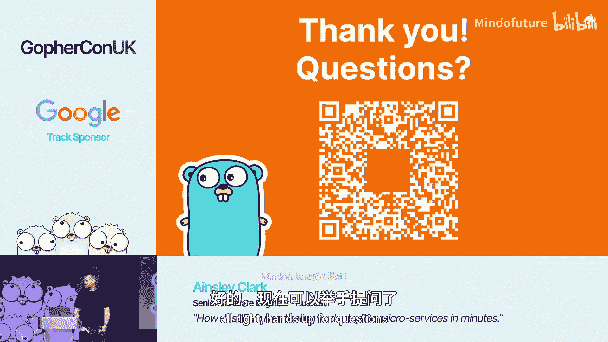

Hi， great talk， thanks。😊，Does go kick。Essentially produce like。

 are all your services the same or do do you modify the output that Goki creates in order to sort of and do you customize that or basically do are your services like pretty much。

The same across the board。 So every every service will have exactly the same folder structure。

 It would be very unusual if we went into a go kit service and there would be a file missing or a folder missing。

Everything that we write， as I said， is in that internal。

 So anything that's custom usually goes in internal。 And because engineers we were on the same page。

 mostly we have kind of a way of defining like stores。 it's very DD。

 So if we had like a stock capability， for example。

 we would have a stock package where we would have a dynamo DB S3， everything within that package。

 So yeah， everything is is pretty much the same。 The only fluctuation is in that internal folder。

 But even that we we're usually quite good at keeping things tight。😊，Excellent， thanks， nice。

 thank you。Hello， thank you。 I could really relate to the fact that you replied to product guy within one minute and then had to had to wait another 25 minutes to actually explain what you good service。

 Yeah， do you find that there's any kind of commonalities between your different restaurants？

 It seems like you have a lot of services， But are there kind of different point of sales systems that you have to integrate with。

 or are there lots of kind of similar operations that you perhaps would have considered creating more of a kind of broad service for。

😊，That's a really good question。 So we。We have like a concept called UTF。

 It was called universalversal to F。 So that was our when we were called F。

 it was kind of our de facto API where we could send orders to partners and they could send as menus。

So if a partner wants to be on board to the that we say UTF flow， then they will go through that。If。

 however， they wanted something a little bit more bespoke。

 a little bit more something or they're not able to do that。

 perhaps they have like a CSV integration or something like that。We would。As I said。

 we would spin up。Bespoke integration。 And then we would。We have。

 we have like events that are pretty much all the same。 So we can start off like。

We start off with some sort of shape of data， and then we sell send it upstream to just eat or take away things like that。

So yeah， it really depends if the partner is able to conform to those standards， our UTF API。

 or if it's something that we do to make it a little bit more bespoke。

But yeah it really depends this。 There's a lot of fluctuation in what partners want to send us and how to send us and things like that。

 It's surprising how many partners are like on a CSV integration， but yeah。

 I hope that answered your question Thank you。😊，好。Oh， hi， I have a related question。

 How do you consider the trade offs between obviously creating a service and context switching between different services has a cost with it？

 so， so how do you consider whether to create a new service or extend an existing service。

 What are the sort of major considerations there， Can you repeat that sorry。

 what what considerations you take in mind when you think about whether a new feature should。

Be part of a new service or should extend an existing service。 Oh that's a great question， yeah。

Usually a lot of arguments over Google Meets， and I'm shake。I think we。

 we don't want to put a round head round pe in a square hole。So we， we kind of。

 we think about whether or not。Is something a really， is this feature that I'm trying to implement。

 implement something really unique。Is it something that we can add to an existing service。

I feel like。I feel like if you're extending a service or adding 2， three packages。

 then that's when we kind of look to it and go， you know what， let's be less， you know。

 try and move to a new service。We're actually kind of I was talking to a colleague earlier。

 and we're actually kind of shifting away from having many services defined in in multiple reos。

 but actually having。Many one service doing different things because it's kind of the same thing。

 Youre just because they did different pods。It's just thinking about one service as opposed to many in the same repo。

 But yeah， usually I don't want to say it depends， but it usually does depend on what we're trying to achieve。

Thanks， generous。Hi， hi， Angel， it's David from the holidays。

 I highlight So we have a somewhat similar domain problem in terms of holidays。

 like we integrate with loads of third party suppliers。

 And one of the constant problems we have is that we have an existing domain model。

 but not necessarily every supplier meets that domain model。 And I guess how do you manage。😊。

You wanted to integrate with like kabs or something rather than just pizzas。

 And how do you handle new schemas that match your event scheme， How do you handle what's everybody。

How do you add new events or event types？ I guess you've created your own standard。

 So what committee decides on that standard。I'm glad you asked that， actually。

 because it's something that I didn't， didn't touch on and feel like I should have done。 But yeah。

 we have one repo called events。😊，And it's just many， many profiles。

 So that is like the gold standard that we have。 And we have like a committee approving those events so。

Those， we basically just。Generate go code off of that， of those events。But yeah。

 that's that just eat like pizza ordered that pizzacc event。

 All of that stuff would have come from the Even repo， as I said， which is just proto。

And because we used to use。Because we used to use Typescript and GRPC。

 It was very easy transferring over。 But yeah， I hope that answered your question。

The thing that I found interesting was that you have GoK and let's say you make a change to the main template。

 what forces that change across all the different 150 services that use it。

 or does it require somebody to then touch it to then update？

I think I can show you said I didn't want to do live demos， but no， maybe not。呃。

Can I put that on there。Okay， so this is。This is。没什么方。那个。

This is kind of just something I spun up for for here。 So you've got that service dot Jason。

 and it will have。Somewhere， it will have， here we go。 dev version。So when we make a PR。

 it will go and download the latest version of Goki， check the version。

 And if this the one in the one recently， if this was a4， but we were on a6， we would say， no。

 you can't merge。嗯。到。So I guess my question is， let's say that I've found a breaking change in GoKt and I've created a new version but I need all my services to use it。

 does it require a developer to touch each service so it's not quite one PR event。

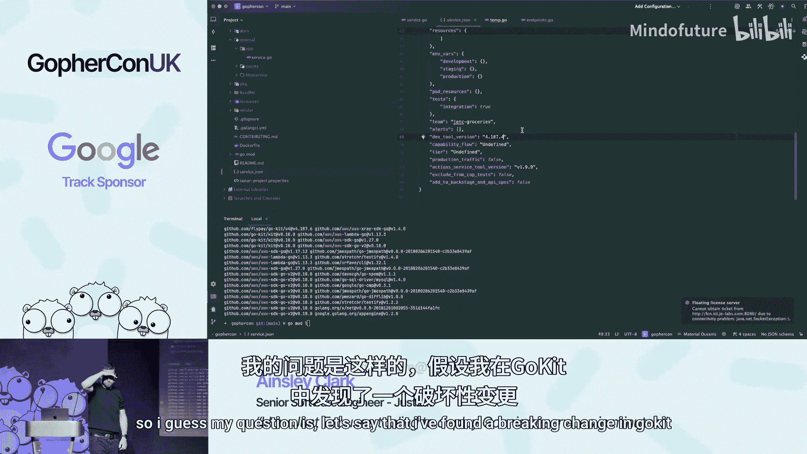

No， it's not we。If I think if it was， I think because it's incremental。

 there if there was a massive break in GoKt， because we do a lot of tests when we merge into Maine from GoKt。

 we have like a playground where we can just check if it's okay。

 But I think if if we were starting to update 100 services from a bug in Go kitt。

 then it would have been spotted before。 but it's a good question。

 We do have some sort of C ICD paradigm whereby。If we make a change to go kit it would update this thing we have called mono repo。

 and mono repo is just one folder with all of the services in it。

 And that's what we use for capability testing。 We just use this mono repo and just spin all of them up。

 It's a CPU hoggger， but it works。😊，Somehow， yeah。Thanks for your。 Thanks for。 I think David。

Next question。Anyone else？Sorry， David。I work with you。But Im but I'm not a plant。

 I promise I'm not gonna ask me something really hard now。m gonna ask really annoyed。 Now I won't。

 I was gonna ask， right， So we have this thing and we like work on it loads。😊，If you。

Went to a company。And they were， like。We're a mess， we need to create a all like this。

What would be the feature that you started on first。

 What would you advocate to do first if you were building Gokit for the first time。

 knowing what you know about all the features that you went through today。

 What would you focus on first。That's a great question。 I think I would。

 I think Service Dot Jason has its power。I think rolling out stuff and fid。

 fiddling and tinkering with resources like databases and stuff like that， takes ages。

And I think if to have a consistent way of rolling that stuff out and makes it easier for engineers to not even think about。

 oh， I have to add this database or I need these permissions or I need this。 I am。

I feel like that would be good， but also。As I said before， I think the most。

 the most powerful thing if you're， if you're in microservices or you're in event based or if you even just have loads of repos is just to have the same folder structure。

诶再啊。Amazing。Thanks， Mike。Next question。👏Okay， I think that's us。 Then Another big hand fans O。

 Oh sorry， there was one more question。 Im sorry。Hello， oh， yeah。

 What's go Ki written in And have you ever considered open sourcing it。

Go Kit written in Yeah hows you mean sorry as in which language or is it a big shell script。

 what is it's all the library stuff is go all of the have we considered open sourcing it。

 my colleague Matthew is not here with today， but he's trying to get this open sourced。😊。

But so of it， so much of it is tailored towards the stuff that we do in order for us to make it somewhat universal to other companies and other people。

 we would have to strip a lot of stuff out。 So it would be a lot of work for us。

 But I think it would be really cool to have it open source。

 I think a lot of these tools are very focused on。😊。

You can't have a 1 f sizeal for these sort of stuff。

 It has to be tailored for the problems that the business has and has to be tailored to the stuff that。

You have facing or stuff like that。 But yeah， it's all go。

 There's a lot of terraform templates in there。 There's a lot。

 I can't think of anything else unless you guys can。 It's all， it's all。Yeah。

 it's all a lot of infrastructure stuff that goes over my head。 but yeah。😊，Thanks， not worries。

Next question。Proise you'd be holding your hand up high if you wanted to ask a question， right。Okay。

 big hand Frsley。Thanksice night。

