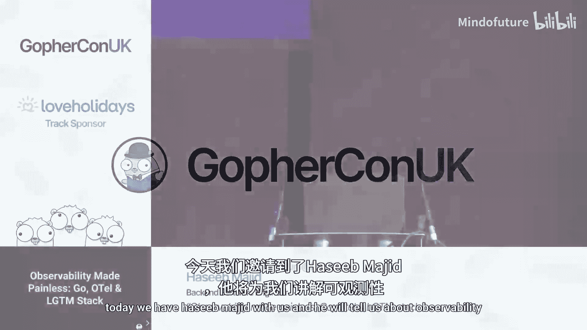
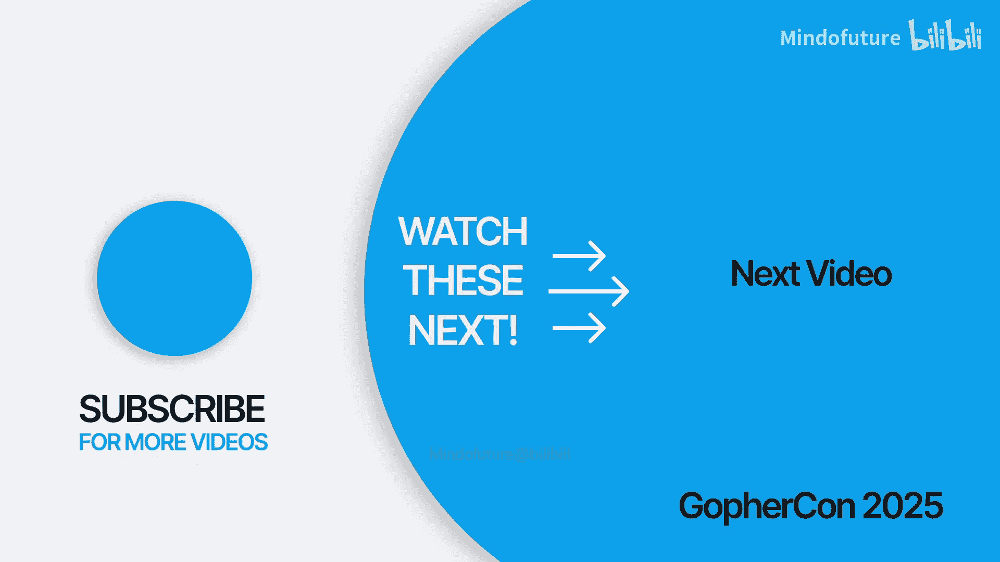

# Gophercon-Uk-2025-p17-P17_可观测性变得轻松——Go、Otel、LGTM_栈--BV1dCHTzQEdN_p17-

Today we have Haib Majid with us， and he will tell us about observability and how to make it painless。

Painless。 So yeah， please welcome Haziib。Hello， everyone。 Welcome to my talk。

 Observability made painless with go oal and that looks good to me stack。 Don't worry。

 if you don't know what most of those words mean， we will cover it。 And hopefully。

 by the end of the talk， a lot of this will make a lot more sense。😊，So a little bit about myself。

 as you heard， my name is seedmarid。 I'm a backend engineer at a Fintech startup called Nala。

 There's a link to my blog， which also house these slides。 I'll have a Q R code at the end。

 So don't worry about going through the slides。 you can go through them in your own time at the end。

 a few fun facts about myself。 I really like cats。 I'm an avid village cricketer。

 My brother told me to put emphasis on the word village。 When I was demoing this talk with him。

 So make that what you will。So who is this talk aimed at Well， of course。

 it's aimed that those people who have perhaps heard about observability。

 but want to know a bit more。 We will cover that。 Maybe you have a application and you。

 you want to improve the observability or see how you can make it more observable。 Hopefully。

 you'll be able to pick up a few things。 It's also aimed that those people who know observability or have some sort of observability stack set up。

 But you want to know more about open telemetry or o。 And how does that faint to things。

 What is that right， And that was this was definitely me like 18 months ago。

 I vaguely knew what open telemetry was。 And hopefully by the end of this talk。

 you will be more familiar with it。😊，We are not going to be covering much Prochl or Prometheus query language or Promeus style metrics。

 We're going go over a little bit， but that could be a talk in its own。

 don't worry if you don't know what Promql is， we will go over that a little bit。

 If you're already an expert in Oal， you might not get a lot out of this talk。 but of course。

 feel free to stay。So let's go over a few definitions。 What's observability。

 It's sort of in the name。 It's basically in terms of we're gonna be talking a lot in terms of H services。

 I feel like a lot of people have written H services。

 but it's basically what's going on with our application。

 and particularly what's going wrong with our application。 If customers， for example， can't log in。

 Is it customer support that's getting in touch with us and letting us know。

 or are we a bit more proactive and we get an alert that there's been an increase in certain types of errors and slacklack and we can try and fix it hopefully before customers notice or with minimal customers noticing。

 And that's where observability is really important。

 It's basically what's going on with our app and more importantly， has something gone wrong。

In terms of this talk， we're going to be covering three main what we call observability signals in the o world。

 You may have seen these refer to as pillars。 essentially the same thing， but in the o world。

 I believe they refer to them as signals。 So really quickly， logs。

 I'm sure most of us are quite familiar with these。 It's like point in time。

 something happened right，805， this happened。 Here's a stack trace。

 right I think most developers are relatively familiar with logs。

 They give us a decent amount of context。 why something happened。

 and you know we add them to our code and we collect and look at them and know Datadog or chrelogs or wherever it may be。

 We have traces。 I find traces developers don't know as well。

 we include go back circuitca 18 months ago。 But traces essentially what they allow us to do is view the lifecycl of a user action。

 Sometimes you may hear people say it's the life cycle of a request。

 I think that can be a bit misleading because when people say request。 people will think HP request。

 which is not it's not like a one to one mapping， but。For example。

 if the user presses an order button on your website， what's happening and we will talk about that。

 they kind of give us this holistic view of the system， right。

 And because they contain a lot of context， a lot of data typically will be sampling our traces。

 because otherwise， our storage costs can skyrocket。 And then finally， we have metrics。

 which are there for aggregating numerical data， generally don't have a lot of context。

 And if for those of you are wondering what I mean by context， I will cover that。 But essentially。

 we just mean like extra information。 metricss on their own， don't give you loads of information。

 They're great like kind of analyzing trends。 And we'll kind cover all three of these in some level of detail。

 particularly focusing on tracing in this talk。😊，Hopefully。

 we'll be able to build something a bit more useful than this。

 But I suppose some observability is better than no observability。

 So they do say London has the most CCTV cameras of I think， per wherever that per square meter。

 So again， make it that all you will。😊，For those of you who might be still confused， let's pivot。

 imagine we own a pizza shop。Right， a log message from a pizza shop or our pizza shop service ordering service might be order 1。

2，3， largege veggie pizza burn at 8，0，5 due to oven failure。 So we've got timest there。

 We've got some extra information about the order I D。 We've got what kind of order it was。

 and why it failed， right So we' got a decent out of context。 A trace might look like order 1，2，3。

 took 30 minutes in total 5 minutes to prepare20 minutes to cook5 minutes to deliver。

 and we could attach some extra context there。 We could attach who ordered it。

 and we could attach what kind of pizza we were cooking as well。😊，But generally speaking。

 that's what trace is。And then for metrics， it's gonna be something like we sold 50 pizzas an hour。

 The average time was 8 minutes。 And again， we could potentially split this by the type of pizza we were cooking and we could drill down a little bit more。

 But there's not loads of context there。 And， of course。

 keeping our pizza shop service is really important because I'm sure we can all appreciate pizza makes the world go around。

 It's the reason some people turn up to some of those meetups。😊，Might be guilty of that。

Don't know Ferguson's in the room， but anyways。So some of you might be wondering， great， seeb。

 why does observability matter， Raise your hand if you've woke。

 been woken up at 2 AM because of a production incident and you've had no idea what's going on。Yeah。

 about maybe half the room， maybe quarter quarter of the room。 So we've all been there。

 and we've all experienced when we just don't have enough tools or we don't have enough information to debug what's going on。

 And especially being sleep deprived that makes things worse， right。

 So of that first bullet point there， provide context issues。 So if users can't log in。

 why can't they log in。 I it because block list like gone crazy blocking everything。

 Maybe we're locking users out。 is it because people are just getting their password wrong。

 Maybe it's someone spaming our system to try and log in right。

 It can also be useful for finding bottlenecks in the system。 So Google。

 I think this is quite old statistic。 But over 50% of users will abandon a website if it takes more than three seconds to load or app right So we want to make sure our systems are as snappy as possible and bottlenecks in the system finding them。

 if you're not observing things if you're not collecting data。

 How you know what's gonna be a bottleneck。 Maybe you can guess that service is a bit slow。

 And particularly in this world of microservices。 I think decent amount of us are。

Using microservices and your particular microservice might just be one in five in the flow， right。

 And if yours is taking a second and all the rest are taking a second， all of a sudden。

 that does add up quite quickly。Now， I know ops teams don't really exist per se。

 but imagine replace that with on call。 We want to avoid making the person on call a pain in the asks for them。

 So we want to make sure it's working everywhere。 And if it breaks。

 we want to make it clear why it's broken。So。What's ottle or open telemetry。 Just really quickly。

 for those of you who know about ottle， Do you say， raise your hand if you say ottle。

Raise your hand if you say hotel。 I don't know which way around Okay， so I've。I'm in the majority。

 I think I'll alternate between the two。 I don't think I have a consistent way。

 but I'll probably generally say o all。Sorry， guys。 But yeah， it's， it's open telemetry。

 which is basically this open standard where it came about because data。

 your data should be your own， right， So let me kind of take you back。

 What generally happened is we wanted traces。 And don't worry if you don't know what traces are。

 I will show you what trace looks like in just a second。But we wanted traces。 So what。

 what would we do， We would have like a datadog agent。

 And that datadog agent would then collect some information， send it to datadog。

 and we could view our trace there。 F。 Perhaps if you're with if you're using Kubernetes。

 maybe you're using like a sidecar or something like that， right， And that's fantastic， except。😊。

What happens now if you want to move to Y or Zipkin or another trace provider and you're using microservices。

1 hundred and 500 services。 you have to go update that agent of。

 So that that's where open telemetry came around。 There was a few others。

 I think before that tried to solve this problem。 But open telemetry kind of is the industry standard。

 And essentially， what it is， is your application is now going to generate tracing information。

 And it's just gonna export it somewhere。 And it's going to export it to this thing called the Oal collector。

 which you can think of as kind of this proxy service。

And it kind of decouples our service from worrying about traces or any observability signal。

 All of our stuff is gonna go to this auto collector。 This auto collector can then do transform。

 convert， whatever it needs to do。 If we want to send it to datadog。

 It can convert it to the datadog format。 If we want to send it to。

 It can convert to the format and then send it is' just a couple of lines of config。

 If we want to send it to both， we can also do that。 you know。

 if we're doing a bakeoff or something and we want to see what is the best provider for us。

 So we just we're just managing that all via config now， and it makes things a lot easier。

 And recently quite a while now。 But recently， you can do metrics And quite recently。

 I think logs are now of beta。 So you can actually manage all three traces metrics and logs via auto。

 And you， can make of that instrumentation a lot simpler because we just export everything to the auto collector and that handle。

 sending it wherever we need to go and we can do that via config。😊。

This is a joke before people start telling me， I don't know how probability works。

 I just found this on the Internet。 found it quite funny。

 but I think we've all been there where it just feels like most of our time is not spent writing code。

 It's debugging something。 And it's even worse in production because you can't do break points。

 You can't necessarily use the debugger。 at least not in in a very straightforward way。 So I think。

 you know， making our lives easier is， is really， really important。😊，So hopefully。

 I'm going to be able to play this video here。So this is kind of what we're gonna try and achieve。

 This is part of that looks good to me stack。 We have Grfana here， and we have low key。

 which is our logging database， right， and what we can see is we're getting logs as structured data。

 and we have something called trace I and span I in that in that kind of block。

 So this is all structured and we can kind of search and filled and do various things。

 And we can also correlate between our different signals。

 So now we have gone by trace I and found the trace in tempo， which is our tracing database。

 not a particularly interesting trace。 It's just showing us the 401 error。

 There's some useful information there unauthorized failed etc。

 So and we have a rough time of how long it took That's pretty cool。

 And then we can go back and look at the logs。 and we can look at all the logs for this trace。

 and that could be across multiple microservices。 and that can be really useful。

 I found this feature， particularly useful outside of Grfaana， wherever it may be。

 But that is really cool。 We can then also just search from tempo itself。

 you can just see me mess around a little bit。 I keep forgetting how to use it there we go。

 I find a trace。😊，This trace is a bit more interesting because it has more what we call spans。

 and we will cover spans in just a second。 And we have something called attributes。

 And we can see us even interacting with the database in just a second。😊。

Over here we can see that we ran a query against a database and we have an attribute which actually shows us the query we ran。

 super useful for debugging when something's gone wrong。

 we can hopefully see the query we ran as well and check that that's correct。😊。

We can also now go and look at Prometheus or Prometheus like， we're gonna be using MiA。

 touchuch on that in a second。 but we can look at some requests， some metrics。

 And some we have these special metrics called exemplars。

 which we'll touch on towards the end of this talk。

 And that allows us to correlate a metric with a trace So we can go。 We see a 401 error。

 We can go and look at the trace and see why do we see that 401。 These are just。

 these are not my recommended。 This was just the default YouTube ones。😊，Out， let's come back here。

Sorry。うん、ちょちゅ。There we go。Cool， so let's take a look at what an ordering service might look like for our pizza shop。

 So we've got the website there。 The user presses the order button。

 The order button then goes to our order service， which goes to our user service。

 which then goes to Postgres and Redis and collects some information， goes back to the order service。

 which then save stuff in Postgres， It then goes to the payment gateway， which then goes to Stripe。😊。

Which then finally， we publish event to Kafka， which is consumed by the email service and goes to our S TP server to send an email。

 You can see a out of breath just kind of explaining that flow。 And in some places。

 this is probably quite simple。 We haven't handled retriries。

 We haven't really spoken about other things that could make this more complicated。

 So keeping this in your brain and trying to understand what's going on can be really tricky。😊。

So that's where tracing is really useful because if we could visualize this in a trace。

 that probably makes our life easier。 And especially if you're new to a flow。

 this becomes way easier to visualize。 So this is kind of what I want you to think about when you're like。

 why is tracing or distribute tracing as as it's referred to useful。

So let's take a look at this example service。 This is not production grade code。

 So if you see something slightly wrong。 don't worry about it so much， this is just more the concept。

 We're just gonna have a single HP endpoint here on our server。

 and it's just allowing us to search for a user based on an I D right， And we're just gonna search。

 sorry we're just gonna start a server on 880。 and we're just gonna have a single handler。

 which are just going go to the database， fetch a user return， right， Co。

 Not much observability not much of what's going on。 It's hard to tell， right。

 So we're gonna instrument this as they say this application。 We're gonna add traces。

 logs and metrics to this。😊，Again， don't worry about this so much。 This is more。

 If you want to go through your your own time and follow this。

 We're gonna download a bunch of go modules here， mostly from open telemetry and get started。

We're also going set this environment variable。 This is to do with that auto collector。

 I told you about this basically tells our application where to export our our observability signals。

 So our traces。 And this is where auto collector is gonna be running because it is a local setup。

 The auto collector is just gonna be running in a docker container with set some port forwarding。

 But the application doesn't worry too much。 It just knows it needs to export it there。

 If it can't export。 It will let us know that it fails。 that's always useful。

 But that's just what this environment variable is。

 We're gonna be exporting all of our observability signals to this auto collector。

 And then that can handle doing whatever it needs to do。So then we create a new function。

 We're going to call it new trace provider。 Again， don't worry about following this line by line。

 I just want you to kind of understand this at a high level。We're gonna set up an exporter。

 which is basically gonna just export to that environment variable we just spoke about， right。

 It's gonna use that environment variable and export our traces over there。

Then we're gonna set up a trace provider and it's gonna do some batching。 So occasionally， you know。

 every X seconds it's just gonna export all of our traces。We set that as our global trace provider。

 So whenever we reference tracing now， using O， it's gonna use this one unless we override it。

 which is when we're getting started， definitely what we want。And then finally。

 we have this concept of propagators。 And this is quite important。

Because propagation is the mechanism that moves context between services， right。

 So what's really important here is that we need some way of moving this trace I D。

Between most of our services and how we do that one of the ways is propagation。

 We use this trace context。 And this is particularly concerned in the H TP world。

 And this is going happen via H T P headers。 So if the order service calls a user service。

 then we're gonna pass that via H T P headers， right。

 So we're gonna set some tracing information in those headers and it's gonna to send that over。

 and it's really important that we set this on all of our services。 So when it receives a request。

 it knows， oh， this trace idea already exists。 I'm going to carry on this trace。

 and I'm going create what they call a new span。 And that's really useful。😊。

So we're gonna return that trace provider。 For those of you who are wondering what the trace context looks like。

 It looks something like this。 And we will cover。 We'll break that down in just a second。

And then in our main function， we're gonna accept this new trace provider。

We're gonna check if there's an error and we're just going defer shutting it down so that if there's any traces。

 we can push them before the server shuts down， essentially。

What we're also going do is we're going to use some middleware available to us from O。

 And essentially， what we're doing here is instrumenting all of our endpoints so that they will automatically trace set tracing。

 So either they'll carry on a trace if if we get one or if there was no trace information in the H request。

 it will carry on it will start a new trace and we don't have to write any code to do that。

 or instrument step for us。 And then we just have a few things about how we're gonna name the span。

 We're just going do it via method and URL path just to make it easier to search。

 And then if you see that just to have that round all of our endpoints。 we're just going have that M。

 which is the middleware wrap that mark。It just sorry。

 Just bear with me for a second because I realized we skipped some slides when I was fing around with that YouTube video。

 So I apologize because we were supposed to cover this before。 And I was wondering why we didn't， so。

Spans are units of work for traces。 They're the building blocks of traces。 Basically in our code。

 We're never actually creating a trace。 What we're doing is we're creating a span。

 And if there's a trace Id already available。 So there's some trace context。

 It's gonna carry on that trace。 And that is really important because if we don't pass that trace context along。

 what we're gonna end up is 20 traces with one span each rather than one trace with 20 spans。

 which is quite useful。 Sore essentially what we're doing is we're linking spans with trace Is That's essentially all you need to think about。

 So we're just gonna go over spans really quickly， again， there's not gonna be a pop quiz at the end。

 So don't worry too much but spans have a name start and finish timet。

 which is how we can see how long they took they have a context。

 which well look at just a second and they have an attribute， which are key value pairs。

 One example we already was we had a key of Db query text。

 and then an attribute of the SQL query we actually ran against that。

 So we can just put arbitrary data that we find useful for providing more context in our span attribute。

😊，Its。Then we have a bunch of optional fields， a set events， Op parent span I D。

 for those of you are familiar with the concept of dags or directed acyclic graphs。

 You can kind of hopefully start to understand how you could generate like this kind of directed acycl graph have parents and children。

 and it's kind of easy to see the relationship of what calls what。 So that really helps as well。

 We can also have optional links to other spans and a span status。

 And we will see some of that in just a second。 So we have the span context here。

 And I visualize this as HP headers because that's how I kind of visualize it in my head。

 And that's where it really made sense for me。 So hopefully that makes some sense to you。

 So we got trace state there， which is a list of key value pairs for vendor specific information。

 Remember Oal is diagnostic。 So sometimes vendors need special information。 So we have that。

 But we don't really care about that too much。 The trace parent is the kind of interesting one。

 So split by hyphens。 But if we break that down。 The first bit is version currently is always version0。

0。 Then we have the trace I d Then we have the span Id 60 etc。 So those that's part of that span。😊。

Context， then we have some extra information about trace flags。 A 0，1 just means sample this trace，0。

0 means ignore this trace。 So again， as I said， tracing has a lot of information。 So hopefully。

 that kind of explains this trace context and making sure that trace ideas is consistent and passed along。

 propagate is really， really important。I'm going quickly cover some other concepts that kind of confuse me and hopefully won't catch you out when you get into this world。

 I was like， what's the link， What's a span link。 Well。

 it's basically a way to connect to spans who are related。

 but don't have a direct parent childil relationship。

 And some of us will be using event drivenn systems， and it can be particularly useful there。

 because， you know， you can't predict when somethings gonna to stop consuming because it's gonna happen in its own time。

 It's asynchronous。 So hopefully that makes some sense about links。

 not use very often but useful to know。We also have span events。

 which basically denote a single point in time。 For example， when a page becomes intractable。

 maybe that's a span event。 and there's a bit of confusion when to use attributes versus when to use events。

 You want to use an event when the times stamp is relevant。

 If the times stampamp is is important to that piece of information， use an event， otherwise。

 just defer and use attributes。 Again， just providing a bit more context to your span。 if you。

 if you need that。And kind of the final thing I want to cover is Sps can have types。

 You can either give them a type of client， server， internal producer or consumer。

 The default is always internal。 And then there's a few other rules we follow where the child of a producer is always a consumer and the child of a client is always a server。

 And for those of you are kind of familiar with these concepts。 that roughly makes sense， right。

So if we go back and look at trace。The red blocks are basically ourpansian。 And hopefully。

 you can start to see some of that child parent relationship that we were talking about。

 We can see like how some of these attributes are useful。 Again， this was all running locally。 Hence。

 it looks pretty quick in production。 itll probably be a bit slower。But yeah。

 so we've got some information。 We've got some names。 We've got some timestamps。

 We've got some kinds there， which， which we already saw。 We， we can see this case it errored。

 and we can see the relationship doesn't exist。 And hopefully。

 that gives us enough information to solve our problem。😊，And if we take a look at span a bit closer。

 we can again see the attributes。 You know， we've got the query text and then the actual SQL query ran。

Ignore that SQL career。 is just fetching some subscription info。

 It could probably be a little bit nicer， but hey， ho。Then we've got some events there。

 which I haven't really shown and we've got some other useful pieces of information。

 so hopefully that makes sense。😊，And now I can actually go back to where we should have been。

 So apologies again if， if， if there any confusion。So what is that middleware。

 So we spoke about this middleware that was that would auto instrumentment our application generate traces for us。

 What's that middleware actually doing。 Well， in this case。

 the go context or the request context here， what it's doing is this R dot context we contain our tracing context。

 So we can actually pull tracing out of it。 So it's gonna inject that。

 And what's really important with all of our observability signals is we pass this context around correctly。

 So we want to pass the C T X object that actually has the tra context in it because if it doesn't have it。

 we're just going start new traces and that's not really useful。

 So that middleware is automatically going start a trace or carry on a trace and inject the relevant tracing context into that C T X。

 And when we log when we use metrics， we want to make sure it's that same context。

 So we want to make sure that middleware is kind of the one that runs first。😊。

So we can pull some information like some span information。 There's this thing called baggage。

 which allows you to pass key value pairs as well as a form of propagation。

 That can be kind of useful when you don't want to pollute your HP request with some observability and for right。

 You want to keep that clean。 So you send that as as baggage。

Don't worry again about the code examples。 I will have a service and example service you can take a look at and use and go through in your own time。

 That's actually in production。 So that probably will be a bit more useful。

 We can also start custom spans if we want， Like if there's a critical part of our code and we want to make sure that is tracked。

 We can just start it。 We just give it a name。 So I've just named it after the function here。 again。

 making sure that that context variable that C T X context variable is is quite important。

 that's passed around。 So we start a span like so we can end it when the function ends we can attributes。

 as we said， those are key value pairs if we want， we can even record errors。

 we can record wire error and we can set the status as an error just a database error。😊。

We can set optional attributes。 So if the users are premium。 so you can do all this stuff。

 you can do your own spans。 And hopefully， if the tracing context is passed properly。

 you'll be able to see that in Grfanal or wherever you'll visualize your traces。

And just to kind of summarize this， if we were to kind of take a look at this in adjacent format。

 This is perhaps what it might look like。 We've got the context， trace I D span I D。 In this case。

 the span doesn't have a parent。 We have the start and end time stamp。

 We have some attributes like some H P root stuff， which might be interesting。

 And then we have an event， right。 So and an event can have attributes as well。

So you can also instrument kind some of your infrastructure。

 So it doesn't just have to be your service。 We can also do it with Postgres and other such things。

 So this will be available。 I'm sure you'll be able to do this with any database。

 and you don't have to use PG X。 If you're using PG X with a Postgres。

 you can just use this library like I have。 And it's just one line of code。

 So one line of code where we set up the pool and it will auto instrument our code。

 So whenever we make queries against the database， it will include those spans。And if we take a look。

 we've really kind of seen this span a bit。 But I didn't write any of this code myself to do this。

 It's all just coming from the library。 And you you can even see that the top right。Similarly。

 we can do this with Redis or Valky。 We create our Redis climb。

We instrument that instrument tracing again just one line or two instrumented and out of the box。

 we can start to see traces like so。 you can see the Db statement and you can see some server address and other such useful information you kind of get that free out of the box don't really have to do much。

 So yeah， that's pretty powerful。 One other thing to consider is the H TP client you're using。

 So if the order service calls the user service， we need to make sure headers actually get passed the tracing headers that we saw actually get passed。

 Now， every time we make a request， we could pull that information out of the context and inject it ourselves or we could just set up a client using the auto HtP library to do that for us。

 And so now when we use this client is automatically just gonna take what's in that context。

 and set that as headers。 And when the order service calls a user service。

 it's gonna pass that information along。 and we can do that just like so here we can just again。

 what we want to call the span。 you can sanitize it。

 So if you don't want each unique one for each user， maybe you could replace。With ID， etc cetera。

 et cetera， because of path parameters and such。 And then we can just call that client as as we would。

 And again， that Cx variable， quite important that we pass that around and that has that tracing context in because when we create this new client and we make that request。

 it's automatically gonna be injected into those HtP headers。 hopefully that makes sense。

 And then equally if we were to log that on like the user service side we would be able to see the HtP headers coming through and we would be able to log that Just one thing to note if you are using this client for everything when you call third parties。

 you'll be sending those tracing headers。 So just make sure there's nothing sensitive in there especially if you're using something like baggage where you can set arbitrary key value pairs don't put any sensitive information there。

And the final thing we're really gonna talk about tracing in terms of infrastructure is you can do it with Kafka or event buses。

 So if you've got Fran go。 and this will work， I'm sure for any library is all we're gonna do is we're just gonna set the tracing context or add it as headers to Kafka。

 Very similar。 I actually wrote code to do this myself before I realized there was a chaotto plugin。

 So we're just going to use that。 And we set it up like so。We just set it up as a hook。

And then we can produce and consumer as we normally would。 And if we logged just before we produce。

 we would be able to see that tracing information available。 And then equally on the consuming side。

 if we were to process that record or that event， we would be able to see that on the tracing side as well on the consuming side。

 We would be able to see the trace information。 Hopefully that makes sense。

 And then that basically allows us to visualize the producing and consuming via our spans as well。

 And that can be particularly powerful because I think one of the biggest downsides to event- driven architectures is you do lose some of that observability that you might otherwise have。

And the final thing I want to talk about with regards to tracing is sampling。 As we said。

 there's a lot of information that you collect from traces， as we've already seen。

 sending all of that for every request if you have 100 services。

 that might not be particularly useful。 So you might want to sample some of your traces。

 And there's few to two main methods。 There's head based which is basically you say I want to sample only 5% of my traces。

 So 95% of the time。 we're just gonna throw that trace away。 And that's called head based samplings。

 It's just probabilistic when you generate a trace is just going say， okay there's a 5% chance。

 And we saw that with the headers remember the01， that tells us it wants to be sampled otherwise it doesn't want to be sampled。

 tail based is a bit more interesting， but a bit more complicated with tail based。

 you can for example， when it's going to the auto collector。

 you can set it up that for if if there's any error we want to sample that right。

 maybe for successful requests。 We don't really care so much about sampling。

 We just want to sample a few but for errors we want to sample all of them or specific kind。

Erras we want to sample all of them。 And that's where tailbased is particularly useful。

 But then with tail based， there's a few considerations。

 it needs to be stateful because it needs to keep things in memory。

 So if your service crashes like your auto tool collector restarts， you can lose information。

 So it's just like everything is' trade offs。 right So yeah， that's sampling in a nutshell。

 feel free to go look that up in more detail。 But I just wanted to make you aware。

 It's possibly something you you want to look at。😊，All right， on our next observability signal。

 As I said， we spent a lot of time on tracing just because I know it's quite a new concept to lots of developers。

 I thought it'd be particularly useful， but we're gonna cover metrics kind of briefly。

 So metrics are there for storing numerical data， which don't have a lot of context。

 And we will touch on what we mean by not a lot of context。

 But that makes them really fast query in quite cheap to store。

 and we're gonna store it as time series data。 And by time series。

 just mean we're keeping track of time。 and we're gonna graph it a long time and view the value。

 Most of you using metrics are probably using Prometheus style metrics visualizing them in Grfana in querying them using this language called pror。

 I'm sure that's most of what people are doing these days。 And that's absolutely fine。 In this case。

 what we're gonna do is our application is going generate OtLP or auto style metrics。

 It's going export them to the auto collector。 and that's going handle converting them to Prometheus。

 So we're still going be playing around with Proql。

 but we're actually gonna be generating a slightly different type of metric。😊，So really quickly。

 we have four main types of metrics for those of you who might not be aware。

 We have counters for tracking ever increasing values。 So， for example。

 the total number of requests that's always going to be going up。

 We have gauges for measuring fluing values， So like CPU usage， memory usage， etc cetera， et cetera。

We have histograms for kind of observing the distribution of values， right。This is。

 this can be particularly useful for like looking at latency of certain endpoints， etctera， etc cea。

 Then we have the up down counter for values that go up and down。 things like Q size。

 But with up down counter， we're more measuring the change。 How much did it change。

 Whereas with a gauge。 We don't really care about the previous value。

 where's an up down counter we do。 So that's kind of the the slight difference。

 We have async versions of these， you can go look them up。 Again， there's no pop quiz at the end。

 So don't worry about if you don't remember all of this is just to give you a rough idea of the different kind of metrics we do have。

And then really quickly， how does a metric look like， Well， it has a name。

 It has these things called attributes and attributes are the things that add context to our metric。

 And for example， if we're doing like the total number of requests。

 some attributes that we might want to have might be the root。

 So the H P root or the end point we're calling right because maybe we want to filter at that later on。

 maybe we want to keep track of the response code， because maybe we want to look at all all of our requests that failed。

 when you're kind of creating the attributes as you might know them in Grfana as labels。

 you kind of already thinking about what you want to query。 That's why with metrics。

 we don't provide a lot of context。 We don't provide attributes with loads of values。

 because we kind of have a rough idea what we want to query。

 whereas with traces and logs generally speaking， we don't really know what we want to query。

 So we give a load of information and then we can query that later on as we need。

 so that's where attributes are， they provide a little bit of context but we don't want attributes that provide too much and we'll see why in just a second。

Then obviously， this is time series data。 So we also want to store the timestamp， and then。

 of course， the value that we actually want to keep track of Ie。

 the total number of requests is 1000 now in5 seconds。 It could be 1001， you know， etc ce， etctera。

So set metrics， again， we fetch some packages。 Don't worry about exactly what we're doing there。

 But yeah， then we create a meter provider。We're gonna set up an exporter just like we did before。

 This is gonna export our metrics to the auto collector。 And again。

 the auto collector is going handle transforming them。We set up a meet provider like we did before。

 and it's gonna periodically export our metrics or good。

 We can auto our application to get some metrics so we can collect some runtime metrics automatically。

 go routines， that kind of stuff， Heap， all that， all that stuff that you might be familiar with。😊。

We can also also very instrument it to collect host metrics。

 So that can be stuff about CPU usage memory usage。

 Perhaps you already have a mechanism for doing this。 So you don't need to do this。 In my case。

 this service was only running in as a single container。

 So that was I decided to collect some host metrics。 And then again。

 we set that as the global me provider。 And that's absolutely fine。 just for most use cases。

 And then we return that And much as we did with the tracer provider in our main function。

 we call it check if there's any errors to further shutdown。😊，Now。

 most of you who are exporting metrics from your service will probably be doing it with client Promeus style metrics。

In the auto world， there's not a lot of， I couldn't find a middleware in the client Prometheus world。

 There's a bunch of middlewares you can just use that will allow automatically generate some HtP useful metrics。

 So those of you aren't aware basically， the middleware is just going be every time we receive a request。

 we're just gonna set some metric information。 So if we take a look at an example。Again。

 therell be a service at the end you can go and look at。Here， we're just setting up a simple counter。

 So we're just gonna increment this every time we receive a request。 So we set this up once。

Then we give it some attributes or some labels to give it some context。

 So the method key is gonna be like， what was it a get a post a delete。 The response status code。

 I it， was it a 200， Was it a 500， Was it a 400， And we can then filter on that later on。

 And then obviously， the route， because maybe we want to look at how many requests each of our routes are receiving or HP end points。

 right。And then finally， every time we receive a request， we're just gonna increment it by one。

 And then as a functional option， we just pass those attributes so they can be added in。

One caveat with attributes， though， those of you experience with Prometheus will already be aware。

 avoid high cardinality attributes or labels。 What do we mean by high cardinality。 Basically。

 I'm talking about the user I there。 And this is also what we meant by context。

 This is not the kind of stuff generally speaking， we want to add again。

 there will probably be reasons you might want to do so。 But if we take a look what's happening here。

 We could have a million users。 We might have 100 endpoint。

 and we might have five methods with 20 states code。 I've exaggerated this a little bit。

 It's probably not that bad。 But each unique combination of that generates what we call a time series graph right。

 and each of those might take1 kiloby of metadata。 And if we multiply that all out。

 and we have all of those combinations， we are gonna generate 10 billion time series。

 which already is gonna be 10tertes of data just in metadata alone。 If we remove the user I。

 all of a sudden that becomes much more manageable， right Obviously。

 Prometheus in reality will start to throw away metrics and do other stuff。😊。

But you probably don't want to lose all of your metrics just because you've added a user I D。

 So that's kind of what we meant by context and avoiding high cardinality metrics。 Hopefully。

 that makes sense。The final bit on metrics。 I just want to kind of show you some metrics。

 visualizing them in Grfana。 So here here's what we were talking about with label filters。 right。

 we added some for context， the H status code。 So now what we're doing is we're just looking at the successful requests and we spliting them by endpoint。

 So we can see the home page has received the most number of requests remember counters are always going up。

 Then we got the f icon。 Weve got other pages。 It's kind of useful。

 I have made a slight mistake in this query。 So you can see the prore at the bottom there with the sum by most of the time I think people are building these with the Grfana query builder。

 But you can also write proq by hand if you wanted to。 the mistake I made。

 and I'm sure some of you have already caught it is that counters should never decrease。 However。

 metrics are just stored in memory for your service。 So guess what happens when your service crashes。

 The metric will go back to0。 And you need to account for the fact in your query that counters can go back to0。

 So if it went back to0 with this current function， everything would go down。😊。

Rather than the next time it received like  one， maybe， rather than showing 19 or 18。

 as we would expect for the the green the green graph， it would show one。

 And what you can do to a counter that is used rate and ir rate and other functions that Prometheus gives you to account for the fact that counters can go back to 0。

This one catches people out。 It caught me out。 senior developer told me offer it。

 So keep that in mind， right， that counters can reset back to 0 in in your application。

 And Prometheus is not gonna do anything for you to account for that。 You have to do it yourself。

Finally， I want to touch on histograms because I think histograms are one of those things people don't know as well。

 And I was in that camp as well。 So we can tell this is a histogram because we're looking at buckets。

 And what we're essentially plotting here is if you can see I don't know well you can see at the back。

 but we're looking at the 95th quantile And essentially what we're saying is at any point in this graph。

 So if you look at the green graph for the homepage。

 what we're saying at any point5% of requests were slower than this。

 if we just look at average latency of our endpoint， it might say 100 milliseconds。 fantastic。

 that's great。 But we want to start looking at outliers because even 1% of our customers could be 10000 customers。

100000 customers。 And maybe when you look at like the slowest 5% of requests are going be slower than and half maybe imagine that wasn't milliseconds。

 maybe that's850 milliseconds。 and maybe that's really slow because again there' other microservices and we're saying 5% of requests are even slower than that。

 So that's where histograms are really powerful And for those of you might not be as familiar。😊。

The math， essentially， what we're doing is we're storing these in these kind of buckets。

 And if we're looking at the 95th percentile， it's going to be somewhere between the 8。0 buckets。

 So El is less than。 So we're saying less than 8。0 seconds。 And it's going be somewhere between 0。

8 and1 Promeus will do some extrapolation。 And that's gonna be roughly n。94 seconds。 right。

 And all of a sudden， when we start looking at these outliers。

 histograms can be great for showing that and see maybe one second is too slow for our customers for those customers at the top。

 Hopefully that makes sense。 So that's kind of some of the power of histograms。😊，Onto logging， sorry。

 wrong kind of logging。So。Logs， I think developers are generally speaking quite familiar with them。

 So we won't spend loads of time on it。 But it's essentially what's happened in our application。

 And it's the common way。 I suspect most of us are debugging our application， right。

 We're going to data to dogg。 We're going to cho logics。 We're looking at logs。

 We're trying to roughly look at the time when we know an error happened or an alert has gone off。

 etc cetera， etc cea。 right， So some of you will be asking me， But see why o in logging。

 And to be to be also kind of applies to metrics。 There's a few reasons。Cont propagation。

 we can automatically attach our trace context to our logs so we can inject a trace Id and a span Id automatically into our logs。

 We don't have to do that ourselves。 O will handle that for us correlation linking logs to traces and traces to logs really useful。

 if you take nothing else from this talk。 if you're in microservices if you're using microservices and you don't have like a trace Id or a correlation Id between all of your logs。

 you know， showing you all of the logs related to like kind of a request really， really useful。

 like you might not always bubble up the information。 like， you know， service A equal B。

 which calls C， you might have to go to service C to actually see the the actual error and understand it。

 And that's been super useful for me in the past。A unified schema。

 we can kind of define these attributes and share them across all of our signals， right。

 So we can just do it in one place。 And we don't have to worry about keeping them in sync。 And。

 of course， a reduced overhead。 We don't have like three mechanisms for pulling observability signals。

 Everything is just gonna be exported to the auto collector。

 And that's still all gonna be done by config。😊，We're gonna be looking at structured logging for those of you who aren't familiar with structured logging。

 Just pretend it's like a Jason object。 So rather than doing like a free text reex。

 we can just like search for specific attributes。 We can say。

 find all the logs with this trace I D with this key and this value。

 And that means for low key and other such logging databases， it's a lot quicker to query。Again。

 we're gonna fetch a bunch of packages。 Don't worry about that。 sorry modules。

 Don't worry about that so much。 We're gonna set a log provider as we have done before。

 We'll notice this minseev thing， which we'll talk about in just a second。 But yeah。

 we're gonna export our logs as we did before。 We're gonna batch our logs。

 And then we have this min thing。 And that's basically to do with log level locally。

 you might want to log level of debug， But when you go to production。

 maybe you don't want debug level logs because they're too noisy you might want to set info or warning or error you maybe only want to see error level logs。

 So that's where we're using the minev there just to say throwaway logs lower than this severity because we don't really care about them So using severity in logs can be super useful that。

 Then we just set up a log provider as we have before global here is part of the o library。

 the o logging library is not something I've done myself。

 but it basically just does the same thing as the rest of our code。

 which was just when we reference our logging provider。

 we're just gonna be referencing this one by default。 And that's absolutely fine。And then find。

 in our main function， we call it like we normally would， right。

 like we've done the rest of our providers。 We check if there's an error， etceta， etc cetera。

Then we have to go a little bit further with logs， actually， unfortunately。 Well， not unfortunately。

 it's just the Oal team decided to take a different approach because logging is quite mature as compared with traces and metrics。

 And what they did is they came up with these bridges。 And the bridge basically transforms your slog。

 we're gonna use slog from the standard library， your slog record into something Oal can understand。

 So for my for logging。 for locally， I have a standard out logger。

 So that's just gonna log to my terminal because that's quite easy to make easy to bo。

 And I also have this auto handler， which is gonna use the slog library and it's just gonna send make sure that the records are converted and sent over to the o collector as we've seen。

 And then I just use this slog multi。 So whenever I log it logs to both if that makes sense。

 logs to standard out and the auto handler in production， I don't care as much。

 I'm not really gonna look at the standard out of like fly fly or whatever my provider is。

 So we I'm gonna view that in Grfana。😊，And then we return the logger as we normally would。

 and we call the logger， as we normally would， you can pass it via str or you can pass it via context。

 And then again， that C T X variable， as long as it has the trace context。

 if we did something like so， we would get output like that。

And then the tin output looks something like this。 It's nice just to view on the terminal and the Grfaa  one we've kind of already seen。

😊，And just really quickly to summarize where might you use what， how many errors occurred。

 Probably a metric。 Why did a specific request fail， you might start off with tracing。

 but you're probably gonna solve that using a log。 You know。

 you're gonna require detailed error context Is late increasing。

 We've kind of already seen what we were looking at。

 We were looking at the P 95 latency but that's gonna be a metric again。

 We're gonna be looking at latency biometric。 things like bottlenecks probably traces。

 Why did a request timeout。 again， probably a trace， See what took so long。

 Why is the user not able to log in Probably gonna be a log。Going over really quickly。

 just a few other auto concepts that were， I was wondering what they are。

 So we have these things called resources， which basically just describe the source of the telemetry data。

So， for example， if you're in a container in Kubernetes。

 maybe you wantna attach some kind of metadata to our observability signals。

 you can do it via an environment variable， or you can do it via code。 And so， for example。

 the deployment environment key is really useful because I for lots of my。

 I just have one set of like， say Grfaana。 And then I can just filter on using the deployment key dev or production。

 And you can attach lots of other useful information。 And then you could potentially filter by oh。

 this containers misbehaving， Why is it misbehaving。

 And you can look at just specific data just to that。

And then we can pass this as a functional option。You might have also seen this Secom library。

 semantic convention。 That's basically just to give us kind of these consistent names or strings。

 So we don't have to worry about naming。 And that will be common across languages and tools。

 So we saw it with our attributes here。 and we see Secom。And basically， we get strings like so。

 And if you did it in Java， it would be a string， etc cetera， et cetera， right。

Finishing off the observability part， some anti patent to avoid oting a log for every H P request。

 Use metric instead in production might be fine locally。

 Try to capture a user I D in a metric we've already seen。 Don't do that。 General speaking。

 Use logs and traces and logging without trace Ids。 Please try and use trace Is。

 It just makes your life a lot easier， especially in the microservices world。😊。

The final part of our talk， we're just really quickly gonna go over that looks good to me stack。

 I think is just a really cool acronym。 So what it stands for is Loki for our logging database Grfana for visualizing everything tempo as our tracing database and meA as our metric database。

 Quick note or meA in production。 you will probably using Prometheus and meA as a backend instead of thanhanos。

 Don't worry if you don't know what that means。 but essentially just to simplify our local setup。

 I just use meA。 and then it fits quite nicely into the looks good to me stack。

 And essentially this is what this is what we're achieving here， right we're collecting O TLP data。

 that's going to the auto collector。 It's then via config going send it to Prometheus tempo and Loki。

 we're gonna connect those data sources to Grfaana and view that on the Grfana Ui。

 That's essentially what'。 I think this is a great diagram from the team。

 we're running a bit behind So I'm not really gonna go over the docker compose setup much。

 but there'll be an example at the end。 But it's essentially just spinning up all those things we just spoke about。

😊，So a little bit about the auto collector。 I've spoken about it a lot。

 And I think this diagram explains things really well。

 The auto collector can receive data in a number of formats。 So O T LP Prometheus， it can then batch。

 transform， filter your security team might love it， because you can start filtering logs。

 If you see like 16 digits split by hyphens could be a credit card number。

 Let's make sure we don't actually send that to our logging provider， right。

 And then we can transform data and we can send it the format， Zipkin format， whatever it may be。

 We can even send it in the O TLP format if we wanted to。

 because lots of our providers now actually support O T LP metrics traces and hopefully seem to be logs。

 obviously， in our case， we're converting stuff into Prometheus metrics。

 And that's how we visualized it。😊，So in terms of the auto collector。

 the1 I actually went with is alloy， which is made by the Grfana team and has this nice UI。

 but basically does the exact same thing as the auto collector just in a slightly different config language。

 They say it's a bit easier to integrate with Kubernetes and a few other things。

 But for all intents and purposes， you can use the auto collector。 You can use alloy。

 I quite like the UI just to be able to see everything is set properly。 We can see Loki there。

 We can see Prometheus and we can see the default OT P exporter。😊。

One other thing part of Grfaana that I like setting up was setting up data sources。

 But rather than doing it via the Ui， you can do it via code。

 And it makes it easier for new people to get set up。 And if you lose your docker volumes。

 it can make it a bit nicer。 And this is how essentially we were correlating our data when we saw in the YouTube video。

 So if we have Prometheus here， we have this thing called exemplars。

 which is how we went from a metric to trace。 So it's just like if you see a trace I use the data source tempo。

 Loki for our logs， we have this thing called the derived field。

 And that's basically just doing a red check。 And if it sees a trace Id can search that trace Id for our data source tempo for our traces。

 And that's how we linked logs to traces。 And then finally， we have tempo， which is for tracing。😊。

And that will use trace to logs and trace to metrics。

 so we can link our traces to logs and metrics as well。 And really quickly， in the Grfana Ui。

 if it's set up properly， I appreciate that it is really terrible。 You can't see that at the back。

 But if it's set up， you can do something like so。 And for metrics。

 you need to enable these things called exemplars。 Exemplars really con me when I was looking up for this talk。

 they basically are just a special metric that gets produced every now and then。

 So it's not like every metric has it。 But they just have a trace context attached。

 So it has basically the same data as a normal metric but it just has a trace Id so we can search。😊。

For that， later。And it looks something like this。 If you were looking at the Jason。

 It's very similar， except with some tracing information。And then finally， with traces。

 if it's set properly， we'll be able to see we're referencing Loki and Grfana。

And if we wanted to just before we finish up， if I was to take a look of viewing an error。

 Imagine I've gone out for lunch and I've come back and everything's on fire。 I quite like community。

 I appreciate。 It's probably not the best meme to use。 But here we are。

 And we see an increase in 4 or1 errors。 Maybe I go to our Grfaa dashboard。😊，We've got exemplars。

 which we just spoke about again， notice how it's not every metric。 It's kind of a special metric。

 I see a specific exemplar。 I click that exemplar and it goes and takes me to tempo for tracing。

 So we kind of see our trace。 We get a bit more information。 We see what's happened。

 We see how long it took。 We see the user401 still don't quite have enough context。

 So we go take a look at logs。 okay fail to get state cookie。

 The user didn't have a cookie that we expected them to makes a lot of sense。

 And that might be like a flow that you use kind of debug and see what's going on。

 And hopefully you can see the correlation in that kind of looks good to me stack can be quite useful。

 Of course， you can use whatever whatever you want to do。

 And now our pizza shop is up and running and it's fully observable。😊，Thank you very much。

 There's a link to the slides and the example service at the bottom。 Thank you for listening。

 I appreciate that was a ton of information。 So don't worry if you haven't some of it went over your head。

 And yeah， thanks to everyone who helped review this talk and provide feedback。😊。

We're doing questions Yeah，' Okay， does anyone have questions？Yeah。Thank you very much。

 That was amazing。 How much of your code ends up being noncode， but just hotel in。

 So in like at work， what I generally would do or what we've done weve abstracted a lot of it out to libraries。

 So you kind of have one library that every microservice imports right？

 So a lot of that just gets moved out。 And then if you need specific stuff。

 then then you would add it。 So not a lot。 if you're like me and like banterbu， for example。

 is just a single service。 then yeah， a decent amount of that percentage is like maybe like 10% of the code。

 does end up being kind of observability related。 But it's kind of like if you're using that。

 if you have a library，s like most things right， you kind of get those economies of scale and you kind of just have to write it once。

 and it does it for you。 if it's just for a one off service。 and yeah。

 it can start it can start to add up。😊，But you， you know， with metrics。

 you'd have to do that anyways， whetherre using O TLP metrics， the logging is just a little bit more。

 or you'd have to add those logs anyway。 So it's probably only the tracing bit really that that adds a bit more。

 But you you'd again need to start those traces yourself。

 So even if you weren't using o and the looks good to me stack， you would still probably need some。

I don't know if that was exactly your question， but hopefully answered it。

So can you use yeger or Prometheus， one of those for oL。

 because I have seen that sometimes yeger is being used for traces and Prometheus for monitoring。

Yeah， so sorry if I wasn't clear。 Yeah， Prometheus is a metrics basically backend， right。

 So what you can do， for example， when I was talking about the auto collector。

 it was some of those specific observability signals can be converted。

 So metrics can be converted into Prometheus format。 traces can be converted to， zipkin Datadog。

 whatever other format you may need。 though again， a lot of providers now support the O TLP format for all of these。

 So you can just keep them in O TLP format。 Yeah， no， absolutely。

 like Yger is is a tracing as I'm aware for visualizing your traces。

 wouldn' I don't you'd be sending metrics as far as I'm aware anyways。

 someone can correct me if I'm wrong。Thank you anymore， yeah。

Thank you for the talk it was really great Do you ever think you can have too many metrics logs and how do you advise preventing too much noise？

😊，Yeah， I think that's a really good question。 I did actually delete some slides just last night where I was talking about lessons learned。

😊，Overlo， I would always push for overloing then underloging。

 but it basically will just come down to when you're in an incident。

 probably looking at that log and being like， that's useless。 I think unfortunately。

 at least in my experience， that's what it bottles down to or when you're trying to debug an issue。

 And you're like， you know what， that log is useless in terms of metrics。 Yeah。

 metrics can be one of those things can be it can be really hard to kind of work out。

 And I think unfortunately some of my learnings have just been from you're an incident。

 you're in an incident， you're like， oh that information would be really useful or looking back and saying we should have a metric tracking that。

 Yeah， trying to be looking forwards I think a lot of it is just learning from experience。

 at least for me， I don't know if's other methods people use。 But yeah。YeahThank you。 Okay。

 question in the bug。There's also some links at the end。 You can。Go and have a look Better to stack。

 do some really good videos and some really good blogs。Have。

Hi thank you that was a great talk really really appreciated it got a question on trace ID I've seen the term correlation ID used and it's not very clear to me whether they mean exactly the same thing or if there is a difference。

 how do use it。😊，So I think apologies again， if that wasn't clear。

 correlation Is basically kind of existed before traces。

 So it was a way to like correlate like kind of the life cycle of something together。 Basically。

 I wouldn't use a correlation I D， I would just use a trace I D now to do that to do that all for you。

 Like you just have a trace I， which is now tracking the lifecycl of an action or a request and just a filter on trace Id to view everything related to that kind of event or whatever whatever you may you may call it。

 But yeah， correlation I， I think just existed generally speaking before tracing became popular just a way before you could even look at traces as a way to kind of correlate logs that are related together that makes sense。

 Yeah， thank you。You can anymore。Questions。有。Thanks for the talk I have a question about the trace ID so what if you don't have a micro service architecture but so the way I understood it is you created a trace ID when the user logs in and that same trace ID goes around in the HCtP headers。

And then you track the entire thing end to end， right？So not quite。 So you could do it。

 That's probably more。 you have like a user I and you'd attach it to your traces。

 A trace I is basically almost trace is more of a user action。 So when they press the order button。

 you could do it from the front end， you could do it from the back end。

 it depends like if you're using sent， you could like that's another pop tool。

 if there's a trace Id by the time the request reaches the backend， itll carry on that trace。

 And obviously， if all of the spans are going to the same place like sent， for example。

 you could visualize it there。 But essentially every user action they're doing will generate a new trace。

 And if you want to correlate it back to the user， you would attach the user I where you can Does that answer your question。

 So like we the trace I around when the microservices are talking It's not like when the user logs in and add something to guard it's reusing the same trace I that's generally speaking。

 no because then what would happen is when you visualize that trace you just get everything So it's kind of。

Like generally speaking。 And again， there's good reasons to break these rules。

 But generally speaking， Think about an action a user does。 So user adds an item to a cart。

 That's an action。 What are all the services that are touched， What are the pieces of infrastructure。

 What happens for that one single action。 Then they add a second item to the cart。

 Then they go to the order。 Those will be like three separate traces with three separate trace I。

 General speaking。 Thank you。是不是。P potentiallytentially， yeah， potentially。

So if you could just repeat that I just said I just said in the case of a sequence of actions from my perspective。

 like adding book， I don't remember what the other ones were out the free。

 but while I was saying maybe you can use families but I think is something that you mentioned is to actually much more work maybe the vote span in each of the three traces。

 they could be linked to one another。Or maybe that's just an idea of the top my head。 if it。

 if it's useful。 that's I， I think generally speaking， I'm not an expert in in in this。

 but generally speaking， you would link them probably via user I D。

 And if you want to send that round， that's where that baggage propagator。

 you can go and kind of look up becomes quite useful。 I think generally speaking。

 my understanding is you want to keep traces kind of short。 As in they shouldn't be running for。

HsKind of sort of thing。 be a span links， potentially， I'm sure there might， again。

 might be good reasons。 I haven't。Actually， I think your direction might be better as I understand。

 Maybe really some not your user I， because it's it can be maybe like sort of a card I D or a transaction Yeah。

 Okay Yeah， again， you can set that past that round。 It all business logic。

 I think someone here had a question yes。I suppose on that note。

 is there anything good for capturing， say a journey like， you know。

 a user carrying conversation with an LLM and you're essentially trying to trace you know how long it takes between responses？

So sort of like doing that sort of。Trace level。Like a phrase except it's a conversation between a user and a。

And something。 Yeah， it's a good。It's a good question。It's not something I really thought about。

 to be honest， because it basically， you would again just be searching。

 The only thing I can think is you'd be searching on user I D and kind of viewing all those traces。

 And it's not you maybe you wanna attach some form of metadata you could then search from。 but yeah。

Catch me at the end if you have any more questions。 I'll be outside。 Yes， thank you， folks。

 We are out of time。 So 15 minute break now， But say thanks to Haze again。

