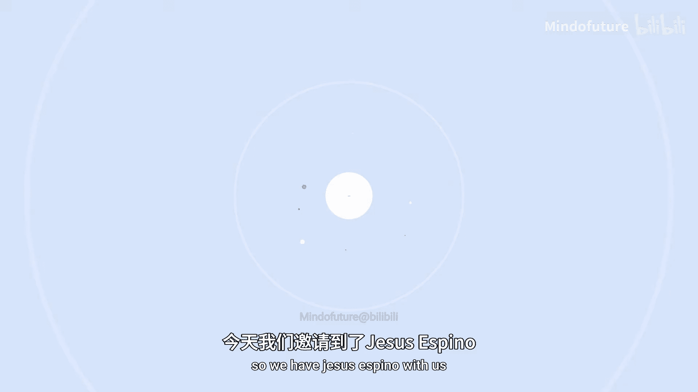
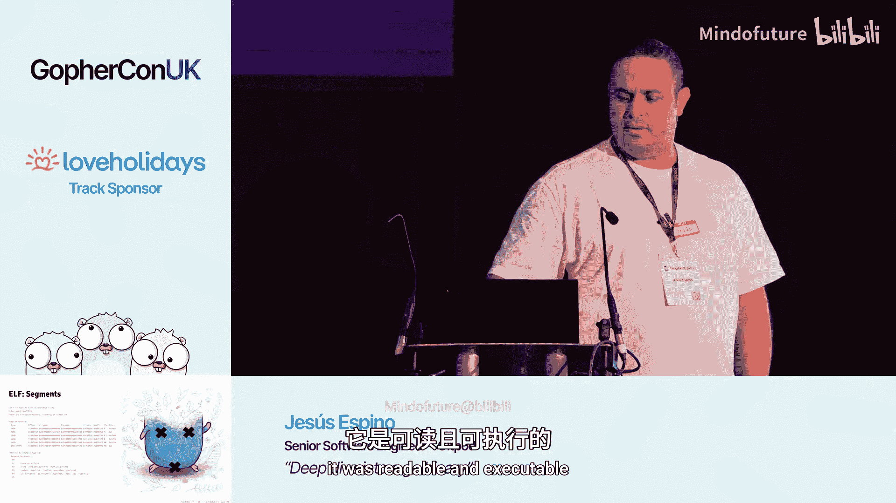
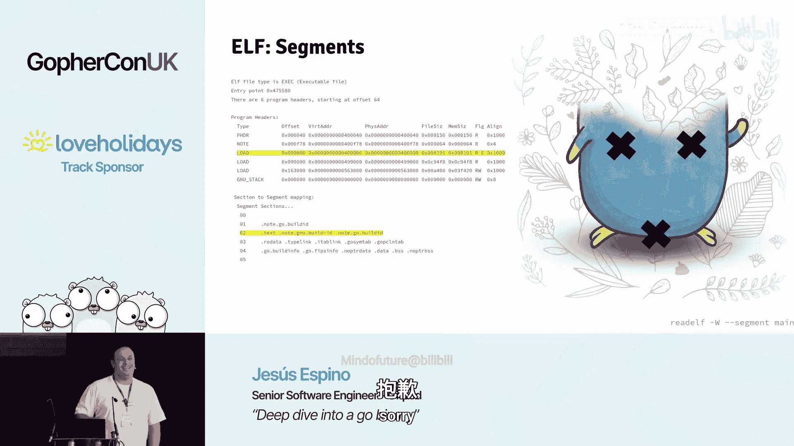
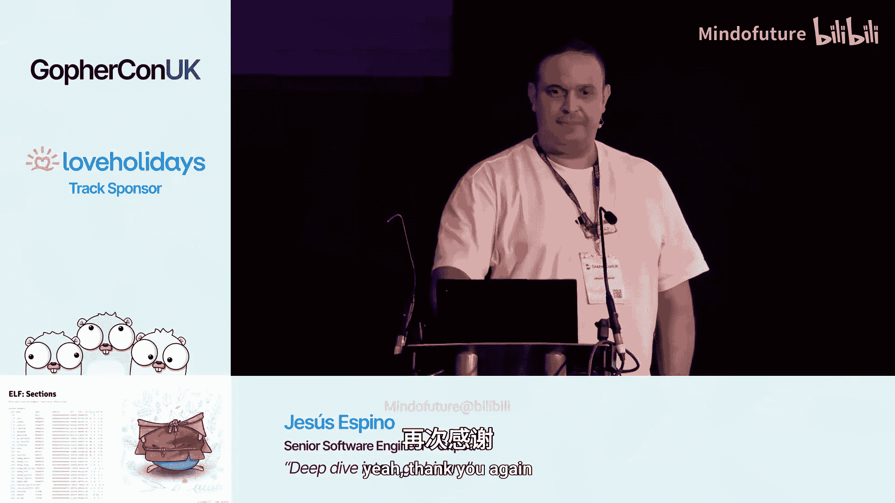
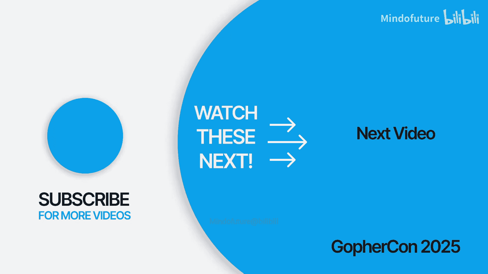

# Gophercon-Uk-2025-p19-P19_深入探索_go_二进制文件--BV1dCHTzQEdN_p19-

。🎼So we have Haus Epinino with us。 He has been giving talks at Gophercon for three years now in a row。

 And for the second day in a row as well。 for this conference。

 And he always comes with the most beautiful slides。 So I'm excited to see his presentation today。

 Yes， please welcome Haus。😊。

Wells let's take a dig dive into a go binaryary so first of all let me introduce a bit myself I'm software engineerra Gitbo I do a lot of public speaking I love a knowledge sharing and an open source enusiast I really love open source I love to contribute whenever I can and also one of the things that I love about open source is reading the source code of all that very brilliant people has writing and this is one of the reasons why I'm speaking here。

And also recently I become a book writer in five days， it's going to be published my first book。

 that is Moern risk API Development and Go so well。That's about me。

 but we are not here to talk about me。 We are here to talk about。Go bin art。

So let's let's introduce my super complex go program， a hellello world。

 that is the program that we are going to analyze during this。45 minutes or so。

So if I compile this go program， I get a binary file。😊，What is the size of the binary file。

 Any can guess more or less。 Yeah， go ahead。Sorry。Well， one。5。多钱。45 point。O。Okay， well， let me。 we。

 we will see that in a moment。The process of compilation basically have a magician in the middle that is a compiler and convert this nice gopher into a really fast executable binary。

And we are going to see why the。The metaphor here。It's 2。2 megabytes。

So that's the size of a hello world compiled with 1。25 version of go， 2。2 megabytes。So what is there。

 what is in those 2。2 megabytes， that is something that I ask myself and I just want to know why we need that amount of data for executing a hello wall well the reality is we don't need that we are going to see exactly what of that we need and why we need that but well。

😊，Let's talk about what is there I'm going to talk specifically about the binary format that is using Linux operating systems。

 so if you are using Windows or you are using Mac the binary format is going to be slightly different。

 but the concept that you are going to see today you are going to see here today are going to be applicable in the same way。

But what is contained in our E file that's there's the metaphor。

 The L files is executable link format in。In Linux。And it contains your program。

 my hellello world compile converting to a cell assembly that a cell assembly converted the binary and put in the binary file。

G dependencies， in our case the go FMT package is going to be compiled， all the process。

 take the binary and put it there， the go runtime is going to be compiled。

 which generate the binary representation of the assembly instructions， put it in the binary。😊。

The book information and some metadata。Let's talk a bit about Elf before we get into what is in the binary。

 I need to explain you how the binary is a structure for that I need you to understand what is and how E organized the data in the file。

L is basically a set of heater， a set of sections， and a set of segments。We。

I wanted to explain what sections are， sections is just continuous chunks of memory。

 continuous chunks of data in your file， in your binary file。

And normally sections are used by tools like the linker， the debugger， tools like that。

 so it's just chunk of data in this binary that that contains raw data that we are going to see what it is。

 but De doesn't know much about what is。What each section contains。

 It doesn't care from the perspective of the format。And if you， well。

 there is something that I do usually in my talks in the bottom right corner。

 you are going to see some notes， in this case， it's a command that you can execute to get this here。

So if you get this， this is the sections that exist in gold binary。

made my hello world compiled binary。All these are 26 sections。

 We are going to go through all of them。 Don't don't worry。 Don't pay too much attention to this now。

 But is that is what you need to know。Your binary is splited in 26 sections in 26 chunk。嗯。

Then you have segments。 segments is exactly the same data， but organized in a different way。

 So we are it continuous block of memory， continuous block of data， but but its。😊。

Grouping the data in a different way， but it's exactly the same datas like there's a full of a overlap between section and segments and segment is what is going to be used in runtime so it means that the sections are used by tools like the linker or the bugggger the segments are the things that are going to take from your binary loading memory and execute during during the execution of the binary so it's the operating system is going to read the sections and put all that in memory。

😊，Sorry， the segments， not the section。 I going to I going to interchange them all the time and not because it's something that you can do。

 you shouldn't do that， but Im going to do that all the time。 So sometimes I going to these segments。

 but by the context you are going to enter that sections。Anyway， these。

 you can execute a readalth command to get the segments and you are going to see here， for example。

 we have six segments and we are going to go into the details of the headde laterator。😊。

And then you have the elf heaters， the elf heaters define segment and sections are just chunk of data。

So the content of that data is not especially relevant from the health perspective。

But you have the headers that decides where that segments are and certain flags and things like that。

 and where that sections are and some metadata that is global to the L files。

I see there section headers and program headers that is interchangeable。

 program and segments headers are interchangeable， well okay。😊，These are the heaters。

 The heaters are at the beginning of the file。 So you have the main heater of the L file that we are going to see in a moment what it is。

 And the then you have the。Seegment heaters。 And then you have the section heaters。Yeah。So。

You can see here this is the help heater， the first thing that you are going to see this data structure at the beginning of the file。

 it's going to give you well the magic number for identifying this that this other file and all the things。

 one thing that is very interesting is the entry point， this is the address in your binary in。😊。

The address in your binary where is the first instruction that the operating system is going to execute whenever the operating system load your binary is going to go to that specific address that is part of your compiled binary part of your assembly already compiled for being executed。

 go there and start executing from there and that's how is executed your binary file。

Then we have a set of segments that is the program heaters， a set of segment headers。

 each heater is going to be 6056 bytes， there's going to be six of them as we saw before and it's going to start in the position 64 it's going to start in the position 64 because the e heater takes 64 bytes。

😊，And this is how it looked like a segment it's going to have。

The size that is going to take the purchasing memory and the more important part is， in my opinion。

 the fl that is going to say you what this segment， how you what can you do with this segment。

 you can read， write or execute this segment， we are going to see that at the at the end of the talk that I think is going to be interesting。

And then right after the segment heaters you have the section headers that is going to be 64 by each and is going to be 26 of them and it's going to start in the position 400 that if you made the math if you multiply 56 by6 and add that to the 64 bytes at the beginning。

 it's 400 so that it's basically just after the segment heaters。😊，And this is our section header。

 again， some information， the address， the name， and some flags and thick like that。

But well let's start talking about what is after the heaters we now what we have is we know the shape of of the binary。

 we have the idea of theres some heaters at the beginning and our bin are split in multiple chunks what is inside each chunk we are going to see where is everything there but。

I want to explain first， what are they common。The common sections that are in E。

 there's a lot of compilers that compile to 2 and there's some sections that are widely used and I'm going to show here some of that well all of the common sections and then I'm going to get into the special sections that are specific to go。

So the first one is the text section that it probably one of the most important one is it's going to take 604 kilobytes。

 so it's less than a third of my binary is the code that I have compiled。受。

What is in that text section， let me show an example if you use a go to object damp。

 what you are going to get is something like that but a ton of this okay。

 but I'm getting here part of the print function。And if you see here， what you see it。😊。

Just some random excalmal numbers， but it's not random at all is the binary representation of the instruction that you see at the right so。

That is the that is a literal translation to binary from the instruction that you have at the right。

 And this is the addressing memory that contained that instruction。

So you can verify that very easily， you can go to your binary， I'm executing here， Cat Ma。

 where I'm basically taking the whole content of the main binary， the binary compiled。

 passed through XxD that basically show exodadeimma representation of that binary。

And do a grab to get the line。 So there's a typo here。 I did change this yesterday。

 but you'll get the line there。The grip and you do the calculations， you say， okay。

 the section text start in this position， have this address is offset。 you do the calculation。

 you take the address of the first instruction and you go to the to the right place in the exact decal of the binary。

 you get exactly that instruction exactly those numbers。 I don't know if I have the pointer。 No。

 I don't have a Well， you get the you get that。😊，Addre。

 and you can see one after another that binary instructions， that binary being there。

 so that's the context of the text it's just assembly code that is converted into binary and it' put there。

 no more no less。Then we have a readon data that contains read only data and is 313 kilobys。

And contains mainly strings， types， interfaces， and constants。can contain other thing。

 anything that is read only goes there， but the main thing is constants types and interfaces。

 and we are going to see why types and interfaces is interesting that is here later because other sections reference that。

This an example of a chunk of ourarrow data， I extract that with a command at the bottom。

And you can see here， sorry here that we have our hellello world string that comes from our source code。

 so。All the strings， you are going to see all the strings there that can be interesting。

 You can see at the bottom See kill and things like that。 So there's strings here。

 There's the types of information here。 There is the interface information here。

 any constant that you define all that stuff。😊，Then we have a data that contain readable， readriable。

Global variables that has been initialized。So it's 21 kilobys。And well， and contains exactly that。

 just the the variables that has been initialized。Then we have a B。

 S S that contains not initialized variables。 And what is this separated。

 Because the interesting part of the B S S is， is empty。

 There's how much space is take from giervanni0。 There's nothing to。

To put there because they are not initialized variables。

 what you only need to know is how much space is going to take and whenever you load that in memory it's going to prereserve that memory for the non initialized variables and then you can put you can put something in those non initialized variables。

Then we have the Simt or symbol table that contains the references to all the symbols all the functions。

 the objects， and think like that in your program is 55 kilobytes。😊。

And then we have the string tab that contains the string representation of those symbols。

 these are more the kind of the pointers to those symbols and the information of those symbols。

 and this is the string representation of the symbol。😊。

And this is what a string tab is under the hood， you can see yeah a lot of strings there representing function names and things like that。

 but the interesting thing because when you use the symbol table plus a string table that you can use with readele and you can see here a lot of functions。

 some objects at the bottom and think like that and the interesting thing also is you can go for example for one of those functions and you see that the symbol points to a text to the text section or in the case of the object you can。

See that memory address， and that memory address points to the data section。

So and then the last one that I want to show here is the SH string tab that contains the string representation of the section names。

So you can see here， for example， the section text the sectionarrow data， the section of street top。

 etctera。 Oh this is something that was added recently， I think in20 in 1。23 maybe。Well， in 1。23。

 it become or 1。24， it become。嗯。It become default set set by default that before wasn in the case anyway。

 it's 3336 bytes and it's just a of your build。So you can modify that and you can get that from。

 from the L file and all that stuff。Apart from that， other common set of sections are the。

 the book information that is called dwarf。 You can， you can almost even that this。

This acronym is more a acronym。 So they have alpha already。 They need something for the information。

 Oh， yeah， let's talk it， let's call it the buging with arbitrary record format。 Why I don't know。

 Sound Sound cool。 No， yeah， of course， itwarf they they。😊，It's， it's a cool name。 I have to admit。

 Anyway， that is the sections， but。Well， it's 622 kilobys and I don'm going to talk about dwarf because it's a whole talk by itself。

 I don't want to get into all those details， but what you need to know is basically information for de bargaingging。

And it's kind more than less than a third of our binary， but still a big chunk of our binary。So。

But let's jump into， I think the most interesting part that are the go specific sections。

What makes binary。A go binary。 What is， is something that is more unique to go。Well。

 there's one thing that is the GoBuild In is 300 bytes， small section。

 but gives you information about how your program was built。For example。

 we can see here that this binary was built with Go 1。25。 had seago enabled。诶。Apart from this。

 we also have the node go B ID， the other one was note new B ID that it's more a general。Build idea。

 That is。呃。It's， it's more widespread in the industry。 This one is specific to go。

And you can it's kind of the same。 It's an idea of the of the build。

 You can get the build I D with the go to B I D and you can set the bill I if you want。

 but I don't have a good reason for for set the bill I D myself， so。This is another interesting one。

 This is the type link。 It's， it's almost 2 kiloB。And it contained。A list of types， well。

 a list of pointers to the type definition。In the in thearrow data。

So that is just a list of upsets actually in thearrow data that points to different types and something that is very interesting is sorted by name。

Its just offsets， but they are shortened by the name of the type。

 and what is a stored in thearrow data is an API type that contains the data structure with information about the type itself。

And then we have the data link。 data link is very similar， but it's for interfaces。

 It's 128 by in the hello world。And it's very similar points to thearrow data this time it's not by offset。

 it's by address， why I don't know。And is a sortaring A ITap interface， AB ITabstructs。

 and that has this structure， the function， at the end， is variable size。

 you can have multiple functions and all that stuff。sorryrry。

And this is the the most interesting one， in my opinion， that is the go PC LN tab。

It's pretty 490 kilowabys。And the Gopi seal tab， the responsibility of the Go PC seal tab is to convert from pro encounter。

 the pro encounter is whenever you are executing the instruction of the CPU is saying oh this is the memory the memory address of this instruction。

 that's the program encounter， so associate basically every instruction in the system to line number and file name and all that stuff。

 this is the go this is the main purpose of the Gopi seal tab。

So and it's used for things like stack traces and things like that。

The Go PCC tab has a header that defines the copCLN tab in general how the data is going to be structure inside。

 then has a list of function， a list of function names is just a list of string one after another that represents the function names。

 the C tab that is a compilation unit table， a compilation unit is kind of a file。

 it's not exactly a file but it's corresponding to a file almost 99% of the time。

 then we have the file name table that is again a list of file name one after another。

 a PC tab that contains information about the pro encounter， the line number， the stack pointer。

 things like that。The function table is one of the important parts is its divided into things。

 one is the pro encounter to function that is a way to find the function itself and then the function info that is a structure that defines that function so the pro encounter to function is the pro to the function information and then we have the list of function information there。

And the fine phone tab。Its a data structure that speed up the process of converting from PC counter to well。

 it's speed up the process to finding the function， basically。

So this is the how it looks like the heater， half a magic number that is di version hasn't changed since 1。

22， if I recall correctly， the instruction size， the pointer size， where the text section start。

 that is 4 well， 401，000。The number of function and the number of files。

and then the pointers to the other， the other blocks， the the pointer to the function name。

 the pointer to the the completion unit table， the pointer to the file name table。

 the pointer to the PC tab， the PC table and the pointer to the。PCLN。That is the。

 the one that is is is helping me to get the the。The function info。So。Again， the， the function table。

 the one here at the bottom after the PC tab。It's going to contain， as I said。

 the relationship between the per counter and the function info and then you have for each function info we are going to have the offset respecting to the text section。

 they are offset in the file names so I can just find the file names in the file name table。

 things like the compilation unit index， the C index that is going to give me the ops。

The index where the compilation unit that correspond to this function is。

 so we are going to see in a moment how is all this information used。And yeah。

 this is the content of the function name table。 You can see just a of a list of function name one after another。

This is an example of the compilation unit table where you have offsets one after another offsets and offsets are offset that points to the file name table and this is the file name table that you have file names and file names and file names。

 for example， this one this the first one here is 39 I can imagine that that could be for example。

 the auto generated one there。Or maybe well， the0 is clearly the first one that is the ABI type go there。

 think like that， so all those compation units it's going to lead to find the file name here。

So whenever you have a function that have a compilation unit index。

 that can allow you to go here and find the compilation unit。

 and you can go here and get the final name of that。嗯。The PC tab， the pro counter table。

 is going to store information of the stack pointer， the file， the line。

 if that function was in line or not， things like that。

And here's more or less how the PCL tab is used you have the pro encounter。

 you use the fine F tab data structure to find the function。

 then you go to the the phone tab for the function table， get the function once you get the function。

 you can go and try to get information from there， for example。

 oh I need the name the file name so get the name offset from the function name go to the function name table and get the function name or get the offset for the compilation unit tab。

 go to the coup tab and use that offset get the offset in the file tab。

 go to the file tab and get the file name。And the same for the program encounter underlying number。

 I go into the a PC tab or the stack pointer and click that。So this is how， how more or less is used。

 the goilant top。Let's talk about all sections， other sections。

 there are some three very interesting ones that is no pointer data and no pointer BSs。

Is the same idea of BSS and data， but in this case our variables。That are not containing any pointer。

 And the reason for that is no pointer data and no B， S S， no pointer B。

 S S are not going to be scanned by the garbage collector。 So it's an an efficiency efficiency。Trick。

So， and then you have the Gos in tab。 the Gos in tab is empty because was replay by the copy ceiling tab。

 So it's no longer a use。And the goal of PhPS the information for Phs verification。

 if you were at the keynote， you know that PhPS is something related to security in the federal government or United States。

😊，So it's because of that we are go adding information to the binaries for helping in the verification of Phps。

Okay， let's talk about the segments， we have seen the sections。

 where now should more or less have a vision about what data is in my binary。

 let's see how it's organized in segments。😊，The first one is the heater。 I going to skip that。

 and I go to the node one。 The first note is the go build I D go note go B。 That is a read only。

 you see the flags there they are in the flag。 It means that it's read only。 Okay。

 that's one of the sections。 The second one is probably a very interesting one that is it's runable is's readable and executable because half an E at the end of the flags。

 and it contains the section text the section node not new build I D and node go build I。

 So those are。😊，What is in this segment and this segment is the one that is executable。

 is's the only one that is executable。 If you try to execute code from any other segment。

 the operating system shouldn't allow you to do that。

And the next one is another read only segment that is going to containarrow data， type link。

 E link goes in T and Go PCC and T， so all that information is read only。

 you can't mess around with that information in in memory whenever you are running your binary。

AndThe last one is the one that is readable andriable and you have there the goB info， go Phps info。

 no pointer data data， BSS and no pointer BSS， so that is what are the segments of my of the binary then you have the no no stack that it's something that is there but yeah。

Okay。Now that we have a more or less global vision about the binary， I want to share。

Some interesting things that maybe you know or maybe you don't know。

So one of the things is that you don't need all these data。

 It's kind of obvious whenever you start seeing that and you say， okay。

 if the segments are the ones that are。Loed in memory when I execute that。

All these sections that I'm not referring in the segments， do I need them， but actually not。If you。

 if I list the main binary that I created is 2。2 megabytes， if I execute a strip on that。

 that is a command that remove everything that is not in the segments。

 so it's not going to be loaded， it's going to remove 1 sections that is going to include all the dwarf information。

 it going to include the syninTab and the string tab going to include certain data that its not really needed。

😊，And we reduce the size to 1。5 MB。 That is still a lot， actually， but。

You need that data if you want to have a combary running。So yeah， that's that's the final result。

 is's 10 sections less。And。Another interesting thing that people don't know or don't usually know is that you can be leaking data without knowing it。

For example， if I do read of dash P， that gets。Text representation of of of my section。 And I， well。

 if I read the Gopiil top and grab for home。This is where I compiled this binary。

So I'm leaking my home directory that maybe it's not relevant information， but if you for example。

 are let's say not very honest security expert in the other side of the equation of the security experts。

 maybe you don't want to know that your username， it's probably your GiHub handle at the same time。

 so it's kind of depending on what you do， maybe it's not the kind of information that you want to leak。

😊，The other thing is。You can also have all the all the file names， all the all the function names。

 all that stuff。 Duke， you are not able to。You are not able to read the code because it's compiled。

 but you can cannot be able to replicate a big chunk of the structure of the program。

 So maybe you don't want that or maybe you don't care。

 normally I don't care because I'm more in the open source side of the equation。

 but yeah some people care。We are going to see something in the reference to held there。

Another interesting thing is your trace box。 If you do the strip thing and you remove all the symbol table and all that stuff that is what is used in other programming languages to get some kind of trace back and think like that。

 But we are we can go use go Pil tap to get the。😊，The trace box。

 so even if you trip everything there， you are going to be able to see the trace box and the different names。

 the line numbers， all that stuff all that information is going to be there。呃。Oh well。

 and what it does， whenever you have to run a attack trace。

 what he's doing is oh what is the query pro encounter， the queryrum pro encounter is x， whatever。

 so go with the pro encounter and start doing that and start tracing back to the。E well。

 to the beginning of the trace。Okay， now another interesting thing I said before that the type link is sorted by name。

 It's just a list of upsets， so it's a list of numbers。

 but it's a list of number that is sorted by the name of the type info that is pointing to。

Why is this Because reflect use that And what reflect does is go to the middle of the T link is's doing a decochotomic search。

 is's going to the middle of tail link and saying， okay。Give me this type。

 get me the name of that type I that type iss that name greater than the name that I'm looking or iss smaller。

 Oh no， it's a smaller。 Okay， then I go to the middle of that side and I' ask， okay。

 give me the type an dichotomic search okay is's going to do that and it's going to find very quickly our type information based on the name So that's something that reflects that。

And yeah， let me summarizemarise a bit because I think this is something that I。I。

I really want to show that is this。Before this talk， if I show you this would be nonsense probably。

 but my expectation of what I would love to see is that you all now， if I say no。

 at the beginnings are the headersof else， then you have the node will B ID。

 the node new B ID and the gofi info， and then you have the text section where it's your assembly code or your your code。

 seecutable code， then the arrow data with the read only data。

 the type link that allows me to find the types in the read only data。

 the data link that allows me to find the types in the read only data， the go PC that gets me there。

From the program counter to the function name and the function information。

 the gobel info that is telling me how this binary was compiled and the data and no pointer data section where I have this variable that are really initialized。

 the dwarf information for the bug， symbol tables and screen table for the symbol string information and the SH screen table for the header names。

Sorry， there's section names。Now。This should be something that you say， okay， now understand。

How the binary is is shaped and why there's things there that are needed。

Some references that I think are interesting in depthE is a YouTube video that gives you some introduction to health and it's very interesting the Gopiilant T design document it's something that was done a long time ago。

 Gopiion T was introducing 1。13 or something like that。

But the problem is the document is really really outdated。

 but the concepts and the intentions behind it's well spread there。

 but I will try to avoid to use that document to understand what is happening in the code。

There's also another interesting one that is Go Re SM that is a program that allows you to access information from the Go PCC on top and things like that。

Gble， it's another interesting one。 If you were worried about me saying that you maybe are leaking data and leaking function names and leaking file names and all that stuff。

 Gar is is is the tool that you are looking for。 The gar tool is going to obfuscate all that information。

 you are going to pay a price because the traces are not going to be。Reusable anymore。 but。

 but you are not leaking data anymore。Of course， as I always recommend， the gold source code。

 in this case， specifically the linker is going to give you the final source of truth of all these。

It's I recommend you to go and try。 It's， it's a really， really hard to to trace a thing。

 Other option is to use。Eth file analyzers and， and there's。

 they're already tool for doing this kind of analysis from the outside without the need of reading the source code。

 but yeah。Yeah， it's not it's not the easiest code in the goal e compiler， to be honest。And okay。

 another thing。 the illustrations of this talk are made by Gund dela Cruz from the Pempotin。

 That is open source alternative to Figma。 So if you want to download them， they are there。

 But also in my Gihaub report， there's I have。I have a gopher repository that has these ones and others and things that I've generated with AI。

 things like that anyway， these illustrations are public domains。

 so are mine but also are yours so do whatever you want with them can do teachers。

 stickers using your presentations， whatever。And that' it， Thank you。

Well let's keep in touch if you want to contact me or whatever。

 And now I'm going to answer questions， maybe not with the right answer， but I'll do my best。

Okay。😊，Thanks for your talk as always。😔，I guess the the obvious for， I guess。

 depending on different architectures， apart from the assembly code。

 iss there any differences between like X 86 and arm on Linux， for instance。you know obviously。

 as far as I know， there's no big difference， probably the Indianness is one of the things that you are going to see。

 but from the data structures， I will say that there's no difference depending on the architecture。

No。Yes。Yeah， thank you for the talk amazing as always You showed us that fl for build I section the G no would build I。

 something like that and you showed us a fl for it。 Yeah yeah it was there。

 It was readable and executable。😊。

I can't imagine why it is executable。Yeah， mean neither。

 I I I had ex actually had this the exact same question of why in the hell these thing that you actually can change。

However you want。It's in the executable section。 Can I put there an executable instruction and call it。

Could be。 I， I， I not handle。 I I will say that it's doable， but I don't know why is's there。

 And actually， there's two， there's two sections。 They know be lady and they go of be lady。

In the prayer talk that I did related to this was a previous version of Go。

 and the newbie Lady wasn't created。But I， I asked myself the same question about the go Bill lady。

 But suddenly， now both are created and both are executable。

 So I guess they have a good reason for that。 What reason， I don't know。 Alright， Thank you。 sorry。

The things。I saw a question somewhere here。Right。I think you were。with the executables for go。

 are they always statically linked， you are the executables always statically linked？And go， yes。

 if yes， I think I think they are started， theres some， I think there's something that you can do。

 There is a plug system that nobody uses。 Thanks God and and go。E but in general， yes。

 the go binaries are statically linked。EI don't know if there's a way to not statically lean them。

 to be honest， I haven't tried。Yeah。If anybody knows the answer to that。

 if it's possible to get dynamically linked， just tell it so。Thank you for the talk。 It was amazing。

So we have all these sections that are obviously named go something。 So this is not standard。

 So it is it going to be the run time that is part of the text that can access these sections。Yeah。

 exactly。 they are they are there mainly for the runtime。

 That's the reason why you can get rid of the go PC sealant top， for example。

 because if you get rid of the gopi seal tab you are saving you are saving like。

Almost a fourth of of the binary。 but you need that because the runtime is going to leverage that to to do things。

 the same thing for types and all that stuff。 it's in the in the case of types， it's a more general。

More general structure that is there， but still it's going to be。

 it's going to be information that the runtime is going to access during runtime。 and yeah。

 and actually， I think all of them。All the go related sections are accessed by the runtime。

Let me check it out here。Yeah， the go info and go Phps infofo all that is get access by the runtime go tab for sure。

 of course and they not not be that idea you can have you can ask the runtime about that information at runtime。

 So every go section it's there。Providing value to the run I normally。Okay， any more questions， yes。

What's your advice on probably also compressing the binary if youre， if you're interested in like。

A very small binary。哎。I don't know if compression is going to do a great thing because at the end of day。

 it's sub binary， I don't think it's going to be a lot of redundancy there。

 but well there's some text right there。Probably you can save something。2 MBby。It's not that big。

 so it's not that important， I think。But it depends。 anyway， if you want really small binaries。

 maybe the option is not。Big go is maybe tinygo that is another option， depending on your needs。

 because if you say oh no， I want to do this very complex production ready program that takes 500 megabytes of binary。

 I'm going to run that with tinygo， probably it's not going to compile because tinygo is not supporting everything that go supports。

 but if it's a small program and you want to make this really small tiny go what is kind of designed for that kind of scenario。

OkayThank you。Oh， UBx。I don't know UBX， but， if you're more familiar with older style compiled languages。

 UPX is a compression format for anything that's compiled in that way， so you can use that as well。

It also changes the health structure as well， so you do lose things。Yeah， good to know， thank you。

Okay， any other question we have some time。Okay， anyway， if anybody have any question after the talk。

 I'm super happy to talk about whatever so free free to reach me out。Yeah， they you。

