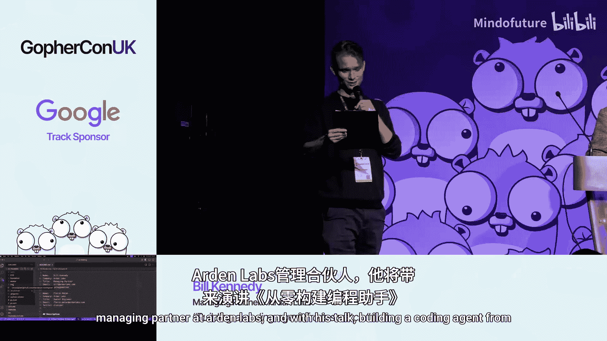
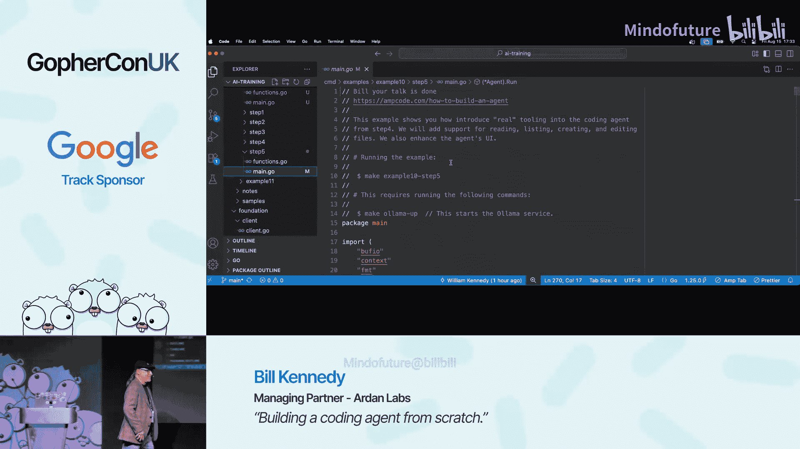
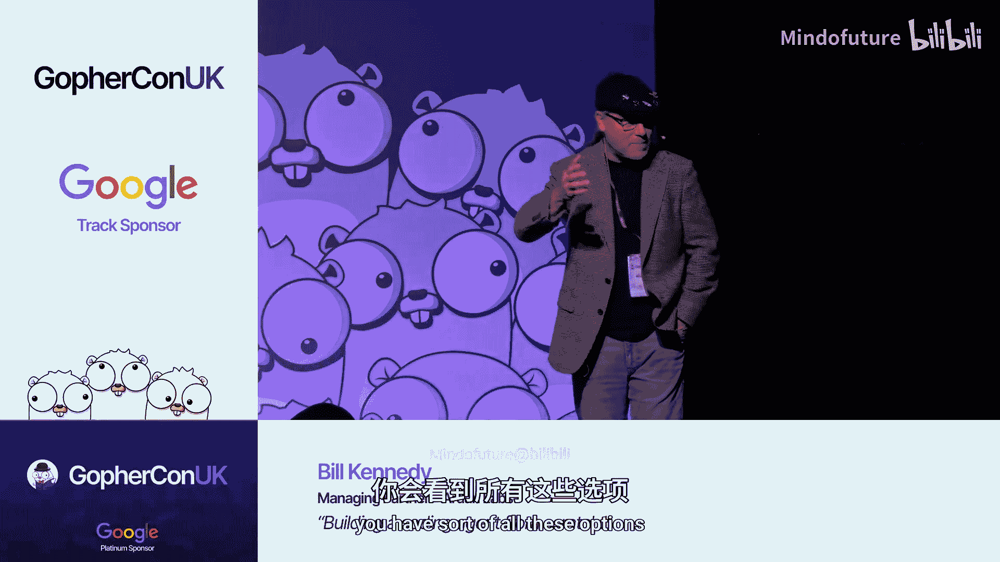
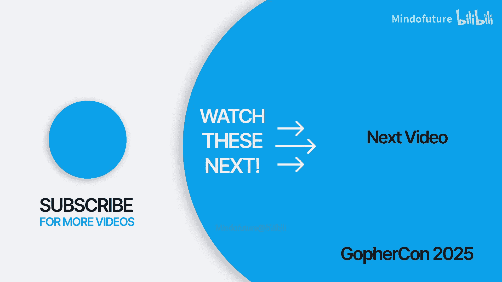

# Gophercon-Uk-2025-p20-P20_从零开始构建一个编码代理--BV1dCHTzQEdN_p20-

So for my arbitrary introduction， a founding member of Go Bridge and the GoDeveloper Network。

 author of Go In Action and the ultimateltimate Go notebook。And yeah。

 then my last note just says all round good bloke wearing a hat。嗯。Managing partner at Arden Labs。

 And with his talk， building a coding agent from scratch。

 a massive hand for Bill Kennedy rounding off the day， please。😊。

Okay。I've been working on some code for the last few weeks， and they needed somebody to come up here。

 and I thought it would be fun to do this。 We're going to copy paste live code， some stuff here。

 but it should be fun。😊，A few weeks ago， Thorrston Ball works over at Sographra。Wrote this blog post。

And he gave out a lot of go code that worked with the anthropic APIs and gave a really basic example。

 a little bit of what AMmp does under the covers， but really， really simplified。

Now I don't know about you， but I don't like spending money。So I run Oama。

And I wanted to try to recreate this with using Oama and I've been somewhat successful doing that。

 So that's what I'm going to show off sort of the different stages and steps I went through to build an agent and we'll walk through all the little things kind of kind of think about at the end of the day。

 I think you'll realize that this is really a toy。And you'll start to realize the massive amount of work it takes to build something。

 say like Sographra， amper， the copilot or cursor， I mean， massive engineering effort really。

 but as a toy it's kind of fun to see it work。Alright， so we're going do a couple things here。 Ive。

 I've raised that screen just so everybody in the back can also see。I'm going run ama。

 Oama is I install it here with Bw。 It's a really nice way of running a bunch of models。

 There's a lot of models out there， not every single model that you'd ever use， but there's enough。

 The model that we're gonna play with today。😊，Is one that had just come out recently。From Open AI。

 and that's going to be the GPTOS latest， it's a 20 B model。 I have like 128 gig on this laptop。

 so it doesn't have much of a problem running it。So it will be fairly fast。

 So I've got that up and running。Let me， I was gonna try to just diagram very。

 very quickly what we're gonna sort of do here。 All right， just so you have some sort of visual here。

 So I'm gonna have ama here。 It's running that model。

 and the idea is I want to do a basic sort of workflow。

 We're gonna have some we're gonna to be the user。 It's all going to be CI based。

 we're going to ask some sort of question， We're going to get some sort of response back。

 Now this model does two things。 not not every model does but this model it has tooling support。

 which is what we need really make this work。 It also has reasoning support， which is really cool。

 and being able to see how the model's reasoning about things。

 helps you a lot too when you're trying to develop this stuff。

 Now the model is going to send us reasoning content first。 So we'll get some reasoning content back。

 reasoning is interesting。And not when we deal with this open AI model。

 the reasoning information comes back in a special field called reasoning。 that's nice and easy。

 But if I were to use like the Quen model who also does reasoning。

 Sometimes you hear that called thinking， it comes back in the regular content that comes back in an HTML tag。

 So I've got code there that has to figure out is this reasoning through the reasoning field or reasoning through the content。

 some point you'll see some of that code。 So when it comes up just so we can separate the thinking。

Or the reasoning。From the actual sort of， let's just call it the answer。That it's going to return。

Now， at some point， what we're going to do， we're going to get this to work first。

 Let's just get this to work。 If we can get this just working or we can do some basic question。

 reasoning answer。 That would be kind of cool。 So let's just sort of start here。😊，This。

 this entire codeb is open sourced。 It's under the R and Las AI training。

 and we're going be playing with the examples that are under 10。

10 is the examples we're going to be playing with here。 Now， what I'm also going do。😊，Under examples。

 I'll add a folder， Im want to call it hack。And I'm on aine dot go。And I told you。

 we're gonna to really just hack on this thing。But I'm not going to try to just write all this code。

 that would be sort of insane， but I'll bring the code over that we need。

And we'll do a little bit at time。 I also turned off my AI agent because it's not happy when I do this kind of stuff。

Okay， so let's just start with some， some basic sort of stuff here。And by the way。

 let me just share this with you really quick。 I wrote the silliest little client package that's using H T TP。

To be able to just talk to Obamaama with the SSE support that we're going to have。

 so I'm not using any third party libraries or anything special there。 it's just straight HTTP。

 which means that you could take this code and point it pretty much anywhere that has an open AI compatible API and it will work。

Allright， so that's what we're using here。 You can look at that code。Okay， so I don't need you。

 I need you right here。 So let's start with number one here。

 So let's just bring in these constants here。That's going to be the local host to Alama。

 You get that。 That's going to be the model that we're going to be using。

 I love being able to talk to developers。 It have to explain too much。😊，Now。

 this becomes really important。 If you're doing anything related to talking to a model。

 context windows eventually bite you in the butt。So every model server and every model itself has a certain max a maximum amount of content that it can handle coming in and it will send back。

 Every model is sort of different。 Oama by default。

 I think is only keeps like a 4K or 8k sort of context window。 and we talk about K。

 we're talking about tokens。 Let's just talk about that tiny。

 I'm gonna give you the quickest way to think about a token。

 A token is three quarters of a word in general。 So think about every10 tokens is about 75 words。

 That's not 100% accurate。 Every model has their own tokenizers。 but in general。

 if you think about that， it'll be fairly in line with what we're talking about。

 So if we're talking about。4000 tokens， right， That would be three4 of that。

 would kind of describe a little bit on how many words we can process。

I've increased the context window to 64K because at some point during this demo。

 I'm gonna to be asking this thing to read files and do all this stuff。

 and I'm gonna hit a 4K limit very， very quickly and the llama server unfortunately doesn't fail。

 It just starts truncating stuff very badly。 And next thing you know， life is bad。

 So and I've even seen bugs lately where we didn't realize we hit context windows and we're trying to figure out it works fine on dev because we have large context windows。

 It's not working on production because we didn't deal with that。

 So the context window is really important。 And so all I'm doing here is reading an environment variable。

 which well have in the make file to sort of set that。Okay。

I use these lines a lot of times in my code just to sort of divide thoughts that probably should have been in a different file。

 but I'm not ready to do that。 So if you see these lines。

 it just helps us from a mental model to see what we're doing。 I love this pattern here。

 Main calling run。 That is what we're gonna do。 And we'll set that up。😊。

OkayThe first thing we need to be able to do is get input from the user。

 One of the things that Thorrston did is he provided this code in his blog post。

 It was actually pretty cool。 He just created a scanner and then he wrote a little function that can pull a line of text at a time。

 So when you hit enter， would this would run。 and then we're gonna pass this function to our agent every time the agent's ready to receive some user input。

 the agent will call this function。 It was actually a really cool mechanic that Thorton came up with So we took that。

😊，Then the idea is we're going to define what an agent is。

 we're going to define some type that will represent an agent and then we'll have a method off of that called run that will get the agent going The agent is just going to be an endless loop。

 it's not going to be anything complicated than that The key is knowing what to do on every iteration that's what's going to make let us win or lose the game here。

Okay， so the next thing now is to define what our agent is。 In the simplest form。

 the agent is going to have a client that lets us do SSE。 And that's just a basic H TP thing。

 And then that function that lets us get that user input。 All right， No big deal。 Now。

 we're gonna to start putting our agent together。 Let's just bring the。The new in here。

 weve got to construct a couple of things。All right， great。 So that little S S。E client that I wrote。

 there are times where you need some logging because things are happening inside of go routines。

 I don't like defining logger interfaces。 I like passing functions for these types of things。

 So there's no dependency。 And so I just defined a logger function that takes key value pairs similar to S log and the Uber apps and all that。

 And we just sort of process that for logging。 I'm gonna pass that in when I construct the client。

 And we're gonna save that function for getting the user messages。

 And then we're just going to return back that agent that we just constructed。Brilliant。What's next。

 What's next is the exciting part。 We've got to now create that， that run loop。

And this is where we're going to spend a lot of the initial time。Okay， so one thing here。

 as we're having a conversation back and forth with the LLM。

 we're going to want to maintain the history of all those interactions The LLM is state list so we have to keep track of all of that and keep feeding it back This is where your context window starts to get eaten up really。

 really quickly because you're paying for the same tokens over and over and over again every time you hit enter you might be at work actually on your agent and you're using the same thread for the last four days。

Every once in a while， I'm like， maybe we can start over now。Okay。

So I'm just going to construct this。 Now， this client D type is really interesting。

 I stole this idea from Mongo。It's just a map string any。

And the idea is that when we define what the request document looks like。

 it's just Json at the end of the day， similar to if youve ever worked with Mongo。

 So instead of creating some strong types for all the different types of input fields。

 This D simplifies it all。 Now， we do have to write some strong types for the return。

 I'll show you those。 But you're gonna see how cool doing something like this is。

 even with the code readability。😊，Okay， no problem。 We're going to start out here。

 We're going to say， hey， do this， and you can hit control C。

 and then we're going to create that endless loop that I told you about。

 and all the magic is going to happen in here。Okay， great。 What's next。 Well。

 we're starting the system up。 So what we're gonna do is ask the user for some input。

 All those little special characters you see there that 94 m is going just write that in blue。

 Just so we have some context。 What's going on。 And I just started subtracting numbers at some point。

 and I saw yellow。 and then I saw red。 and I saw I was like， this is cool。😊。

But that's all that you're doing。Okay， great。 So we're going to get some user input。 Now。

 what are we going do。 Well， this is important。We're going to add that question into the conversation。

What we're going to do is everything just goes into the conversation and then we're going to just send that to the LLM so we don't lose track of anything that's going on so we've got the conversation in place and now what we're going to do is define that request again this is what the open AI sort of standard is for doing a chat completion which is what the API call is but how cool is that to be able to define it like this instead of some sort of hardstruct that's going to change every other week when they add a new parameter for you to turn this on and turn that off that's kind of insane this sort of solves and keeps your APIs fairly fluid for changes that are coming in from inputs。

So real quick， that's the model we're going to use。 Those are the messages in the current context。

 The very last message will always be the last thing that we're doing。

 The size of the context window will be max， temperature top P and K， real quick。

 I've got things here。 you can read them really quickly。

 What I'm trying to do here is reduce to almost nothing， the randomness。

I want this model to reason at a high level。 And so if I let it sort of float in space。

 I don't think we're gonna to get the results。 So for things like tools。

 you want to do that for things like conversations， you want those numbers to be a little higher。

 Everything about that is sort of playing with it to get the the models to do what you want。Okay。

So we've got that in。 Now we've got to make the call。 So I'm going bring in this code right here。

 Now， oops， stay in the loop。I'm just going to say there that we're now waiting on the model to come back。

 I'm going to use a channel。 So since this is SSE events are coming back from the server。

 we just put those in a channel。 I've got this type here。 This has to be strongly typed。

 This is what you're going to see coming back out of。If I can show you that。To this one chat。

 So this is really， and this doesn't， this stuff really doesn't change。 So we can it's。

 it's not bad to sort of have this hard coder。 but this is what's going to come back。 Ially。

 we're looking at choices and choices are going to have a delta almost like every word comes back sort of as a response。

 And then we're gonna have the content for that。 or we might have reasoning。

 if the model uses reasoning。 And then eventually， as we get to tool calls， this stuff will be used。

 so。Not rocket science here， right， You're all familiar with this， Okay， so。

We're going to make that call， but we're going to get everything back in a channel。 fine。

 now this due call is going to return immediately， right We're like like we' do this and it's going to say we're going to use this channel。

 not a problem。And so now what we need to do is essentially be here。是。

Classic four range on the channel， waiting for everything to come back。

 and then our little client knows to close the channel when everything is sort of done and then this sort of loop。

 So now we're in here trying to process all these chunks。 Now。

 these things are coming back in chunks。 And I tend to always see them come back as words at a time。

 But this whole entire thing that comes back。 I need it kind of like in a single string。

 So I can feed it back into the conversation。 So we've got a chunks slice。

 and we're gonna just append everything that comes back from the model into that。Now。

There's a chance I haven't ever seen it， but there's a chance that the model responds and there are no choices。

 So let's do a little bounce checking there。 And then Florence laughing because I told him it would never happen And somebody came to me and said。

 Bill， you know， the code panicked on me here。And I was like， yeah， of course it did。

And if I don't do this， it's going to panic on stage。Okay， real simple， look， little switch。

 if there is content， then what we're going to do is just print it。And add it to our chunks。

 Or if there's data coming in under reasoning， which it will be using this model。

 then we'll just print it。 I'm keeping this right now， super， super simple。And after that。

 we've got this call to。I I have it after the。 Yeah， yeah， out a loo。This gets。

 this kind of stuff gets really complicated。 And I'm sure somebody can tell me how to improve it。

 I'm in a for loop， so I can't defer。The cancel because it will never cancel until we。

 And so it gets really interesting in these situations where I'm gonna have to cancel here because of a continue。

 And then I have to cancel when this loop is done。 If I cancel inside the loop Well the whole thing stretched down。

 too。 These are really， these are things that make my stomach occur a little bit because I feel like I'm doing something wrong with context。

 but。At least right now， it is what it is。 Okay， the last little piece here is we've gotten everything out of that channel。

 So what we're going to do is if we did get any chunks， then we know that we got something back。

 And I'm going to add that to the conversation。 We've already printed it on the screen。

 And then we're going to go back to the top of the loop。 And since that is already。

Already in the conversation， when we come back here。

 we'll just go back and the user can ask sort of another question。

 And we'll just double check that the history is sort of working。 We don't have any real good。

Foratting here yet。 Oh yeah， silly。 We don't have any really good formatting yet。

 but we're gonna get there。 We're gonna get there。 Okay， so this is gonna be our little hack program。

 So I've got all of these things。 In fact， I'm gonna just take this right here。😊。

And we're going to call this example 10 hack。 that should work right there。

 And you're gonna to do a hack。 and that should work right there。 If I did everything right。

 So let's just see what sort of happens here。And there's no hack。 Where did I put the hack。Oh。

 I didn't put it in。 I put it， except。Oh， I didn't put in example 10。 Let's move it there。

 just in case I have any problems with subdirecties later on。Let's try it again。Perific。

 So I always say hello， model because I try to be nice。 You see right now。

 that model is getting loaded。 One of the things Oama does is it will load the model。

 But if it's not being used， it will unload it。 So it's just loading it again。

 There's settings for all that sort of stuff here。 But let me bring that up to the top again。😊，Hello。

 model。And you see， I'm not doing a lot of formatting， but at least I got the red part here。

 That's the reasoning。 And maybe， you know， just say， okay， you're cool， right。

 and I want to do more here。 Allright， good。 Okay， so we've got， at least at this point。A loop。

That's asking a question， getting back a response。 We kind of know what reasoning is。

 We know what that is。 And then we just sort of go back。

What I'd like to do is clean this up because if we get to the tool calling and we can't really see the different parts。

 that's going to get a little complicated。 So let's do the following。

Let's go ahead now and look at the code that I want to bring in from step 2。

 As you go through these examples on your own， you're going to see me yelling at you。That way。

 I don't miss it。So this is what we're going to now add to our little client。

I'm going to add a system prompt to our client。And the。

 the thing about system prompts is you can give the model a little bit more instruction。

 If it's not behaving， this is a good place。 Sometimes we can go and try to get it to behave。

 So you're a helpful coding assistant and the G model has this concept of reasoning。

 and I want it to be set high。 I want it to be thinking really， really， really hard。

 Not every model sort of has that。 Okay， so we're gonna have a system prompt beautiful。

 And what we're gonna have to do， though， in run is make sure that the very first thing we do。😊。

Is that that system prompt to the conversation or the model's not going to have it。Okay， great。

 so we've done that。The next thing here is I want to split out the reasoning from the content。

 and the big reason is you do not want to add the reasoning or the thinking into the conversation。

One， that costs you tokens。 and two， that's not really helping you with context。

 That was just the model thinking。 So that's an expensive mistake if you're putting the thinking or the reasoning back into the history of the conversation。

So what I'm going to just do， and this code isn't as efficient， maybe as it otherwise could be。

 We're just going to get it to work。But I'm going to define a couple of flags where this thing's thinking through the reasoning field。

 or it's thinking through some。Think tags。 And just to get some nicer formatting。

 We're going to put that in。And now， when there's context， I'm going to do a couple of things。

In the context here。I'm just going to check， hey， are we we， let' me try it again。

 When the first context chunk comes in， I'm going to just ask， have we been in thinking mode？

Becauseuse if we are， and then let's just say that we're not thinking anymore。

 because now we know the context is coming。 That's great。 Then what I'm going to do is。

 and I have no choice here。 I'm going to just see where the thinking is happening from。

 Is it happening from the reasoning flagger here。 So I'm just going to look to see if I find these tags。

And then， after that。I'm just gonna come in， and were， we'll just take this here。

 So instead of just doing those two things。If we're not content thinking。

 then I want to print that content and I want to save it。 if we are content thinking。

 then I just want to display it again， we can't save the thinking。

 It's not going to add any real value to you。😡，Okay， great。 now， under the reasoning。

 what I'm going to do is。If this is the first time I'm seeing reasoning in this loop。Or if we're not。

 I'll do the carriage return。 If we are， we'll set it， you know， reasoning Z， we'll set it to true。

 And then we're just going to sort of display that。Okay， great。 So again， just just some formatting。

 Now， when we get back to this right here。The thinking。

 because we're not adding the thinking tags and all that。

 we're going to get a bunch of extra carriage return line feeds。 It's not going to look very pretty。

 So what I'm going to do here。Is just some really quick。

Looking for any extra carriage return line feeds from the beginning。

 because we've pulled out some think tags。 And then what we're going to do here is to say。

 don't add anything to the conversation unless unless you have it。Okay， that's it。

 That's all we need here。 Now， when we run our hack program， it should look a little nicer。我 model。

That's cool， right。 Now， we're seeing thinking now we've got some reasoning。 Now。

 here's the cool part。 This is what I've been doing to test it。😊，Hey， can you write。

A hello world program in。Not go。 I've been looking at syntax from Lisp， prologue， Ada， Cobalt。

 But here's the cool part。 Now that we have history。 Hey， can you do that again。😊，But for rust。

And so now that there's history there， look at the reasoning， right， The reasoning said。

 and this is the key to everything that we do when we're debugging。 Oh。

 I must want us to do that hello world， but now in Rus， the reasoning was right。

 and now it's doing it。 So that's the power of the history where we don't have to be very explicit anymore。

 we can leverage the fact that it's there。 Okay， we've got a nice formatted little agent right now。

 we're right where we need to be。What's next？Now that we can talk to the agent。

 get something back and we can see it clearly， the next thing is to learn how to make a tool call because that's what these agents are all about。

 They're about calling tools， defining tools and calling tools。

 So let's just look at I'm just on this case， I'm going to look at the little sample program we have to do a tool。

 then I'm going to bring that code in to our little hackCC program。

So let's take a look real quick at step 3。Then we'll run this as well。

This has our context when it was run and our weather question。 Okay， so I've gotten my client。

 You see that。 I've hard coded a question， what is the weather like in New York City。

And I'm going to display that。 And we're going to add that question to our conversation。Now。

 what I'm going to do is just hand code a tool。 I'm going to call the tool tool， underscore， get。

 underscore weather。I've read over the last few weeks that it is good practice to name your tools。

Tool， underscore， it can help the models be less sort of confusing about what's going on。

And then I've hand coded the， I'm going go one level smaller， if I can。

 I've hand coded here what a tool definition looks like。

So this is how you add a tool to the request Every time we make a request we're going to provide these tools。

 you can see it's type function， we've got the name， we've given it a description。

 it has parameters and we've said which ones are required you have to be really good here with your description and your parameter descriptions so the reasoning that takes place in the model hopefully picks this tool。

Now， when we submit this and there is a question that the model reasons that we should use a tool。

 it's going to return to us。 and we'll see this。 Hey， I think you should make this tool call。

 The models not making the tool call。 It's telling us that we should make the tool call。Also。

 the auto selection auto is important。 Allright， so you've seen this code already。

 you've seen this kind of code。 But now on line 1，32。

 we have to check to see if we got any tool calls there。 if that's greater than 0。 And if it is。

 then right now， we'll display it on the screen。😊，Now， one mistake that I made。

 I want to call it a mistake。 I had the agent working。 I would say， at about 80%。

Where I would give it a response for a tool call， and it would sort of accept it。And then Floren。

 who works with me， said， you know， Bill， you're not telling。

 you're not adding back into the conversation that the assistant asked for a tool call。

Because it doesn't come out of content。 It was coming out of here。 And I was like。Damn， you're right。

 Like， the history doesn't really show that there was a tool call。 The tool calls have an I D。

But there wasn't anything to match it to。 So we added this back into the conversation。

 and this thing just got sweet。😊，So if you're playing with this stuff。

 make sure that you're adding back and this isn't structured， I just did it。

 you'll see what it looks like on the screen， but if you add back the fact that it asked you for a tool call what those parameters are with the tool ID。

 it just it worked so much better。Okay， now I'm just going to execute a function。 We'll look at that。

 I'm assuming that it's going to ask me for the weather because that's the only tool that I have。

So let's take a look here。So this little function takes the tool name。

 and it takes back the parameters that came in from the model。

 which will be the values for those arguments。 It should give us a location。

And then I found that it's much better on the tool calling to send back some structured data。

So I just define this strong status， the data that's coming back， I've hard coded it。

 I don't need to do API calls here。 I've hard coded it。 you can see what the temperature is。

 and then I just put that into JO and we then put that into a client D to go back。

 So this is a structured response that's going to be put back into the conversation。

Where am I going here？Into the， that's the weather tool。 Where am I here。 Oh， here we go。

 back into the conversation， okay。Now， after that's done， since we're just hacking。

 I'm going to now make a new call with the current conversation。And our silly little loop。

 which hopefully。Shows some thinking and then gives us what the weather is。

 hard coded there in any city。2。So I'm gonna say make example 10， step 3。

So what's the weather like in New York City？Alright， so look at all the things。 I'll scroll back up。

So there's the reasoning。 And then you could see here that the model asked for a tool call and they said。

 I think you should call tool get weather。 And I think that should be your location。

 and here's your tool Id。Now this is what I sent back to the model as part of the conversation。

 I said， hey， there was a successful tool call with this ID and under the data here。

 here's everything that you got。And the model came back and said， oh， look。

 we've got a weather description， and then it gave me that answer。And now I could say something like。

Yeah， but。What about。What about。Let's say。Oh， it's not running。 We'll do that on the next one。

 You're right。 It's not running。 But let's incorporate it。

 and then we'll see how the history sort of works with it。 But you all saw this Now。

 we've got the the base mechanics in here。 We know how to do it now。

 We just have to now just look to see if a tool call comes in。And sort of process that。Okay。

 now what I'm going to do is copy my functions。File in here。So。I did two things now for tooling。

 I wrote a function called tool Su Response， takes the tool I D。

 the tool name and a set of key value pairs。 And the idea is that it can create that same structured response that you saw before。

The same thing， if there's an error， it can create the the same structured response by using this function。

 So you get all of that。 We've got success。 We've got failure。And then to define a tool， I decided。

 let's define a type called getwe。It's going to have a name。

Let's write a function that can register this particular tool in a map。

 we'll have the system passes a map to register ourselves in with the name。

 and it will return this document， which we have to be able to add back to all of those requests。

And then finally。We'll implement a function called our method called call。 And again。

 we're just hard coding stuff here。Okay， sweet。So we've got that in place。

 Now we've just got to add the， the rest of the integration into here。

So since we're going to end up with。A bunch of tools。 by the time we're done here。

holdold on a second。Yeah， right above the agent， so put everything in the same place。Right。

 I'm going to define an interface。 Well call it the tool interface has one active behavior call。

 All tools are going to have to implement this。 You already saw the call implementation for it。

 It takes the parameters， Re to client D that we're going to put back into the conversation。

All right， I don't need you open anymore。Now I'm going to add two more items to our agent。

I'm going to add that map of tools and then just to make things more efficient。

 I'm going to have this collection of those tool documents so it's easy to put it back in the request every time。

😡，And then when we construct our agent。Now， what we're gonna do is I'll define that map of tools。

And I'll come in here and we'll add this to our agent construction。Now。It should have been Maine。

 did I not do Maine？We'll figure that out later。So。We'll do that。

 It should find the register function here， maybe。I should have found that already。

 maybe there's something other missing。There you go， VS code， Thank you。Okay。

Anytime the editor's not behaving， just reload it like that。 If it comes back。

 then you've done something wrong。So the idea of register needs that tools and then it just returns those docs。

 Okay， perfect， now I'm going to add a few more things to the system prompt things that I sort of discovered along the way over a few weeks I needed to give the model a little bit more sort of direction in the things that it was doing。

 This is where you start to sort of tweak things and you could read that already and kind of see I'm telling trying to prepare it for what's coming。

Okay， sweet， so now I have to know whether or not。We're in a tool call because if we're in the middle of a tool call。

 we have to change our workflow。 You see it's like the user says something agent response。

 you go back to the user。 but this time it we ask a question the agent said call this tool。

 We've got to get the results and then we've got to feed it back to the LLM。

 we don't want the user to ask another question yet until the tool calling is done and sometimes an agent might say call this tool and it may fail it's like well try it this way or it might say now that I did this。

 call this tool。We'll talk a little bit more about that。

 So we have to know if we're in a tool call so we don't go back to ask the user。

To continue sort of the conversation。Okay， great。 So now what I'm going to do。

Is at the top of our loop right here。Which is the one that gets the user message。

 I'm just going to say， if we're not in a tool call。 actually， I can't do it here。

I just about to make a big mistake there。Let's take the whole thing here。Yeah， I don't want。

 I want this guy。Before I make a mistake。 So now those two lines of code that I had。

 I only want that to run if we're not in a tool call。And then if we know that we get there。

Right before we do the call at this point， I'll just reset the flag to say， well。

 I don't know if I'm going to be in a tool call again。 if we are， everything will get set。All right。

 so we had this， I just wrapped it now we're back to this thing here and what we're going to do is now enhance our request to provide the list of tools you saw what that structure looks like and to say the auto selection。

Now， after that， what we're going to have to do。Is we've got our switch here。

Our switch was looking for content。 It was looking for。m reasoning。Now。

 what it's going to do is look for tool calls。All right。

 so just to make the code a little simpler to read， if a tool call came in。

 I'm just going to reduce all of that down to one variable。

And then what I'm going to do is add back to the conversation。The tool call that I was asked to make。

So， and I'm going to use role assistant because it was the assistant。

 which is the model that asked me for this tool call。Allright。

 then what I'm gonna do is we're gonna to call the tools。We haven't added this method yet。

 but this method via the interface should allow us to execute any of the tools that we've registered。

And then what we'll do。Is based on those results。If we got any results back。

 we'll put it into the conversation and then specify that we are absolutely inside a tool call。Okay。

 none of this other stuff changes。But the one thing I am going to do。

Is that once we're done processing all of that。If we're not in a tool call and their chunks。

 then we'll sort of process all of that information。Okay， great。Now。

 this is the method that we're missing to leverage all of those tools that we have that are registered to be able to execute them。

On that line that I added here。Okay， you can see it takes the。The data that came back from the model。

 and it will return that。All right。 now， I have not experienced。

The model asking me to do one doing more than one call at a time， the API supports it。

 so we got to support it。😡，But I have never seen it happen。 It's usually just one model call。

 and that's it。But since we're getting back a slice， let's just do the right thing。

Willll go into this four range for all the potential tools。We'll take a look in the map。

 verify that we have a tool based on that name， the map maybe the model hallucinated about a tool that doesn't exist。

I'll display on the screen。What that tool call looks like will make the function call through the interface。

We'll then append the response back to our local set of our slice here。

 just in case there's more than one tool。And。We we turn that out。So guess what。

We've got all the tool support we need here in Maine。

 and we now have one tool call here that is for getting the weather。 again， hard coded。Well。

 let's run this。helello马龙。loading that out。What is the weather。In New York City。

I'm going to hold it right here because look at what it reasoned we need to call a tool and this is the tool that we should call with that parameter Now again we executed it just like you saw before we put that back into the conversation the model said hey。

 we got weather data and it did this but now that we're in in a conversation I can say oh I can say hey。

 what is what what is the how about this I want to be really vague what about。One the 행 동안。

These tools are only as good as the model's ability to reason。

So as the models get better reasoning and our tools get better in terms of what they can do in their descriptions。

 the better this。 And remember， I'm doing this on a 20 billion model locally。

 the models that were running out in the cloud were so much better。😊。

But I love that This worked because all I said about is， what about London。And it did that。

 It leveraged all the context from that history， and it worked。How cool is that？Now。

I don't know how much time I have left， but we're going to do one more thing。 I don't care。

 You guys were drinking already。 so it's good。We're going to add。A few real tools。

I'm not going to work on my hack program anymore。I'm going to work on step5。

 I've got a few enhancements on the main dotgo。 It really isn't much different。

It just does two more things that I didn't want to spend time coding with you。 It does that。

 which you didn't do until I saw Daniela's talk because I thought it was the coolest thing。😊。

On that gym and I C I， I said， I got to add that。 And then you can't kind of see it here， but。

I'm also calculating the tokens。 So you can see how much of your context window is sort of being used。

 This little main also will start deleting。 This is a really rough way to do it， but it's simple。

 If you reach the context window， will start deleting messages minus the system 1 all the way down until you're back inside your context window。

 There are better ways to do that。 You could summarize everything up to that point。

And then sort of start there。 There's a lot of techniques。

 but that would be really complicated for this little toy。 So we'll see， we'll see that。 Okay。

 let's take a look real quick at the tools that you'll find in function that I've created。

I have found so far that the， the。If you take that Unix philosophy。

 write one tool that does one thing really， really well。You'll get a lot out of it at the same time。

If you're writing tools where the， the models are going to have to ask for a lot of things after you're killing your pocketbook。

So there's some balance between having tools that can do a lot of work for the model。

But you can't make them so like they do a Swiss army knife where the model is confused about how it should call it。

I keep saying this over and over again， everything that we're doing on the opposite side today and everything we're doing here is more of an art than a science。

We're all no longer。 And when somebody asks you what you do to say， I'm an artist。

Because that's where we're at。So I've added a tool called Read file。

 You already understand the structure。Here's the。Description， read the contents of a given file path。

 Everything will be local， and you can also search for patterns and things like that。

 And you can give me the path。And then here's the code， essentially， what it does。

Just reads the file。Sends it back and don't do anything else。 Now， you might be seeing， Bill。

 why'd you write this and go， You could have done this shelling out and calling cat。 Yeah。

 your operating system is filled with tools。Just don't open it up to like a tool that says run any shell command you want。

 like don't do that。 But some of this code that I wrote and go。

 I could have just shelled out and had like another tool do it right I know they want me to wrap up。

 It's not gonna happen Okay So here's searching files so we can go and search files on disk and get back a list of them。

Then we've got a create file， which I won't run。And I asked my amp agent to write a function that could edit some source code and go adding。

 replacing and deleting lines。 And it gave me this code。 And it's very basic。😊，But it works。 Well。

 We'll play with these three tools。 So the tools are there now， right。

 Let's see it all just sort of come together now。Okay， so I'm going to say。

Can you show me all the files that have。Example in their name。 Again。

 this is only as good as it can reason what I'm asking it and the tool set that it has。

So that's brilliant。 It used the right tool。 It said search files。

 and it gave me this filter of example。And it's now giving me an answer here。That's pretty cool。

 right， addinging tools to this now is fairly trivial because I just got to add one of those types and sort of do that。

 I shouldn' have told you to be brief。 But now that this is in context， right， hey， can you。😊。

Give me a brief。Summary of the main dot go file。Under example 10。Step 5。Hopefully。

 that gives it enough context to use the read file。 Hey， wants to read a file。

 This is where the context window starts to get crazy because I just fed it the entire file。

But I'm almost only 9% of my 64K token window， it's all good。

And now it's giving me a summary of that file。Let's try the last tool here， we'll see if it works。

I'm going to add a comment to the top of that same file。

And I'll just tell it using the same file that you just gave me a summary of，right。嗯。

Same file that you。I've never tried've never tried these pros by。 I'm just playing here， right。

 so it should fail。Epically， you do the same file that you gave me the summary。Of。

Can you add a comment。To the top of the file， that says。Bill， your talk is done。

Let's see what happens。I have no idea okay， it chose the To go code editor。That's good。

 Let's see if it's given me a decent parameter， oh。I think it did it。 Let's come back。唉。That good。

All right。This is a toy agent， but now you know how that agent in the sidebar is working。

 Those companies are building tools after tools。 If you go look on example 11。

 I've taken all the tools and I've put them into an MCP service。

 So now that function makes an MCP call to the same tools。

 which is kind of like a cool way to wrap all the tools like Daniela was showing。

There are model servers， Oama will do it， where with some extra configuration。

 you can have it make the MCP call。Instead of you submitting a tool function call。

 and then you doing it， you have sort of all these options。 But I hope you take this code。

On 10， at least and hack on it。 createre some tools。 Have some fun。

 If you do anything really cool or improve it， give me a PR。😊，Right， it would be really cool。

 but this is a toy， but it's a cool toy。 Anyway， I'm way over。 Thank you very much。 Hope， enjoyed it。

😊。

