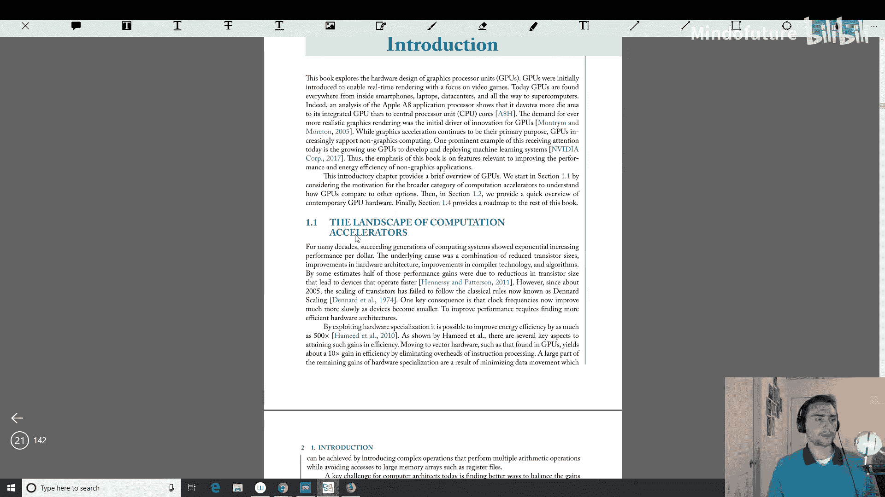
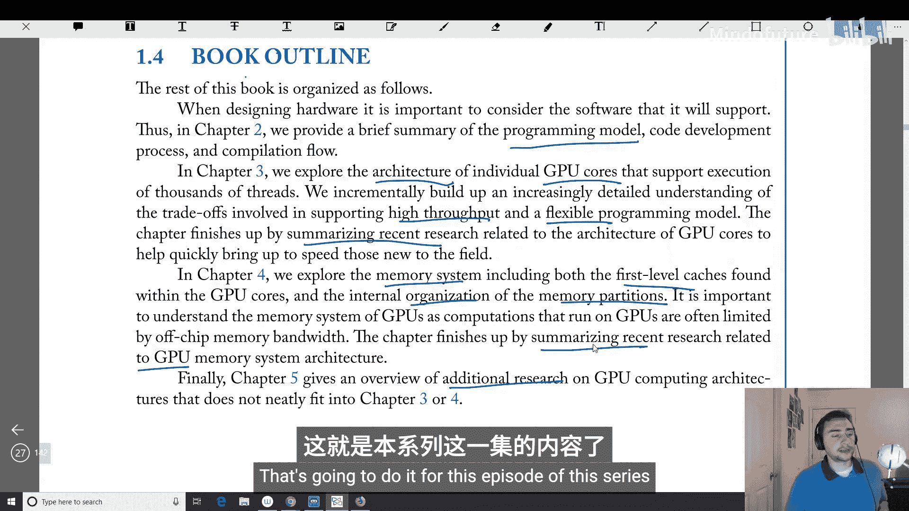

# GPU架构基础-p01-P01-Introduction--BV1ay5vzgEAe_p1-

Hey everyone， I'm Nick and welcome to my series on the fundamentalals of GPU architecture。

 So this in this video we're going to really introduce this book that we're going to be going over in the series called General purposepo Gs Pro Architectures and really going to dive into you know the non graphic side of GPUs。

So this is part of the synthesis lectures on computer architecture。

 so feel free to check that series out of books and you can find a lot of really great content there。

 So let's go ahead and get started。So let's go to the。The introduction。Okay。

So what are we going to explore in this book， So we're going to talk about GPUus。

 something that many people are familiar with， but there's not a lot of great references on in terms of the underlying architecture。

So you know， the first thing we kind of need to think about is。

 you know what's this space that we're in that， you know GPUs have kind of come to the forefront and we hear a lot about them when when it comes to。

 you know， machine learning type workloads and you know， will CPUUs replace will GPUs replace CPUUs。

 so let's kind of put that into perspective。So there's a couple things， so we need to think about。

Back in 2005， something rather interesting happened。And this was。

 we started to the thing called dinnernard scaling， really started to break down。

 And diard scaling is something that we really relied on to get a lot of our performance increases generation after generation。

Of。Transistor technology。 And what this really relates to is， you know。

 can we half the voltage while we double the frequency and double our clock frequency。

 And after a while， once we started getting to around 2005， the same kind of frequency scaling。

 we just couldn't do it anymore。 We hit something called the power wall。 And that's something that。

This property of dinner and scale this actually goes all the way back to 1974。So so what do you do。

 what do you do when you can't when it's really， really hard now to make transistors smaller and really。

 really hard to really push clock frequencies to the edge。So one way， of course。

 to do it is by exploiting parallelism。You know， we can make single thread performance faster and faster and faster and faster。

 but you know there's more than just the thing called instruction level parallelism。

 So CPUs fundamentally exploit instruction level parallelism。

 which means you know finding or picking out dependencies between instructions。

 finding ones that can you know how they can be rearranged through things like the reorder buffer in order to find you know inherent parallelism there。

 but there's parallelism at different levels。 So there's things like data level parallelism。

 So maybe the data that you're acting on。Maybe there's no dependencies there。 So that's one level。

 And then another one is， you know， task level parallelism。

 So maybe you just have completely different tasks that you need to do。 So this。

We entered kind of the parallel era， and that's when around 2005 or so that's when multi corere really started to take off more and became the dominant trend that we see today。

 you know， more and more cores every processor or generation。So back in 2010。

 how do we overcome this energy efficiency necessity for this new hardware if we can't push clock frequency？

And a lot of it came down to moving to vector hardware。 So this means doing things in parallel。

 And so， you know， and even CPUs have vector hardware in them， you know。

 the M M X extensions and the Sdi hardware that's in。Majority of。Parts now。

 you know that specifically tries to tackle this or tries to assist in that area。

And you know GPUs are a really good source of this， you know， GPUs are massively parallel processors。

So you know there's a couple things， though， so it's not just about you know finding this inherent parallelism。

 Another part of it， you know， we can't just say add more threads and you'll just keep getting performance。

So a lot of it also comes down to this idea of minimizing data movement。

 So if we have large amounts of data that， you know， we want to， you know work on， well。

 we only have， we have finite cache sizes and we have finite amounts of memory。

 so we need the we need all the data we're work on to be at the right place at the right time。Okay。

 so。So let's talk about so a key challenge for computer architects today is finding better ways to balance the gains and efficiency from using specialized hardware。

With the need。For flexibility required to support a wide range of programs。

 So not only do we need to design things that are really， really fast。

 but we can't afford to just throw them out as soon as， you know。

 the next application comes out that we need to accelerate that may be a little bit different。

 but maybe just different enough where our old hardware doesn't work great。

But that's not to say that specialized hardware。You know。

 is going away or will ever go away necessarily。 So a great example of specialized hardware that you know exists today and is incredibly common is the Google Tensor processing Uni。

Right so this is a。This is basically Google's machine learning accelerator that does a really。

 really good job at things like matrix multiplication。And you may。

 you may be familiar with this name right here。 Jopi。 So Joby's famous for a couple things。

 He's had quite a long。Career as an architect and one of his big contributions are these things called victim caches within CPUs。

 but。That aside， we're still in this era where machine learning is extraordinarily popular。

 And like the book says， you know， it's not going away anytime soon。 So a lot of research， you know。

 especially in the architecture area， as well as other areas。

 deals with how can we improve machine learning performance。But you know。

 going back to the point of we don't want specialized hardware for everything because it's not flexible。

 that's where GPUs come in。So the interesting note about GPUs as compared to other things like the Tensor processing unit。

 is that GPUs are turning complete or they have a T complete programming model。

So they can run arbitrary applications， things like a TU or they're much more limited。

 So GPUs are flexible。 So when the next， you know， range of applications come out。

 it doesn't require new hardware， they're general enough that they can， you know。

They can say run the new models。That may be significantly different from the ones that preceded them。

TPU is not nearly as flexible。So there's a trade off there。Because their GPUs are more flexible。

 that means on certain tasks， they're definitely not going to be as performingant as something like a TPU。

But again， it's a trade off。So for software that can make a full use of GPU hardware。

 GPUs can be an order of magnitude more efficient than CPUs so yeah。

 there's certain tasks that GPU can really blow CPUUs out of the water。

 but we need one key thing that we should keep in mind is that this doesn't mean that every task will be better on a GPU and we'll talk more about that later。

And so， you know， there's a lot of things that have been going on within， you know， GPp development。

 So in from the architecture level， you know， how do we make things， of course， go faster。

Another key thing that you know if you're familiar with any type of parallel programming is about the programming model。

 so parallel programming is incredibly difficult a lot of times。

 so there's a lot of work that's been done into the programability of GPUs while there's still some pretty major gaps there it is getting better and then also you know。

Flexibility and energy efficiency。 So right now， when you're tuning code when you're trying to efficiently create GPU code。

 a lot of times you have to explicitly know what type of GPU you're going to be running on if you want to see you know the best performance。

 So there's a lot of work in the area of， you know making it flexible。

 So you don't need to know the specific architecture。 And then likewise， power is always a concern。

 So just because we mean GPUus doesn't mean things like the end of Denard scaling in the power will win away。

Okay， so basics of GPU hardware。Okay， so again， it brings up the question of whether GPs will replace CPUs entirely。

And， of course， the answer is， it's unlikely。 So fundamentally， GPUs do。

Gps and C do two different things。 They're optimized for two different things。

 So you can think of the common analogies。 You can think of a CPU as a race car。

 and you can think of a GP as a bus。 So race car really， really fast。

 but maybe it only holds two people。 a bus considerably slower， but it'll hold 20 people，30 people。

 So they're fundamentally used for different tasks。

 So if we have incredibly serial code with lots of dependencies， and。We have to， you know。

 kind of go in like a zigzag line of dependencies and maybe control flow is really complex。

 CPU might be our best bet。 Well with GPUs， if we have， you know， tons， you know。

 tons and tons of things that are don't have many dependencies and can all run in parallel。

 GPUs are a lot of time the better bets。 So things like linear algebra， GPUs do really， really well。

And so they're really more seen as a co processor rather than a replacement for a CPU。

So a lot of time the general model is that you'll have a CPU and that will initiate the work done on a GPU and then you'll have to manage the data transfer itself so the GPU will have its own memory a lot of times that you'll have to explicitly copy to or use some sort of unified memory manage some unified memory interface in order to get that data onto the local memory for the GPU so that's physically different than the memory that's on the CPU。

あ。So another really big reason that， you know there is this switch is because or there is this split between CPU and GPU is that there's other things that GPUs fundamentally。

 or it's really fundamentally， they make more sense on CPUU。

 So one of them is interfacing with Io devices。 So maybe we're reading in data from something。啊。

Or maybe we're reading in， say from a file onto a GPU。 Well， from a CPU， it makes sense。 generally。

 we're working in a single thread。 We can open a file。 We can read its contents。

 So when we're on a GPU， we really don't think about things in terms of a single thread。You know。

 we think about things in terms of large collections of threads and because we do that。

 it makes this idea of opening up， you know a file， you know。Kind of kind， you know， kind of weird。

 kind of funky。 And the reason is because， you know， you don't necessarily want， you know。

1000 threads on a GPU all opening one file。 But there， there has been a considerable amount of work。

That''s gone into looking at things like this。Thanks looking at， you know。

 file system support for GPUs and， you know。Making a more sane way to maybe directly do IO from the GPU。

 say finding a way to have all the threads， you know。

 kind of collapse the requests into one request to say， open a file。Okay， so。呃。Okay， so you know。

 that really covers the basics of， you know， why do we still need CPU， So we should move into。

 you know， what's the typical design of a CPU GPU system then if we know that CPUs aren't going away。

So we have two main types of systems here。This one is probably the most common or the one that people are most familiar with。

So a lot of times you'll have， you know your CPU and whatever memory is associated with that。

 and then you'll have your GPU and graphics memory。So that'll be the local memory to the GPU。

 and then they'll be connected over some kind of bus。

In the case of a lot of GPUus are connected to the CPU via。

Or via the PCI Express right so you plug in a GP and PCI Express and then your CPU talks to the GP through that。

The other way。 And there's also some hat that had。AMD especially has this。

 like with their AP modelss， is that， you know， the CPU and GPU。You know。

 are kind of built in together。 So I the reason why I mentioned the GPU and not something like integrated graphics that things like。

 you know Intel chips have。Is because， specifically with the IPU。

 there's some really neat stuff there considering theyre putting a more powerful GPU in there。

And especially in terms of sharing the same physical physical memory， it becomes rather interesting。

 especially in terms of memory management， if you want the CPU and the GPU maybe touching the same data。

So let's talk about it。 So on left， of course， we usually call this a discrete GPU versus an integrated GPU on the right。

呃。So on the right is typical of GPUs like AD's Bristol Ridge APU。Or a mobile GPU， right？

So mobile GPUs often have the same kind of interface， where they'll share the same physical memory。

 so I Qlcoms mobile GPU is called the they're called Addreno GPUs。Okay， so。

There's another thing that we should think about when it attempts to memories and not all memory is the same。

 so we have CPU DRAM。That's typically optimized for low latency access。 And then we have a GPU Dra。

 which is optimized for high throughput。So that's why， you know。

 you'll see if you're look in a spec sheet， you'll have， you know， just say DDR 4 for a CPU while。

 you know， when they're releasing the latest GPU， it'll be say G DDR right and that's specifically for as we see here。

 DDR versus GDDR So that's four graphics right that's for GPUus。

 that's for this high throughput high bandwidth。Okay。So， and then， of course。

 for low power mobile devices， you can。The obvious extension is that you'll have DRAM optimized for low power as well。

Okay， so what's the actual flow though of execution in these models？As of right now。

 everything starts on the CPU， so you'll just like any normal C application。

 you're running Hello world or something， you compile an application， you execute it on the CPU。

And so what's responsible for you generally on the CPU is that you you make some calls to some GPU libraries that will allocate memory on the GPU。

So a lot of times you'll have to allocate memory on the CPU and then copy that memory to allocate a memory on the GPU。

呃。So that's what's going on here。 So you typically allocate space on both。

 So there is some data replication going on， something that， you know。

 is an interesting research area for APU type architectures or。

When you have them integrated on the same， same chip in or they share the same memory。

That becomes more interesting because maybe you don't need this replication。

So the CPU portion of the application orchestrates the movement of this data。

 So a lot of times you'll have。Explicit MIM copies。

But there is a lot of work that's gone into having automatic transfer and actual paging of data to the GPU and from the GPU。

 and so this was really kind of introduced in Invidious Pascal architecture。

 which was two generations ago now so we're on Tring architecture before that Volta and before that Pascal and then if you want to go before that。

 there's Maxwell and Kepler and Fermi， but of the more recent architectures。

 it's going to be Pascal and。Pascal and Volta and Tring。So。

So this is you know this is taken care of through virtual memory and you know this is typically referred two also as unified memory。

 so you have one azure space you're seeing。Oh there we go。Okay， so yeah。

 and that that's where the interesting thing comes in where they're integrated on the same chip is that。

You know， you're not going to have to have this programmer controlled copying from the CP to GP memory。

嗯。There there are some more nuanced problems， though。

 when it comes to sharing memory directly on an integrated system， and that generally relates to。

As is typical in for most problems related to sharing， it relates to cash coherence， so。

You know whose， whose data is valid at what time right and who。

 who has access to what and who should， you know what happens when somebody wants to write something or when somebody wants to read something in this cache coherence is something that becomes rather messy when you start talking about GPus where you have many。

 many threads， accessing many， many things at the same time。Okay， so。Of course。

 so after we've done the management of memory， we have to tell the GPU to do something。

So this is typically done with the driver。And of course， you the GPU has to know what to do。

 So you have to specify which code should be run。 And we generally refer to this as a kernel。

 which will go over another time。 but the reason why it's called a kernel。

 So not not to be confused with something like the Linux kernel。

 you know you can think of you know you have this major application and you'll have some some you know really big outer loop that does so a ton of things。

 and then inside you've got， you know this you know really compute intensive inner loop that you really want to optimize。

 And so it's this kernel of the program that you really want to speed up and that has this parallelism And so that's why we call it a kernel。

 It's just this small portion of a program that you really want to。

That you really want to exploit the parallelism of。So there's more things it has to do than just say。

what code should I run， you have to specify things like how many threads， So you know。

 even more than just P threads where I'll say like on a Linux system where it's like， you know。

 maybe I'll spawn you know，10 threads or 12 threads and run some program you know we're talking on the order a lot of times of。

 you know， thousands to tens of thousands of threads that you're going to be launching。And then。

 of course， you have to say， you know， where is the data that you allocated on the GPU？So。

So of course， the driver has to do a lot of the translation and a lot of this management and translate it and put it into a place accessible by the GPU。

Where the GPU， hit knows， hey， I need to check this spot for stuff。And then of course。

 the driver also has to tell the GPU， hey， you've got new stuff you have to do。

 here's the work that's been assigned to you by the CPU。So let's talk a little bit。

 so now that we've seen kind of the overall system view。

 let's talk more about modern GPUs themselves。So we're going to be mainly referring to these as by their two different names。

 so inVIDdia we have these cores so to speak that NviIDdia calls streaming multiprocessors and then on the other side of thing things AmD calls these compute units。

 so two names for you know fairly similar， if not just about the same thing。

And GPS have a different execution model， and it's this idea of CT execution。

 which stands for single instruction， multiple threads， so we'll have a single instruction。

 say an ad， but 32 threads will all do an ad on their respective data， or however they're indexing。

 say， an array。So each core on GP can typically run run on the order of 1000 threads。 General。

 it's something like 10，24 threads。That can be assigned， and then。You know。

 the threads executing on a single core can communicate through scratch pad memory and synchronize using fast barrier operations。

 So there's generally this thing within within the core itself called scratch pad memory inep in。

In Nvi GPU is called shared memory and you can think of this a lot of times as a user managed cache。

 so if you know exactly what data and you want to get the best locality and you know exactly what data you're going to reference。

 you can go ahead and load that in you don't have to worry about it getting kicked out or evicted by by other requests。

So， of course， it also has other things。 So it has instruction and data caches。

 which mainly act as bandwidth filters。 So this is mainly， you know。

 you have so many threads acting at the same time。 you can't just constantly be， you know。

 just pounding away the memory system。You know， nothing works well if you really stress it out too much。

 so by having cache is of course， they act as， you know， a filter more or less。

So that a large number of threads running on the cores are used to hide the latency of access to memory。

 So what do we mean by this， So this is a fundamental part of GPUs。Compared to CPUUs， so with GPUs。

You know because we have so many threads and we have so much work to choose from， you know。

 we can go all the way to memory。And you know， get data all the way back。 But the thing is。

 because we have thousands and thousands of threads， we can actually， you know。

 start to hide that latency， not have to say that we can hide all latency that comes from。

From memory aes。But we can do a pretty good job at it。Okay， so so how do we。

So here let's actually look at this for a second。 So what do we have here。

 So the general layout is we'll have， you know， a S core cluster。

 So we'll have a couple of S cores kind of grouped together that all go through some interconnection network。

And they'll be assigned to a specific memory partition， which will be assigned a specific part。

Of memory。 so because we've got this interconnect here， we can still access all of memory。

 but we have these partitions that split up the different piece of physical memory。All right。

 so how do we sustain high computation throughput？To balance high or。

To sustain high computation throughput， you have to also balance。With high memory bandwidth。

 So it's really important that we're not only understanding that we can do a ton of stuff in parallel。

 but how do we balance this with other levels of the GPU architecture。 So the memory system。

 especially。So in GPUs， this parallel is provided by including multiple memory channels。

 so know by having multiple memory channels， we get some higher bandwidth and memory not only provided by the fact that we have GDDR instead of just DDR。

And so like we said， this is associated with a portion of the last level cache。

 which in GPUs today is an L2 cache。So in video GPUs。

 they'll have an L1 cache and an L2 cache then the memory channels and then the backing memory。So。

That's not to say there aren't other organizations possible， so things like the Intel Zion Phi。

So they directly compete with GPUs for the supercomput market。

Which distributes the last level of cash with the course。Right。

So let's talk about the GPUs versus CPUUs in terms of performance。So。

So you know when we're talking about CPs， we'， of course talking about you know what's we have to do a fair comparison against state of the art。

 so we're talking about know superscalear out of order CPUs on highly parallel workloads。啊。

And the reason why GPUs tend to win out is because， you know， a huge fraction of GPUs。

It's just associated to arithmetic logic units and less area to control logic。

 So some things to remember are GP don't have things like branch prediction。

 They also don't have things like out of order execution。 So compared to CPUus， they're much。

 much more simple。 But they， they trade that off for the fact that， you know。

The number of a U that a Jepu has is。You know。Extreme。

 extreme increase over what a traditional CPU will have。So the biggest thing to keep in mind， though。

 is that there is a balance and there is regions where multi core CPUs are better。

And there is a region where。Oh。Massively multi threaded things like GP use are better。And。

We can really see that， you know， really in this picture here。

 so there'll be this multi corere region right here。As we start increasing the number of threads。

 and you see that there's this dip right here， right， So this dip right here。You know。There's。

There becomes this trade off of understanding， you know， we get really。

 really high frequencies compared to we get all this great serial stuff in CPUs。

 we get things like caboard execution， branch prediction， higher clock frequencies。In in CPUs。

 but then you know。If we have really massively multi threaded data。what we really care about is。

 you know， if we have something that's really compute dense， we really just want ALUs。

 So things like branch prediction aren't going to help us as much。

 But there is this region right here。As indicated as this valley right here。

 where we start to get between where， you know， traditional things in。

CPUs that exploit instruction level parallelism。You know。

 they're not giving us much more performance， but we're having more threads than we can really support on a CPU。

 but， you know， we're not quite at the point where we have something that's massively multi threaded。

So， you know， if we put it on a GPU， we're really not going to utilize， you know。

 our available band with that well。 And so there is this valley right here that we have to be aware of and deciding if we're in this valley if it should be changed one way to be。

 you know more optimized for a CPU or if it really is parallel and we just need to work a little bit harder to really kind of push it to the right and。

 you know。Launch the 10，00，00000 threads and you know。Really exploit that perlism。

 Those are things we have to think about。Let's see。So yeah， so again， like on CPUs。

 we'll increase threads to a point where， you know we can't actually support it with the caches anymore。

 Every single thread will just end up blowing out the cache of other threads。

 And so that's why we see this performance dip。 So you know。

 parallel parallelism depending on the platform isn't always a good thing。嗯。And yeah， of course。

 again， since we don't have enough threads， we don't do a good job at hiding。Off chip latency。Right。

 so again。GPUus are really designed for this idea of massive multi thread this massive multi threaded processors。

 So if we're not saturating it with enough threads， then， you know， the fact that you can swap。

 you know， you know， groups of threads out and find more work if you don't have those other threads to swap in。

 you know， you're not going to see the improvement。So。Again， with the end of Denard scaling。

 so again， often cid in around early 200s， early mid2000s。Energy efficiency is， of course。

 a big driver in the market today。 there's a lot of research that goes into more energy efficient designs。

So of course we also don't want to access very large memory structures that consume a ton of energy。

So of course， when we're talking about GPUs and having thousands of threads。

 we have to take this into consideration。And so a lot of times in our actual modeling themselves。

 so one thing that I use and a lot of researchers use is a simulator called a GP GPU SM that includes an energy model called GPU Watch。

Right。So we see that when we're talking about operations， so ads， tiny amount of picojos about。

You know， a10th of a picojoule， even something like a accessing 32 bits from a 32 k SRAm only takes around five picojoules。

But， you know， as we get up here to accessing 32 B from Dram， you know， sudden we' at。Y。640。

640 pikachjoules。 So roughly。64000 times more energy required than doing an ad operation。 So。

 you know， really adds up。 So if we need so that that that kind of drives home this point about being concerned about power still and also being concerned about data movement。

 especially for going， you know， all the way to the Rim。

So of course we should really talk about what is the background of GPUs， so GPUs didn't just appear。

 they do have a history。So back in the 60s， of course， you know， when computers were first emerging。

And computer graphics were first emerging。 That's kind of， you know， where things got their start。呃。

Things like a lot of drivers for early GPUs were， of course， you know， rendering for animation。

So early video cards started with IBM， the monochrome display adapter。Which only supported text。

 so we're not talking about you know playing a video or something。

 we're talking just about text at this point。And then eventually we moved on to 2D and 3D acceleration。

 And when we talking about early 3D stuff， it's always important to remember that Nvidia G4 256。嗯。

However， you know eventually， you know we started to get some programmability to the GPU in the shape of vertex shaders。

 so this is something more on the graphics side of things and then also pixel shaders。In the G43。So。

 you know， one thing that people were really clever back in the day。And they said， hey， you know。

 I've got this parallel hardware。 Why， why don't I do something， you know， kind of different with it。

 What if I don't really care about， What if I don't really care about graphics that much？

 And so people found really， really interesting ways of mapping linear algebra to shaders and to start mapping matrix data into textures and applying shaders。

You know， and basically， you know， cooping。Graphics processors。

 so we're not talking about the era of general purpose GPUs。

 We're talking about strictly graphics processors。And people found some clever ways to start doing things like Linear algebra on them。

And so this really drove the market。 So people were doing this to such an extent that， you know。

 places like Nvidia said， hey。If you want， if you guys want this。

 we're more than happy to provide it。So。Things like eventually Nvidia and the G4 8。好。

There is a couple innovations， so the ability to write to arbitrary memory addresses from a shader and scratch pad memory。

 So we started to free up the memory system。And then also enabling caching of Read towrite data in Fermi architecture。

 so now we're starting to reach the more modern architectures。

And so there's other things such as in MDD's fusion architecture。

 integrating the CPU and GP on the same die and having dynamic parallelism。

So things like launching from the GPU itself。 So typically we talked about this， you know。

 the CPU is really the thing that starts work on the GPU。

 so what if the GPU could start its own work in some cases。And then， of course。

 one of the more recent introductions and was even optimized further， I believe。

 in the Tring architecture were things like tensor cores。

 so specifically targeting specific non graphics related acceleration。Okay。

 so that's going to be you know， the brief introduction to GPUs and kind of their history。

 so what else are we going to cover？In this series。 So one thing that we'll cover。

You know if we're going to work with GPUs， we have to know what GPUs run。

 so I have another series specifically on KUDa programming for GPUs。

 but we will discuss the programming model in some detail here。

 as well not just for NVIDdia GPUs but for AMD GPUs as well。

 and we'll find that they're fairly similar even if their languages differ substantially。So then。

 of course， we have to get into you know the real cool parts， which is exploring the architecture。

Specifically， first of the GPU core and how they execute thousands of threads。

And then we have to know kind of build that up and how they provide this high throughput and a flexible programming model。

 and then we'll also introduce some of the recent research related to GPU architecture specifically for the cores themselves。

And then after that in chapter 4， we'll discuss things like the GPU memory system。

 mainly being things like the caches within the core， so L1 caches are within the GPU course。

As well as in some more internal organization， the memory partitions。呃。And then， of course。

 just like with the cores， we'll summarize some recent research。Related to GPU architecture。And then。

 of course。We'll talk about some other contemporary research issues。And really。

 some of the stuff that you know I work on in GPU architecture and what kind of the big outstanding problems that people are looking at right now for GPU architecture but。

That's going to do it for this episode of the series。 Feel free to check me out on Github at Github。

 com s coffee before arch。

I have a whole bunch of different series that on my YouTube channel and I post all the code up here。

 so feel free to look at my stuff on C++ data structures and algorithms。

 my parallel programming and C++， which is multi core programming。

I've got some basic stuff with C++ and Python 3 as well as stuff like coupa programming。

 so how do we program GPUs and。As always， all the code for these things like I said。

 is listed as well as linked to within the individual repositories。

 and I'm always open to suggestions。I'm Nick from Coffee before Arch， and hope you had a nice day。

