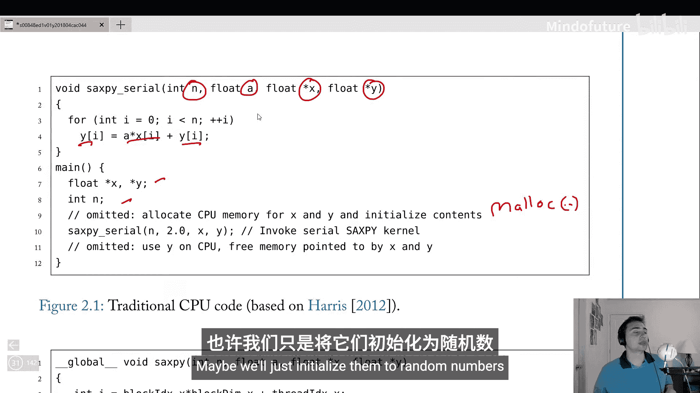
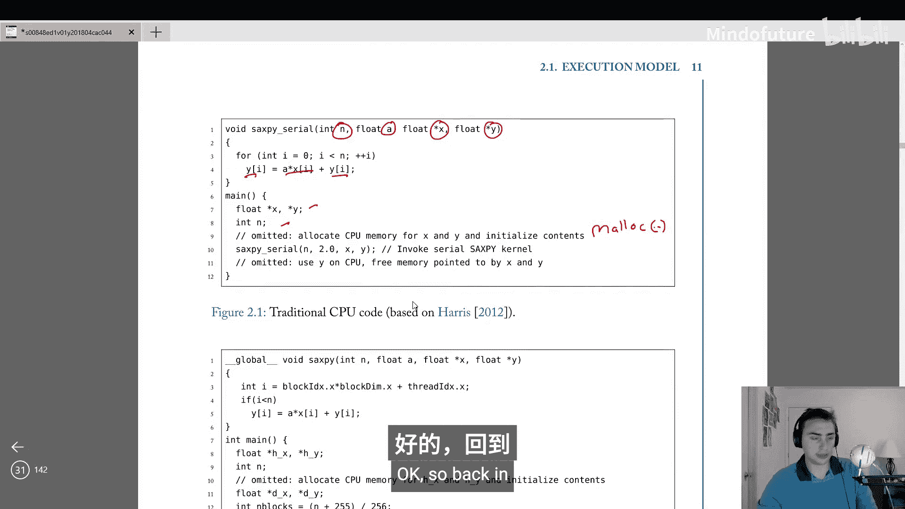
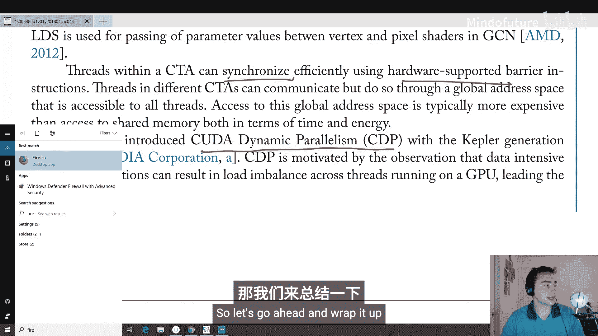
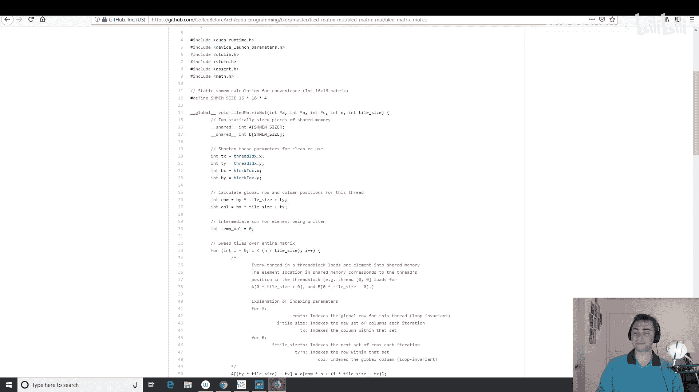

# GPU架构基础-p02-P02-Programming-Model-Part-1--BV1ay5vzgEAe_p2-

Hey， everyone， I'm Nick， and welcome to another episode of Fundamentals of GPpU architecture。

 So in this video， we're going to expand on this 10000 f view that we saw of GPs in the last video where we got some basics of。

😊，You know， where GPU programming came from for general purpose applications followed by。

 you know what does a GPU look like from kind of a 10，000 foot view。

 as well as some basics like the history and you know what kinds of GPUs are out there。

 whether they're discrete or whether they're integrated， so you know。

 they're connected with the same physical memory as the CPUU。

So you in order to understand the architecture that we'll cover in later videos。

 we have to understand the programming model for GPUs。

 this is really essential before we dig into the hardware because at the end of the day。

 how we program a GPU depends on will depend on the underlying hardware and the underlying hardwares of course influenced by how we're able to program it。

So。So this is just going to cover kind of the basics of GPU programming If you're interested in you know GPU programming itself。

 I suggest this book which is cited here， which is a programming massively parallel processors。

 it's a great book I used it when I was learning GPU programming also check out the videos that I have and the other YouTube series Kup to crashash course where you know I do a lot of the examples that they cover in this book as well and some other things that aren't covered in the book。

So， you know。Let's just jump right in。And so and start discussing how we program GPU。

 so GPUs employ wide CD hardware。 So again， this is single instruction， multiple data。

To exploit data level parallelism inside of GPU applications。

 So we have a lot of parallelism in our data that we want to exploit。 so you know。

 we can work on different pieces of data at the same time because there's no dependencies。

 So that's really what we use GPus for。But the。How we actually program this hardware through APIs like KUa and OpenCL。

 So KUa is from NviIdia， so in GP GPUs are typically programmed using Kuda。

And then AMD GPUus are programmed you know a lot of times with open C。

 they feature a MIMD like programming model。That allows the programmers to launch a large array of scalar threads onto the GPU。

So each of these scalar threads， because submity stands for multiple instruction， multiple data。

 and these things are， again， are scalar threads。 So each of these scalar threads has the ability to follow a unique execution path。

 So every single thread could be doing its own thing， we could have this big， if else， if， else， if。

 else， if statement and kind of section off threads 1 by one。

 and every thread could do something different。But it's important to note that at runtime。

That's not exactly how things get executed。So these scalar threads aren't just completely independent and you know individually schedulable。

 they're actually grouped into things that NviDdia calls warps and AMD calls wavefronts。

 so these are just collections in the case of warps， 32 threads and in the case of wavefronts。

 64 threads。That operate in lockstep。 So this means that every single thread is doing the same operation at the same time。

 So if we have you know an ad， all 32 threads in a warp will all be doing an ad。

 So we'll only have one instruction and this execution model is called St。 So single instruction。

 multiple threads。 So we can still have this these， you know this vision of scalar threads。

 even under a St model， we just have to make sure that we have something called an active mask。

 which says which threads inside of a warp or active at one time。 So in reality。

 when we're programming these things， we really should be thinking about what entire warps are doing at the same time in avoiding and avoiding having。

 you know every single thread in a warp be doing different things。

 which is something that we call warp divergence。😊。

But we'll discuss that later on and how that actually gets handled by the hardware when there is warp divergence。

So。Let's go ahead and get started with the execution model。 So again。

 kind of like we saw in the previous chapter。So everything starts really with the CPU。

 so the CPU is kind of the thing that kicks off everything when we're executing GP code。

So typically from the GPU we'll allocate memory so we'll do something like a kudamalik。

 so just like Malik does it'll allocate some memory for the CPU kamalik allocates memory on the GPU so a lot of times when we're programming these things we have a discrete GPU so it has its own memory。

 so we have to call kamalik。In the case， this is， of course， in the case for NviD GPUus， you know。

 OpenC does not have Kutamalek。And then of course， there'll be a data transfer。

 so because the memory is separate physically， we have to copy the memory from CPU memory all the way to GPU memory。

 and this is typically done with a function call in the case of NviDdia， this is Kuta M copy。

 so fairly straightforward name。Okay。So again， this transfers our input data to GPU memory and then we'll launch right。

 so then we have to tell the GPU hey， I have a kernel free you to work on， here's the kernel。

So for integrated GPs。 So these are the GPUs that we discussed last time that shared the same physical memory as the CPU that's common in things like the。

And mobile devices that have a GPU in the same SOC as a processor。

And then also it's in things like the APU from AMD。They share the same physical glimmering。

 So for these， of course， we don't need to allocate separate memory。 we don't need to。We， of course。

 don't need to copy memory because they're shared physically the two pieces of memory。

 it's really just one combined memory。So for this for integrated GPUs。

 we really only need to launch the kernel because the memory is already there。Okay。Alright。

 so let's go ahead and keep going。 So we'll scroll down。

So typically these kernels are composed of thousands of threads， and like we saw last time。

 we really want to be launching thousands of threads when we do a kernel because we really want to soak up all that memory bandwidth that we have available to us and really occupy our GPU。

And then each thread will execute the same program， so we don't need to。

 you know if we launch 1 thousand0 threads， we don't need to write 1 thousand different programs。

 we'll define one program that every single thread will execute。And of course。

 these threads could have different control flow through the program。

 so if we have an if statement and an else statement， you know。Conceptually。

 we could have some threads go into the if statement and other threads go into the else statement。

 although we want to try to limit that as much as possible。At least at certain granularities。

 but we'll discuss that another time。So we'll go through a very basic example of something called Sxby。

So what is sxby， So saxby is a single precision Scalar value a times vector value x plus vector value Y。

 So long， a long name for something that's incredibly simple。

 All this says is that we're going to have some array。We'll call it x。

 and we want to multiply every element in array by some value a right。

 so we're scaling up this x a times right so it's a times x。

 So every element in x will be whatever x of I times a。

And then we're just going to add that entire array to another array。

 y right and these are all going to be single precision numbers。

 so we're talking about floating point numbers here。

And this is a very common well known part of the basic linear algebra software， so BloOS library。

And it's often used for implementing higher level matrix operations like Gaussian elimination。

So know， NviIDdia actually has its own library for highly optimized bs。Colons， it's called Kub Blos。

 stands orkua Blos Library。And。Yeah， so these are very common operations。

 so we'll start by going over this example。So， and then we'll also look at some open CL as well later on。

 But a lot of this book is focused more on the Nvidia side of things。

 but you know architectures for GPUs are somewhat very similar right At the end of the day。

 it's very， very parallel hardware。So let's start it off by just going over the basic serial representation how this is。

 you know， if you were to just open up you know， a terminal or open up an IDE and make a quick C or C++ program。

 what is it going to look like？So here's our Saxby serial program。

 so it'll have you know the number of elements in an array。

 it'll have some value a that we're going to multiply times every value in an array X in an array Y。

 so we're just passing pointers to these arrays here。

And then what we'll do is we'll just iterate over every single element inside of these arrays We'll multiply the element of x times a。

And then we'll add it to Y。 and then the output we can just store in y。

So in the main function side of things， it's pretty simple。

 all we need to do is declare a couple pointers， declare the size of the array。

 What's omitted here is we're going to need to allocate some memory and initialize the contents。

 so we'll need to call something like malac here， you know just to allocate you know some memory for both of these arrays。

And then we'll have to have some， you know， either we'll read in the contents of two vectors or two arrays。

 or maybe maybe we'll do something different， maybe we'll just initialize them to random random numbers。

Okay。So let's z back in。

Okay， so here we have just a function call so we'll just scale everything by two。

 but you know overall this is a fairly simple code。

 So let's see how it changes when we look at the GPU side of things so we'll start with the host site code and so we again terminology wise when we say host side code we mean the code that's executed on the CPU。

Dvice side code is what we refer to when we're talking about code executed on the GPU。So again。

 we'll create a couple pointers to arrays This time we'll prefix it within an H specifying that this is a pointer to these arrays on the host side。

And then we'll also have a size in。And then again， we'll have to call Maicure and initialize these two arrays。

or some， or if we're doing C++， we could call new。Okay， and then this is for a discrete GPU。

 so we'll also have to have a couple pointers for device memory right because again these are physically separate pieces of memory。

 so we have to allocate memory on both sides， the host side， the CPU， the device side of the GPU。

RightSo we'll skip over this line right now and let's just go to the allocation right， So over here。

 we'll go ahead and allocate memory on the GPU and we do that with simply kuta Malek。

And then we pass in the address of these flip pointers。

And then how much space we want to allocate and then within these pointers。

 it adds a pointer to device memory so this is something that we can't be referenced on the CPU。

 this is something that's only valid on the GPU because completely separate Azure spaces because it's completely separate memory。

Right。Then， of course， we'll have to。Copy of the data over and so we use KutaMm copy for this and so we say I want you to put into this Dx。

 which is our pointer to device memory that we allocated here。

 I want you to put whatever is in H of x， so that's our host memory。Then however。

 however many bytes in this case is just going to be in。

 which is the size of our array times the size of a float。 right， So it's going to be， you know。

4 bys times the number of elements。In the array。 And then we have to specify direction。

 So we'll specify co a mem copy host to device If you want to copy things back， as we see down here。

 to copy them back。 You know， this， this will be2。GPU， and this will be。From the GPU。

And so it's pretty similar in this way， the only difference is our target is first， of course。

 so our target was the device side here， so here the target is going to be a host pointer from a device pointer。

Then it will be in time size of float。 So this is just the number of bytes。

 And then we specify the opposite direction。 So instead of host to device， it becomes device to host。

And then， of course， we'd do some free over here， right， so we'd free our host memory。

 and then we'd also do coupa free， which is just the same thing except it frees device memory。

 So now let's talk about， you know。😊，The little bit nastier parts of GPU programming that we skipped over。

So as we mentioned in the last video， in order to get this parallelism。

 we have to set up a grid of threads that we're going to launch。Right。

 and so that's our grid of scalar threads。And so programmers define this in。

In really two different ways， so they define it as an entire grid。

 and then they define it at chunks of the grid called thread blocks。

And so let's do a very simple example here。So let's say I want to launch four threads， right？

 I have four scalar threads here that I want to launch。Well， eventually。

 as we scale this up and up and up， we get a limitation on， you know。

 the number of threads that we can launch inside of a sable thing called a thread block。

 So if we put everything in one thread block， right， so you can think of having this thread block。

 it has some number of threads in it。Eventually。You know， this thread block will get full。

 There's dimension constraints on a thread block。 and thread blocks are the things that actually so we'll call this a T for thread block。

 and this will actually get scheduled to an S M。 So a streaming multi processor。

 which is just a core。So what we want to do is we want to put all of our threads into different。

We want to have groups of threads inside of thread box。

 and we want to launch multiple of these things so they get spread out across all the cores。

 So let's do a simple example。Where we have a thread block。They can hold two threads。Right。

And then say if we want to launch four threads， we launch two thread blocks。

If we wanted to launch six threads， we'd launch three thread blocks， right？

So this is just a very simple example， in reality， we can launch a lot more threads per thread block than this。

And again， you know we talked about warps earlier in wavefronts。

 the programmer doesn't actually see warps in wavefronts。

 so thread blockslock actually get decomposed into warps and wavefronts behind the scene All the programmer sees is thread blocks and a grid so each of these things is a thread block。

And in the collection of all of these thread blocks。Is a grid right， So it's a grid of thread blocks。

Okay， so let's let's get rid of this and then let's get to the a little more complicated parts of GP programming。

 So let's start here。 So the number of thread blocks that we want to launch。

 we specify that right here。 and in this case， it's n plus 255 divided by 256。

So this is a little non intuitive when we first look at it。

 so I'll break it down of what they're trying to say here。

So one of the assumptions being made here is in the kernel launch itself。

 which we'll get into a little bit。 So for a kernel launch， we specify two things。

 We specify a grid size。And a block size block is just short for a thread block。

 so we can say A TB size。RightSo we specify， how many blocks we want to launch and then this is this。

 is equivalent to how many threads。Per block。So down here， that's the order here。

 So the number of blocks is the grid size and the threads per block is 256。

 So that's where this 256 comes from， as well as is 255。

 This comes from this assumption that they're launching 256 threads per thread block。

And so in the example we looked at we just had you know four or two threads per thread block。

 So let's see where this n plus 255 comes from。 So sometimes we get really lucky and we have input sizes that are a power of two other times know we're not so lucky。

 maybe we'll get an input size of 1000 instead of 1024。

 and so we have to be able to pad those empty threads in a thread block to make sure that。

 you know even if every thread in a thread block isn't working。

 we're still calculating the entire operation of say Saaxby。

So let's see where this n plus 255 do 256 comes from。

 So let's say we have our thread block thatter size 2 again， and we have a problem size that is say。

 you know。N is equal to 5。So in this case， how many threadbs do we need to launch？So。

Here's a thread block with two threads。Here is a thread block with two threads。

And then here's our final one。 Now， all the thread blocks have to have the same size， right。

 so we can't have one with less threads。 So we have to have two threads here， right。

 even though we only have five elements。 So how do we get from 5 to3 thread blocks。

 So we have to do some padding。 right， So that's where this n plus 255 comes from。

 So if instead this was two threads， this would be in plus。At2。-1， right。

 so this that over here is the number of threads minus-1。Divided by the thread block size 2。

 So in this case， it's just padding to make sure you get to the at least to the very end of the。

Of of a thread block， right？ So so in plus one divided by 2 is going to， in this case。

 be 5 plus 1 divided by 2， which is going to be equal to 3， right， So3 thread blocks。

 If we didn't do this padding at the very end， what what would we wind up with。

 say if we just want to split our problem by dividing you know the total number of elements by the number of threads per thread block。

 Well， then in this case， we would do5 divided by 2， which is going to equal 2。5， right。Now。

 the thing is， this is an integer， right。 So it's int nu blocks。 So we won't keep this05 parts。

 So we'll only launched two thread blocks。 And then the last element of these vectors won't get calculated。

 So we have to make sure we do this padding， especially if we're doing， you know。

If we're calculating things， it aren't a multiple of the threads per thread block。

If everything was a multiple of 256， you know， it would always divide evenly。

 so we have to do a little bit of padding。So that's kind of the basics there。So over here。

 we calculate our grid size。 So in blocks is our grid size。

 So this says that in the case of our simple example。

 it would have said we were going to launch three thread blocks。In this example。

 it's kind of generic because we don't specify what in is。

And then down here is where we actually launch the kernel。So we have a kernel called Sxby。

We're going to launch a grid size of some number of blocks。

 and we're going to launch some number of threads here。In this case， 256 threads per thread block。

 again， this is per thread block。And then we'll have some parameters here and notice that we put all of these block and grid dimensions inside of this code。

Triple less than greater a greater than sign notation。 So it's kind of funky。

 Thiss kind of triple Cheevron notation。 But you know。

 somebody decided that's how we want to launch kernels。 So that's how it happens。

So that's kind of our setup。 So now we know how to kind of define a grid。

 We know how to define the number of threads we're launching overall。

 we know how to copy allocate memory on the GPU。 We know how to copy memory onto the GPU。

 So what's left。 Well， of course， the actual kernel itself。 So now let's look at the kernel。

All right。So here we have it。We always specify and Kuda。

 a kernel will start with this global right here。 So this just says I'm a function that will be executed on the GPU。

 and I will be called on the CPU。 So the CPU will call this function and then tell the GP to do this work。

 There's also this， this could also be device。 and that's a special kind of you know。😊，A function。

 which is called a device function， and that is something that it doesn't start on the GPU or sorry。

 it doesn't start on the CPU。 It's a function that's called directly from the GPU。

 but we'll leave that to another time as well。So the rest of it is exactly the same as。

It's exactly the same as a normal function you would see in C or C++， you know。

 it's just a void function called Saxby， you know， and it takes some parameters in this case。

 it'll take an integer in so the number of elements a float A， which is just how we're scaling。

And then two pointers to device memory。 Remember， down here when we call the function。

 we pass it the pointers that we allocated with kudamalc， right， we don't pass the host ones because。

 you know， on the GP， you don't understand CPU memory if you're on the GP for discrete devices。

 So it has to be the device pointers。Okay， so then we have our first kind of new line compared to the last one。

Which is this block I D X， block dim X and thread， I D X。

 And then its this int I is is set equal to that。 So all of these values are things that are kind of they're built in values for every single thread。

 So as you can imagine， it's important that every thread knows where it is within our grid of threads。

 So let's get back to a simple example of say， you know， and is equal to 5。And our thread block size。

 you know， T size is equal to 2。 So there's two threads per thread block。So， here we have。You know。

Two threads。In the first thread block， two threads in the second thread block。

 And we have two threads in the last thread block because they all have to have the same number of threads。

 But this threads actually not going to do anything， right， So this thread is just kind of。

 it'll be idle。So you know how do we figure out which thread we are globally in the entire thing。

 So we know that this thread should access element 0。

 This thread should access element 1 on this thread should access element 4 So intuitively that makes sense。

 but how do we get to you know how do we tell the threads that and we do it through these variables right here。

 So we have a block I a block dim in a thread I。 So a block I is just going to be which thread in a specific dimension you are。

 So one thing that I kind of omitted is that you know grids and blocks can have know parallelism defined in three dimensions。

 So I could have blocks defined in the x dimension。

 the y dimension and the Z dimension and I could arrange threads within a thread block into an x dimension a y dimension and z dimension for something something as simple as this we don't need that extra those extra dimensions。

 we just have a big long array so。We need is a single x dimension。

We'll kind of ignore that other dimensionality for now。So again， so if we consider this to be。

The X dimension。 So let's look at the block I。 So this will have block I 0。 This will have block I 1。

 and this will have block I 2 right So just it just linearly increases。And then the block dimension。

 this is going to be the same for every single block。

 And that's just the number of threads that are in the X dimension for every single block。 When。

 in this case， it's going to be2。 every thread has two thread blocks in the X dimension。So， you know。

So we can say B dim is equal to 2。And then of course， we have thread ID X dot x。

 which says which thread am I in the x dimension in this particular block？Right。

 so here we' have thread0， here have thread 1， here we have thread 0， here we' have thread1。

 and this will continue on。So how does this calculation look like for a particular thread。

 So it's a very simply a base offset right So to figure out the base。

 we calculate this a block Id x times block dim x。 so if I'm block 0。This base will be zero。

If I'm block 1， this this base will be2。So it'll be block I x1 times block dim。2。

And then if I'm in the third block， my base will start at 4， right， So it'll be block I D X。

 which is 2 times block Dm x， which is 2， right。 So this is 4。And then， we find a。

So that's our base and our offset is just going to be the thread within that block。

So if we take something in the middle here， So let's say we want it， we want this thread right here。

 right？So our block IDX is going to be1。Our block dim X is going to be 2。

 Remember that's the same for every block。 And then our thread I D X is going to be。

 So this is thread 0。 This is thread 1。 So they linear increase from 0 to however many threads you have per thread block。

As in this case is going to be one。 So this will be two times1。Plus one， which is equal to。3。

Right so and that makes sense if we were to count linearly up from starting from the first thread。

 so this would be 0，1，23 right so like I said， this calculation is just finding a global thread index。

 So which thread am I with respect to the entire grid and so it's fairly simple in this case once we start doing two dimensional threads like I have in the you know the coa the couta crash Co videos for you know handling。

 say a 2D matrix。You know we have to， we have to both calculate， you know， a row and a column。

 but in this case， it's fairly simple。 It's just one dimension。

 We just have a big long line of threads， and we need to figure out where we are in that line。

So then we have a simple comparison statement， so we want to make sure that， you know。

 is the thread that we launched， is it active， right？So in this case， in our simple case right here。

 So let's clean this up a bit。 Let's draw this again。So we launched three thread blocks。

 but our last one。Had an inactive threat in it， right。So， we had。These five， because n is equal to 5。

 That's the number of elements。 So we want to launch as many threads as elements。

 but we had to do a little bit of padding for this last thread。

Because we have to launch a fixed size number of thread blocks or rather the number of thread blocks have a or the threadb themselves have a fixed size。

So how do we avoid this thread doing anything nasty， right。

 We don't want him to access memory that's out of range。

 We don't want him to interfere with anyone else's memory。

So it turns out we can just do a simple comparison。So we just said if I is less than n。

Right so this thread， this calculation I will be 0。 this will be 1，2，3，4，5。So this one，5。

 or in is equal to5 itself that we pass in right here。So in this case，5 is not less than 5。

 So it just doesn't do saxby。 just doesn't do a times x plus y。 So， you know， we launched a thread。

 You know， the thread's not doing anything， but that means it's also not harming anything。

 So we can get away with that， right， And sometimes we have to do that If we have an awkwardly sized problem。

And so that's kind of the basics of the GPU kernel right here。

 So the general process that we do is at the very beginning of the kernel will you know figure out what position you know a thread is in with respect to the entire grid。

And then we'll start doing computation based upon its position in the grid。 So again， you know。

 instead of having a for loop here like we had in the serial saxby。

 that for loop is replaced by just a calculation of a position in a grid。 right。

 So that's what's used to index Y。An X。Okay， so a little bit complicated。

 but fundamentally it's the same。 We just need to figure out we're basically unrolling a loop。

 So every iteration of the loop now just becomes the operations of a different thread。Okay。

 so some clean up stuff。 Let's talk about some basic things。 So again。

 these triple angle brackets is what we used to define a grid of thread blocks。

 And then behind the scenes， this will get translated back into warps。

 or in the case of A D wave fronts。 Again， Nvidia has size 32 warps。

 While A D wave fronts consist of 64 warps。 Occasionally。

 thread blocks themselves will go by a different name。

 Sometimes people will call them a CT T A or a cooperative thread array。

Let's see if there's anything else。I think that's going to be about it。

 So there's some other things that we can do。As well。

 so inside of we can do a little bit of optimization inside of the GPUs themselves when it comes to programming。

 so GPUs have a very， very fast piece of memory， we can access this local to the core and it's called shared memory for NviDdia GPUs and it's called the local data store for AMD GPUs in the GCN or graphic score next architecture。

So what is shared memory and you'll see this a lot if you start looking at optimized GPU code。

So you should be familiar with something like A。Something like a cache inside of a CPU right So GP have caches too。

 But the problem is because there' are so many threads inside of a GPU， it can， you know。

 you have lots of threads all saying doing loads or stores and you can have problems of locality right because you know。

 CPUs， you have a single thread kind of going and。You know， it can find a good amount of locality。

 but as soon as you start putting more threads active at the same time。

 they'll all be competing for the same cash and you can lose a lot of locality there。

 But what if you know exactly what kind of or what piece of data you needed to have locally at a given time and you know。

 you don't want those to get evicted no matter what。

So NVIDdia and AMD both allow this and something called Share memory or the local data store。

And which is the scratchpad memory And what you can do with this is you can manually load data into Sctpad memory。

 which is very， very fast。 it'll be like a five cycle access time that is， you know。

 you can access it in parallel with every thread of like a warp。And you know。

 it's not going to get evicted you manually， you know， in the programming language itself， you know。

 you have an interface to loading into the shared memory or local data store and also you know。

 so you can read and write from the local data store and you can also you know read from the local data store or scratchtpad memory and write it back out to main memory。

 but it's kind of manually managed。And so that's just kind of this optimization thing that we can do in a lot of GPU programs。

So yeah， so this is typically for if the programmer can identify data that is reused frequently in a predictable manner。

 If it's not predictable， then you're not going to see much benefit because fundamentally。

 you have to load from main memory， no matter what before it goes into the local data store or scratch pad memory or shared memory。

 You know， it still requires you to load it from main memory。 That's where the data is。Okay。

So then you know， inside of a specific thread block or CTAs are often called。

 you can synchronize the threads within a single thread block。

 so there are supported barrier operations like underscore sync threads that says I will wait at this point or every thread will wait at this point until every other thread of the thread block reaches here。

And this is needed a lot of times when we're working with shared memory。

 Another interesting part of the programming language itself。

So Nvidia introduce this thing called Kup dynamic parallelism。So what is k dynamic parallelism。

 So if we know。So we can actually so could dynamic parallelism just kind of enable the ability to launch work on a GPU from the GPU。

 so it no longer just has to come from the CPU launching work。Okay。

So that's going to go ahead do it for this episode so that's kind of the fundamentals of GPU programming。

 so let's kind of wrap this up So what we kind of saw was that you know fundamentally in the GPU application。

 it starts with an allocation of memory， a copy of memory。Then we have to define our problem。

 right So we map a problem。 In this case， it was Saxby。

 We map it to a grid of scalar threads that it's broken up into thread blocks。

 then with inside the kernel itself， every thread has to find where it is in this grid of thread blocks and then it will operate on the data that's mapped to that grid of thread blocks。

 and that's managed by the programmer there。And then we also talked a little bit about the fact we can have。

You know， we can have some slight optimization。 So if we want to exploit some。

If we know exactly what data that we're going to be working on。

 we can of course have shared memory or local data store frequently called scratchtpad memory where we can put pieces of data that into a user managed L1 cache so that we can exploit locality that the programmer knows ahead of time。

Right。And then we also talked a little bit about， you know， not only can we launch work from the CPU。

 but with the introduction of K dynamic parallelism， we can actually launch work from the GPU itself。

 But okay， that's going to do it for this time。 So let's go ahead and wrap it up。

 So feel free to go on the Github page at Github do com s coffeeoff beforearch。

 And I'm not logged in。

So let me log in real quick。So on this page。This is where I do all of my。

 I host all of my code for all of my videos。

And so feel free to download any of this。 So I've got stuff on， you know。

 what's most related to this will be the coupa programming stuff。

 So I have links to all the videos there， as well as links to all of the。All the code we use there。

 So here's a quick example of tiled matrix multiplication。

 So we see that we're using shared memory here。And then we're also doing。

 you know the same kind of you know calculating using block Is and thread IDs。

 So you know this is what， you know kind of optimized， you know GPU code looks like。

 but that's going do it for this time next time will cover you know the instructions set architectures and how those vary between different generations of architectures for GPUs and what we can kind of glean from that information。

 But I'm Nick from Ka before Arch and I hope you have a nice day。

