# GPU架构基础-p03-P03-Programming-Model-Part-2--BV1ay5vzgEAe_p3-

Hey everyone， I'm Nick and welcome to another episode of Fundamentals of GPU architectureitect。

 So in this video we're going to expand on what we talked about last time。

 which was you know the high level programming interface for things like GPUs using KUuda。

And we're going to see how that actually translates down to first a virtual instruction set。

 and then finally a machine instruction set， and we'll also look a little bit at open CL。

 which is more typically used for AMD GPUus rather than invi ones。

So let's go ahead and get started so again。With all of these things。

 it all starts back at the very beginnings of GPUus with purely graphics oriented things。

So instructions to virtualization for GPUs。You know， it really started with， you know， open GL。

And their OpenGL shading language， OGSL， and then also Microsoft's high level shading language HLSL。

But， you know， Kuta came around 2007， so a similar path。

 they had their own high level virtual instruction set architecture。And so for NviIdia GPUs。

 this is called parallel thread execution， ISO or just PTX for short。So。

This is a fully documented virtual instruction set so you can go to the Nvidia site and you can see。

 you know， the semantics of all these instructions and， you know what to kind of expect from them。

 and then， you know this。This virtual instruction set itself is used in a very common academic simulator。

 So that's used for hardware research called GPGPU Sim。

 So GPGPU Sim allows you to simulate new architectures for GPus。 So you know as that kind of implies。

 doesn't run on a GPU。 It runs on a CPU and it uses this virtual instruction set and it gives you a functionally correct simulation。

 So there's a performance model。In there， but then there's also a functional model。

 So not only do you get the performance numbers that you know you can use to kind of judge whether or not new architecture is good。

 but it will actually be running this Px instruction set and it will give you the desired result as if you did run it on on hardware right So if you did vector add or something or like Saxby and the simulator。

 you would get the same result at the output。 It would just take quite a bit longer。

 So it's not a replacement for GPUus as far as running GPU code。Okay。

 so PTX is pretty similar as it is a risk instruction set architecture like arm or MIps or Spar。

 which means it's pretty easy to understand unlike more complex things like like a cisc architecture like X86。

And so we'll actually see that and we'll look at what that Sx week program that we saw above。

or in the previous video， how does that translate into PTX So let's go ahead and so let's give a kind of a refresher。

 So here's our Sacby code。 the only thing that's going to be PTx here is of course the actual Saxby function itself everything else is just going to be run on the CPU so that that requires no special know that's kind of out of the scope of you know GPU architecture or GPU programming。

 So it really just cared about what this turns into that's into PTx or how this is turned into PTX rather。

So that's our CPU code or or rather our our high level ka code。 So you know， just as a reminder。

 so it's a。Cutto kernelnal。 So that's denoted by this global。 And then we pass it some things。

 And then， you know， we figure out a， you know what position the thread is within a grid right here。

 We make sure that we're not off the actual number of elements inside of our vectors that we pass in。

 and then we just do saxxby。 right Every thread does their own version of saxby。

 So let's see how this looks in PT X。Again， the virtual instruction set。So。

It's not terribly difficult to understand， but it is a little more verbose。

 So we've got this these parameters right， and these parameters are just what we're loading in。

As far as you know our arguments to the kernel so we've got an U 32 and a floating point number and then these two U64s。

 So these are just going to be our pointers， right， 64 bit pointers。Then we'll have this flow point。

32， so that's going to be our a value of saxby， and then this U32 is just the size of those vectors。

 which is an int that we passed in。RightSo if we go down to the actual code that gets executed。

 right？So we've got， you know， you know， this is just loading up parameters， so with LD parameter。

 pretty easy to understand。Then we'll go ahead and get our block and our thread dimensions here out of the special registers。

 So CTA ID， so cooperative thread array， like I said last time， it's another word for thread block。

So CTA ID NTID and TID， so we use these to calculate where we are within the grid。

 which is what this multiply and ad does instruction and then we have this set P so set P stands for set predicate。

And so basically what this does is it evaluates some operation that' is greater than or equal that's denoted right here。

 and then it sets a predicate， in this case， predicate1。

And then we evaluate that predicate here right and so based upon how we evaluate that predicate either you know this is that if statement in there。

 so either we do nothing， so we go all the way here right and just to the return part of the program or we actually do Saxby right so this big part right here is the actual saxby。

So we see you've got some。We've got some global loads that we're doing here。Then we also have。

 you know， a store to main memory。 So that's after we do Saxby， and then we've got some， you know。

 addition multiplication right here。So again， this is just， you know。How Sxby looks in terms of PTx。

 right， but it's fairly easy to understand。 So let's kind of go back up here。

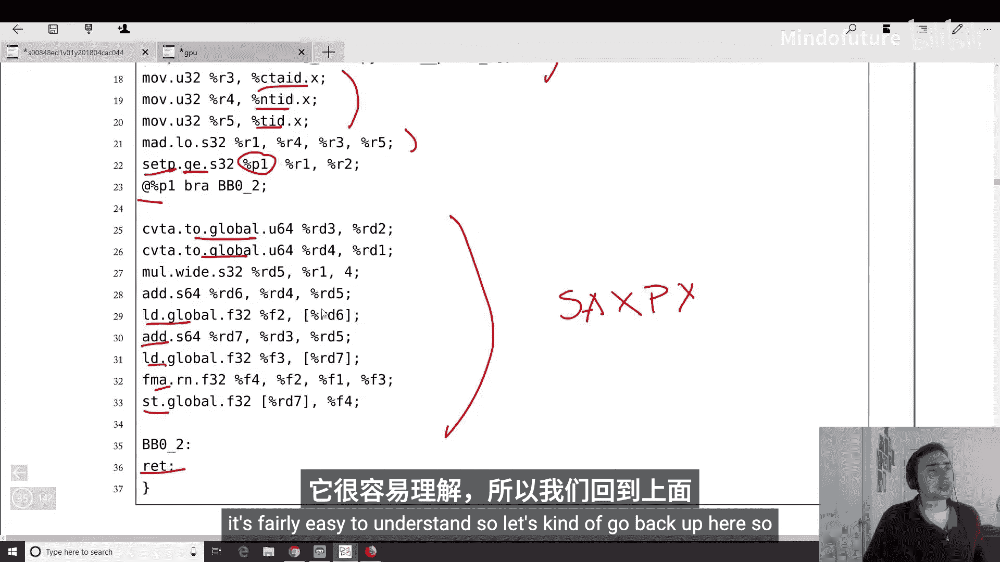

So。So you know what do we is PTX the bottom level， no。

 so what happens is like I said this is a virtual instruction set。

 so before runtime this gets converted into SAS， which stands for streaming ass。

And this process of using an assembler， this is either done by the GPU driver or a standalone program such as the PTX asmbler PTXA。

 and so this is provided by the NVIDdia CoUa toolkit so you can have so just like NVCC that used to compile your programs you can use PTXA to assemble PTX code。

The only catch is that SAS， what it gets translated into isn't fully documented。

 so while you can write all the code you want PTX， you can't write all the code you want in SAS because it's not fully documented。

 meaning you don't really understand what every instruction does or how it may modify state or what the actual semantics are。

So。But there has been a significant amount of research that's gone into this。

 So things like you know， very early day。 So back in 2007。You know， project called D Ka。嗯。

And so this was really for the first kind of iteration of Kuta。

 figuring out what the SaS instructions did and to such a point where you could actually develop an enimer for it。

嗯。So then， you know， this was even supported on the simulator。 So the simulator that now。

Typically it only does a PTX code or a modified version of PTX called PTX plus。

 but we'll leave that out for now。It could actually run the machine instruction set at that time。

So eventually there was a tool released called CU objectject dump， similar to objectject Do。

 if you're familiar with that in the CPU world， where you could actually get the SAS code out of a binary or the PTX code if you want。

And they started to partially document SAS because of course it's really important， you know。

 if you're a GP programmer， you understand what your code is doing so they did document it somewhat。

But， you know， as of you， April last year， there's only so about a year ago now。

So only a partial list of op code names and then no detail on up end formats exist or the actual instruction semantics。

So， you know the fact that we need higher and higher performance stuff has led to other projects like thekuuda。

 so this project right here called Max A yes， for Maxwell Asmbler where you know it was actually SaS instructor set was actually completely reverse engineered such as that another asmbler could be made for academic purposes this guy Gray。

So 2。4 illustrates the SAS code compiled for Fermi architecture， so a very early architecture。

 and so we'll just go through this paragraph and then we'll look at the code。So。

So let's see what we have here。 So oh， it looks like it's just going to talk about the code。

 so let's go down there。 so let's look at 2。4。And so you can see that it is significantly different than the PTx code。

But you know there's still some things you can pick out right So know like here you can tell here's our CTA and our thread ID information。

 we're doing you know this multiplying ad operation here to calculate you know our position of a thread in a grid and then we're setting a predicate。

 So this is integer set predicate greater than are equal and so exactly what these means and all these specifiers that can pile up and pile up and pile up。

嗯。You know， this is something that， you know， the reverse engineering work has to go into and kind of tell what it's doing。

 But basically they're setting this predicate 0。Right， and this PT。

 So these are getting set based upon。You know， evaluation of these。

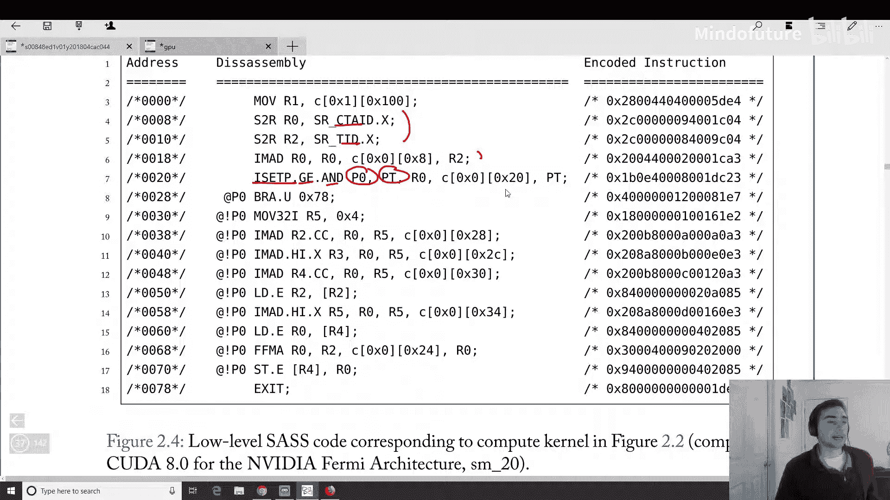

greater is greater than or equal and and operation between all of these， right。

So this is basically just used to。This is used， this is that if statement comparison here。 and then。

 of course， we have a branch right， So instead of branching to you know， so up in the PTx right here。

 we've got this branch to B2。Here we have a branch to a specific location。 So 0 x 78。

 which is right here， which is an exit call right， And then over here， this is just going to be sxby。

 right， So we've got， you know some。

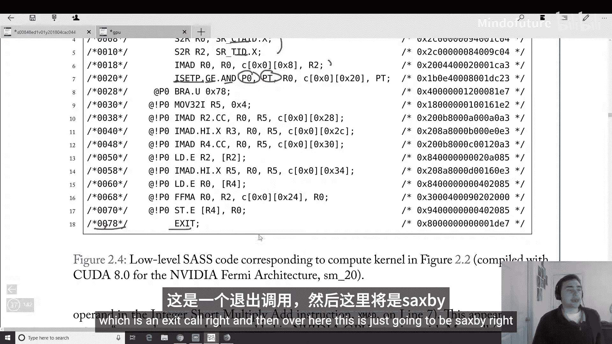

Some memory locations here that we're loading in and then stores。Like I said， loads。

 multiplying ad operations fuse multiply ad operations， right。

 so this is just computing Saxby though， and like I said， this is for Fermi architecture。

 which is denoted by SM20。So let's go back to that paragraph and skip over the code part。

So a little bit different， but you know the main difference you can see is you know。You know。

 up at the PX code， we had， you know， kind of parameter space where we specifically had， you know。

Load per right， but this didn't really exist in the SaS code。

 So the reason why it doesn't exist is because in SaS parameters are allocated while they're allocated in their own separate parameter space in PTx and SaS。

 kernel parameters are just passed in banked constant memory。

Which can just be which can be accessed by non load store instructions and SAS。

 so this is a constant memory， we don't have to do the explicit loads like we have in the virtual instruction set。

So then we have it a lot different， so we'll look at another compilation of the same PTX code to a different machine ISA。

 so that was for SMM20， we'll look at it for a later SMM version。

So we can go ahead and do that now after a little bit of talk。So， you know。

 the actual machine I set changes significantly sometimes between generations。So。

There there are even some lines that you'll see that there is some， you know encoding there。

 but there's no disassembled instruction， right？And so it turns out what they started doing in VDdiaA that is。

 is they started betting special control instructions， not associated with the specific。

 you executed instruction， but a control instruction is just something that they added introduced into Kepler architecture to limit the need for dependency checking using a scoreboard。

 so they basically took scoreboard logic and they put it in instructions instead。

 so it's part of the instruction stream。So this has been explored by a couple people。Let's see。So。

 you know， there's according to the Max A S， the guy that did that gray， there was。

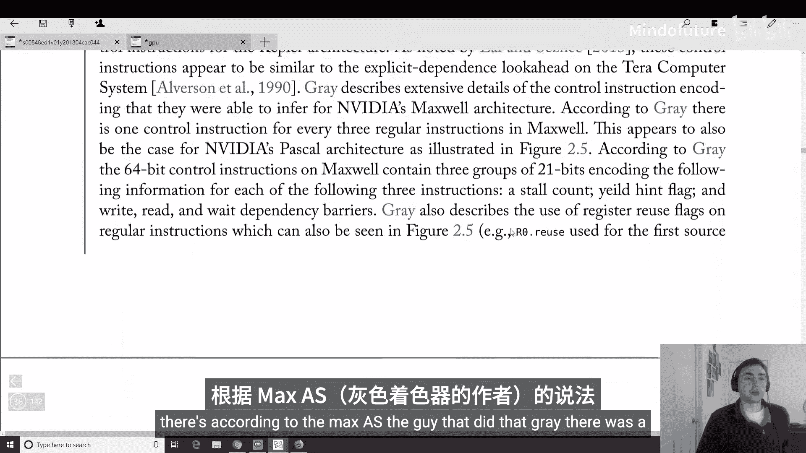

There appears to be， one control instruction for every three regular instructions in Maxwell。

 which appears to be the same in Pascal， I not quite sure for Volta and Turing。 likely it's the same。

 but it could have changed。So there's also， you know， the 64 bit control instruction。

 So what does it typically do， So it's generally grouped into three parts。 So 21 Bs。

So can Max will contain three groups of 21 bits each。

Encoding the following information for each of the following three instructions。

 So it'll include a stall count， a yield hint flag and a write read and weight dependency barrier。

 So basically， they're just taking the logic of， you know。

 how long do you have to stall and you know。Whether or not you have to yield and then if you have read or write dependencies there。

 that's just all encoded within that instruction。And then also。

 if you're familiar with my this weekend architecture series where we talked about register file caches。

 so they alsobed things they also embed things into the assembly itself， such as this our0 do reuse。

 so register reuse or opera and reuse cache that they have， that's also embedded in the。

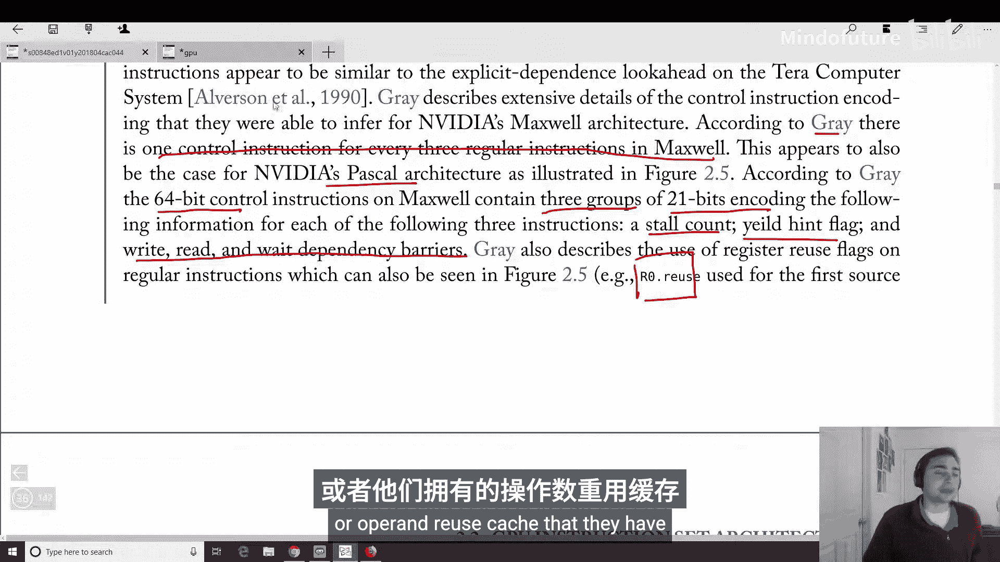

As a modifier to the actual operarans。So we'll look at an example of that。

 so this short multiply ad instruction。We'll see an example of that。So this operating reus cache。

 like we explained， and this week in architecture， this operating reuse cache appears to enable register values to read multiple times for each main register file access。

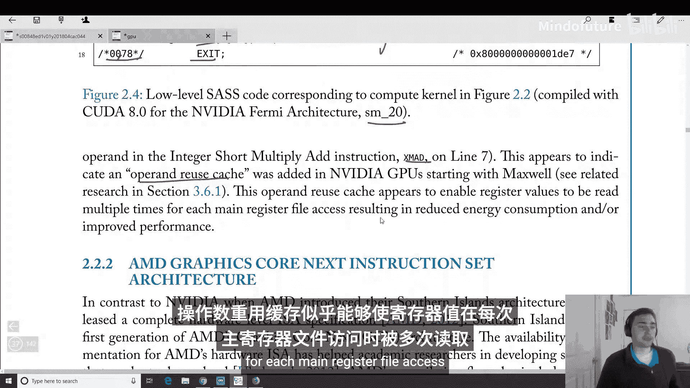

Resulting in reduced energy consumption or improved performance。

So see that other video if you're interested in that。 But let's look at the。

The actual disassembly there， right？So here we have the disassembly， as you can see。

 it's far different than the original disassembly for SM M20。 So this is for。

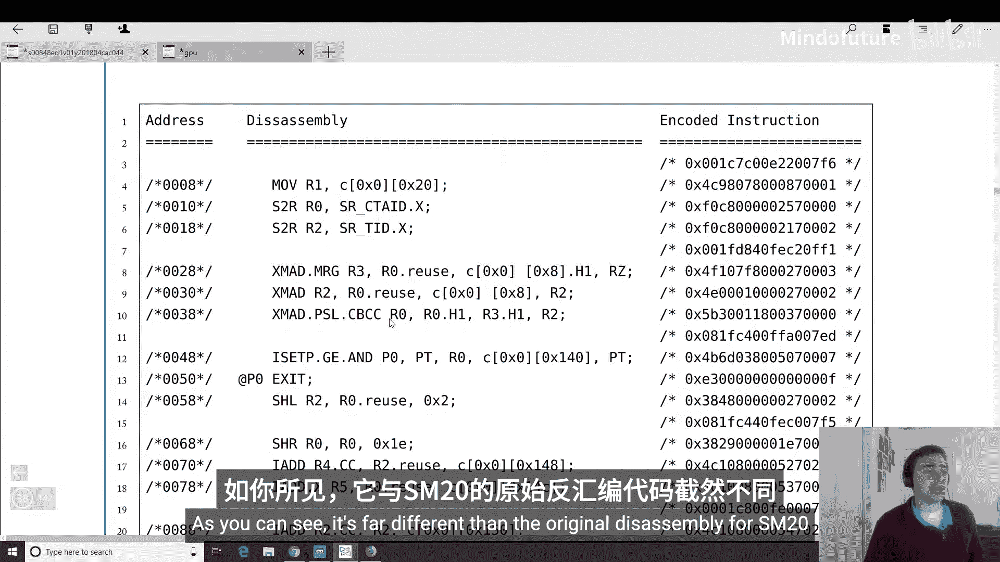

SM60 architecture， so Pascal architecture。

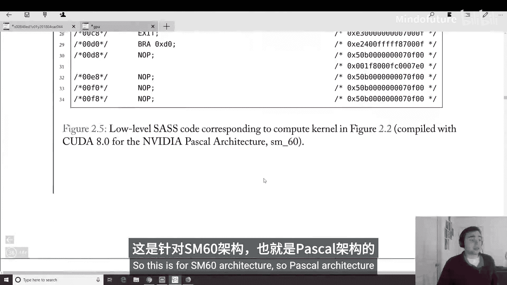

So as you can see， there's about every three instructions there's a special instruction here。

 which't isn't associated with actual instruction because it's just encoded dependencies right So that's what you know we've got that here。

 we've got another one here， another one here， etc ce。 and like right here， we've got this reuse。

 So this is saying use the opera and reuse cache。 So you know between the actual machine Is。

 there can be a huge difference。 But you know in the PTx go the PTx is kind of abstracted away from that。

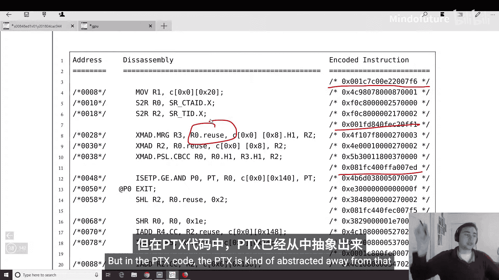

So it can kind of ignore the underlying changes， you know。

 the assemler has to worry about doing that pass of the PTx and converting it into SAS。

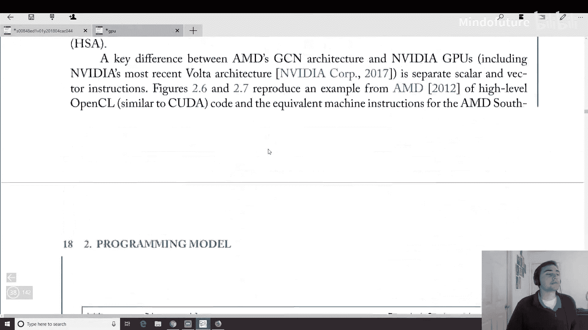

All right， so。It's a lot on the PTX side of things。 But， you know， you can still， there's， you know。

 it's still fairly readable， though， even if we don't know explicitly what it's doing。 So we've got。

You know， we still had CCTAD and T ID here。We've got some new modifiers。

 right that are a little bit tricky。 and I don't know what they are off the top of my head。

 but we see a set predicate here。And， you know， based on the separate predicate。

 so this is going to be the if statement。

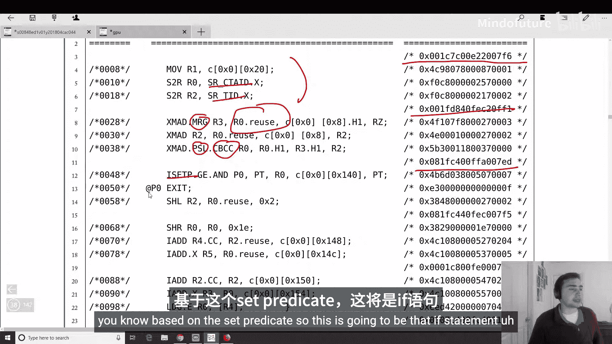

Which leads me to， you know， everything past here， right is going to be。

This is actually going to be the Sxby part。So this is going to be this actually part of the program。

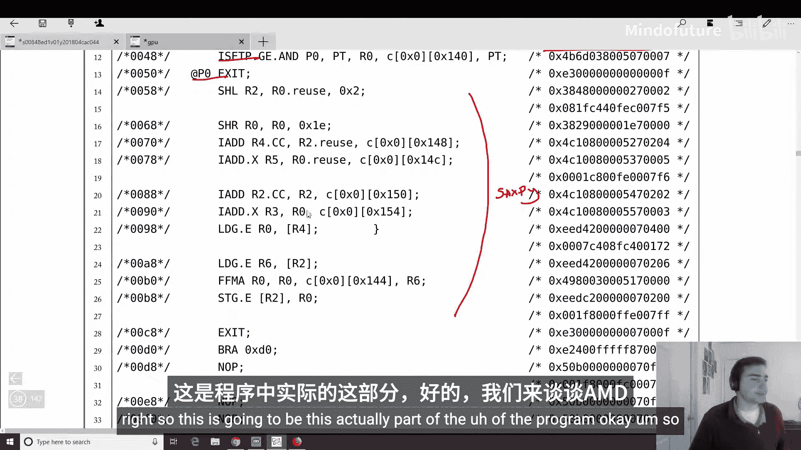

Okay， so let's talk about AMD now right so AMD in the graphics score next instruction set architecture。

 so in contrast to NviIDdia， so while NVD didn't release a machine instruction set or hardware level ISA AMD did for Southern Ireland's first generation。

 AMD's GCN architecture。So this is really helpful to academic researchers developing simulators。

Because you explicitly know what is actually being executed on the GPU。

So a key difference between this GCN architecture and the NviIdia GPU architecture， though， is。

A separate scalar and vector instruction pipeline， right？Now。

 this is actually changed then because I believe Tring has a scalar pipeline as well。 But you know。

 you might be wondering， you know， well， why would I have scalar pipeline， right。

 What's the point of having a scalar pipeline？ Well， so you big vector instructions， right。

 So you're doing Sxby， you've got all of these things that are， you know， computing。

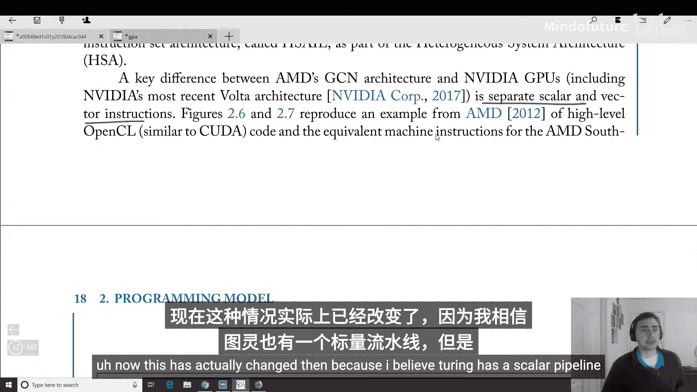

You，Different operations on different piece of memory。 That's great for a vector pipeline。 Now。

 let's say that you have。I don't know。 So let's say that。

 you know you pass in a value A in a value B and your function and you compute A plus B right so。

This will be done by every single thread， but it doesn't need to be done by every single thread。

 especially if you launch a ton of threads。You're computing a single value there， right？

You're not computing you know a bunch of different values。

 touching a bunch of different piece of memory。 Every thread will evaluate the exact same number。 So。

 you know， if you have a scalar pipeline， you can kind of avoid that， right， you can have only。

 you know， say one thread or that scalar pipeline just computes that single value instead of having every thread waste a bunch of energy computing the same value。

Okay， so to configure figure 2。7， which we'll look at a little bit。

Scalalar instructions are prefaced with an S， and vector instructions are prefaced with a V。

So in MDD GC and architecture， each compute unit， so this is going to be a core compared to an SM and videos。

Contains a scalar unit with four vector units。So vector instructions execute on the vector units and compute different 32 bit values for each individual thread in a awayfront。

 so wavefronts are just groupings reminder of 64 threads。So in contrast。

 scalar instructions execute execute on the scalar units and compute a single 32 bit value shared by all threads。

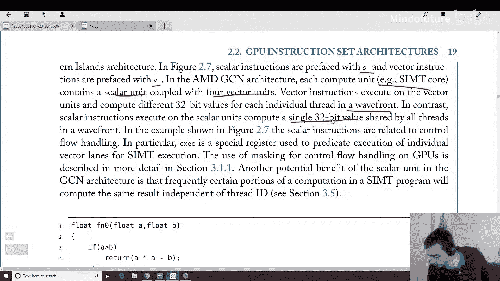

Okay。So let's continue on。And the example shown a figure 2。

7 so let's go ahead and look down here right so here's so opencl code based upon figure 2。2。

 So that's from a while ago but here's the open C version right so it's pretty similar right so here's some function here notice it's not co to semantics but we have know if a is greater than B you return a times a minus B L return B times B minus a。

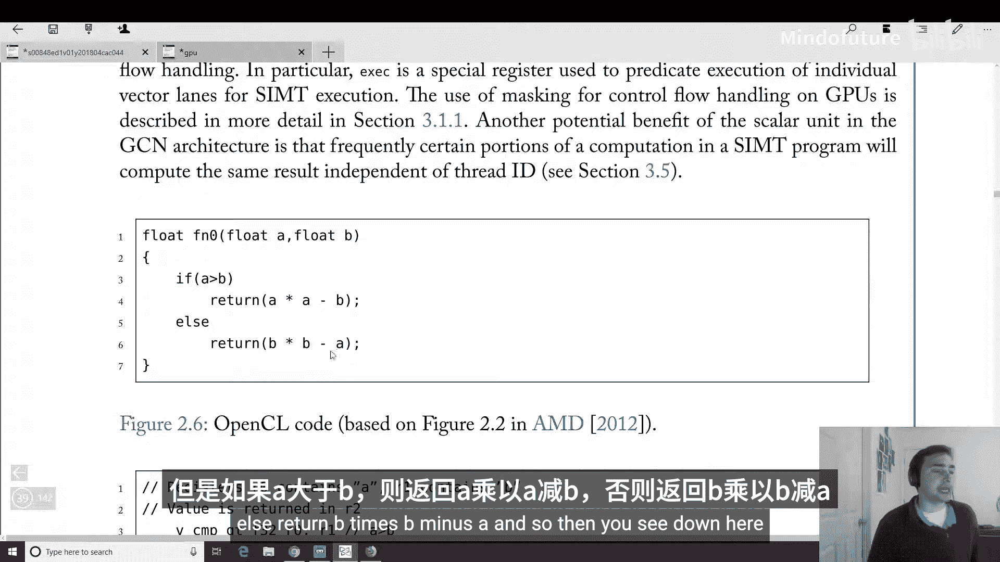

And so then you see down here。It's annotated， so you've got vector and scalar instructions here。

Depending on you know what the compiler says to do， and then you have， you know。

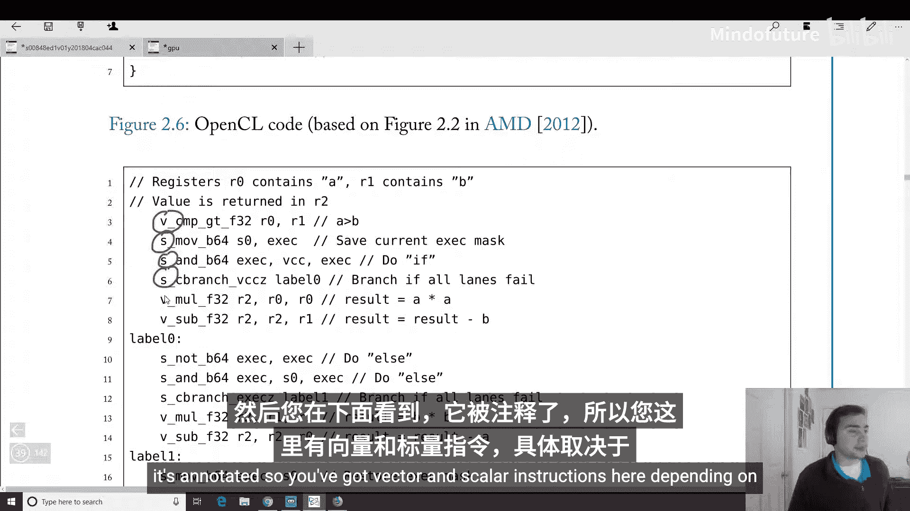

You know， two different control flow paths， right， so you have this if path path and then this else path。

Right。So。So in the example shown in a figure 2。7， the scalealar instructions are related to control flow handling right。

 so you know that you know as far as control flow goes。

 you A greater than B will be the same for everybody because know float A， float B。

 those are constant for everybody。 So you really only need to execute that once。

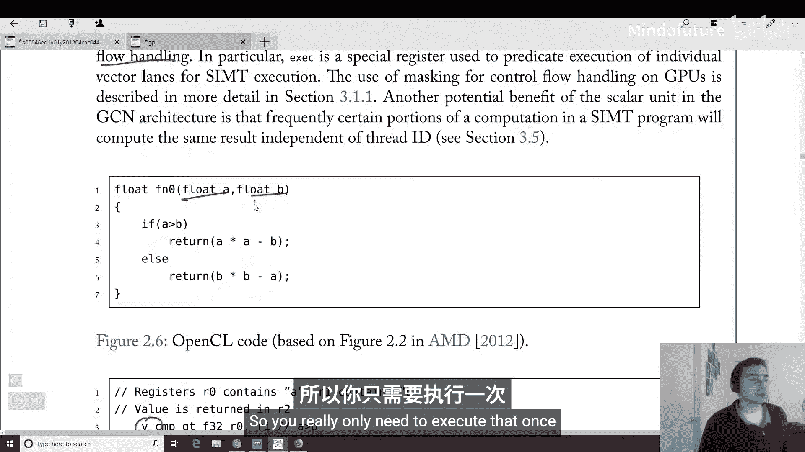

So， let's see。So in particular， exec down there in the。

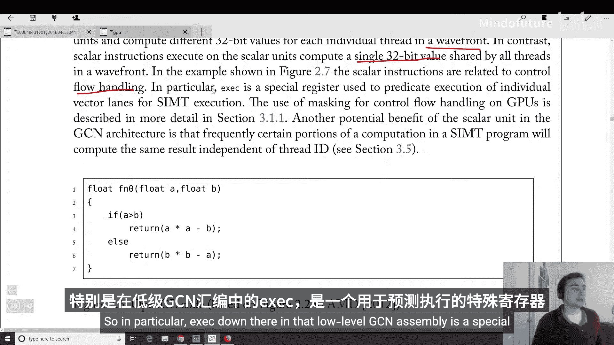

That low level GCN。Assembly is a special register used to predicate execution。

 so kind of like those P registers in KUuta。Of individual vector lanes for symptom execution。

 And so like we said， we've got groupings of a bunch of threads together all kind of going in logstep。

 So sometimes， you know not all 64 threads will be doing the same thing。

 And so we have to use kind of this mask that know tells us which threads should be active at any given point because remember。

 the programmers have this idea that， you know things are their scalar threads so they can all go different control a different way as far as control flow goes。

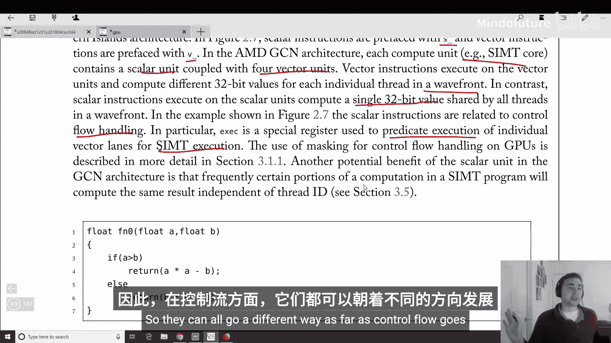

So。The use of masking for control flow handling on GPU is described more detail detail in 3。1。1。

 so once we get into the core we'll actually we need to see， you know physically。

 how does or at least know from a hardware level， how do we actually do this though。Right。So。

 so AD's GCN Har In set manual。So there's interesting insights into the M D hardware。

 So if we know the low level machine instruction set got better insights into what they're actually doing and what the hardware has to do。

 So， you know， an example of this is。To enable data dependency resolution for long latency operations。

You know， there includes this， you know， S weight count instruction。For each wavefront there。

 so for each wavefront， there are three counters， so vector memory count。

 local global data store count。And then a register export count。

 And then these indicate the number of outstanding operations of a given type like a Pr programmer inserts this instruction to have the wayfront wait until the number of outstanding operations decrease below a specified threshold right so this is how they manage these they manage these things。

 Well， you know we just kind of believe these encoded instructions from Nvidia side of things。

 So that's going to go ahead and do it for this episode。

 though So next time will actually get into the the Sty core instruction and register data flow a little more interesting than high levelvel programming model。

 but know it's kind of necessary as always， feel free to check me on on Github Github co for archs where I've got on my coa codes t plus plus code teaching stuff and even in the read means there I have linked to the videos and then the individual things that I use。

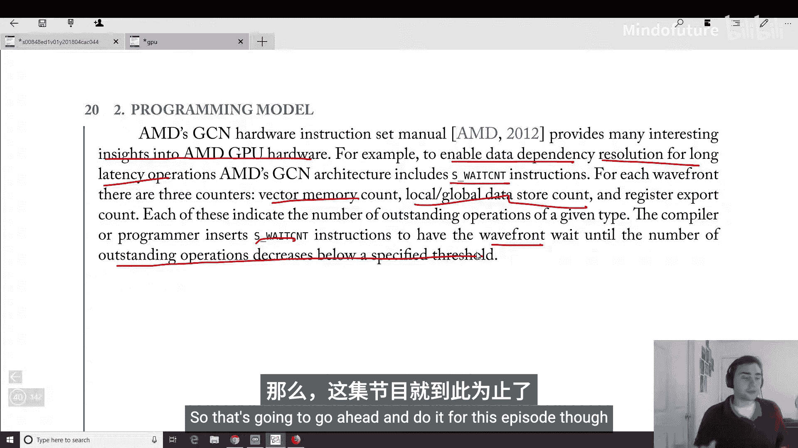

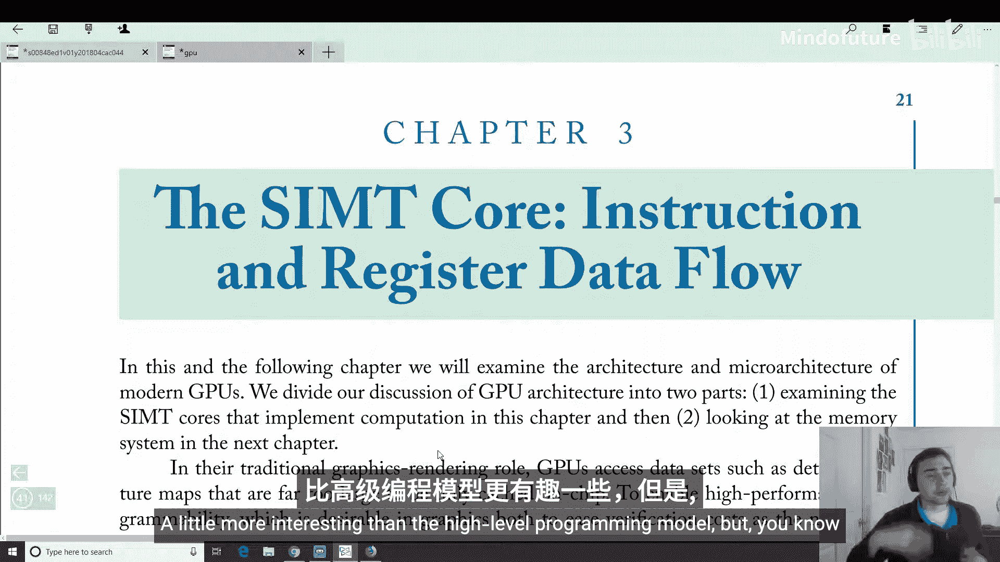

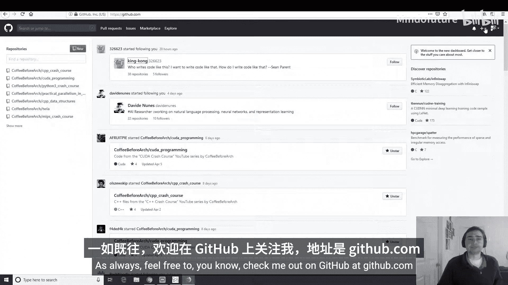

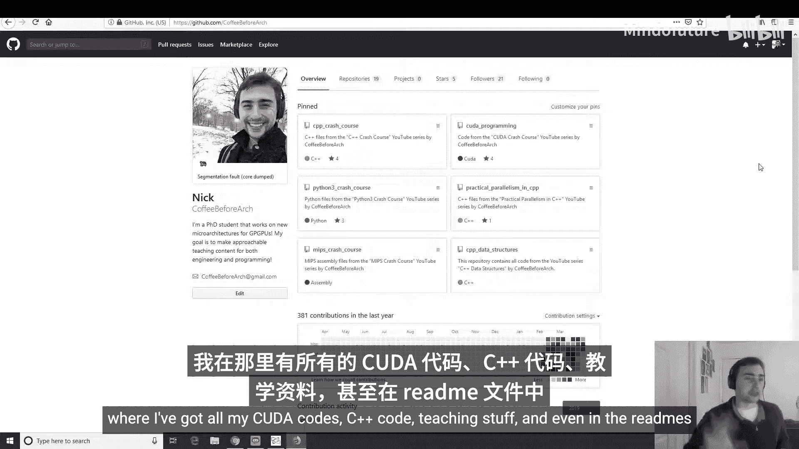

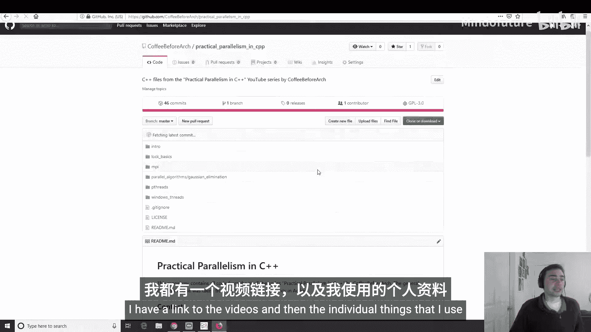

And then if you want to follow me on Twitter， I've got one of those as well。Okay， dope。

 let's gonna go ahead and do it again。 My name is Nick from Coffford before Arch and hope you have a nice day。

