# GPU架构基础-p04-P04-SIMT-Core-Part-1--BV1ay5vzgEAe_p4-

Hey， everyone。 I'm Nick Kf for Archin。 Wel to another installment of the fundamentals of GPU architecture series。

 So in this one， we're going to go over， you know， our start of the actual micro architecture of。😊。

The GPU starting at the Sti core right so this will end up getting broken up into two main sections。

 one specifically relating to the memory system， and then this first part relating to the Sty core itself in itself we'll split this into a couple different videos just to keep them a self contained topics。

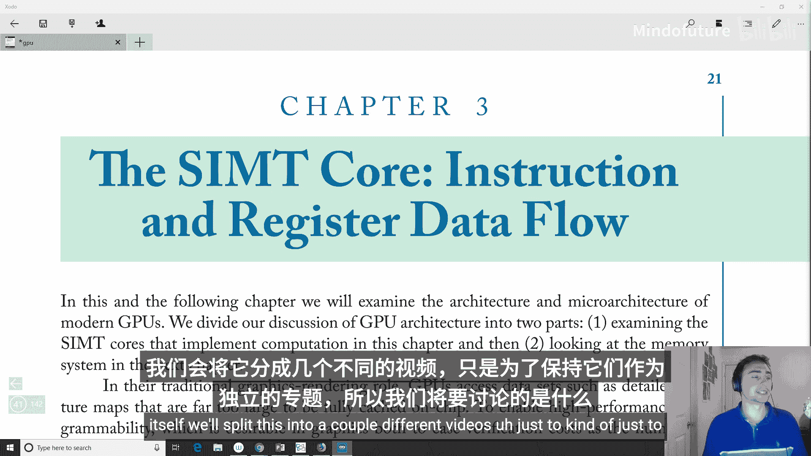

So what are we actually going to discuss。 So like I said， this is really broken up into two chapters。

 so one of them examining the ST course。 So just as a reminder， ST stands for a single instruction。

 multiple thread。And how they're implemented。 So you know we've got this kind of parallel programming model。

 so how does that translate to the actual hardware。

And then the second part of it is the actual memory system， which will be the next chapter。

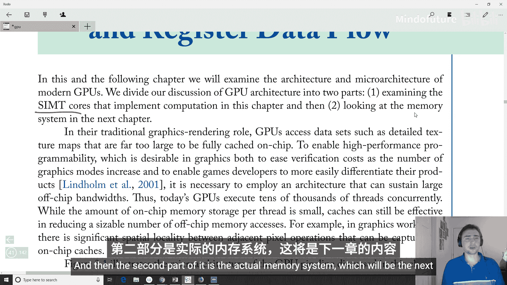

So let's get started。 So that's kind of a little bit of a background to the microarchitecture。

 So again， everything started back at graphics and we have。

 you know adventure you know initially we were just storing these you know detailed texture maps and of course these things can often be really huge they they're not going to be fit or they're not going to fit into the on chip caches。

 So how how did we design GPUs。So in order to have high performance。

What we end up having to do is know。We just wanted to make an architecture that can sustain large object bandwidth。

 so this is why we have， you know instead of， you know just DDR。

 we have GDDR right so the graphics double data rate memory so higher bandwidth memory and even now in some models we don't even have DDR or G DDR we've got HBM or high bandwidth memory。

Okay， so。You know， we have tens of thousands of threads concurrently。

 So this can be kind of tough with all the caches。 right， if we have lots of things。

 kind of doing loads or stores， then you know it's hard to exploit locality there just because。

 you know， we could be accessing tons of different data。

 So it'd be really difficult to build a cache that can really sustain that。

 But that's not to say that caches don't work at all。

 right So caches can still be effective because you know a lot of times， you know。

 there still is fundamentally some kind of locality。 So take， you know， graphics workloads。

 oftentimes if we're doing something， maybe we're blurring an image。

So maybe we're just going to average some pixel values so we'll have one center pixel and four adjacent pixels and then we'll just that that center pixel value will just take the average of the surrounding four pixels。

Or maybe the surrounding 3，6， the surrounding8 pixels。 right。

 So there can be some significant spatial locality because if we move one pixel to the right， well。

 you know。We're going to be using a lot of the same values and same if we move one pixel up or to the left or down right。

 So， you know， a lot of times these caches are useful also in terms of the fact that。You know。

 they provide a pretty good filter for traffic going down to the rest of the memory system。

 so we don't want to just constantly be pumping everything into the memory system or at the lower levels of the memory system。

 if we can filter some of it out and you know remove some congestion further down。

 it's always a good thing。So what we're really going to talk about in this chapter。

Is really understanding how a single symptom core works。

And how it's really divided into aT frontend and a SD or single instruction， multiple data back in。

So what these typically get broken down into as well is three main scheduling loops right so one of these is an instruction fetch loop。

 so this is made up of or so we'll go into that in just a second so we have an instruction fetch loop。

 we have the actual instruction issue loop and then the actual register access scheduling loop you know basically fetching instructions it issuing instructions and then you know scheduling how we access the register file。

And so those are the main schedulers we have。 So as part of the instruction fetch stage this typically involves the eyec。

 the instruction cache， you know the decode logic and then the instruction buffer So then after we do fetch we're going to issue right so the issue loop consists of the eye buffer。

 so where do we put the instructions that we fetched the scoreboard and then which is going to handle some of our dependencies and then also issue right so now that we've got everything。

Now that we're ready to， you know， start an instruction， right and execute it or we have to。

You know that's part of the issue stage and then also the ST stack。

 so you know at every single instruction we need to see which threads are actually active and that's what we'll really focus on in this video。

So and then finally， we have the register access scheduling loop。

 So this contains the opera and collector AU in memory and we'll go into the opera collector in greater detail later。

 but basically know because we have so many threads and we have limited ports on things like a register file。

 you know we could wind up with some port contention problems。

 So what the opera and collector really helps us do is schedule reads to the register file in such a way to remove remove conflicts and then the rest of it is really just more part of execution right So we've got Alu for AU operations and memory for the memory system operations like loads and stores。

Okay。In this chapter， we're going to really dig into those blocks and really understand them。

 leaving out the memory system for the next chapter。

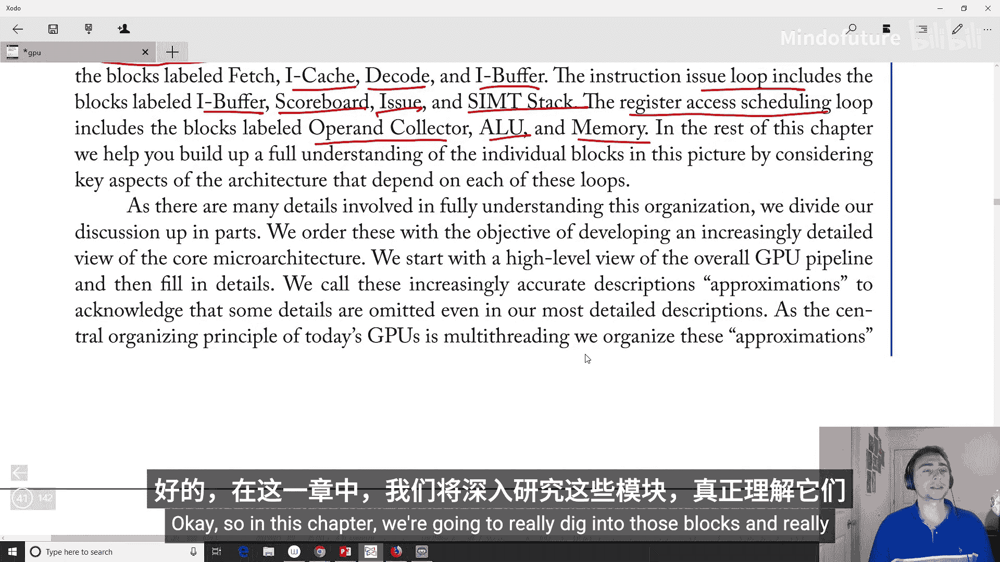

So。You know， we're going to start at kind of a 10000 foot view。

 We're going to work our way down to you know， say a 5000 foot view and then down to say an 1000 foot view。

 we're going to do that with these increasingly accurate descriptions that we'll call approximations because it's not going to include every detail of GPU architecture because a。

 they're not all completely available and then B， often they're not often you know some details will be very architecture specific So to a specific implementation And it's not really useful to get。

 you know you know too drawn into those details。 we really want to think of it a more holistically from a little bit of a higher level。

To really understand the greater the higher order trends going on。

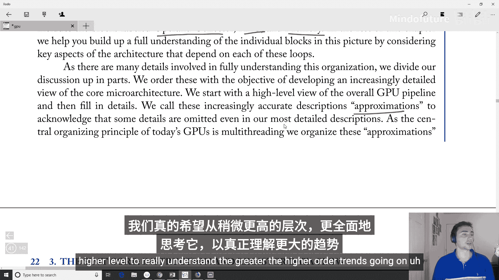

So you know here's。Here's the。Here's the basic overall organization so we've got you know the split between the ST frontend and the SMD data path right so the SD frontend。

 like we said， we've got fetchch the ICash Decode instruction buffer and scoreboard issue and the ST stack and then when we're actually getting to the data side of things and the actual execution we've got know the opera and collector。

 which will schedule our register file reads and then also feed into the execution stage with the ALU and the memory right for the load store units etc。

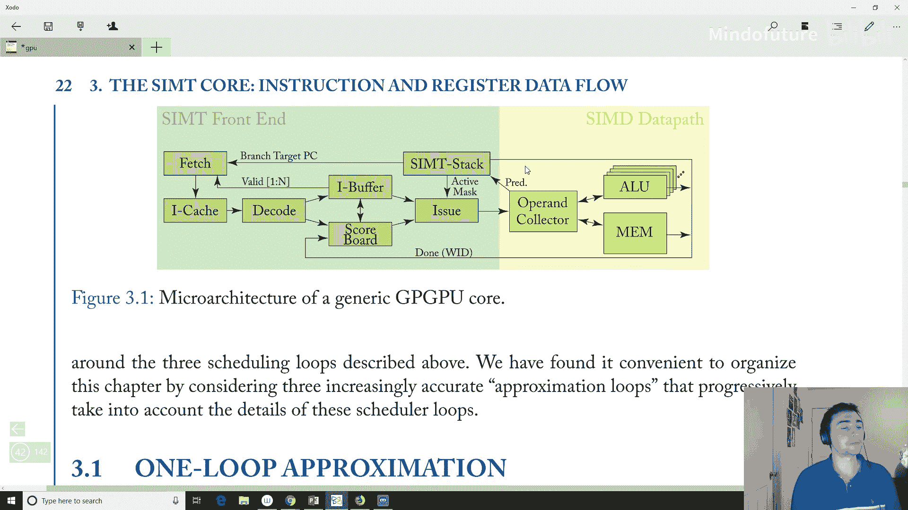

So， you know， in these approximations that we're going to be doing。

 so we'll start with a one loop approximation， so we'll just consider one scheduler right and then we'll gradually build on and add more schedulers until we have you know our three loop approximation。

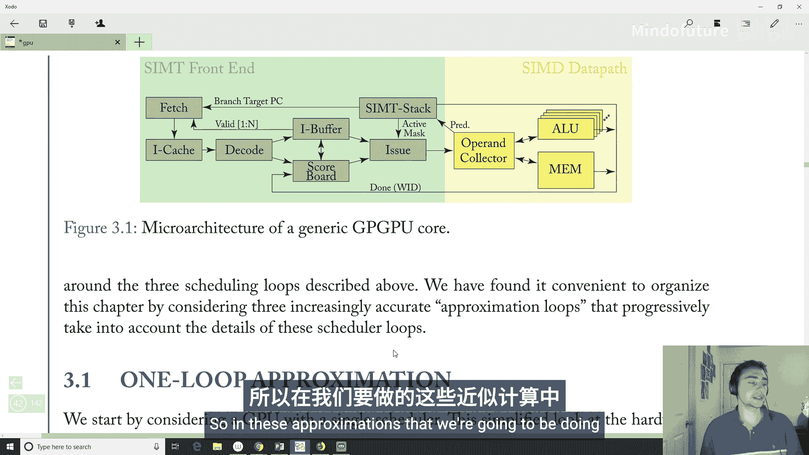

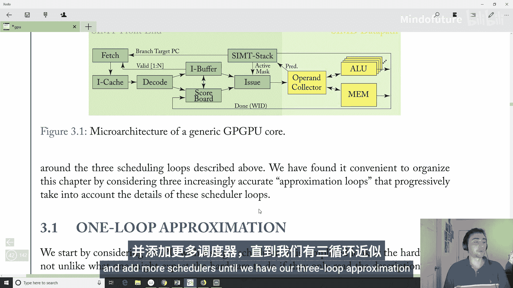

So let's start with a one loop approximation so what is a single scheduler and this is not unlike if you were to just read the a coupda programming manual。

 so a lot of times you know the low level details are going to be abstracted away from you。

 you know by the programming model， but you know in this case being computer architects or GPU architects。

You know， we really care about these low level details that are usually hidden from programmers。So。

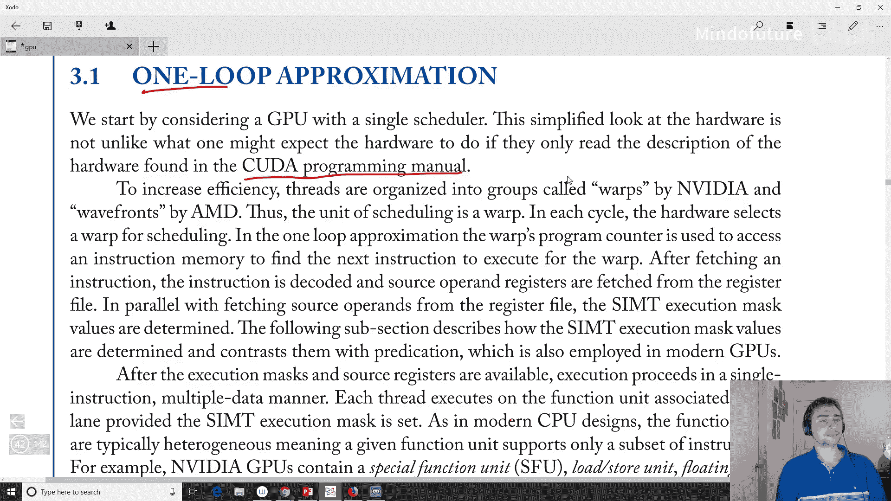

Okay， so let's go ahead and look at that。 So again， as kind of a reminder。

You know because we're talking about things that are S or single instruction， multiple thread。

 we're talking about things that are grouped as warps or wave fronts。

 So we have you know a group of in this case for warps， 32 threads in a case of wave fronts。

 it's going to be 64 threads that， you know they'll have a single instruction。

They will get executed for multiple threads of Sti。So you know。

 this is the unit of scheduling that we're going to look at so we're talking about this one loop。

 you know， the scheduling is going to be。You know， at the warp level。

So in each cycle what happens so first the hardware selects a warp for scheduling so which warp out of you know we have big thread block it's going to be made up of multiple warps。

 so which warp are we going to take instructions from。So in the one loop approximation。

The Warps program counter accesses the instruction memory。

 right so we just use a PC value to figure out which instruction we want。

And what we're going to execute right So after fetching the instruction， we have to decode it。

 of course， figure out what it is and then also figure out you know what it uses So which registers。

And then these are fetched from the register file。 right So that goes to the operating Collector。

 which we'll discuss later。So in parallel to this， of course。

 while we're fetching the source opera from the register file。

We have to determine the values for the ST execution mask。

 so we'll talk about this more in more detail later， but we have to remember that。You know。

The programmer can see these things as scalar threads， right。

 So every thread could potentially go down a different control flow path。

 So that means that in every step in the program， not all threads should be doing the same instruction。

 So should be going in the if statement some should be going in the else the else statement， right。

 So this empty execution mask is really how we do this。 So we can mask off certain threads and say。

 you know， threads 0 through 15 are active right now， they're doing the if， the if path。

 and then threads16 through 31， will'll do the else path later， right， So you'll have， you know。😊。

Half of， you know， 32 Bs be zeros， and half of it be ones。

 and then it'll reverse when they go down the other path。But like I said。

 we'll discuss that in a little bit。So after we figure out who's supposed to be active and we have the source registers ready。

 so then we can of course， go to execution and this occurs in a single instruction。

 multiple data manner， right so we have one instruction and ad and we've read out you know from this vector register file you know all the different values we need。

 So we're working on all different data and we're just know we're chugging along right so we're doing ads multiplies maybe memory aes。

So， you know。You know， as far as this goes， you know。

 we'll have special functional units that may have very， you know， commonly used。

 but less common than say ads and subtract and multiply。

 so maybe square root functions in there are sine functions。We'll also have know load store units。

 floating point units， integer units， and then in Volta we also have tensor cores right。

 so this is more of a matrix multiplication and addition kind of operations。

That's really useful for things like machine learning。

 which is mainly things like matrix multiplication。So just as a brief aside。

 so when we're talking about these， so you know these As， they're also。

 you know you can think of them as wide AUs， so these functional units will often contain as many lanes as there are threads within a warp。

 so it'll be a 32 wide special functional unit or 32 wide integer functional unit etc。

But that's not necessarily the case， it doesn't have to be the case。

 so you could you know make this a little bit more narrow， maybe it's only 16 threads wide。

 and you could pipeline it and then you could， like I said。

 increase the clock speed and then you know you can get higher performance per unit area at the expense of some increased energy consumption。

And so you can pipeline the execution units。u。Or increase the pipeline depth。

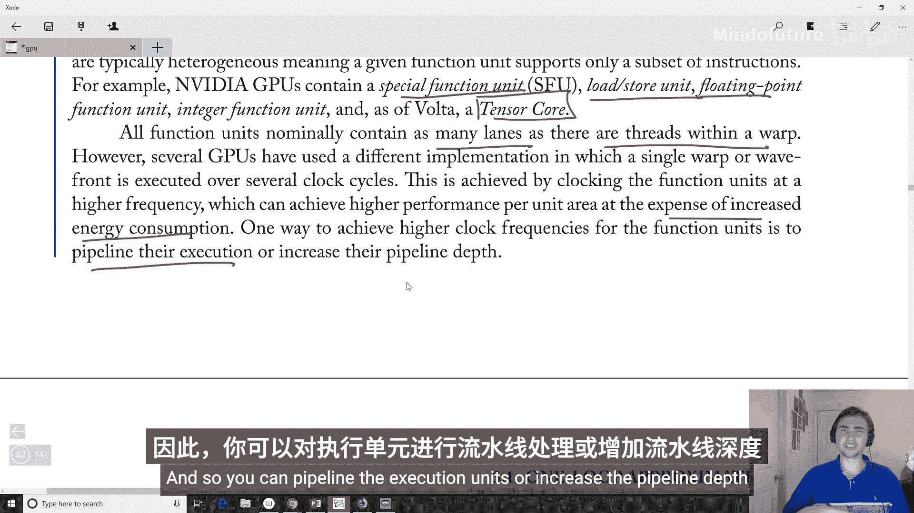

Okay。So let's let's talk about the more interesting part of this， right。

 so which is the S execution masking， right， So that's that's the thing that we've kind of pushed off to the side up until this point。

 now， we can't avoid it any longer。So you know how do we determined which threads should be active and how we keep track of it。

So from the standpoint of functionality， you know， we have this abstraction of individual threads that can be completely independent。

So this it can be done potentially via predication alone， but this isn't how it's implemented today。

 so you know there's as always there's a lot of different ways to implement something and so you know by pure predication that's not how this was implemented。

So the way it works today is a combination of traditional predication。

So you can think of predication as just kind of flagging something as you know。

You know trueru or false， right， so whether a predicate is set or not。

And then along with a stack of predicate masks， right， So we call this， you know。

 traditionally the Simty stack。So this helps us handle two key issues when all threads can execute independently。

 so one of them is nested control flow， and then the second one is skipping computation entirely while all threads avoid while all threads in warp avoid a control flow path right so you know we want to make sure a branch divergence that we're not wasting any time there。

 so those are the two things that we need to handle。Okay。

So the Sti stack can of course handle both both of these and then in descriptions of the Sti stack。

 and this is mainly found by looking at patents filed by places like NviIDdia。

 as well as inferring things from the instruction set manuals。

So it's at least partly managed by special instructions。

But what we'll describe it as here is a slightly simplified version that was part of an academic work。

So what are we going to use to describe this。 So we'll start with some kuda code and also some PT T X。

 So as a reminder from the previous videos， PT T X is the virtual instruction set。 So this is。

This is not what actually gets executed on the hardware。

 this gets another as simpleler pass on it an optimization pass before it gets turned into SAS。

 but it's a good proxy for what this will end up doing。In hardware。

 it just might be missing some of the hardware specific details。So you， so again。

 lets let's think about this in two cases。 So let's first talk about it， you know。

 if this was a CPU executing this code， so this is basic C code。

 so what would it look like if we have a CPU that has a single thread。So if we have a single thread。

 what happens， So it's a do while loop， we know that from here and here。

So what we're going to end up doing is you know， we'll go in here， we'll set T1， T2， T3。

 T4 to some values right here。So this is this block A right so you know the thread will go in and block a and then what happens。

ll it'll evaluate an if statement。So if that if statement is true， what happens， you know。

 we'll go in there。 if it's not true， we'll go into that L statement down here， right。

 and then we have these subbs in here， right， so know if we go in here， we go into this B subblock。

 Otherwise we go into an F subblock。 Now if we're a single thread， we just make a decision， right。

 we go into one or the other。嗯。So in this case， let's say we go into the if block。

 we have another we do another load into another variable T5。

 and then you know we decide whether we want to go here in this if or over here at is this else。

 right。So， you know， again， this is a single thread。 Only one of these decisions will be made。

 so we'll either go in here or we'll go in here， and then eventually we'll。

 you know either add something to X or add something to y。 And then after we get to this point。

 you know， this if block is done。 So， you know， we'll go over to this I plus plus。AndOtherwise。

 if we go， if if this fails， you know， we'll just go directly into this if this or this L statement。

 do this z plus equals 3。 And then we'll just go ahead and exit out here。 right。

 And then we have one final check， which is just the while loop， right？ So what is so so that's。

 you know that's basically how that looks as a CPU。

 So where do we run into trouble when this turns into a GP。

 So in the example in this chapter you know， we'll look at， you know。

 what happens if we have four threads。What is that going to look like So you know everybody is still going to you know all be going along together。

 executing the same instructions in a single instruction， multiple thread fashion， starting here。

 So everyone will load TD times in everyone will set T2 to this value everyone will load from you know a different part in the array right。

 because you know we are calculating things like a thread I or things that might be hidden up above so we may be loading different data here。

 So it's the same instruction。 it doesn't matter right。

 there's a SD backend so single instruction multiple data， but it's the same instruction。

Then over here， everyone will set T4 equal to zero。So where we run into trouble？Is right here。

 right when we hit this if statement。What happens know， up until this point， all these threads。

 you know， at each instruction have been going along together in what we call lockstep fashion。

 right， So what happens if， you know， maybe only two threads or three threads go here。

 And this other thread doesn't maybe this T 3， not equal to T 4， Maybe that doesn't evaluate to true。

 So it actually doesn't want to execute。 You know， this， you know。

 evaluation that store something into T 5， You know， that's not its control flow path。 And， you know。

 programmers see these again， a scalar threads that can go anywhere。 So how do we handle this， right。

 So we have to， So that goes back to this， you know， active mask。

 right that says which threads are active。But this is really the motivating problem， right， if。

 you know， if we're doing this where， you know， multiple threads are kind of， you know。

 marching down together in lockstep， what happens， you know， if we get to this if statement， right。

 And then again， if we get another if statement， maybe you know。

 only two threads go into that if block， right， and then how do we bring all the threads back together。

 how do we。How do we reconverge all the threads again？

Because by the time we get here to this I plus plus， you know we're out of this if statement。

 we're out of this L statement。 know we've already passed this if L statement。

 so everyone should be together again at this point so let's see how we kind of manage that。

And then if we look at this in the actual PTX code， it follows basically the same line of logic。

 right。knowEverybody does these same operations。The problem is， you know， this set P set predicate。

This P1 value that does an equal to comparison。Based upon T3 and T4， so this is that if part。

 you know。This branch could either be executed， which would take you to F。

Let me scroll down a little bit。So you could either branch to F or you could not branch to F and go straight here into B。

So again， the problem is some threads could branch to F。While other threads will go straight down。

So we don't need to go much more into the this assembly， it's the same idea as that kuta code。But。

 again。Yeah。We'll use things like predication， so like a set P where we do a logical comparison。

 and then we'll branch based upon that predicate and the predicates are just predicate registers。

Okay。So let's kind of continue on and then let's look at an example， right？

So we'll ignore this side of things。 this is the actual stack itself。

 so this TOSOS stands for top of stack。Not the original series。 if you're a Star Trek fan。

 So let's start from a control flow graph point of view。 So here we're at a。 So this ABC D， E FG。

 this corresponds to each of these blocks right here， right， ABC， D， E， FG。

So what happens So we all start out together， So this is our active mask。

 this is which threads are active at this point of the program。So let's say that as we move down。

This is going to be our if。And this is going to be our else block， right。

 that outer level if else block。 And then over here we have our inner if else block， right。

So what happens here， so we start out everyone is doing that T1， T2， T3， T4 is equal to something。

And then we hit that evaluation。 So some of the threads go here to the block B。

 Some of the threads go here to the else block， which is block F， right。

 So what do we do at this point。 So only some threads should continue down each path。

 And we mark that， you know， by the active mask。 So one means the thread is active。

 It should execute the instruction that we're on。So then， you know， it can it's nested control flow。

 so it can split again， right， So maybe only one thread goes into the next if block and then two threads go into the next else block。

 But the important point is， you know， we have reconvergence points。

 So reconvergence points are where we get back to the same active mask after control flow splits。

 So let's clear this up a bit。So in the case of， you know， from here from starting at block A。

 we split into this B and F。But then you know， we're both going to reconverge back at G right because we get back to the same active mask。

 So that' we call that our post dominator。Our immediate post dominator。

And so the same thing happens over here， right， so you know we're at block B。We split。

And then we reconverge， right。So this is going to be our reconvergence point。

For block B in this case。Not for block A， of course， because you know。

We're not reconverged to the same point here， but this is a reconvergence point for this block B here。

Okay。So again， let's just kind of summarize this。 So we start out with everyone active。

 People threads go different ways。 not at the same time。 This has to be serialized。

 And so we see that kind of here。 So this is a little better visual description of what happens。

So we start at a， right。 So everyone's going together and then our control flow splits。

 We get if else。 So we'll pick one path to go down。 Typically， this is the majority path。

 So where most of the threads go。So we we start at B， you know。

 and then we follow down that control flow path。 So if we go back up here。

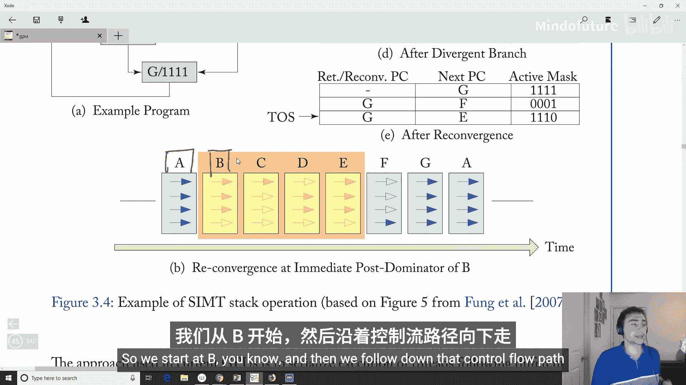

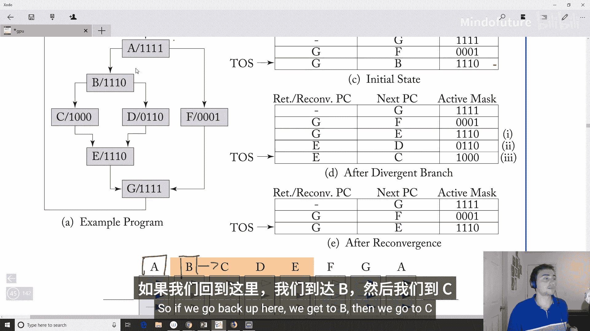

We get to be。And then we go to C and then our control flow splits again， right。

 So we get an if and else， right， So what we'll do is we'll serialize it again。 So， you know。

 maybe first we'll do C， then we'll do D。And then after that， we reconverge and then both， you know。

 all three of these threads will all do E， right？Now， you know。

 this is mainly for illustrative purposes where it shows， you know， we don't necessarily have to。

 There's nothing that dictates whether or not we should execute， you know， the majority path first。

 or in this case when we have， you know， split divergence again。

 they execute the minority path first， this is really just kind of an implementation decision and we'll see that。

 you know， they cite a paper that says， you know typically majority path work first you know。

 limits the the stack size the symptom stack size。But again。

 this is over time right so the important thing to know is that know this ends up being serialized but we'll talk about some more modern things as well later。

 but basically what happens is when we're all together everyone's doing the same instruction in order to do different instructions。

 we serialize it so。Three threads will do instruction B， only one thread will do instruction C。

 two threads will do whatever is at D， or in block D， I should say。

 not necessarily a single instruction， but could be multiple instructions within one block。

They reconvene and start all executing down the same path at E， these three。

 Then we go down the other line。 So one thread does F。 and then everyone comes back together at G。

 right， So we have our active mask is， you know， all ones。 and then， you know， we all do， again。

 if we scroll back up to the program。

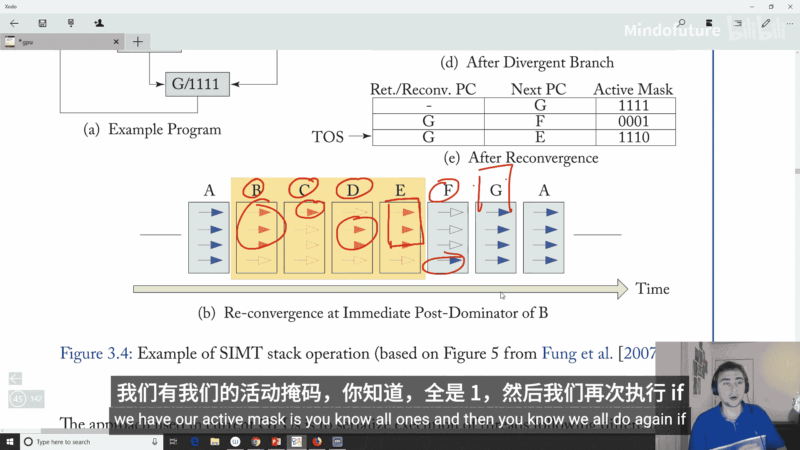

Everyone does i+ plus and everyone evaluates while I is less than n， right？

So they all do that together， right so that's a reconvergence point。Okay。So， let's see。

Let's see where we。 So let's start here right So let's talk a little bit about reconversiongence points。

 So this is a location of the program where threads that diverge can be forced to continue executing and lockstep。

 And again， what we call this nearest reconvergence points so well。

 the nearest reconvergence point is generally preferred right because we want to be doing the most amount of work as we can at one time。

 We don't want to have only a couple threads active right We're not going to be progressing very quickly if we do that。

So the earliest point that can be guaranteed at compile time。

An execute in a lockstep manner is the immediate post dominator of the branch that caused branch divergence。

But， you know， some other papers have looked at， you know， early reconvergence。 Now， you know。

 all this stuff about， you know， reconvergence and active masks。 know。

 a lot of this centered around the very early days of GP PU architecture。 As you can see。

 this is 11 years old，8 years old。A lot of this is kind of， you know solve now as far as， you know。

 we know how to implement this， but there still is some interesting things in terms of doing more complex control flow in GPUus。

And so again， here， the interesting question is， what order should be used to add entries to the stack following a divergent branch？

So you know， from this AMD citation here， you know。

 they say to reduce the maximum depth of reconvergence to be a logarithmic and number of warps in a thread。

 it is best to put the entry with the most active threads on the stack first and then the entry with fewer active threads。

So again， they just show both， you know， two ways of doing this。 So let's actually look at the。

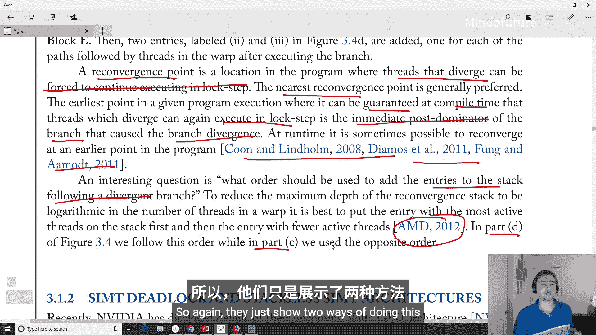

The ECyT stack itself。So this is just kind of like a table version of the Sty stack。So here we have。

 you know， we start out， we start pushing things into the stack right， So you know。

 where we're going to eventually go is G。But， you know， we have this divergence here， right。

 So we have two different paths。 So what we'll end up putting on is both the paths。

 So you know G is will the is where they will reconverge and then。You know。

 the next the PC will start at F for this thread that has an active mask of1。

 and then we'll push on the other one that has the next PC of B that has an active mask of you know。

 these， these upper three bits set。 But they both reconverge at G， right？ And that's this point。

 And so what happens is during execution。 you know will look at the empty stack。

 And this PC right here will tell us where to begin execution。And it's not until we hit， you know。

 G that we say， okay， we'll I'll pop this entry off the stack， right。

 And then when we pop that entry off the stack， right。

 So this will go away and then we'll have the other side of execution to go down， right。

 So we'll choose F to be our next PC。After we execute whatevers and then else branch。

 we'll get down to here again right and then you know we'll pop this off the stack and then finally we'll be back at G。

 so our next PC will just you know。Be from that block G。Right， so let's。

 let's look at it later in the program。 So let's look at it， you know。

Considering if we go down the first。Go down the if block first。 So again。

 so here's our original three entries in the ST stack。

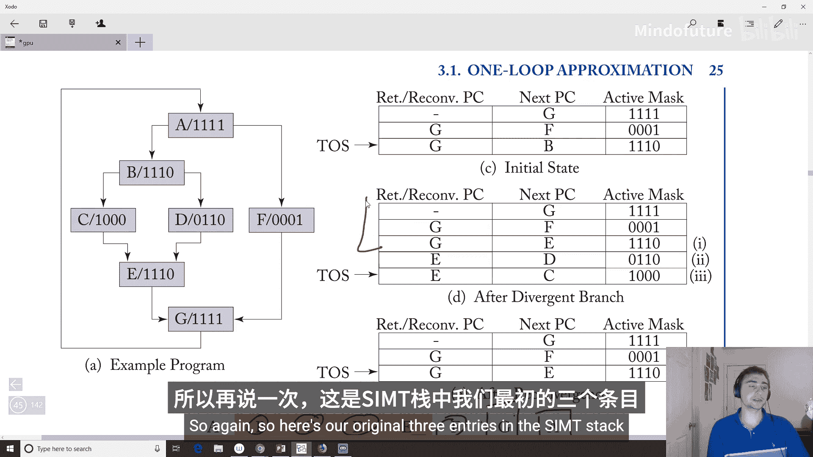

And we're going to have to push two more entries on right So we'll have to push on an entry for you know。

 if we go down， you know， for block C and another， if we go down for block D。 And again。

 this is showing， you know the two different ways。 So in this case。

 the one that ends up being on top of stack is the majority path。 And then， in this case here。

 they put the one with the minority path on。 But this is just kind of a design decision。

 This isn't you know， a requirement for correctness。

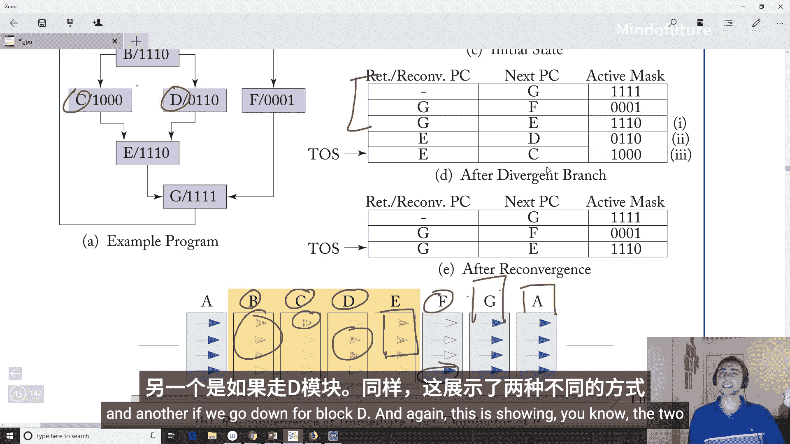

Okay， and so again， so now we have you know， another you， nested piece of control flow to consider。

So in this case， we'll start with the next PC being here， C。

And then we have a new reconvergence point， right， because， you know， we have nest control flow。

 So if we branch and we could go put two possible directions。

 we have to reconverge from that branch before we reconverge from the outer if statement。

 So our reconvergence point is E， right， So this is kind of like a local reconvergence point。So。

Again， where it B。We split， and then we reconverge。Right， and so， you know， both of these Es。

Is for both of these arrows here from C and from D， both good to E。So again。

 just to kind of explain how this works， during execution， we'll look at this empty stack。

 we'll get our next PC， which is going to be wherever this block C is， right？

We'll start execution down that block。 We'll eventually get to block E and then when we get to block E。

 we'll pop this guy off the stack。This this next entry will become the top of the stack。

 and then we'll just start executing you know， whatever is that block D， right。

 And then we'll go down until eventually we get to the PC value of E。

 which will be our reconvergence point。 So we'll pop this guy off the stack。 and then we can start。

 you know， going。We can， you know， if we're already at G after that。

 if we go down the next instruction， then we can pop that guy off and again go down here。

 And that's really how we achieve this serialized control flow right it's just a matter of。

 you know pushing entries onto the Sty stack。 And then as we hit reconversiongs point。

 we'll pop them off and we'll keep popping them off until we get to you know the next PC that's valid。

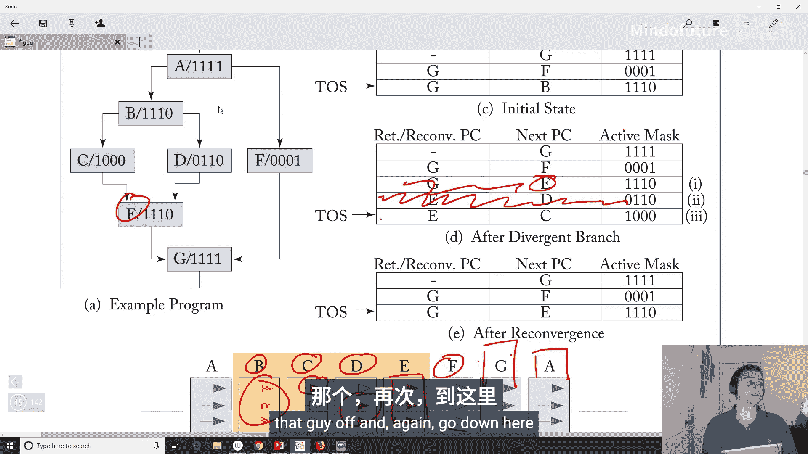

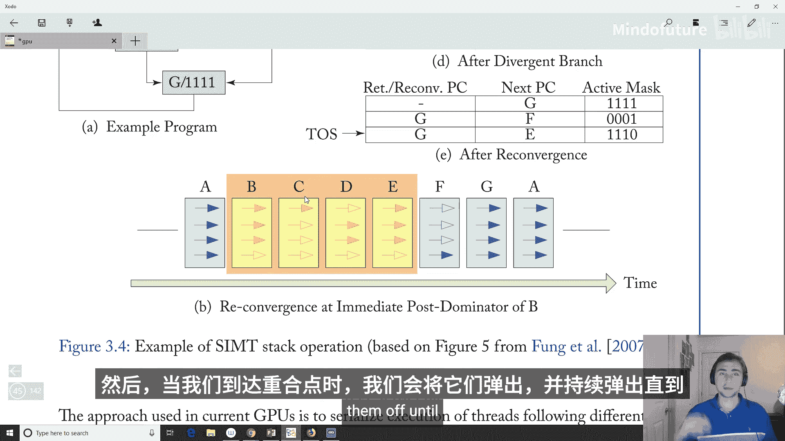

All right。

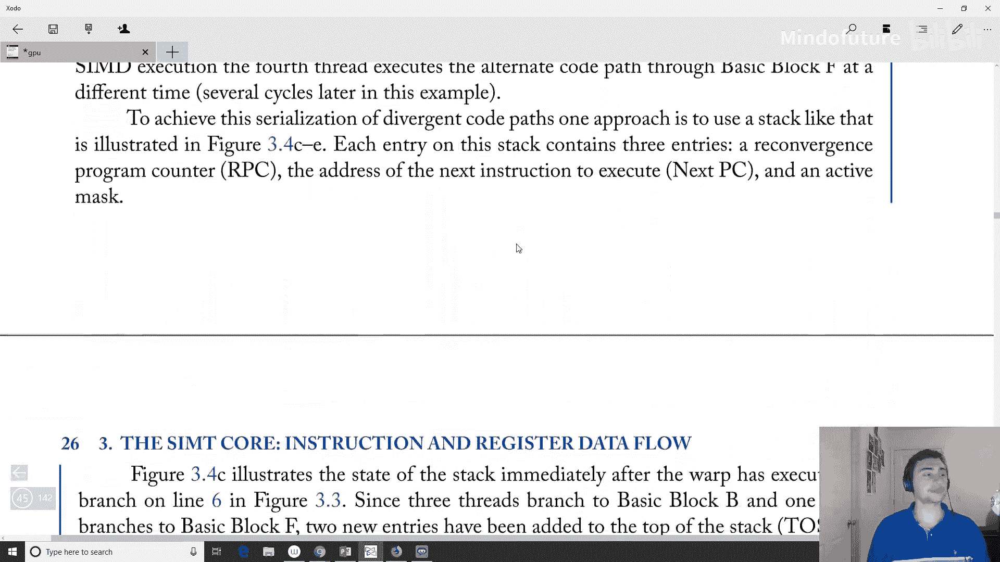

Sos that's about it。 So that's going to be the overall operation of the ST stack。

 So that's how we handle the fact that you programmers can view these things as scalar threads it can all go different ways。

 even though we have a St or single instruction multiple thread execution model。

 So what are we going to discuss next time， I feel we'll probably leave it here because this is more of a topic in and of itself。

 So you may be wondering well， what happens if you know we get stuck someplace where you know part of our threads are waiting in half or half our threads are active or in and if block and maybe there's a synchronization call right well if half of our threads are active you know how can we ever synchronize if the other half we never making forward progress so。

We'll talk a little bit about this thing called Sti Delock and then also you know how we could have stackless Sti architectures。

 But that's going to go ahead and do it for this episode。

 That's a brief introduction to the Sty core using kind of a one loop approximation。

 We'll talk about the other schedulers and things like the opera collector later， as always。

 feel free to check me out on Github。 I have all the code from all the other series I do post it there And if you have any questions。

 feel free to email me at coffee beforearch@gmail co comments on a video maybe if there's a specific topic that you like know maybe I can do a video on that。

 I do take things like viewer suggestions。

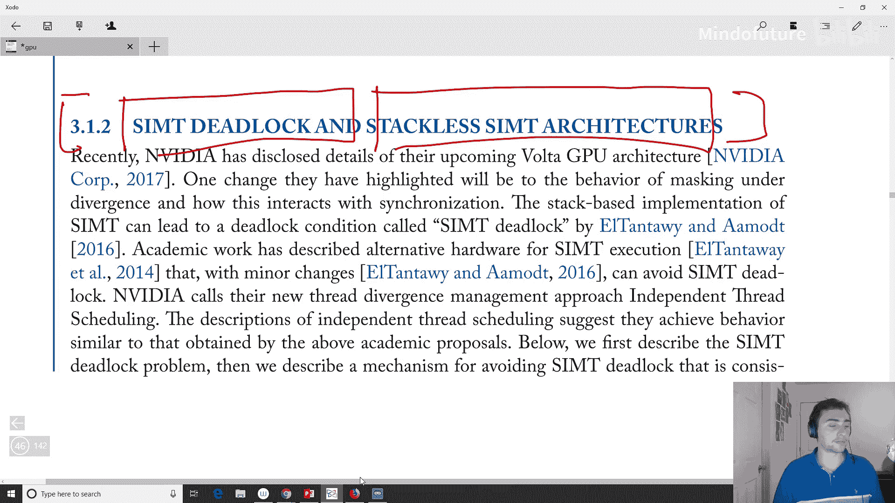

And then I've been thinking about doing other things like a video or video series on cache coherence and memory consistency。

But like I said， that's going to go ahead and do it for this video。 again。

 My name's Nick Co before Arch and I hope you have a nice day。

