# GPU架构基础-p05-P05-SIMT-Core-Part-2--BV1ay5vzgEAe_p5-

Hey everyone， I'm Nick from Cuff before Arch。 And in this episode of Fundamentals of GP P Architecture。

 we're going to be continuing on looking at the core architecture。

 This time we're going to bring up where we left off last time。

 which is this idea of S deadlock that comes from the fact that we have this stack based architecture。

So this is something that's been， you know。Removed， or at least。

 you the best of our knowledge and to what we can surmise by what Nvidias released and what Nvidias patented。

 as well as kind of what the contemporary look at research is saying is that， you know。

Starting in about the Volta GPU architecture line from。You know2017 onward， you know。

 they don't use the symptom stack based implementation for divergence。

 so they use something else for handling warp divergence and synchronization。So， you know。

 what we're going to go into today is， you know， this idea of what is empty deadlock and how does that stem from the architecture？

And then how we can avoid it。

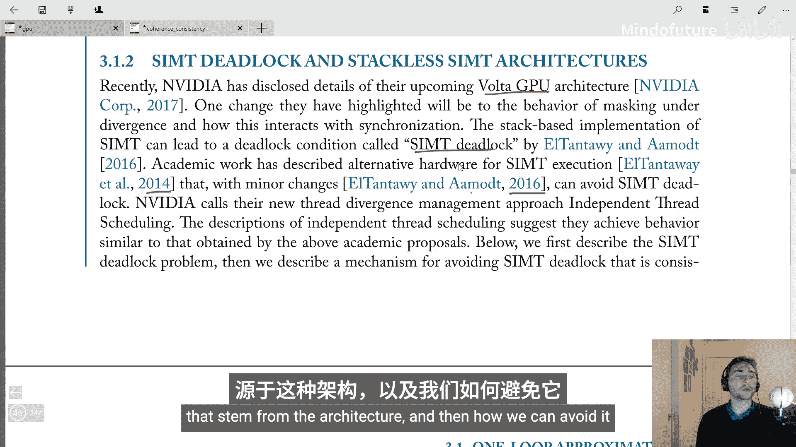

So we'll go ahead and start with a very simple example that shows the problem in these architectures with the ST stack。

And so， you know， what we're going to look at is， you know， we'll have， you know。

'll we're just considering a single warp at the moment。 So we'll have a single warp that， you know。

 it'll initialize a shared variable。 that'll just be some u text log to 0。

Zero indicating that the lock is free。Then every thread will also do a atomic ca。

 which just stands for Atomic Comp and swap。So。This is actually just a compiler intrinsic that gets translated into this atomic Do globalca。

 PTX instruction。And so kind of logically， what this does is it will read whatever the， you know。

 sort of takes three parameters， so it will read whatever the first parameter is， which will be say。

 a mut text lock。It will compare the value to the second input， which in this case will compare to 0。

0， just meaning that the log is free。So if that ends up being true。 So if the muex is 0。

 then we'll go ahead and swap that value with the。U with the value of the muttex。

 what we want to change it to， which will be the third input which in this case we'll use one and one will signify that it's。

That， you know， the lock has been taken， right， so we'll we'll， we'll fix that with one。

 So you may be thinking， hey， you know， this is a multi threaded thing。 This is， you know。

 S execution。 all three of these or all 32 of these threads will be doing this atomic instruction at the same time。

 well。You know， this is an atomic instruction。 So they act a little bit differently。 So in this case。

 when we have multiple aes by atomic cast to a single location made by different threads within the same warp。

 they're going to be serialized。 So that means that only one thread has the potential to get a lock at a time within a warp。

So also only one thread will ever see the value of muttex being0 at a time because like I said。

 they're serialized。 So only one of them will that 0 equals 0 will be true。

 and it'll swap in that one。 Everyone else will see that that value is one。 So it won't get the lock。

 And so it'll just have to wait around for it。So let's go ahead and jump on down to this。

 this quick example。 So this actually shows off this， what we've been talking about。 So everyone。

 all 32 threads start out right here。 So， you know， all the threads are。No one's diverge。

 Everyone's kind of doing the same thing。And they just all write zero to mute text。

 doesn't really matter that they're all writing to mute text， they're all writing the same thing。

 so it's fine。So the part that where Cinti Dlock comes in is right here。 So this while loop。

 So this while loop is just basically an infinite loop where it says。

 just wait until you get the mutex lock， so。You know， like we said。

 this atomic cast instruction will be serialized for all the threads， so you know， 31 of the threads。

Will stay in this while loop。 And then one of these threads will get out of this while loop。

 So you can see right here that this is already going to be thread divergence， right。

 So 31 threads are staying in a while loop。 One thread is out of the while loop。

So if we think about this from the context of a， of the ST stack architecture， what's going on here。

 So we have。A wild loop right here。 And so this will get translated into， you know。

 Comps and branches。 So basically， what's going to happen is we're going to go down two paths。

 you know， one。That is， if， you know， this doesn't or this is true。 So we didn't get。

 we didn't get the lock。 So we're going to stay in this while loop。 and then one where it's false。

 right， So we'll use 0 to say false。 So if we get down the false side， we exit out， right？

 And what happens is we end up getting this。This kind of funny pattern where you know as soon as we get out of this while loop。

 that's also our reconvergence point。 So everybody will eventually get out of this while loop。

 So our reconvergence point。 So if we think about our entry in the Sti stack。

Everybody will eventually reconverge right here in a normal sty stack based architecture。 Now。

 the problem with this is that this reconvergence point is before the lock free。

 So why is this a problem， so。The problem is that as soon as the thread that made it past gets to the reconvergence point。

 its entry will be popped off the stack of the or popped off the Ste stack。

 And what will happen is that will resume execution for， say， the other 31 threads in the while loop。

 Now this leads to kind of a cyclic dependency。 So the one thread that just broke out of the while loop。

 but hasn't executed this atomic exchange。 It's going to be waiting because it wants to reconverge with the 31 other threads。

 So then the 31 other threads are also waiting because they need the lock in order to proceed。

 So we have the cyclic dependency。 So this is what we call a deadlock。

 So deadlocks are just where you， nobody is able to make a forward progress。And so basically。

 our entire program seizes up。 So that's where this kind of stems from。

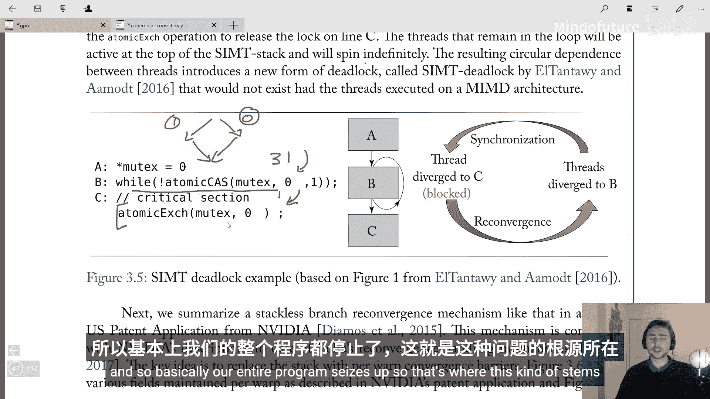

So， you know， based upon a patent that NVIDdiaA has from 2015。You know， kind of this， the， you know。

 the research seems to。Pretty well correlate with what Invidia said。

 And then also this patent finding。 So we'll go ahead and go over kind of what they've proposed。

So here we've got you know a couple figures so this comes from that patent filing in 2015。

 we've got this example that we'll be going going through from one of the research papers。

 and then we also have another figure that comes from that 2015 patent so let's go ahead and start talking about how we can replace a stack based architecture with something else。

So we're going to start with those fields from figure 3。6 up here and what these actually mean。

 So what is a barrier participation mask， what a barrier state， what's a thread state。

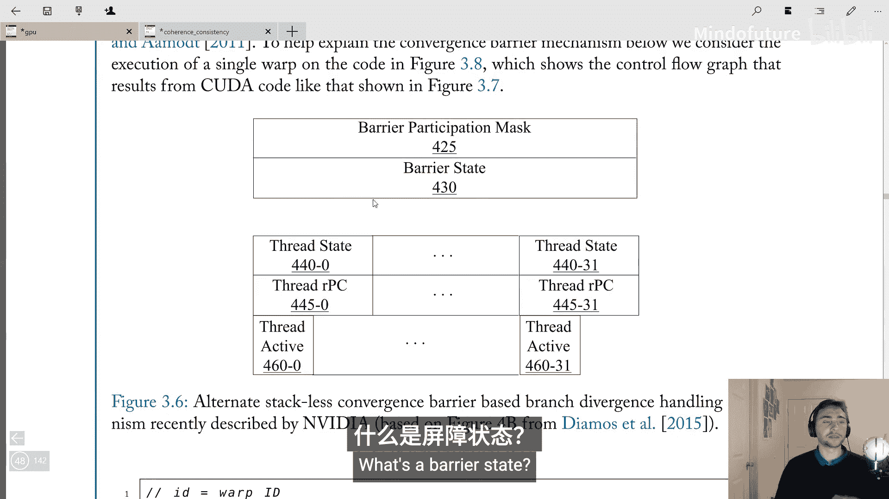

Okay。So right here。So these are all fields that are going to be stored in registers and used by the hardware Warp scheduler so they're going to determine who is going to be you know doing what at what time。

So we're going to have barrier participation masks。

 and these are going to be used to track which threads within a warp participate in a given reconvers。

 a given convergence barrier。 So this is just saying。

We're going to have some masks that you know they're going to be the size of warp。

 so they're going to be 32 bits so for you know if say half the threads are going to reconverge at a certain point。

 maybe it's the first half of the threads in a warp， 0 through 16， those bits。

 or rather 0 through 15 will all be ones and then 16 through 31 will all be zeros。

So we'll have some mask saying， who is actually reconverging here， Who do I have to wait for。

So that's the first thing we need to know who we have to wait for。Then， you know in the common case。

 threads tracked by a given barrier participation mask will wait for each other to reach a common point in the program following a divergent branch。

 thereby reconverge together。 So that's going to be these convergence barriers。

 So how do we support this So not only do we need to know which threads need to reach this point。

 We use this barrier state field， which is used to track which threads have arrived right So this is just keeping track ofver this barrier participation mask says who's going to arrive and then the barrier state field says who has arrived already。

And then one final thing that we'll keep track of is this thread state。

 So the thread state just says， you know， for each thread。You know what's its current state。

 so is it ready to execute， is it blocked at our convergence barrier。

 so is it you know waiting on other threads to arrive at some certain point。

 and then again we also need to track which one is is it waiting at because you know we can have nested conditional statements。

 so we need to support having different levels of convergence。

And then there's also this idea of yielded。 So this is something that's a little more abstract。

 but we have a fairly good idea from everything that Nvidia said Im from the patent to kind of know what it does。

 at least it。

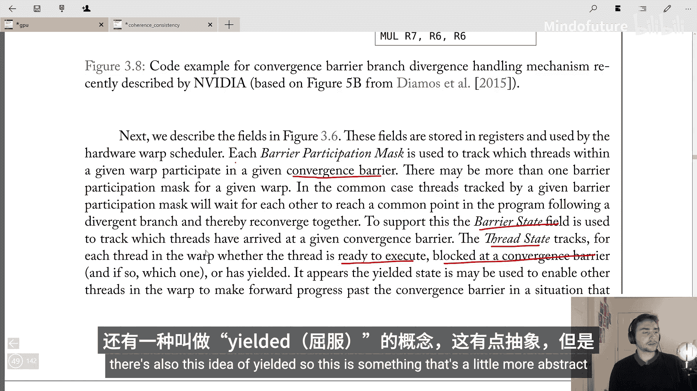

You， a very kind of hand wavy level。 So what it appears that this yielded state does is that it may be used to enable other threads in a warp。

 make forward progress past the convergence barrier in a situation that would otherwise lead to a empty deadlock。

So， you know， in order to avoid situations like we saw up here in this example。

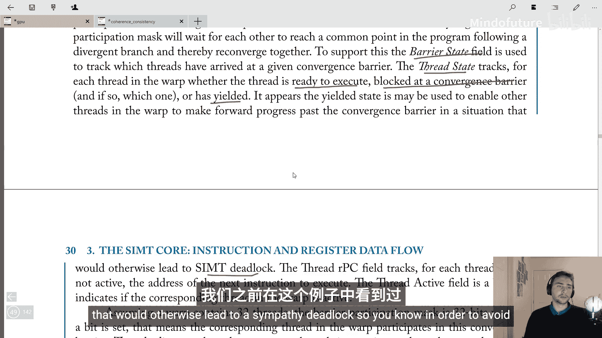

You know。Maybe we can start executing instructions， you know。

 past a convergence barrier so we could get an instruction to release a lock so that we don't wind up in this empty deadlock。

scenariocenar。Okay， so again， you know， since a warp has 32 threads。

 we're going to need a 32 bit wide participation mask that just depend that just says， hey。

 who's going to converge at a certain point？So here we can see。

K of how that looks like from a high level so here we have a basic example where we've got a number of basic blocks。

 so we've got basic block A， which is basically our entry to the function and then we split off into two separate basic blocks。

 one inside of this if statement and then another inside of the L statement so we'll have this is one level of divergence then within this L statement we could go into two different basic blocks D and E then we have our first reconvergence point at a basic block F where the else block reconverges and then we've got our final reconvergence point at this basic block G so we' all the threads should be kind of getting back together at this point。

And then we see that here， right， so we have you know。5。

10 corresponds to base this basic block 510 basically corresponds to that first if statement。

 So in that if statement， we can either go you know， one of two directions。If an else。

 and then inside of that L statement， right， we'll consider this the else block。

That Ls block also splits into two different control flow paths that。

 end up both converging at the same point later on。And so， you know。

 this really all comes down to this this branch based based on a predicate。

 right so we're branching based upon some value for some threads， it may be valids。

 for some threads it may be invalid so we could go one of two ways。

 Sam thing with this branch right here based upon this predicate 0。Okay。So yeah。

 so these correspond to two if statements。Like we said， at any given time。

 each warp may require multiple barrier participation masks to support nested control flow。So。

 you know， these registers that we're talking about， so you know。

 keeping track of who's reconverging， what the status is know whether it's or who has arrived whether or not。

 you know， they're waiting on other people or whether or not what's the next PC that they're supposed to。

 you know， execute next or they're ready or whether or not， you know。

They're being told to yield with whatever， you know， actual semantics that means。So where。

 where does this actually get stored so these could be just implemented。

Using general purpose registers or dedicated registers or some combination of the two。

 So the actual patent doesn't say。 So this low level detail is kind of abstracted away from us。

 So we can do our best guesses here。 But at the end of the day， there are just going to be guesses。

So， you know， given that the bear participation mask is only 32 Bs wide because like we said 32 Bs in a warp。

 it would be redundant if each thread had a copy of a bear participation mask， so。You know， if it's。

 if we're going to have we could just have 1，32 B register for all 32 threads， right。

 because they really only need one bit。 they don't need an entire register。Each that is。So。Okay， so。

 you know。It would be redundant if each so I had a copy of the bear participation mask。As it might。

 if it natively， as it might， if naively rather， sorry。

 using the general purpose register file to store it。 So， you know。

 control flow though can be nested to arbitrary depths。 So this presents kind of an issue。

So given more maybe an arbitrary number of barrier participation masks。

 so software management is a little more amenable to the situation because asking hardware to manage something of arbitrary depth。

 that's asking a little bit much。So getting a little more into the weeds， though。

 so kind of moving past that。 So how does this actually look。

 So how do we initialize a convergence barrier。So this is actually done with the special ad instruction。

And then all threads that are active when the warp executes this add instruction have their bits set in the convergence barrier indicated by the add instruction。

 and so we can see this in the example above， so let's go there。So here we have。Right。

 so let's get rid of these arrows real quick。 So like we said， we're going to be， we。

 we have some if statement here that we could either go into the。You know。

 this would be the if block， and then this will be the else block right here。

 And so we know that from the predicate in this branch。

 But this ad right here is saying this is going to initialize， you know who is going to converge。

 So everyone that's active at this point。 and we'll just assume at this point， it's all 32 people。

Or all 32 threads， right， and we'll just give it some label 0。Okay。And then down here， you see。

 we've got another label， right。 And so in this time， when we do this ad， you know， for this。

 this other， you know， boundary or this other convergence point， it's not going to say be， you know。

All you know，0 to 31 threads here， right So we really are only talking about maybe a subset of these threads that will be you know tracked now because there there will only be a subset active in this side of the in this side of the basic blocks anyway。

 right some of the threads will go through the if block。

 others we'll go to the else block and we just use these special addd instructions to say， hey。

 this is who's going to be waiting at this convergence point that we're going to call label one。Okay。

 so then the next thing we have is a special weight instruction。

 So this is just used to stop a warp split when it reaches a convergence barrier。

 So as described in the patent application so that 2015 patent。

 the weight instruction includes an operator to I indicate the identity of the convergence barrier。

And so the effect of the weight instruction is to add the threads in the warp split to the barrier state register for the barrier and change the thread state to blocked。

 So basically， we're combining all the threads and everybody's going or we're putting them in the blocked state。

 saying they're all just waiting at a convergence barrier now。And so we can see that here or so。

At our first convergence point that we hit right here。 you see， we've got a wait on B1。

And B1 was the。This barrier that we had coming from this basic block and then up here at this very first one。

Where we call this。You know， say B0 right here that we initialize this this reconvergence point。

 we've got a weight B0 down here at the very end。 So this is going to be you know the very end of this this simple example right here when we're reconverging into basic block G。

Okay。

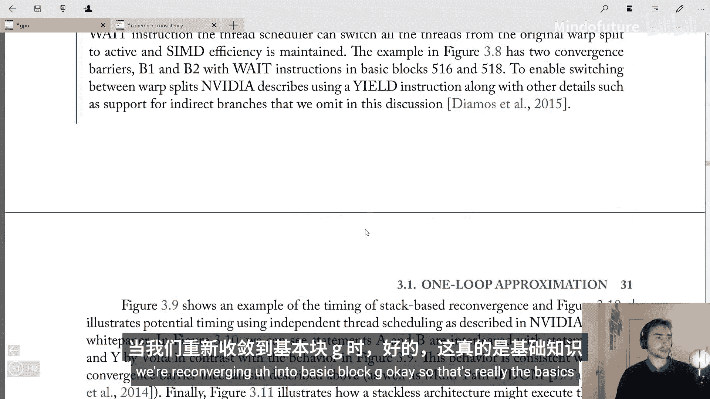

So that's really the basics。Of， of how that really works。 So one thing we didn't go over， though。

 was yield， right And so that's still fairly vague。 So we won't go into it in right here， but。

You know， you can find out a little bit more about yield than the actual patent filing itself。And so。

 you know， one of the things that。This yield does is。

 you know it enables switching between warp splits and we'll go into that of what that actually means。

 but we're not going to go into saying what does yield actually do when it's speculation？

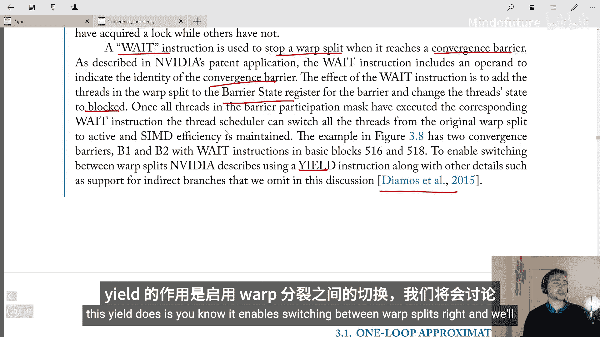

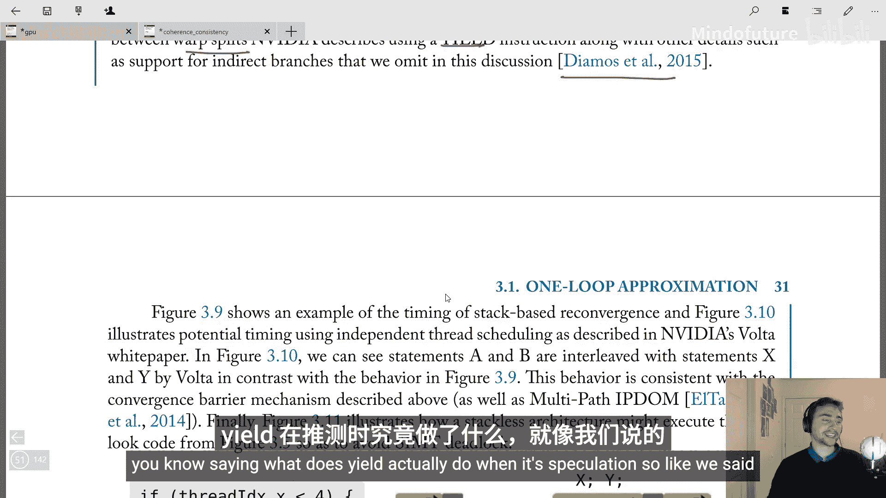

So like we said， you know。It it does help us do something as far as executing different warp splits and warp splits you can think of as those different paths on the Sty stack from a 10000 foot view。

 they look kind of similar。But with more flexibility。So here。Shows， you know a simple timing example。

 So this is time going to the right and then we've got this simple code right so you know from a empty stack point of view what happens。

 So some of the threads will go down one branch and they'll be in here other threads will go in here and then we'll all reconverge at this this point here where Z is。

 So you know right here we've got you know all the threads together。

 So that's exactly like where the very top of the function。

 then we hit that compare statement that thread ID X less than4。

So what will happen is one of these paths will be selected depending on how it's implemented。

 so we'll go ahead and go down one path so we'll do A and B， and then this will get down here。

 that'll be a reconvergence point so that will get popped off the empty stack and then we'll start the other side of execution so we'll do x and y。

We'll go past there。 it'll hit this reconvergence point， it'll get popped off the Sti stack。

 and it will reconverge， and then everybody will work in lockstep together and execute Z。

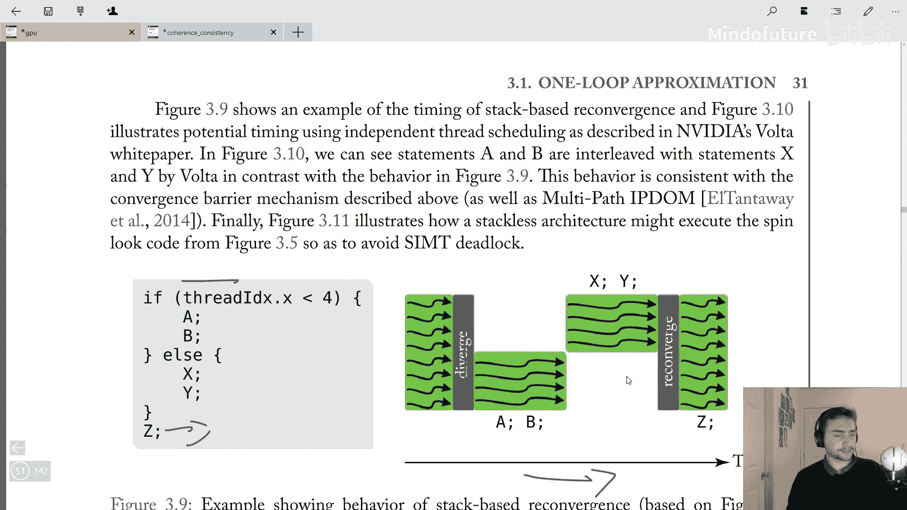

So that's the stack based。呃。Okay， so then as we move on right here， this is more the。

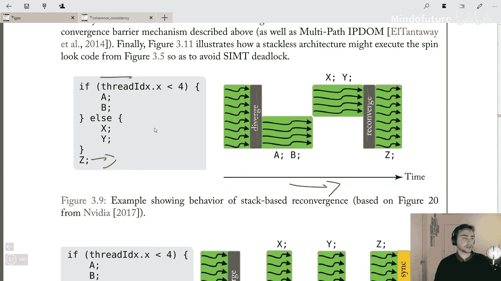

The Volta kind of reconvergence of how this works from their white paper describing it。

So basically what happens is， you know， everybody's still altogether up here before we diverge。

 But instead of having， you know， this very strict ordering to which what we have to execute at any given moment。

 we can kind of ping pong around。 So because it's not a stack base where we just have to look at only the top of the stack。

 we can， you know， maybe start executing a， then we can start executing X。

Then we can go back to executing B， Then we can go to executing Y， the consequence of this， though。

Is that after we execute why this doesn't mean that all the threads are going to be together at that point。

 So we don't have a guarantee of that anymore。So。You know， in this case， what could happen is that。

 you know， Z could execute。But only for a subset of the threads， you know。

 the threads may be coming from the if statement。And then it'll hit a sink warp。

 And so it'll just wait here。And so those sides we blocked at that point。And then。

Maybe the other side， you know， we'll go ahead and execute Z over here。

 So maybe the L will then start executing Z right here and then you know。

Both of these will get blocked in。 So once they all finally finish and get together。

 So they'll kind of reconverge。 And then finally， they'll be in lock in lock step here。

 But we don't get this automatic guarantee that all the threads， you know。

 will be in lockstep like we do in the Sty stack based approach。

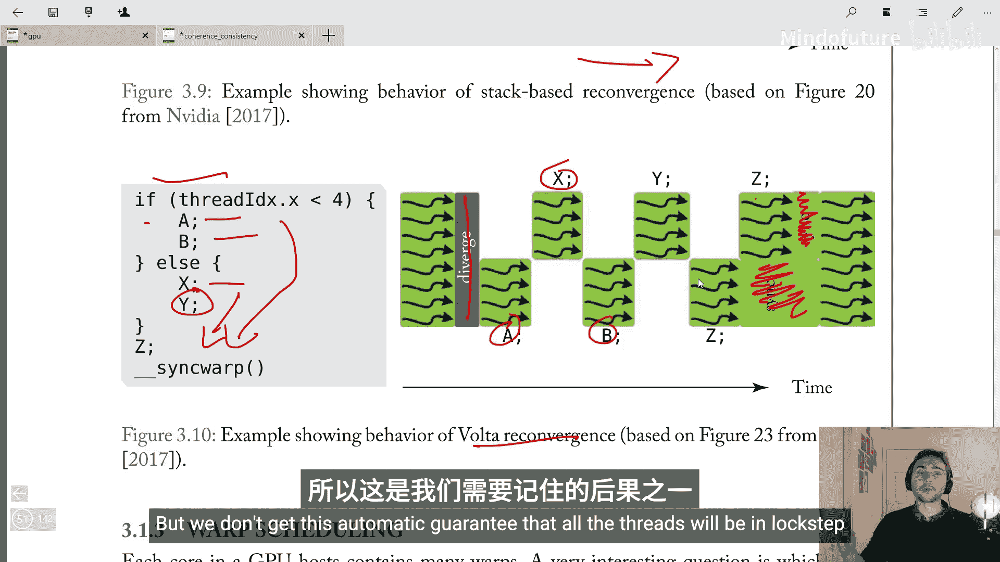

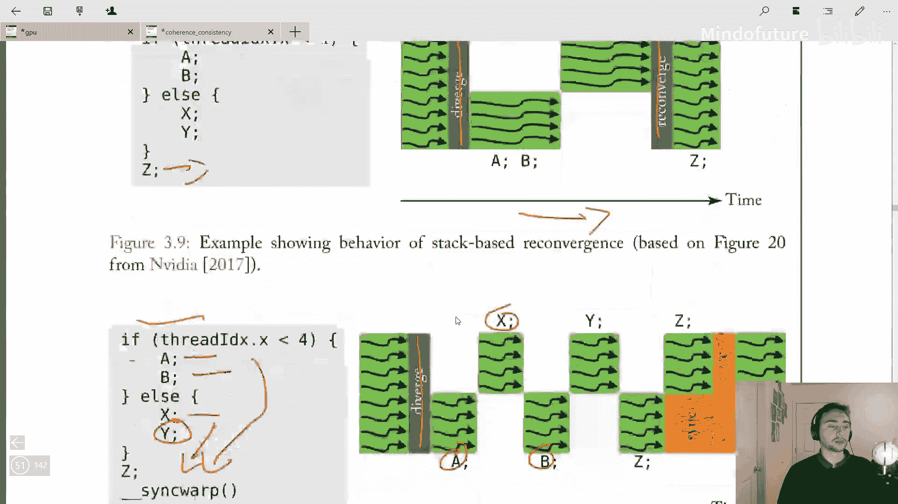

So that's kind of one of the consequences or one of the things that we should keep in mind。

 and you know as you can see right here， there's an explicit there's an explicit you know kind of function that we call to make sure that everyone's together and that's a sync warp and that's basically just one of the that's another interaction between you know thread divergence and reconvergence that we have。

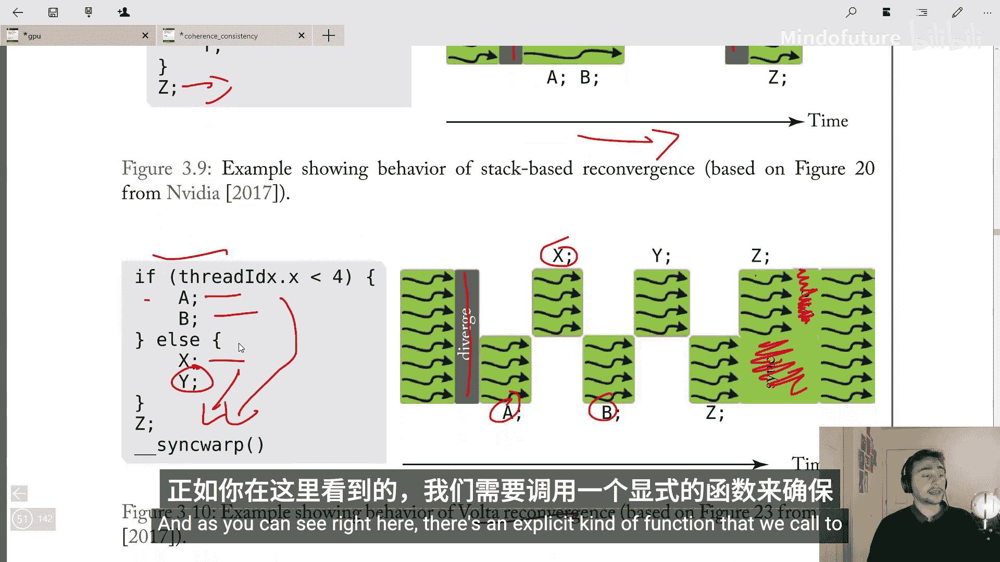

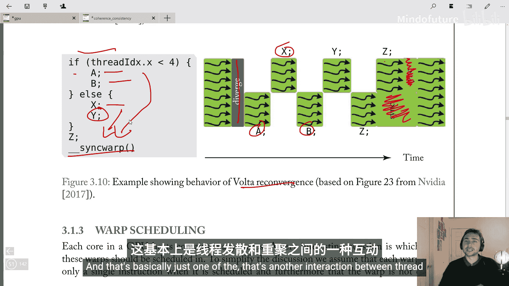

So of course， we can't get away with talking about all the stuff about warps without talking a little bit about warp scheduling。

So as we know， GPUs contain a bunch of warps So the way that GPUs fundamentally work is we try to hide latency not by you know instruction level parallelism。

 but we try to hide it by the fact that we have so much work that we give to pick from that if somebody's you know waiting on。

 say a long latency memory instruction， we just kind of throw them out and pull someone new in to start executing。

But there's an interesting question though， which is， who gets to go or who should go。

So we'll start with a very simple assumption， which is that， you know。

 each warp issues only a single instruction when it's scheduled and then furthermore。

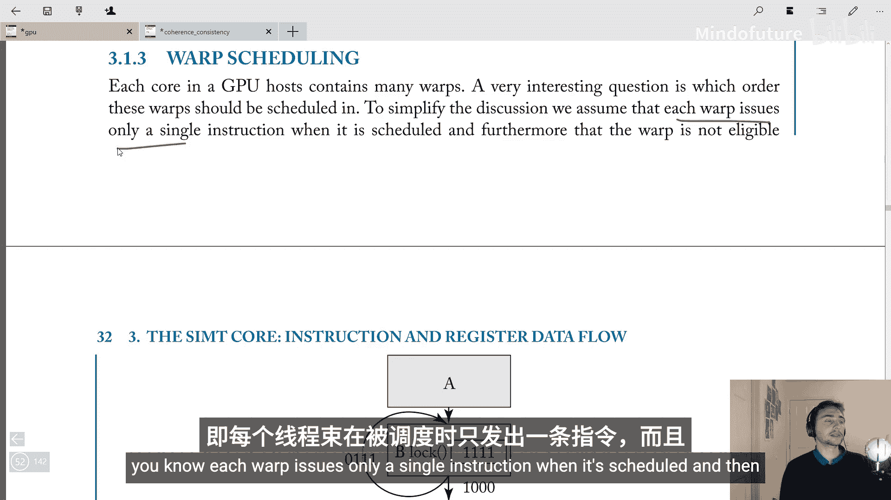

That a warp can't execute or issue another instruction until the first completes。

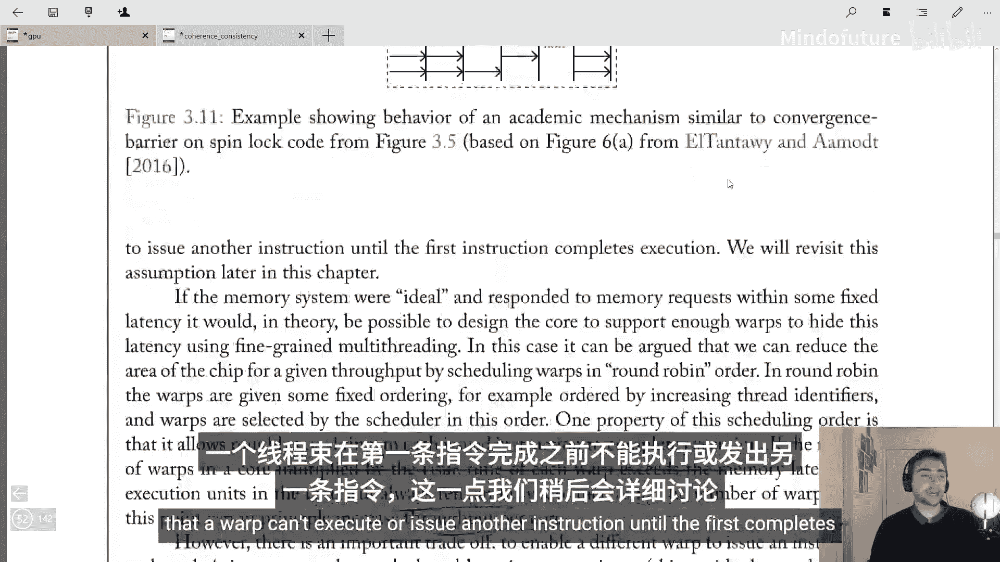

啊。This， though， will kind of hand waveve away until。

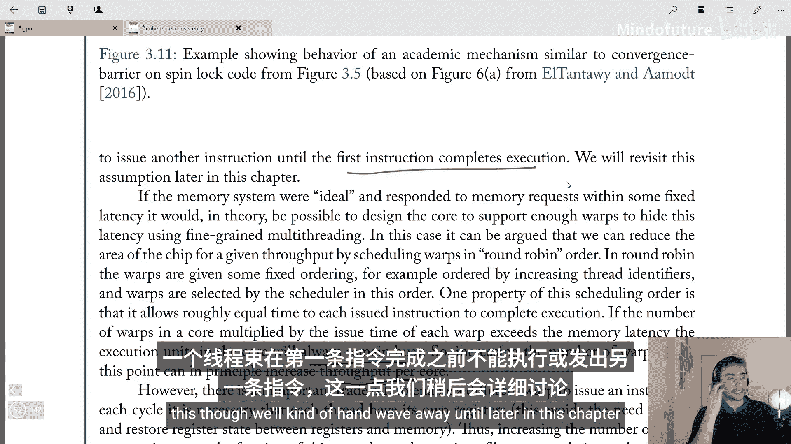

Later in this chapter。So if memory was ideal and responded within some fixed latency that we could account for。

 we could design a core to support enough warps to hide this latency using fine grain multi threading。

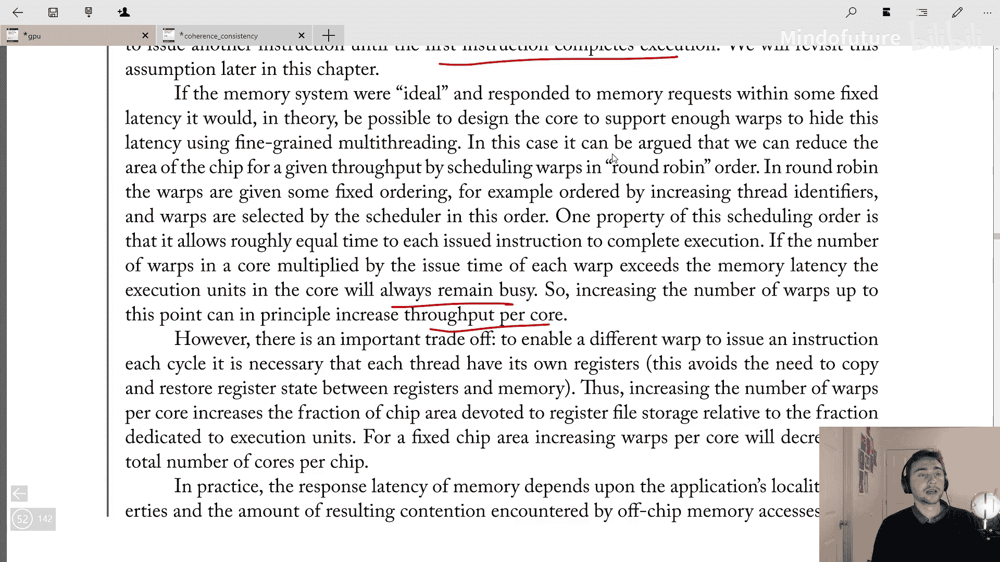

So in this case， it can be argued that we can reduce area of the chip for the given throughput by scheduling warps in round robin order。

 So this just is saying that， you know， if we knew kind of how long memory was going to take by some fixed time All we would need to do is have。

 you know enough instructions so that the time it takes to execute or rather enough warps all that we would need is enough warps to select from that by the time we go down the line and start you know issuing from one warp at a time。

 But the time we loop back around to get back to the first warp。

 it's ready and its memory request is already back So that's all that it's saying with this you know this fixed latency of what that would mean。

O。啊。So， so one proper of scheduling order is so what round Robbin basically is is it itll it basically gives everyone kind of equal time because it doesn't。

 you know， pick one and say， we're going execute a bunch of instructions from you。 It just says， hey。

 we'll like you one from you， one from the next guy， one from the next guy。

So if the number of warps in a core is multiplied by the issue time of each warp。

And that it exceeds the memory latency， the execution units in the core will always remain busy。

So basically， what we want to happen is we want to be able to be constantly issuing requests such that。

 you know， we're not just waiting on one warp that's， you know just。

It's not making any forward progress。 It's just sitting there waiting。

 So we want enough warps in there that we can constantly rotate them around and issue new instructions and new instructions。

So again， like I said， we're trying to hide everything just by multi threading right。

 so huge levels of multi threading。But， you know， this。Everything for a price so。

There's an important trade off here， which is， you know。

 if we want to have different warps to issue an instruction each cycle。

That means we need to store a whole lot of state。 So we can't just throw away state if we want to get rid of a warp and start issuing from another a new warp。

 So we have to keep that around， which means that every warp is going to have every thread is going to have to have its own registers。

 That way， we don't have to do some kind of crazy expensive context switching that would end up probably eating more time than it's worth worth。

So， you know， it's a balancing act because if we increase the number of warps。

 that means we're going to。increasec our parallelism， so increase our multi threading。

 but also means we're going to increase the amount of state that we need to keep。

 so we're going to increase our register file size。

So you know if we keep increasing the amount of warps。

 that means eventually we'll start decreasing the number of cores per chip。

 so it's this balancing act of you can increase the number of warps。

 but that's going to eventually decrease the number of cores considering a fixed chip area。

Another big thing to， you know， really consider is the fact that， you know。

 this just makes the register file get really， really big。 So already。

 a register file and a contemporary GP， register file will take up around 256 kiloB of space。 So。

 you know， that's already on the order of。CPU caches， right。

 and this is just for the register file state。

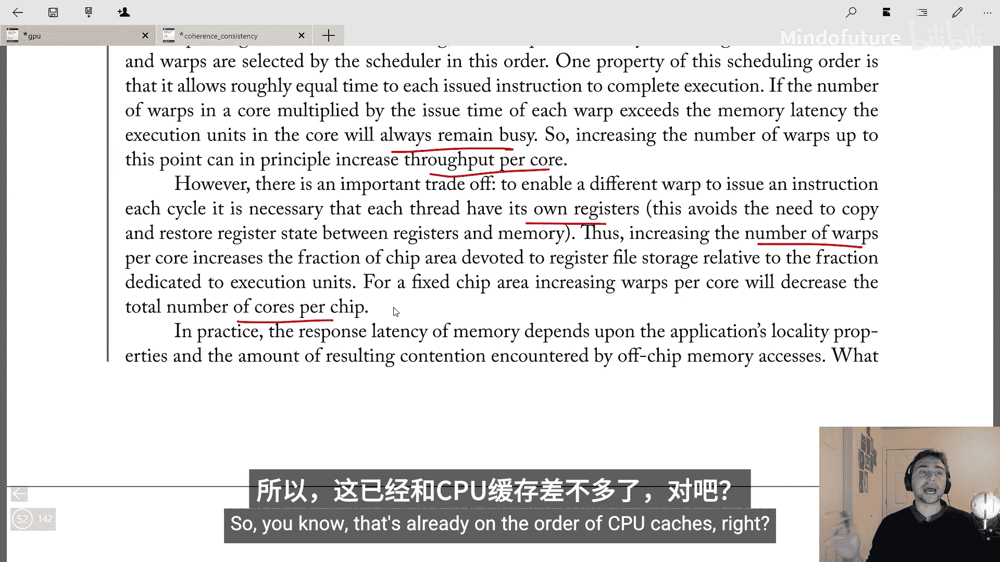

So， you know， that's one of the reasons why things like precise exceptions can be difficult because you know。

It's really hard to keep track of that state。 And asking， asking to roll back that state is。

 you know， a whole nother beast。

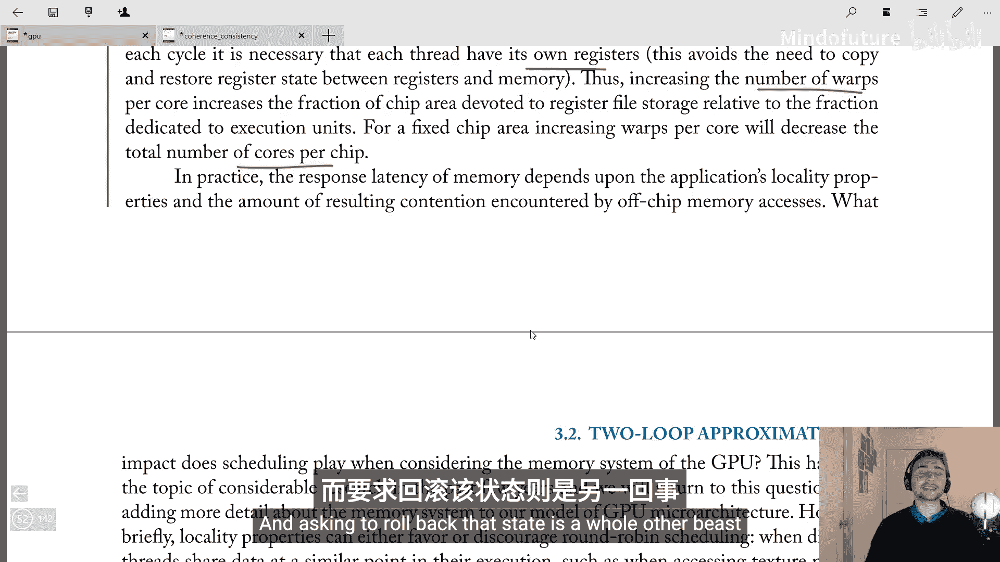

So in practice， well we're talking about memory。You， latency memory depends on， of course。

 an application's locality。

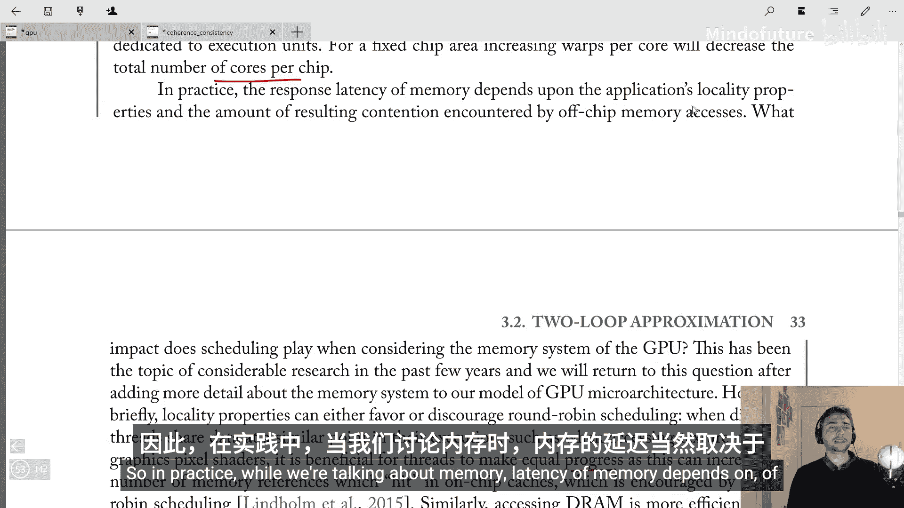

And one of the nice things about a lot of applications that。That we found and that。

 pretty much everybody already knows。Is that。You know， sometimes， you know。

 round Robbin scheduling can be pretty good at finding locality。So where does this happen。

 So this happens a lot in graphics workloads。 So when we have graphics workloads。

 typically we want all the warps to be in around the same place。

 when all the warps in around the same place in a graphics workload。

 they're typically working on the same data。 And so this is really typical with， say。

 accessing texture maps in graphics pixel shaders And so we can increase the amount of hits in the amount of time we're spending in the on chip L1 or L2 caches。

 if everyone's in the same place。 But this isn't always the case。

 because there are situations that round round Robbin scheduling can actually be bad for performance。

 And we don't actually want everyone to be in different places。

 So if we have kind of like disjoint data and complex data structures maybe some really complex graph application。

We really don't want。A whole bunch of threads to be， you know。

 progressing along because there's no guarantee that they're going to be working on the same data。

 Like we said， this could be some weird graph application。So in those cases。

 what's going to happen So everyone's going to be touching different data。

 which means that everyone will be loading different data into the caches。

 which means we're not getting much reuse between different warps。

 if we're not getting much reuse between different warps， caches really aren't that big in GPUs。

 which means that we're not going to get any hits in our caches or nearly zero hits in our caches。

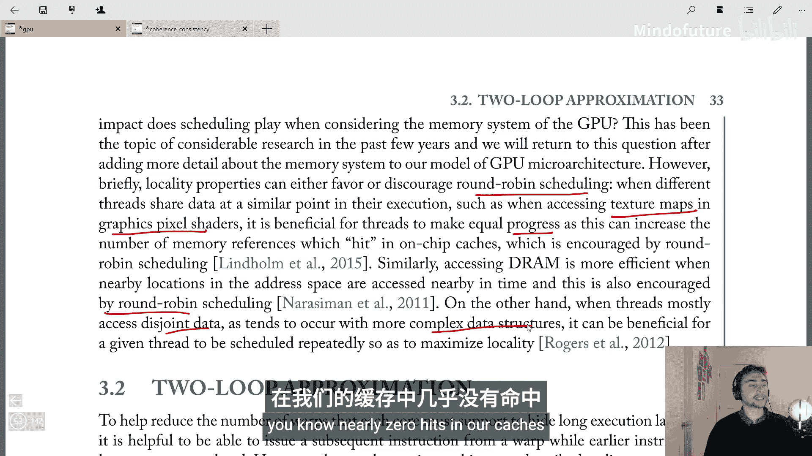

So， you know， what this work back in 2012 said was。You know， if we have situations like this。

 you know， it could be better that instead of trying to hide this latency by multi threading。

We'll actually do some throtling， right， and we'll say that we'll only allow， say， certain warps。

To execute， you know， instructions。 And when we do this， you know， suddenly the amount of。

 you know diver aes coming out， suddenly， it's really just from a few warps that maybe can fit all their stuff could be resident in the cache at that point because they don't have all this interference kicking kicking things out of the cache anymore。

 And so you can actually schedule in such a way to maximize locality by doing a little bit of throdling。

 And so this idea was from 2012。 And it's called CCW S。

 which stands for cache conscious wave front scheduling。

 So wavefront is just aimed Ds term for warps， so。You know。

 you could call this cache conscious warp scheduling if you want。啊。Okay。

 so that's just kind of high level ideas about， you know。You warp scheduling。Okay。

 so that's really going to do it for this episode。 So let's just do a quick recap。

 So starting from the top。You know， we kind of introduced this idea of， you know。

 last time we talked about the Sty stack。This time， we talked about， you know， well。

 recent architectures are moving away from the empty stack。

 And the reason why they're moving away from the empty stack is this idea of empty deadlock。

 and empty deadlock comes from the fact that。

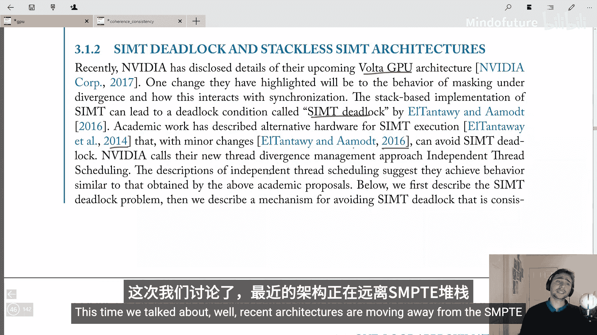

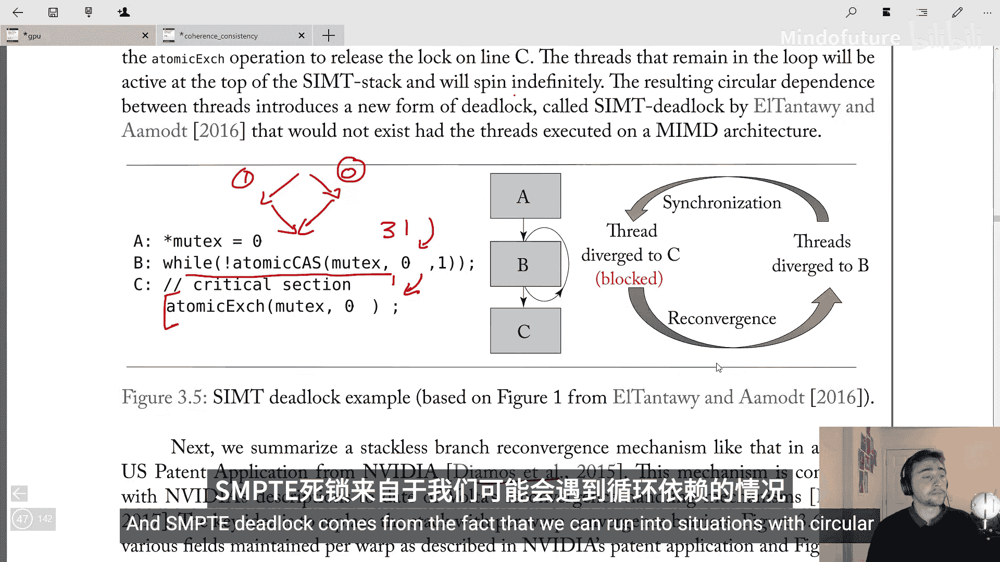

We can run into situations with circular dependencies。

 so newer architectures that are not stack based that can。

 you know schedule different groups of threads kind of at well。

 It doesn't have to go based upon some simply stack order get around this。

 and we saw that you know it's more of a barrier based implementation， a stack based implementation。

 And we saw the basic ideas of how this kind of works out。 So we talked about that。

 And then we also talked about what this looks like from a time perspective of what which threads are executing at any given moment。

 And then finally we talked a little bit about warp scheduling。

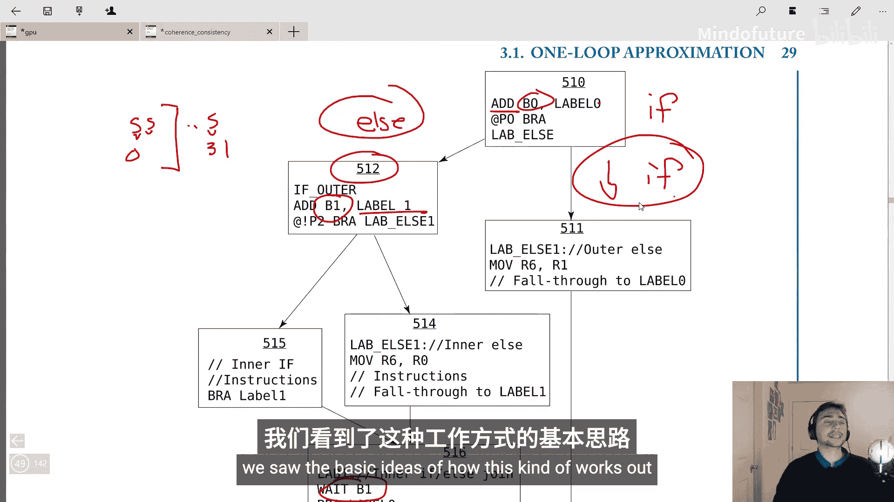

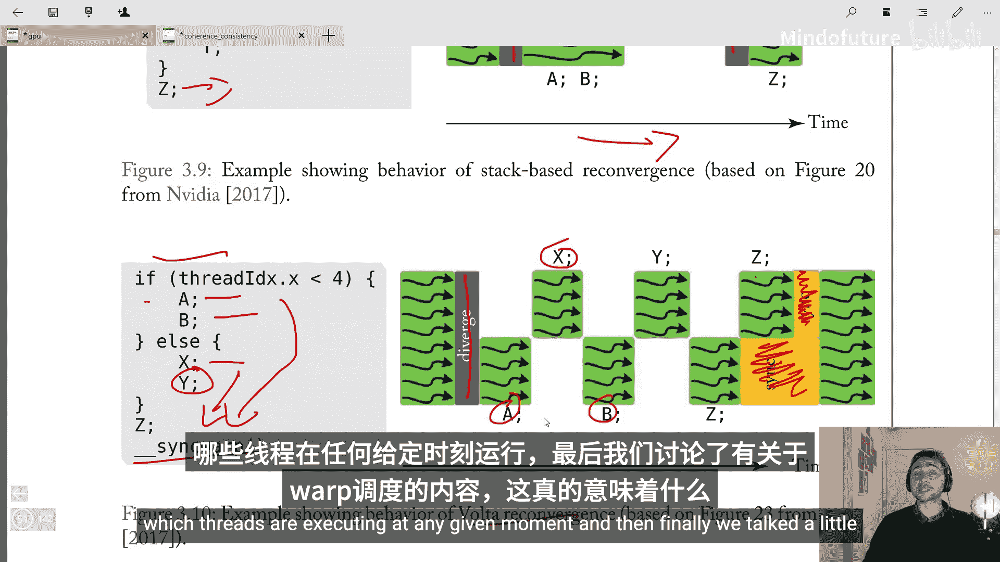

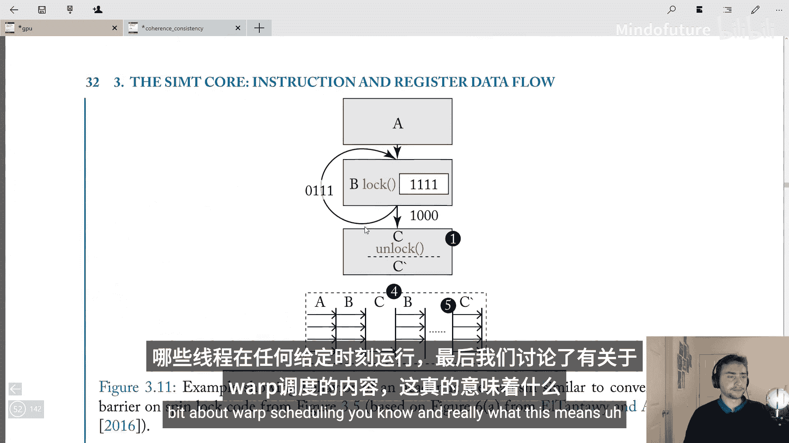

You know， and really what this means。呃。Yeah， okay， so that's going to do it for this episode。

 So next time we're going to start the next level of you know digging deeper into the Sty core。

 So again， this is all part of the first section on the one loop approximation。

 So we'll talk more about in more detail of a more realistic model of a GPU based upon what we call a two loop approximation。

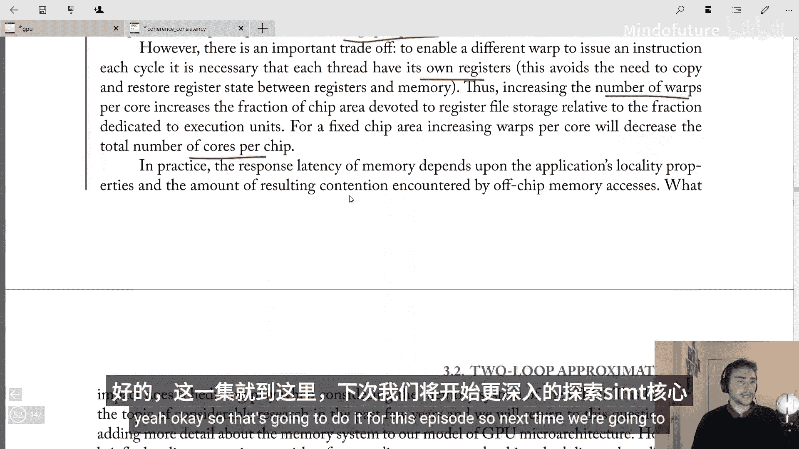

So， we're gonna。GPUs have a bunch of schedulers in order to really provide。You know。

 this really good performance。 So we need to know gradually work our way up， starting from。

 you know a GPU with a single scheduler to you know two schedulers or so to even three schedulers。

 But like I said， that's gonna go ahead and do it for this episode。

 Feel free to check me out on Github com coffee before arch I've got a lot of code for all my other series there take a look at my other series on YouTube on cachecoherence and memory consistency and of course。

 if you have any questions， feel free to message me and I'd be happy to help you through anything。

 but that's gonna to do it for today。 I'm Nick from coffee before Arch and I hope you have a nice day。

