# GPU架构基础-p06-P06-SIMT-Core-Part-3--BV1ay5vzgEAe_p6-

Hey， everyone， I'm Nick from Coffee Before Arch and in this episode of Fundamentals of GPU architectureitect。

 we're going to be talking about the two loop approximation。

 So we're still talking about the cores and the architecture for the cores。

 And last time when we're talking about the one loop approximation。

 we're we're considering the architecture in terms of what you would expect just looking at the programmer's model。

 So you know the idea of you look at a warp， a warp will have an instruction and then we'll go ahead and execute that instruction。

 And so if we want to hide the latency of a warp that has long length instruction。

 we just have multiple warps that we select between and we pick another warp to issue from。Now。

 the other thing we covered just kind of recap was this idea of。

You know what happens if not all lanes within a warp will be executing that same instruction？

 And so in order to handle that， we talked about the empty stack and stack based architectures for reconvergence。

 and we also talked about stackless architectures。Now in this case。

 we're going to improve our view of the underlying GPU architecture by adding another level of scheduling。

 So that's why we call it the two loop approximation。

So the real efficiency of the one loop approximation。

Is that we really just have a thread identifier and an address that we're considering that address of the next instruction that is。

 But what it doesn't say is whether the next instruction to issue for the warp has a dependency on an earlier instruction。

 So what does this mean， It means in the one loop approximation。

 We have to wait for one warp's instruction to finish before we can issue another instruction from that warp。

Because we're not keeping track of dependency information。So。W is a problem。 Well。

 it turns out that it's a problem because if you want to hide a long latency instruction and you don't have this dependency information。

 that would mean that you would have to have a large number of warps on a single core to select between and pick one instruction from。

 Now， you know， as we already said， massively multi threaded the nature of these things。

 you end up having a ton of state you have to keep around。 And so， you know。

 if you also know requiring to have even more and more and more warps active at one point to issue from in order to hide latency is becomes a problem because that ends up being a lot of state。

 So what we're really trying to tackle here is。

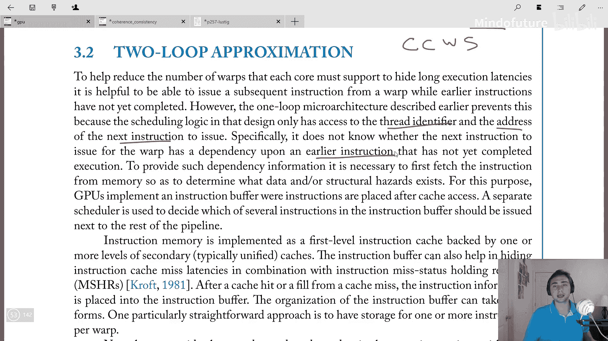

You know， instead of having to have， you know， maybe a ridiculous number of warps to hide long latency instructions。

 what if instead， if we knew the dependency information。

 then we would need a smaller number of warps and we could just issue multiple instructions from those same warps on all we really need to do is keep track of dependencies。

And so in order to do this， in GPUs， we've got an instruction buffer where instructions are placed after we get them from the instruction cache。

And then we have a separate scheduler that decides which of several instructions within this buffer can be issued or should be issued to the next。

should be issued next to the rest of the pipeline， so basically we're just keeping track within the instruction buffer if that instruction is ready if it doesn't have any dependencies。

So kind of going backwards a little bit， giving a little bit of background So instruction memory is implemented as a first level instruction cache backed by you know more levels of secondary unified caches So the instruction buffer can help in hiding instruction cache mislatencies so you can think of the instruction buffer as you basically another layer in this hierarchy you'll check to see if you've got instructions in the instruction buffer that you can issue you're also checking in the cache when you have to access new instruction and then likewise you go down further than the hierarchy if instructions is not in the cache。

So after a cache hit or a fill from a cache miss， so when we're getting a new instruction。

 the instruction information is placed into the instruction buffer and the organization of the instruction buffer can take many forms。

 but the most straightforward approach is just to have storage for one or more instructions per warp。

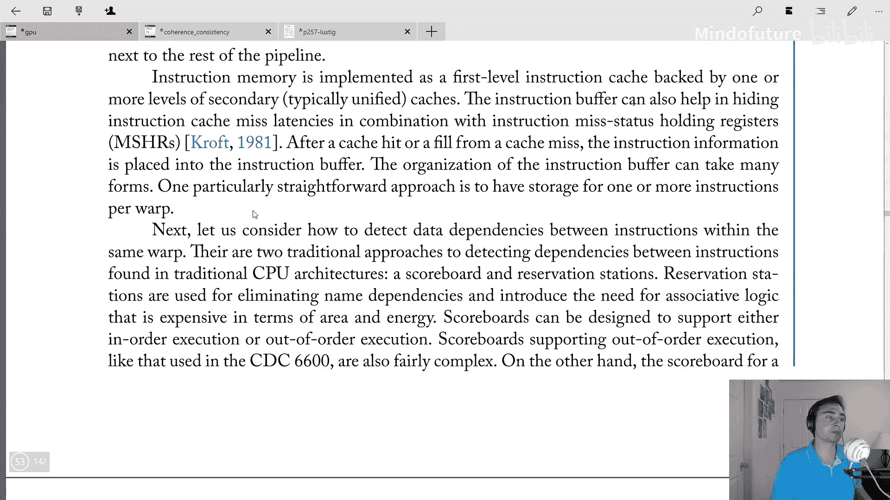

So now let's consider the idea of， you know， what we're really talking about here is detecting data dependencies。

 Now， classically in CPUs。There's two main approaches。

 which is this idea of having a scoreboard or reservation stations。 So with reservation stations。

 you know we use these to eliminate name dependencies。

 but this introduces the need for associative logic that's expensive in terms of area and energy。

 Now the reason why this is a problem is because when we're talking about GPUs。

 we're talking about these giant， massly multi threaded。Giant， massively multi threaded things。

 And the design kind of pattern for these things is keep things simple because we just want to tape out。

 you know as much a compute as we can。 We care about， know， the number of AUs that we have。

So once we start adding these very expensive and complex structures。

 we're really decreasing the amount of space we have for raw compute。Now， scoreboards。

These are these can be designed to support in order execution like GPUs have or out of order execution now while the out of order execution scoreboards can be fairly complex。

 a scoreboard for single threaded in order CPUs can actually be very simple。

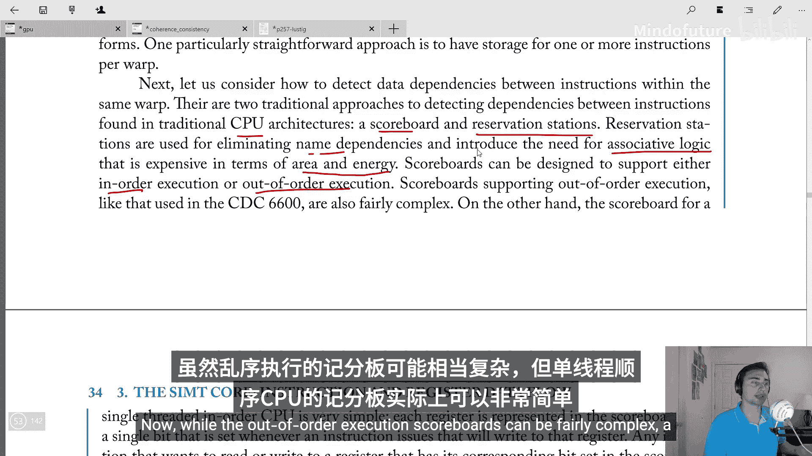

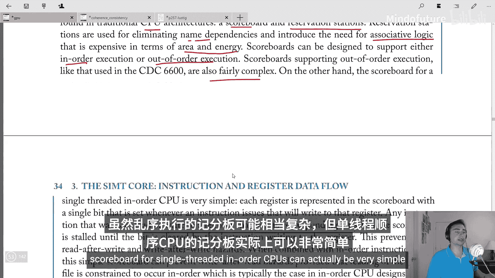

So each register is represented in the scoreboard but a single bit that is set whenever an instruction issues that will write to that register。

 So basically what we're doing is that once an instruction issues， we check， okay。

 are you going to write to this register set that bit。 And then when later instructions come。

 they'll just have to check the scoreboard and see okay that bit is busy。

 I can't I can't do anything until that dependency is gone or it's。

I'm no longer waiting on that dependency。So that's what we're saying here。

So until that bit is cleared。 so this prevents read after write and write after write hazards。

 So when combined with in order instruction issue， the simple scoreboard can prevent write after read hazards provided that reading of the register file is constrained to occur in order。

 which is typically the case in order CPU designs。

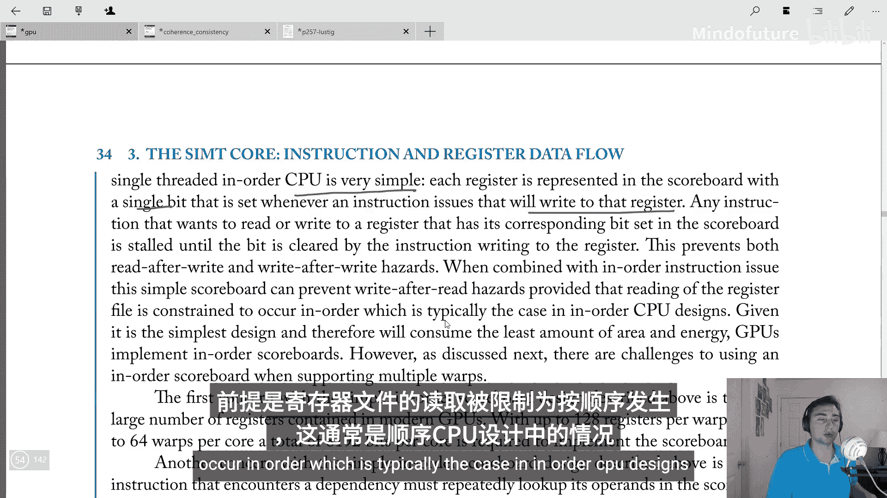

So， you know， because this is know fairly the simplest design and consumes the least amount of area and energy。

 this is really attractive for GPUs。So GPUs implement in order scoreboards。

 but that doesn't mean that all of our problems are solved。

As we keep bringing up GPP are these massively multi threaded things。

 So that in and of itself incurs a number of interesting issues。 So what's the first concern。Well。

 with a simple in order scoreboard。You know， we have a lot of registers because of the massively multi threadreaded nature。

 so per warp， which is 32 threads， we can have up to 120 registers per warp。Now。

 if we have you know up to 64 warps per core， this means that we need to keep track of8 or 8192 bits or 8k of bits per core to implement a scoreboard。

 so already we see that you know。We're trying to use massively this massively multi threaded thing that in itself is going to have its own cost。

 as it always does that we talked about earlier with the register file and the fact that the register files are so big。

It's also going to complicate the fact that we need to for dependency tracking that this you know this naive port from CPU to GPU is not really realistic。

Now， another concern。With that simple in order scoreboard design。

 if you just took it as is from the CPU and moved to the GPU。Is that， know。

 when instruction encounters a dependency， it has to keep looking up its opera in the scoreboard to see if it's ready。

 to see if the dependencies are gone。Now， with a single threaded design。

 this injury a little complexity。 but know when you have an in order issue multi threadreaded processor。

 instructions from multiple threads may be waiting for earlier instructions to complete。

 So if all such instructions must probe the scoreboard， additional read reports are required。

 So recent GPU support up to 64 warps per core， as we mentioned up here。

With up to four operarans allowing all warps to probe the scoreboard every cycle would require 256 read ports。

 Now this is just an insane number right so having something this many read ports would just be know it's very cost prohibitive so we don't want to do that so we need to find a way around it。

Now， one way that we could go around it in kind of the， you know， naive。

A simple way is just to restrict the number of forps that can be considered for scheduling。Now， this。

 this itself has its own problem because， you know our main benefit was having a massively multi threaded system。

 And now， in order to handle a massively multi threaded system。

 we're saying you need to decrease the amount of parallelism you have。

 So it's kind of this circular problem that ends up creeping up quite a bit。But you know。

 both of these issues， the fact that the large amount of state and things like read ports。

 they can be addressed using a design from 2008。And then which basically is。

 you know rather than hold a single bit per register per warp， you know。

 the design contains a small number estimated to be three or four by a 2016 study of entries per warp。

Where each entry is the identifier of a register that will be written by an instruction that has been issued but not yet completed execution。

 so these are the ones that are outstanding。So a regular in order scoreboard is access both when an instruction issue and when they write back。

 but instead this designed from 2008， the scoreboard is accessed when instruction is placed into the instruction buffer。

 so when it goes into the instruction buffer， it checks， okay。

 where are my dependencies and it' will keep it there in the instruction buffer。

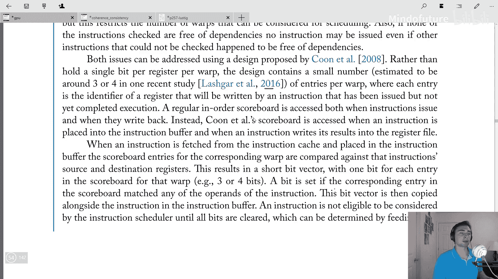

And then when instruction is。When an instruction writes its results to the register file。

 so it updated dependencies when an instruction is finishing。

So when an instruction is fetched from the instruction cache and placed into the instruction buffer。

 so the scoreboard entries for the corresponding warp are compared against the instruction source and destination registers。

 so we need to figure out where the dependencies lie。

And if there's outstanding dependencies for or if there's dependencies for outstanding instructions。

 so this results in a short bit vector。With one bit for each entry and the scoreboard for that warp。

 so three or four bits。So a bit is set if the corresponding entry in the scoreboard match any of the operas from the instruction。

 so this bit vector is en copied alongside the instruction into the instruction buffer。

 so now we have this structure that not only has our instruction。

 but it also has encoded its dependency information。Now。

 an instruction is only eligible to be considered for scheduling if all of its bits are cleared。

 and that's the same thing if just like in a normal scoreboard， if a bit is cleared。

 that just means that the dependency is gone， or rather you don't have to wait on that dependency。

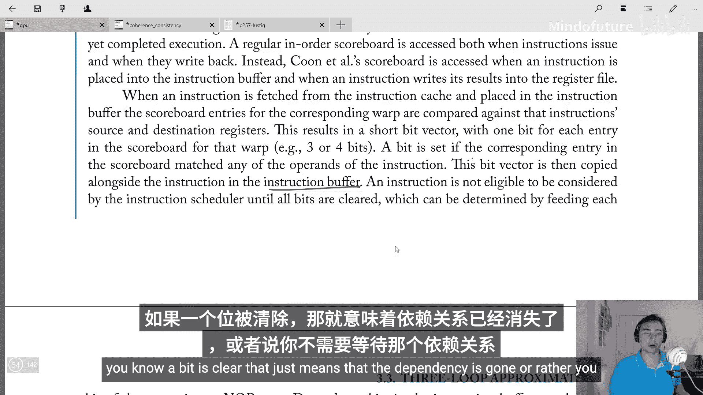

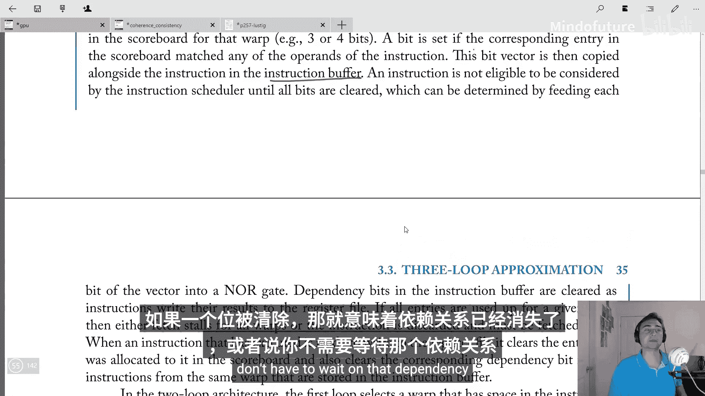

So this is actually a pretty simple thing that we can do so you can just feed all of those bits into a Nor gate。

 So a nor gate will do an or and then the reverse of it。

 And so the only way that that will be one is if all of the inputs are0。

 So basically all the dependencies are done。RightSo if you have a simple orgate here。

It's prettyty poor drawing。 And you have four inputs。

 right So the output would only be a1 if all of these inputs are0 and this would be an output of a one。

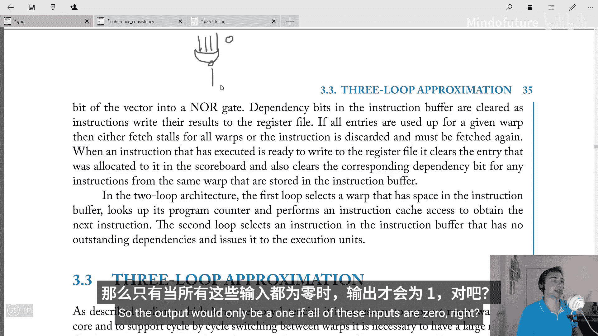

Okay。Alright， so if all entries are used up for a given warp。

 then either fetch stalls for all warps or the instruction is discarded and must be fetched again。

 so you can just throw away an instruction and say， okay， just try and get it again。

So when instruction that is executed is ready to write to the register file。

 it clears the entry that was allocated to it in the scoreboard and also clears the corresponding a dependency bit for any instructions from the same warp。

 this sort in the instruction buffer so it has to clear two things so it has to clear here's the scoreboard that contains the dependency information and then all the bit vectors that may depend on that instruction got to clear those as well。

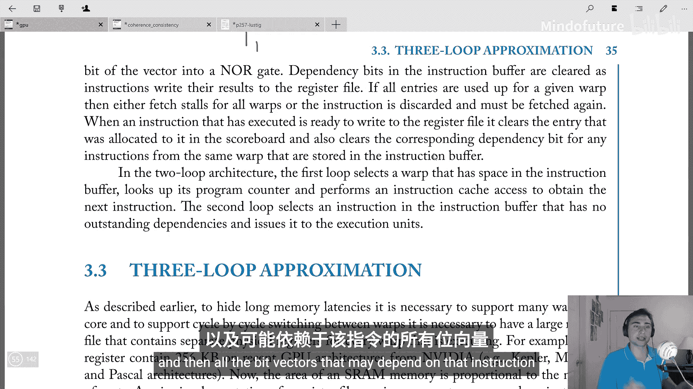

So you know basically the key idea is that in this two loop architecture。

 the first loop that we described up front it's like a warp that has space in the instruction buffer looks at the program counter and performs the instruction cache access to obtain the next instructions so we've got these warps and we need to pick say hey。

 you you're the one that's going to we need an instruction from you now and you've got space in the instruction buffer。

 go ahead and put an instruction of the instruction buffer Now the second loop itself goes。

 okay now that we have all these instructions。We have to figure out which ones are eligible to execute。

 And these can be multiple instructions from the same warp。

 And all that we have to do is we need to check to make sure that its dependencies are cleared。

 So that's the key idea behind the two loop approximation。

 So this handles the original problem of only having。

Being able to do one instruction from a warp and needing a lot of warps instead we can cut down on the number of warps and issue multiple instructions from the same warp Now we're going to continue on in the next video on the threelib approximation and we're going to be talking some interesting thing about some interesting things including how we actually access the register file when we've got all these instructions but that's going to do it for this time as always feel free to check out the Github page at Github。

 co s coffee before arch this is where we handle or this is where I post all the code from my other series including GPpU programming with couda so that'll be directly related to GPpU architectureit as well as other things like Python programming C+ plus programming and parallel programming and C++。

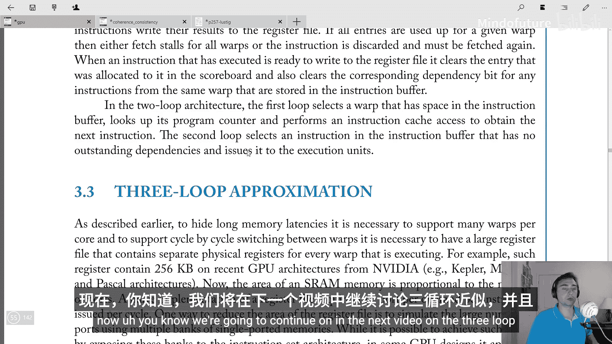

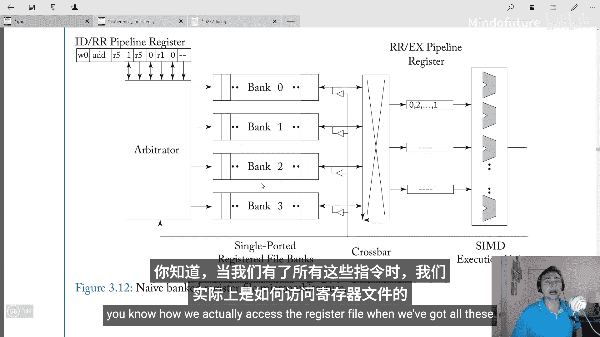

So feel free to check that out， we also have a book that I'm writing called a Tour of Programing。

 and we've got the draft up here。

So this is going to be an in progress thing where we're going to cover you know all the videos that I have all the videos that I have on YouTube these are all going to be into written tutorials。

 you know going through parallel programming， optimizations object oriented code design GP program with Kuta those are going to have their own examples。

 some verlog stuff as well as things related to research So this will be psycholevel simulators like GPGp use SIim that I work with rather frequently other simulators like Jim 5 and SST and going over some contemporary research papers and kind of summarizing you know the fields that I'm interested。

 but that's going to do it for this video as always a Nick from C before art and I hope you have a nice day。

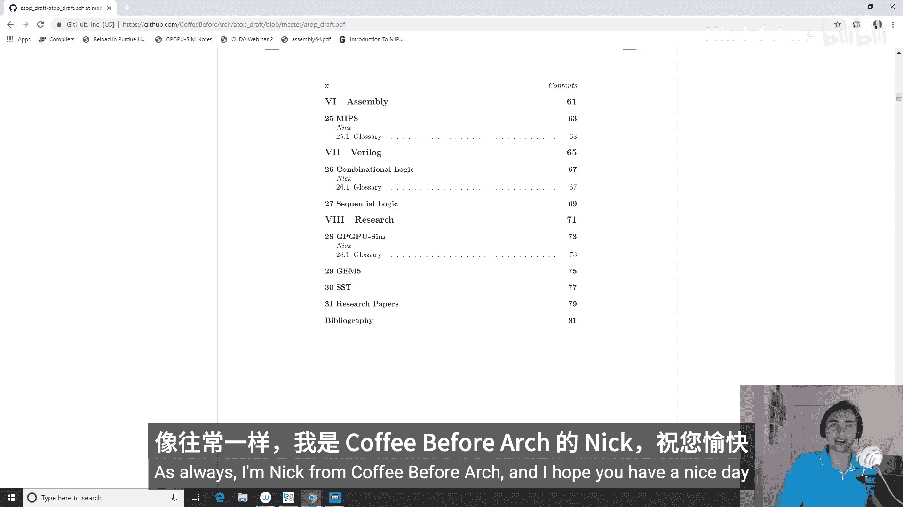