# GPU架构基础-p07-P07-SIMT-Core-Part-4--BV1ay5vzgEAe_p7-

Hey everyone， I'm Nick， and in this episode of Fundamentals of GP P architectureitect。

 we're going to move on to the three loop approximation。

 So just as a reminder of what we've covered for the previous two loop approximations of the first loop was a scheduling loop where we picked an instruction from a warp。

The second loop was now that we've picked instructions and we put them into an instruction buffer。

 how do we select which instruction we're going to begin working on next So this dealt with tracking dependencies and in this loop。

 we're going to move past dependencies and start looking at how do we schedule accesses to the register file。

So as we kind of talked about previously。RightSo we need a ton of warps in order to hide long memory latencies。

 but the fact that we have so many warps leads to giant register files， right。

end up being around 256 k， in Kepler， Maxwell and Pascal architectures。Now。

 a naive way that we can make a register file would be to require one port per operaran per instruction issued per cycle now this winds up being a lot of ports。

 so we don't really want to do that。So what do we do instead， Well。

 we simulate a large number of reports using banks， right。

 so we use multiple banks of single ported memories。

 and that's how we get around this problem But we'll see that。

 you know a naive implementation just using banks runs into problems of its own and this ends up being bank conflicts。

So what we'll look at here is this idea called an opera and collector。

 which is likely what exists in modern GP designs。 A lot of this comes from patents that have been filed。

And so we'll go ahead and start by just considering a basic naive bank register file microarchiture。

 So here we've got， you know between instruction Decode and register read right so we've got our register reads or our register numbers going into an arbiter an arbiter will select which bank this read will go to。

And then on the other side between the register read and execution。

 there are these pipeline registers right and so we'll read out from these banks and it'll go to these pipeline registers before finally going to execution to these SD execution units and then for a naive banked register layout we'll do a simple say mod 4 operation so in this case Warp 0 register0。

 we'll go to bank 01 to bank 12 to bank 23 to bank 3 and then because it's mod our modular operator it'll wrap around once we get to R4 so R4 will be map to bank 0 and the exact same thing happens with Warp1 and we'll see that both of these things together kind of constrain us to such a point and it's inflexible to such a point they wind up with a lot of bank conflicts which we'll discuss here so let's consider two instructions one of them is going to be an add instruction so we're going to add R5 to R1。

Sttor it in R5。And then we have a multiply an addd instruction。

 which will just multiply two numbers and add it to a third。 In this case， it will be R 4。

 R 6 and R 5 store the result in R 2。 Now， what we can see already with a。

This addd instruction right here。Is that we've got。You know， all of these。

 all of these map to the same bank， right， these all mapped to bank one， right。

Now up here we see that this also maps to Bank 1， but the other in the other register is map to Bank 0 and bank 2。

 So what we'll see know down here， So this is our order of execution right。

 so we start here and the cycle 0 right So cycle 0。

 we're going to begin working on Warp 3 So Warp 3 has it's going to be executing instruction 1。

 which is a multiply an ad so it'll start reading out R 5， R 4 and R 6。

 which is exactly what happens down here。Now， whilsts reading out our our 4 or5 and our 6， again。

 this is to banks 1，0 and 2 right so all of these can occur in parallel because they're all mapped to different banks。

 so this is pretty good。 And then in the next cycle。

Because we've read the three op brands in this first cycle。 we can begin execution。

 So this Eu stands for execution unit。 so we can begin executing Warp 3s instruction Now in this cycle while we begin execution。

 we can also start reading out from Warp 0。 Now with Warp 0， it's doing instruction 2。

 which is it's reading out from bank 1 and bank 1 Now these are both from the same bank。

 So clearly we can't execute both of these reads in the same cycle。

 So we' have to kind of we'll have to stall them right or solve  one of them。

 So we'll read out the first op brand in this cycle right， so we'll read out R1。

 and then in the next cycle， we can go ahead and read out R 5 right and that's our2。

And this is going to be our two opera brands that were needed for this instruction。 right。

 So we get a bank conflict here。And so we have to stall for a cycle and then now that we've read both of these opera brands so we can begin execution in cycle 4 now in this same cycle right in cycle 3。

 we can also write back Warp 3's result because Warp 3。

 it's map 2 bank in this case we see that R2 is going to be map to Bank 2。

 and so because Bank 2 doesn't have a conflict with Bank 1 it can go in parallel。

Now here's here's where the problem starts to really kind of pick up。

 So now Warp 0 needs to write back while Warp 1 is trying to read out its's two opera brands right so Warp 1 reads out R1 first Warp 0。

 it's writing back to R 5， but R5 is in the same bank as the R 5 for the other warp right so there's a bank conflict here。

 So Warp 1's read gets stalled right and so we end up with this pretty bad utilization overall。

Of our bank register file， right， so we see that。Bank 3 is actually never used right across the entirety of execution。

We see that， Bank 0 is actually only used once， and we see that Bank 1 ends up having the majority of the reads going to it。

 And this is bad for a number of reasons， right So if we have all of our reads going to a single bank。

 what's the point of banking in the first place， if everyone's going to the same bank。

 you might as well not have any banks at all， right so we're getting very little benefit out of this right here。

 So that's as we have the problem。 It's this combination that you know at a time。

 we're only selecting from you know one warp， right， So we're only selecting from Warp 3， right。

 then we're only selecting from Warp 0， So this is a right back。

 So's that's happening know after our reads， then we're only selecting from warp 1。

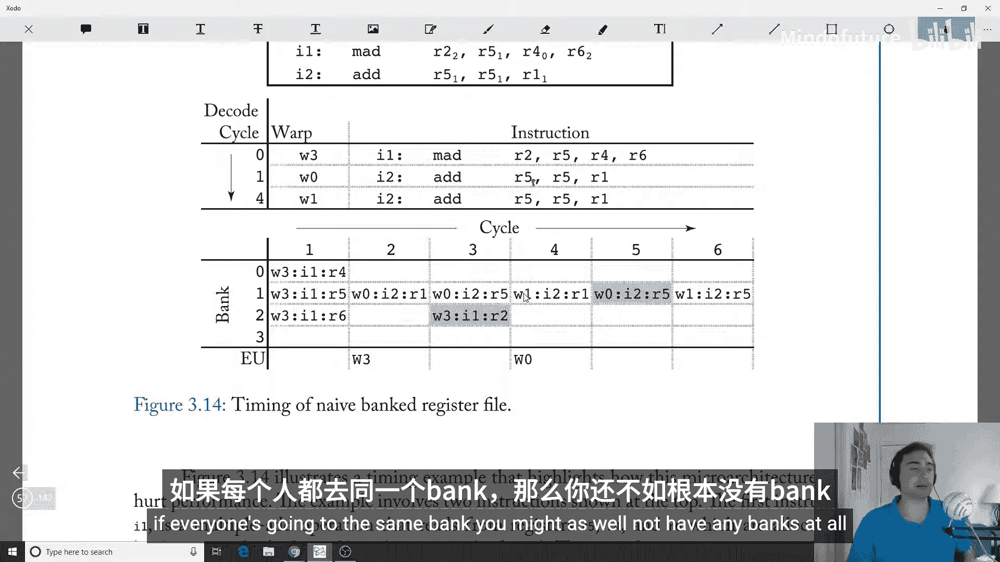

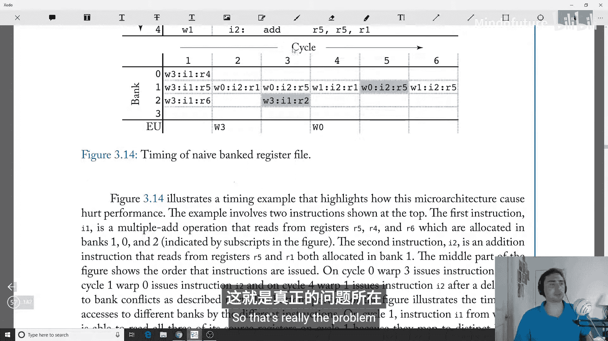

And so we have a limited pool of opera brands to pick from in order to fill these banks and to try to avoid bank conflicts。

So let's motivate this design， right， so now we've got collector units。

So you know the key thing here is that now we've got multiple instructions that we can pick from。

 so instead of having you know just pipeline registers on this side。

 we'll go ahead and assign when a register comes in or when an instruction comes in。

 we'll assign it a collector unit right and now we've got all of these instructions on this side that we can select opera from that way we can reduce the amount of bank conflict that we can saturate all of our banks。

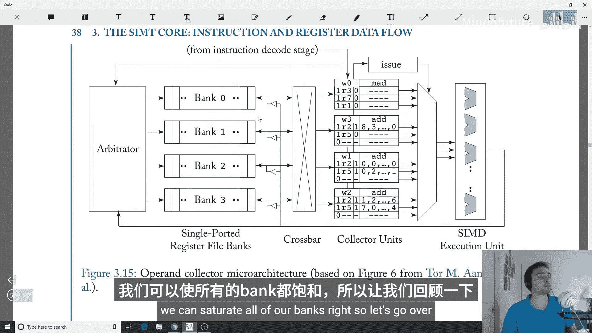

Right， so。Let's go over that a little bit more。 So yeah we've replaced our stationging registers with collector units and so each instruction is allocated a collector unit when it enters Reg read and there are multiple collector units so multiple instructions can overlap reading the source opera brands。

 which can help improve throughput in the presence of bank conflicts right so inherently GPs are throughput oriented machines Unlike CPUs which are more latency oriented。

So it doesn't really matter if we stall an instruction for a little bit as long as we're， you know。

 improving throughput， right this is， of course， you know， to an extent。

 we don't want one instruction to just， you know， sit there and never actually get out to execution。

Right。So given the large number of sourceop brands from multiple instructions。

 the arbiter is more likely to achieve increased bank level parallelism so we give more options。

 we're able to find more possibilities to really use all the banks in parallel。

Right so the Operaran collector uses a scheduling to tolerate bank conflicts when they occur right so this is this idea that we've got a third scheduling loop now。

 so not only are're picking are we scheduling between warps。

 which instruction to pick and then scheduling from an instruction buffer which instruction is ready to execute now scheduling or reads to the register file in such a way to avoid bank conflicts。

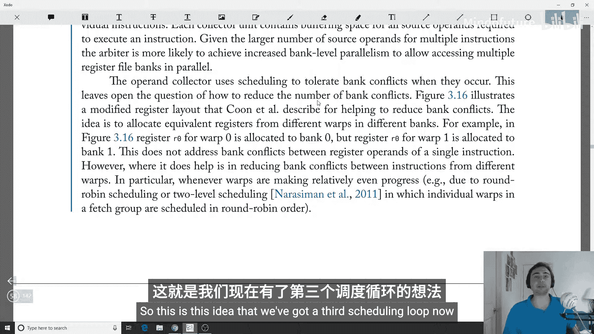

And so。We'll look at a different register banked register layout compared to the first one and show that and kind of motivate this design as well as the need for collector units。

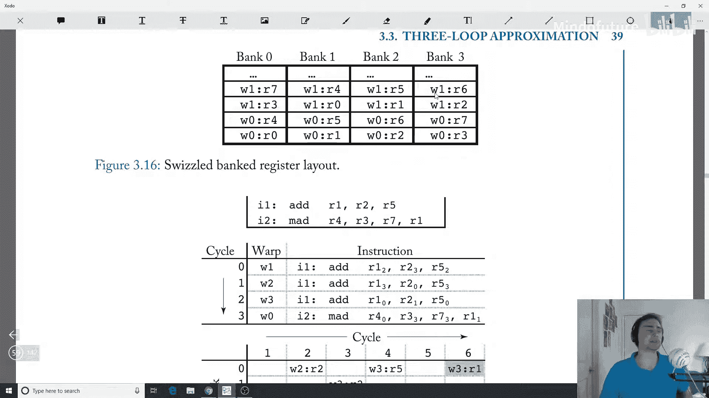

So the first thing we to understand with our naive design。

U here where we're just using a simple mod 4 operation。Is that， you know， intertro warp。

 this is fine。 right？ So inter warp， we run into the situation where okay， well。

 we're only ever going to be able to， you know， split this in such a way that。Yeah， work。

If R1 and R5 end up being the same instruction。There's not much we can do there， right。

 They're both going to be act the same bank， but what we can play around with is not just intra warp bank conflicts。

 but inter warp bank conflicts。So this is going upon the idea that when we're executing a GPU program。

 a lot of times the warps are about in the same place in execution。

 Now the problem with this is that if warps are in about the same place in execution。

 that means they might be reading the exact same registers。

 right so let's take consideration this case with Warp 0 and Warp 1。

 So they're both executing this instruction2， which means they're both accessing the exact same registers。

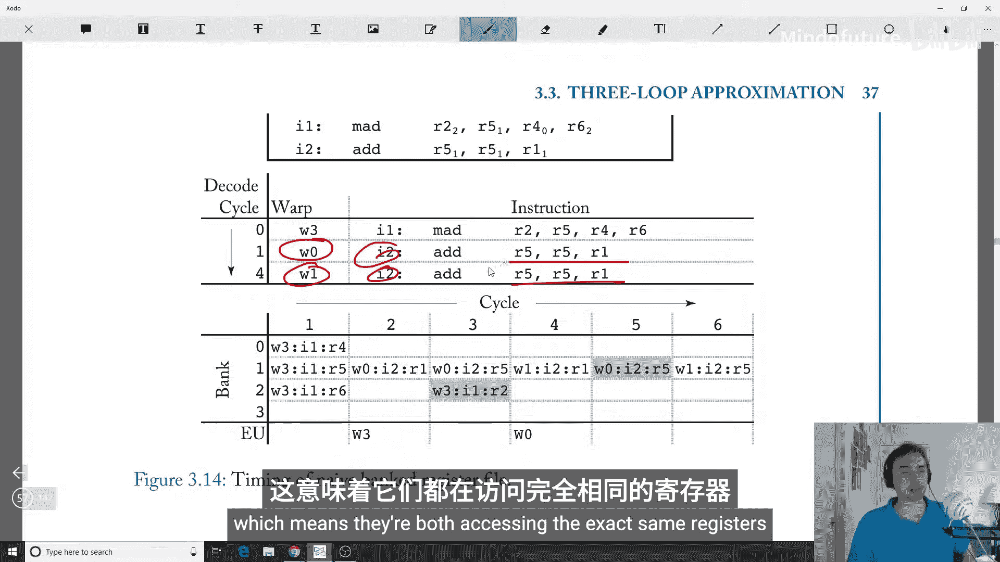

Now， this is a problem when we start looking at this naive register layout because we see that all of these registers are going to be mapped to Bank1 right so now。

Not only do we have， you know， intra warp bank conflicts， but now we've got interwarp bank conflicts。

 So we're really going to be stalling on these register reads。

 So a way that we can fix this rather simply is having what we call a swizzled banked register layout。

 Now， Warp 0 is going to look exactly the same。 So Warp 0 is still going to have you know。

 a basic mod 4 operation。 So the next warps， right， So say Warp 1， it will be offset by one position。

 So we'll go ahead and shift。

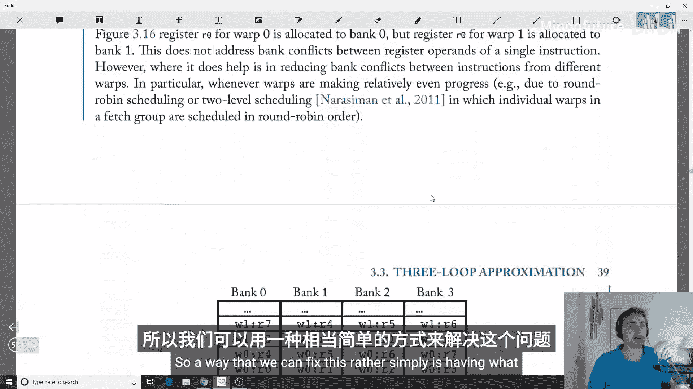

R 0 to now be mapped to Bank 1， are 1 being mapped to bank 2 and R 2 being mapped to Bank 3。

So what does this do， It ensures that if we run into a situation。

Where all the warps are in the same spot。 We'll still have bank level parallelism。

 so we'll still have the same registers will now be mapped to different banks。

 So R 0 here is map to bank 1。 while R 0 here is mapped to bank 0。

And so we can look at how this affects。Through an example right through timing of an operating collector and so we'll kind of take this to the extreme we'll have three warps all executing the same instruction with the exact same registers right because it's all instruction 1 and we see that over here we're accessing banks 2。

3 and 2 over here we're accessing banks 3，0 and 3 and over here in Warp 3 we're accessing banks 01 and 0 right so we have bank level parallelism inter warp now so we can't really get you know run away from the fact that we still have in trial warp。

Potential bank conflicts。 But we've solved the problem of inter warp， or we've at least mitigated it。

So let's look an example， so we'll start out with Warp 1， so Warp 1 is going to need to read。

And not brand， so it'll go ahead and read out。R2， right， so we're right here in execution。

In the next cycle， we'll go ahead and read out the second operaand for Warp 1。

 which is going to be R5。 So now we've read out both of these for Warp 1 and we've read out R 2 for Warp 2。

 right And this is mapped to a different bank。Then over here in cycle 3。

 we can go ahead and start reading out our5 for Warp2。

 so we've read out both of the opera brands for Warp 2。And then in the same cycle。

 we can read out for Warp 3， R 2， and we can begin execution for Warp 1。

 because Warp 1 now has both of its operaran， so it can begin execution。Likewise， at this point。

 we've read out both of Warp 2's operaranso in the next cycle， it can begin execution as well。Now。

 in this same cycle， we see that we've got a lot of things going on between different warps。

So not only can we read out Warp 3， its second operaand R5。

We can also write back what warp 1 has executed into R1。

 right so now this instruction is now complete。And then we can begin execution of Warp 2 in this cycle and we can read out R3。

 which is the first operaand of Warp 0。Right。And so this will continue on。 And so of the next cycle。

 Warp 2 will finish execution。 So it will go ahead and write back。 Now， there's。

 we can't remove all possible bank conflicts。 So over here， right。

 So we find that the right back for Warp 2 is actually going to cause a bank conflict with the read from Warp 0。

 we're trying to read out。In Bank three。So， you know， sometimes we get a little bit unlucky， right。

 but still， as we can see。We get far better utilization of our banks。

 having collector units and having the swizzled register file layout than we did with just a a naive simply banked register file that just used also was this layout was just a simple modular operator。

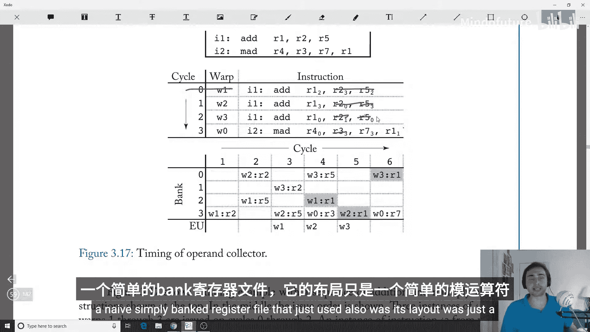

Right， so there's a couple things that we should， we should really kind of emphasize or small issues that can occur。

 right， So one thing that we didn't talk about was the fact that， if we use an opera and collector。

 know what happens。If a later instruction or instruction that's supposed to execute later is ready to issue before an earlier instruction。

 right， So what if we run into right after read hazard。

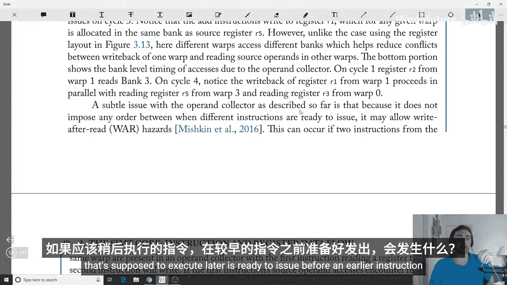

Because maybe the earlier instruction， know， it ran into a bunch of bank conflicts。

 but the later instruction maybe didn't run into many bank conflicts if any bank conflicts。Right。

 so there's a number of ways we can correct this in you know。There's been research work。

 so from 2016。That， you know， proposed three ideas with minimal overhead in order to combat this。

 So the first one was。Release on commit warp board。

 which basically just allows at most one instruction per warp to be executing， right。

 so an operating can still get or an instruction can still get to a collector unit。

 but it's not allowed to actually， you know issue and begin execution until all previous until you know。

 any outstanding。Instructions from the same warp have finished。Right， so unsurprisingly。

 they find this impacts performance negatively， reducing performance by almost a factor of two in some cases。

 Now， in order to mitigate this a little bit more， they've got released on Re orp board。

 which allows only one instruction at a time per warp to be collecting opera brands in the opera and collector。

 So now we're not allowing a warp to just you know camp inside of an opera brand collector and you know。

 be ready to go but not able to do anything that we're freeing up that space and say， all right。

 well， we're just not going to pick you to sit an opera brand collector because we know you're not going to be able to go so we don't want to waste space。

😊，So they find that this you know at most 10% slowed down in the workloads they studied。

And then finally， as a kind of final suggestion， they propose a bloom board。

 which just uses a small bloom filter。To track outstanding register reads right and this is less than a few percent versus of course。

 the。The absolute worst case that is not even allowable， which is allowing right after read hazards。

 right？This， of course， would be the best performance because we're not having to wait for anything but it's of course it impacts correctness right and we can't have that。

So， you know what what has been found， especially， you know。

 by this publication by Gray or this is this was。Basically。

 a homemade as simplebller from Xwell architecture called Max A。

It suggests that Invidious Maxwell GPU introduced a read dependency barrier。

 which is managed by special control instructions and which may be used to avoid right after read hazards for certain instructions。

 Now we've talked about this a little bit in the past and we'll just go ahead and scroll up and kind of see what this what we're talking about here。

And this goes all the way back up here when we're talking about the Saas code。 right。

 So in the Saas code right here， I see I still have it underlined。 We saw that there were， know。

 instructions here。Or rather， we had some hex here that didn't actually decode to anything。 right。

 And that's， And that's because what this was theorized to be and what it most likely is。

 is going to be basically metadata instructions。 So this。

 this will encode something about dependencies for the preceding instructions， right。

 So in this case， it's every。Three instructions， there's a metadata instruction right。

 and this will decode dependency information for the following three instructions right so you can see before every set。

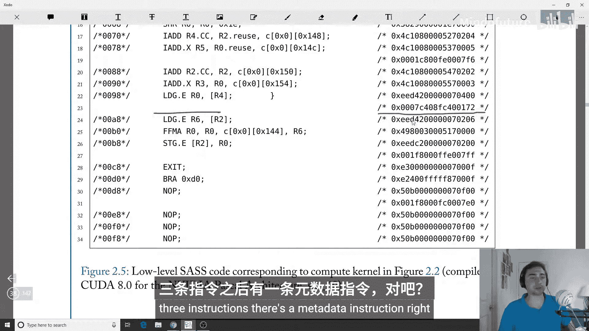

So we've got a metadata instruction， three normal instructions， another metadata instruction。

 three normal instructions， etc cea， so that's another way we can handle this kind of dependency tracking。

Alright， so that's going to go ahead and do it for this episode。

 That's the basics of the three loop approximation。 So， you know， following this video。

 we're going to know， kind of close up our look at the sty core by looking at a。

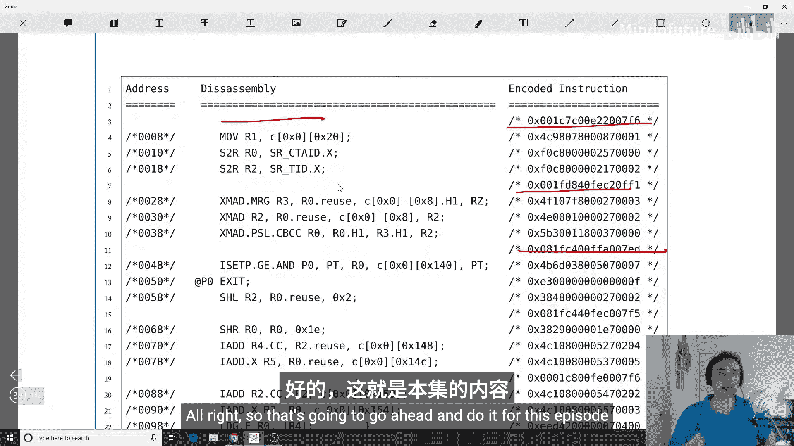

A number of kind of cross cutting issues or cross-cu research directions。

 things like instruction replays， so how do we handle structural hazards and then all of these different ways that we can handle things like branch divergence。

 how we can split warps up or merge them together or use large warp architectures。

And basically you know kind of summarize what are the key research areas that have occurred for the Sty core。

 but like I said， this's going to do it for this time。

 always feel free to check out my stuff at Github。com s coffee before arch。

So let's go ahead and pull that up real quick so here we go。

 So feel free to check out any of this so I've got stuff if you're interested in GPUs I've got a GP programming series called Kuda Crash course where we talk about things like how to first how to set up your environment like in visual Studio or Linux and the basics of vector edition。

 matrix multiplication using Kuda libraries， some reduction and optimizations convolutions etc ce So check any of this stuff out as always I'm Nick from Kf for Arch and I hope you have a nice day。

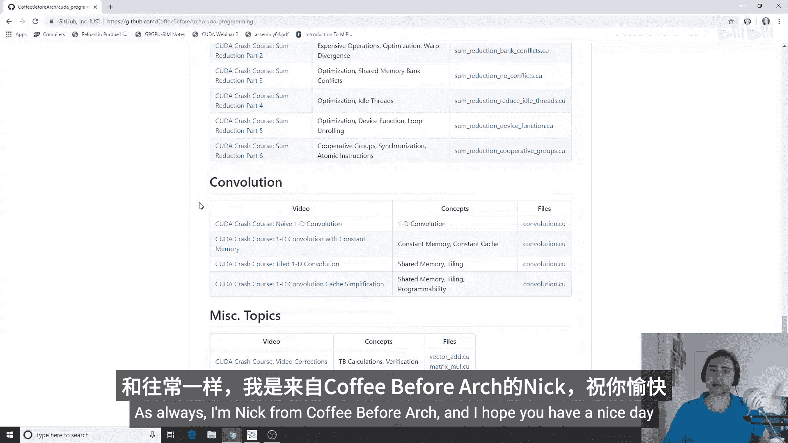