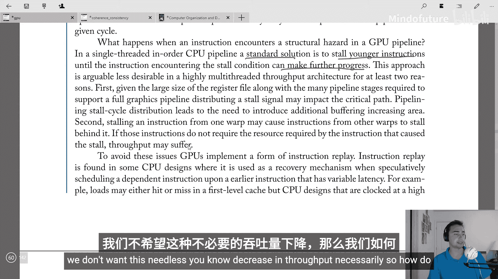
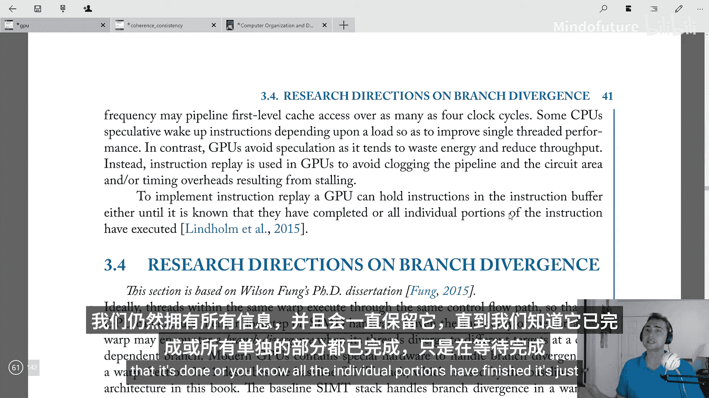
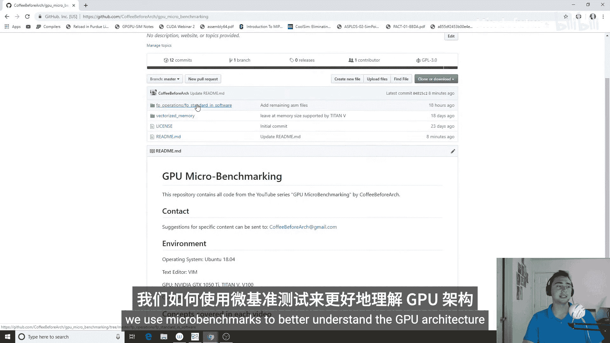
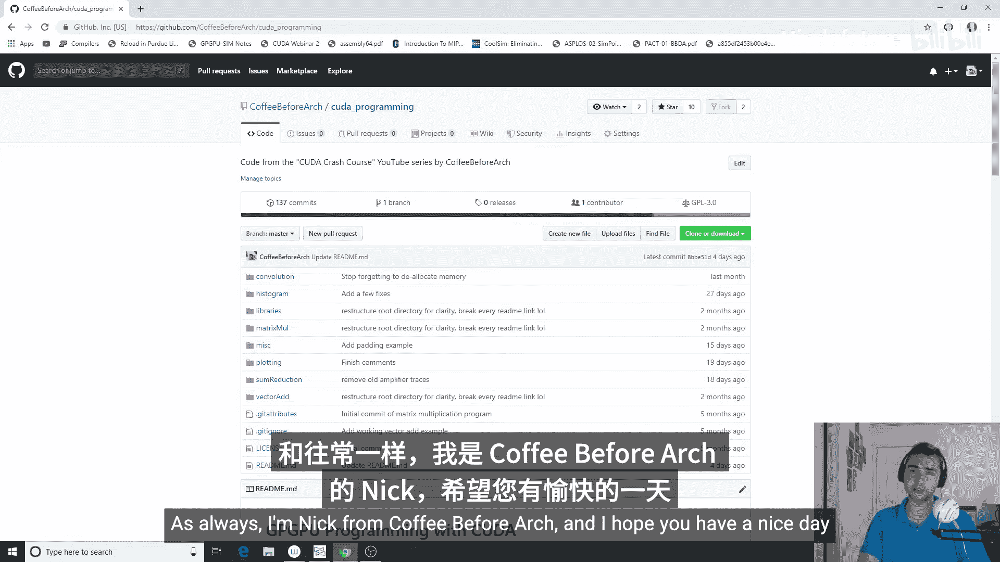

# GPU架构基础-p08-P08-SIMT-Core-Part-5--BV1ay5vzgEAe_p8-

Hey everyone， I'm Nick from Coffee Before Arch and in this episode of The Fundamentals of GPPU Architecture。

 it's going to be a relatively short video we're going to be capping off the last little section on the SMT corere before we have our next video on the landscape of research in relation to the ST Core。

RightAnd so it being July 4th today， we'll just close it out with a very small little topic here。

 which is instruction replay。 so how do we handle structural hazards？Right， so we've talked。

Previously， you know in the one loop， two loop and three loop approximation。

 all of these different scheduling loops that we can consider you know which warp selection for picking an instruction from once we pick the instructions。

 how do where do we put them so that we can select from multiple instructions inside of the instruction buffer？

And then， finally， we talked about how do we schedule register reads in such way that。

 we don't have to have some massively， multiported thing that'll end up being very costly to manufacture。

RightAnd so now we're going to bring up this idea of instruction replay right so there's many causes of structural hazards and GPU pipelines right。

 so this could be simple as you know in the read stage for the registers。

We may just run out of opera and collector units， right， So this can happen， right。

 so many sources of these hazards， right， they relate to the memory system。 Now。

 we haven't really gone into the memory system。 that'll be the next section after we talk about kind of research directions and the the kind of the landscape of research in this field。

呃。So， you know， in general， a single memory instruction executed by a warp may need to be broken down into multiple separate operations。

 right， And you know， each of these operations can utilize a portion of the pipeline on a given cycle right。

 So the question that we're really trying to answer those what happens when an instruction encounters a structural hazard in the GPU pipeline。

 So let's kind of go back and let's think about what happens in a normal CPU pipeline， right。

 So the easiest thing we can do in kind of the standard solution is just to stall younger instructions。

 right， So and we do this untiltail the stall condition， right。Until we can make further progress。

 right， so until you know something happens where those instruction that's stalling can finally proceed。

 right， so it can like begin execution or maybe it has all of its know all of the arguments that it needs to progress forward。

So so this is okay in CPUs as it kind of says here， but for GPUs。

 this isn't really the great idea for two main reasons。

 and the first of which being the large side of register files along with the many pipeline stages required to support a full graphics pipeline distributing a stall signal may impact the critical path and if we have to distribute a stall signal and this impact in the critical path right if we're talking about something like graphics which has quality of service deadlines。

 we don't want we don't want know how fast we can process frames to be impact。

You know buy a stall you don't want you want your video to be nice and smooth getting sent out by the GPU。

 So this is non ideal in that case。 right And so you know this stall cycle distribution leads also leads to the need to have additional buffering so we don't know when a stall is necessarily going to happen。

 it'll just happen， but we need to be able to make sure that you know we're not losing anything during that time。

 So we have to add a little bit of buffer space as well right and this just increases area So the second thing we need to do So stalling an instruction from one warp。

 it can cause instructions from other warps to stall behind it right if those instructions do not require the resource required by the instruction that causes stall throughput may suffer So this is just saying that if one warp causes another warp to stall that other warp may you know maybe it wouldn't have encountered a stall if it had gone first so we don't want this needless you know decrease in throughput necessarily。

So how do we fix this， right？ So what's the。What's your strategy for GPUus right so it's this idea of instruction replay right so this isn't a completely new thing right so it exists in the CPU world as well where it's used as a recovery mechanism right and this is for speculative execution right so when speculatively scheduling a dependent instruction upon a earlier instruction that has a variable latency So this variable latency is often from the memory system right we don't know if we're going to hit an L1 cache。

 the L2 cache， maybe we have to all the way up to main memory heaven forbid we have to go all the way up to disk。

So for example， loads may either hit or miss and if we have a design that's collected at a high enough frequency。

P first level cache access may take over four clock cycles right so some CPU speculative wake up instructions depending on a load so as to improve single threaded performance so in GPUs we don't have speculative execution right we don't have branch predictors so we don't choose a path。

 we rely on massive multithreading to have multiple instructions that we choose between。

Right so so like I said， it tends to waste energy and reduce throughput。 right。

 We want to save that space， you know， mainly for compute units。

So instruction replays using GP to avoid clogging the pipeline and the circuit area and or timing overheads resulting from stalling。

Right so to implement instruction replay， how can a GPU do it so like all these things。

 we have our guesses to how it's done。So instruction Re GPU。Right。

 we can hold instructions inside of that instruction buffer。

 either until it is known that they have completed or all individual portions of the instruction have executed。

 right， So this is just saying that。You we'll just keep that you know that copy of the instruction around just in case you know something happens。

 we still have all the information and we'll just keep it around until we either know that it's done or you all the individual portions have finished and just waiting to finish so that's gonna go ahead and do it for this short video as always feel free to check out know any of the other videos in this series as well as on the Github page where we have you know all kinds of cool stuff we've got a new series on GPU microbechmarking where we go over you know how do we use microbenchmarks to better understand the GPU architecture as well as a couda programming one where we look into GPU programming with Kuda but it's going to do it for today as always I'm Nick from Ko before Arch and I hope you have a nice day。

