# GPU架构基础-p09-P09-Warp-Compaction--BV1ay5vzgEAe_p9-

Hey everyone， I'm Nick from Coffee Before Arch and in this episode of Fundundamentals of GP PU Architecture。

 we're going to be looking at some of the research directions on branch divergence。 Now。

 in this episode， we're going to be focusing on the first section in the first set of papers that deal with this。

 specifically talking about warp compaction。

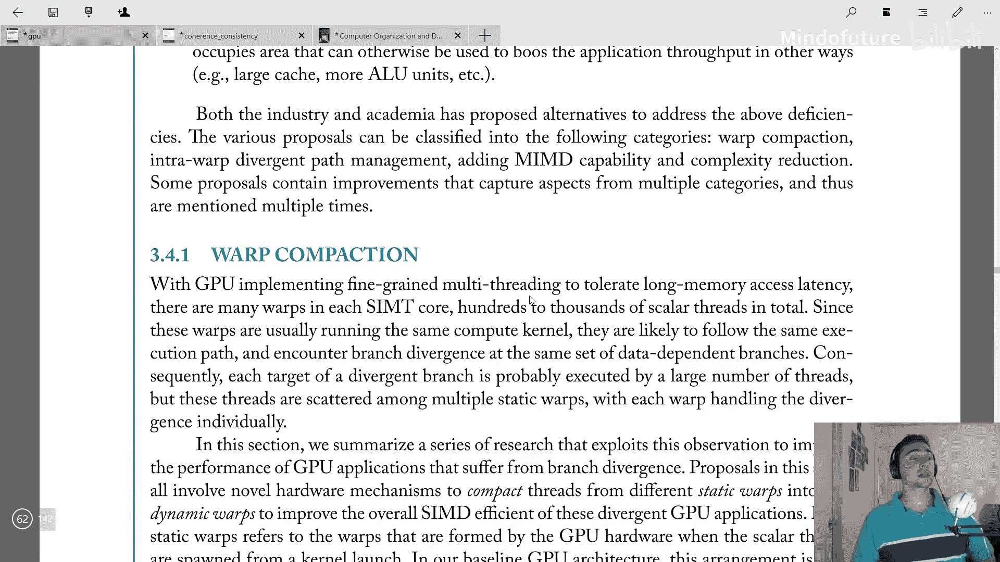

So let's go ahead and get started， right。

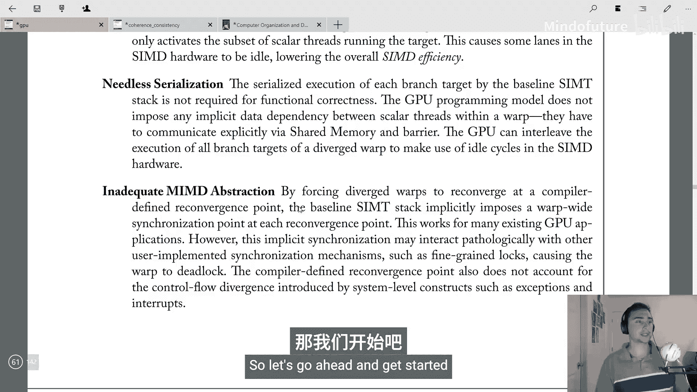

You know， one thing that we haven't really talked about is， you know。

 some of the problems with the Sty stack and other thing that we've talked about when we've talked about the S core architecture。

 right？So， you know， ideally， you know， what you have is that you've got all warps executing the exact same control flow path。

 But as we saw with the need for the emptyty stack， this isn't always the case， right。

 and you get divergence。Right so given the autonomy of threads。

 so this is just saying the threads can go in different directions。

 you get branch divergence and then modern GPUs contain special hardware to handle branch divergence。

 which we talked about extensively in terms of these Sty stack and then later more recent stackless architectures in proposed designs to get rid of some of the problems with the Sty stack。

 namely something like Sty deadlock and supporting more fine grain locking mechanisms。Right。

 so while the baseline S stack handles branch divergence correctly for a lot of applications。

 there's some problems here and we'll go into these。Briefly right。

 so one of them is lower SD efficiency right So again， as a reminder， SMD stands for S instruction。

 multiple data。So when we get branch divergence， the baseline ST stack serializes the execution of each branch target。

 So what does that mean， So if we've got know say 32 threads you know inside of inside of a warp potentially each thread could go down a different path of execution you depending on what the control flow looks like So potentially we can have only a single thread active at a time and so this really lowers our sym efficiency so in the very worst case scenario where only actually executing one thread from each warp and all those 32 threads end up having their execution serialized so that's bad。

So the second thing is needless serialization， right。

 So the serialized execution of each branch target by the baseline Sty stack is not actually required for functional correctness。

 So the Gp programming model does not impose any implicit data dependency between scalear threads and the warp。

They have to communicate explicitly with shared memory and barriers。

So the GPU can interlea the execution of all branch targets of a diveered warp to make use of idle cycles in the Sty hardware。

 so they don't necessarily， you know this serialization that we saw from the empty stack。

 it's not necessary It's just kind of an artifact of the way the stack was designed。

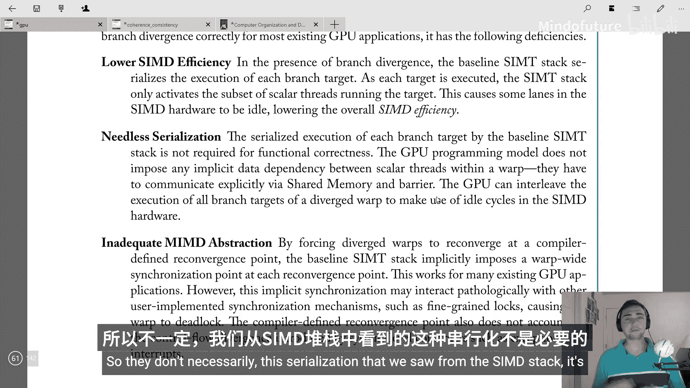

Another thing is the inadequate MIMD abstraction right so you know because we force divrgerge warps to reconverge at a compiler defined reconvergence point。

 you know the baseline empty stack implicitly imposes a warp wide synchronization point at each reconvergence point。

So。You know while this works for many existing GPU applications。呃。You know， this， you know。

 implicit synchronization is not necessarily a good thing， right， So as I mentioned earlier。

 there's problems with a S stack in terms of things like fine grand locks。

 which would cause warps to dead lock， right if you know， which again， is something that's been。

More or less solved with more recent Staless architectures。

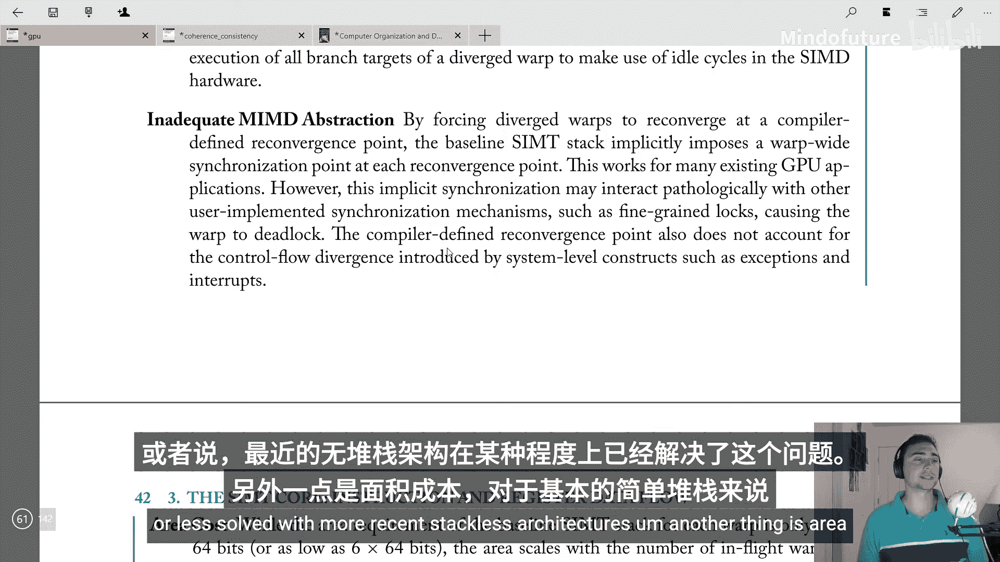

Another things area cost， so for the base and empty stack。

You know for each warp is only 32 by 64 bits or as low as 6 by 64 bits。

 the area scales with the number of inf warps in the GPU in typical GPU applications where branch divergence is rare。

 the SSt occupies area that can otherwise be used to boost the application throughput in other ways。

 so this could be instead spent on other things like a larger cache more ALU units。You know。

 we also want to address things like， you know， you know。

 we don't want to make this into stack too big or maybe what are alternatives that are more area efficient。

 So how can we use these transistors more intelligently。But you know the thing is。

 of course this isn't a problem that nobody's thought of before。

 so industry and academia have both proposed alternatives to address the above deficiencies right。

 and they can be categorized into a number of different research direction。

 So one of them is warp compaction， which we'll cover today。

 then we'll also have intrawarp divergent path management。

 adding MIMD capability and complexity reduction。 So let's go ahead and start talking about warp compaction and that line of research that's going on。

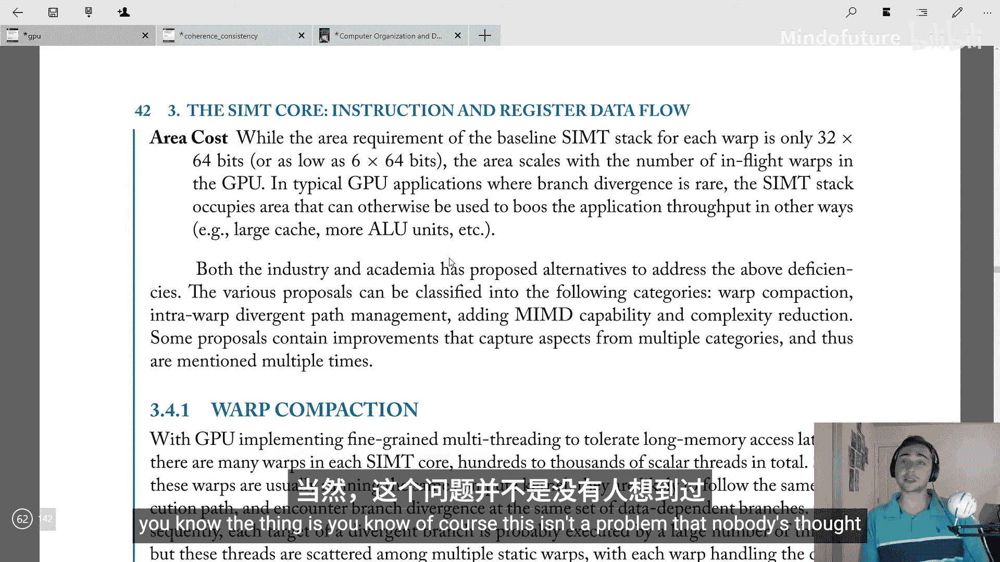

So with GPUs implementing fine grain multi threading， you know。

 to tolerate long long memory access latency right。

 so this just means that we've got so many threads to cover the fact that you know some threads will be waiting on long。

 you know。Long latency memory operations， right， So let's hide that latency with more threads doing different work。

You know， since these warps are typically running， you know， the same compute kernel。

What tends to happen is they're likely to follow the same execution path。

 And they'll also end up having， you know branch dirgence， you know， around the same time。

 So this is this idea that all these wars are actually， you know。

 even though they're completely independent， they tend to progress at around the same rate。

RightAnd so because of this， you， each target of a divergent branch is probably executed by a large number of threads。

 even if it's not even if you get divergence within a warp。

 you know it's a large there's a large likelihood that if we start looking across warps right there still is you know an overall number。

 a high number of threads going that same path， but again。

 they're scattered among multiple static warps with each warp handling the divergence individually So they're all handling it with say the empty stack right And so you know maybe half the threads will be active and then half will be waiting to execute their control flow path next。

 but if say you know half the threads。You know that are on a particular SM right are， you know。

 let's say that all the warpss are diverged in an SM。Half are going one direction。

 but it's half of every single warp， then potentially you could rearrange these threads in such a way where you've got half the warpps going one direction and half the warps going in another direction。

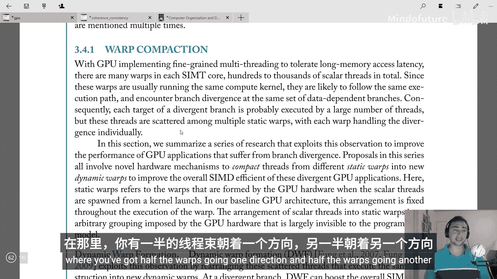

So that's kind of the key idea here or the key thing that we're trying to notice here。So again， yeah。

 we're going to be summarizing a series of research that exploits this observation to improve the performance of GPU applications that suffer from this branch divergence。

 so not for very regular applications， more so for irregular applications。

So this includes things that are in the hardware right so ways to compact threads from different static warps into new dynamic warps to improve the overall S efficient efficiency of these diverg GP applications right so we want to have as many active threads as possible。

 you know doing you know progressing things for it at the same time and not just be inactive。

Right so here static warps refers to the warpps that are formed by the GPU hardware when the scalar threads spawned from the launch kernel right so this is kind of intuitively how we think about our applications right so you know consecutive know threads you know if we say have a linear you know grid right so every 32 threads will represent its own warp right so that's kind of the intuitive way to think about it and we're talking about dynamic warps we're talking about splitting those up and rearranging them。

So let's first talk about dynamic formation from 2007 to 2009 right so they're trying to exploit this observation by rearranging these scattered threads that execute the same instruction into new dynamic warp just because we have got divergence of warps。

 perhaps multiple warps have the same divergence， so let's know kind of repack these threads so that we don't have this divergence。

so the key idea is that divergent branches， dynamic formation can boost the overall s efficiency of an application by compacting these scattered threads。

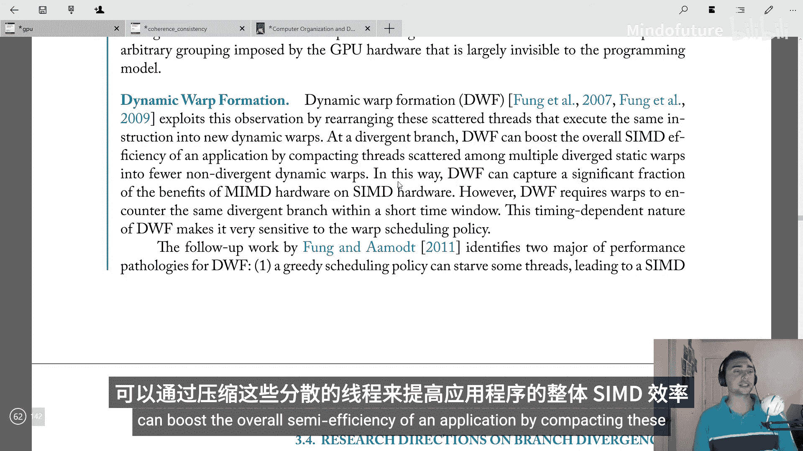

And so some follow up work in 2011 identifies two major performance pathologies for dynamic formation。

 so one of them being that a greedy scheduling policy can starve some threads leading to CD efficiency reduction。

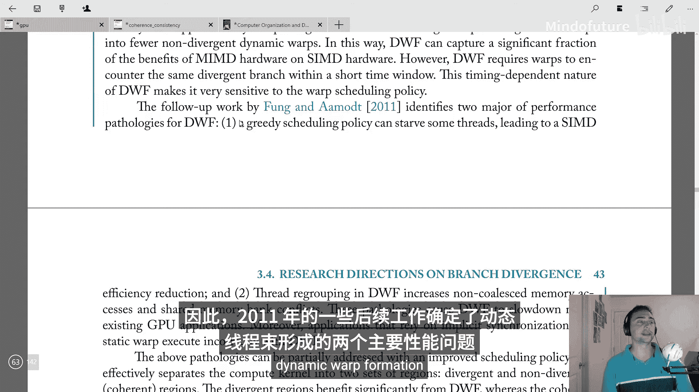

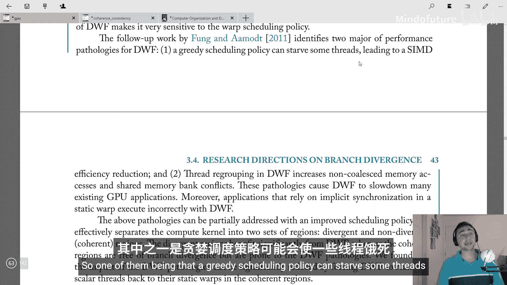

And the second is that thread regrouping in dynamic warp formation increases non cooles memory aes and shared memory bank conflicts。

You know， when we're thinking about how threads are going to access memory。

 we're generally thinking of， you know， how is say， a set of 32 threads going to access memory。

 So as a programmer， we might make this so that， you know， these threads will access memory。You know。

 in a coalesed fashion。 So they'll be accessing， you know， you know， by a constant stride。 So。

 you know， we're accessing a contiguous chunk of memory。

 But when we start adding things like dynamic warp formation。

 all of a sudden that intuition goes out the window because， you know， on the fly。

 all of a sudden in hardware， these threads are getting reshuffled anyway。

 So we're going to lose those contiguous aes。 So that's the。

 that's really the second pathology that we're talking about here。

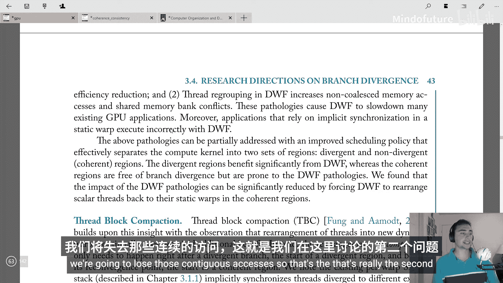

Now all hope isn't lost so these can be partially addressed with an improved scheduling policy that effectively separates the compute kernel into two sets of regions and those regions are divergent and non-divergent coherent regions so divergent regions benefit significantly from dynamic warp formation whereas the coherent regions are free of branch divergence but are prone to dynamic warp formation pathologies so we're going to so this is basically just saying that if we can identify the areas where we're going to have a lot of divergence。

 then it's probably useful for us to do dynamic warp formation。

 however in other situations where it's unlikely we're going to have significant branch divergence a lot of times we'll probably be accessing memory in some contiguous fashion where we don't actually want to start rearranging any of the threads it's often better that we have large coalesced memory aes。

And we follow what the programmer intended in terms of trying to avoid things like shared memory bank conflicts。

Right， so so another paper from 2011。Right so on thirdblock compaction so TPC or thirdblock compaction builds upon this insight with the observation that rearrangement of threads into new dynamic warps continually does not yield additional benefit so instead the rearrangement or compaction only needs to happen right after a divergent branch the start of a divergent region and before threecongs point to start a coherent region so we don't need to continuously be doing this but selectively do it at very particular points。

So we note that the existing per warp empty stack， so this is the one that we've discussed in an earlier video。

 we've got this implicit synchronization of threads diverge to different execution paths at the reconvergence point of the divergent branch right so emergingrging these diverged threads back into a static warp before executing the coherent region。

So threadm compact compaction extends the ST stack to encompass all warps executing in the same core。

 forcing them to synchronize and compact at divergent branches and reconverence points to achieve robust dynamic warp formation performance benefits right so we're kind of broadening the scope of what the ST stack is managing instead of being very local per warp。

So however， synchronizing all warps within a core at each divergent branch for compaction can greatly reduce the available thread level parallelism so some threads may or some warps may reach that reconvergence point early and all of a sudden。

 even if they've got say no dependencies and could potentially move forward。

 you know they're stuck there。😊，So what does thread about compaction do。

 so it settles for a compromise between CD efficiency and you know。

 available thread level parallelism。Or availability by restricting compaction to only occur within a thread block。

So GPpU applications usually execute multiple thread blockss concurrently on a single core right so when we're scheduling thread blocks。

 you know oftentimes a thread block， each individual threadb isn't as big as a single core so we can usually fit maybe two thread blocks per core for thread blockss per core。

 depending on how many registers we're using or how much shared memory we're using or the number of threads we're using。

嗯。So right， so I multiple third bucksing currently on a core to overlap synchronization and memory latency。

Right so。TBC is basically leveraging this software optimization to overlap the compaction overhead at divergent branches。

You know，When warps of one thread block synchronized for compaction at a diveversionent branch。

 you know， because we have another thread block there。

 that other thread block can make forward progress at the same time。

So it extends the per warp empty stack to encompass warps in a threat block right so instead of per warp again。

 it's extending the scope of the empty stack。

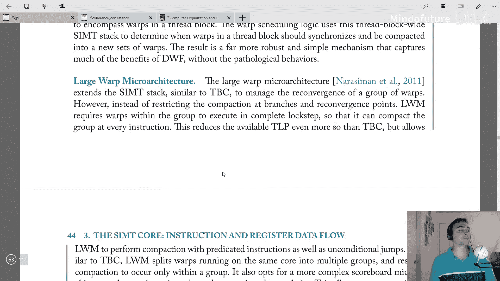

All right， so moving on to something slightly different right so let's talk about large warp micro architectureitecture。

So in you LWM or large mark architecture， so this was a paper in 2011。

 this extends a emptyT stack similar to threadblock compaction to manage the reconvergence of a group of warps。

 right？But instead of restricting this compaction at branches and reconvergence points， instead。

 you know it requires warps within a group to execute in complete lockstep so that it can compact the group at every instruction so this reduces TLP even more so than thread block compaction because everything's in lockstep but what it does allow is it performs compaction with predicated instructions as well as unconditional jumps。

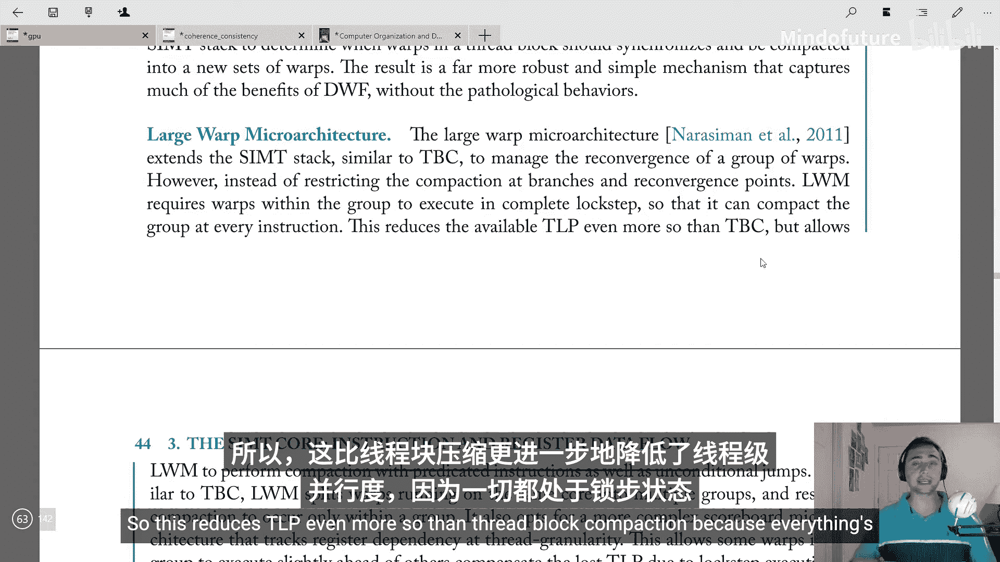

So what it'll do is'll split warps running on the same corn to multiple groups and then restricts compaction to only occur within a group。

 So it also opts for a more complex scoreboard micro architectureit。

 So starting to add a little bit overhead and complexity。

 that tracks register dependency at thread granularity。

So this allows some warps in the group to execute slightly ahead of others to compensate for lost TLP due to lockstep execution。

 So there's lockstep， but with some caveats， allowing some warps to execute slightly ahead。

 to make sure that we still are making forward progress and we're regaining some of the know overhead of forcing。

A。Tra arm lockip execution。

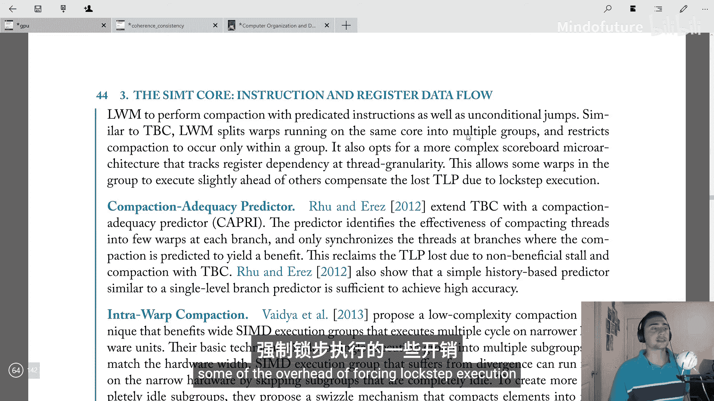

So， you know， as far as other papers had been， this area just a little bit later in 2012 and 2013。

 we've got compaction adequacy predictor。Right， so this extends threadb compaction with an adequacy predictor。

 So this you know basically we want to know you know what's a smarter way to tell you know know if it's going to be effective to actually compact threads into a few warps at each branch and only synchronizes the threads at branches where the compaction is predicted to yield benefit right so instead of just always doing it we want to selectively do it only when it's going to do to have a benefit So what this does is it reclaim of the TLP lost to to non-beicial stall and compaction with threadb compaction right so we don't want to be doing compaction。

 if it's not actually going to help us at all。And apparently。

 this is know a simple history based predictor similar to a single level branch predictor yields sufficient accuracy so we don't need you know a crazy。

 complicated predictor in order to actually do this right so it turns out it's fairly easy。

So the next thing is interwarp compaction from 2013。

 so it proposes a low complexity compaction technique that benefits wide C execution groups that execute that executes multiple cycle on narrow hardware units so the basic technique divides a single execution group into multiple subgroups that match the hardware with right so instead of having you know say a wide group that we're all executing at the same time。

 we divide it up into smaller subgroups for the hardware。

Right so Cdy execution group that suffers from divergence can run faster on the narrow hardware by skipping subgroups that are completely idle right So。

 you know， if we say have you know 16 threads， right， and so four threads are going to go one path。

8 threads are going to go another path， right， so we can split these up into more fine grain groups。

The ones that aren't doing anything， we can skip completely。

 and then the other ones that will do something， we're able to execute faster。

So but this requires something right because we're not guaranteed that we'll have continuousig threads that are going to be you know necessarily going down the same path。

 so each thread again can still go any path it likes， it has its own。

 you know the programmer sees them as completely independent schedable things。

 even if the hardware is more tied in the Sti fashion。

So in order to create these completely idle subgroups， they've got to add another mechanism。

 So a swizzle mechanism that can packs elements into fewer subgroups at diversions， right。

 So you know， if you've got some threads going one way。

 you want to swizzle that warp around so that you've got a contiguous group of threads that aren't doing anything。

 for example。So in 2012， there's a paper on simultaneous warp inter leaving。

So this proposes a simultaneous branch and warp interleaving。

 which extends the GPU S front end to support issuing two different instructions per cycle。

 so they compensate for this increased complexity by widening the warp to twice the original size so SwiI coisue and instruction from a warp suffering from divergence with instructions from another diverg warp to fill the gaps left by branch divergence right。

 so again， we're trying to fill these gaps of5 branch divergence by looking at a larger range of threads。

Right so the next thing we should be considering with all of this is what is it not only how does it affect overall execution。

 but how does it affect things like the register file itself？

Right so to avoid introducing extra communication traffic between S cores。

 the hardware compaction proposals usually take place locally on the S core。

 so generally we don't have a lot of interSM communication。

It's only been relatively recently that we've had even the ability to do something like interSM communication through things like cooperative groups that provide global synchronization barriers for all threadblock that are on a particular GPU。

Right so since the compacted threads are all located on the same core sharing the same register file。

 it's possible to perform compaction without moving their architectural states with a more flexible register file design。

 And so you know let's talk a little bit more the register file and how things like rearranging threads can actually lead us to some trouble and why we need to start thinking about the register file as well。

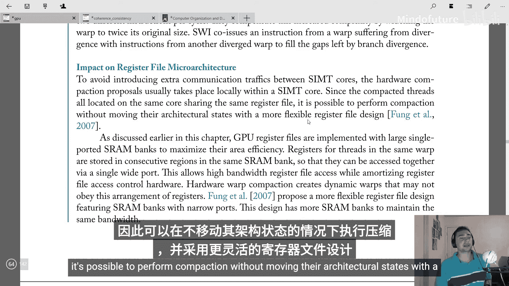

So we've talked about the register file a bit。And the way that they're typically set up is we've got these large single ported SRAM banks to maximize area efficiency and the registers for threads in the same warp are going to be stored consecutively in the same SRAM bank so that they can all be accessed together and read up together right And this is going to be a single wide port。

 so this cell is hyp in with register file access， you know。

 while amortizing register file access control hardware。But， you know， you。

 as you may have already guessed， there's a there's， you know。

 a problem if we start rearranging threads。 And that's that， you know。

 things like warp compaction creates dynamic warps that don't obey this continuousiguous arrangement of threads。

 Also we have threads from different warps。 Those should actually go to different banks。 So。

 of course， this was noticed in this 2007 work。 And they proposed a more flexible register file design featuring you know。

 em banks with narrow ports。You know， this design has more eM banks to maintain the same bandwidth right。

 so we need to be able to access you know， more banks in order to access。

 you know registers from potentially different banks if we're rearranging where the threads are with dynamic orps。

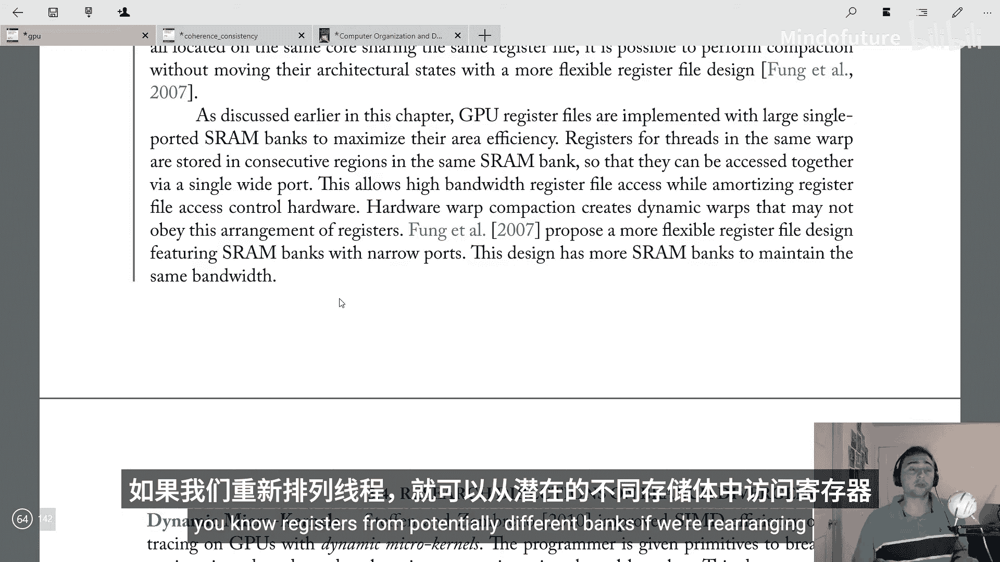

Right， so in 2010， there's another work dealing with dynamic micro kernels。RightSo in this work。

 they're targeting CD efficiency of rate tracing on GPUs。

 we haven't talked much about rate tracing on GPUs。

 but we probably will in the GPU programming course。So with a dynamic micro kernelnal。

 So basically they give the programme or a set of primitives to break iterations in a dated dependent loop into successive micro kernelnal launches。

 So this isn't going to do anything for parallelilism because of the know dependencies between loop iterations。

But instead， the launch mechanism improves the load balance between different threads in the same core because we can go ahead and compact the remaining active threads into a few warps。

 So if we only have a few active threads， we want to make sure that they're all kind of going together that when we don't have。

 you know all this work spread out。So it also differs from the rest of the hardware work compaction techniques in that the compaction migrates the threads with or architectural states using a perco scratch pad memory as a staging area。

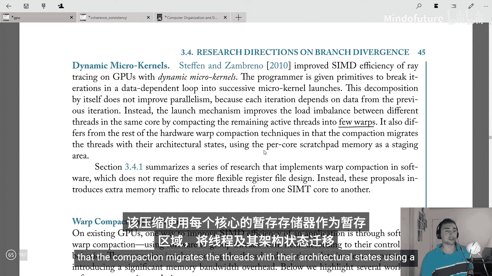

Right， so you know。3 to 4。1 summarizes a series of research that implements warp compaction and software。

 which does not require the more flexible register file design。 Instead。

 these proposals introduce extra memory traffic to relocate threads from one empty core to another。

 right， so now that we've kind of gone over all of these， you know these multiple。

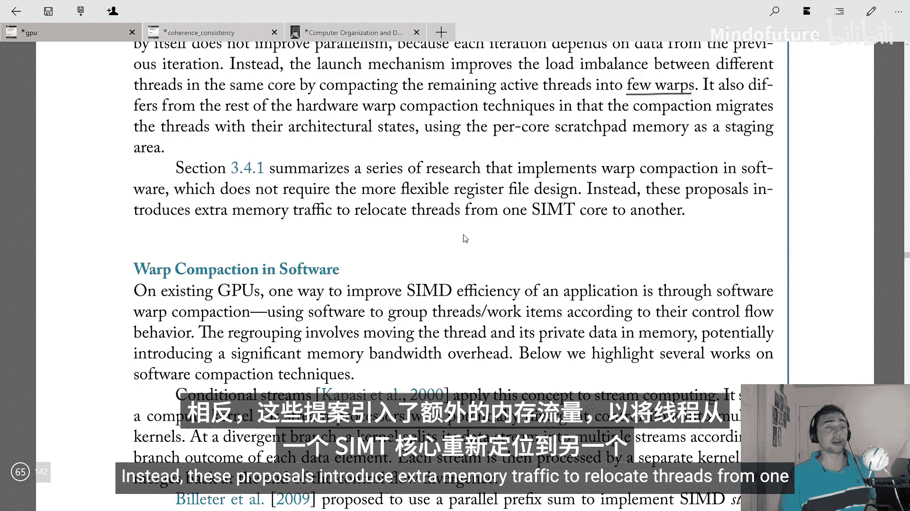

You knowHar techniques we're going to get into， you know， well。

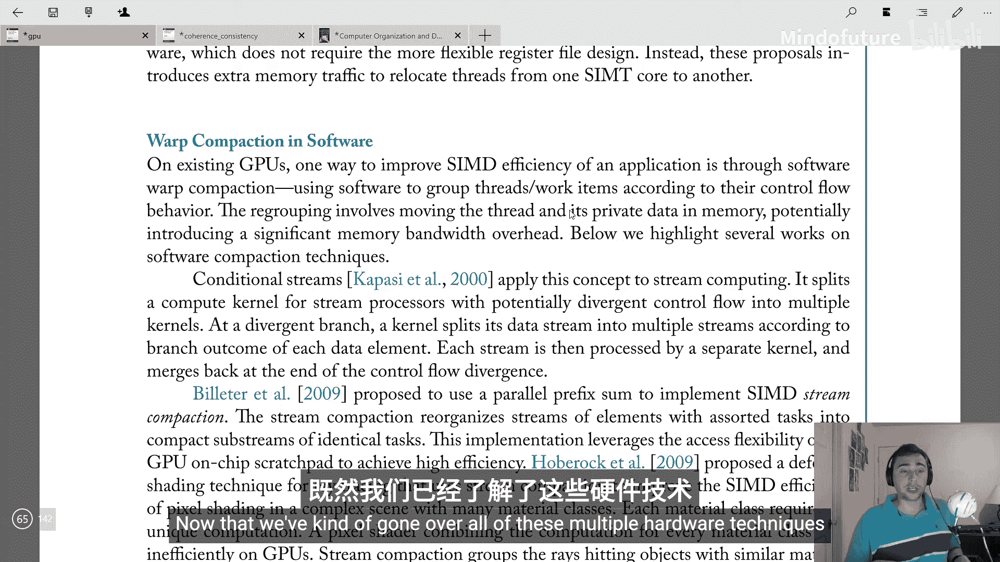

Can we do warp compaction more intelligently in say software。

 so instead of changing the architecture？Right， so on existing GPUus。

 one thing you can do to improve Cd efficiency is through software warp compaction， right。

 so this is know the same kind of idea， but you're using software to group threads of work items together according to their control flow behavior。

So you know a work a very early work in 2000 so this is really before the era of GPGPU conditional streams apply this concept to stream computing right so it splits a compute kernel for stream processors with potentially divergent control flow into multiple kernels and it branch divergent branch。

 a kernel splits its data stream into multiple streams according to branch outcome of each data element。

So each of these streams is then accessed by a separate kernel and merges back at the end of the control flow divergence。

 so getting more towards。You know， more into the GP GPPU era。

 you've got this work from 2009 that proposed apparel prefix sum to implement SD stream compaction。

Right so basically what we want to do is we want to recognize streams of elements with a sort of task into compact sub streams of identical tasks。

 So the same idea as the harbor right we want to match things together that are all doing the same thing。

So this implementation leverages the access flexibility of GPU on chip scratch padd to achieve high efficiency。

 right， So we've got this， you know， shared memory， the scratch padd memory。

You know what if we can use it to solve other problems rather than just， you know。

 fast access to data right， so what if we can use it to you know。

 to handle things like work compaction， right？So another 2009 work proposed a deferred shading technique for ray tracing that uses stream compaction to improve s efficiency of pixel shading in a complex scene with many material classes so each material class requires its unique computation and a pixel shader combining the computation for each material class runs inefficiently on GPUs so stream compaction groups。

 the race hitting objects with similar material classes so now we're again grouping things together。

Which， you know， is better for GPU hardware。 So GPU hardware likes to all kind of run， you know。

 the exact same code contiguously， right， That's what really GPUs you know， Excelel at。

 So things like matrix multiplication that are very regular。

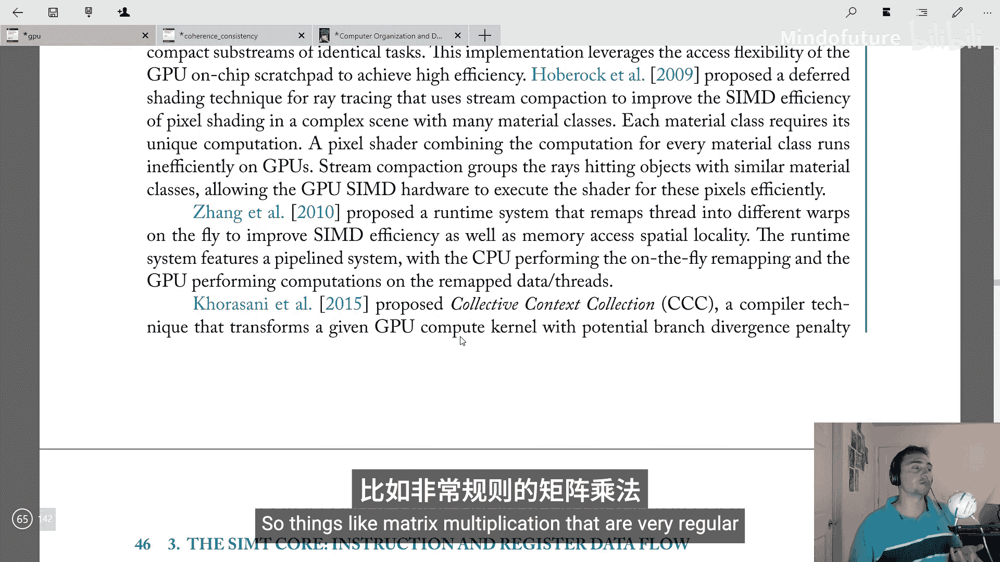

So in 2010 right so a proposed runtime system that remaps threads into different warps on the fly to improve MDD efficiency。

 as well as memory access， spatial locality， the runtime system features a pipeline system with the CPU performing on the flyly remapping in the GP performing computations on the remap data and threads。

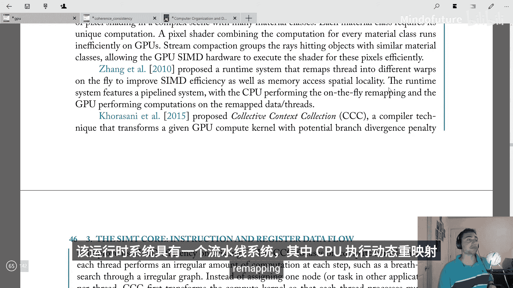

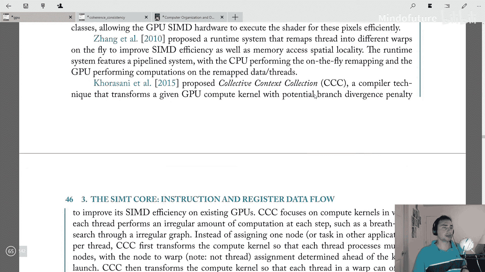

Another thing from another idea from 2015， a proposed CC or collective context collection。

So this is more compiler side thing， so a compiler technique that transforms a given GPU kernel with potential branch divergence。

A penalty。嗯。

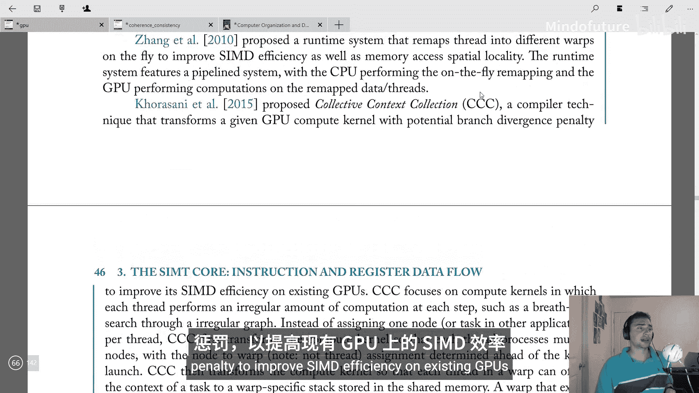

To improve city efficiency on existing GPUs。So it focuses on compute kernels in which each thread performs an irregular amount of computation to each step。

 such as a breath first search through aregular graph。 So it's something like breathth。

Sorry breadth first search I think we've got a typo here。

 So in you know in this kind of application each thread is going to be tied to a vertex and each vertex will have an adjacency list and so we'll look through you know the adjacency list but in a regular graph you know。

Some， you know， threads， you， will have a relatively short adjacency list。

 Other threads could have a very long adjacency list。 right， So， you know。

 they'll be accessing different amounts of memory and doing different amounts of work。

So instead of assigning one node or task in other applications per thread。

 it transforms the compute kernel so that each thread processes multiple nodes。With a note to warp。

 assignment determined ahead of the kernel launch。So you know this transforms the compute kernel so that each thread and a warp can offload the context of a task to a warp specific stack stored in shared memory。

 a warp that experiences low SD efficiency at its current set of tasks can offload tasks to the stack and use these offload a tasks to fill up threads that went idle。

As they process a later set of tasks right so basically this is just kind of doing a workload balancing right so if I've got too much work。

 you know we'll put it over here and then idle threads can then pick up that work。

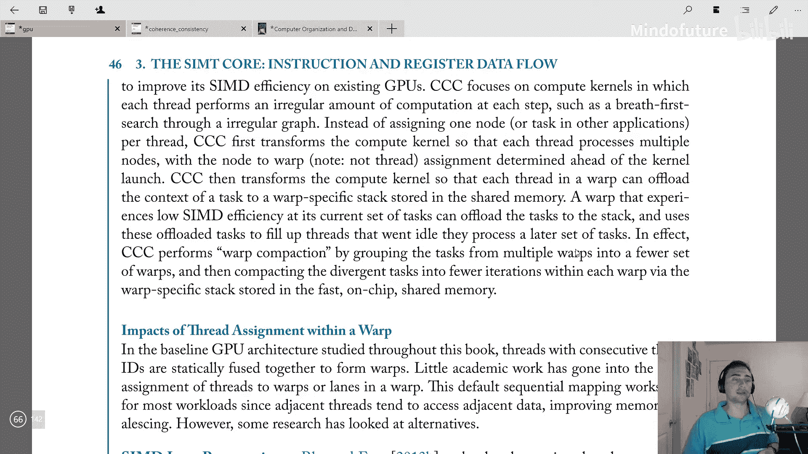

So another thing is impacts of thread assignment within a warp。

 so in the baseline GP architecture study through the book。

 threads with consecutive thread Is are statically fused to form warps。However。

 little academic work has gone into the static assignment of threads in warps or lanes in a warp。

 So this default sequential mapping works well for most workloads since adjacent threads since to access adjacent data。

But， you know， this isn't necessarily the case。 it's the case for very regular applications。

 but once we start moving to more irregular applications with a lot more data dependencies， you know。

 there's really no reason why this is going to be true。You know。

Eially in something like a know graph algorithm where we'reing where we're accessing different each thread is accessing a different vertex。

There's no guarantee that once we start accessing the adjacency list and another vertex。

 there's no guarantee that what we're going to be accessing will be anywhere near each other or even have the same amount of adjacent nodes。

Okay， so one of these works from 2013。Right， so on sdy lane permutation makes the observation that sequential mappings of thread Is to consecutive threads in a warp is suboptimal for warp compaction techniques。

 So a key limitation being。You know。A key limitation is when is that when threads are assigned to a new warp they cannot be assigned to a different lane or else a register file state would have to be moved to a different lane in the vector register so in this work they observe that the structure of the program biases certain control flow paths to certain Cd lanes and then this biasing makes it difficult to achieve compactions since threads that take the same path tend to be in the same lane preventing these threads from being merged right so we can't overlap threads on the exact same lane。

 so that's why they can't be compacted， so they propose several different thread mapping permutations that remove these programmatic biases to improve the rate of compaction so make compaction even possible。

Right， so this work from 2013 in 2009。Exploit the fact that the width of the S data path does not always equal the warp width。

 So， for example， you know the S width of 16 but a warp size of 32。

 which means that we'd actually need two cycles to compute something。Right， so。

So so this paper from 2013 observes that when divergence occurs。

 if a sequential S worth of threads are masked off for an instruction。

 then instruction can be issued in only one cycle skipping the masked off lanes。 So they they you。

 call this technique cycle compression。 However， if the masked off threads are not contiguous。

 The basic technique does not yield any performance。 So， you know what would you need to do。

 So similar to as we discussed earlier， you need some kind of swizzle compression technique to rearrange the threads。

 So you've got 16 contiguous threads threads accessing you know the compute units of the same symdy width of。

 say 16 in this case。

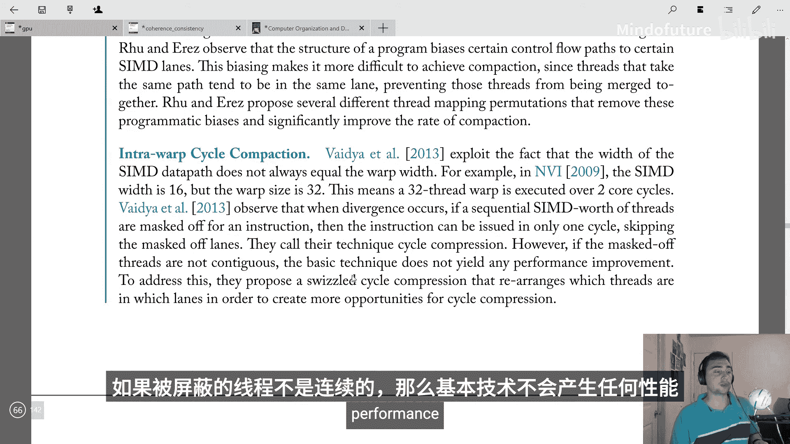

Right and so the last thing kind of in this line of work that we'll discuss is warp scarization right。

 so other works such as this work from 2014 argues that the CT programming model is inefficient when the threads with a warp operate on the same data。

 so a number of solutions proposed， including a scalar unit in the pipeline for work that the compiler or programmer can identify as scalar a priori。

 so that just means we can determine you this is going to happen ahead of time。Right。

 and so AM D's GCN architecture includes a scalar pipeline for this purpose， right so。You know，Se 3。

5 you know， discusses this in more detail and actually in the most recent architecture。

I believe in the Tring architecture， there actually is a scalar pipeline on NviIdia GPUs now。Now。

 this entire。You know， paragrapharagraph is basically just saying。Okay， you've got 32 threads。 Okay。

 all of your 32 threads are doing， no， say， you know， you know， A plus B。

 but it's the exact same A plus the exact same B。 Well， if they're all doing that。

 there's no reason why all 32 threads need to， you know store that data or compute that single value。

 You know， it should just be computed by a scalar unit， right， So just a single thread， right。

 And that's this idea of a scalar pipeline。Right。So， you know。Long winded explanation later。

 That's kind of the， you know， current state of the art and the scope of， you know。

 research as it relates to。

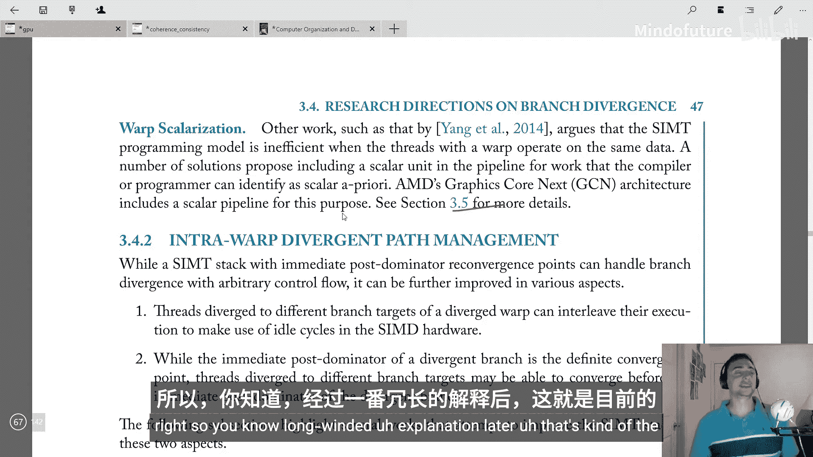

This idea of warp compaction。 So as you can see， you know。

 a lot of this work was done in the very early days of GPU architecture。 So you see papers from 2007。

 2011。

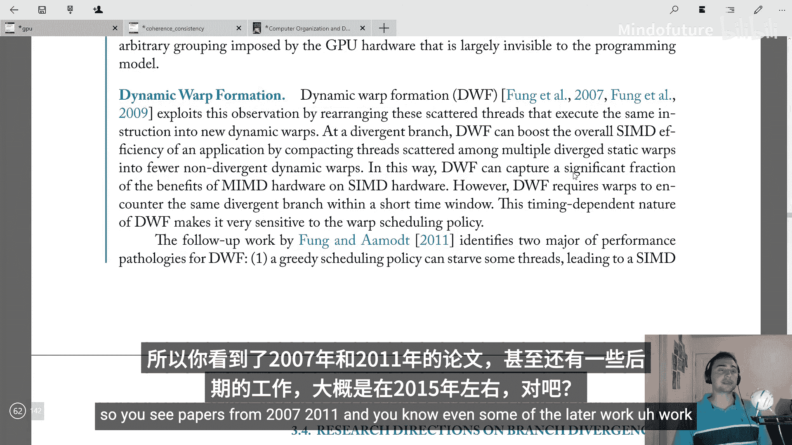

And， you know， even some of the later work work being。

You know in 2015 or so right so this work is know very mature now in the field of GPU architecture。

 so next time in the next episode， we'll go ahead and start talking about the second big topic on S corere architecture and survey this research which which deals with Introwarp divergent path management so that's going to go ahead and do it for today as always feel free to check out any of the code that I have at Github co s coffee before arch So you know we've got stuff on say GPpU programming in Kuta so feel free to check out the other YouTube series I have called couta crashash course where we go over things like vector edition using unified memory matrix multiplication using cache tiling and talking about coalescing using theuda libraries。

 optimizing kernels for some reduction convolution histogram etc ce and we'll have later topics on doing you know actually writing our own。

嗯。You know， kernels for instead of dense matrix multiplication。

 doing things like sparse matrix multiplication。 but that's going through it for today。 As always。

 I'm Nick from Coff before Arch。 send any questions if you would like to know more about anything。

 and as always， hope you have a nice day。

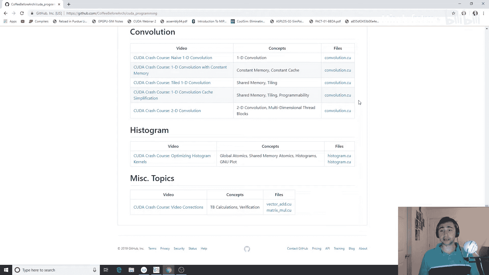