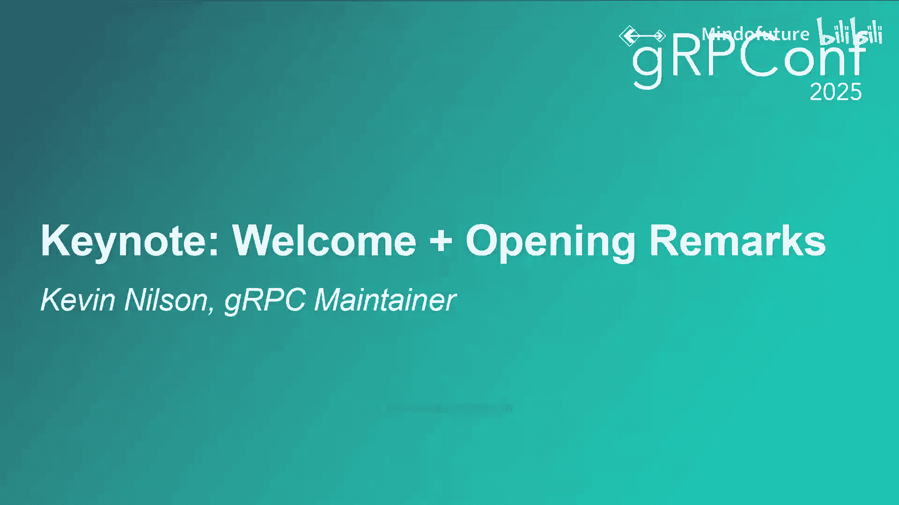
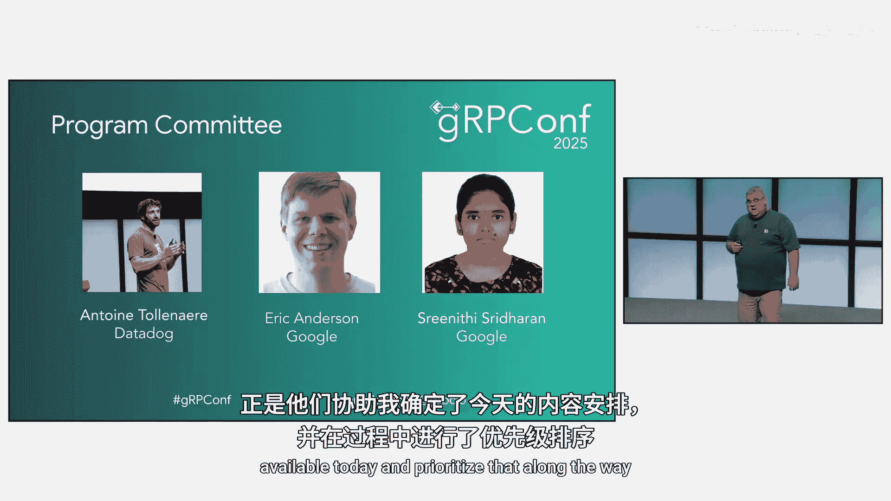
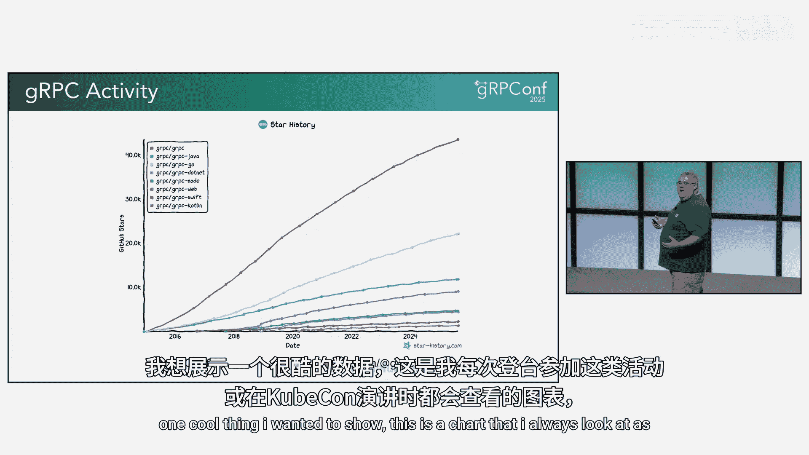
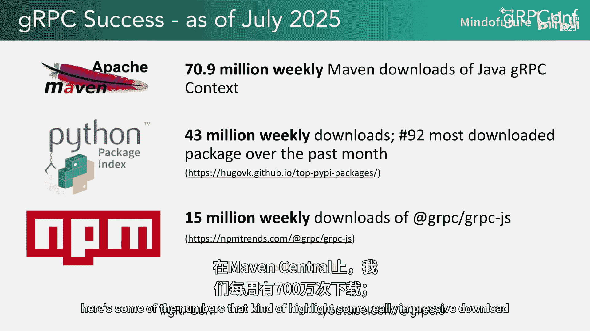
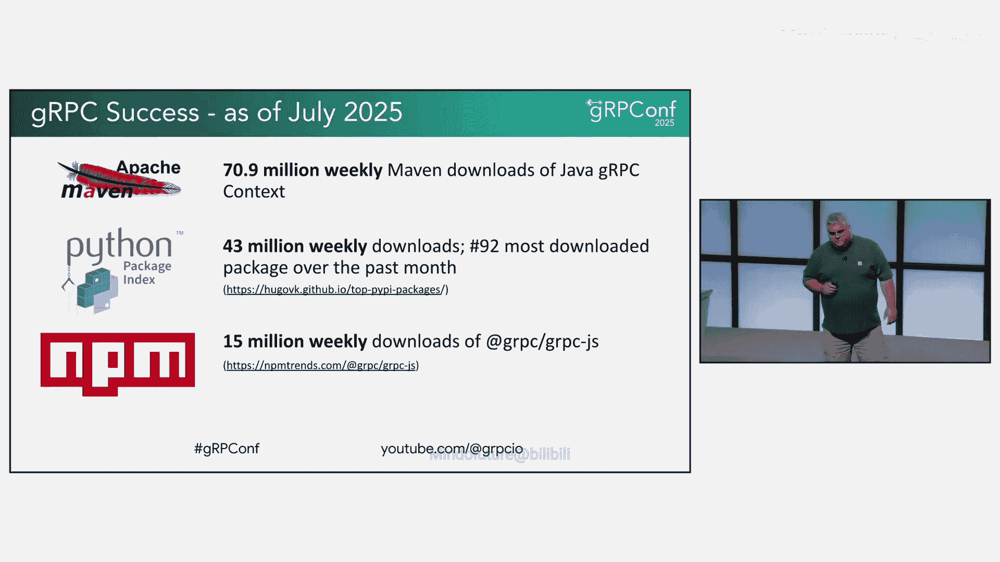
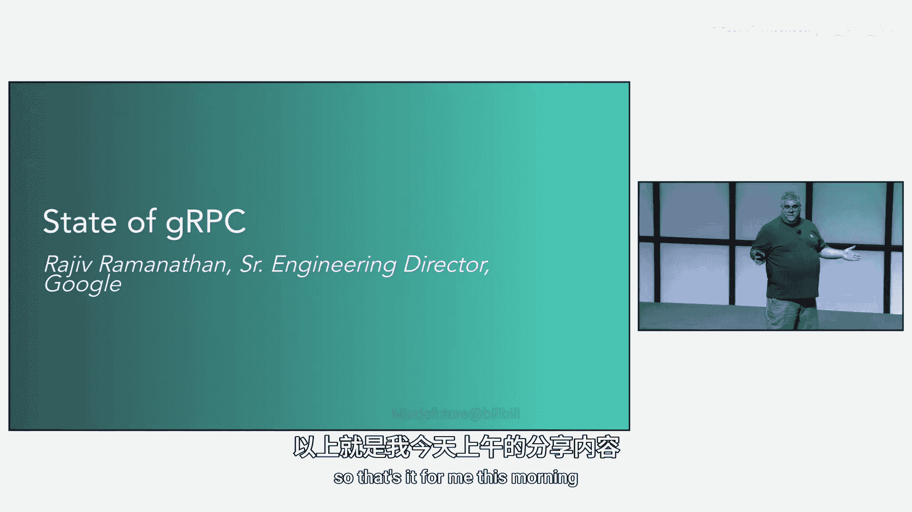

# Grpconf-2025-p01-P01_主题演讲-欢迎_+_开幕致辞--BV1yTHMzKE1U_p1-

Hello and welcome to GRPC Com。 How's everyone doing this morning。😊。

All right， so my name is Kevin Nelson。 I will be your M C for tonight。 and for myself。

 I'm on the steering committee member of GRPC， which is a brand new committee。

 And then also the program chair。 So finding all the great talks that we have。 and speaking of talks。

 we've got talks from a lot of great companies， We got folks from Apple， folks from Cloudflare。

 Mastercard Netflix， WS O2 LinkedIn， Reddit and many， many others。 So it's really。

 really exciting great to be here again。 And how about a quick shout out to the 1015 starts。 So yeah。

 anyway， for me， you know， we were talking about， should we start at 9， should we start at 9。

 And I said， no， let's let's do things。 a little bit later。 So show hands。

 How many of you joined us last year。 So last year was a very， very important year for GRPC。

 we announced our 10 year anniversary。😊，So it's a long time。 And the really exciting thing is。

 is that GRPC is remaining relevant。 with a lot of new stuff we're gonna tell you about today that's super。

 super exciting。 So here we are， sort of celebrating our 11th year。 coming up in our teenage years。

 So it's great to see all of you again here in the audience。 do want to thank all of you for coming。

 I know all of you are like me。 You have very busy days。 You have a lot of things going on。

 a lot of other places you could be。 And so hopefully， you know。

 we've done a lot of work to prepare Hopefully we've got a lot of great content for you today。

 You'll enjoy。 you'll learn and get to meet a lot of the great folks from the GRPC team。

 quick reminder。 We do have free wfi in here for the alphabet guest。 And so definitely。

 if you need that login great opportunity to use that。 did want to do a quick show of hands。

 about how far folks came for today。 I spoke to a few folks from a long way away。 How many folks。😊。

are from the local here in the Bay Area。Awesome， awesome。Inside the states， outside of California。

Anybody from the East Coast。Long drive。 Wow， quite a few， quite a few。 That's awesome。

 And how many of you， this is your first GRP compf ever。😊，That's awesome。

 You're here for an exciting day。 Any， This is second。😊，Third。Anybody join us in Detroit。

 Any in Detroit。 Yeah， a few， a few folks in Detroit。 That's awesome。 That's awesome。 Now。

 I'm curious about languages。 How many folks are using GRPC Java or Kotlin。😊，Yeah， yeah。

 That's me go。Python。Dotnet， C sharpp。Anybody using Ru yet。Yeah。

 so that's our newest thing that we're super excited about today。

 We're doing some early access sort of previews。 We have a code lab around rust， super。

 super exciting for us。 And that is something that we heard about from you starting at GRPC compf。

 So a few years ago when we were in Detroit people started asking and they started asking Cubecon。

 And you， put together a team。 and that's something we've been working on really， really hard。

 We've got a lot。 We've got to talk。 We've got a code lab。

 That's something that we're really excited about coming here soon。 lastly。

 I want to know how many of you are using GRPC in more than one language。😊，Wow， just about everybody。

 more than two languages。More than three， Any polyglots out there。Yeah， a few， more than four。

Yeah that's awesome。 Antoine。😊，Always here to impress。Cool。

 so before we jump into things there's a few people that I want to thank firstly。

 I want to thank Google Cloud for being the diamond sponsor for this， providing the venue， the food。

 the T-shirs， the bags， all the great stuff that comes along with with that。 And so super grateful。

 you know， me and the GRPC team were're all super grateful for Google helping and make this happen today。

 Next， I want to thank the CNCF， know Linux Foundation， cloud data Comp。

 the GRPC team would like to thank CNncCF， got a ton of support from many people at the CNCF。

 both for the GRPC project and for GRPC compf。 We're in the process of pursuing CNCF graduation。

 which is the final stage in the CncCF project lifecycle。

 graduation signifies that a project has achieved the highest level of maturity adoption and community support。

😊，Throughout the process of moving towards graduation， we've been working very。

 very closely with the CNCF。 And with the help from the CNNCF。

 we just completely rewrote our governance and created a new GRPC steering committee to help drive the future direction of GPC。

😊，And we'll be submitting our graduation application to the CC F T， O。

 C within the next week this afternoon at 150。 If you want to hear more about our governance changes and an overview of that。

 Richard Bellville will be on stage talking about that。

 And so I encourage you if you're interested in that or have any feedback。

 that's a great place to go。😊，Next， I want to thank the program committee， these are the folks。

 Antoine， Eric and Trinniy， These are the folks that helped me decide what content that we're going to have available today and prioritize that along the way。

I also want to thank our organizing committee， Kathy Cellia， Cheryl and Stay。

 these folks have been having meetings probably for the last nine months。

 organizing things and getting the food ready， getting the venue ready。 How many rooms。

 all the work that goes along with that。 And so a huge thank to them for making it happen。

 And then for myself， a special shout out to Kathy really。

 really stepping up and and helping with all aspects of the show。😊，GRPC。

 one of the things that I mentioned earlier is we have a new steering committee and part of the steering committee helping drive the direction。

 So if you see these folks， feel free to give them your ideas。

 let them know all of them are here today and this is a group of folks that have been engaged and involve the GRPC for a very long time and then helping us drive what is the direction we go。

 how do we meet the users needs， and so congratulations and welcome to this group of fine people on the stage。

 Antoine， April， Craig， Gina， myself， Mark and the Pur And in addition to this。

 we have well over 30 members of the GRPC team here today from Google from Apple from LinkedIn from Datadog many。

 many Microsoft， we have folks from all of those companies represented here who are GRPC team members。

😊，Lastly， I want to recognize two notable contributors from the community。 Lucofranco has been very。

 very helpful in our rust implementation。 He had an early version of rust support for GRPC。

 we partnered with him to create the version that we're going that we're working on to provide as a supported fully supported language within GRPC and then lastly。

 I want to thank Antoine from Datadog Antron did a bunch of huge contributions in the go codebase for us and about a year ago we promoted him to a maintainer。

 so special shout out to Antoine。Cool， so I wanted to remind everybody of a couple of key links and places you can learn more and get engaged with the GRPC team。

 First is our documentation at GRPCIO。 We have a Google group groups Google colash g GRPCIO。

 and that's a great place for you to talk to other users of GRPC And so if you want to flow ideas is anyone else using GRPC in this way。

 Anyone have suggestions how to do things or share some of the interesting things that you have done。

 That's great place to do it。 Obviously， the GRPC team is on the list as well。

 but everyone has the ability to contribute， share their thoughts and share their questions there。

 We got a great YouTube channel been pumping a lot of content in there。

 That is one of the feedback that we got。 is know as things have evolved our developers have started consuming a lot of their documentation more from YouTube And so we did a big investment created a ton of video。

😊，And things there。 finally， we have a meetup and the meetup。

 we have one here that runs in Sunnyvale meeting on the Google campus。

 There's another one in Bangalore。 And then we have virtual meetups as well。 And so check that out。

 Join as a member。 And then lastly， a bunch of our announcements。

 Like if you want to hear about GRPC comp， we're gonna put that up on X。😊，As I mentioned earlier。

 we've done a bunch of improvements to our developer guides。 And that was like I mentioned earlier。

 That's where we got a bunch of feedback from all of you。 So we got a ton of new user guides。

6 new user guides that didn't exist before， a bunch of new examples。

 And then the thing that we released this week。😊，There's a bunch of new code labs。

 So got them in a new format， a lot easier to consume new ones and rust。

 and we'll actually be having code labs throughout the day。

 So if you're new to GRPC or want to try a new language， want to get started。

 That's a great place to go as well。 And then finally， as I mentioned before。

 a ton of new YouTube videos。 We will be posting the videos from this both on the CCF YouTube channel。

 as well as the YouTube channel that we have for the GRPC team。 All the videos。

 all the content will be up there from today's event as well as our future Bangalore event that's coming later in the year。

 I'll talk about later。😊，One cool thing I wanted to show。

 this is a chart that I always look at as we come on stage to do one of these events or speak to Kubcon is I kind of look at how are we trending。

 how are we growing， And as you look at know our main repo in red you can very clearly see JRPC continues to grow。

 continues to be more and more relevant and continues to get more and more users over time。

 And so this is a great sign for all of us being know11 years of maturity，11 years of bug fixes。

11 years of performance improvements， people continue to use it and people you know the library continues to grow。

 So definitely want to thank all of you for helping make this happen for the GRPC project。😊。

Here's some of the numbers that kind of highlight some really impressive download statistics so in Maven Central we have 7 million weekly downloads for Python。

 we have 43 million weekly downloads and finally for NPm 15 million weekly downloads so these numbers are super impressive really excited for us to see that continue to grow and every single year these numbers grow and grow along the way。

Cool， so that's it for me this morning。 I'll be back a little bit later。

 But now I want to welcome Rajeiv。 and he's a senior director at Google。

 And he'll be talking about some of the excitement that we see today in the state of GRPC。 Thank you。

😊。

