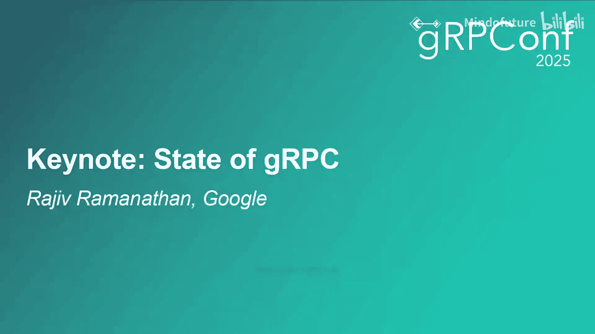
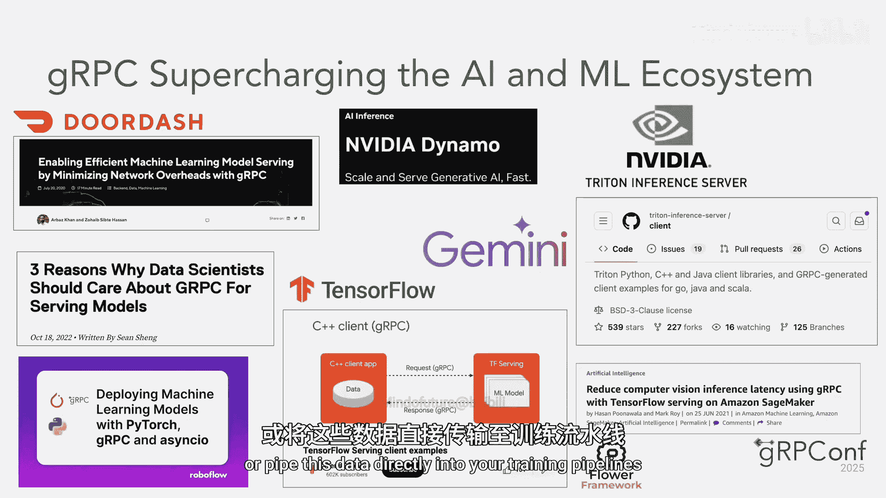

# Grpconf-2025-p02-P02_主题演讲-gRPC的现状--BV1yTHMzKE1U_p2-

Hi， I'm Rajeiv。 Thank you， Kevin。 I've been a GRPC user for probably 10 plus years。

 probably right when it went open source。 And in that time。

 this is across startups and money companies。 And so I'm super thrilled to be here to be the X sponsor of both the GRPC and GRPC conf。

😊。

Thank you all for coming to GRPC conf。 It's pretty exciting for me to be here with you all。

 Over the next few minutes， I'll talk about。😊，GRPC is incredible adoption。

 where we are today and where we are going next。Yeah。

 it's been 10 years since we released GRPC In that time。

 GRPC has experienced rapid adoption across various industries。

 It high performance and support for many languages has made it the godu solution for building efficient and scalable communication for modern distributed systems。

 I think Cisco was the first to begin integrating GRPC， probably a year after it began。

 This is followed by Netflix who's been a contributor and has used it for their backend communication and then Spotify and Reddit and LinkedIn and so on。

 In fact， I think in Qcon last year， LinkedIn had you know。

 talk about how they migrated 50000 endpoints from their internal framework to GRPC。

 I'm sure some of you are here somewhere in the audience。

 So it's incredibly rewarding to see how our solutions being embraced and making a positive impact across various industries and applications。

😊，So what makes GRPC so successful， GRPC is sort of an exceptional fit for cloud native environments。

 and it's designed to enable efficient communication using protocol buffers for reduced message size。

 as well as H T TP 2 for network efficiency and real time communication。

 This makes it sort of ideal for microservices that need to exchange large amounts of data。😊，Okay。

It's language agnostic nature allows you to build and deploy services in your preferred languages。

 This portly is crucial for cloud native environments where it is common to build microservices in different languages。

 Last but not the least， GRPC enables the architecture pattern for microservices。

 This allows teams to break down large problems into smaller services and you know。

 well encapsulated services and you know， this eventually enables developer velocity and allows smaller teams to work in parallel Acating the overall development process。

 In addition， GRPC provides features like load balancing and retries to improve reliability in these distributed systems。

😊，We use GRPC heavily inside Google， E C D， Con D， Kubernetes。

 and many Google projects use it for our internal communication。So effectively。

 GRPC has become the popular choice for modern， scalable efficient applications in cloud native environments。

So we continue to commit to making GRP more cloud native， friendly， proxy less GRP service mesh。😊。

Streamlines our deployment process and eliminating the operational over overhead of running and maintaining sidecar proxies。

 So this approach not only sort of reduces complexity， but also improves the source efficiency。

 making it appealing for large scale cloud native environments。Also， GRPC comes with many features。

 I think some are written here to allow you to bring these service mesh capabilities directly into your applications。

So if you want to learn more about that， Eric Anderson is talking about service Mash and GRPC at 1。

50。哎。Right at last year's GRP conf， we announced our collaboration with Tnic。

 and we've been working very closely with the maintainer since we have made significant progress over the last year。

 and we'll be launching a preview soon。😊，Please join Doug's exciting talk at 2。

20 PM for a deep dive into GRPC Ru and learn about our progress。😊，We also have a code lab at 4，10。

 If you want to get your hands dirty and get some hands on experience with GRPC un rust。Okay。O。

So AIM L has really lit up in the last few years， right。

 And GRP is revolutionizing the way AIM L models communicate and operate。

 So it's inherent speed and efficiency and support for data streaming。

 establish it as a key building block in these AIML pipelines to help train large models and to serve inference requests quickly。

The efficient data injectiongestion processing facilitated by GRPC significantly accelerates our model development life cycle。

 So training large scale machine learning models。 all of you are aware。

 uses a gobs of data and GRPC's data serial powered by protocol buffs combined with its ability to handle these large payloads makes it a reliable and robust solution to be able to dump dump this data or pipe this data directly into your into your training pipelines。

😊。

And thanks to its sort of low latency and high throughput。

 GRPC is efficient at handling inference requests as well。

 So prominent machine learning frameworks like Tensorflow utilize GRPC to manage and process these vast number of inference requests。

Nvidia's Dynamo Triton framework， you know， is the one that sort of helps you build and deploy models。

 uses GRPC as their transport。So GRPC ensures that real time applications receive predictions with minimal delay。

We are doing a lot of work in AI M at Google。 And there's some some exciting stuff that we can announce today on like MP and A2 A。

😊，MCP or model context protocol allows AI agents to connect and use external tools。

 databases and services。 And A to A is a protocol that allows different AI agents to collaborate with each other to delegate tasks to one another and so on so。

GRPC is is going to see you through your AI M L journey。

 and we are here to show you how we have a few more sessions later today that are talking about this。

Okay， lastly， thank you all again for being here at GRPC conf。

 We truly appreciate you taking the time to be here。

 We really hope that you have a fantastic day filled with like exciting topics and valuable insights。

😊，There's a lot to learn about how GRPC is being used and how it can potentially help you solve your problems。

And enjoy the rest of your conference。Back to you， Kevin。

