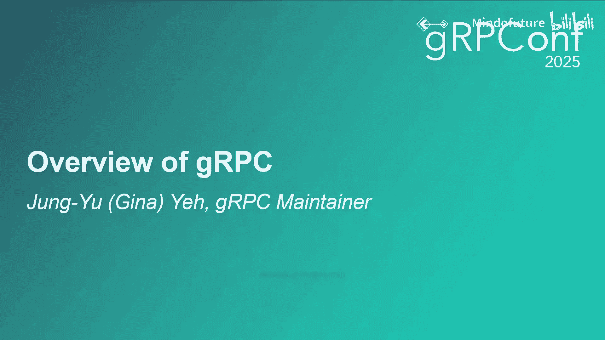
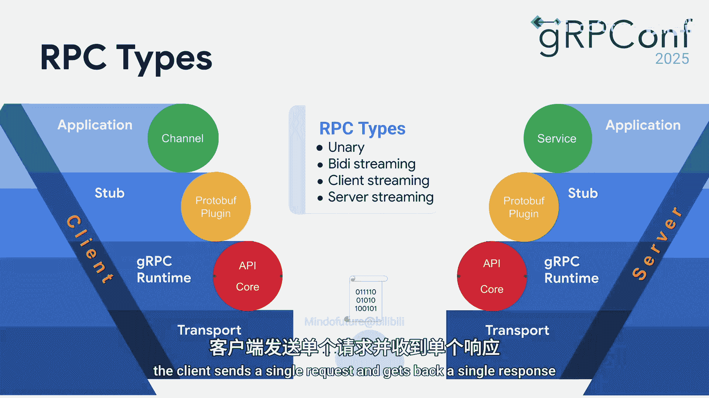
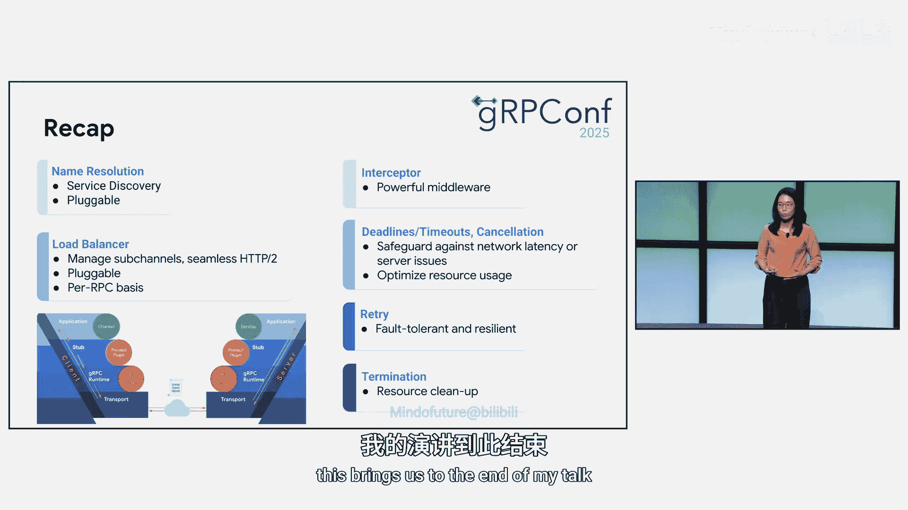

# Grpconf-2025-p03-P03_gRPC概述--BV1yTHMzKE1U_p3-

Hello， everyone。 welcomelcome to J PC cof。 My name is Gna Ye， and I have D PC maintainer。

 In this talk， I will cover J PC's core concepts and its life cycle。 If you are new to J PCC。

 you will learn a basic concept of J PC。 And we also have handsz on colls available all the day in the breakout rooms for practical experiences。

😊。

For those familiar with G PCC， this offers a quick refresher to prepare you for a full day of rich topics and advanced use cases。

So， let's get started。GR PC is open source high performance Re procedure call framework。

 It's easy to use， In efficient and has become the go to standard in the industry。In simple terms。

 think of G PC as a high speed delivery service for your data。

 It reliably and quickly transmits information between your services and applications over the Internet。

Jopee's popularity stem from its ferility and high performance。

In addition to being available in a wide range of programming languages and platforms。

Its performance is industrial leading。The framework features a pable architecture。

 allowing for flexible and efficient integration with various development stacks。Furthermore。

 GRPC offers a rich feature set for traffic management， security and service mesh integration。

A key design choice of G PCC is using Portof as its I D L to structure the service messages。

Protobos use of a binary encoding format resulting smaller message sizes and highly efficient parsing。

This benefits directly to G PCC's high performance and high flexibility compared to other R PCC framework。

Another fundamental design decision of J PC is that is built on top of H P 2。

Ensuring the comparability with many existing load balancers in this process。

HEP tos use of header compression， binary encoding and multixing over a single TCP connection makes G PCC a high performance framework that reduces the network latency and use resources more efficiently。

Now， let's take a look at GRP's core concepts。 and it starts from a channel。

A D PC channel is an object that represents a virtual connection to a drop PC service。

 identified by a target U I。A J PCC channel is responsible for managing TCP connections for server to the surfs。

And you could have 0，1 or many connections Depend on the needs of your applications。

The channel is also responsible for handling key functionalities like name resolution。

 load balancing。 So you don't have to do it by yourself。 And I'll cover that in a few minutes。

After establishing a GC channel， you create a client stop from it。

This stop generated from your port definition is the object that you use to make remote calls。

When you invoke a method on the stock， it initiates a logical call within the JC runtime。

The call is then mapped to a H TP to stream at the transport there。

 which handles the actual data transmission。Essentially， an RPC， a call and a train。

 all referring to the same fundamental idea is just different terms that was being used at a different abstraction layer。

Before a D PC channel can connect to a server， it must first perform name resolution。

This is because applications use a target U I to specify the surface to connect to when creating a J PCC channel。

But the underlying transport rely requires the specific IB address to establish a contextion。In JRPC。

 nameM resolution is the process of figuring out the IP address of a server from a given UI。

Think of it as a JC equivalent of phonebook。When the client wants to call a server。

The server it uses the server UI to look up its addresses before establishing a connection。

While this sounds a lot like what Y S does， GRP's name resolution is more flexible。

It has a pluggable architecture that allows for different strategies to find server addresses。

Name resolver then returns the service cong to the next component， load balancer。

The load balancer manages open connections towards the back end servers and then distributes a request among multiple back end servers based on the service config。

G PCC offers the building load balancing with several common load load balancing policies such as run Robbin。

 We run Robbin list request and default is pick first。

Low balancing is one of the most critical components within GRPC。

If you're interested in learning more about how it works and best practiceses。

 we have a bird of feather at 3，30 today， and we also have another talk from Ewa at 410 to talk about to deep dive into the low balancing details。

So once the connection is established， G PCC serialized the request data and sent it in in frames。

 according to the HP2 protocol。The server site mirrors the client site。

The server transport received a request and then notifies a location。

The application server logic will then process the request and then returns the response to be sent back to the client。

Dropvis supports four types of communication patterns。

 and you can choose the one that best fits of your communications needs。

Uary is a classic request response model。The request。

 the client sends a single request and gets back a single response。

Server streaming， the client send a single request and get multiple responses。Client streaming。

 the client sends multiple requests and gets back a single response。

 Last one not list by directional streaming。 both the client and the server send independent streams of messages to each other。

Now that we've covered the GRPC life cycle， that's will on to a few other important features。

 and the first one is interceptors。GRP interceptors is a powerful middleware component that in the。

 that in the GRP framework that allows you to intercept and modify the request before or after they reach the intended destination。

As shown from the graph， there are certain points that your PC will call to run your interceptor tasks。

Interceptors provide a clean way to add cross cutting concerns such as authorization， authorization。

 error handling， and more to your GC services without cloing your main application logic。

Deadlines is another feature provided by RC， and it is a client side mechanism to prevent RPCs from being running indefinitely。

The client specify how long is willing to wait for a response。

 and this timeout can be set either as a fixed point of in time or a duration。

If the time is exceeded， the call is canceled with the deadline exceeded status。

 and it can happen for various reasons。Such as a failure connect to the server or a server recognizing that the client deadline set by is simply too short to fulfill。

Crucially， DRP supports deadline propagation。When the server receives a request。

 it also receives the associated deadline。If that server then makes its own RP PCC to other upstream services。

 it it automatically forwards the remaining time， ensuring that the original client time limit is enforced across the entire distributed systems。

This is a crucial safeguard against the network latency or server issues。

And we highly recommend you to always set the deadline or time out in your application。

In addition to deadlines， D PCC clients can manually cancel an R PCC it no longer needs。

The cancellation signal propagates through the HTP transport to the server。

 allowing it to stop processing and clean up the resource。For this to be effective。

 especially for loan lived R PCs， a server handler should superiorly check if the call its servicing has been canceled。

Upon detect upon detecting a cancellation， the server should stop processing immediately and clean up the resources and ideally propagate the cancellation to any downstream services it may have called。

GRPC Retry is a feature that allows clients to automatically reattt an R PCC call， if it fails。

It's a powerful mechanism for building resilient applications that can gracefully handle transient server side issues or temporary network problems without requiring adding complex logics into your application code。

When you enable D PC retry， the clients channel is configured with a retry policy。

This policy defines the rules of re attempting of a failed call， such as max attempt。

 back delay and retriable status code。When criteria are met。

 J will create a new re stream after the exponential backup delay。Once a response is received。

 no further retries will be attempted and GRPC will hand over the the call to the application。

If you have observability enabled， you will see the retry metrics。

 including details like retry attempts and backup delays for each of the call。

We have a D PCC Observability talk from Yaj at 440 today and join the talk if you are interesting to learn more about D PC Observability。

Every RPC will eventually terminate either successfully or with the error code。

This termination of the call is communicated through the status code。

 which informs the client about the outcome of the RC。

It's important to terminate the GRPC channel properly when you are shutting down your application。

You can initiate a graceful termination using the shutdown method， which rejects new costs。

 but allows for in allows for any inf request to finish。Since the shutline is as synchronous。

 you must wait for the process to complete。You can use the method of weight termination to block until the channel has fully terminated。

 or a certain time is reached to ensure a clean asset。For a more immediate stop。

 the shutdown now methods will forcefully cancel all the ongoing and new calls。To summarize。

 we began the， we began from the fundamentals。 G PCC is a modern， open source， high performance。

 remote procedure call framework。It's built on top of Peov and HP2。

We also walk through the life cycle of a D PC call from channel creation。

 name solution to load balancing。Finally， we cover several defense use cases and best practices that are key to build a robust applications。

Using interceptors as the powerful middleware to modify the G PCC call before or after they reach the intended destination。

Stating deadlines were a timeouts to prevent R PCCs from running indefinitely。

And allies will be propagated to upstreams， if any。Using cancel。

 if you no longer interested in the results of the R PCCs。

 and the server handler should period check if their call has been canceled before processing the request。

Also， propagating the cancellation to any downstream services is highly recommended。

Configuring retry， configuring retries were fault tolerant and resilient and aggressivelyfully terminating the GRPC channels during the application shutdown。

This brings us to the end of my talk。 Thank you for your time and attention and good luck with your D PC application。

 Thank you。😊。

