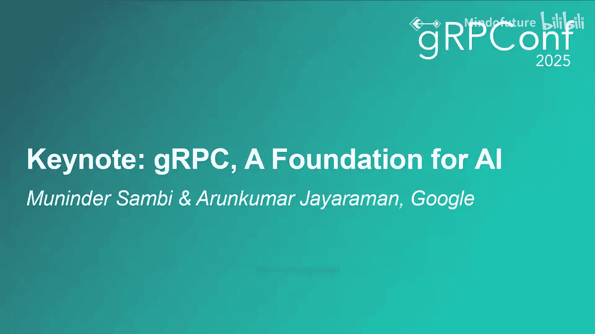
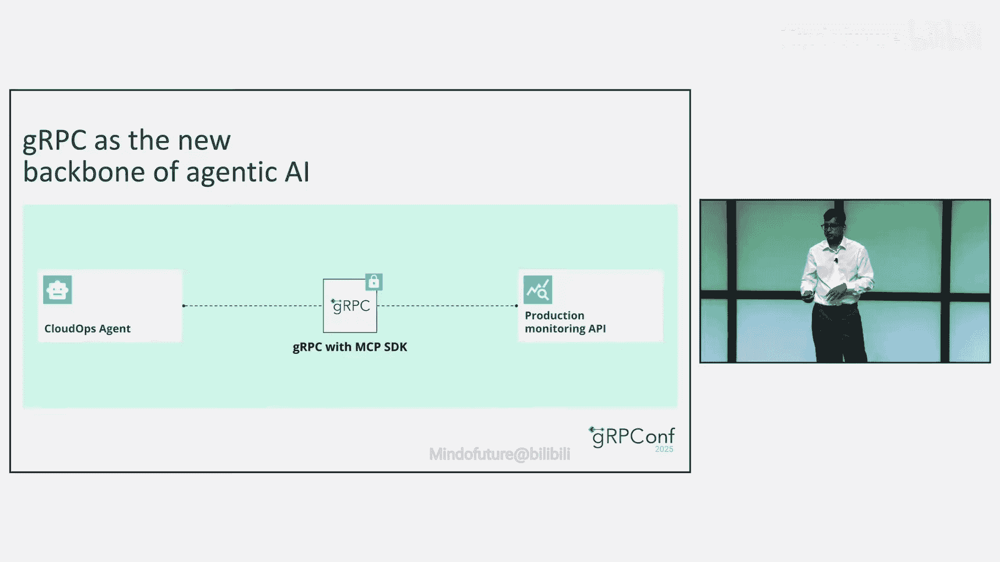
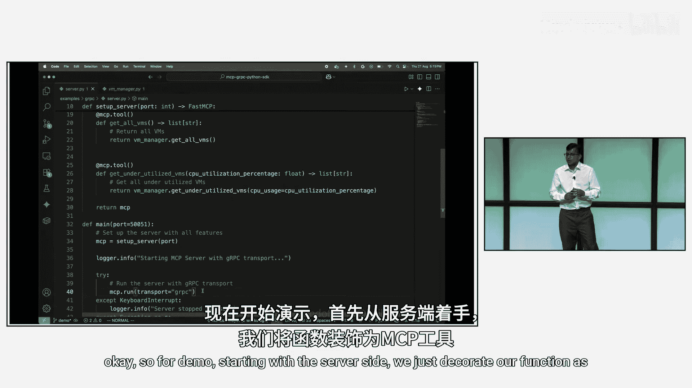
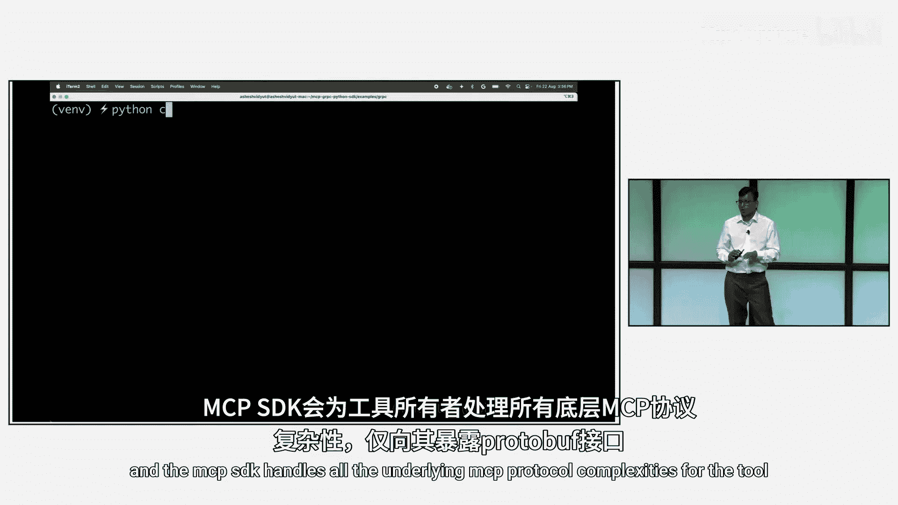
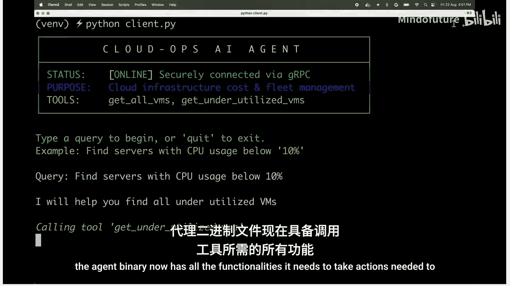
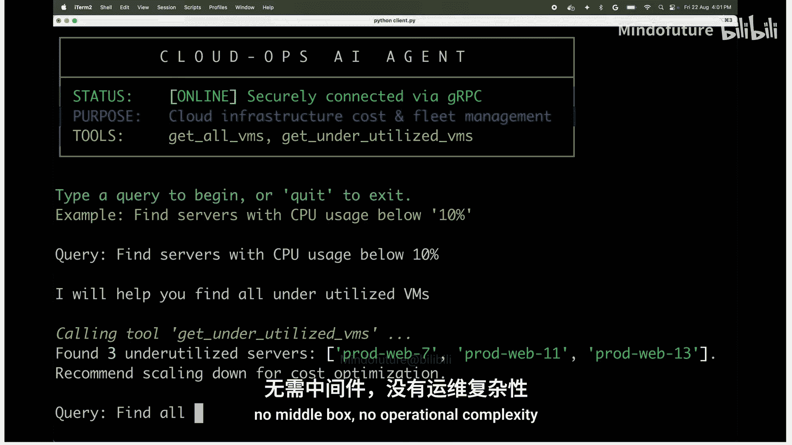
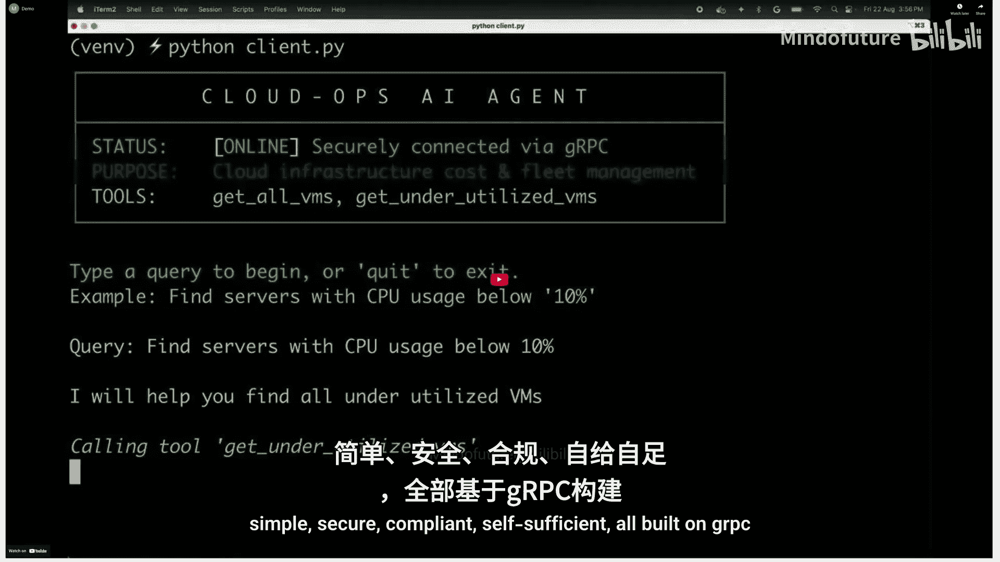
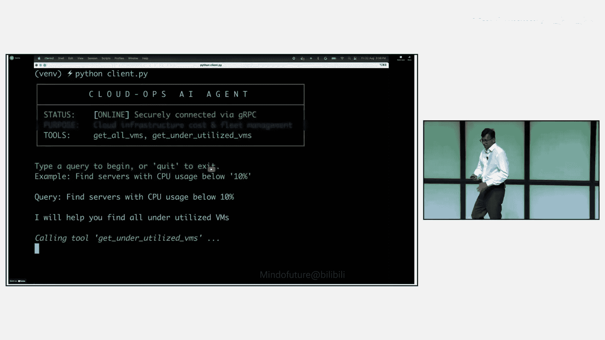

# Grpconf-2025-p04-P04_主题演讲-gRPC__AI的基础--BV1yTHMzKE1U_p4-

And's much bigger of a crowd， I guess， from last year， which is good。

 And thank you for taking time to attend this GRPC conference。 I think it means a lot。

 First to see all of you here。 our second， I think for us sharing how the exciting times with GRPC are going to be in the world of AI that we're gonna live in。

😊，U。I'm just going to start with a brief overview of what the market has trended over the last 25 years。

As we all know， we went from the Internet era where we built a lot of the capacity。

 a lot of workloads， a lot of e-commerce， a lot of new companies started showing up using the Internet era。

 We went from Internet to streaming with YouTube and the likes of Netflix， etc ceter。

 with cloud coming to the making。And now we are at the fourth， which is， I think。

 the largest inflection point that we have seen for decades。 And what does that really mean。

 It actually means the current offerings， the current capabilities we have in networking in GRPC have to evolve。

 They cannot be exactly the same that we've done for the last two decades。

 almost rethinking or reimagining what the networking stack is going look like。😊。

With training and infferencing。We will need to have a high performance， low latency。

 and a cloud infrastructure that can support all type of models。 bring any type of agent。

 be able to connect securely to any model or tools。

So let's talk more about what we see in the industry， from an AI perspective。

Just to give you a brief overview of what enterprises are seeing。

1 is about 93% of the Fortune 500 that are all already using more than one model。On an average。

 we see each of these enterprises for different type of workloads using up to three models。

And that creates complexity。That creates underut and lack of cost efficiency on the GPU TPU infrastructure。

We also see， while we see a lot of petabytes of data that' is being transferred。

Being driven by training。There's a huge， huge focus from almost every enterprise that's trying to evolve their applications to become Gen EI applications that actually leverage inferencing as a much larger workload than we see from a training perspective。

😊，So whatever we build now from a networking perspective has to have that continuum with addressing the training needs of high performance low latency。

 But continue that with the inferencing as that becomes much more dominant in the market。😊，Now。

 we can't ignore security， as I've shared last time as well。

 One of the big things on cloud networking that we do， security has to be built in。

Has to be thought through in everything that we do cannot be an afterthought。

 cannot be solution that we bring that is bolted on in the future。And with AI。

 I'm sure you guys have read news about new LLM models and how easy they were to break into completely removing the guardrails for an LLM model。

 being able to do poisoning of the model， being able to do data exfiltration being able to ingest or inject malicious traffic to make the LLM model hallucciinate And we've seen many reports that have come up here。

 like 90% of the prompt leaking data that I have was for a very specific model that was introduced back in January and February。

😊，Now， as enterprises， we absolutely want to make sure that your data is protected。

It's secure and the L LM model， the agents， as well as the tools that you do。

 and the intercommunic is as secure as possible。Now with that。

 I want to first announce and talk about capabilities that we launched in the last couple of months。

When I talk to customers and we talk about AI， there's three strategies that customers are building together。

The first， obviously， being an AI and a cloud strategy。Where my GP is going to be。

 am I gonna to use GP versus GP， What models am I going to standardize on。

 What workloads am I going to prioritize and move into the cloud to leverage and evolve them to become G applications。

The second biggest strategy is data management。Like petabytes of data have to be transferred closer to the GP T P infrastructure。

 How do you transfer that in a secure， high performance， low latency manner。

And the last thing that' talk about， you need a robust。Evolution of your networking strategy。

 Networking is are the foundation to making sure that enterprises can now move and leverage the power of cloud。

 leverage the power of AI， leverage the power of the model infrastructure。

 the agents that they need to build in order to evolve their applications。

So that's exactly what we did。 We started the journey with data ingestion。

 We want to make it easier and simpler for customers to be able to move data into the cloud and we are very pleased to announce 400 gig of Google Cloud Interconnect where customers can now connect it 4 x or what we had before。

😊，It gives a much better price point， and you can move in much more data。

 much faster in high performance， low latency manner。😊，Fully reliable， fully S L managed。

 So that inter interface that were giving is backed by our reliability development。😊。

The second biggest capability is obviously be the ability to support GKE as we know。

 Kubernetes and GKE is almost the de facto standard for any infferencing or gene applications that we are seeing。

😊，We now support up to 65000 nodes。With each GPU cluster。Not only that。

 we also developed an RDM A VPC that can do 3。2 TB per second for GPU to GPU communication or TU to TU communication in a low latency。

 high performance non blocking manner。That was super， super critical for us to do。Last。

 we also realized that the Gen EI， the AI M L applications， both training and inferencing。

Are very different than how we were supporting web based applications。

Their traffic patterns are different。Their needs are very different。

 You have to look at K V caching and other metrics that come in order to be able to do intelligent traffic management。

And that's where we introduced the inference gateway。Now。

 let me talk to you more about the inference Gway this one is super， super exciting for us。😊。

We are obviously first in cloud be to offer an inference gateway that is natively integrated into our GKE architecture。

😊，It improves inference performance。By offering 60%， lower latency。It offers 40% higher throughput。

And the reason we are able to do this is because we have intelligence from K V cash from the GPU models。

 be able to optimize that traffic management and get optimal experience。😊。

We also work with any type of model， whether it be V L L Ls， the N VDs， the jet streams and others。

And all of this。Needs to be able made available through a GRPC infrastructure as well。

 And that's where it's extremely extremely important。Now， as we go into the second pillar。

As you all know， cost of GPU TPU is extremely high。

 I there anything that networking can do by being able to support and lower down the total cost of ownership。

And one of the challenges that we took on as a team is the ability for us to now provide intelligent traffic management based on the GPU utilization of the model or multiple models on that infrastructure。

And we believe we can lower your total cost of ownership by about 30%。

And this is not just networking cost。 This is the overall bill of material where predominant cost of the GPU and TU or the AI infrastructure that you' are investing in。

Last， I talked about security。 and that's extremely important for us。

We have seen attacks like prompt injection attacks， training， data poisoning， model stealing。

 sensitive data exfiltration。And with inference Gateway。

 we have now integrated providing you the best of breed security appliances that you want to bring in could be an ISV vendor of choice。

 could be the pan W AI firewall that they have could be any other vendor could be our own native model armor that you could use。

😊，Giving you that flexibility so that your security controls， your S ops。

 your security teams are completely confident about moving those workloads into the cloud。

 making sure that they comply and are regulated and governed。Buy that security team。Now。

 we are not going to stop here because the challenges continue。And models are just one piece。

Of the AI journey that we have。Clients or agents accessing models。

 It just one piece of the agent AI puzzle。Traditionally。

 what we would have done is build custom connectors。For every single API。

But that traditional approach is very inefficient and cannot scale。

 Just imagine the number of models and imagine the number of tools that you will have。

 And each one started to build a bespoke API。You would never be able to move into a Gen journey。

 And I think this is where the unified protocol that was announced by Anthropic。

 which is called the model context protocol MCP。 It provides every API producer to expose an MCP server。

Now， this allows any AI agent， as you can see on the top in the middle。

 any AI agent to have uniform access to tools or data， simplifying your deployment。

 making it consistent。And enabling rapid adoption， you don't have to worry about bespoke APIs that would have been created。

 There's a single infrastructure， which is MCP that you can rely on。Now， last。

 there's gonna to be a lot of agents。 And yes you can see that mesh that I've created on the right side of the slide。

 which is agent to agent。Agents。Are going to be developed。

 They're gonna be homegrown by your enterprise。 They're gonna be external parties that will be offering agents。

 or therell be L L M models that will be actually generating agent code and creating and deleting agents by demand。

😊，And we want to build an infrastructure that can actually support all three。

 not just one in a very consistent， comprehensive manner。

And be able to support it in a way that is standardized。

 And that's exactly where Google pioneered A to way， which is agent to agent communication。

 And we've actually seen a lot of enterprises actually start to adopt。

 start to test and validate what that happens。😊，Now， as we go through it。

 you'll see we want to make models， agents and tools。Everywhere。

 independent of whether you have them on prem。In Google Cloud or any other cloud available to your developers available to a common infrastructure that you can securely connect。

And be able to provide governance and security regulations along the way。Now。

 this creates a lot of challenges as we develop this strategy。

 So I just want to walk through what we believe are the challenges。 The challenge number one。

 Gen AI wants to be able to leverage GRPC tools and data sources。To accelerate development velocity。

You've already done that for the world that's calling it traditional applications。

As those applications move to GenI based， you want to be able to have access to the same set of tools and data sources that were available historically through GRPC。

The challenge。MCP as a protocol does not support GRPC。Second， serverless Kubernetes。

 whether GK or native Kubernetes is going be the platform of choice for agent developers。Today。

 we do not have GRP support on serverless runtime， as well as the agent SD DKs。Third。

 there are going to be new threat vectors that are going to be introduced by Gen EI。As you can see。

 I continue to bring security as top of mind on everything that we do。😊，Now。

 agents need to access other agents。 They want to be to access tools or even L L M models。

 and you want to be able to do it from anywhere in a preferred choice of your security vendor。

Traditional security appliances， you know， putting a bump in the wire or bump in the cloud。

 being able to redirect your traffic。That's very hard， very complex。

 And there's potential of that being non optimize from a cost performance or even security perspective。

We want to make it really simple as you integrate your security appliance of choice。And with that。

 that's exactly what we are doing。3 things that we are announcing first。

 enabling GRPC as the mod as the native transport for A2 A， as well as MCP。😊。

So all those eight data sources and tools that you talked about that are talked about。

 which are connecting to your traditional or today's applications。

 can use the same transport as it comes as they evolve to a Gen AI infrastructure or a Gen AI application。

The second security is top of mind。 We had invested in this very cool technology called service extensions that provides data plane programmability。

😊，Now， we are extending that in a way where you can use Google's native model armor to protect your LLMs。

 to protect your agents。But you can also bring third party could be Palo Alto， AI firewall。

 could be Nvidias， or could be any other preferred choice that you might have。And finally。

 we also want to be able to support GRPC across all compute runtimes on Google。😊，Including cloud run。

So that all the agent SDKs that you have developed automatically get extended and can be now made available for this new agent world that you are going to live in。

😊，We are super excited about these these innovations to come。

 would love as we bring these innovations and we start making them into preview。

 We love to get feedback from all of you Pri out in your labs。

 your pos or even your pilot webs applications that youre piloting or moving them into a GenI on Google cloud。

 We would love to hear your feedback。 I have to say many of these things that we have made available today。

 actually came into making thanks to a lot of the folks here in this room that actually provided us feedback as MCP was being developed as8way was being developed。

 and we invested heavily to make sure that GRPC continues to provide that continuity that you used it in the past and now being available for the next generation of applications that are there。

😊，Now， better than me showing slides， it's good to see a demo。 So with that。

 I'm going to announce and invite Aron， who's our Uber T L principal engineer at Google。 He。

 along with his team， are almost the brains behind this。😊，So thank you， Aaron。 Okay。

 thanks me in there。Okay， so let me build on Monda's introduction and zoom in on agent AI。

 Soft as service has had a large impact over the last two decades。

 But we are on the cusp of the next great evolution。 You know。

 a shift from software as service to agentic AI。😊，Unlike deterministic software as service in components。

 agents deliver towards a high level outcome。 These agents can reason。Plan。

 act and think autonomously。In this new era， the A is not a backwards compatible。

 rigid wrist spec anymore。 when an agent is asked to perform an operation。

 you know like make a travel plan。 It orchestrates a complex workflow by interacting with other agents and other tools and these interactions use an A A first natural language protocols。

If microservices broke down monolithic applications， agents are breaking down monolithic AI。

 This is an architectural evolution。 The GRPC ecosystem must evolve for GRPC to play an important role with agents like it does for microservices today。

So one of the key aspects of how GRPC works with microservices is GRPC Proxs service mesh。

 The GRPC Proxs service mesh provides a NATO application integrated traffic management， discovery。

 security， extensibility and observability， all without requiring sidecars and sidecar。

 the operational complexity of the sidecar has been a service mesh adoption concern。

To fully support agent AI， it is necessary to transition GRPC proxs service mesh to a GRPC proxys agent mesh。

What does it mean。It means。The GRPC。As an ecosystem and GRPC service measures as an ecosystem need to natively support a workloads。

Supporting a safety and security， like Mon in a call out。

Adapting observability for the dynamic agent driven protocols。

Integrating with the new A protocols like A to A and MCP that Mu talked about to give give a few examples。

 So this is the transition from the GRPC proxs service mesh over to a GRPC proxs agent mesh。

So that brings us to the emerging standards for agent communications， A to A and MCP。Currently。

 MCP relies primarily on Json R PCC protocol with a H T TP transport。What is it。

 what it actually means for GRPC two developers is that it forces them to either use proxies。

Or to rewrite their tools， introducing friction and complexity and the lack of usability of the existing ecosystem。

 I know this is a topic of tremendous interest。 as I see a couple of presentations later on。

 you know， today on the exact same topic。But what if GRPC were transport natively for A to and MCP。

All the GRP agent service mesh benefits that we just， you know， talked about。

Now gets integrated and directly available in your agent binary through this A case and MCPS S D K。

So now， the agent application。Can directly support a safety and security。Agent governance policies。

 Agent observability。All without requiring any additional operational components。

 the tool owners can also leverage the GRPC product of ecosystem like they do， you know。

 today with their microservice。Let's try to demonstrate these benefits by showing an example agent。

 you know， system running in serverless。As we all there service measures historically been associated with G K E。

But a quick agent development cycle， especially in some of the non enterprise scenarios。

 makes server less a very interesting platform to run agents。😊，GRPC agent mesh。

 along with GRP support in the A to A MCP protocol。

 allows agents running in these in a serverless environment to communicate with agents running anywhere else。

 any cloud， any compute， tools running anywhere else and discover them and access them with built in a safety and security。

 built in observability and without requiring any additional networking you know components。

This is the promise of GRPC agent mesh。O， like Mo said， time for some action with the devil。

So the demo is actually going to show a GRPC。As a transport option for MCP。

 this is not ready for release it， but the demo is to show the progress that the team has made in so far。

I'll set the stage， but。set the stage for demo by introducing an example use case in a typical cloud environment。

 a cloud ups agent needs to securely access the monitoring tools。Historically。

 this has required deploying a proxy between the cloudup cloudups agent。

And the tool for the proxy to perform a lot of inner function that we just talked about。

But your PCC changes this。We are moving these functions provided by proxy directly into the agent binaryry by integrating GRPC as a transport for MCP and deploying GRPC agent mesh for a centralized operational control。

😊，I'm going to show a demo of GRP support and MCP。 but in the interest of time。

 I'm going to narrowly focus on taking P L S as an example capability provided by this integration。

 But you can imagine how it expands to everything else that we just talked about。😊。

Okay， so for demo， starting with a server side。We just decorate our function as an MCP tool。

And the MCP SD D K handles all the underlying MCP protocol complexities for the tool owner presenting a product of interface to them。

Now， let's say， see the user query in action。Will give our agent a natural language query to find underutilized Vms。

The agent and L L M understands the request and calls the correct tool。

 The GRP core as part of the MCP S D K， then takes on the responsibility to provide secure T L S connection to the tool。

 offloading all these complexities from the agent owners。

The agent binary now has all the functionalities it needs to take actions needed to call the tools。

 no middle box， no operational complexity。

This is the promise of agent， proxys infrastructure， simple， secure， compliant， self sufficient。

 all built on GRPC。

Hope you enjoyed the demo。

