# Grpconf-2025-p05-P05_使用Gemini进行故障排除--BV1yTHMzKE1U_p5-

Good morning， everyone。 I'm。 working the G C E I Prime team here at Google。 A few days ago。

 I held my friend Cassy， a brilliant fashion designer to take her brand the pancake to the next level。

 Pancake is the golden retriever。 It's the mascot of GRP。

 And Cassie has been running a very successful physical store for many years。

 Her store just sells GRP and Golden retriever merchandise。

 But this year is our first time going online。 We used the Gemini to web code the website and deployed the service on a Google cloud VM instances。

 We got everything set up just in time before the big Lib Day sale。😊。

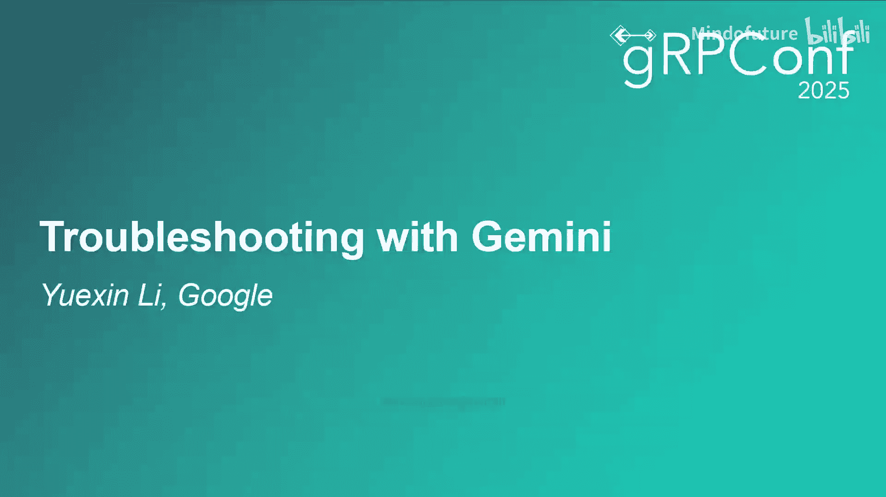

And。🎼Cassie is calling me。 So maybe let me answer the phone。 I wonder how the sales are going。Hey。

 Cassie， how are you？Hey Yuin。The Pancake website is down。 It's not working。

 The Labor Day sale is coming。 Can you help me fix it。Okay， so， well， I， I guess we have a lab issue。

 This is a big deal。 And maybe let's just check out the website。And it's 4，4。

Just give me a few moments， and。Let me see if I can find anything。 So here are my observations。

 First， the VM Web server is restarted last night to apply on update。 Second。

 the external IP address on the VM changed after the restart。😊，I don't know what's going on here。

 but I guess we have a very clear mission。 We need to fix the website。

 Get the IPO address reserved and maybe through all future updates。

Everything need to be fixed before the big Labor Day will。 So let's get to work。

So here we are in Pancakes cloud console。 for most cloud users， including myself。

 when we are facing an incident like this， sometimes it's like solving a puzzle with a million pieces。

 I just don't know like where to go。 I wantna scan for global voltages。

 I want to find like the most relevant public documentation that's me being like really lost。

 But today we havemini cloud assist。 So I just open cloud assist in the channel。

 It's like you have a cloud expert sitting next to you。 And hopefully I can help me out。

 So I will start everything by initiate a new investigation。

 And here I will just paste in my previous observation。

 The external IP address of the VM change and I need a fix。

 and I can also set the time range to be maybe 50 minutes ago。

 and I can also attach the VM web server to this investigation。 our web server is an instance。

 So Im all the resources in my project by instance type and。😊。

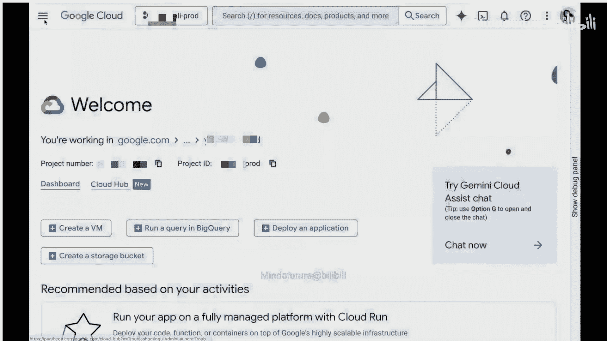

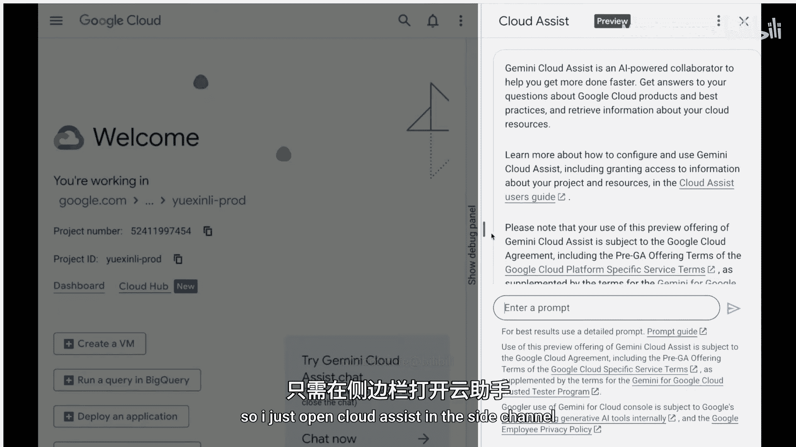

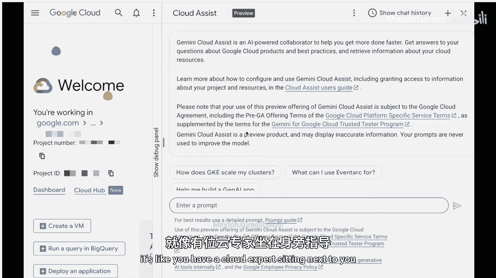

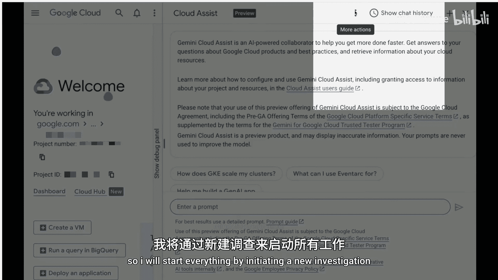

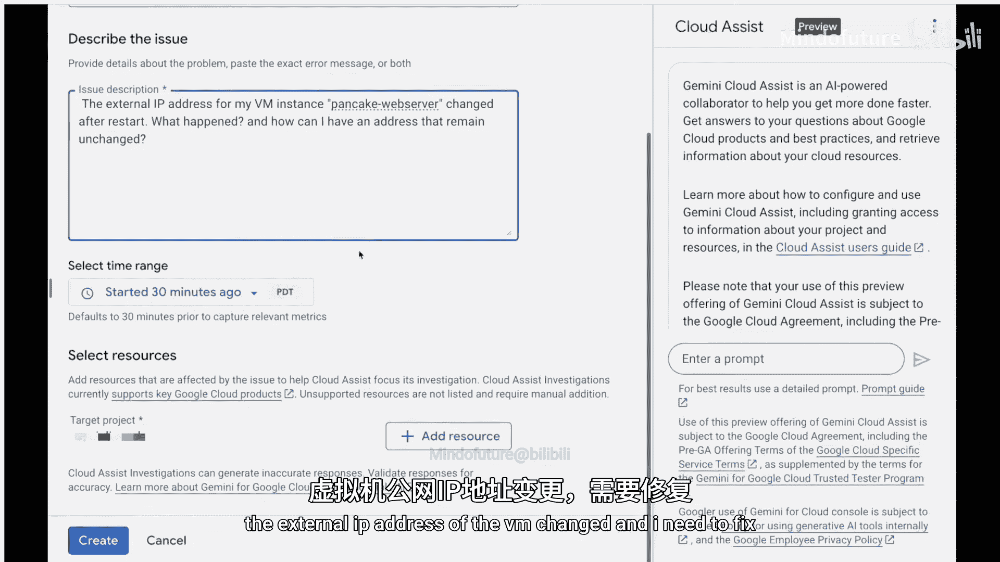

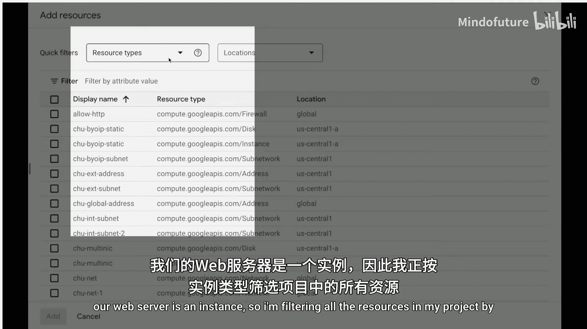

Then let me find the pancake web server。 There it is。 So I selected this one。

 added it to my investigation。 and just let me double check everything。

So I have to write description of the issue and I have the Tadge site。 Everything looks great。

 And I will click create。 So right now， underneath the hood Gemini is doing all the analytics for us Its first create an embedding for the issue description in a high dimensional space。

 that's like a really high dimensional vector representing our understanding I mean。

 the agent understanding of the issue and the user intention and starting from there it will start fetching the most relevant information regarding this intention and the current situation。

 And this information includes the difference in VM configurations before and after the incident and also like like recent audiolos in past 15 minutes and can also cross reference with like public documentation and the first part Google engineer domain knowledge And now it's giving us the clears we were using an ephemeral external address。

 that is temporary。 So every time we start our。

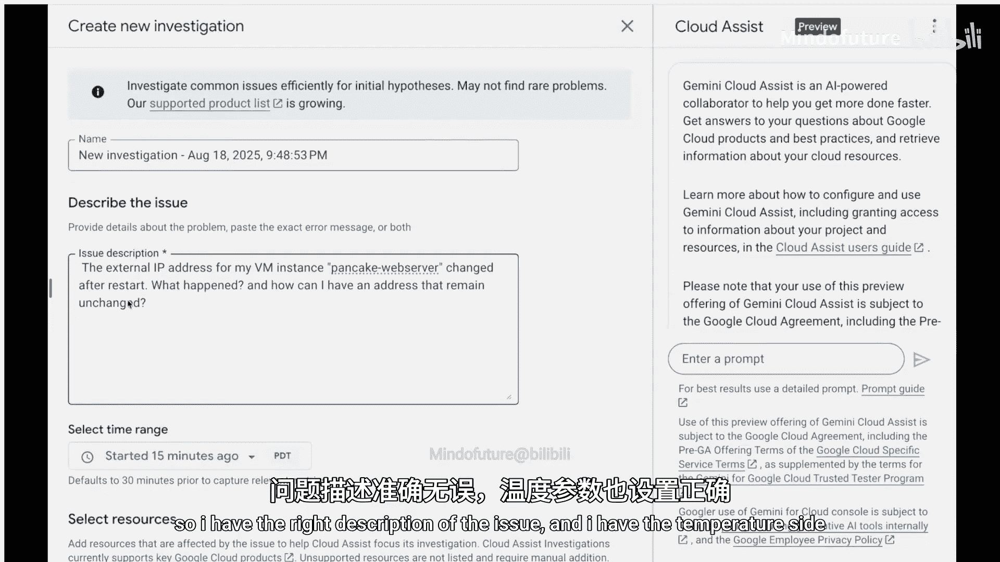

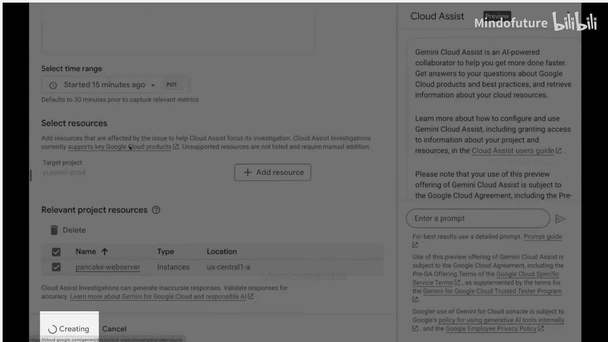

The address would change。 And all we need to do here is to reserve a static external IP address and assign that to our V I。

And Chiirman I even gave us the exact G call command we need to run。 And look over there， its。

 it filled in the， the V Im web server that we created。

 So all I need to do here is take a few more moments。 I just copy， paste the G call command。

 get the static gap fixed and。The wife said he's back。

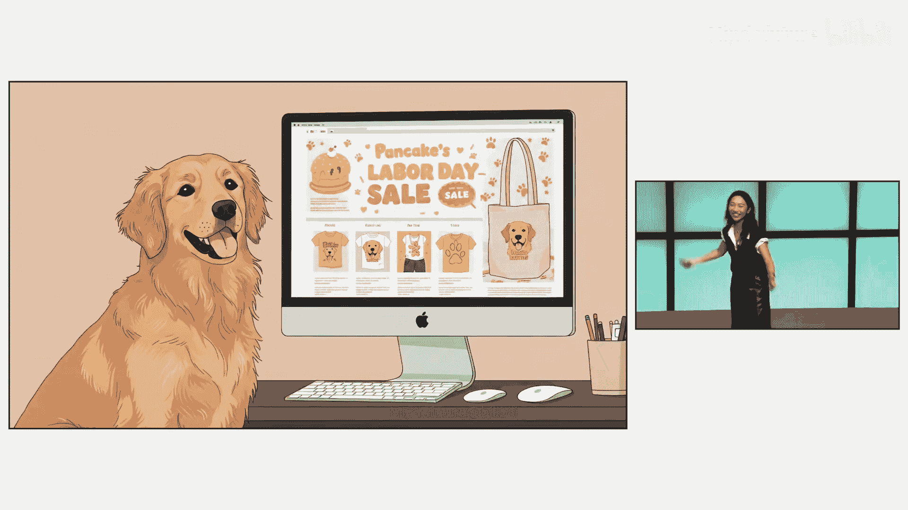

Yeah。Thank you， Kevinvin。够。Yeah， so this is the future of developing and troubleshooting with Google cloud platform。

 Gemini can transform hours of troubleshooting into just like minutes of learning。 And trust me。

 the troubleshooting process。 it will just take less than the time to make a pancake。

 So now I can call Cay back and let her know the great news。 Just a disclaimer。

 our images and videos in this slide， they are generated by Gemini。 except the demo。

 The demo is real。 And you can start using Gemini cloud assist today。

 It's in public preview and it's very powerful， super helpful to your workflow are encourage everyone to leverage Gemini cloud assist。

 Thank you。 And I will give the stage back to Kevin。😊。

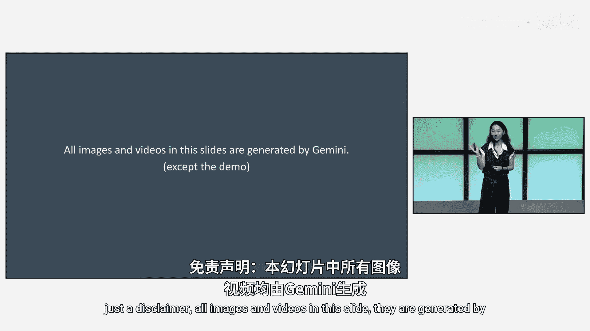