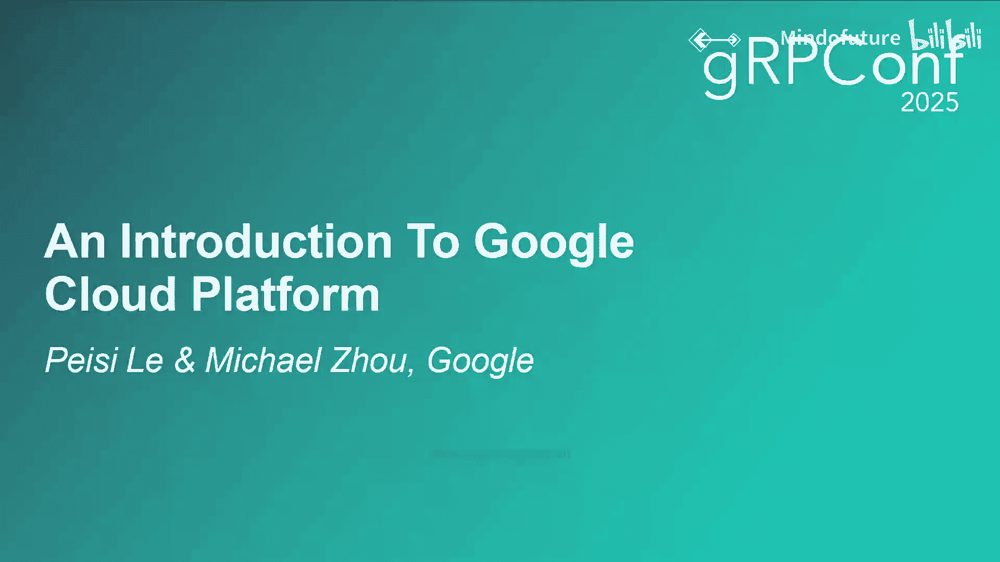
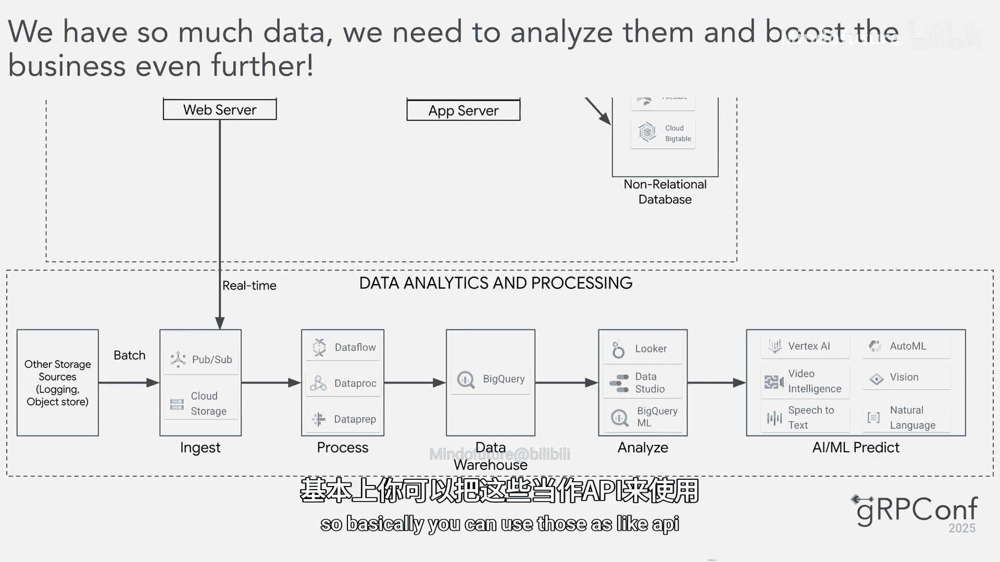

# Grpconf-2025-p06-P06_Google_Cloud_Platform简介--BV1yTHMzKE1U_p6-

Hi， everyone。

How's your coffee。Also， welcome to this session。 My name is Pay。

 I'm a staff software engineer at Google。 This is my colleague， Michael。 Yep。

 I'm the senior software engineer at Google。 Yeah， today we will tell you about a small story on how we build a fabric application called Jshu。

😊，So the entire story is going to tell you how we can build things with Google Cloud。So in happened。

 in 2026， me and Michael decided to retire from Google and start a new adventure。

 A e-commer company selling shoes。😊，So we call it Jshu。

 What is the first thing to decide when you build a star。

Some might say we want to decide the technical stuff like which language we use。

 Some might say we need to find the investor。 But actually。

 the first thing you do is to find an office。 And， of course， being a Google。

 we both know the natural choice of our first office。 if these two can create Google from a garage。

 So can we。有。So as a former software engineer， we， of course。

 know how to create a small web application。 We buy a few motherboards。

 We buy memories by CPUus and assemble them into big boxes。 One is used as our web server。

 and another is used as our application server。😊，To， to do back backend processing。

 such as authentication， inventory， payment services。Lastly， we need databases for that。

 we prepare two different kinds of databases。 One is for our transactions。

 We use relational databases to store user profiles， transactions。

 member membership subscriptions and billing accounts and so on。

 Another is non relational databases to store articles， product get catalogs and so on。

For the front end， both me and Michael don't have any experiences for U I design。

 And Michael probably has more than me， but we are not experts。 However。

 thanks to Gei code assistant， we could build the front end with little effort。

For the web web verification to go online， we also need DN S names。Luckily。

 Jshu dot com is still available at 2026。 So we registered that。 And this way。

 when a customer visits our website， a DN server will will resolve the domain into I P address。

The IP address， of course， is the Web IP of our Web server in the garage。O。

 the app is up and running in just a few weeks。 Very nice。After a few months。

 this ourselves sales go up and up。 A lots of people starting to see error pages when visiting our website because there too。

 too many traffic。 I didn't talk with Michael， and we decided to scale up。

There are few things we can do。 First of all， you can buy more CPUs。

 buy more memories and put into a bigger boxes， which we call vertical scaling。

Another thing we can do is we buy additional machines for our Web server and application service。

 That is called horizontal scaling。So for。Both can work， but usually you have。

 you will hit some limits when you add more CPUs at certain points。

 You cannot shop like 10 or 20 CPUs into a single box。

 So for large traffic and horizontal scaling is usually preferred。So。

Now that we have multiple web servers， each will have I different I address。

 How can our DN server resolve the name into a single IP address and decide which web server to go that that is sold by low balancing So low balancing low we we。

 we add a low balancer in front of our web server and it has a single I and take all traffic from customer distribute them based on predefined low balancing algorithms。

😊，Of course， we can do the same for our application server on the difference is that the is the internal load answerr do not have need to have Internet access。

So lastly， but last but not least， our relational database has a lot of queries and oftentimes the queries are very expensive。

 What we can do is add a memory caching layer to cache the frequent visited queries and reduce the latency。

So this new infrastructure overall has much better performance than our first design。However。

 there is a small issue。The landlord， who is our friends， complained about electric。

 electric bills and the noise from the machines。And this is him。

So we decided that we need to move one step further。As former cloud engineer。

 we of course know that is Google Cloud。To build things in Google Cloud。

 the first thing we can do is to create a virtual private cloud。

 which provides managed a networking functionality for all our cloud resources。

For our our application infrastructure， which is our web server and application server。

 we have multiple options， depending on multiple factors。For a small team like us。

 it time is better spent on coding instead of worrying about scaling and infrastructure。

 So serverless options such as cloud run， cloud app engine would be great picks。😊。

Both are serverless and skilled with no effort as your traffic grows。

Cudan offers the ability to run serverless containers， not just supporting web traffic。

 but also web sockets and of first GRP。If we want to run containerized apps with more configuration and flexibility。

 then we will pick a Google Kubernetes engine， which also called G K E。

 It helps us deploy containerized apps with Kubernetes with without much of a learning curve。

 while giving us the control over configurations of nodes that we want in our infrastructure。😊，G。

 K E also offers autopiette for when you need flexibility and control。

 but have limit appss and engineer support。Lastly， the most maximum control option is the Google Comp engine is straight up virtual machines。

 So you can define the configuration of the machines。

 depending on what amount of memory and CPU you want。

 But this also means you are responsible to scale， manage and patch， maintain them as needed。😊。

Now comes the time we need to balance load across these compute choices。

Cloud load balancing is a fully distributed software defined system。

 It can literally respond to over a million queries per second。

 and it is based on any cast I P address。 What does that mean， Well。

 it means that we can define our front and infrastructure with a single I address。

If we we have a global user coming from， for example， Asian， Europe， US， of course。

 it can serve requests from a server that is close to them as possible。

Its also offers internal load balancing for our internal application server。

 just that it won't have Internet access。Now coming to the databases。

 we have a few choices there as well。 For relational databases， we have cloud S Q， R and cloud Spner。

 They are both managed。For generic SQL needs， for example， you use MyQ prosperous SQL server。

 Calex SQL is a perfect choice。Cos of is best for massive scale relational database and horizontal that needs horizontal scaling。

 by massive， I mean， thousands of rise per second and tens of thousands of ray per second。

While doing so， a class vendor also supports strong consistency。

 which is very ideal for transactions。For nonreal databases， we have two major options。

 One is called Firestore。 Another is called Big table。

 Firestore is a serverless document database that can be used as database as a service。

 which is easy to set up and provides fast result to complex queries in real time。

It also supports offline data and things， which may make it great choice for mobile use cases。

 along with web， I O T and gaming。😊，Now， cloud big table， on the other hand， is a Y column， No。

 No secureq database that supports heavy rates and rise with extreme low latency。

This makes it a perfect choice for event time series data from I O T device。

 recommendations and other personalized related use cases。😊，As to our caching layer。

 we can use cloud memory store。 Cloud memory store is a fully managed in memoryory data storage service for Redis and memory cacheched at Google Cloud。

😊，It is best for in memory and trans transcend data stores。 Al is the complex task of provisioning。

 replication，over， patching so that you can spend more time to do coding and business business instead of managing the things。

😊，Because it offers extremely low latency and high performance。

 Man is good for web and mobile and gaming。😊，And all kinds of social chats， news feess， and so on。

Last but not least， we use cloud DN S as our DN S resolver。

 Cloud DN S is Google's infrastructure for high volume authoritative DN S serving。

 which offers incredible 100% S O， meaning it never goes down。

 use our global network of any cast naming service to serve the DN S zones from the redundant location around the world。

 providing that high availability and low latency for the users。😊，W。

 now that our application is fully on Google call， we can serve hundreds of millions of users worldwide。

 You may， you may ask what's next。Well， with large amount of users come with large amount of data。

 and we need to analyze the data and boost our business even further。

So I will invite our my colleague， Michael， to explain how you can do data processing and analytics using Google Cloud。

 welcome。Thanks。So we will walk through how we can go from raw data。

 both in batches and in real time， all the way to other events AI power predictions。

 Let's start from the lab with a data injection。The first step is to get our data into the cloud。

 We handle two main types of data here for batch data。

 or we can say iss the offline data which might come from the logs， files or other object stores。

 we use cloud storage as our scalable and durable landing zone for realtime data coming from the source like web or application servers We use pops up。

 So pops up is a serverless messaging service that can easily ingest millions of events per seconds。

 making it perfect for the streaming data。😊，Once the data is ingested， we need to process right。

 it means like cleaning it， transforming it， enriching it to make it easy for the data analyst to analyze。

 So Google Cloud offers a few great options， depending on your team's need。

 So data flow is the first one。 is a great solution that you can use to process both batchge and streaming data in scale。

 Its based on the Apache beam framework。 So you can just write your process logic in one place and deploy in many process engines。

😊，If you already have a Hado or sparkar ecosystem in use， then data Pra is the best choice。

 iss a managed Hadoop or spark instance that you can just focus on your job now managing the cluster。

For the team that prefers no code， then data prep is the perfect one for you。

 It provides like a U I based tool that can do the data transformation。After processing， where do we。

store our prepared data。 We use Bquery here。 So BigQury is a completely serverless data warehouse that can us go to the petaby of data。

 You can run standard sQL payments and then is also serves as our long term data lake and our analytical engine。

呃。With our data warehouse in the BigQu， now we can start deriving some insights， right。

 so we can connect tools like Looker or data studio directly to the BigQury to build a powerful。

 interactive dashboards。😊，But also， like Bco itself provide like building in machine learning capabilities with the Bco M L。

 So this allow us to create and run machine learning models to make a prediction directly within the data warehouse using just SQl statement。

😊，I also know nowadays， BigQu M team， they try to use the natural language API to help user to use the natural language to convert it into the sQL statements。

 So it just simplify our usage of the BigQu data。Cool， now we move to the most funamp part。

 the most advanced machine learning adventure， which is the vertex AI。

 vertex AI is Google all in one AI platform。 you can think of it as like a supercharge workshop。

 where we can build some truly amazing things with our data from BigQury。

 vertex AI give us a whole spectrum of options。 So the first one is the pret models。

 For many common tasks， we don't wantna reinvent the wheel， right。

 we can start with Google's powerful pret models like Gemini。

 which is like the multimod that can support all kinds of input， for example， tags， image。

 audio or even video today。 This is the perfect solution for if you need a deal。😊。

With variety of data。 But if you think gize way too powerful for your product is fine。

 We also got some specialized model like vision AI， you will handle the logo detection。

 face detection or even reading the text from the image other than that。

 we also have speech speech to text or text to speech As where you can integrate some voice capability in your website。

 So you don't have to think too much about like how to build N LP model for your own website anymore。

 But of course， one of the biggest thing coming is the natural language AI。

 which can understand the structural of the texts like for your data analysis。😊。

Other than the pretrain model， we also support like very great product， which is called auto M L。

 Auto M L is like hire a PhD for you。 So you don't need。

 You can just upload your own data set to the auto M and auto M will come up with the best model architecture for you。

 So you don't have to like hire a PhD to think about how how to create this model for。

 for your own business。😊，So since we already talk about Pre and auto M， if you wan to go pro。

 what can you do with that？ So vertex AI provides like a full environments for you to build or train your entire model。

 It's like if you have a team of data scientists or M L E。

 They can just use Ptorch tensorflow to build their model。

 And I use our vertex AI to deploy the their model in production。😊。

A few other notable mentions here for Vertex AI。 First one is the model garden。

 Model garden is like an app store for AI models。 It has over 200 models from Google or other leading AI companies。

 You can browse test， deploy this model with just a few clicks。

 It's amazing way to discover the perfect model for your project。😊。

Another 1 I wna mention is the agent builder。 This is like a very new thing because agent is the most hearty word this year。

 right， You definitely wna have some agent for your business。

 Then agent builder let you create your own agents and sophisticated chatbot with little to noco。

 These agent can automate tasks complex questions and provide truly interactive experience for the users。

😊，And the last thing is the powerful M ops tool provided by vertex AI。

 The first one is the vertex AI pipeline。 You're gonna automate your whole M workflow like deploy the model control when to release the new one。

 The second one is the model registry。 It's a central place to keep the versioning of the models。

 So you don't， if you run into some problem with one model version。

 and you can roll it back or pick the better one to use。 And the last one is the model monitoring。

 which make sure all the models are performed well in the production。

 And then you will trigger alerts in like email or messages to make sure like the Dev are in aware of the problem in production。

😊，But， of course， like other than auto software things we just talk about， we must mention the TP U。

 This is the most advanced hardware in the market today。

 like you definitely want to deploy your model in TP U to make sure like it's very cost efficient and very scalable。

😊，So with the vertex AI， we are not just making the prediction。

 We are actually building the intelligent applications that can see， hear。

 speak and understand the world in a way that like it was in science fictions like few years ago。

 So the possibility are truly endless。So that is for our story。 So thank you for your attention。

 If you guys have any questions， feel free to ask now。😊，要。Yeah。So basically。

 you can use those as like API like you just get a Google Cloud API key。

 and then you can directly send API to those pretrain model。 No that that's fine。

 I'm asking about validation test。 I mean， do you have it like a validation of these pretrain models that you can supply us。

 who if you' are interested in using some of these pretrain models。😊。

I like， for example， the logo you were talking about， right， Let's say you have a model that can do。

 Do you have like a validation that shows like。How it detects logos， how long it takes。

 like all of the validation tests that you have to do for a service。

So I can talk to you offline about this to get more idea of your validation work in this case。

 I think like we do have some validation， but I want to probably get more details on your question。

 Yeah， sure， Yeah， thank you。 Yeah， we also have a discussion section later today。

 So we can actually go deeper into like how GCP can work with GRPC to support the AI kind of infrastructure thing。

 Yeah。Cool。有。So vertex AI provides infrastructure for building maybe pretrain。

 testing and deploying models。 Does it also provide version control。

 like hugging face or something where you can like store your models and like maintain history of them。

 Yeah， so the model garden is the one。 you can find open source model and deploy it。

 and then you can use a model registry to control the versioning。 So yeah。

 and then it would just make sure like your product you don't see any problem that you can rever。

 right， some user try to use your product。 And then suddenly they see a bunch of garbage data。

 So in that case， you really need to roll it back to some working version。 Yeah。

 so that's the answer for your question。Go ahead。 So as the GP users。

 I need to manage many projects for my customers。 And I got a networking related question is some。

 use case， theres the use case。 I need to track the I P usage across different projects。

 but I don't find any， you know， existing product in GCP allow me to do that。

 So do we have any plan of supporting this functionality in the future。Yeah， maybe Pa you can answer。

 Yeah， so， yes， we do have a plan， and we are planning to have I P management service。

So the question is， in Google Cloud， we have a lot of endpoints and different IP usage。

 and there seems lack of a IP management tool to view and manage the Is。

 So the plan is we want to provide such a functionalities。

 And we are actively developing this functionality。 And hopefully we can launch something soon， yeah。

Thank you。Thank you so much。 Yeah， and we can talk at the stage about the requirements。

