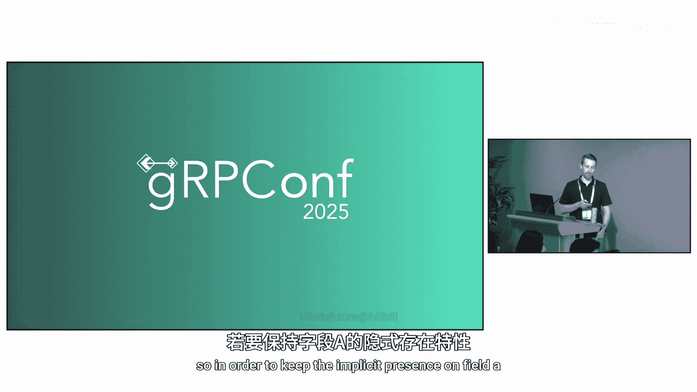
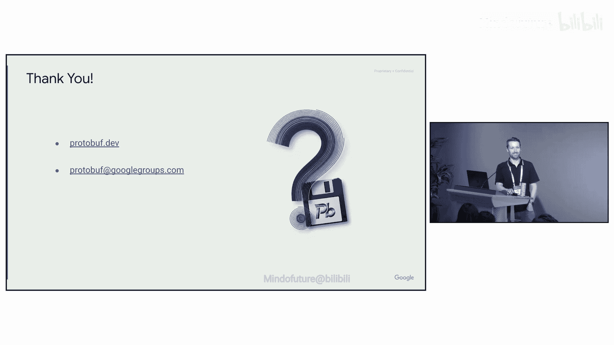

# Grpconf-2025-p07-P07_Protobuf版本--BV1yTHMzKE1U_p7-

Hi， everyone。

My name is Mike Crsll， and I'm on the Proto Buff team at Google。

 And today I'm going to be talking about Protobuff editions。

 which we first previewed here two years ago at this conference。😊，For over two decades。

 Protobuuff has powered countless systems。While it's emphasized evolution of schemas from the start through the use of things like unknown fields and flexible schemas。

Evolution of other aspects has proven a lot more difficult。For example。

 the wire format itself has had almost no changes made to it since Proto 1。

 and these changes are extremely difficult to roll out safely。

This talk is going to be focused entirely on the evolution of the language and APIs。

Which motivated the design of additions。Thank you。While we've been able to evolve our runtime APIs somewhat via breaking changes。

 it's really disruptive， and it's not really scalable to the API's generated four year profiles。

We have been able to make some changes to those by creating ad hoc global options。

 but those tend to just build up over time， and they always keep the bad defaults that we want to remove。

Cluuttertting your schemas。For the Proto language itself。

 there's been two major evolutions in its history。 there was originally a Proto 1 internal to Google before we created Proto 2 and released that to open source in 2008。

We then later created Proto 3 and released that in 2016。

Both of these evolutions were drastic changes to the language where we really had no migration plan in advance。

The migration plan from the migration from Proto 1 to Proto 2， for example。

 was an incredibly painful multiy effort that still is an 100% complete。Proto 3， on the other hand。

 was launched with an explicit goal to not replace Proto 2。

 mostly to avoid the painful migration we had just kind of finished。

And it ended up bifurcating the ecosystem。In creating Proto 3。

We added and removed a bunch of things from the language in a backwards， incompatible way。

For example， field presence was made implicit。Enums were changed to follow open semantics。

 repeated fields were packed by default， strings were made more reliably UTFA validated。

We added maps， JSON and replaced extensions with any， and a lot of these we backported to Proto 2。

But we also made quite a few mistakes in Proto 3， some of which took us years to reverse。

 and a lot of which we still haven't。In 2020， we decided to fundamentally change Proto 3 by putting back the explicit present semantics of Proto 2 using the optional keyword that we had decided to originally remove from the language。

This was notable because it demonstrated that we could make backwards imba changes。

 but it required a significant amount of work to actually land。

 Every protocy plugin now forever needs to advertise whether or not it supports this new feature。

And new files that use Proto3 optional no longer work with older versions of the compiler or plugins that don't advertise that support。

We had a lot of other changes we wanted to make， but we also wanted to be able to improve the language more gradually。

Introducing something heavy handed like Proto 4 and expecting it to be final forever。

Would have just repeated our past mistakes。So our solution to this problem was Protobu editions。

 which was inspired by rust editions。And it's a new framework designed for controlled。

 extensible evolution of both the protouff language and generated code。

Instead of a new monolithic syntax version like Proto4。

 additions are more of a framework for configuring individual language features at a much finer grain level。

They're designed with backwards compatibility in mind。

 so there will always be a migration path from older additions to newer ones。

You can upgrade your photoss to the latest edition to use the newest features。

 but also retain old behaviors when needed， even if they're no longer there to fault。

By pushing the control down to the down to fine grain features。

 this design allows for precise incremental upgrades。

 New profiles can use the latest addition with the latest features and defaults。

While remaining completely compatible with files still on older editions。

Those older files can also be incrementally upgraded on their own schedule by overriding features as needed to restore old behaviors。

Here's an example， migration that shows how a proto3 file can be upgraded to audits without changing any behavior。

We start with a simple proto3 message with two string fields。

One of them has been marked optional so that it has the explicit presence tracking behavior like in Proto 2。

And the other has the implicit presence behavior that Proto3 uses by default。

The main difference between these two things is basically just whether or not we generate hazards for the fields。

In additions on the right， instead of specifying a syntax。

 each profile now explicitly declares its edition， where here we've used our first edition 2023。

This declaration locks in a specific set of default values for every feature on everything in this file。

The default feature。The default field presence behavior in 2023 is explicit， like proto3 optional。

So in order to keep the implicit presence on field A。

 you would need to specify a feature override like we've done here。

Features are specified just like ordinary options。 The main difference is simply that their default values when they're not set can vary between additions。

In an alternative scenario， if you had a proto with a lot of implicit fields。

 you might want to override field presence at the file level specifying a new file wide default。

In this case， you would then specify the feature override on field B to set it back to explicit presence。

This highlights the lexical scoping property of features where。

Any feature overrides will change the default for everything within the containing scope。

 So features set at the file level will override be default value for everything within the file。

 and features set on a message will override the default for everything defined within that message。

This example also demonstrates one of the language changes we made in addition 2023。

The optional keyword was removed from the language， again。

And we restored the proto2 semantics of tracking field presence by default after realizing a bunch of different problems with implicit presence。

Another example of how we can use additions is for API evolution。

This is done using language features where any proto C plugin can manage their own set of features specified in a prototype that follow the same set of rules as the global ones。

 So here on the left， you can see we import CPP features proto。

Which contains our C++ language feature definitions。In our first edition。

 we've released the C++ string type language feature as part of an ongoing optimization effort。

Previously， the accessors generated for string fields would return string references。

 like what's shown here for field B on the right。And this API is actually a little problematic because it forces us to store the field in memory as an actual stood string object。

 and it leaks implementation details and prevents us from doing all kinds of optimizations under the hood。

By opting into the new view feature， these accessors will start returning the more opaque string views。

 like for field A。And it'll give us the freedom to optimize our internal memory representation in the future without actually breaking anyone using this feature。

In our next edition， which I'll discuss in a bit， we flip the default value of this feature to view after an internal migration。

So after upgrading， you would just need to switch where the feature overrides are field A would no longer need an override because the default is now view and field B would need to be overwrittened back to the old string behavior and the result is that you would get the exact same gen code。

The power of the Eds framework comes from being able to explicitly enable or disable individual features within a chosen edition。

 giving you fine grain control over your schemas。While we've picked defaults representing our recommendations and future direction。

Any proto 2 or proto 3 behavior can be represented in additions with the appropriate set of feature overrides。

With Protouff Eds comes a new commitment of stability from us。

Once an addition is officially released， all of its defined behaviors are frozen outside of minor bug fixes。

This means that if you have an Edition 2023 file， its generated code and runtime behavior will remain consistent even as we've released newer versions of protocolto。

This consistency is guaranteed for the entire supported lifetime of that edition。

Any new features or changes to default behaviors will only ever be introduced in new additions。

This puts you， the user firmly in control。 You get to decide when you adopt new capabilities by explicitly updating the addition declaration in your profiles。

Our goal here is to eliminate the fear of unexpected breakages and also the complexity of our protocol releases。

 you can develop with confidence knowing that your protocols will continue to pave as expected without changes as you update to the latest version of protocol。

One thing that might not be obvious here is how Proto 2 and Proto 3 fit into this new framework。

But for all intents and purposes， both of them are now treated as special historical editions themselves。

In fact， our edition ENM has special values for Proto 2 and Proto3。

 and almost all of our internal code treats them just like any other edition now。

They even have their own set of default values specified for every feature。

Just like the explicitly numbered editions， their behaviors will now be completely frozen。

And they will continue to receive long term support。This means that bug fixes。

 performance improvements， and compiler updates will still apply to all of your Proto2 and Proto 3 files。

But the cost of this ability is that you won't be able to use any new features we've released without upgrading to the latest edition。

There won't be any force migrations， though you are absolutely safe to continue using your existing Proto 2 and Proto 3 files for the foreseeable future due to our long term support guarantees。

It is important to be clear， though， that long term support is not the same as eternal support。

 and like any software， very old editions will eventually reach an end of life phase。 However。

 this process will always be transparent。And we are committed to providing clear deprecation policies and ample notice years in advance before any addition reaches its end of life。

We haven't yet set any timelines for deprecating old editions or features， but before we do。

 we will be providing ample tooling and documentation to help you transition off of them。

Since our initial public release， additions have undergone a massive internal rollout at Google。

 This wasn't a small scale test。 It was a full migration across our vast code base。

We have successfully migrated hundreds of thousands of Google's internal profiles to addition 2023。

 and this effort tested and validated the framework in real world high performance scenarios。

Our internal use has ensured that our compiler and the various language runtimes are robust and fully functional under editions。

 and we've ironed out a lot of kins and edge cases throughout this process。

It also reinforces our stability guarantees for the open source community。

This internal migration was carried out using Prototer。

 which is a tool we've developed to programmatically transform protocols。

And while Prototer is currently still internal only。

 we're actively working on getting it into shape for a public release。

With the goal of making future migrations as smooth and automated as possible externally as well。

Compared to the Google3 mono repo， where everything runs at the same version。

The additions framework in open source ecosystems has a few complications。

The main difference comes from the version skew between the various components that need to interact with your profiles。

There's four basic different types of component that need to be considered here。 The first one。

 of course， is the Pro compiler itself。To use any specific edition。

 you'll need a version of Proto C that actually understands what that edition is。For example。

 our first edition was released in Protocy version 27。

And it wouldn't be recognized by earlier versions if you try and give an edition 2023 file to Procy version 26。

 it'll give you an error saying it doesn't understand the syntax。

So when you upgrade your proto to a new edition， it will suddenly have a new minimum version of Proto C that users can actually use to build it with。

There's also the language generators。That generate code for your pros。

Which can either be protocy plugins or the generator is built directly into protocy itself。

These generators all need to explicitly advertise their addition support to protocy。

And if you try and compile a profile with a plugin that doesn't support its edition。

Protoy will then give you a clear error message indicating that you either need to update your plugin or get the owner to add support。

All of the plugins advertise a minimum and maximum edition version that they support。

For both of these types of plugins， protey and the generators。

Users should tend to prefer the latest versions so that they can always build pros from all editions。

On the other hand， proto owners should typically hold off on upgrading to an edition。

Until they're willing to drop support for older releases from before that edition was released。

Our releases generally stay in support for one to two years。

 So staying one or two additions behind to continue working with all supported versions of protobuff。

Would be a reasonable thing to do for pros with a lot of consumers。For example。

Almost all of Google's public APIs are still on Proto 3， for this exact reason。

Related to the generators are their corresponding runtime implementations。

 which usually have coordinated support windows。You can't really expect arbitrarily old versions of the run time to understand future Gen code as changes are made。

 but the specific guarantees may vary by language。For all of our languages that we publish。

 we've specified that we never support Gen code produced with a newer version of the generator than the runtime being built against。

 and we've actually started adding poison pills to enforce this in all of our languages。

So with that policy in place， you can actually be sure that any supported runtime will always know about the addition your proto uses if you were actually able to generate code for it in the first place。

Another issue that can pop up with runtime is if you have old binaries in your system somewhere that have old versions of the runtime and Gen code built into them。

If。You have pros that are used to communicate with those binaries。

 You might be worried that upgrading those pros to a newer edition might break something。

But because additions are designed to be backwards compatible。

 you would typically do this upgrade in a behavior preserving way by setting the appropriate feature overrides。

This means that the upgraded proto would backward would be wire format compatible with the old one。

And any code still running on your system will continue to work just fine with serialized bytes it receives from the newer pro。

The final component to consider is third party tolling。

Any tools that leverage our plugin framework would have to advertise their addition support windows just like the language plugins。

 and they would behave the same。If an unsupported edition is past to these plugins。

 Protecy will report an error。In fact， many of these types of plugins。

 especially the RPC related ones， don't actually care about any of the features we've released so far。

 so adding support may be as easy as simply flipping the right bit to advertise that fact。

The more complicated cases are those tools that parse profiles directly without using any of our libraries。

These will also need to be updated to understand the addition syntax and its features。

 but the failure mode is a lot less predictable because we don't control anything about what they're doing。

We have published documentation for tool owners on how to implement addition support， though。

 so we encourage you to check with project maintainers if you're using any of these tools。Finally。

 we're excited to announce that our second edition。

 2024 is officially released and available as of two weeks ago。

While our first edition was primarily focused on simply unifying Proto 2 and Proto 3。

Addition 2024 actually makes incremental improvements。We kept the changes fairly limited。

 targeting specific user pain points that fall into two basic categories。

The first is language specific changes that only affect a single language。

One example of this is we added a Java feature that allows you to generate larger enums that work around some size limitations in the language。

We also made a few protocy front end changes， which are defined as changes implemented entirely in the protocy binary itself and don't require any changes to language plugins or runtimes。

One example of this is that we added a feature to enforce our naming style guide in pros as you build them with Proto C。

As a result of this scoping， edition 2024 should be a lot easier to implement。

For third party tools that have already added support for additions。

For more information about all of the new features we added。

 you can see our documentation and news announcement on Protouff。 dev。

Thank you very much for your time。 I hope this has shed some light on what we're doing with additions。

Do we have time for questions？Do we have any questions。Yeah。

 how are you planning to navigate this with me？Like that。How the Pro for？I can ask again。

 how are you planning to manage this with manage mode for Buff for Code Gen because that like pulls a lot of options out into Buff Gen Yaml。

 and it looks like this is pushing a lot of things into the actual proto。

I'm not actually familiar with manage mode from。Am。We can talk after I'm curious about that。

All right。Given out that you have addition of the prototype， like how it deleted to the GRPC。

 because it generated from the pro C itself。Sorry what was that So what is related to the GRPC generator like when you generate on the proto C right so yeah the addition is like related to the GRPC when you release a new edition Yeah so GRPC is implemented as a protocy plugin so it also has to advertise what additions it supports but they're all tied together so you mean tie together when you announce like the new feature it is it gonna go to the protocol but therefore its just have separate channel to check on the GRPC like when we see the new feature GRPC could introduce their own features but for the global features GRPC would have to respect those also。

But at the moment， they're one of those plugins that don't actually care about any of the features we've released。

So that's mean we need to see on separate part， like the on the edition of the photograph and also something on the GPC when we consider using the addition。

Sorry， I'm not following that。 So let's say like So something new on the GPC， right。

 How can we know that， like we use the specific feature on the GPC and it not conflict with the addition on the port above。

What feature on GRP， Let's say like So I'm not quite sure be to be like the addition of the Port right。

 and also the GRP。 So let's say you have 20 to24 of the Port like So it does something new on the GRPC that we can leverage。

 And then we need to be careful like on top of that。Am。Yeah， I so that that。

So the addition only controls protouff features， and GRPC could leverage that。

 but they're not at the moment。 So the addition doesn't control anything。

That GRPC is doing at the moment。Okay。Thank you。Do you have any plans to build a language specific API for protoy for the proto compiler instead of just utilizing the the binary？

A language specific API。Yeah， like currently if you want to compile a protobuff。

 you use the Protey compiler right， you have to install the binary。

 are there any plans to bring that capability into any specific language as a library that you can。

Builded as code。I see， so。You mean you want to be able to。Build produces。

As a library instead of running by。So we do have dynamic messages in many languages。

 which can do something similar， but they generally can't generate code。

Are you looking to also generate code？Well， just basically how procy operates， but you know。

Utilizing more of it in code rather than just the binary so for example。

 in our company we have were adopting more to be a polyglot。

And so we want to standardize protobuffs across different languages and how we use it internally。

 at least for Java， right， we have this protobuff and we build out this model and that we can consume it as dependencies for multiple different applications。

 but if we're dobbling and go and rust in other things， how can we。

What are the tools around being able to build those different models as libraries that those particular libraries can consume just from one protobuff Yeah。

 our general recommendation is to use protey as a parser。

 output it as a file descriptor proto and then you can build that dynamically in all the languages separately using dynamic messages？

Okay， and we're out of time。

