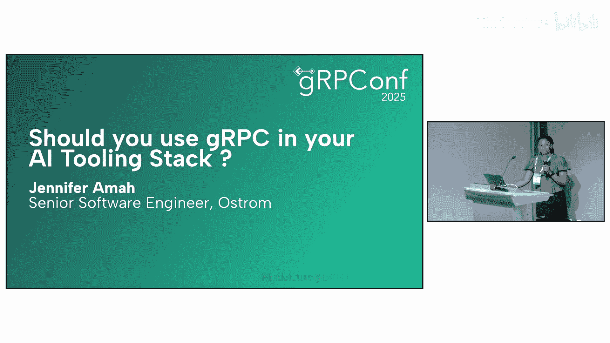
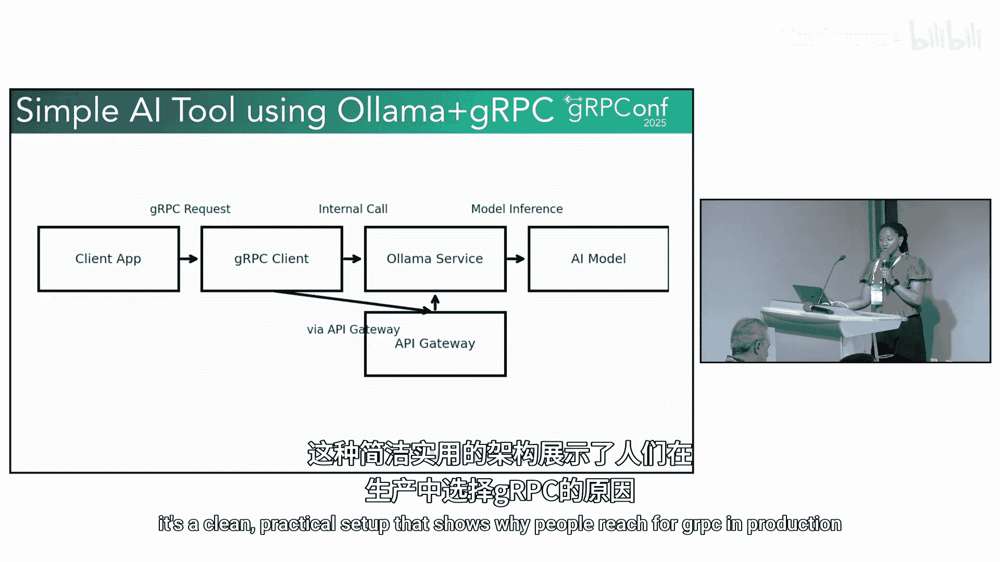
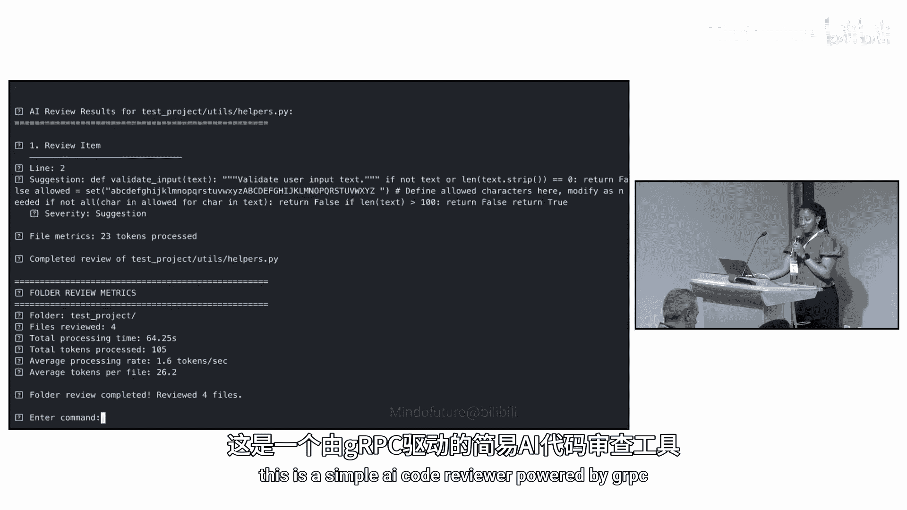
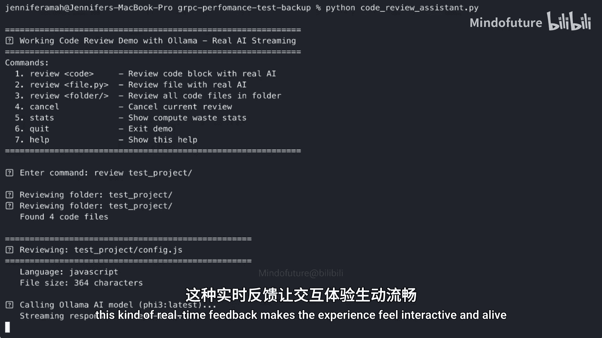
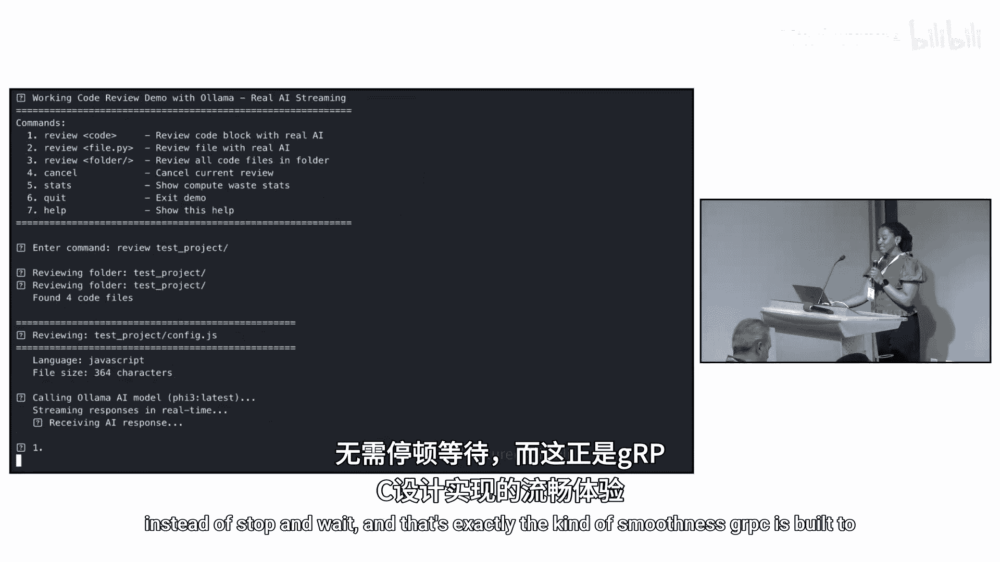
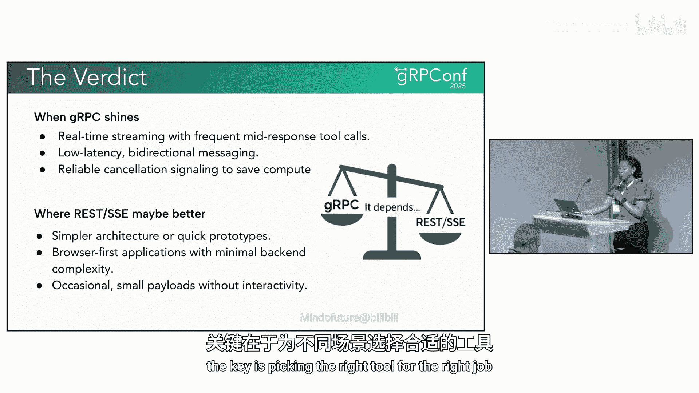
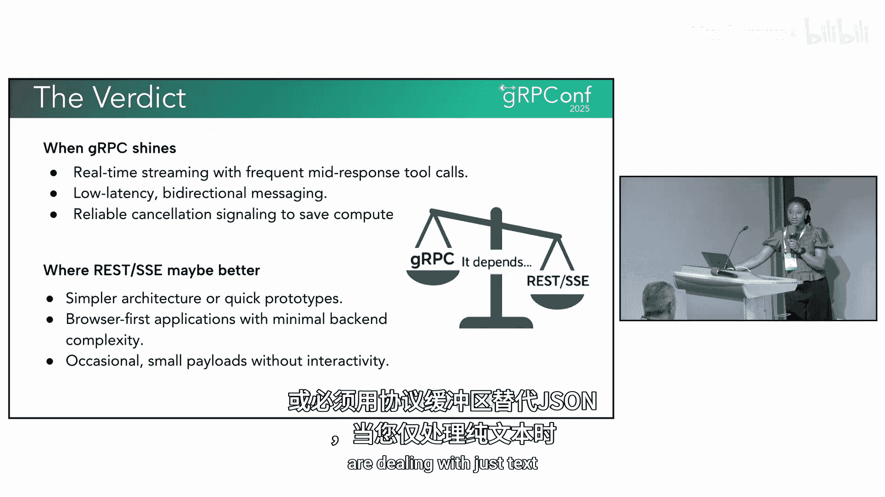

# Grpconf-2025-p08-P08_您的AI工具栈中是否应该使用gRPC--BV1yTHMzKE1U_p8-

Good morning， everyone。 My name is Jennifer Am。

I work as a senior software engineer for a green energy company based in Germany。

Today we're going to talk about an interesting topic in the AI space。

And it's about if you should use geographyy in your AI to stock。Over the last couple of years。

 AI has exploded， we've moved from building models in notebooks to building products that people rely on every single day。

And with that shift。Something becomes very obvious。 People don't just care what the AI says。

They care how it feels。If it lags。If it cancels slowly， then the magic is gone。

And that is where the question comes in。Should we be using J PC to build these AI systems。

For some people， geographyies is already the default。But for most。

It's like， an unnecessary complicity。So in this talk， I want to unpack that with you。

We look at J PC those， the problems that it solves， the trade offs that it brings。 And finally。

 when it's actually the best tool for your stock。😊，So what is Jroy？

Ger PC as its core is just a framework that lets services talk to each other。

But the way it does it makes it really fast。Instead of using JC， it uses protocol buffers。

 which are much more smaller and more efficient。And because it's built on H T， T P 2。

 you get things like streaming in both directions。And handling multiple calls at once。

The simplest way I' like to explain this is this rest is like sending a letter through the mail。

1 message， one reply。Geroic is like being on a live call。

Where both sides can speak and listen at the same time。So what does it matter for AI。

Over the last years， JPC has moved from research labs to large language models， multimodal systems。

 imageary editors， and many more。😊，They are not just research projects anymore。

 They are powering products people use every day。And with that， expectations have changed。

People don't want to wait。People want answers instantly streamed as they are being generated。

That's where Ge comes in。 It's fast。 It handles streaming really well and it scales across multiple core。

😊，That's why it's become the good tool tools for team serving AI models at large。

This chart shows gey maintains constant， low latency performance。

As the number of AI models and concurrent calls scale up， making it for real time AI workloads。

When you look under the hood of every AI tool。There are a few common stages。

A user sends some inputute， maybe text， voice， even images。

 The model processes it and generates the response。

Sometimes it has to call an external API or a database mainstreamstream to fetch extra information。

Meanwhile， streaming resource back to the user as they see progress as it happens。And finally。

 a user gives feedback or even cancels midwe。😊，Each of these stages we just looked at has its own pain point。

Qut are brutal。That first request takes ages because the model has to spin up。

Then there's talkingken latency。 We the model just tricks text lower， and anyone has patience for。

2 calls meet response can be sluggish and break the flu。Streaming isn't always reliable。

 so the user could catch their staring at a frozen screen。

And maybe the most frustrating when a user hits cancels。The system keeps chewing out compute away。

 That wastes resources and money。If you've ever used an AI tool and felt like it was slow and all responsive。

 chances are one of these problems was to blame。Now。For each of these problems。

 there are possible solutions for them。For cold start delays。You can warm start the model。

 So the first request doesn't seem like you're waiting for water to boil。

Another is efficient token streaming where you send each token the moment it's ready。

 so responses feel are。Then there's bidirectional tool calls。

 instead of stopping the AI to make an API call， you can handle it on the same channel without round tips。

And finally， instant cancellation， which means the moment the user steps out。

 the system actually stops。😊，These aren't abstract ideas。

 They make the difference between a clunky AI demo and products people actually enjoy using。😊。

There are two critical movement。In air interaction， where performance really matter。

The first is when the AI needs to call it two mid response。Even it small delay。They can make。

 They can make the conversation feel broken。With J PCC， you get a single bidirectional stream。

 so responses can flow back instantly without waiting for a whole new connection。😊。

The second is cancellation。When a user decides to stop， you want everything to shut down immediately。

Otherwise， you're wasting computer time and bond money。

Grup has built in support for consollation that's fast and reliable。

 Those two things alone can completely change the experience， especially at scale。😊。

Here is a simple example。Imagine it client up talking to a J PCC client。

 which calls an Obamaama service that runs the AI model。

Everything can go through an API getsway to manage traffic。

 The nice part is that GPC keeps the flu efficient。 Res and responses travel on the same stream。

 so you don't need extra overhead。 It's a clean， practical setups that shows why people reach for JPC in production。

😊。

This is a simple AI code review power by JOPC。

What I want you to pay attention to is how the feedback doesn't just appear all at once at the end is that the suggestions are streaming in as they are being generated。

That means while the model is still thinking， the user is already seeing useful hints about their code。

This kind of real time feedback makes the experience feel interactive and alive instead of stop and wait。

😊。

And that's exactly the kind of smoothness J PC C is built to deliver。

But， let's be real。Grupy isn't perfect。Setting it up takes more work。You need profiles。

 call generation， and extra toolin。Which can be is。

 can be a lot for a small team or quick prototypes。Browsers don't support it natively， so。

If your product is browser heavy。You need a jy web proxy。Which adds more moving partss。

 debugging is also harder compared to plain HTTP。And messages aren't human readable。

 So you will need an external2 to do that。And honestly。

 if your too only makes  occasional J requests。Gerrup PC can be an overkill。

So when does this make sense。G absolutely shines when your streaming responses in real time。😊。

Making frequent meet response to calls。When cancellation needs to happen instantly。

That's the sweet spot。On the other hand， if you're building something simpler。

 maybe a prototype or a browser fist up or a system that only makes occasional lightweight callss。

Rest are often in better fit。It doesn't have to be either or G R or either rest or G R PC。

It can be a mix of both。You can use rest where it's simple and bring in J PC。

 where performance really matters。The key is picking the right tool for the right job。

And thank you for listening。 The goal， the goal here is not to convince you that。

Grup is always the answer， because。It's not。But to give a clear framework of when it actually pays off。

I would like to hear your own experiences。 Have you used g C in your AI stock。

 How was it and what was the experience。Any questions on that？No question。Thank you。Hi。

 my name is Iger。 do we have like any data show an improvement when transitioning from Json rest protocol to J PCC like any cases that you looked at。

 So we come in。So any data from the real life。Project。

 what is improvement when transitioning like by how much latency was reduced。Et cetera， et cetera。

 Yeah， so for Latin C， it takes a lower time。 I can give it in figures， but when you use。

When you use Jason。It actually takes a longer time to return the response compared to when you use G R PC with protocol buffers。

 But then there's a side to this because it is not necessary to use G R PC or it' is not necessary to use the protocol buffers instead of using Json when you are dealing with just。

With just text， I think the difference in laency is is significant when you are dealing with J objects。

 we are dealing with J instead of where you are dealing with text。😊。

So I would say that you would， it doesn't really make sense to use GRO PC when the data that you're expectinging are mostly are mostly text。

 but it's better to use it when they are J。Not sure if that answered your question。あしかと。

A specific number。Because I would also expect for text。His compression with Kiquino。Yeah。

There's there's a difference， but the difference happens when it's on at scale。

 So when you're dealing with large data over time， you see the difference。

 But definitely when you use protocol buffers， it is much more faster than when you're dealing with Jason。

嗯。😊，Thank you。Any questions。嗯哼。So I'm curious when you listed out the downsides of GRPC。

 which one would have kind of the biggest positive impact if it were addressed。Okay。嗯。

Could you mention one of the downsides So I think you had limited browser support debugging overhead and being overkill for simple apps。

 Yeah， so I would say the browser side would have more impact。

 The reason is that with the browser you might not experience as much performance that G PC has to offer if you're using the G PC web proxy。

 but。Aside that if you're using GROPC without the web， it is much more faster。

 so the browser side definitely has more downside。 So if your app is browser heavy。

 if it's something that maybe is a browser first app and on the surface。

 you don't want to use GROPC there。 but then like I mentioned the Vedex， it can be a mix of boot。

 you can decide to use rest from the browser side and then introduce GOPC where you really need to focus on performance。

Yeah， please。Soone's asking about latency number of comparisons， there's a lot of data online。

 but the comparison is that。嗯。GRPC is about 7 to 10 times faster at scale than doing a rest call， so。

Is that a question always I was just trying to provide okay， information to earlier question Okay so。

That's why。Jason here。Yeah， if you're comparing systems that are using rest， JSON。大。Yeah。

 server to server。一。Okay。😔，So I was actually expectinging a question about， okay， you can go on。嗯哼。😊。

Be the right use case。 So I just w to understand like when would you like are there cases where you should be using GRPC when your app is on a browser needs to be served on a browser or you just don't recommend using GRP there。

 so I wouldn't recommend using it if your app is browser heavy because it just more compity。

 you have to use proxy， which is not as fast as when you are not using proxy but also you can use both of them and scenarios where you want to use G PC where performance is very important and you want to make mid response call So you're calling the model you want to reach out to an API you want to use G PC in cases。

 because of the bidirectional streaming opportunity for So that way you just have one open connection and that makes it better。

 But then yeah， you can use PC on the browser if you want I mean。It's like an ova。

 It's over engineer at some point。 But it's better to just introduce the both of them。

 but will it degrade the performance。 it would not be as fast as if it weren't on the web。

 I think the web makes it a little bit slower。 I don't have the figures to back that off。

 but using Jy web proxy。Would not give you the speed that's using jy without the web doors， yeah。

Okay， so。I was expectinging a question about web sockets because I spoke more on streaming。

 and there's always this debate about streaming like， oh。

 why not use Web soet Web socket can do that， you know， and。

As much as web socket can also handle streaming。 I think there are some special cases where it has J PCC has power over it because if you mention web socket that oh Web socket does streaming。

 J Why would I use J using web socket。 But when it comes to cancellation。

 I think J PCC has like built in features for cancellation that makes it faster。😊。

Unlike when you're using Web socket， I think you still have to do more logic on that in order to cancel quickly。

 And constant computinging is very， very important because if you don't cancel well。

 when the user decides to end the call， there could still be some background processes going on。

So it's very important to have something that helps you cancel quickly。Any more questions。

 no questions， no questions， no debates。But how many of us I use G PC here。Okay。

How many info have used the j web proxy。K嗯。What do we think about the experience。So。あニュースケース。

It's just for connecting。An existing application to use the GRPC interface。

 So latency is not that much of an issue。So， yeah， we chose to use DRPC on our embedded system。

 but there were existing web interfaces。And so we use the GRPC gateway， were proxy。Okay。So。

 but do do you feel it's complicated using is' just something you just add to it。No。

 it's not like because you don't have to change the gateway for every A that you add。 It's automatic。

 So it was easy to set up。 Okay， cool， nice to know。Has everyone used G PC to build an EI tool here。

Okay， what was your experience？ Yeah， you have a question。Youre just， okay。

 what was your experience in terms of streaming， How did it work。

Do you think it was better using J PCC。I can share our exc so。We are doing server site streaming。

We're doing server sight streaming。 The server is a Python GRPC server。

 and it's streaming server to another backend， basically the backend for the front end。

 The back end is doing a proxy on proxy and front end is consuming directly GRPC sts。

 So it's actually using GRPC in in terms of server side streaming。

And latency wise other than the LLM responses。 So the latency of the LLM itself， it's。

Comparably better than rest， I would say， So technically， we can do SC as well， right。

 So server will stream events to the backend of the front end server。

 and that backend can do SC to the front end。Only to broadcast events to the client。

 This is not going to be bidirectional， but it works really well for us。

 but we did not pick up the SSE pattern。 Okay， We just deployed a envoy proxy。

 which is proxy all the requests directly to the client and back and forth， right。

So that's the experience so far I don't think we have run into any major hurdles yet。

 but it's only deployed to a very limited number of users， so when we will ramp it to more users。

 I guess we'll observe more data and patterns。Kong。Thank you。Yeah， please。

So do you know if there are any managed LLM services just like Chamini or OpenI。

 which are like moving towards providing a GRPC interface？In， in addition to the rest API， No。

 no we have this。Thank you。 I think someone must answer that。

Qu question in I regard to cancellation signal。 I don't have to do anything as software engineer it's in SDDK or J PCC Yes。

 that gives like more stable connection comparing to web sockets， right yes。So for G PCC。

 I think each of the languages， they have their own pattern of calling the me to cancel。

 So we just cancel immediately other than for example。

 web showcasecase where you need to do some astr logic to make get that done。嗯哼。😊。

And that you receiving a cancellation request。A you。

 we're saying that the server doesn't have to be like polling for that or or like。

Identifying when that happensca at least my assumption would be like the server want to know like at a specific point。

 you might be able to cancel versus what can when it cannot。

 So you're saying the server doesn't do any sort of that logic。 It's just automatic。

When you talk about the server， are you talking about when you try to cancel from J PCC。

So if we have a client calling a GRPC server and so the client initiates a cancel request yes are we saying that the server doesn't have to have any logic to listen for that or respond to that it's just automatic in the framework Yes。

 so JRPC handles that for you so when the client cancels the request。Behind the scene。

 you call the function to cancel it， but it was it immediately。 So if youre not。

 if you don't have an extra if there isn't something like， for example。

 web or heads or maybe just rest， isn't a rest architecture。

 when the client cancels in the background， the AI will still be running。

Because you already made a request to go to the model。

 So the model will still be running in the background。 So this is like spend the money。

 You don't even need。 use already canceled， like， just waste compute time， like。

Like a follow up to that so if that's if that's happening automatically， what might happen。

 let's say a backend request has multiple steps， maybe the first step make some like update and then a second step may makes another update and there's a cancel in between those if the server doesn't have to have any logic for that。

 how would like the first step get rolled back in that example if it gets canceled between the first and the second goal。

Are you talking in within a single connection。Like this first call and second call L are playing in the same connection。

 right， right， so like let's say the back end API and it's getting like two update calls， right？Okay。

 so if you're streaming and this is happening in one open connection I you cancel。

 it cancels automatically。hy is it okay， okay。Okay。I， I。

 I don't think it would work in this case if you're making two different requests and then you cancel。

 I think it only cancel the one that you canceled。Yeah， but I mean。Okay。嗯。

So I think the reality is you need server or it from slightly shocking it's not free， of course。

 that like。It's as simple as handling cancellation talking gets you have cancel talking youre watching it's canceled。

 then it's up to you what to do。 Of course， it doesn't cancel hands up。You can。At least do you know。

 as a developer that。other and。Cancel。 Yeah， it's like preemptive multitking。 You need to look for。

 oh， am I being cancel。 have to Okay， I stop working now， but it's not。

There is no server side developers have to work it just does for you to make more efficient I think you need to handle the events on the server side and rule that right but it was the same story as website years ago right you should send a message you need to look for it in the stream if you get it connected then on disconnected events that if you handle on the server side there's also on cancelation so you need to write your code on cancel vision and start ruling back your database commit I think that's what you were talking。

Okay， I hope your question was answered。Okay。If we don't have any more questions。

I think thatll be it。 Thank you and everyone for listening and see you。

