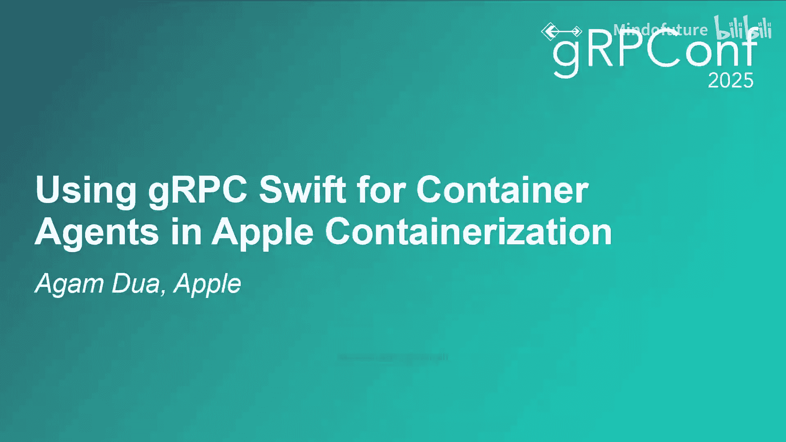
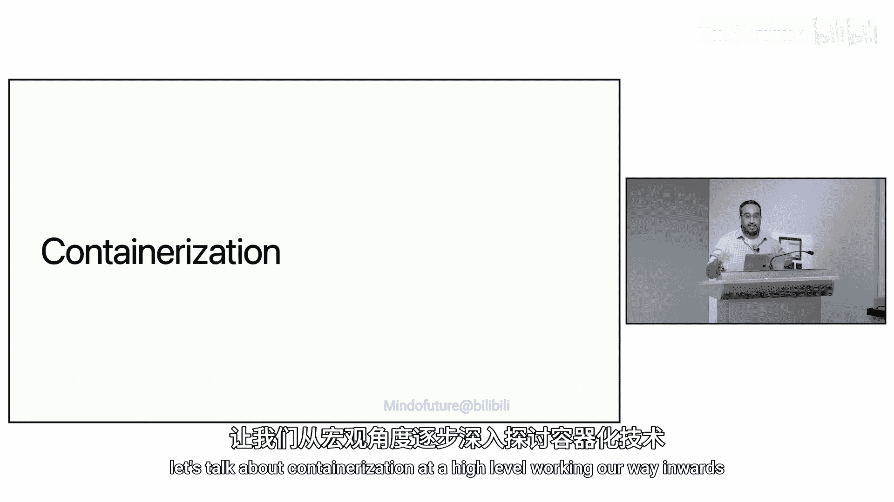
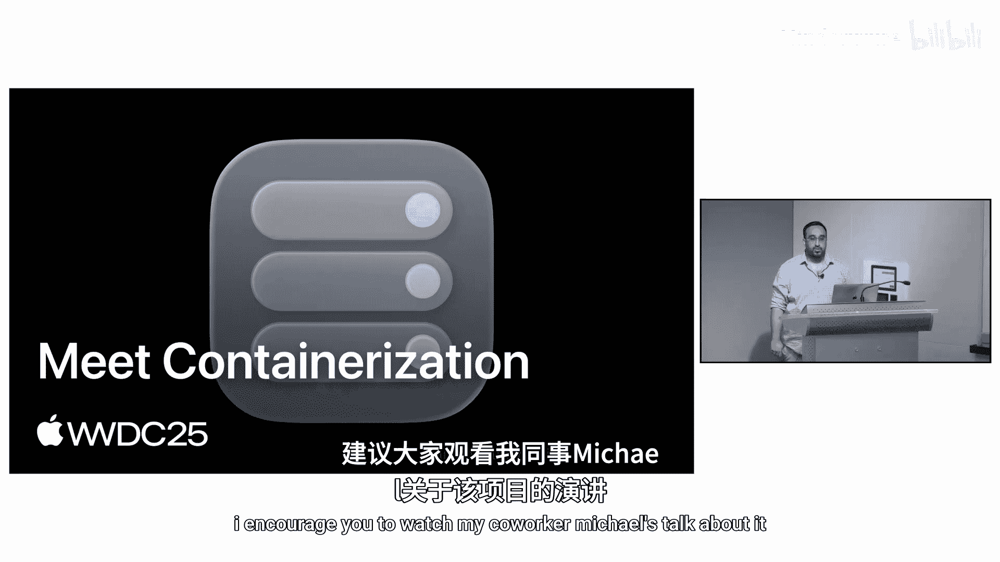
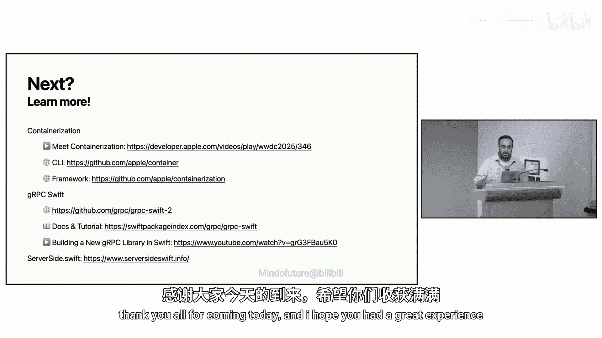

# Grpconf-2025-p09-P09_在Apple容器化中使用gRPC_Swift实现容器代理--BV1yTHMzKE1U_p9-

My name is Aga， and I'm a software engineer on the Swift server team at Apple。

Over the past few years， I've worked on the containerization project and also a Sw NTP library。

 both which can be found at Github。com/apple。Today。

 we're going to talk about how we used GRPC Swift in the containerization framework。

So every time you start a container with containerization framework， for example。

 when you run container run Hello World， we spin up a GRPC server which helps us orchestrate all our runtime configuration for starting up a container。

 and that's what we're going to dive into today。So we're going to talk about what the containerization framework helps us achieve。

How we use an agent with a GRPC server running in a containerization container to orchestrate the runtime configuration？

Spoiler， it's definitely a success story。And after that。

 we'll wrap up with what the experience looks like in Swift and GRPC。

So to see how our GRPC server works as a container agent。

 let's talk about containerization at a high level working our way inwards。

We released the containerization project at WW DC earlier this year。

 I encourage you to watch my coworker， Michael's talk about it。

We also released this as open source on GitHub and would absolutely love contributions if you're interested。

So what does this project do？Containerization enables applications to use Linux containers。

One thing that's unique about how we do it is that each container is expressed as a lightweight virtual machine。

 providing isolation benefits that help with security and privacy。😊。

So let's now unpack what containers are， and in the process。

 let's also understand containers as lightweight virtual machines a bit more so that we can build up to the GRPC server that is used to configure a virtual machine as an actual container。

So stepping back a bit， what is a container， let's take an example of a serverside application。

 So a container is a single unit to run a set of packaged application。

 which could be a Linux serverside application and its dependencies。

 So typically these are packaged into a single image that you can specify to run with the right tools。

For example， if the serverside application is called Hello World。

 it's built as a binary and has OS dependencies that I need installed。

 that application and its dependencies can be packaged into that image。

Once I have that image for Hello world， I can ensure that I have the open source container CLI installed on my MacBook and run a container with the command container run Hello world。

That will run the Hello world image that I just packaged and assign an IP address for it so that it's network addressable on my local machine。

Let's say the hellello world application I package is a simple H TP server running on port 80。 Also。

 I know it could totally have been a GRPC example， but anyway。

Once I have that container running with the server。

 I'll be able to curl with the IP address of the container on port 80 to get a 200 OK response。

So from a user's perspective， all you have to do is container run and you're off to the races。Now。

 if we think about how we got here， AKA， the actual implementation of a container runtime。

 there's a lot of ways to do that。In containerization specifically。

 we took the approach of leveraging virtualization as a concept。Specifically。

 we leverage the virtualization framework to execute each Linux container inside of its own lightweight virtual machine。

To learn more about the virtualization framework， there's great docs on developer。apple。com on it。😊。

But to run container run Hello world， as I did in the previous slide。

 we need to use this framework to spin up the lightweight virtual machine that then starts the server。

Peaing the onion further， How does the virtual machine know to actually start the server process。

That among managing other runtime configurations， is what our container agent does。

That agent is in init process that we call VM in it D or virtual machine in it demon。

We'll dig into it a bit more later， but this is the process that hosts the G PC server that we use to communicate。

Let's take a look holistically at the containerization architecture to see where and how that actually happens。

😊，So our container running as a lightweight virtual machine is shown on one half of the side。

In the containerization framework， we need a client to actually start this container that we've been discussing。

That client is represented on the other half。As an example。

 it could be the open source container CLI that we just spoke about or something you write yourself leveraging the containerization framework。

Either way， to leverage the virtualization framework dependency。

 this client will run on Mac OS to create and run our container。

The client now has to communicate the startup needs to VMmin it D。 For example。

 what process should it run， Do we want to run Hello world， Do we want to run Postgres， If so。

 how do we actually run Postgres。To understand that connection that our GRPC server will leverage。

 let's take a look at some code from the project to create a Linux container。

 we'll even touch on some virtualization framework bits so we understand how we're crossing the virtualization boundary with GRPC。

We're using Swift for the container runtime here， which will look familiar in some regards。

 but I'll try to add some commentary anyway。Looking at basically a cliff's notes of the code in containerization at the very outset。

 we have Linux container， which conforms to a container protocol for those new to Swift。

 a protocol is very similar to an interface in other languages。

To be able to define a Linux container in our code。

 we need some configurations so the container knows what it looks like。

And then we can finally create the underlying containers VM。

 You'll notice an async throws here in the function signature。😊，Briefly。

 that's a way in Swift to handle aync programming and error handling。

 and we'll talk more about that later。For now， let's take a look at some of the virtualization code that helps actually create a container。

 This is really important because this defines how the GRPC server communicates across the virtualized host boundary。

So first， we're going to import the virtualization framework to define an initial configuration for the virtual machine。

That is going to eventually become our container。You'll notice a prefix of VZ in front of anything that's imported from the virtualization framework。

 For example， here to define the configuration， we have ViZ virtual machine configuration。

Then we can provide some resources to it。 We need the V M to be of a certain size。

 I provided count of a CPU count of 4 and a memory size of 1024 megs as an example。

These can easily be tweaked according to your project and hardware configurations。 In fact。

 when you're spinning up a container on your own， when you do a container run with the CLI or even directly in containerization。

 you can tweak these values yourself and customize that。Now。

 this line is the most important for today's talk。 We want to think about how to communicate across the virtualized host boundary so that the host is able to send RPC calls to the guest。

The virtualization framework allows us to expose a verdiio socket device。

Which is a device that manages port based connections between the host and the guest。

Since we have a GRPC server running on the guest via minute D。

 and we want to leverage it to set up the dynamic runtime configurations on startup。

 we need that communication channel to send the requests we need over GRPC。

Now that we're done with a minimal set of config for the purposes of this talk。

 we can instantiate a virtual machine with the configuration we defined。

I say minimal because this snippet gives us a pretty good idea for the talk today。 Of course。

 there's a lot more power in the virtualization framework that you can leverage outside of this context。

Now， let's bring this back to the architecture diagram to fully understand our cross platform use of GRPC and VO to set up the communication channel that we need。

Let's dive into more details about the actual container agent that leverages GRPC or Vm Min D。

 so what does Vmmin D actually do at a high level， it helps set up all runtime configuration we need to set up an execution environment on the virtual machine to behave as a container。

It's important to note that these are pretty low level operations that are orchestrated over multiple RPC calls。

Typically， I've seen GPC be used more in distributed system settings。

 maybe to call on another service that interacts with a database behind a load balancer or in other container runtime to interact between the client and the demon。

 we had some examples shown to us today before in the keynote as well。But in this case。

 it's a bit more unique to have the communication across the virtualized host boundary。

 So let's take a look specifically at whatveheminent D helps with and go over some of the features。

One of my favorite examples is the mount and Unmount calls。

 which can be leveraged in a few different ways。 You can leverage mounts to mount a file system onto a container。

 And one really cool use of this is when you want to mount run X 86 workloads on Apple Sil inside a Linux container。

 So the mount call gets used for Rosetta emulation configuration on the Linux container that you're running。

 And this is pretty powerful to be able to run images that are not built for multiple architectures to still work well on your Apple silicon machines。

😊，There's also a networking layer， for example， for IP address management。

 we have some logic that brings interfaces up and down and configure specific routes that we want。

This uses our netlink code that we wrote in Swift underneath。

The process supervision will start the process that you specified or run。 For example。

 if you want to do a container run Postgres like we talked about。

 it'll make sure that Postgres is actually started correctly。 In fact。

 we're going to look into some code for this later on in the talk。 But when you do a container stop。

 it'll also ensure to reap child processes。 So it's kind of a cool init demon that does a bunch of different things at a low level。

😊，And all of this is orchestrated over GRPC API calls。

 so let's learn more about how GRPC and GRPC Swift helped us achieve this。

GOPC Swift is a great open source library to use for leveraging GRPC and Swift。

 You may have heard about it before。 My coworker George gave a talk last year at this very conference。

😊，We've been using this for a bit and are quite happy with it。 And to be honest。

 it's the core of our success story that we're talking about today。😊。

Because we're crossing host boundaries， we need it to be super performant。

 so you want your container to start up super quick， for example。

 if you want your Hello world application or the Postgres container to serve traffic。

 you want that to happen as soon as possible。Secondly， a lot of us had used GRPC。In the past。

 so it's natural for us to look for this same stable。

 awesome tooling to just work in the Swt ecosystem。😊，Some of us might consider it boring。

 but boring tech like this is kind of amazing。 We could build without worrying about the low level bits。

 And for this GRPC absolutely delivered。😊，It also works great in the data center。

 which we talked about a little bit， but one thing that I learned is it works great on a local machine to cross the virtualization boundaries as well。

Lastly， the tooling also helped us to think about versioning and iteration from the get go。

So when we're talking about versioning， you can see the code excerpt from the project that we're now on version 3。

 That means we've iterated twice already。 But even before we had to completely break versioning completely。

Protobuts were great to evolve over time。We were able to evolve our types from V1 to V2 and even V2 to V3 in some cases。

 in our protouffs by adding fields that clients wouldn't use right away。😊，Also。

 features like optional fields help for use cases where we want a bit of extra configuration occasionally。

Here on the screen， you can see we're using a create process request message as an example。

This provides everything that we need to provide via aminity to configure a process for us on the container。

Immediately， we can see how it's used with the GRPC server with the request and its matching response。

One awesome thing that I don't need to sell GRPC confn is the generated code for the server and the client making it easy to have both these generated straight away and useful in our code。

And this is the corresponding client that we can look at。

 you can see the fields from the proto aboveuff reflecting here in the outer function。

 and internally we call the generated client with the create process request as try0ate client create process。

Another thing that's great with GRP Swift is how well the library has adopted the Swift runtime concurrency concepts。

 So when dealing with clients and servers， Acync programming is a regular activity。😊。

It's also important to acknowledge that writing asyN code without tooling or without language features can be verbose。

 complex， and in some cases even incorrect。Swiifft has async away keywords which were introduced a couple of years ago that could really help with this。

 Let's take an example with some code。Specifically。

 let's take a look at a simple GRPC request that we use in containerization。

 starting with the request and the response messages。When a container starts up。

 we want to ensure that the right process starts up with it， like we've talked about。

Over the last few slides， you've already seen how this process is created。

 This now talks about how we start the created process。 For example。

 if you're doing a container run Postgres， we want to make sure that Postgres actually is starting up with the arguments that you want the way you want on the right port。

 et cetera。The start process request， as you can see。

 takes an ID of the process that we've created and the container I that we want to start it on。

The response gives us back the pit of the process once it's been started inside the container。

The RPC call simply takes the start process request and returns the start process response we just talked about to see how this all works in action。

 let's take a look at some other code。When the container agent VMmin D is actually called to start the process。

 we try await the call The try here works well for error handling and the weight ensures while the code is written in a linear format。

 it's still asyN code that we can reason about。It's interesting to note that this is also propagated up the function call stack。

This shows the enclosing start function that has aync throws in its signature that correspond to the trial or weight in reverse order。

 of course。So if we look at the last few sections altogether。

 we can construct a simplified view of what it takes to start a Linux process in a lightweight virtual machine。

Within the containerization project， leveraging GRPC as our communication channel。Now。

 I've touched on this earlier a little bit， but it was a learning for me that it's easy to use G PCC with Swift for systems。

 That's not really how I thought about G PCC or even Swift before we started some experimenting。

In fact， when we were prototyping in the early days， VMmin a D was written in go。

 and having the GRPC interfaces allowed us to evolve the rest of the project before we decided on simplifying the stack to use one language。

Uifying on one language to simplify the stack helped the developer experience a lot while maintaining a great user experience。

 So I'm really glad we made that move from a developer standpoint。😊。

So reviewing some of the code that helped us on the GRPC Swift for system side。

 when we want to connect from the host to the guest， we instantiate a client for VM minute D。

And GRPC is very flexible on how to create instantiate the connection with a remote peer。

 It doesn't just require the host and port to bullet。 So in our case。

 when we want to connect the virtual machine over Vsock。

 we just pass the file handle that we get from the virtualization framework。

 and we're pretty much ready to go。😊，On the server side that's running inside the Linux container。

 a GRPC server also would have a way to use the VO connection natively with the context ID and port。

 and overall it's a win win on the connection front。

So Swift turned out to be a really great language to use for container runtime。

 which is a bit surprising to me as well when we started the project。😊。

Swiifft is a modern general purpose language that's expressive， safe and fast。

 It was also a joy to work with。 I've been using it for multiple systems and server use cases over the last couple of years and have been pleasantly surprised with how well it works。

😊，There's also a really great C in Iraq Rock， which works well for the kind of projects I work on。

And for our use case， we also wanted to leverage a framework with the native Swift binding。

 So it really helped to do it in the same programming language。

 But the fact that its cross platform really helps as well as we do have those Macos and Linux bits。

 In fact， we actually cross compiler our Linux bits like via a Min D on Macs。

 which is a great convenience。 again， from a developer experience point of view。😊。

So what were some takeaways from our success story today？

The containerization architecture with the container agent and G PCC。

Enabled us to perform the runtime configurations to get the execution environment up and running。

The GRPC communication channel over a VO connection worked great for our use case to send those RPCs over the virtualized host boundary。

And GRPC worked great with Swift， a programming language I've come to like。

Even though we've built only a simplified view of the amenities's process management capabilities in today's presentation with the create process and start process communication。

 GRPC Swift worked very well for versiononing， cogeneration and Swifts async features。

So where do you go next from here， try out containers， watch the talk。

 download and install the CLI to run your own container。

 or even write your own client with the framework。For GRP。

 star in Fork the Repo work through the super quick tutorial and watch George's talk from last year。

 George and I will both be at Serverside Swift conference in London in October。

 where he'll be talking about GRPC Swift。 And I'll be teaching a workshop on how to get an H T TP server working with databases。

 using Swift as a serverside programming language。 So join us in London on October 1。

 Thank you all for coming today。 And I hope you had a great experience。😊。

