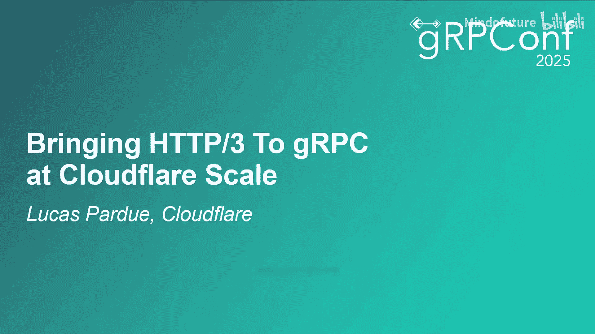
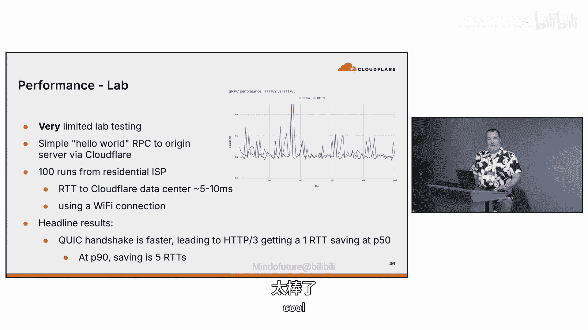

# Grpconf-2025-p10-P10_在Cloudflare规模下将HTTP_3引入gRPC--BV1yTHMzKE1U_p10-

I'm Lucas， I'm a protocols engineer at Cloudflare based out of London。

 I've flown over to Sunny Sunny Rail to talk to you today about bringing H3 to GRPC at Cloudflare scale。

 It's a bit of a clickba title really this talk is gonna be about kind of the journey and the timeline various Internet standards GRPC is protocol itself。

 the time I've worked that Cloudfl have contributed。

 A lot of this is not just representative of the engineers and the product folks at Cloudflare。

 also the Internet ecosystems So developers lots and lots of people。

 So don't take anything I say as the truth necessarily。

 it's a reflection on my reflections on that time。 start a little bit about me。

 I'm new to the GRP community。 I'm so excited to be here today to be able to see people meet them。

 I really would love to chat lunchtime or after any of the topics in this talk grab your attention or inspire with new ideas or you've got issues or things that youve maybe seen the protocol level like wait。

😊。

Not really the application layer。 I'm a protocol nerd。

 I've been working on this stuff for like a decade。

 It's kind of a summary of some of my experiences building these kinds of technologies。So， yeah。

 that's all I want to say。 the team I work on is responsible for the ingress CN Cloudflare。

 I'll go into a little bit about what Cloudflare is。

 If you're not familiar with these kinds of companies。

 but I really want to focus on the protocol level stuff。

 In addition to my day job at Cloudflare and the culture of the Quick working group。

 So touch on this a bit in the keynote this morning。 Quick is a new transport protocol。

 It's not that new， you'll understand more of that timeline in the coming。Slides。

 but also participate in various other IETF and web and protocol stuff because that's what is's quite just my it。

A little bit about Cloudflare is kind of try to to describe ourselves in different ways for different audiences。

 But connectivity Cloud is maybe the one that's appropriate for this。

Group of community of people in that， you know again at the keynote， we talked about clients origins。

 things in the middle。 data centers talking to each other。

 Cloudplay really wants to help build the connectivity between all of these different use cases in a way that adds security and performance。

 And part of the way that we do that is we've got loads of data centers all over the world。

 we have all of these things。 we block all serve lots of traffic。

 but it's not just HtDP GRPC is one thing。 Web sockets。

 There's different kinds of products that Cloudplay provide。

 I'm talking today about the CDN focused on things like HP and Web sockets。

 How it works is you can go and read the documentation。 I'm not going go into that。

 I don't have the time today。 But effectively， you would have your origin server somewhere like GCP。

 for example， And without Cloudplay， you would be in a web browserrow could visit this。

 I'm going assume you are familiar with things like how DNS and HB2 work。 Gina did a great example。

walkthrough of some of the the kind of concepts this morning。

 So thank you so much for that because it's avoided me having to go too much into them again。

 because I don't have the time。 But typically you just insert Cloudplay in the middle by signing up and it's pretty quick process。

 And it provides a lot of useful protections and defaults out of the box。

 and then power users can go and customize it with all sorts of things like cash rules or rules to say if something looks this way。

 blocklock it or redirect it。 it enables you to maybe。So a website with multiple origins。

 senses of load balancing and things behind that。But that's it。 That's that boring stuff out the way。

 The agenda today is to give you a background on quick and HB3。

Talking about how we implemented those at Cloudioflow itself， then going back in time。

 maybe five years ago to how we introduced G IBC over HB2 a Cloud Blalair。

 some of the challenges that there are just with H2 if you're kind of，Not familiar with that。

 If you haven't been keeping track or if you are， you know。

 a horrible reminder of some of the the issues that there can be。

 some of the challenges opportunities for H3， how we got that deployed at Cloudflower itself。

 but also， you know， some of the discussion about。How GRPC protocol itself has been trying to adapt itself to H B3 and how that's going。

 And then to finish all this off with a wrap up。Background quickly， quick isn't TCP。

 it's a different transport protocol， it's an RFC， it's being standardized by the IEDF as RC 9000。

It's not TLS， but it has integrated security based on the TLS model。 So you've got the handshake。

 I would love to spend the whole session going through how you discover a quick service。

 how you do the handshake and why it's more optimal than TCP and TLS because you can save an RTT or two or whatever depending。

 but I just don't have the time。 There's great resources on all of this great talks that people have done if you want to find out more about that。

 come and chat with me after and I can try and point you in the right direction。嗯。But importantly。

 quick isn't H TDP， Google quick back in the early days。 That's all it could do。

 But as part of the standardization process， we wanted to to create this。

 this transport protocol that could serve any application needs。 So it is not just H DDP。

 although that's one of the driving use cases of it。

 we're seeing kind of more emerging application layer protocols as we call them the ITF to do these things。

 HB3 itself is not H2。 albeit， it provides all of the same kind of capabilities that HB2 can do such as streams that we talked about earlier。

 different kinds of frames， a control layer， had a compression。

 It's kind of feature compatible with HB2 itself， but also。Kind of。

 by virtue of that is fully compatible with all of the things you could do normally on H TTP as well。

And again， I could spend all day talking about those things， but I don't have the time。

 unfortunately。And another thing， to kind mention is quick is its designed to be run over UDP。

 It needs the unreliability of that effectively。 plug that idea。

 But it's not just the web over UDP Quick is a way。If you can get outside of the。

 the HDP Re response mindset to allow different forms of interaction。And some exciting stuff。

 I'm gonna try and present to you later on。 in summary quick as quick。 And， and H B is H B 3。

 It's got similarities to things you're familiar with。

 But do be aware there are differences that I'll try and touch on later on。

Where to start with all of this， because it is completely overwhelming kind of the breakdown of the RFs that have been published already is we have in the left hand column there。

 what we kind of call the core specifications。 RF C 9000 I mentioned is the transport protocol definition itself。

 How you get this multiplex and secure transport over UDP，9001 is how to use Tl S to secure that。

9002 is lost detection and congestion control。 And TCP。

 know TCP is reliable protocolic guarantees delivery of what you sent comes back out in the order that you sent it。

Pers can get lost， but TCP mechanisms ensure that there the recovery or the detection is lost and the recovery happens。

Congestion control is about not overwhelming the network by sending too fast and causing a congestion can collapse with the internet being a kind of fair citizen and all of these things。

Quick， takes。All of those features and implements them in similar or slightly different ways。

 But you can effectively think of a quick stream as a equivalent to a T CP connection。

 So you can have multiplexing or within a bound of a quick connection。

 which provides benefit in terms of resources and these kinds of things in the form of a quick stream。

And the congestion control， you might be familiar with these kinds of things in sense that there's algorithms or parameters you might be able to tune。

 one of the quick benefits is that it makes it kind of easier to play around with those things because implementations tend to be in user space less so than the kernel and that not just that。

 but that the the wire protocol level of things you need to be able to do to play around with things like congestion control or the transport layer stuff。

It's really hard in TCP because a lot of the information is visible on the wire and can be modified by middle boxes that are not part of the end to end connection。

 which breaks your ability to make any assumptions about deployments that you would make and try and evolve and iterate and improve and tune the performance for your needs。

's something called notification， maybe that somebody built a middlebox based on what TCP was in 2001。

 now in 2025， the assumptions it made are invalid it。So that's one of the benefits of quick。

 There's a bunch of extensions that we've developed since standardizing this stuff。

Unreliable data grants， different form of delivering application data when you don't want the reliability that can help with low latency things。

 We've got other stuff there， not important here。 got applicability and manageability。

 therefore protocol designers， not for us。 We've got H P3 and Qac definitions。

The primary features I kind of mentioned， we have encrypted brackets to prevent from osification。

 the combined transport and security。 truly independent streams。

 There's really the difference between what H3 and H2 can provide is using quick to avoid head of line blocking。

 So for networks a lossy， you can doing multiplex workloads。

 A loss of one stream doesn't block all of the others。

 And that's where we can kind of see some latency wins for this kind of use of the protocol。

Got connection migration， which can be useful for like mobile oriented workloads or behind nets。

 And this idea of a connection I D， which I won't have the time to go into。

 I'm afraid the timeline got it touched on。 We got a blog post I pushed out years ago， but。It's old。

 So from 2015 to 10 years ago， early discussions are bringing Google quick into the IT。

 So Google is working on this even before that。 But to try and standardize it so we can have a proliferation of client and server implementations The people just pick and choose and do what they would like。

In 2016， the Quick working group forms to develop these standards and in 2001 we published as RRC 9000。

 so to me it's not new， it's old and you'll see why in a few more slides in 2022。

HB3 was published itself， there's a gap there of like a year。

 but effectively we believe in running code， so we already like Chrome， Cloudflare。

 multiple servers supporting clients and servers supporting this kind of thing and a priorities draft worked on that came around the same time。

Now， kind of to help you visualize all of this in an easier way。

 the obligatory kind of stacking diagram。 you know， we've got IP common to both of them， TCP or UDP。

 and then quick， say providing the the integrated security that TL S might normally provide in a TCP stack and sitting on top of that then is your H TDP layer 1 and2 over TL S and TCP and H P3 over quick。

The interlocking pieces of quicker that kind of mentioned already the application mapping sitting on top of the transport and the security and the recoveryability。

 These are pluggable in sense that you could swap out the TLS based security for something different if you wanted to。

 or you could change the recovery and the loss detection and congestion control aspects。

 but generally you just take like there in an implementation and works。

This is a diagram taken from a blog post I put out trying to talk about more of the framing differences and how you have。

K it's upside down from the last 1。 I apologize。 But how you would take this idea of a request response in H B 1。

1。 That's text in H2。 that's broken out into frames such as headers and data。 in H 3。

 There's also headers and data frames。 They're subtly different。

 They have things like the frames in H3 can be longer。And that helps in some ways。

 But those frames in H2， the streams are part of H2。In quick， the streams are part quick。

 and the headers and data frames map onto those streams。

 but don't embed stream information in the frames themselves。I know that's a lot to take in。

 I'm sorry， but that's the most short description I could give again。

 more than happy to go into all of this。So that's kind of like the background on the protocols in terms of implementation at Cloudflare。

In September 2018， we had beat to support for quick and the draft versions and kind of iterating and getting this running code to support the standardization process。

2019， we opened sourced a library we call Keche written in Rut。 Again。

 lots of stuff about Rus this morning。 I wasn't really aware of before about GBC。

 So my colleague and I are super excited to attend those sessions later today。

 But this is an implementation of quick and HB3 that we've been using to power our E and and various other services for know。

 over 60 years now。 September 2019。 We made that available to everyone in terms of。

Early adopters coming on to Cloudflow flipping a bit in a configuration to allow this。

 And most recently in December 2024， we open source a tool called H3 I to help us test and debug protocol。

 Testing this stuff is really hard。 There's really good support for the H TP request response layer。

 maybe your transport layer。 if you do wire shark out and those kinds of things。

 But there's this kind of middle ground， which I'll get on to later if again。

 power through the slides to do these things。Cloudflow is a chain of proxy。

 So really you said you could stick Cloudflow in the middle， but to expand that out effectively。

 when a user say or something connects into Cloudflow's edge。

 then they speak to a series of proxies before they get to that origin。

 The ingress I mentioned before is really about Tl S termination。 We're usingquiche to。

Power the quick implementation。 Then we move on to kind of the brain within， within the the。

 the thing that applies some of the rules I mentioned earlier。 Then we've got caching， kneegress。

 which is doing low balancing or selection of origin servers。Her。Back in 2019。

 so this is the HP version support that we had across these proxies on the front end， one。

 two and three。On the back end， one。And in the middle one。

 So that doesn't like really be compatible with GRP C。 But also back then。

 all of these proies were built on engine X， which is a server that you might be familiar with for Plan of La 7 load balancing。

 We had a bunch of our own with additional code and and stuff kes and rust。

 But we had a FFI to allow that to run as a kind of。Between rust and sea。

 And now we're migrating to everything， trying to be rust。Go， okay。I'm going to skip this slide。

We're going to talk about how we got H2 in， as you say， full details are there。

 This was launched in 2020 by popular demand for people seeing the value in GRPC and wanting Cloudflare to be able to provide the kind of protections that they were used to for regular HB traffic for GRPC。

 So what did we do。It is the same diagram as before， but we added H2 on the back end。 And that was。

 that was one of the changes there。 But in order to get that to work。 if you notice。

 we're still talking 1。1 in the middle， and that was due to legacy reasons that we couldn't fix within the time frame of the futures that we wanted to support。

 So we came up with this crazy scheme to do H2 on both ends and to use GBC web in between。

It required code in both the ingress and the Egress to convert these things back and forth。

 And that was kind of hard to do， But we did it。 it works。 It's fine。

There's real world challenges here， this kind of middle， weird thing that I mentioned。

 I call layer3 and4 and three quarters。 It's where the bugs that I spend a lot of my time trying to chase are H2 has various CVEs against it back in 2019。

 we had the Netflix attacks。 Again， not going to go into them。

 But one of those was something called ping flood， We implemented a bunch of mitigations us and many other servers who affected by these kind of denial of service attacks。

 which caused an interrupt bug with our new GPC feature where we were getting inundated by default by pings and killing GRPC connections。

 It's an example of unintended consequences of the lower layer protocol actions。More recently。

 in August 2023， there's something called rapidpi reset。

 which is a way to use the H2 protocol in a completely legal way。

 But in a way that's kind of unexpected， causing a backlog of work to queue up in our chain of proxies。

 It's a deployment kind of strategy。 And that's what goes wrong。And this kind of talks about it。 We。

 we we're doing 1。1 between these proxies， but over units to main sockets rather than TCP。

 It's kind of a relevant detail there。Even more recently， like a couple of weeks ago。

 there's something called May reset which was the same kind of attack but in the opposite direction yeah。

 go and read， I'm trying to paint the picture that H2 is broken in so many ways and that there's opportunities for H3 to replace that in 2025 there's lots of different limitations but creating a good deployment of H3 and quick can be difficult if you've not done anything before。

😊，For those reasons， again， skip over some of them。 sorry。

 But what I want to express is that quick is immune to a lot of these files of attack。

 just by design。 And it's really hard。 There's not much appetite for people to go back and fix H 2。

 We've had this discussion in the I TF。 And maybe H 3 is a way to provide GRPC services that are inherently better in。

The buggability of quick is hard。 It's encrypted。 It's harder than H2。 There's more going on。

 We're trying really hard as a community to create。Btter， badness Yeah。 So Q log is on here。

 He structured logging format This being standardized in the quick working group H3 I。

 I mentioned this kind of thing interests you。 come and chat to me after。

There's a brief history here I will go into before skipping some of the later details just for brevity。

 But yeah， back in 2019， there was an issue opened for GRPC of H3 support，2021。

 James Ea and King proposeds design。 and then Eric Anderson merge that proposal in 2021。

 So it's current。 and it lives there。The differences is really not much because all of the differences are handled in the RFCs。

 Kevin McDonalll did a blog post last year or a series of blog posts that went into some of the awesome work he was doing to help improve the capabilities of the ecosystem。

 And now this this example doesn't work。 My origin servers offline for other reasons。

 But you can use tools like Buff with the HB3 flag to just do this and it all work。

 And if you had something behind Cloudplayer Edwardward work without you needing to change your origin。

Because the only thing that's new is GBC on our front end。And that's it。

The only blocker for us to make this work was our trailer support。

 which might be something you guys have encountered in the past in your libraries。Performance wise。

 I'll go into very quickly lab testing。Just doing under requests on a residential ISP to my origin and over wfi。

 we save an R T T， like on average， you'll save an R T T。

 which depending on your path could be really big or not。 But at P 90。

 saving of5 R T Ts for some reason。 which is pretty cool。 And this is only lab testing。

 not fully representative， always do your own testing and measurements。

 but we are really happy to announce that we with the customer on this。

 We're happy for to share with them their data。 we've got to take the numbers off。 but effectively。

 their P 75 for H3 is better than H2。😊，It's even better for P 95。

 and the success rate is even better when using H 3 as well。This is really exciting for us。

 we're going to be gathering more data and if you're interested in maybe onboarding with us because this is an early kind of rollout。

 please come and speak to me and。And yeah， I don't want to take it too much time。

 So I was just gonna pause it there。 But thank you so much for your time and attention。😊。

I'm curious about your mask protocol， I believe it's alternative to H proxy built at top of quick。

 if you'll give a thought how JC may fit in this new protocol then are you seeing any traction with that with mask mask。

 Yeah， So I've been involved in mask for a long time in the IF world for maybe people who who don't understand。

Mask is not necessarily a protocol itself。 It's a working group that's bringing attention to what lots of people want to do。

 which is proxing different network protocols over HtDP。

 HDP for the longest timeve been able to do what's called the connect method。

 which is when you're behind a proxy。 you can ask the proxy to create a TCP connection for you to to the target and then create this fully end to end by directional stream that you can run any TCP based protocol What mask did is take that concept and say we want to be able to do this the same kind of thing with proxying for UDP traffic and IB traffic and then from there build out new kind of privacy。

 enhancing proxying deployments that can utilize or leverage those things great so。In one hand。

 it is related because it's HtDP。 but also， it's kind of like， in my mind。

Like any tunneling or proxying technology， if you need to speak to an origin server over there and you want to go via a proxy。

 you could create that tunnel， and then you could run GRPC over that tunnel。And it would be fine。

It would be like emulating UDP。But you'd be running it quick and H3 over that tunnel and it would just work。

Does that answer the question？ Yeah， thank you。 No pops。How quick a cricket is。

Detecting the connection failure。In case of any network anomalies。

It depends always the classic engineering answer， right。

 So if you're doing things like just the connection goes theres a physical link failure the machinery for loss detection is similar to TCps to gonna have like retrans timeouts And those layer of things。

 I wouldn't say it's any different or any better。 but what is nicer in general for error handling is that there's more error codes。

 like we might be familiar with go away in H2， there's connection close and quick。

 So you can be more explicit。 there's also built in idle timeout where you can do a what's called a silent clothes。

 So you could say both endpoints say I want this connection to live for five minutes。

 if there's no traffic that happens。 both close it in a way that's expected。

 And TCP is kind of not granular enough to do that can introduce some kind of problems when that happens。

 So I don't think it's。Strictly better in your use case， say， but you might be able to iterate。

Using quick because you can， because it is encrypted。 And you could come up with an extension。

 maybe to try and do。More rapid。Failure detection， possibly， I don't know。Yeah。

 another question again related to rate transmissions。

 have we tested this compared the performance metrics when the network when there is high rate of rate transmissions within the network as compared to HDP2。

Personally， no， like in general， measuring all of these things， you know， bandwidth limits。

 RTT and RTT jitter and variation， loss rates， retransmission or reordering rates。

 a lot of it depends on the algorithms and the implementations unlike say TCP where you might have a standard implementation in your network。

 operating system library。 there's far more diversity in the implementations was still in this kind of we have an idea of how to do things。

 but fine tuning them is a bit variable。 there's opportunity there。 It's really good。

 but there's challenges too。 So as a community in quick。

 we're still learning from each other about different people taking different approaches just the other day。

 someone's talking about reordering。 I'm sometimes seeing packets like 10 packets late getting reordered like that。

 the middle box is being weird。 I don't know。 and what's the effect is the performance of things。

Is terrible the benefit， though， with Quick is the independence of the streams means that sometimes the kind of what you see as a client or server that there's just this delay in receiving anything from the transport layer can be less likely to happen if you're in a highly concurrent kind of usage of the protocol。

 So if you're doing multiple API requests all in parallel that could be paralleled。

 you might see that the the latency for some of those is reduced compared to the TCP like H2 vision。

Okay， thanks。He yeah， as an application developer。 I'm very interested in the latency benefits that you're performing there。

 I'm actually curious number some followup questions。 I guess number one。

 like why your best hypothesis the why you think this happens。

 number two is this on the order of like microseconds or milliseconds And number three is like a one off thing at the beginning of the request or is it like scale to how much bend with the packets I'm sending is it like proportionate thing。

 excellent questions。 I'm not gonna be able to answer them fully because again it depends in this lab。

 I've just gone back there the dumbest stupidest thing you could do running GRP in a loop time going to the full handshake in this case it was a5 to1 millisecond R to the Cloudplay edge from my house and then going through Cloudplay to hit the origin server that I had and then coming all the way back。

 And yeah， on average the quick handshake is say an R So if latency is important in the order。

Magnitude of1 R T T 5 to 10 milliseconds， which you can be immediately。

 you're gonna get a win like on average， in really bad networks where things are like worse。

 it can be even better。 But to address the second point。

 you're not always just doing a new connection to someone request because that's kind of wasteful in in itself。

 So some of the the data from Uber。 It is potentially speaking more to those longer live connections and pooling。

 I can't speak for them。 I can say， they gave us permission to share this data， but。Yeah， okay， yeah。

 yeah。 yeah。s please， please。 I think the some of the data actually is more coming from our data centre edge。

 So I just wanna call it's not from like back end microservice to microservice。

 It's more like from the public traffic to our like data centre edge。😊，So yeah， that's， I mean。

 I think that's just something I will call。 It's like basically public private。

 And then there's like， we are more， it's more about like the HP term， H T TP to H TTP termination。

Yeah， that's， I mean， that's where that like data was from。

And something I kind of had to skip over for time that I do want to mention because I think this group would be interested。

 especially in the context of this morning， where we were talking GRPC for like intratra data center use cases quick。

Provides design benefits compared to H2 in my mind。

 but it comes with a constraint that you have to run it over UDP currently。

 and that introduces more system calls， less efficiency with with how things are dense quick streams are amazing。

 But some of the stuff underneath you don't want。 And so something we rechartering doing work in the ITF to be able to take that quick stream abstraction and run it over any bidirectional transport。

 We've got people who are doing it for our DMMA already。 there's a great opportunity， I think。

 to be able to think even beyond GVC over H32。What do we need。

 We could run H3 over like the Unix socket or RDMA and to help these workload。

 I be if that excites people。 It'd be really interesting to finding out because we want more people with concrete use cases for that work we're going to be doing in the ITF。

Thank you。Bold done。Cool， thank。 thank you so much again for all of your time alright。

